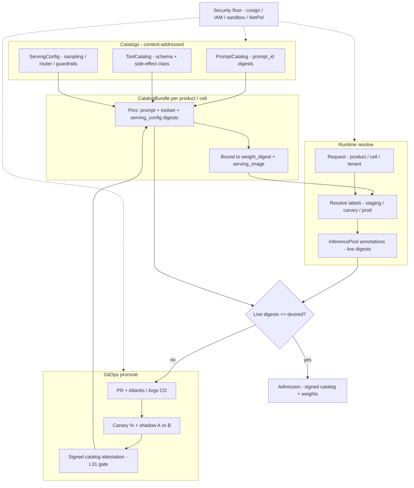

# Lesson 33 — AI/ML platform: prompt/tool catalog versioning & serving config as code at fleet scale

*2026-10-11*

## What interviewers are really probing

[Lesson 31](/lessons/31-evaluation-release-gating-canary-weights) and [Lesson 32](/lessons/32-offline-online-eval-consistency-llm-judge) made the gate trustworthy: signed eval attestations, offline↔online calibration, pinned judges and rubrics. That gate still lies when the **prompt, tool schema, or serving knobs** that produced the score are not the ones live tomorrow. A one-line system-prompt edit, a new `tools[]` allowlist entry, or a temperature bump in a ConfigMap is a **model release** in everything but name — and most fleets still treat those as chat scratchpads.

This lesson is the operator layer that makes templates, tool catalogs, and serving config **production config**: content-addressed digests, GitOps promotion with canary, binding to weight + serving-image digests so L31/L32 stay reproducible, multi-tenant catalogs per product/cell, and a security floor that refuses unsigned prompts/tools/configs the same way it refuses unsigned weights ([L12](/lessons/12-node-container-hardening-supply-chain)–[L14](/lessons/14-ml-inference-training-deploy-hardening), [L27](/lessons/27-gpu-supply-chain-weight-registry-hydrate)).

Cross-links: [L21](/lessons/21-inference-serving-slos-ttft-tpot-kvcache) (sampling and stack are quality), [L24](/lessons/24-multi-cluster-inference-routing-capacity) (cells — no fleet-wide blast radius), [L15](/lessons/15-terraform-atlantis-fleet-scale)/[L16](/lessons/16-temporal-argo-workflows) (GitOps / pipelines), [L13](/lessons/13-ml-weights-checkpoint-hardening). Fuel: [wafer-ai/gpu-perf-engineering-resources](https://github.com/wafer-ai/gpu-perf-engineering-resources) — platform depth, not CUDA.

What they check for:

- **Prompts are config.** System prompts, chat templates, few-shot packs, structured-output schemas — versioned, digested, reviewed, canaried. Not strings in a Jupyter cell.
- **Tool catalogs are contracts.** OpenAPI/JSON-Schema digests, allowlists, side-effect classes, sandbox policies. Changing a tool signature is a breaking API change for every agent that calls it.
- **Serving knobs as code.** Temperature, top-p, max tokens, stop sequences, router policies, guardrail configs — pinned next to the weight digest, not "defaults in the Deployment env."
- **Runtime resolution.** `request → (product, cell, tenant) → catalog_ver → prompt_id + toolset_id + serving_config_id → pinned digests` bound to weight + serving image.
- **Drift & shadow.** Live pods vs desired CatalogBundle; shadow-compare template A vs B on the same request IDs (L32 pattern).
- **Security.** Signing/provenance for catalog artifacts, bucket/registry IAM, secrets never in templates, tool sandbox/network isolation, admission so only signed catalog digests bind to signed weights, injection & exfil via tools.

**Interview sentence:** "I treat prompts, tool schemas, and serving knobs as content-addressed production config. Every request resolves a CatalogBundle for its product and cell — prompt digest, toolset digest, serving-config digest — and those digests are bound to the weight and serving-image digests that L31/L32 already pin. Promotion is GitOps with canary and a signed attestation; admission refuses unsigned catalog objects the same way it refuses unsigned weights. Tools run in sandboxes with side-effect classes and default-deny egress, and CI scans templates for secrets before anything can be labeled production."

## Core diagram: Catalogs → Bundle → Runtime resolve → Canary (+ security floor)

![Prompt/tool catalog versioning and serving config as code at fleet scale: content-addressed prompt catalog, tool catalog with schemas and side-effect classes, and serving-config knobs feed a CatalogBundle that pins digests bound to weight and serving-image digests; runtime resolution maps request to product/cell/tenant catalogs; GitOps canary promotes labeled digests; drift detection compares live pods to desired; security floor covers signing, IAM, secrets scanning, tool sandbox isolation and admission](/prompt-tool-catalog-versioning-serving-config.png)



**How to read it:** left is three immutable catalogs; the middle is the per-product/cell bundle that binds them to weights; right is request-time resolution and drift. Promotion is a label move backed by eval attestation, not a silent ConfigMap edit. The PNG packs SLIs, canary waves and the security floor.

## Idiosyncrasies / operator depth

### 1. Three catalogs, one contract — never promote one without the others

| Catalog | Identity | What changes it | Must also re-gate |
|---|---|---|---|
| **Prompt** | `prompt_id` + content sha256 | System text, chat template, few-shots, output schema prose | Offline suite + paired shadow (L31/L32); judge cache keys include `prompt_digest` |
| **Tool** | `toolset_id` + schema sha256 | JSON-Schema / OpenAPI, allowlist, side-effect class, sandbox policy | Tool-use slices; agent simulators; deny-path tests for new write tools |
| **Serving config** | `serving_config_id` + knobs sha256 | Temperature, top-p, max tokens, stop, structured-output schema, router, guardrails | Quality **and** length/latency SLOs ([L21](/lessons/21-inference-serving-slos-ttft-tpot-kvcache)) |

The **CatalogBundle** is the unit of promotion: `{prompt_digest, toolset_digest, serving_config_digest, weight_digest, serving_image_digest, catalog_ver}`. Promoting a prompt alone while leaving tools and sampling floating is how "offline green, online red" happens in L32.

### 2. Labels are pointers; digests are truth

Uber-style and Langfuse-style registries get this right: immutable versions, movable labels (`staging`, `canary`, `production`). Runtime code asks for **label**; audit and eval pin **digest**. Rules that keep you honest:

1. **Never** put a mutable tag (`:latest`, `:prod`) in an InferencePool or Job. Always `@sha256:…`.
2. Label moves are GitOps commits (or attested API calls) with reviewers from eval-platform + product — not a UI click with no trail.
3. Client-side caches of labeled prompts need an explicit TTL and a "pin digest for this request" path for eval/canary (otherwise L32's paired shadow scores the wrong template).
4. Rollback = move `production` back to the prior digest. That must be faster than a full service redeploy — minutes, not hours.

### 3. Multi-tenant / multi-cell — blast radius is a design choice

At [L24](/lessons/24-multi-cluster-inference-routing-capacity) cell scale you do **not** ship one global prompt:

| Dimension | Practice |
|---|---|
| **Per-product** | Separate PromptCatalog / ToolCatalog namespaces or prefixes; product SA cannot `GetObject` another product's catalog |
| **Per-cell** | CatalogBundle can override for a cell (locale, compliance, SKU mix) without fleet-wide rollout |
| **Canary wave** | First cell → holdout cell truth → remaining cells ([L24](/lessons/24-multi-cluster-inference-routing-capacity), [L31](/lessons/31-evaluation-release-gating-canary-weights)) |
| **Sticky traffic** | Canary % sticky by conversation ID so users don't flip mid-thread between template A and B |
| **Feature flags** | OpenFeature / flagd for percentage; CatalogBundle digest still pinned — flags choose *which* digest, they don't invent config |

### 4. Tool catalogs — schemas are APIs; side-effects are threat models

| Concern | Practice |
|---|---|
| **Schema digest** | Every tool's JSON-Schema / OpenAPI fragment is content-addressed; agents pin `toolset_digest` |
| **Allowlist** | Product × role × cell allowlist; adding a tool is a PR with security review if side-effect ≥ write |
| **Side-effect class** | `read` / `write` / `money` / `admin` — guardrails and human-in-the-loop thresholds keyed off class |
| **Sandbox** | Tool runners: no direct egress, proxy-only, own workload identity, read-only FS where possible (L34 teaser) |
| **Injection** | Model output that becomes tool args is **untrusted input**; validate against schema; never `eval`; log redacted args |
| **Shadow** | Online shadow stubs write/money/admin tools — never mutate prod from a shadow path ([L31](/lessons/31-evaluation-release-gating-canary-weights)) |

### 5. Runtime resolution & drift

```
request
  → gateway extracts (product, cell, tenant)
  → CatalogBundleResolver → catalog_ver + three digests
  → fetch OCI/ConfigMap @ sha256 (cached)
  → inject into serving request + span attributes
  → DriftController compares pod annotations to desired Bundle
```

Prometheus names (illustrative): `catalog_resolve_latency_seconds`, `catalog_digest_drift`, `catalog_unsigned_reject_total`, `prompt_canary_quality_delta`, `tool_side_effect_denied_total`, `serving_config_mismatch`.

Alert when live ≠ desired for > 2 minutes — that is a failed rollout or a hand-edited ConfigMap, both pages.

### 6. Ownership

Eval / ML platform owns catalog CRDs, signing keys, admission, and the Bundle schema. Product owns prompt *content* and tool allowlists for their surface. Security owns side-effect class policy and sandbox baselines. On-call owns canary abort. Nobody pastes a new system prompt into a live Deployment env var.

## Concrete commands & config

### CatalogBundle — the unit of promotion

```yaml
# catalog-bundle.yaml — pins everything L31/L32 need to reproduce a score
apiVersion: catalog.corp/v1
kind: CatalogBundle
metadata:
  name: support-agent-us-east
  namespace: serve-support
  labels:
    catalog.corp/product: support-agent
    catalog.corp/cell: us-east
spec:
  catalogVer: "2026.10.11-rc3"
  prompt:
    id: support-system
    digest: "sha256:a11ce…"          # PromptCatalog object
    label: canary                    # movable pointer; digest is truth
  toolset:
    id: support-tools-v4
    digest: "sha256:70015…"
  servingConfig:
    id: support-serve-default
    digest: "sha256:5c0nf…"
  weightDigest: "sha256:9f3c…"       # L27 OCI weights
  servingImage: "registry.corp/vllm@sha256:77aa…"
  canary:
    percent: 5
    stickyBy: conversation_id
    shadowCompare:
      baselinePromptDigest: "sha256:b0ld…"
      sampleRate: 0.1
```

### PromptCatalog + ServingConfig CRDs (sketch)

```yaml
apiVersion: catalog.corp/v1
kind: PromptCatalog
metadata: {name: support-system, namespace: catalog}
spec:
  versions:
  - digest: "sha256:a11ce…"
    templateUri: "oci://registry.corp/catalog/prompts/support-system@sha256:a11ce…"
    variables: [locale, product_tier]   # typed; no secret refs allowed
    createdBy: "https://kubernetes.io/namespaces/catalog/serviceaccounts/catalog-release"
---
apiVersion: catalog.corp/v1
kind: ServingConfig
metadata: {name: support-serve-default, namespace: catalog}
spec:
  digest: "sha256:5c0nf…"
  sampling: {temperature: 0.2, topP: 0.95, maxTokens: 2048}
  stop: ["</answer>"]
  structuredOutput:
    schemaDigest: "sha256:5ch3m…"     # JSON Schema for response_format
  router:
    policy: least-ttft
    fallbackModel: "sha256:fb01…"
  guardrails:
    configDigest: "sha256:gu4rd…"
```

### ToolCatalog with side-effect classes

```json
{
  "toolset_id": "support-tools-v4",
  "digest": "sha256:70015…",
  "tools": [
    {
      "name": "get_order",
      "schema_digest": "sha256:0rd3r…",
      "side_effect": "read",
      "sandbox": {"egress": "none", "identity": "tool-runner-support"}
    },
    {
      "name": "refund_order",
      "schema_digest": "sha256:r3fnd…",
      "side_effect": "money",
      "requires_human_approval_above_usd": 50,
      "sandbox": {"egress": "payments-proxy-only", "identity": "tool-runner-payments"}
    }
  ],
  "allowlist": {
    "product": "support-agent",
    "roles": ["agent", "supervisor"]
  }
}
```

### Resolve at the gateway (illustrative)

```python
# resolve.py — every serving request records digests for L32 judge cache + audit
def resolve_bundle(product: str, cell: str, tenant: str) -> dict:
    b = catalog.get_bundle(product=product, cell=cell, tenant=tenant)
    # Always materialize digests — never trust a floating label at score time
    return {
        "catalog_ver": b.catalog_ver,
        "prompt_digest": b.prompt.digest,
        "toolset_digest": b.toolset.digest,
        "serving_config_digest": b.serving_config.digest,
        "weight_digest": b.weight_digest,
        "serving_image": b.serving_image,
    }
```

### cosign: sign & verify catalog OCI artifacts

```bash
# Release job signs the prompt/tool/config package (same identity pattern as L27/L31).
cosign sign \
  --certificate-identity "https://kubernetes.io/namespaces/catalog/serviceaccounts/catalog-release" \
  --certificate-oidc-issuer "https://oidc.eks.us-east-1.amazonaws.com/id/EXAMPLE" \
  registry.corp/catalog/prompts/support-system@sha256:a11ce…

cosign attest --predicate bundle-attestation.json \
  --type https://corp.example/attestations/catalog-bundle/v1 \
  registry.corp/catalog/bundles/support-agent-us-east@sha256:bund1e…

# Serving / admission verifies before binding to weights.
cosign verify \
  --certificate-identity "https://kubernetes.io/namespaces/catalog/serviceaccounts/catalog-release" \
  --certificate-oidc-issuer "https://oidc.eks.us-east-1.amazonaws.com/id/EXAMPLE" \
  registry.corp/catalog/prompts/support-system@sha256:a11ce…
```

### Drift detection (kubectl + PromQL)

```bash
# Desired digests from CatalogBundle vs live InferencePool pod annotations
kubectl get catalogbundle support-agent-us-east -n serve-support -o jsonpath='{.spec.prompt.digest}{"\n"}'
kubectl get pods -n serve-support -l app=vllm \
  -o jsonpath='{range .items[*]}{.metadata.name}{"\t"}{.metadata.annotations.catalog\.corp/prompt-digest}{"\n"}{end}'
```

```promql
# Page when any serving pod's annotated digest diverges from desired Bundle
catalog_digest_drift{namespace=~"serve-.*", kind="prompt"} > 0
```

### Kyverno: refuse unsigned catalog digests on serving pods

```yaml
apiVersion: kyverno.io/v1
kind: ClusterPolicy
metadata: {name: require-signed-catalog-bundle}
spec:
  validationFailureAction: Enforce
  rules:
  - name: catalog-and-weights-attested
    match:
      any:
      - resources:
          kinds: [Pod]
          namespaces: ["serve-*"]
          selector:
            matchLabels: {platform.example.com/role: inference}
    verifyImages:
    - imageReferences: ["registry.corp/catalog/*", "registry.corp/models/*"]
      verifyDigest: true
      required: true
      attestors:
      - entries:
        - keyless:
            subject: "https://kubernetes.io/namespaces/catalog/serviceaccounts/catalog-release"
            issuer: "https://oidc.eks.us-east-1.amazonaws.com/id/EXAMPLE"
      attestations:
      - type: https://corp.example/attestations/catalog-bundle/v1
        attestors:
        - entries:
          - keyless:
              subject: "https://kubernetes.io/namespaces/catalog/serviceaccounts/catalog-release"
              issuer: "https://oidc.eks.us-east-1.amazonaws.com/id/EXAMPLE"
```

### CI: secret scan + schema check before label move

```bash
# Fail the PR if a template contains secret-like material or undeclared variables
gitleaks detect --source ./catalog/prompts --verbose
python -m catalog_ci.check_no_secret_refs ./catalog/prompts
python -m catalog_ci.validate_tool_schemas ./catalog/tools
# Eval gate (L31) must name the new digests — unsigned label move blocked in Atlantis
atlantis plan -p catalog-support
```

### S3/GCS IAM sketch (catalog artifacts ≠ training; write = release only)

```json
{
  "Version": "2012-10-17",
  "Statement": [
    {
      "Sid": "CatalogReleaseWrite",
      "Effect": "Allow",
      "Principal": {"AWS": "arn:aws:iam::123:role/catalog-release"},
      "Action": ["s3:PutObject", "s3:GetObject"],
      "Resource": "arn:aws:s3:::corp-catalog/prompts/*"
    },
    {
      "Sid": "ServingReadOnly",
      "Effect": "Allow",
      "Principal": {"AWS": "arn:aws:iam::123:role/inference-sa-*"},
      "Action": ["s3:GetObject"],
      "Resource": "arn:aws:s3:::corp-catalog/prompts/*"
    },
    {
      "Sid": "DenyCrossProductRead",
      "Effect": "Deny",
      "Principal": {"AWS": "arn:aws:iam::123:role/inference-sa-payments"},
      "Action": ["s3:GetObject"],
      "Resource": "arn:aws:s3:::corp-catalog/prompts/support-*"
    }
  ]
}
```

Pair with Object Lock on promoted digests, KMS per product prefix, and registry immutability tags so a compromised serving SA cannot overwrite a prompt object even with a stolen write path.

## Failures & fixes

| Symptom | Likely cause | Fix / mitigation |
|---|---|---|
| Offline green, online quality cliff after "prompt tweak" | Template not in CatalogBundle / not digest-pinned | Bundle is unit of promotion; L31 attestation lists `prompt_digest`; treat as model release |
| Canary looks good, fleet red after full promote | Cell mix; one cell's CatalogBundle override missing | Per-cell waves; holdout cell; sticky conversation IDs ([L24](/lessons/24-multi-cluster-inference-routing-capacity)) |
| Judge cache hits wrong scores after prompt edit | `prompt_digest` missing from L32 cache key | Cache key = `(prompt_hash, cand, judge, rubric, prompt_digest, toolset_digest, serving_config_digest)` |
| Agent calls a tool that should be denied | Allowlist not bound to toolset digest; floating schema | Pin toolset; admission + gateway enforce allowlist; deny-path CI tests |
| Refunds fire from shadow traffic | Shadow path not stubbing money/admin tools | Shadow stubs all side-effect ≥ write; NetPol blocks payments-proxy from shadow NS |
| Live pods ≠ Bundle for 20 minutes | Hand-edited ConfigMap; broken reconciler | Drift alert at 2m; GitOps-only writes; immutable annotations |
| Temperature changed, TTFT/length SLO burned | ServingConfig not gated on latency/length | Gate serving-config changes on L21 SLOs + quality; canary on both |
| Secret API key found in system prompt | Author pasted credential into template | gitleaks + deny `{{secret}}` in CI; External Secrets at runtime only |
| Unsigned prompt served | Admission only on weights, not catalog | Kyverno verifyImages on `registry.corp/catalog/*`; CI deny-path |
| Cross-tenant prompt bleed | Shared bucket prefix; over-broad IAM | Per-product KMS + Deny; separate catalog namespaces |
| Label `production` moved without eval | UI/API promote without attestation | Atlantis/Argo policy: label move requires L31 catalog-bundle attestation |
| Rollback took a full redeploy | Digests baked into image, not Bundle | Runtime resolve from Bundle; rollback = prior Bundle revision |
| Tool schema drift vs agent code | Agent pins name not digest | Agents depend on `toolset_digest`; break build on schema incompatibility |

## Security & hardening

**Catalog artifacts are supply chain.** A malicious or unsigned system prompt is as dangerous as a malicious weight: it can exfiltrate via tool calls, jailbreak guardrails, or leak secrets embedded by a well-meaning author. Apply [L11](/lessons/11-cluster-security-pss-admission-rbac)–[L14](/lessons/14-ml-inference-training-deploy-hardening), [L12](/lessons/12-node-container-hardening-supply-chain) signing, and [L27](/lessons/27-gpu-supply-chain-weight-registry-hydrate) provenance explicitly to prompts, tool schemas, and serving configs.

### Signing, provenance & admission

| Control | Threat | Practice |
|---|---|---|
| **Catalog OCI signed** | Unsigned / swapped prompt or tool schema | cosign / OpenSSF; CatalogBundle attestation names all three digests + weight + image; serving references `@sha256:` only |
| **Admission binds catalog ↔ weights** | Signed weights + unsigned prompt (or vice versa) | Kyverno/OPA: InferencePool may run only when catalog-bundle attestation and weight attestation both verify and name each other |
| **Immutable registry** | Overwrite of a promoted digest | Registry immutability + Object Lock; separate `catalog/released/` prefix write-only by `catalog-release` SA |
| **Provenance** | Mystery prompt in prod | SLSA provenance on catalog build; `createdBy` identity in CRD; audit every label move |

### Bucket / registry IAM

| Control | Threat | Practice |
|---|---|---|
| **Write = release only** | Compromised product SA ships a prompt | `PutObject` only for `catalog-release`; serving SAs `GetObject` only |
| **Per-product isolation** | Tenant A reads tenant B's system prompt / tools | Prefix + KMS per product; explicit Deny cross-product; separate namespaces |
| **No training read** | Train jobs scrape production prompts for leakage into weights | Deny `trainer-*` on catalog buckets (mirror L32 golden-set Deny) |

### Secrets in templates

| Control | Threat | Practice |
|---|---|---|
| **CI secret scan** | API keys, tokens, internal URLs in prompt text | gitleaks / trufflehog on `catalog/`; fail PR |
| **No secret refs in templates** | `{{vault.db_password}}` rendered into model context | Schema allows only declared variables; deny secret-provider paths; inject secrets into **tool runners**, never into prompts |
| **Redaction** | Prod logs contain prompt+PII | Redact at gateway; classify prompt logs like user data; short TTL |

### Tool sandbox, network isolation, injection & exfil

| Control | Threat | Practice |
|---|---|---|
| **Sandbox baseline** | Tool runner reaches internet / metadata / sibling tenants | Default-deny NetworkPolicy; DNS + approved proxies only; no cloud metadata; `automountServiceAccountToken: false` unless needed |
| **Side-effect class enforcement** | Model socially engineers a `money`/`admin` call | Gateway refuses tools not in allowlist; human approval thresholds; shadow stubs write+ |
| **Args are untrusted** | Prompt injection → malicious tool args | JSON-Schema validate; allowlist enums; parameterized queries only; never shell out on model text |
| **Exfil via tools** | "Summarize and POST to attacker URL" | Egress allowlist; block arbitrary URLs in tool schemas; DLP on tool payloads |
| **mTLS + identity** | Spoofed tool runner | Workload identity per tool class; mesh mTLS ([L10](/lessons/10-service-mesh-istio-linkerd-mtls)) |

```yaml
# Tool-runner egress — payments proxy only (money class)
apiVersion: networking.k8s.io/v1
kind: NetworkPolicy
metadata: {name: tool-runner-payments-egress, namespace: tools-payments}
spec:
  podSelector: {matchLabels: {tool.corp/class: money}}
  policyTypes: [Egress]
  egress:
  - to:
    - namespaceSelector: {matchLabels: {kubernetes.io/metadata.name: kube-system}}
      podSelector: {matchLabels: {k8s-app: kube-dns}}
    ports: [{protocol: UDP, port: 53}]
  - to:
    - namespaceSelector: {matchLabels: {platform.example.com/role: payments-proxy}}
    ports: [{protocol: TCP, port: 8443}]
```

### RBAC & separation of duties

Authors propose Bundle PRs; eval-platform + security approve label moves to `production`; break-glass overrides are signed, logged, and expire. Product cannot approve its own `money`-class tool additions without security review.

## Interview soundbites

- **"Prompts, tool schemas, and serving knobs are content-addressed production config. The CatalogBundle is the unit of promotion — three digests bound to weight and serving-image digests."**
- **"Labels are pointers; digests are truth. Runtime may resolve `production`; eval and audit always pin sha256."**
- **"A one-line system-prompt edit is a model release. It goes through GitOps, canary, and an L31 attestation that names the new prompt digest."**
- **"Tools are APIs with side-effect classes. Adding a write or money tool is a security review, not a ConfigMap tweak."**
- **"Shadow traffic never mutates prod — money/admin tools are stubbed; NetPol enforces it."**
- **"Drift alert at two minutes: live pod annotations must match the desired Bundle, or we page."**
- **"Admission refuses unsigned catalog objects the same way it refuses unsigned weights — and the attestation binds catalog digests to weight digests."**
- **"Secrets never live in templates; CI fails the PR, and tool runners get credentials via workload identity."**
- **"Next: Lesson 34 — agent/tool sandboxing, side-effect controls and egress policy at fleet scale."**

## How this maps to the JD

Roles that say **"LLMOps," "prompt management at scale," "tool calling infrastructure," "config-as-code for GenAI,"** or **"ship agents safely across cells"** are asking whether you can make the non-weight half of the serving contract as rigorous as the weight half. This lesson connects [L31](/lessons/31-evaluation-release-gating-canary-weights)/[L32](/lessons/32-offline-online-eval-consistency-llm-judge) (gates that pin digests), [L27](/lessons/27-gpu-supply-chain-weight-registry-hydrate) (signed artifacts), [L21](/lessons/21-inference-serving-slos-ttft-tpot-kvcache) (knobs = quality/latency), [L24](/lessons/24-multi-cluster-inference-routing-capacity) (cells), [L15](/lessons/15-terraform-atlantis-fleet-scale)/[L16](/lessons/16-temporal-argo-workflows) (GitOps), and [L12](/lessons/12-node-container-hardening-supply-chain)–[L14](/lessons/14-ml-inference-training-deploy-hardening) (signing/hardening). Fuel: [wafer-ai/gpu-perf-engineering-resources](https://github.com/wafer-ai/gpu-perf-engineering-resources).

## Watch (talks & demos)

Real talks. Watch them after Failures & fixes.

### The New Stack and Ops for AI

OpenAI. Grounding with knowledge + **tools**, function calling into your own microservices, orchestration for scale/cost/latency, and the LLMOps framing (observability, security/compliance, eval velocity). Operator takeaway: tools and prompts are part of the production stack — not app-layer afterthoughts — which is exactly why they belong in versioned catalogs bound to serving config.

<iframe width="100%" height="360" src="https://www.youtube.com/embed/XGJNo8TpuVA" title="The New Stack and Ops for AI - OpenAI" frameBorder="0" allow="accelerometer; autoplay; clipboard-write; encrypted-media; gyroscope; picture-in-picture; web-share" allowFullScreen></iframe>

[Open on YouTube](https://www.youtube.com/watch?v=XGJNo8TpuVA)

### Infrastructure for Long Running Agents

Ankit Goyal (LinkedIn AI Platforms), Berkeley RDI. Agents as untrusted workloads: **no egress, no credentials, proxy-only communication**, harness-as-code, warm GPU pools, restricted sandboxes. Operator takeaway: section 6's tool sandbox / NetworkPolicy / side-effect class model — and why "the model asked for it" is not authorization.

<iframe width="100%" height="360" src="https://www.youtube.com/embed/FJUrsZn1BSI" title="Infrastructure for Long Running Agents - Ankit Goyal, LinkedIn" frameBorder="0" allow="accelerometer; autoplay; clipboard-write; encrypted-media; gyroscope; picture-in-picture; web-share" allowFullScreen></iframe>

[Open on YouTube](https://www.youtube.com/watch?v=FJUrsZn1BSI)

### Build Hour: Agentic Tool Calling

OpenAI. Practical tool-calling patterns: registering tools, routing hard work to stronger models, keeping a thin interactive loop while background tool tasks run. Operator takeaway: tool schemas and allowlists are product surfaces you version — the Build Hour is the app-level view of what our ToolCatalog digests formalize at fleet scale.

<iframe width="100%" height="360" src="https://www.youtube.com/embed/7E-qdsVEoB8" title="Build Hour: Agentic Tool Calling - OpenAI" frameBorder="0" allow="accelerometer; autoplay; clipboard-write; encrypted-media; gyroscope; picture-in-picture; web-share" allowFullScreen></iframe>

[Open on YouTube](https://www.youtube.com/watch?v=7E-qdsVEoB8)

Also read (not a YouTube embed, but high-signal): [Uber Engineering — Introducing the Prompt Engineering Toolkit](https://www.uber.com/us/en/blog/introducing-the-prompt-engineering-toolkit/) (Sishi Long et al.) — code-reviewed prompt revisions, etcd/UCS deploy, eval before production label. Talk recording: [AI in Production 2025 / MLOps Community](https://home.mlops.community/public/videos/introducing-the-prompt-engineering-toolkit-sishi-long-ai-in-production-2025-2025-03-17).

## References

- Prompt / catalog practice: [Uber Prompt Engineering Toolkit](https://www.uber.com/us/en/blog/introducing-the-prompt-engineering-toolkit/) · [Langfuse prompt management / labels](https://langfuse.com/docs/prompts) · [OpenAI: move prompts into source / Git](https://developers.openai.com/api/docs/guides/prompting/migrate-from-prompt-object) · [Agent patterns: prompt versioning](https://github.com/agentpatternscatalog/patterns/blob/main/patterns/prompt-versioning.md)
- Tools & agents: [OpenAI function calling / tools](https://platform.openai.com/docs/guides/function-calling) · [The New Stack and Ops for AI](https://www.youtube.com/watch?v=XGJNo8TpuVA) · [Infrastructure for Long Running Agents (Goyal)](https://www.youtube.com/watch?v=FJUrsZn1BSI) · [Build Hour: Agentic Tool Calling](https://www.youtube.com/watch?v=7E-qdsVEoB8)
- GitOps / config: [Argo CD](https://argo-cd.readthedocs.io/) · [Atlantis](https://www.runatlantis.io/) · [OpenFeature](https://openfeature.dev/) · [Kyverno verifyImages](https://kyverno.io/docs/writing-policies/verify-images/)
- Security & provenance: [cosign attestations](https://docs.sigstore.dev/cosign/verifying/attestation/) · [OpenSSF model signing](https://github.com/sigstore/model-transparency) · [SLSA provenance](https://slsa.dev/spec/v1.0/provenance) · [gitleaks](https://github.com/gitleaks/gitleaks)
- [wafer-ai/gpu-perf-engineering-resources](https://github.com/wafer-ai/gpu-perf-engineering-resources) — AI/ML platform fuel
- Prior: [32 — Offline/online eval / LLM-as-judge](/lessons/32-offline-online-eval-consistency-llm-judge) · [31 — Evaluation / release gating / canary](/lessons/31-evaluation-release-gating-canary-weights) · [27 — GPU supply chain / hydrate](/lessons/27-gpu-supply-chain-weight-registry-hydrate) · [24 — Multi-cluster routing](/lessons/24-multi-cluster-inference-routing-capacity) · [21 — Inference SLOs](/lessons/21-inference-serving-slos-ttft-tpot-kvcache) · [16 — Temporal / Argo](/lessons/16-temporal-argo-workflows) · [15 — Terraform / Atlantis](/lessons/15-terraform-atlantis-fleet-scale) · [14 — ML deploy hardening](/lessons/14-ml-inference-training-deploy-hardening) · [13 — ML weights](/lessons/13-ml-weights-checkpoint-hardening) · [12 — Supply chain / signing](/lessons/12-node-container-hardening-supply-chain) · [11 — PSS / admission / RBAC](/lessons/11-cluster-security-pss-admission-rbac) · [10 — Service mesh / mTLS](/lessons/10-service-mesh-istio-linkerd-mtls) · [9 — NetworkPolicy](/lessons/09-networkpolicy-multi-nic-sflow)
- Next: **Lesson 34 — AI/ML platform: agent/tool sandboxing, side-effect controls & egress policy at fleet scale**

## Quick self-check

Out loud, in under two minutes each:

1. A PM pastes a new system prompt into a Deployment env var on Friday. What breaks in L31/L32 reproducibility, and what CatalogBundle design would have prevented it?
2. Design the cache key for online judges so a toolset schema change cannot silently reuse scores from the previous schema.
3. You add a `refund_order` tool (side-effect: money). Walk the controls: schema digest, allowlist PR, sandbox NetPol, human-approval threshold, shadow stub, admission.
4. Live `catalog.corp/prompt-digest` annotations disagree with the CatalogBundle for 15 minutes in one cell. What do you page on, and how do you roll back without redeploying vLLM?
5. Sketch IAM + Kyverno so (a) only `catalog-release` can write prompts, (b) payments inference cannot read support prompts, (c) unsigned catalog digests cannot bind to signed weights.
