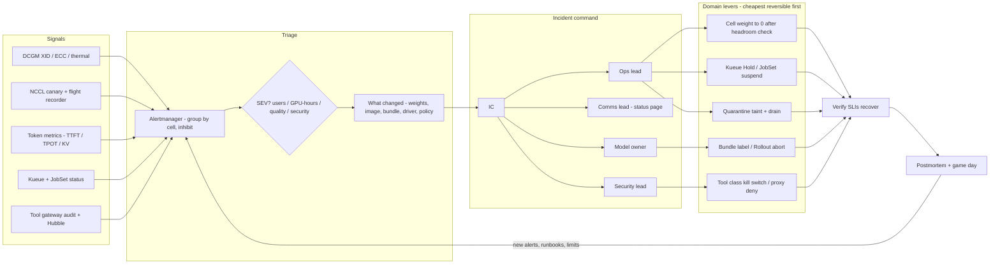

# Lesson 35 — AI/ML platform: fleet-wide incident response & on-call runbooks for GPU, inference and agent workloads

*2026-10-13*

## What interviewers are really probing

Lessons 18–34 built the machine: GPU pools and topology ([L18](/lessons/18-gpu-node-pools-mig-timeslicing)/[L19](/lessons/19-gpu-topology-nvlink-rdma-nccl)), serving SLOs ([L21](/lessons/21-inference-serving-slos-ttft-tpot-kvcache)), PD/MoE ([L22](/lessons/22-prefill-decode-disagg-moe-serving)), eyes ([L23](/lessons/23-gpu-observability-dcgm-nccl-roofline)), cells ([L24](/lessons/24-multi-cluster-inference-routing-capacity)), weights ([L27](/lessons/27-gpu-supply-chain-weight-registry-hydrate)), autoscaling ([L28](/lessons/28-inference-autoscaling-scale-to-zero)), training reliability ([L29](/lessons/29-training-reliability-checkpoint-elastic)/[L30](/lessons/30-training-data-loading-storage-io)), release gates ([L31](/lessons/31-evaluation-release-gating-canary-weights)–[L33](/lessons/33-prompt-tool-catalog-versioning-serving-config)) and sandboxes ([L34](/lessons/34-agent-tool-sandboxing-egress-policy)). This lesson is about **3 a.m. on a Saturday**, when one of those pieces breaks on 10K nodes and you are the one holding the pager.

The interview version is usually a scenario: *"TTFT p99 just tripled in one region"*, *"a 4K-GPU training run has hung for 40 minutes"*, *"security says an agent emailed a customer list somewhere"*. They are not checking whether you know what a GPU is. They want to see whether you can **run** an incident: size it, contain it without making it bigger, mitigate before you root-cause, talk to people while it's happening, and leave the fleet better afterwards.

Cross-links: [L1](/lessons/01-hyperscale-mental-model) (cells = blast radius), [L2](/lessons/02-k8s-control-plane) (control-plane overload, APF), [L8](/lessons/08-cni-cilium-ebpf)–[L11](/lessons/11-cluster-security-pss-admission-rbac) (Cilium/Hubble, NetworkPolicy, mTLS, RBAC/admission), [L13](/lessons/13-ml-weights-checkpoint-hardening)/[L14](/lessons/14-ml-inference-training-deploy-hardening) (weight + deploy hardening), [L15](/lessons/15-terraform-atlantis-fleet-scale)/[L16](/lessons/16-temporal-argo-workflows) (GitOps + workflow rollbacks), and every lesson from 19 to 34. Fuel: [wafer-ai/gpu-perf-engineering-resources](https://github.com/wafer-ai/gpu-perf-engineering-resources): platform depth, not CUDA.

What they check for:

- **Severity on ML-specific axes.** Users affected and SLO burn, yes. But also **GPU-hours burning** (a hung 16K-GPU job at about $2/GPU-hr wastes about $32K an hour with zero user impact), **model-quality** incidents (bad weights that are fast and wrong), and **security** incidents (weight exfil, unapproved side effects), which are SEV1 regardless of latency.
- **Mitigate first, diagnose second.** Do you reach for the fastest reversible lever (a route weight, a CatalogBundle label, a Kueue hold, a kill switch) before you open `dmesg`?
- **Command structure.** IC / Ops / Comms (Google IMAG), plus the ML roles: model/release owner, capacity lead, security lead. Who decides to roll back weights?
- **Domain runbooks.** GPU hardware (XID/ECC/NVLink/thermal), inference SLO collapse (KV pressure, preemption storms, PD imbalance), training storms (hangs, checkpoint storms, stragglers), agent sandbox blowups (egress spikes, injection), release incidents (bad canary, registry outage, hydrate storm), and cell failures.
- **Blast-radius discipline.** Do you know that automation can be the outage (a remediation controller cordoning half a cell because of a bad exporter), and that a careless failover can push a second cell over?
- **Incident-time security.** Break-glass that is time-boxed and audited, containment that **narrows** access instead of widening it, evidence preserved, no "just make the bucket public so the hydrate works."

**Interview sentence:** "I run ML platform incidents like any SRE incident, with IMAG roles, SLO-burn paging and mitigate-before-root-cause, and I add three ML-specific axes: GPU-hours burning, model quality, and security side effects. Every runbook starts with 'what changed' across weights, serving image, CatalogBundle, driver, node image and policy. Then I pull the cheapest reversible lever with the smallest blast radius: drain one cell after checking headroom, flip a bundle label, hold a Kueue queue, or kill-switch a tool class. Automation gets rate limits so it can't become the outage. Break-glass is time-boxed, two-person and audited, and containment always narrows access. I never fix a hydrate by turning off signature checks or widening bucket IAM."

## Core diagram: Signals → Triage & SEV → Incident command → Domain levers → Verify → Learn (+ security floor)

![Fleet-wide incident response for an AI/ML platform: signals from DCGM, NCCL canaries, vLLM token metrics, Kueue, gateway audit and Hubble flow into alert routing with grouping and inhibition; triage assigns a SEV using user impact, GPU-hours burning, model quality and security; an incident commander with ops, comms, model owner, capacity and security leads chooses domain levers for GPU hardware, inference SLOs, training storms, agent sandboxes, weights and release, and multi-cell traffic; mitigations are verified against SLIs and feed postmortems and game days; the security floor covers break-glass, audit, signed rollback targets, bucket IAM, secrets, network quarantine and admission](/fleet-incident-response-gpu-inference-agent-runbooks.png)



**How to read it:** signals come in from the left already grouped per cell, so 400 nodes throwing XIDs open one incident, not 400 pages. Triage decides severity on four axes and asks what changed. The IC hands out levers by role: Ops owns traffic, queues and nodes, the model owner owns weight and bundle rollback, and security owns kill switches. Every lever is reversible and scoped to a cell or tenant. The loop closes with postmortems that produce new alerts, runbook steps and automation limits. The PNG adds the per-domain runbooks, SLIs and the incident-time security floor.

## Idiosyncrasies / operator depth

### 1. A SEV matrix for ML platforms (impact is four-dimensional)

| SEV | User / SLO | GPU-hours / capacity | Model quality | Security | Response |
|---|---|---|---|---|---|
| **SEV1** | Inference SLO breach in more than one cell or a whole region; global API errors | Flagship training run down and recovery blocked; more than 20% of fleet GPUs unschedulable | Bad weights serving at more than canary %; harmful or wrong outputs at scale | Confirmed weight/checkpoint exfil; `money`/`admin` side effect without approval; sandbox escape | Page IC + domain on-call + security now; status page within 15 min; exec comms |
| **SEV2** | One cell burning fast (14.4× over 1h); a premium tenant degraded | Large job hung or ETTR dropping sharply; registry down with scale-out blocked | Canary regression detected and live at 5% | Prompt-injection with attempted exfil blocked at the proxy; credential exposure suspected | Page domain on-call; IC if it crosses teams; status page if external users see it |
| **SEV3** | Slow burn (1× over 3 days); one model degraded on one SKU | Straggler slowing a job; one node pool short; eval backlog | Eval drift with no live impact | Policy denials spiking for one tenant | Ticket, business hours, owner named |
| **SEV4** | None | Single-GPU XID that auto-remediation already handled | None | None | Dashboard + weekly review (remediation-rate trends) |

Two rules interviewers like hearing. First, **security and quality incidents don't wait for latency**: a model that is fast and wrong is worse than one that is slow. Second, **SEV can only go up during the incident**. Downgrade in the postmortem, never mid-incident to dodge process.

### 2. Page vs ticket at 10K nodes: alert design is incident prevention

- **Page on symptoms with burn rate, ticket on causes.** Page when TTFT/goodput SLO burn is 14.4× over 1h *and* 5m, or 6× over 6h *and* 30m (the SRE workbook multiwindow pattern). A single XID 79 on one node is a **ticket for automation**, not a human page. NVIDIA reported about **19 remediations per 1,000 nodes per day** on GeForce NOW, so at 10K nodes that is about 190 events a day. If those page, on-call burns out in a week.
- **Group by `cell`, inhibit downstream.** When `CellTTFTBurnFast` fires, inhibit per-pod and per-node alerts in that cell. When `NodeNotReady` fires, inhibit that node's DCGM alerts.
- **Page on the remediation system, not the remediation.** Alert when the remediation *rate* is anomalous: more than N quarantines per cell per hour, the same node remediated twice in 90 minutes (NVIDIA's "flapping node" alert), or the quarantined fraction above budget.
- **Security tripwires always page:** any sandbox connection to metadata or the kube API, any `money` tool without approval, any read of `models/*` by a non-serving principal.

### 3. Roles: IMAG plus the ML-specific seats

| Role | Owns | ML-platform nuance |
|---|---|---|
| **Incident Commander (IC)** | Coordinate, communicate, control; the SEV; when to escalate | Not the person typing `kubectl`. At SEV1, the IC hands off ops work |
| **Ops Lead** | Levers on traffic, nodes, queues | Usually the platform on-call for the affected cell |
| **Comms Lead** | Status page, stakeholder updates every 30 min (SEV1) / 60 min (SEV2) | Says "degraded latency for model X in us-east". Never leaks customer prompts into public updates |
| **Model / release owner** | Weight, CatalogBundle and prompt rollback decisions | Holds the authority to roll back weights. Ops should not guess at quality |
| **Capacity lead** | Cross-cell headroom before any drain or shift | Owns the "can the other cells absorb it?" math (KV seats, prefill headroom, [L24](/lessons/24-multi-cluster-inference-routing-capacity)) |
| **Security lead** | Containment, evidence, credential rotation, legal/privacy loop-in | Mandatory for agent/tool and weight incidents. Their containment can override a mitigation |
| **Scribe** | Timeline with UTC timestamps, commands run, decisions | The timeline is the postmortem. Write it during the incident, not after |

### 4. "What changed?" The ML platform has six change streams, not one

Most incidents are changes. Check all of these, per cell, for the last 2–6 hours:

1. **Weights digest** ([L27](/lessons/27-gpu-supply-chain-weight-registry-hydrate)/[L31](/lessons/31-evaluation-release-gating-canary-weights)): canary %, Argo Rollout step.
2. **CatalogBundle** ([L33](/lessons/33-prompt-tool-catalog-versioning-serving-config)): prompt / toolset / serving-config digests. A `max_num_seqs` or `gpu_memory_utilization` change here causes KV OOMs.
3. **Serving image** (vLLM/SGLang/TRT-LLM version, CUDA, NCCL).
4. **Node layer**: driver, firmware, GPU Operator, kernel, node image, DCGM exporter version.
5. **Network / policy**: Cilium, NetworkPolicy, egress proxy allowlists, sandbox template version ([L34](/lessons/34-agent-tool-sandboxing-egress-policy)).
6. **Demand**: a tenant launch, a new agent product, a traffic shift from another cell that drained earlier.

The trap: stream 6 looks exactly like a regression. If TTFT rose in cell A right after cell B drained, the fix is capacity, not a rollback.

### 5. Domain runbooks: symptom, first lever, and the gotcha

#### GPU hardware / driver / fabric ([L19](/lessons/19-gpu-topology-nvlink-rdma-nccl), [L23](/lessons/23-gpu-observability-dcgm-nccl-roofline), [L29](/lessons/29-training-reliability-checkpoint-elastic))

| Signal | Meaning (confirm against the [XID catalog](https://docs.nvidia.com/deploy/xid-errors/)) | First lever | Gotcha |
|---|---|---|---|
| XID 79 | GPU fell off the bus | Quarantine taint, drain, RMA ticket | Reboot "fixes" it until it happens mid-run again. Recurrence on the same UUID means hardware |
| XID 48 / 95 | Uncorrectable (DBE / uncontained) ECC | Drain now. Never keep serving | Uncontained means the data may be corrupt. Treat recent checkpoints from that rank as suspect |
| XID 94 | Contained ECC error | Restart the affected process. GPU reset to clear | Row-remap **pending** needs a GPU reset to apply. Check `remapped_rows.pending` |
| XID 63 / 64 | Row remap / page retirement event / failure | 64 or remap failure: RMA | 63 alone is often informational. Trend it |
| XID 74 | NVLink error | Drain node. Run NCCL single-node test | Breaks the whole NVLink domain, not one GPU. With NVSwitch, check Fabric Manager |
| XID 119 / 120 | GSP RPC timeout / GSP error | GPU reset. Power-cycle if it persists | Often driver-version correlated. Check whether a driver rollout is in progress |
| XID 154 | Recovery action required (summarizes earlier XIDs) | Do what it says: drain-and-reset, reset, or reboot | Informational by itself. Read the XID that came before it |
| XID 13 / 31 / 43 | Usually application (illegal access / MMU fault / stopped) | Correlate with workload + image | Don't RMA a GPU for a user's kernel bug. Only escalate if it repeats across workloads |
| Thermal / power clock events | `DCGM_FI_DEV_CLOCKS_EVENT_REASONS` HW slowdown / power brake | Check rack/row, not the model | A whole row throttling at once is a facilities incident. Page the DC, don't drain 64 nodes |
| `ibstat` link down / symbol errors | IB/RoCE path degraded | Drain node from multi-node gangs | One flapping NIC turns a 1K-GPU job into a straggler |

**Fleet rule:** automate cordon + drain + reset/reboot (NVSentinel, Medik8s NHC, or your own controller), but put a **budget** on it: max N quarantines per cell per hour, and a `minHealthy` floor. A buggy DCGM exporter release that reports phantom XIDs must not be able to cordon a cell.

#### Inference SLO fires ([L21](/lessons/21-inference-serving-slos-ttft-tpot-kvcache), [L22](/lessons/22-prefill-decode-disagg-moe-serving), [L28](/lessons/28-inference-autoscaling-scale-to-zero))

| Symptom | Likely cause | First lever |
|---|---|---|
| TTFT p99 up, TPOT flat, `num_requests_waiting` climbing | Prefill/admission saturation, or a demand spike | Scale out (if GPUs exist). Shed low-priority tenants at the gateway. Cap `max_tokens` (brownout) |
| TPOT up, `kv_cache_usage_perc` near 1, `num_preemptions_total` rising | KV pressure causing preemption/recompute churn: continuous batching collapse | Lower `max_num_seqs` via a bundle revert, route long-context traffic elsewhere, add decode replicas |
| Goodput down, latency fine | Errors or truncation: `finished_reason` shift, tool-call parse failures | Check the bundle/weights change stream. Roll back the prompt/toolset digest |
| PD disagg: prefill fine, decode queue grows | P:D ratio wrong for current prompt/output mix; KV transfer path degraded | Rebalance P:D pools. Check RDMA/NIXL transfer errors. Fall back to colocated serving for the cell |
| MoE: one EP rank hot, others idle | Expert imbalance after a traffic-mix change | Re-shard / replicate hot experts if supported. Otherwise shift that traffic class |
| Pods OOMKilled / CUDA OOM after deploy | `gpu_memory_utilization` or context length changed in the bundle | Revert the bundle label, not the image |
| Cold-start TTFT spikes after scale-up | Hydrate storm, image pulls, weights not cached | Pause scale-in (KEDA paused), preheat, stagger rollout |

Gotcha: **autoscalers fight you during incidents.** If the registry is down, scale-in destroys warm capacity you cannot hydrate back. Pause KEDA/HPA scale-in first.

#### Training job storms ([L20](/lessons/20-training-inference-scheduling-kueue-volcano), [L29](/lessons/29-training-reliability-checkpoint-elastic), [L30](/lessons/30-training-data-loading-storage-io))

| Symptom | Likely cause | First lever |
|---|---|---|
| All ranks stuck, zero throughput, no crash | NCCL hang: one rank dead or wedged | Flight recorder dump to name the rank. Taint that node, restart from the last COMMITTED checkpoint |
| Step time up 20% fleet-wide on one job | Straggler (thermal, NIC, noisy neighbor) | The rank that waits *least* in all-reduce is the slow one. Drain that node |
| Many jobs slow at :00 and :30 | Checkpoint storm: synchronized saves saturating storage | Jitter checkpoint cadence. Stagger by job. Async DCP. Hold new admissions |
| Dataloader stalls, GPU util sawtooth | Storage metadata/IOPS ceiling, cache tier miss | Warm the cache tier. Cut readers per node. Check the Lustre/FSx MDS |
| Restart loop: job restarts every few minutes | Bad node keeps getting re-picked, or checkpoint corrupt | Exclude nodes by label. Verify the checkpoint hash manifest. Roll back one checkpoint |
| Eviction cascade from inference preemption | Priority/quota misconfig after a cohort change | Kueue `stopPolicy: Hold` on the offending ClusterQueue. Revert the quota change |

Gotcha: **restart is not free.** A 4K-GPU restart costs `R` minutes of the whole gang ([L29](/lessons/29-training-reliability-checkpoint-elastic)). Don't restart into the same bad node. Exclude it first.

#### Agent / tool sandbox blowups ([L33](/lessons/33-prompt-tool-catalog-versioning-serving-config), [L34](/lessons/34-agent-tool-sandboxing-egress-policy))

| Symptom | Likely cause | First lever |
|---|---|---|
| `egress_denied_total` spike for one tenant | Prompt injection trying to exfiltrate, or a new tool missing an allowlist entry | Security lead decides. Disable class ≥ `write` for that tenant. **Preserve** sessions (`Retain`) |
| Write/money tool calls spike | Runaway agent loop or injection | Tool-class kill switch per tenant. Check idempotency dedupe. Run compensations |
| Claim p99 1s to 40s | Warm pool drained, cold image pulls, APF throttling | Raise pool replicas in other cells. Shift sessions. APF priority for claims |
| All sandboxes lost egress | Shared template NetworkPolicy edited | Roll back the template version. Don't hand-patch live policies |
| DNS NXDOMAIN storm / long labels | DNS tunneling attempt | Confirm the DNS allowlist is enforced. Pull Hubble DNS flows for evidence |

#### Weight / release incidents ([L27](/lessons/27-gpu-supply-chain-weight-registry-hydrate), [L31](/lessons/31-evaluation-release-gating-canary-weights), [L32](/lessons/32-offline-online-eval-consistency-llm-judge))

| Symptom | First lever | Gotcha |
|---|---|---|
| Canary weights: quality complaints, judge-score drop, refusal spike | `kubectl argo rollouts abort` + HTTPRoute weight to stable | Abort doesn't revert a CatalogBundle that moved with it. Revert both |
| Registry outage | Freeze scale-in and new rollouts. Serve from node cache / Spegel peers | Don't fail over to an unsigned public mirror. The emergency mirror must hold pre-signed digests |
| Hydrate storm after a cell restart | Cap `maxSurge`, preheat with Dragonfly, stagger nodes | 500 nodes × 140 GB = 70 TB in one burst. Your object store's per-prefix limits will tell you |
| Wrong weights loaded (digest mismatch) | Stop the rollout. Admission should already block it | If it ran, treat it as a provenance incident, not just a bad deploy |

#### Multi-cluster / multi-cell ([L1](/lessons/01-hyperscale-mental-model), [L24](/lessons/24-multi-cluster-inference-routing-capacity))

- **Drain is a capacity decision.** Before setting a cell's weight to 0, the capacity lead confirms the remaining cells have KV-seat and prefill headroom for its traffic **plus the cold-cache penalty** (prefix-cache misses mean the receiving cells run more prefill per request).
- **Shift in steps** (100, 50, 0), watching the receiving cells' TTFT burn. Failover cascades are the classic multi-cell outage: drain A, overload B, drain B, and now it's a region.
- **Quarantine vs drain.** Quarantine stops new routing and new scheduling but keeps pods for evidence and fast return. Drain moves everything off. Security incidents usually want quarantine.
- **Never fix one cell by changing global config.** If the mitigation edits fleet-wide state (global route table, shared policy, base bundle), it needs a second approver.

### 6. Rollback order: fastest and smallest first

| Order | Lever | Typical time | Blast radius |
|---|---|---|---|
| 1 | Feature flag / tool-class kill switch | Seconds | Tenant or feature |
| 2 | CatalogBundle label back to the previous digest | Seconds to 1 min | Product × cell |
| 3 | Route weight shift (HTTPRoute / GLB) | 1–5 min | Cell |
| 4 | Argo Rollout abort/undo (weights or image) | Minutes, plus hydrate | Deployment × cell |
| 5 | Kueue hold / JobSet suspend | Seconds (admission), minutes (drain) | Queue |
| 6 | Node quarantine + drain | Minutes per node | Node / rack |
| 7 | Driver / firmware / node-image rollback | Hours, with drain waves | Pool |

Rollback targets must be **previously signed and attested digests**. A rollback is a deploy and goes through the same admission path.

### 7. Communication

- **First update within 15 minutes of SEV1/2 declaration**, even if all it says is "investigating elevated latency for model X in region Y."
- **Status page granularity = product × region**, never cell IDs or node names.
- **The incident channel is a data store.** No customer prompts, tokens or PII pasted in. Link to the audit-store query instead.
- **Handoffs are explicit:** "IC handing to @name at 04:00 UTC; open threads: A, B; next update 04:30."

### 8. Game days and chaos for GPU and agent fleets

| Drill | How | What it proves |
|---|---|---|
| Phantom XID | `dcgmi test --inject` an XID field value on a canary node | Alert routing, quarantine automation, the remediation budget |
| NCCL rank kill | Kill one rank's container in a canary JobSet | Flight recorder, hang detection time, restart-with-exclusion |
| Registry blackout | Chaos Mesh `NetworkChaos` partition from the cell to the registry | Node cache and Spegel serve; scale-in pause works; no unsigned fallback |
| Cell drain | Shift 50% of a canary cell to 0 at peak-minus-20% | Headroom math, cold-cache penalty, receiving-cell burn |
| Agent injection | Red-team document with an exfil instruction against a staging tenant | Proxy denies, gateway audit, kill switch latency, evidence capture |
| Kill-switch drill | Flip "deny class ≥ write" for a test tenant | The switch exists, is RBAC-scoped, and takes effect under 60 s |

### 9. Postmortems that change the fleet

Blameless, with a timeline from the scribe. Metrics: **TTD, TTM, TTR**, GPU-hours lost, requests failed, tokens refunded. Every postmortem produces at least one of these: an alert, a runbook step, a guardrail on automation, or a game-day scenario. Cluster incidents by root-cause class quarterly. Meta's "reliability flywheel" work found recurring cross-team patterns that no single on-call would spot.

## Concrete commands & config

### Triage: what changed in this cell?

```bash
CELL=us-east-3
# Recent cluster events, newest last
kubectl --context "$CELL" get events -A --sort-by=.lastTimestamp | tail -50

# Weight / image rollouts and their current step
kubectl --context "$CELL" argo rollouts list rollouts -A
kubectl --context "$CELL" argo rollouts get rollout llm-70b -n serve-chat

# CatalogBundle digests (L33): what is live vs last-known-good
kubectl --context "$CELL" get catalogbundles -A \
  -o custom-columns=NS:.metadata.namespace,NAME:.metadata.name,VER:.spec.catalogVer,PROMPT:.spec.prompt.digest,WEIGHTS:.spec.weightDigest

# GitOps history (Argo CD) for serving + node layers
argocd app history serve-chat-$CELL | tail -5
argocd app history gpu-operator-$CELL | tail -5

# Driver / image skew across GPU nodes
kubectl --context "$CELL" get nodes -l nvidia.com/gpu.present=true \
  -L nvidia.com/cuda.driver-version.full,node.corp/image-version --no-headers \
  | awk '{print $(NF-1), $NF}' | sort | uniq -c
```

### PromQL an on-call actually runs

```promql
# TTFT p99 by cell (vLLM)
histogram_quantile(0.99,
  sum by (cell, le) (rate(vllm:time_to_first_token_seconds_bucket[5m])))

# Fast-burn check: fraction of requests over the 2s TTFT SLO, 1h vs 5m
(
  1 - sum by (cell) (rate(vllm:time_to_first_token_seconds_bucket{le="2.0"}[1h]))
    / sum by (cell) (rate(vllm:time_to_first_token_seconds_count[1h]))
) / (1 - 0.99)

# KV pressure + preemption churn (batching collapse)
max by (cell, pod) (vllm:kv_cache_usage_perc) > 0.95
sum by (cell) (rate(vllm:num_preemptions_total[5m])) > 0

# Queueing vs running
sum by (cell) (vllm:num_requests_waiting) / sum by (cell) (vllm:num_requests_running)

# GPU fleet health
count by (cell) (DCGM_FI_DEV_XID_ERRORS > 0)
sum by (cell, Hostname) (increase(DCGM_FI_DEV_ECC_DBE_VOL_TOTAL[1h])) > 0
max by (cell, Hostname) (DCGM_FI_DEV_ROW_REMAP_PENDING) > 0

# Quarantine budget: fraction of GPU nodes tainted in each cell
count by (cell) (kube_node_spec_taint{key="gpu.corp/quarantine"})
  / count by (cell) (kube_node_labels{label_nvidia_com_gpu_present="true"})

# Training: pending vs admitted in Kueue
sum by (cluster_queue) (kueue_pending_workloads{status="active"})
```

### Alertmanager: page on symptoms, group by cell, inhibit the noise

```yaml
route:
  receiver: ticket-queue
  group_by: ["cell", "alertname"]
  group_wait: 30s
  group_interval: 5m
  routes:
  - matchers: ['severity="page"']
    receiver: pagerduty-ml-platform
  - matchers: ['category="security"']
    receiver: pagerduty-security
    continue: true
inhibit_rules:
- source_matchers: ['alertname="CellTTFTBurnFast"']
  target_matchers: ['alertname=~"PodTTFTHigh|VllmQueueDeep|KVCacheHigh"']
  equal: ["cell"]
- source_matchers: ['alertname="NodeNotReady"']
  target_matchers: ['alertname=~"DCGM.*|GPUThermal.*"']
  equal: ["node"]
```

```yaml
apiVersion: monitoring.coreos.com/v1
kind: PrometheusRule
metadata: {name: ml-platform-ir, namespace: monitoring}
spec:
  groups:
  - name: inference-slo
    rules:
    - alert: CellTTFTBurnFast
      expr: |
        cell:ttft_slo_burn:rate1h > 14.4 and cell:ttft_slo_burn:rate5m > 14.4
      labels: {severity: page, team: inference}
      annotations:
        runbook_url: https://runbooks.corp/ml/inference-ttft-burn
        summary: "TTFT SLO fast burn in {{ $labels.cell }}"
  - name: remediation-guardrails
    rules:
    - alert: QuarantineRateAnomalous
      expr: sum by (cell) (increase(gpu_quarantine_actions_total[1h])) > 20
      labels: {severity: page, team: gpu-fleet}
      annotations:
        summary: "Auto-remediation quarantined >20 nodes/h in {{ $labels.cell }}: suspect exporter or rollout, consider pausing automation"
    - alert: NodeRemediationFlapping
      expr: increase(gpu_quarantine_actions_total[90m]) >= 2
      labels: {severity: ticket, team: gpu-fleet}
```

### GPU node: confirm, quarantine, drain, remediate

```bash
NODE=gpu-a3-0142
# Kernel-side truth
kubectl debug node/$NODE -it --image=registry.corp/ops/toolbox@sha256:... -- \
  chroot /host bash -c 'journalctl -k --since "2 hours ago" | grep -iE "NVRM: Xid|nvlink|fallen off"'

# On the node (or via the GPU Operator driver pod)
nvidia-smi -q -d ECC,ROW_REMAPPER,PERFORMANCE,TEMPERATURE,POWER | less
nvidia-smi --query-remapped-rows=gpu_bus_id,remapped_rows.correctable,remapped_rows.uncorrectable,remapped_rows.pending,remapped_rows.failure --format=csv
dcgmi health -s a && dcgmi health -c          # enable all watches, then check
dcgmi diag -r 2                                # medium diag; -r 3/4 only on a drained node
systemctl status nvidia-fabricmanager          # NVSwitch systems: FM down = NVLink domain down
ibstat | grep -E "State|Rate"; ibdev2netdev

# Quarantine with a reason (taint + label so dashboards and automation see it)
kubectl taint nodes $NODE gpu.corp/quarantine=xid79:NoSchedule --overwrite
kubectl label nodes $NODE gpu.corp/quarantine-reason=xid79 gpu.corp/quarantine-ticket=INC-4812 --overwrite

# Drain GPU workloads only; leave DaemonSets (DCGM, Cilium) for evidence
kubectl drain $NODE --ignore-daemonsets --delete-emptydir-data --timeout=10m \
  --pod-selector='workload.corp/class in (inference,training)'

# After reset/repair: burn-in before return (L29)
dcgmi diag -r 3 && /opt/nccl-tests/build/all_reduce_perf -b 1G -e 8G -f 2 -g 8
kubectl taint nodes $NODE gpu.corp/quarantine- && kubectl uncordon $NODE
```

### Automation with a budget (Medik8s NodeHealthCheck)

```yaml
apiVersion: remediation.medik8s.io/v1alpha1
kind: NodeHealthCheck
metadata:
  name: gpu-nodes-us-east-3
spec:
  selector:
    matchLabels: {nvidia.com/gpu.present: "true"}
  minHealthy: "90%"            # stop remediating if more than 10% of GPU nodes are already unhealthy
  unhealthyConditions:
  - type: Ready
    status: "False"
    duration: 300s
  - type: GpuXidCritical       # set by NVSentinel / NPD custom plugin
    status: "True"
    duration: 60s
  remediationTemplate:
    apiVersion: self-node-remediation.medik8s.io/v1alpha1
    kind: SelfNodeRemediationTemplate
    namespace: medik8s
    name: gpu-reboot-template
```

`minHealthy` is the most important line in that file. If a bad exporter rollout flips the condition on 40% of nodes, remediation stops and a human gets paged by `QuarantineRateAnomalous`. NVSentinel gives you the same kind of control with `dryRun` and per-module enablement.

### NCCL hang: name the rank, exclude it, restart

```bash
# Env baked into training images (L29): flight recorder on, dump on timeout
#   TORCH_NCCL_TRACE_BUFFER_SIZE=2000  TORCH_NCCL_DUMP_ON_TIMEOUT=1
#   TORCH_NCCL_DEBUG_INFO_TEMP_FILE=/ckpt/fr/rank_
kubectl get pods -n train-llm -l jobset.sigs.k8s.io/jobset-name=pretrain-405b \
  -o custom-columns=POD:.metadata.name,PHASE:.status.phase,NODE:.spec.nodeName,RESTARTS:.status.containerStatuses[0].restartCount \
  | sort -k4 -rn | head
# Analyze flight-recorder dumps: reports the collective each rank last entered and who is missing
torchfrtrace /ckpt/fr/ -p rank_

# Suspend the JobSet (stops the bleed, keeps the object + history)
kubectl patch jobset pretrain-405b -n train-llm --type=merge -p '{"spec":{"suspend":true}}'
# Exclude the bad node, then resume from the last COMMITTED checkpoint
kubectl taint nodes gpu-a3-0217 gpu.corp/quarantine=nccl-hang:NoSchedule --overwrite
kubectl patch jobset pretrain-405b -n train-llm --type=merge -p '{"spec":{"suspend":false}}'
```

### Training storm: stop admissions without killing running work

```bash
# Hold: no new admissions, running workloads continue
kubectl patch clusterqueue research-h100 --type=merge -p '{"spec":{"stopPolicy":"Hold"}}'
# HoldAndDrain: also evicts admitted workloads (use for runaway quota/preemption cascades)
kubectl patch clusterqueue research-h100 --type=merge -p '{"spec":{"stopPolicy":"HoldAndDrain"}}'
# Release
kubectl patch clusterqueue research-h100 --type=json -p '[{"op":"remove","path":"/spec/stopPolicy"}]'

kubectl get workloads -A --sort-by=.metadata.creationTimestamp | tail -20
```

### Inference: freeze autoscalers, brown out, shift traffic

```bash
# Registry or hydrate incident: freeze KEDA at current replicas so scale-in can't destroy warm capacity
kubectl annotate scaledobject llm-70b -n serve-chat \
  autoscaling.keda.sh/paused-replicas="$(kubectl get deploy llm-70b -n serve-chat -o jsonpath='{.spec.replicas}')" --overwrite
# Undo
kubectl annotate scaledobject llm-70b -n serve-chat autoscaling.keda.sh/paused-replicas-

# Weight canary went bad: abort, then confirm stable gets 100%
kubectl argo rollouts abort llm-70b -n serve-chat
kubectl argo rollouts get rollout llm-70b -n serve-chat --watch

# CatalogBundle revert (L33): move the label back to the last-known-good digest via GitOps
git -C catalog revert --no-edit HEAD && git -C catalog push   # Argo CD syncs; signed bundle re-admitted
```

```yaml
# Cell drain in steps: edge HTTPRoute weights (Gateway API). Capacity lead signs off on headroom first.
apiVersion: gateway.networking.k8s.io/v1
kind: HTTPRoute
metadata: {name: chat-global, namespace: edge}
spec:
  parentRefs: [{name: global-gw}]
  rules:
  - backendRefs:
    - {name: cell-us-east-1, kind: Service, port: 443, weight: 50}
    - {name: cell-us-east-2, kind: Service, port: 443, weight: 50}
    - {name: cell-us-east-3, kind: Service, port: 443, weight: 0}   # was 33 → 15 → 0, watching receivers' TTFT burn
```

### Agents: audit, evidence, kill switches

```bash
# Which sessions hit the proxy deny path in the last hour, by tenant and destination
jq -r 'select(.ts > (now-3600) and .decision=="deny") | [.tenant,.session,.dest_host] | @tsv' \
  /audit/egress-proxy/$(date -u +%F).jsonl | sort | uniq -c | sort -rn | head -20

# Tool gateway: write/money side effects for a tenant, with approval binding
jq -c 'select(.tenant=="acme" and (.side_effect=="write" or .side_effect=="money"))
       | {ts, session, tool, args_hash, decision, approver, toolset_digest}' \
  /audit/toolgw/$(date -u +%F).jsonl | tail -50

# Hubble: dropped flows and DNS from the tenant's sandboxes
hubble observe --namespace sbx-tenant-acme --verdict DROPPED --since 1h -o jsonpb > /evidence/INC-4812/hubble-drops.json
hubble observe --namespace sbx-tenant-acme --protocol dns --since 1h -o compact | awk '{print $NF}' | sort | uniq -c | sort -rn | head

# Kill switches (L34), narrowest first
kubectl patch configmap toolgw-flags -n toolgw --type=merge -p '{"data":{"acme.max_side_effect":"read"}}'
kubectl patch sandboxwarmpool code-exec-v7-pool -n sbx-tenant-acme --type=merge -p '{"spec":{"replicas":0}}'
# Fleet-wide proxy deny-all is a SEV1 lever with IC + security approval
```

### Quarantine a sandbox or pod for forensics without deleting it

```yaml
apiVersion: cilium.io/v2
kind: CiliumClusterwideNetworkPolicy
metadata: {name: ir-quarantine}
spec:
  endpointSelector:
    matchLabels: {ir.corp/quarantine: "true"}
  ingress:
  - fromEndpoints:
    - matchLabels: {k8s:io.kubernetes.pod.namespace: ir-forensics}
  egressDeny:
  - toEntities: ["all"]
```

```bash
kubectl label pod -n sbx-tenant-acme sess-7f3a9c-0 ir.corp/quarantine=true
kubectl patch sandbox sess-7f3a9c -n sbx-tenant-acme --type=merge -p '{"spec":{"shutdownPolicy":"Retain"}}'
```

One label cuts the pod off. Deny wins in Cilium, so nothing else can reopen it. The pod, its filesystem and its flows all stay around for the security lead.

### Game day: inject a phantom XID on a canary node

```bash
# Inject into DCGM's view only (no real hardware fault); 230 = DCGM_FI_DEV_XID_ERRORS
dcgmi test --inject --gpuid 0 -f 230 -v 79
# Expect: alert in under 2 min, quarantine taint, drain, ticket, NO page, budget counter +1
# Registry blackout drill (Chaos Mesh)
kubectl apply -f - <<'EOF'
apiVersion: chaos-mesh.org/v1alpha1
kind: NetworkChaos
metadata: {name: registry-blackout, namespace: chaos-testing}
spec:
  action: partition
  mode: all
  selector:
    namespaces: [serve-canary]
  direction: to
  externalTargets: ["registry.corp"]
  duration: "20m"
EOF
```

## Failures & fixes

| Symptom | Likely cause | Fix / mitigation |
|---|---|---|
| 400 pages in 5 minutes, on-call can't find the real one | Per-node alerts with no grouping/inhibition | Group by `cell`. Inhibit node/pod alerts under the cell symptom alert. Hardware events go to tickets |
| Auto-remediation cordoned 35% of a cell | DCGM exporter / driver bug reported phantom XIDs | `minHealthy` / rate budget on remediation. Page on remediation rate. Canary exporter upgrades |
| Draining cell A took down cell B | No headroom check; cold prefix caches in B | Capacity lead gates every drain. Shift in steps. Brownout before drain |
| TTFT fixed by rollback, back an hour later | Cause was demand (tenant launch), not the change | Check the demand stream first. Per-tenant quota and shedding at the gateway |
| Weights rolled back, quality still bad | CatalogBundle prompt/toolset moved with the weights and wasn't reverted | Roll back the Bundle as a unit ([L33](/lessons/33-prompt-tool-catalog-versioning-serving-config)). The rollout abort runbook includes the bundle step |
| Registry outage became a capacity outage | HPA/KEDA scaled in during the outage; pods couldn't come back | Freeze scale-in (KEDA paused-replicas) as step 1 of the registry runbook |
| "Fixed" hydrate by pulling from a public mirror | Signature verification bypassed under pressure | Pre-signed emergency mirror. Admission policy exceptions only by namespace, with TTL |
| 4K-GPU job restarted 6 times in an hour | Bad node re-picked on every restart | Taint before restart. JobSet/Kueue exclude by label. Burn-in before return |
| All training slow every 30 min | Synchronized checkpoint saves | Jitter cadence per job. Async DCP. Storage QoS per tenant |
| Whole row throttling, 64 nodes drained | Facilities (cooling/power) event treated as GPU faults | Correlate by rack/row label first. Page the DC. Don't drain for clock events |
| Prompt-injection evidence gone | Sandboxes had `shutdownPolicy: Delete` and expired | IR runbook flips to `Retain` + quarantine label. Audit logs are append-only and retained 90+ days |
| Kill switch didn't work at 3 a.m. | Never exercised; RBAC missing for on-call | Quarterly kill-switch drill. On-call role includes exactly those verbs |
| Break-glass admin still active a week later | No expiry on the emergency binding | Time-boxed bindings reaped by a controller. Alert on any break-glass group activity |
| Status page said "cell us-east-3 node pool h100-b" | Comms written by ops, not the comms lead | Template: product × region × symptom × next update time |
| Postmortem says "human error" | Blame framing; no system change | Blameless. Every action item is an alert, guardrail, runbook step or drill |

## Security & hardening

**The worst security decisions happen during incidents.** People are tired, the pressure is real, and "just open it up for now" sounds reasonable. On an ML platform, that kind of shortcut can leak weights worth more than the cluster, or let an injected agent finish what it started. Incident-time security means the safe path has to be the fast path, and it has to be set up before anything breaks.

### Model weights, checkpoints & ML assets during incidents

| Control | Threat | Practice |
|---|---|---|
| **Rollback only to signed, attested digests** | A panicked rollback to an unverified or "local copy" checkpoint | Rollback targets come from the registry's attested history ([L31](/lessons/31-evaluation-release-gating-canary-weights)). Admission verifies them like any deploy ([L13](/lessons/13-ml-weights-checkpoint-hardening)) |
| **Checkpoint integrity on restore** | Restoring from a checkpoint written by a rank with uncontained ECC, or one tampered with | Verify the hash manifest + COMMITTED marker. Treat checkpoints after an XID 95 on any rank as suspect. Load with `weights_only=True` ([L29](/lessons/29-training-reliability-checkpoint-elastic)) |
| **Weight exfil is SEV1** | A reader principal copying `models/*` out of the perimeter | Alert on `GetObject` volume by principal against a baseline. VPC-SC / VPCE-conditioned bucket policies. The security lead owns the response |
| **Immutable evidence + no deletes** | Someone "cleans up" checkpoints or logs during an incident | Object Lock / retention on checkpoints and audit buckets. Delete denied for all incident roles |
| **Model quality is a security surface** | Poisoned or wrong weights reaching prod | Quality SEV path. Freeze promotions fleet-wide until the provenance chain is verified |

### Registries & signing / provenance

| Control | Threat | Practice |
|---|---|---|
| **Pre-signed emergency mirror** | A registry outage pushes people to unsigned public pulls | A secondary registry per region with replicated **signed** digests. Admission trusts the same keys. A public HF/Docker Hub fallback is never in the runbook |
| **Admission exceptions are scoped and expire** | `failurePolicy: Ignore` on the verify webhook fleet-wide "for now" | Kyverno `PolicyException` limited to one namespace + one digest, with a `cleanup.kyverno.io/ttl` label. Never disable the policy globally |
| **Signing key compromise runbook** | A stolen keyless identity or KMS key signs malicious weights | Revoke the identity / rotate the key, re-sign known-good digests, push a digest denylist to admission, audit Rekor for unexpected entries |
| **Freeze promotions during SEV1** | A concurrent rollout muddies the timeline or pushes a fix that skipped gates | Argo CD sync windows / Rollout pause fleet-wide. Hotfixes still go through signing |

### Bucket IAM & secrets

| Control | Threat | Practice |
|---|---|---|
| **Incident roles are read-mostly** | "Give on-call admin on the bucket" | A pre-built `ir-readonly` role: List/Get on logs, audit and manifests. No Get on `models/*`, no Put/Delete. Weight access needs a separate, approved grant |
| **Never widen to unblock** | Making a bucket public or adding `*` principals to fix a hydrate | The hydrate runbook's levers are cache, peers, preheat and freeze. IAM changes during incidents need security lead approval |
| **Rotate on suspicion, narrowly** | Mass rotation breaks everything mid-incident, or no rotation leaves a stolen token alive | Brokered short-lived tokens ([L34](/lessons/34-agent-tool-sandboxing-egress-policy)) make rotation cheap: revoke at the broker for the affected tenant/tool first, then rotate any long-lived keys that touched the scope |
| **No secrets in the incident channel** | Tokens, prompts or PII pasted into Slack | Bot-redaction on the channel. Link to audit queries, not payloads. Incident docs are access-controlled |

### Network isolation & containment without widening blast radius

| Tempting move | Why it's wrong | Safe move |
|---|---|---|
| Delete the suspicious pod | Destroys evidence; the agent session may just restart elsewhere | `ir.corp/quarantine=true` label + Cilium deny-all; `Retain` |
| Disable NetworkPolicy to "rule it out" | Opens lateral movement fleet-wide | Hubble `--verdict DROPPED` to prove or disprove the policy; policy audit mode on **one** endpoint |
| Fleet-wide egress proxy deny-all as the first move | Breaks every tenant and every agent | Per-tenant class kill switch, then per-template pool → 0, then the cell proxy. Fleet deny-all is a SEV1 IC decision |
| Turn off auto-remediation everywhere | Real XIDs pile up on healthy-looking nodes | Pause it in the affected cell. Keep the budget elsewhere |
| Give the vendor/partner cluster-admin to debug | Third party on your weights | Screen-share or a scoped `view` role in one namespace, time-boxed |

### Admission, RBAC & break-glass

```yaml
# On-call gets exactly the runbook verbs: cordon/taint, drain (evict), scale, patch rollouts/queues/flags
apiVersion: rbac.authorization.k8s.io/v1
kind: ClusterRole
metadata: {name: ml-oncall-runbook}
rules:
- apiGroups: [""]
  resources: ["nodes"]
  verbs: ["get", "list", "watch", "patch"]          # cordon + taint
- apiGroups: [""]
  resources: ["pods/eviction"]
  verbs: ["create"]                                 # drain
- apiGroups: ["argoproj.io"]
  resources: ["rollouts"]
  verbs: ["get", "list", "watch", "patch"]          # abort / pause
- apiGroups: ["kueue.x-k8s.io"]
  resources: ["clusterqueues"]
  verbs: ["get", "list", "patch"]                   # stopPolicy
- apiGroups: ["keda.sh"]
  resources: ["scaledobjects"]
  verbs: ["get", "list", "patch"]                   # paused-replicas
- apiGroups: [""]
  resources: ["configmaps"]
  resourceNames: ["toolgw-flags"]
  verbs: ["get", "patch"]                           # kill switches
# Deliberately absent: secrets, pods/exec in sandbox namespaces, clusterrolebindings, webhook configs
---
# Audit everything a break-glass identity does at full fidelity
apiVersion: audit.k8s.io/v1
kind: Policy
rules:
- level: RequestResponse
  userGroups: ["corp:breakglass"]
- level: RequestResponse
  resources:
  - group: "admissionregistration.k8s.io"
    resources: ["validatingwebhookconfigurations", "mutatingwebhookconfigurations"]
- level: Metadata
  resources: [{group: "", resources: ["secrets"]}]
```

```bash
# Check what on-call can do before you need it
kubectl auth can-i --list --as=oncall@corp --as-group=corp:ml-oncall | head -40
kubectl auth can-i create pods/exec -n sbx-tenant-acme --as-group=corp:ml-oncall   # must be "no"
```

Break-glass rules: a **two-person** request (IC + security lead for SEV1), a binding with an **expiry** that a controller reaps (or an access broker such as Teleport / cloud PAM issuing short-lived certs), **every use pages security**, and the identity is excluded from weight buckets unless explicitly added. The per-cell offline break-glass kubeconfig from [L1](/lessons/01-hyperscale-mental-model) exists for IdP outages and lives in a sealed vault with check-out audit.

### Agent-specific incident controls

Freeze CatalogBundle / toolset promotions for the affected product. Downgrade the tenant to `read`-class tools. Preserve sessions and gateway + proxy audit. Identify the injecting content by hash (doc, URL, ticket ID) and block it at retrieval. Run registered compensations for any completed writes. Loop in privacy/legal if customer data moved. Sandboxes and their identities have no route to weights, checkpoints, golden sets or catalog write paths ([L34](/lessons/34-agent-tool-sandboxing-egress-policy)), so the blast radius is bounded *before* the incident starts.

## Interview soundbites

- "Severity on an ML platform is four-dimensional: users, GPU-hours, model quality and security. A hung 16K-GPU job is a SEV2 with zero users affected."
- "Mitigate first, root-cause second, and the first question is always what changed: weights, bundle, image, driver, policy or demand."
- "Page on symptoms with multiwindow burn rate. Hardware events are tickets for automation. At 10K nodes, about 190 GPU remediations a day can't be human pages."
- "Automation can be the outage. Every remediation controller gets a `minHealthy` floor and a rate budget, and I page on the remediation rate, not the remediation."
- "Draining a cell is a capacity decision. I check headroom plus the cold-prefix-cache penalty and shift in steps, or I turn one bad cell into a regional outage."
- "Rollback order is fastest and smallest first: kill switch, bundle label, route weight, Rollout abort, queue hold, node quarantine, and the driver last."
- "During a registry outage, step one is freezing scale-in. Warm capacity you can't hydrate back is the real outage."
- "Containment narrows access, never widens it: quarantine labels instead of deletes, a pre-signed mirror instead of public pulls, time-boxed audited break-glass instead of cluster-admin."
- "A model that's fast and wrong is worse than one that's slow. Quality incidents get the SEV path too."

## How this maps to the JD

100+ clusters / 10K+ nodes is exactly where incident response stops being heroics and becomes a **system**: cell-scoped alerting and blast radius ([L1](/lessons/01-hyperscale-mental-model)/[L24](/lessons/24-multi-cluster-inference-routing-capacity)), automation with budgets, GitOps rollbacks through Atlantis/Argo ([L15](/lessons/15-terraform-atlantis-fleet-scale)/[L16](/lessons/16-temporal-argo-workflows)), and K8s internals you lean on under pressure (APF, eviction, taints, admission, [L2](/lessons/02-k8s-control-plane)/[L11](/lessons/11-cluster-security-pss-admission-rbac)). The networking (Cilium/Hubble quarantine, cell routing) and security depth (break-glass, audit, signed rollback) are what make a DevSecOps/platform candidate credible as the person holding the pager.

## Watch (talks & demos)

### All-Your-GPUs-Are-Belong-to-Us: An Inside Look at NVIDIA's Self-Healing GeForce NOW Infrastructure

Ryan Hallisey & Piotr Prokop (NVIDIA), KubeCon NA 2024. Tens of thousands of GPUs across regional K8s/KubeVirt clusters, a maintenance API, and self-healing operators. It's the source of the "19 remediations per 1,000 nodes per day" number and the "alert when a node is remediated twice in 90 minutes" pattern. Operator takeaway: section 2 (page on the remediation system) and the automation budget.

<iframe width="100%" height="360" src="https://www.youtube.com/embed/iLnHtKwmu2I" title="All-Your-GPUs-Are-Belong-to-Us: An Inside Look at NVIDIA's Self-Healing GeForce NOW Infrastructure" frameBorder="0" allow="accelerometer; autoplay; clipboard-write; encrypted-media; gyroscope; picture-in-picture; web-share" allowFullScreen></iframe>

[Open on YouTube](https://www.youtube.com/watch?v=iLnHtKwmu2I)

### Navigating Failures in Pods With Devices: Challenges and Solutions

Sergey Kanzhelev (Google) & Mrunal Patel (Red Hat), KubeCon NA 2024. Why Kubernetes keeps a pod bound to a GPU it knows is unhealthy, what device plugins and the Pod Resources API do and don't tell you, node health controllers, and Pod failure policies for device errors. Operator takeaway: the gaps your GPU runbooks and remediation controllers have to fill.

<iframe width="100%" height="360" src="https://www.youtube.com/embed/-YCnOYTtVO8" title="Navigating Failures in Pods with Devices: Challenges and Solutions - Sergey Kanzhelev & Mrunal Patel" frameBorder="0" allow="accelerometer; autoplay; clipboard-write; encrypted-media; gyroscope; picture-in-picture; web-share" allowFullScreen></iframe>

[Open on YouTube](https://www.youtube.com/watch?v=-YCnOYTtVO8)

### GenAI Training in Production: Software, Hardware & Network Considerations

Adi Gangidi, Jenya Lee & KR Kishore (Meta), @Scale Systems 2024. How Meta built and operated the 16K-GPU clusters behind Llama 3, including the reliability and performance problems they hit at every layer and how they fixed them. Operator takeaway: the training-storm runbooks in section 5 and why GPU-hours are a severity axis.

<iframe width="100%" height="360" src="https://www.youtube.com/embed/1lhrGRqqPWU" title="GenAI Training In Production: Software, Hardware & Network Considerations" frameBorder="0" allow="accelerometer; autoplay; clipboard-write; encrypted-media; gyroscope; picture-in-picture; web-share" allowFullScreen></iframe>

[Open on YouTube](https://www.youtube.com/watch?v=1lhrGRqqPWU)

Also read: Google SRE Workbook, [Incident Response](https://sre.google/workbook/incident-response/), and the [Incident Management Guide](https://sre.google/resources/practices-and-processes/incident-management-guide/) (IMAG roles), plus [Navigating Failures in Pods With Devices](https://kubernetes.io/blog/2025/07/03/navigating-failures-in-pods-with-devices/) on the Kubernetes blog.

## References

- Incident management: [Google SRE Workbook: Incident Response](https://sre.google/workbook/incident-response/) · [Google Incident Management Guide](https://sre.google/resources/practices-and-processes/incident-management-guide/) · [SRE Workbook: Alerting on SLOs (multiwindow burn rate)](https://sre.google/workbook/alerting-on-slos/) · [SRE Book: Postmortem Culture](https://sre.google/sre-book/postmortem-culture/)
- GPU faults: [NVIDIA XID Errors catalog](https://docs.nvidia.com/deploy/xid-errors/) · [DCGM documentation](https://docs.nvidia.com/datacenter/dcgm/latest/) · [NVIDIA/NVSentinel](https://github.com/NVIDIA/NVSentinel) · [Medik8s Node Health Check](https://www.medik8s.io/remediation/node-healthcheck-operator/node-healthcheck-operator/) · [nccl-tests](https://github.com/NVIDIA/nccl-tests) · [PyTorch flight recorder](https://pytorch.org/tutorials/prototype/flight_recorder_tutorial.html)
- Training reliability: [The Llama 3 Herd of Models (interruption taxonomy)](https://arxiv.org/abs/2407.21783) · [Revisiting Reliability in Large-Scale ML Research Clusters (Meta)](https://arxiv.org/abs/2410.21680)
- Kubernetes levers: [Kueue ClusterQueue stopPolicy](https://kueue.sigs.k8s.io/docs/concepts/cluster_queue/) · [JobSet](https://jobset.sigs.k8s.io/) · [KEDA pausing autoscaling](https://keda.sh/docs/latest/concepts/scaling-deployments/#pause-autoscaling) · [Argo Rollouts](https://argo-rollouts.readthedocs.io/) · [Gateway API HTTPRoute](https://gateway-api.sigs.k8s.io/api-types/httproute/) · [Safely drain a node](https://kubernetes.io/docs/tasks/administer-cluster/safely-drain-node/)
- Observability & alerting: [vLLM metrics](https://docs.vllm.ai/en/latest/design/metrics.html) · [Alertmanager configuration (inhibit rules)](https://prometheus.io/docs/alerting/latest/configuration/) · [Hubble](https://docs.cilium.io/en/stable/observability/hubble/) · [Kubernetes auditing](https://kubernetes.io/docs/tasks/debug/debug-cluster/audit/)
- Security: [Cilium deny policies](https://docs.cilium.io/en/stable/security/policy/language/#deny-policies) · [Kyverno PolicyException](https://kyverno.io/docs/exceptions/) · [Kyverno cleanup TTL](https://kyverno.io/docs/policy-types/cleanup-policy/) · [Sigstore cosign](https://docs.sigstore.dev/cosign/) · [Chaos Mesh NetworkChaos](https://chaos-mesh.org/docs/simulate-network-chaos-on-kubernetes/)
- [Teaching AI to Fight Fires: Building the Reliability Flywheel at Meta](https://atscaleconference.com/teaching-ai-to-fight-fires-building-the-reliability-flywheel-at-meta/) — incident clustering and AI-assisted investigation
- [wafer-ai/gpu-perf-engineering-resources](https://github.com/wafer-ai/gpu-perf-engineering-resources) — AI/ML platform fuel
- Prior: [34 — Agent/tool sandboxing / egress](/lessons/34-agent-tool-sandboxing-egress-policy) · [33 — Prompt/tool catalog / serving config](/lessons/33-prompt-tool-catalog-versioning-serving-config) · [32 — Offline/online eval](/lessons/32-offline-online-eval-consistency-llm-judge) · [31 — Release gating / canary weights](/lessons/31-evaluation-release-gating-canary-weights) · [30 — Training data / I/O](/lessons/30-training-data-loading-storage-io) · [29 — Training reliability](/lessons/29-training-reliability-checkpoint-elastic) · [28 — Inference autoscaling](/lessons/28-inference-autoscaling-scale-to-zero) · [27 — GPU supply chain](/lessons/27-gpu-supply-chain-weight-registry-hydrate) · [24 — Multi-cluster routing](/lessons/24-multi-cluster-inference-routing-capacity) · [23 — GPU observability](/lessons/23-gpu-observability-dcgm-nccl-roofline) · [22 — PD / MoE](/lessons/22-prefill-decode-disagg-moe-serving) · [21 — Inference SLOs](/lessons/21-inference-serving-slos-ttft-tpot-kvcache) · [20 — Kueue / Volcano](/lessons/20-training-inference-scheduling-kueue-volcano) · [19 — Topology / NCCL](/lessons/19-gpu-topology-nvlink-rdma-nccl) · [14 — ML deploy hardening](/lessons/14-ml-inference-training-deploy-hardening) · [13 — ML weights](/lessons/13-ml-weights-checkpoint-hardening) · [11 — PSS / admission / RBAC](/lessons/11-cluster-security-pss-admission-rbac) · [9 — NetworkPolicy](/lessons/09-networkpolicy-multi-nic-sflow) · [8 — Cilium / eBPF](/lessons/08-cni-cilium-ebpf) · [2 — Control plane](/lessons/02-k8s-control-plane) · [1 — Mental model](/lessons/01-hyperscale-mental-model)
- Next: **Lesson 36 — AI/ML platform: multi-region DR & failover for inference — traffic shift, cross-region weight hydrate, RTO/RPO for GPU cells**

## Quick self-check

Out loud, in under two minutes each:

1. TTFT p99 tripled in `us-east-3` ten minutes after cell `us-east-1` was drained for a driver rollout. Walk through triage, the "what changed" streams, who decides what, and the first lever you pull.
2. A 4K-GPU pretraining run has made zero progress for 40 minutes, with no crash and no XID page. Name the rank, contain it, and restart without picking the same node again. What severity, and why, with no users affected?
3. DCGM alerts fire on 30% of the nodes in one cell within 10 minutes, right after a DCGM exporter upgrade. What does your automation do, what should it do, and what config makes the difference?
4. Security reports a spike in egress-proxy denials for tenant `acme`, with destinations that look like base64 subdomains. Walk through containment, evidence, kill switches and comms without breaking other tenants.
5. The weight registry is down for a region and a traffic peak is 90 minutes away. Give the ordered runbook, and explain which tempting shortcuts (public mirror, admission bypass, bucket IAM) you refuse and what you do instead.
