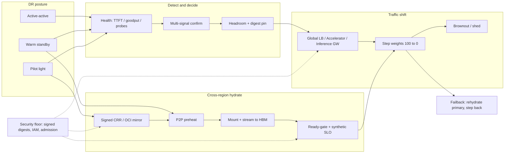

# Lesson 36 — AI/ML platform: multi-region DR & failover for inference — traffic shift, cross-region weight hydrate & RTO/RPO for GPU cells

*2026-10-14*

## What interviewers are really probing

[Lesson 24](/lessons/24-multi-cluster-inference-routing-capacity) taught you to route across **cells**. [Lesson 27](/lessons/27-gpu-supply-chain-weight-registry-hydrate) taught you that a 140 GB weight file has **physics**. [Lesson 28](/lessons/28-inference-autoscaling-scale-to-zero) taught you that cold starts are a **waterfall**. [Lesson 35](/lessons/35-fleet-incident-response-gpu-inference-agent-runbooks) taught you which lever to pull at 3 a.m. This lesson asks the geo question: **what happens when a whole region dies**, and can you shift inference without turning the surviving regions into a second outage?

The interview version is a whiteboard: *"Design multi-region DR for a 70B chat model with a 5-minute RTO. What is your RPO? Walk the failover."* They are not checking whether you know Route 53 exists. They want to hear that **RTO is dominated by weight hydrate and GPU warm-up**, that **KV cache is region-local and therefore RPO for sessions is infinite**, that you **never shift traffic into a cell whose signed digests are not already warm**, and that the security floor (signing, bucket IAM, admission) survives the panic.

Cross-links: [L7](/lessons/07-edge-lb-ddos-armor-shield) (edge LB / Armor / Shield), [L13](/lessons/13-ml-weights-checkpoint-hardening)/[L14](/lessons/14-ml-inference-training-deploy-hardening) (weight + deploy hardening), [L21](/lessons/21-inference-serving-slos-ttft-tpot-kvcache)–[L22](/lessons/22-prefill-decode-disagg-moe-serving) (SLOs, PD/MoE), [L24](/lessons/24-multi-cluster-inference-routing-capacity), [L27](/lessons/27-gpu-supply-chain-weight-registry-hydrate), [L28](/lessons/28-inference-autoscaling-scale-to-zero), [L31](/lessons/31-evaluation-release-gating-canary-weights)/[L33](/lessons/33-prompt-tool-catalog-versioning-serving-config) (gates + CatalogBundle), [L35](/lessons/35-fleet-incident-response-gpu-inference-agent-runbooks). Fuel: [wafer-ai/gpu-perf-engineering-resources](https://github.com/wafer-ai/gpu-perf-engineering-resources).

What they check for:

- **RTO/RPO redefined for inference.** RTO = detect + decide + traffic shift + max(0, hydrate − preheat) + CUDA-graph / KV warm-up. RPO for **weights** is registry CRR lag; for **serving config** is CatalogBundle sync lag; for **KV / in-flight streams** is effectively ∞ — you accept miss and reconnect.
- **Posture before the outage.** Active-active, warm standby, pilot light, cold. The posture *is* the RTO budget. Quoting a 5-minute RTO with a cold secondary is a fail.
- **Traffic shift as a capacity decision.** Same discipline as [L35](/lessons/35-fleet-incident-response-gpu-inference-agent-runbooks) cell drains: headroom (KV seats, prefill), cold-prefix-cache penalty, step weights, brownout before full shift.
- **Hydrate is the critical path.** Cross-region CRR of signed OCI artifacts, P2P preheat, ImageVolume/modelcar mount, streamer into HBM, ready-gate *before* weight rises. 500 cold nodes × 140 GB = 70 TB — your object store's per-prefix limits will tell you.
- **Process recovery ≠ regional DR.** NVIDIA Dynamo shadow engines recover a failed replica on the **same GPUs** in seconds. That number must not be quoted as your multi-region RTO.
- **Security floor under geo pressure.** Signed digests only in every region, least-privilege CRR IAM, no public-mirror "fix", same admission keys everywhere, secrets stay region-local / brokered.

**Interview sentence:** "For inference DR I pick the posture before the outage. Active-active gets me minutes of RTO because the weights are already warm; pilot light adds the full hydrate waterfall. RPO is registry and CatalogBundle lag — KV is region-local, so I expect cache miss and reconnect. Failover is: confirm multi-signal, check survivor headroom and digest pins, freeze scale-in and promotions, step HTTPRoute / Global Accelerator weights while watching receiver TTFT burn, and only raise weight after the ready-gate (signed digest + synthetic SLO). I never unblock hydrate with an unsigned mirror or a wider bucket policy. Failback rehydrates the primary and shifts back in steps the same way."

## Core diagram: Posture → Detect & decide → Traffic shift → Cross-region hydrate → Ready-gate → Failback (+ security floor)




**How to read it:** posture on the left decides how much of the hydrate path is already done when the region dies. Detection is multi-signal so a single bad probe does not flap the globe. Shift uses the same reversible levers as [L35](/lessons/35-fleet-incident-response-gpu-inference-agent-runbooks), but the ready-gate on the hydrate path is a hard dependency — weight does not rise until the survivor reports the **same signed digest** and passes a synthetic SLO. The PNG layers RTO/RPO math and the security floor across the whole path.

## Idiosyncrasies / operator depth

### 1. RTO / RPO for GPU inference (not your database worksheet)

| Quantity | What it actually is for inference | Trap |
|---|---|---|
| **RTO** | Time until a **healthy** survivor serves within SLO: detect + decide + shift + max(0, hydrate − preheat) + warm-up (CUDA graphs, compile cache, prefix-cache fill) | Quoting DNS TTL or LB health-check interval as RTO. Those are floors, not the budget |
| **RPO_weights** | Lag of signed artifact CRR / OCI registry replication to the survivor region | Assuming zero: async CRR has lag; a failover mid-promotion can land an older digest |
| **RPO_config** | CatalogBundle / serving-config / toolset sync lag ([L33](/lessons/33-prompt-tool-catalog-versioning-serving-config)) | Matching weights with a stale bundle = quality incident |
| **RPO_KV / sessions** | Effectively **∞** — KV is region-local; in-flight streams die | Promising sticky sessions across regions; clients must reconnect / resume |
| **RPO_checkpoints (train)** | Different problem (next lessons / [L29](/lessons/29-training-reliability-checkpoint-elastic)); do not mix into inference DR answers | |

**Rule of thumb interviewers like:** if your secondary is not already holding the bytes on NVMe (or at least in the regional registry + P2P swarm), your RTO has a **hydrate term** measured in minutes to tens of minutes for 70B+, not seconds.

### 2. Pick a posture — it *is* the architecture

| Posture | What is warm in region B | Typical RTO | Cost posture | When it fits |
|---|---|---|---|---|
| **Active-active** | Serving replicas + weights + images; global LB spreads | Minutes (shift + SLO settle) | ~2× GPU burn (or N regions) | Flagship chat, paid SLA, regulated |
| **Warm standby** | Weights + images hydrated; replicas scaled near zero or tiny canary | Minutes + scale-out + probe | Idle GPU ≈ warm-pool tax ([L28](/lessons/28-inference-autoscaling-scale-to-zero)) | Strong RTO, cost-sensitive |
| **Pilot light** | Registry replica + signed digests + IaC; nodes optional | Hydrate waterfall + provision | Cheap until the day you need it | Internal tools, best-effort |
| **Cold** | CRR of buckets + Terraform only | Hours | Cheapest | Rarely acceptable for interactive inference |

**Gotcha:** "multi-region" on a slide often means **pilot light**. Make the interviewer say the RTO number, then pick the posture that can hit it.

### 3. Traffic shift: planes, steps, and what not to flap

- **Control planes you will actually use:** AWS Global Accelerator (anycast + health) in front of regional ALBs ([GCO pattern](https://github.com/awslabs/global-capacity-orchestrator-on-aws/)); GCP global HTTPS LB / GKE **Multi-Cluster Inference Gateway** with preferred-region ordering and elastic spillover; Gateway API `HTTPRoute` weights across multi-cluster Services ([L24](/lessons/24-multi-cluster-inference-routing-capacity)); Cloudflare / Cloud Armor / Shield at the edge ([L7](/lessons/07-edge-lb-ddos-armor-shield)).
- **Health checks must be inference-aware.** TCP:443 green while TTFT is 40s is how you serve a degraded region forever. Probe **TTFT / goodput / error class**, not just `/healthz`.
- **Step the weight.** 100 → 70 → 40 → 0 while watching survivor `cell:ttft_slo_burn` and `kv_cache_usage_perc`. Same discipline as a cell drain in [L35](/lessons/35-fleet-incident-response-gpu-inference-agent-runbooks).
- **New sessions only when possible.** Drain in-flight streams; do not break mid-response if the client can finish. Accept that many streams will reset.
- **Freeze survivors' scale-in and promotions** before the flood arrives ([L28](/lessons/28-inference-autoscaling-scale-to-zero), [L31](/lessons/31-evaluation-release-gating-canary-weights)). A registry blip during failover + HPA scale-in is how warm capacity evaporates.
- **Hysteresis + human gate for SEV1 full-region shifts.** Automation can spill *over* (elastic HA); full-region *away* usually wants IC confirmation so a probe flake does not migrate the globe.

### 4. Cross-region weight hydrate — the physics that eat your RTO

This is [L27](/lessons/27-gpu-supply-chain-weight-registry-hydrate) at geo distance:

1. **Replicate signed artifacts** — OCI registry mirror or bucket CRR that **preserves digest + signature + Object Lock**. Lag here *is* RPO_weights.
2. **Preheat** — Dragonfly / Spegel / regional model cache onto the standby node pool **before** you need it. Cap `maxSurge` so a region recovery does not become a 70 TB hydrate storm.
3. **Mount + load** — ImageVolume / KServe modelcar / FUSE for bytes on node; Run:ai streamer / safetensors into HBM; CUDA graphs + compile cache warm-up.
4. **Ready-gate** — admission confirms digest pin; synthetic SLO probe passes; KV seat / replica readiness exported; **then** raise route weight.

**Numbers to keep in your pocket:** 70B FP16 ≈ 140 GB; 405B / large MoE is worse; cross-region egress + API rate limits dominate; lazy image loading does **not** help inference weights (you need 100% before first token). Process-level recovery on the same GPU (Dynamo shadow engines, ~seconds) is a **different tier** — device-preserving, not region-preserving.

### 5. CatalogBundle, images, and "same model" lies

A survivor serving `sha256:abc` weights with yesterday's `max_num_seqs` / toolset / prompt digest is a **quality** incident, not a successful failover ([L33](/lessons/33-prompt-tool-catalog-versioning-serving-config)). Geo-replicate the **bundle as a unit** with the weights. Serving image (vLLM/SGLang/TRT-LLM + CUDA + NCCL) must match the digest pin the release gate approved ([L31](/lessons/31-evaluation-release-gating-canary-weights)).

### 6. PD / MoE and multi-region

Prefill/decode disaggregation and MoE expert parallelism ([L22](/lessons/22-prefill-decode-disagg-moe-serving)) are usually **intra-region** (RDMA / NVLink domain). Across regions you fall back to **colocated** serving or accept that P:D pools reform in the survivor. Do not design cross-region KV transfer into the critical path of DR.

## Concrete commands & config

### Ready-gate: confirm signed digest warm in the survivor before shifting

```bash
# What digest is the standby Deployment pinned to?
kubectl --context us-west-2 get deploy llm-70b -n serve-chat \
  -o jsonpath='{.spec.template.metadata.annotations.weights\.corp/digest}{"\n"}'
# Compare to primary's last-known-good (should match the attested release)
cosign verify --certificate-identity-regexp '.*@corp' --certificate-oidc-issuer https://oidc.corp \
  registry.corp/models/llm-70b@sha256:4f2c…   # must succeed in EVERY region

# Node cache / ImageVolume presence ( Spegel / dragonfly peer hit rate )
kubectl --context us-west-2 get pods -n serve-chat -l app=llm-70b \
  -o custom-columns=POD:.metadata.name,NODE:.spec.nodeName,READY:.status.conditions[?\(@.type==\"Ready\"\)].status
```

### Freeze survivors, then step traffic (Gateway API)

```bash
# Freeze KEDA scale-in in the receiving region so hydrate pressure can't destroy warm replicas
kubectl --context us-west-2 annotate scaledobject llm-70b -n serve-chat \
  autoscaling.keda.sh/paused-replicas="$(kubectl --context us-west-2 get deploy llm-70b -n serve-chat -o jsonpath='{.spec.replicas}')" --overwrite

# Freeze promotions / canaries during SEV1 failover
kubectl --context global argo rollouts pause llm-70b -n serve-chat
```

```yaml
# Global HTTPRoute: shift us-east-1 → us-west-2 in steps (capacity lead signs headroom first)
apiVersion: gateway.networking.k8s.io/v1
kind: HTTPRoute
metadata: {name: chat-global, namespace: edge}
spec:
  parentRefs: [{name: global-gw}]
  rules:
  - backendRefs:
    - {name: cell-us-east-1, kind: Service, port: 443, weight: 40}  # was 100 → 70 → 40 → 0
    - {name: cell-us-west-2, kind: Service, port: 443, weight: 60}
# After each step: watch us-west-2 TTFT burn + kv_cache_usage_perc for 2–5 min
```

### AWS Global Accelerator endpoint weight (illustrative)

```bash
# List endpoint groups; lower weight on the failing region, raise survivor
aws globalaccelerator list-endpoint-groups --listener-arn "$LISTENER_ARN"
aws globalaccelerator update-endpoint-group \
  --endpoint-group-arn "$EG_EAST" \
  --endpoint-configurations EndpointId="$ALB_EAST",Weight=0,ClientIPPreservationEnabled=true
aws globalaccelerator update-endpoint-group \
  --endpoint-group-arn "$EG_WEST" \
  --endpoint-configurations EndpointId="$ALB_WEST",Weight=128,ClientIPPreservationEnabled=true
```

### Cross-region hydrate: registry mirror + preheat (not a public pull)

```bash
# Replicate an attested digest to the standby region's pull-through / mirror (signed only)
oras cp registry.corp/models/llm-70b@sha256:4f2c… \
  registry.us-west-2.corp/models/llm-70b@sha256:4f2c…

# Preheat onto the standby node pool BEFORE raising weight (Dragonfly job / daemon preheat API)
curl -X POST "http://dragonfly-scheduler.dfstore/preheats" \
  -d '{"url":"registry.us-west-2.corp/models/llm-70b@sha256:4f2c…","type":"image","scope":"node-pool:gpu-inference"}'

# Cap surge during recovery so you don't create a hydrate storm
kubectl --context us-west-2 patch deploy llm-70b -n serve-chat --type=merge \
  -p '{"spec":{"strategy":{"rollingUpdate":{"maxSurge":"10%","maxUnavailable":0}}}}'
```

### Bucket IAM for CRR — least privilege (never widen mid-incident)

```json
{
  "Version": "2012-10-17",
  "Statement": [
    {
      "Sid": "ReplicationReadSourceWeights",
      "Effect": "Allow",
      "Action": ["s3:GetReplicationConfiguration", "s3:ListBucket", "s3:GetObjectVersion",
                 "s3:GetObjectVersionAcl", "s3:GetObjectVersionTagging", "s3:GetObjectRetention"],
      "Resource": ["arn:aws:s3:::weights-prod-east", "arn:aws:s3:::weights-prod-east/models/*"]
    },
    {
      "Sid": "ReplicationWriteDest",
      "Effect": "Allow",
      "Action": ["s3:ReplicateObject", "s3:ReplicateDelete", "s3:ReplicateTags",
                 "s3:ObjectOwnerOverrideToBucketOwner"],
      "Resource": "arn:aws:s3:::weights-prod-west/models/*"
    }
  ]
}
```

No `s3:PutObject` for humans on `models/*` during failover. No public ACL. Object Lock / retention stays on.

### Synthetic probe + failback checklist

```bash
# Inference-aware probe (TTFT budget), not TCP
curl -s -o /dev/null -w '%{http_code} %{time_starttransfer}\n' \
  -H "Authorization: Bearer $PROBE_TOKEN" \
  -H 'Content-Type: application/json' \
  -d '{"model":"llm-70b","messages":[{"role":"user","content":"ping"}],"max_tokens":8}' \
  https://chat-us-west-2.corp/v1/chat/completions
# Ready-gate: HTTP 200 AND time_starttransfer under TTFT SLO before raising weight

# Failback: primary rehydrated + signed digest match + probe green → step weights the other way
kubectl --context us-east-1 annotate scaledobject llm-70b -n serve-chat autoscaling.keda.sh/paused-replicas-
```

## Failures & fixes

| Symptom | Likely cause | Fix / mitigation |
|---|---|---|
| Failover complete in 90s, TTFT p99 30s for an hour | Shifted into cold weights / empty prefix cache | Ready-gate on digest + synthetic TTFT; preheat standby; expect cold-cache penalty and step slower |
| Survivor OOMs / preemption storm after shift | No headroom check; KV seats insufficient | Capacity lead math before weight moves; brownout `max_tokens`; shed low-pri tenants ([L21](/lessons/21-inference-serving-slos-ttft-tpot-kvcache)/[L35](/lessons/35-fleet-incident-response-gpu-inference-agent-runbooks)) |
| "Same model" but quality regressions | CatalogBundle / prompt / toolset lag behind weights | Geo-replicate bundle as a unit; ready-gate includes bundle digest ([L33](/lessons/33-prompt-tool-catalog-versioning-serving-config)) |
| Hydrate storm melts object store / WAN | 100% of nodes pulling 140 GB at once after region recovery | Cap `maxSurge`, P2P preheat, staggered node joins; pause non-critical scale-outs |
| Flapping between regions | TCP health green while inference SLO red; no hysteresis | Inference-aware probes; multi-signal confirm; human gate for full-region shift |
| Warm capacity vanished mid-failover | HPA/KEDA scaled in during registry lag | Freeze `paused-replicas` as step 1 ([L28](/lessons/28-inference-autoscaling-scale-to-zero)/[L35](/lessons/35-fleet-incident-response-gpu-inference-agent-runbooks)) |
| Quoted 5s RTO from a blog | Dynamo shadow / process recovery on **same GPU** | Use that for device-preserving restarts; regional DR still needs hydrate + provision |
| Unsigned public mirror "to unblock" | Panic path bypassed signing | Pre-signed emergency mirror per region; admission never set to `Ignore` globally ([L13](/lessons/13-ml-weights-checkpoint-hardening)/[L27](/lessons/27-gpu-supply-chain-weight-registry-hydrate)) |
| Bucket made public / `*` IAM mid-incident | "Just so CRR works" | Least-privilege replication roles only; security lead owns IAM changes |
| Sticky sessions broken, customers angry | Promised cross-region KV continuity | Document reconnect; design clients for resume; never sell ∞ RPO_KV as zero |
| Failback immediately re-broke primary | Shifted back before primary hydrate + probe | Same ready-gate in reverse; step weights; keep survivor warm until primary stable |
| PD/MoE serving dead after failover | Assumed cross-region RDMA | Fall back to colocated topology in survivor; reform P:D pools region-locally ([L22](/lessons/22-prefill-decode-disagg-moe-serving)) |
| Secondary served an older digest | CRR lag / mid-promotion failover | Pin attested digest; block ready-gate on mismatch; communicate RPO_weights honestly |

## Security & hardening

**Geo failover is when people bypass every control you spent Lessons 12–14 and 27 building.** The safe path has to be the fast path: signed digests already in the standby registry, IAM that already allows CRR, admission that already verifies the same keys, and a runbook that **does not include** "disable verification" or "make the bucket public."

### Model weights, checkpoints & ML assets across regions

| Control | Threat | Practice |
|---|---|---|
| **Signed digests only, every region** | Unsigned or locally copied weights loaded "because primary is down" | Ready-gate requires cosign/admission success on the **same** attested digest the release gate approved ([L31](/lessons/31-evaluation-release-gating-canary-weights)/[L13](/lessons/13-ml-weights-checkpoint-hardening)) |
| **CRR preserves provenance** | Replication that strips signatures, attestations or Object Lock | Mirror OCI artifacts with signatures; bucket CRR with retention / Object Lock; verify after replicate |
| **No public / unsigned fallback** | HF Hub / Docker Hub emergency pull | Per-region **pre-signed** emergency mirror. Public pull is never in the runbook ([L27](/lessons/27-gpu-supply-chain-weight-registry-hydrate)/[L35](/lessons/35-fleet-incident-response-gpu-inference-agent-runbooks)) |
| **Checkpoint ≠ serving weights** | Restoring a raw training checkpoint into inference under pressure | Only promoted, eval-gated, signed serving artifacts; `weights_only` load path |
| **Quality SEV still applies** | Fast-and-wrong model in the survivor | Freeze promotions fleet-wide during SEV1 failover; compare judge/offline signals after settle ([L32](/lessons/32-offline-online-eval-consistency-llm-judge)) |

### Registries & signing / provenance

| Control | Threat | Practice |
|---|---|---|
| **Same trust roots everywhere** | Region B trusts a different key or `failurePolicy: Ignore` | Identical admission policies + OIDC identities in every cell; CI proves drift |
| **Scoped exceptions with TTL** | Global webhook disable "until CRR catches up" | Kyverno `PolicyException` per namespace/digest + `cleanup.kyverno.io/ttl` — never fleet-wide Ignore |
| **Freeze promotions during failover** | Concurrent canary muddies digests mid-shift | Pause Argo Rollouts / sync windows until failback complete |
| **Signing-key compromise runbook** | Stolen identity signs malicious geo-replicated weights | Revoke, re-sign known-good, push digest denylist to all regions' admission |

### Bucket IAM for cross-region hydrate

| Control | Threat | Practice |
|---|---|---|
| **Replication roles only** | Human admin keys with `s3:*` on `models/*` | Dedicated CRR roles: read versioned objects on source, replicate on dest; no Delete for incident roles |
| **Never widen to unblock** | Public ACL, `Principal: *`, disabled Block Public Access | Hydrate levers are mirror, P2P, preheat, freeze — not IAM expansion. Security lead approves any IAM change |
| **VPC-SC / PrivateLink paths** | CRR over the public internet, exfil risk | Private connectivity for registry and bucket replication; alert on public egress from hydrate principals |
| **Separate audit / evidence buckets** | IR roles that can read weights | `ir-readonly` gets logs/manifests, not `models/*` Get ([L35](/lessons/35-fleet-incident-response-gpu-inference-agent-runbooks)) |

### Secrets, network isolation, admission & deploy hardening

| Control | Threat | Practice |
|---|---|---|
| **Region-local KMS / brokered tokens** | Long-lived keys copied to "the other region" in chat | Short-lived tokens from a broker; per-region KMS CMKs; no secrets in the incident channel |
| **Failover ≠ mesh everything** | Opening east-west between tenant sandboxes across regions | Keep sandbox egress policy ([L34](/lessons/34-agent-tool-sandboxing-egress-policy)); shift only the **inference edge**, not tenant networks |
| **On-call RBAC = shift + hydrate verbs** | Cluster-admin to "move faster" | Patch HTTPRoute / Accelerator weights, pause rollouts, annotate KEDA, trigger preheat — not secrets, not webhook configs, not `pods/exec` in sandboxes |
| **Digest-pinned deploys** | Floating tags after failback | Serving image + weights + CatalogBundle all digest-pinned; PSS restricted; no hostPath model mounts ([L14](/lessons/14-ml-inference-training-deploy-hardening)) |
| **Break-glass stays time-boxed** | Permanent admin in the survivor "until things calm down" | Two-person, expiry-reaped bindings; every use pages security ([L35](/lessons/35-fleet-incident-response-gpu-inference-agent-runbooks)) |

```yaml
# Admission still verifies in the standby region — exception is scoped + TTL if ever needed
apiVersion: kyverno.io/v2
kind: PolicyException
metadata:
  name: dr-hydrate-llm-70b
  namespace: serve-chat
  labels: {cleanup.kyverno.io/ttl: "2h"}
spec:
  exceptions:
  - policyName: verify-signed-weights
    ruleNames: ["verify-cosign"]
  match:
    any:
    - resources:
        kinds: ["Pod"]
        namespaces: ["serve-chat"]
        names: ["llm-70b-preheat-*"]   # preheat Job only — not the Serving Deployment
```

## Interview soundbites

- "RTO for inference is detect + decide + shift + hydrate debt + warm-up. DNS TTL is a floor, not the budget."
- "RPO_weights is registry CRR lag; RPO_KV is infinite — I design clients to reconnect and I say that out loud."
- "The posture *is* the architecture. A 5-minute RTO implies active-active or warm standby with digests already on the box."
- "I never raise route weight until the ready-gate: same signed digest, synthetic TTFT green, headroom checked."
- "Failover is a capacity decision — step weights, watch survivor burn, brownout before you melt the second region."
- "500 × 140 GB is a hydrate storm. Cap surge, preheat P2P, freeze scale-in first."
- "Dynamo shadow recovery is seconds on the same GPU. It is not my multi-region RTO."
- "Unsigned public mirrors and widened bucket IAM are not DR levers. Pre-signed regional mirrors and least-privilege CRR are."
- "Weights without the matching CatalogBundle are a quality incident wearing a failover costume."

## How this maps to the JD

Hyperscale compute (100+ clusters / 10K+ nodes) is inherently multi-region and multi-cell ([L1](/lessons/01-hyperscale-mental-model)/[L24](/lessons/24-multi-cluster-inference-routing-capacity)). Interviewers hiring DevSecOps / Platform / Cloud / Infra engineers for AI/ML platforms want someone who can **price RTO in GPU physics**, operate global traffic planes ([L7](/lessons/07-edge-lb-ddos-armor-shield)), keep the supply chain trustworthy under pressure ([L12](/lessons/12-node-container-hardening-supply-chain)–[L14](/lessons/14-ml-inference-training-deploy-hardening)/[L27](/lessons/27-gpu-supply-chain-weight-registry-hydrate)), and run failover with the same incident discipline as [L35](/lessons/35-fleet-incident-response-gpu-inference-agent-runbooks). That combination is the job.

## Watch (talks & demos)

### Platform engineering for AI: Architect a unified stack on GKE

Google Cloud / GKE. Multi-cluster Inference Gateway, prefix-aware routing, flow control, and how secondary/tertiary regions participate when primary capacity saturates — including scale-to-zero wake paths. Operator takeaway: preferred-region spillover vs hard failover, and why the gateway must understand inference load, not just TCP health.

<iframe width="100%" height="360" src="https://www.youtube.com/embed/OMQXAPyxZ5o" title="Platform engineering for AI: Architect a unified stack on GKE" frameBorder="0" allow="accelerometer; autoplay; clipboard-write; encrypted-media; gyroscope; picture-in-picture; web-share" allowFullScreen></iframe>

[Open on YouTube](https://www.youtube.com/watch?v=OMQXAPyxZ5o)

### How Anthropic uses GKE and TPUs to scale resilient AI

Google Cloud Next. Inference Gateway results, Dynamic Slicing recovery (hot-swap on the order of tens of seconds for slice failures), and how large accelerator fleets think about resilience. Operator takeaway: separate **device/slice recovery** numbers from **regional DR** numbers when you quote RTO.

<iframe width="100%" height="360" src="https://www.youtube.com/embed/1fajBv4-bzM" title="How Anthropic uses GKE and TPUs to scale resilient AI" frameBorder="0" allow="accelerometer; autoplay; clipboard-write; encrypted-media; gyroscope; picture-in-picture; web-share" allowFullScreen></iframe>

[Open on YouTube](https://www.youtube.com/watch?v=1fajBv4-bzM)

### The GKE inference playbook: Optimize cost and performance

Google Cloud. Load-aware and prefix-aware routing, admission control, and multi-cluster / multi-region Inference Gateway use. Operator takeaway: health and routing signals you should wire into a failover ready-gate (queue depth, KV utilization, predicted latency) instead of `/healthz`.

<iframe width="100%" height="360" src="https://www.youtube.com/embed/WQlKo0D3Ofg" title="The GKE inference playbook: Optimize cost and performance" frameBorder="0" allow="accelerometer; autoplay; clipboard-write; encrypted-media; gyroscope; picture-in-picture; web-share" allowFullScreen></iframe>

[Open on YouTube](https://www.youtube.com/watch?v=WQlKo0D3Ofg)

Also read: [GKE elastic cross-region high availability](https://docs.cloud.google.com/kubernetes-engine/docs/concepts/about-elastic-cross-region-high-availability), [Restore LLM Inference Capacity in Seconds with Shadow Engine Recovery in NVIDIA Dynamo](https://developer.nvidia.com/blog/restore-llm-inference-capacity-in-seconds-with-shadow-engine-recovery-in-nvidia-dynamo/) (process-tier recovery — contrast with regional hydrate), and [awslabs/global-capacity-orchestrator-on-aws](https://github.com/awslabs/global-capacity-orchestrator-on-aws/) (Global Accelerator + multi-region EKS inference pattern).

## References

- Traffic & multi-region HA: [GKE elastic cross-region HA](https://docs.cloud.google.com/kubernetes-engine/docs/concepts/about-elastic-cross-region-high-availability) · [GKE multi-cluster Inference Gateway codelab](https://codelabs.developers.google.com/codelabs/gke-inference-gateway-multi-cluster-tpus-dranet) · [Gateway API HTTPRoute](https://gateway-api.sigs.k8s.io/api-types/httproute/) · [AWS Global Accelerator](https://docs.aws.amazon.com/global-accelerator/latest/dg/what-is-global-accelerator.html) · [awslabs/global-capacity-orchestrator-on-aws](https://github.com/awslabs/global-capacity-orchestrator-on-aws/)
- Hydrate & recovery tiers: [NVIDIA Dynamo shadow engine recovery](https://developer.nvidia.com/blog/restore-llm-inference-capacity-in-seconds-with-shadow-engine-recovery-in-nvidia-dynamo/) · [ORAS](https://oras.land/) · [Dragonfly](https://d7y.io/) · [Spegel](https://github.com/spegel-org/spegel) · [KEDA pause autoscaling](https://keda.sh/docs/latest/concepts/scaling-deployments/#pause-autoscaling)
- DR framing: [AWS multi-region DR — RTO/RPO](https://builder.aws.com/content/3JdrClMpiFu3EsmBPQ0J8GBFB7c/designing-multi-region-disaster-recovery-on-aws-rto-rpo-and-automated-failover) · [Google SRE Workbook: Incident Response](https://sre.google/workbook/incident-response/)
- Security: [Sigstore cosign](https://docs.sigstore.dev/cosign/) · [Kyverno PolicyException](https://kyverno.io/docs/exceptions/) · [S3 Replication / IAM](https://docs.aws.amazon.com/AmazonS3/latest/userguide/setting-repl-config-perm-overview.html) · [VPC Service Controls](https://cloud.google.com/vpc-service-controls/docs/overview)
- [wafer-ai/gpu-perf-engineering-resources](https://github.com/wafer-ai/gpu-perf-engineering-resources) — AI/ML platform fuel
- Prior: [35 — Fleet IR / runbooks](/lessons/35-fleet-incident-response-gpu-inference-agent-runbooks) · [34 — Agent sandboxing / egress](/lessons/34-agent-tool-sandboxing-egress-policy) · [33 — CatalogBundle / serving config](/lessons/33-prompt-tool-catalog-versioning-serving-config) · [31 — Release gating / canary](/lessons/31-evaluation-release-gating-canary-weights) · [28 — Inference autoscaling](/lessons/28-inference-autoscaling-scale-to-zero) · [27 — GPU supply chain / hydrate](/lessons/27-gpu-supply-chain-weight-registry-hydrate) · [24 — Multi-cluster routing](/lessons/24-multi-cluster-inference-routing-capacity) · [22 — PD / MoE](/lessons/22-prefill-decode-disagg-moe-serving) · [21 — Inference SLOs](/lessons/21-inference-serving-slos-ttft-tpot-kvcache) · [14 — ML deploy hardening](/lessons/14-ml-inference-training-deploy-hardening) · [13 — ML weights](/lessons/13-ml-weights-checkpoint-hardening) · [7 — Edge LB / DDoS](/lessons/07-edge-lb-ddos-armor-shield) · [1 — Mental model](/lessons/01-hyperscale-mental-model)
- Next: **Lesson 37 — AI/ML platform: chaos engineering & DR game days for GPU inference fleets — region blackhole drills, hydrate storms & controlled failback**

## Quick self-check

Out loud, in under two minutes each:

1. Interviewer asks for a 5-minute RTO on a 70B chat model. Which posture do you pick, what is warm in region B today, and what is your honest RPO for weights vs KV?
2. `us-east-1` is gone. Walk detect → decide → freeze → ready-gate → step weights into `us-west-2`. What do you watch on the survivor after each step?
3. Standby nodes are up but TTFT is terrible for 20 minutes after failover. Name three likely causes and the preheat/ready-gate controls that would have caught them.
4. Someone proposes pulling weights from a public HF mirror "just until CRR catches up." Refuse it and give the signed-mirror alternative, including admission behavior.
5. Failback time: primary is back. How do you avoid bouncing traffic twice, and what security checks run before `us-east-1` weight goes non-zero again?
