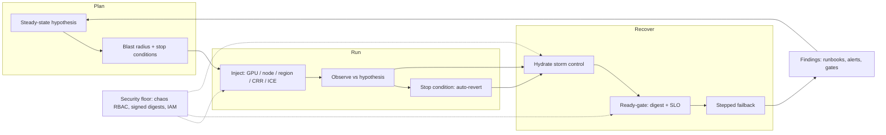

# Lesson 37 — AI/ML platform: chaos engineering & DR game days for GPU inference fleets — region blackhole drills, hydrate storms & controlled failback

*2026-10-15*

## What interviewers are really probing

[Lesson 36](/lessons/36-multi-region-dr-failover-inference) gave you a DR design: posture, RTO/RPO math, ready-gates, stepped traffic shift. [Lesson 35](/lessons/35-fleet-incident-response-gpu-inference-agent-runbooks) gave you the runbooks. This lesson asks the follow-up every senior interviewer eventually asks: **"How do you know any of that works?"** A DR plan that has never been exercised is a hypothesis. A runbook nobody has run with a stopwatch is fiction.

The interview version: *"You claim a 10-minute RTO for your 70B chat model. Design the game day that proves it, without causing the outage you're trying to prevent."* They are listening for **steady-state hypotheses written before the drill**, **blast radius and stop conditions**, a **ladder** from tabletop to a production cell, GPU-specific faults (XID, ECC, NVLink, capacity), the **hydrate storm** you will cause on recovery, a **controlled failback** that does not bounce traffic twice, and a chaos platform that is not itself the easiest way to compromise the fleet.

Cross-links: [L13](/lessons/13-ml-weights-checkpoint-hardening)/[L14](/lessons/14-ml-inference-training-deploy-hardening) (weight + deploy hardening), [L19](/lessons/19-gpu-topology-nvlink-rdma-nccl)/[L23](/lessons/23-gpu-observability-dcgm-nccl-roofline) (NVLink/NCCL, DCGM observability), [L21](/lessons/21-inference-serving-slos-ttft-tpot-kvcache) (inference SLOs), [L24](/lessons/24-multi-cluster-inference-routing-capacity) (multi-cluster routing), [L27](/lessons/27-gpu-supply-chain-weight-registry-hydrate) (hydrate), [L28](/lessons/28-inference-autoscaling-scale-to-zero) (autoscaling), [L31](/lessons/31-evaluation-release-gating-canary-weights) (release gates), [L34](/lessons/34-agent-tool-sandboxing-egress-policy) (sandbox egress), [L35](/lessons/35-fleet-incident-response-gpu-inference-agent-runbooks), [L36](/lessons/36-multi-region-dr-failover-inference). Fuel: [wafer-ai/gpu-perf-engineering-resources](https://github.com/wafer-ai/gpu-perf-engineering-resources).

What they check for:

- **Hypothesis first.** "If `us-east-1` is blackholed, `us-west-2` serves chat within TTFT p99 SLO within 10 minutes, survivor KV usage stays under 85%, and zero unsigned digests are admitted." Written down, with numbers, before anyone touches a fault injector.
- **Blast radius as a design input.** One cell, one tenant tier, one model; a hard duration cap; stop conditions wired to SLO alarms that **auto-revert**, not a human watching Grafana.
- **GPU-aware faults.** Pod-kill chaos is table stakes. GPU fleets fail as XID 79 (fell off the bus), double-bit ECC, NVLink/IB flaps, thermal throttling, stragglers, and **no capacity in the survivor** (ICE). Can you inject those, or at least their signals?
- **Recovery is the dangerous half.** The drill's region comes back and 300 cold nodes all pull 140 GB at once. If you have not drilled the **hydrate storm** and **failback**, you have drilled half the incident.
- **Findings become structure.** Every drill ends with action items that land as runbook steps, alerts, admission policies, or release gates ([L31](/lessons/31-evaluation-release-gating-canary-weights)), not a slide.
- **Security under chaos.** Chaos controllers are privileged. Drills must prove the security floor holds (signed digests, bucket IAM, admission) instead of quietly suspending it "for the test."

**Interview sentence:** "I treat DR as a falsifiable claim. Each game day starts with a written steady-state hypothesis tied to the posture's RTO budget, a scoped blast radius, and stop conditions that auto-revert on SLO burn. I climb a ladder: tabletop, replica and GPU faults, cell drains, a hydrate storm, then a region blackhole with CRR paused, and finally a controlled failback with the same ready-gate in reverse. I measure detect, decide, shift, hydrate and time-to-SLO separately, and the drill fails if real RTO exceeds the budget. The chaos tooling itself runs with inject-only RBAC and signed images, and one injection in every drill is a bad digest that admission must deny."

## Core diagram: Hypothesis → Guardrails → Inject → Observe → Abort/recover → Controlled failback (+ security floor)

![Chaos engineering and DR game days for GPU inference: a five-step experiment lifecycle from steady-state hypothesis through blast radius and guardrails, fault injection (DCGM XID/ECC, node and NIC faults, FIS cross-Region blackhole, CRR pause, GPU capacity errors), observation against the hypothesis, and abort or recover; below it a drill ladder from tabletop to region blackhole and failback, hydrate storm physics, and controlled failback steps, all resting on a security floor for chaos tooling, weights, bucket IAM, secrets and admission](/chaos-dr-game-days-gpu-inference.png)



**How to read it:** the loop is closed on purpose. A drill that does not feed `OUT` back into the next hypothesis (tighter RTO, new alert, new gate) is theatre. Stop conditions sit on the observe step, not on a human; both the happy path and the abort path go through the same hydrate-control and ready-gate as a real failback, because recovery is where most drill-induced outages happen. The security floor touches injection (who may inject what), hydrate (no unsigned shortcuts) and the ready-gate (same attested digest).

## Idiosyncrasies / operator depth

### 1. Write the hypothesis like an SLO, not a wish

| Field | Example for a 70B chat cell | Why it matters |
|---|---|---|
| **Steady state** | TTFT p99 under 1.5 s, goodput above 95%, 5xx under 0.5% | You can't detect "worse" without a baseline measured the same week |
| **Fault** | `us-east-1` cross-Region connectivity cut + S3 CRR paused for 45 min | One fault per experiment until the basics pass; compound faults later |
| **Expected behaviour** | Detect in 2 min, IC decision in 3, survivor at SLO by minute 10 | Splits RTO into terms you can each fix ([L36](/lessons/36-multi-region-dr-failover-inference)) |
| **Invariants** | Zero unsigned digests admitted; no IAM changes; no `failurePolicy: Ignore` | Turns security into a pass/fail criterion of the drill |
| **Stop conditions** | Survivor TTFT burn rate above 14x for 5 min, or paid-tier 5xx above 2% | Auto-revert. The drill is not allowed to become a SEV1 |
| **Abort owner** | Named human with the revert command already typed | Someone must be allowed to say "stop" without a meeting |

**Gotcha:** teams measure "time until traffic moved." The interviewer wants **time until users were served within SLO**. With pilot light that gap is the whole hydrate waterfall.

### 2. The drill ladder (do not start at region blackhole)

| Rung | What you break | Proves | Typical frequency |
|---|---|---|---|
| **L0 tabletop** | Nothing; walk the [L35](/lessons/35-fleet-incident-response-gpu-inference-agent-runbooks)/[L36](/lessons/36-multi-region-dr-failover-inference) runbook with a stopwatch | Runbook steps exist, RBAC works, people know the levers | Monthly, every new on-call |
| **L1 replica kill** | `pod-delete`, engine crash, OOM | Readiness, router ejection, replica restart time; process-tier recovery (Dynamo shadow engines) | Continuous in staging, weekly in prod |
| **L2 GPU faults** | DCGM-injected XID / ECC / PCIe replay signals; real `gpu-burn` thermal stress | Detection pipeline: DCGM → node-problem-detector/health controller → taint → drain → reroute | Weekly per SKU pool |
| **L3 cell drain** | HTTPRoute weight 100 → 0 for one cell | Survivor headroom math, brownout, freeze of scale-in | Monthly |
| **L4 hydrate storm** | Recycle N% of a GPU pool so it re-pulls weights | Object store limits, P2P hit rate, `maxSurge` caps, time-to-first-ready | Quarterly, and after any registry change |
| **L5 region blackhole** | Cross-Region cut + CRR pause (FIS scenario or equivalent) | Real RTO and RPO_weights / RPO_config honesty | Quarterly per flagship model |
| **L6 dependency outage** | Registry, KMS, IdP, Sigstore/Rekor, or DNS unavailable | You serve cached, already-verified digests and fail **closed** on new ones | Quarterly |
| **L7 failback** | Bring the primary back | No double bounce, ready-gate in reverse, thaw order | Every time you run L3–L5 |

Climb a rung only after the one below passes twice in a row. Run L5 in a **production cell** eventually: staging regions rarely have the real traffic mix, prefix-cache warmth, or GPU capacity scarcity.

### 3. GPU faults are mostly signal injection, and that is fine

- **DCGM error injection** (`dcgmi test --inject`) writes a contrived value into a DCGM field, so DCGM policy and health watches **report** a PCIe replay storm or double-bit ECC. Hardware is untouched. You are testing the **detection → remediation chain**: exporter alert, health controller taint, drain, router ejection, replacement node, re-hydrate.
- **Real stress** (`gpu-burn`, `dcgmproftester`) exercises thermals, power capping and clock throttling. Expect stragglers rather than failures, which is the point: does your router notice a replica whose TPOT doubled ([L21](/lessons/21-inference-serving-slos-ttft-tpot-kvcache))?
- **XIDs to rehearse:** XID 79 (GPU fell off the bus), XID 48/63/64/94/95 (ECC and row-remap family), XID 74 (NVLink), XID 13/31/43 (often app-level, should **not** drain a node). A drill that drains on XID 13 is a drill that found a bad remediation rule.
- **NVLink / IB / RoCE:** flap a link or down a NIC port on one node in a staging pool; watch NCCL timeouts on multi-GPU replicas (TP=8) and whether the whole replica is ejected rather than serving at a fraction of throughput.
- **Capacity faults:** the survivor having **no GPUs to scale into** is the most common real-world DR surprise. AWS FIS has `aws:ec2:asg-insufficient-instance-capacity-error` and `aws:ec2:api-insufficient-instance-capacity-error`; use them to prove your plan works with only the warm capacity you already hold.

### 4. Region blackhole drills: what actually gets cut

The AWS FIS **Cross-Region: Connectivity** scenario blocks outbound application traffic from the experiment Region to a destination Region (transit gateway and route-table actions) and pauses S3 and DynamoDB global-table replication, for 3 hours by default and up to 12. Idiosyncrasies that matter for inference:

- It cuts **outbound from the experiment Region**. Stateless inbound from the isolated Region and traffic from AWS managed services may not be blocked, so it is a dependency finder, not a perfect partition.
- **Pausing CRR is your RPO_weights drill.** Promote a new signed digest in the primary while replication is paused; the survivor must keep serving the **last attested** digest and the ready-gate must refuse the new one until it lands ([L31](/lessons/31-evaluation-release-gating-canary-weights)).
- **Hidden cross-region dependencies** are the real yield: a tokenizer fetched from a primary-region bucket, a CatalogBundle API ([L33](/lessons/33-prompt-tool-catalog-versioning-serving-config)) that only runs in `us-east-1`, a Sigstore/TUF mirror, an IdP for probe tokens.
- **Region switch orchestration:** AWS ARC Region switch runs multi-Region recovery plans (routing controls, Route 53 data-plane failover, scaling steps) with live dashboards. Its execution report is game-day evidence; it doesn't replace the inference-aware ready-gate.
- On GCP, use VPC firewall deny rules, Cloud Armor, or Multi-Cluster Inference Gateway backend weights to the same effect; on bare metal, BGP withdraw of the anycast prefix for one site.

### 5. Hydrate storms: the drill you cause on recovery

[L27](/lessons/27-gpu-supply-chain-weight-registry-hydrate) physics, at drill time: 300 nodes × 140 GB ≈ 42 TB. Without P2P, every byte comes from the regional registry or bucket, and you will see S3 `503 SlowDown` on hot prefixes, registry blob 429s, NAT/egress saturation, and kubelet image-pull back-off that makes pods look broken.

- **Measure the curve**, not just the end: GB/s per node, P2P peer hit rate, time-to-first-ready-replica, time-to-SLO.
- **Cap the wave:** `maxSurge` 10%, node pool scale-up step size, staggered node joins, a preheat Job ahead of traffic.
- **Freeze competitors:** pause non-critical scale-outs and batch/eval jobs that also pull weights.
- **Fail the drill** if the hydrate term alone exceeds the posture's RTO budget; that's a posture problem (pilot light pretending to be warm standby), not a tuning problem.

### 6. Controlled failback

Failback is a second failover, done with less adrenaline and more traffic. Rules:

1. Primary rehydrated with the **same signed digest** and the same CatalogBundle digest as the survivor.
2. Synthetic TTFT probe green for N minutes, prefix-cache warm-up traffic sent first (shadow or replay) so the first real users don't pay the cold-cache tax.
3. Step 0 → 10 → 40 → 70 → 100 while watching **both** regions. Keep the survivor warm until the primary has held SLO for a full peak (hysteresis).
4. Thaw KEDA `paused-replicas` and Argo Rollouts **last**, survivor side after primary is stable.
5. Close the drill: actual vs hypothesised numbers for every RTO term, and owners for every gap.

### 7. Culture and cadence

- Announce L3+ drills to dependent teams; run L5 with an IC, comms lead and security lead, exactly like [L35](/lessons/35-fleet-incident-response-gpu-inference-agent-runbooks).
- Change freeze for the drill window. No releases, no promotions, no node image rollouts.
- Rotate who runs the drill. The person who wrote the runbook is the worst tester of it.
- Track drill results like SLOs: "last successful L5 for `llm-70b`: 41 days ago" belongs on a dashboard.

## Concrete commands & config

### GPU fault signal injection (staging pool, DCGM)

```bash
# Policy watch in one terminal on the target node (or via the DCGM hostengine)
dcgmi policy --set 0,0 -p          # PCIe replay policy
dcgmi policy --reg

# Inject a contrived PCIe replay count (field 202) on GPU 0
dcgmi test --inject --gpuid 0 -f 202 -v 99999

# Inject double-bit ECC (field 319) — should drive taint → drain → reroute
dcgmi test --inject --gpuid 0 -f 319 -v 4

# What the platform should do next (verify, don't do by hand):
kubectl get node gpu-a100-17 -o jsonpath='{.spec.taints}{"\n"}'
kubectl get pods -n serve-chat -o wide --field-selector spec.nodeName=gpu-a100-17
```

```bash
# Real thermal / power stress for straggler detection (60 s, all GPUs on the node)
./gpu_burn 60
# Watch: DCGM_FI_DEV_GPU_TEMP, DCGM_FI_DEV_POWER_VIOLATION, router TPOT per replica
```

### Chaos Mesh: replica kill + network partition between a cell and the registry

```yaml
apiVersion: chaos-mesh.org/v1alpha1
kind: PodChaos
metadata: {name: kill-one-llm-replica, namespace: chaos-system}
spec:
  action: pod-kill
  mode: one
  selector:
    namespaces: ["serve-chat"]
    labelSelectors: {app: llm-70b, cell: use1-a}
---
apiVersion: chaos-mesh.org/v1alpha1
kind: NetworkChaos
metadata: {name: cell-cut-from-registry, namespace: chaos-system}
spec:
  action: partition
  mode: all
  direction: to
  selector:
    namespaces: ["serve-chat"]
    labelSelectors: {cell: use1-a}
  externalTargets: ["registry.us-east-1.corp"]
  duration: "15m"                 # hard cap; controller reverts on expiry
```

Chaos Mesh only acts inside namespaces allowed by its controller config (`controllerManager.enableFilterNamespace` plus the `chaos-mesh.org/inject=enabled` namespace annotation). Turn that on in production so a typo can't target `kube-system`.

### AWS FIS: region blackhole + CRR pause + no-GPU-capacity, with stop conditions

```json
{
  "description": "L5 drill: isolate us-east-1 from us-west-2, pause weights CRR, deny GPU capacity in survivor ASG",
  "roleArn": "arn:aws:iam::111122223333:role/fis-dr-drill",
  "stopConditions": [
    {"source": "aws:cloudwatch:alarm", "value": "arn:aws:cloudwatch:us-west-2:111122223333:alarm:chat-ttft-burn-14x"},
    {"source": "aws:cloudwatch:alarm", "value": "arn:aws:cloudwatch:us-west-2:111122223333:alarm:paid-tier-5xx-2pct"}
  ],
  "targets": {
    "tgw": {"resourceType": "aws:ec2:transit-gateway", "resourceTags": {"dr-drill": "use1"}, "selectionMode": "ALL"},
    "weights": {"resourceType": "aws:s3:bucket", "resourceArns": ["arn:aws:s3:::weights-prod-east"], "selectionMode": "ALL"},
    "gpuAsg": {"resourceType": "aws:ec2:autoscaling-group", "resourceTags": {"pool": "gpu-inference-usw2"}, "selectionMode": "ALL"}
  },
  "actions": {
    "cutCrossRegion": {
      "actionId": "aws:network:transit-gateway-disrupt-cross-region-connectivity",
      "parameters": {"duration": "PT45M", "region": "us-west-2"},
      "targets": {"TransitGateways": "tgw"}
    },
    "pauseWeightsCRR": {
      "actionId": "aws:s3:bucket-pause-replication",
      "parameters": {"duration": "PT45M", "region": "us-west-2"},
      "targets": {"Buckets": "weights"}
    },
    "noGpuCapacity": {
      "actionId": "aws:ec2:asg-insufficient-instance-capacity-error",
      "parameters": {"duration": "PT45M", "availabilityZoneIdentifiers": "usw2-az1,usw2-az2", "percentage": "100"},
      "targets": {"AutoScalingGroups": "gpuAsg"}
    }
  }
}
```

```bash
aws fis create-experiment-template --cli-input-json file://l5-drill.json
aws fis start-experiment --experiment-template-id "$TPL" --tags drill=L5,model=llm-70b
aws fis get-experiment --id "$EXP" --query 'experiment.state'
aws fis stop-experiment --id "$EXP"     # abort owner has this typed before T0
```

Parameter names and target keys vary by action; generate the template from the FIS console scenario library once, then keep it in Git and review it like Terraform.

### Hydrate storm drill (L4) and what to watch

```bash
# Recycle 30% of the pool so it must re-hydrate (staging or one prod cell)
kubectl --context use1-a -n serve-chat patch deploy llm-70b --type=merge \
  -p '{"spec":{"strategy":{"rollingUpdate":{"maxSurge":"10%","maxUnavailable":0}}}}'
kubectl --context use1-a -n serve-chat rollout restart deploy/llm-70b

# Time-to-ready curve
kubectl --context use1-a -n serve-chat get pods -l app=llm-70b -w \
  -o custom-columns=POD:.metadata.name,READY:.status.containerStatuses[0].ready,START:.status.startTime
```

```promql
# P2P effectiveness (Dragonfly) and object-store pain during the storm
sum(rate(dragonfly_dfdaemon_peer_download_traffic_total[5m]))
  / sum(rate(dragonfly_dfdaemon_download_traffic_total[5m]))
sum(rate(aws_s3_5xx_errors_sum{bucket="weights-prod-east"}[5m]))
histogram_quantile(0.99, sum by (le) (rate(vllm:time_to_first_token_seconds_bucket{cell="use1-a"}[5m])))
```

Metric names depend on your exporter versions; the point is a ratio for P2P hit rate, an error rate for the origin, and a TTFT quantile for the users.

### Controlled failback (L7)

```bash
# 1. Same attested digest on both sides
for ctx in us-east-1 us-west-2; do
  kubectl --context $ctx -n serve-chat get deploy llm-70b \
    -o jsonpath='{.metadata.name} {.spec.template.metadata.annotations.weights\.corp/digest} {.spec.template.metadata.annotations.catalog\.corp/bundle}{"\n"}'
done

# 2. Probe the primary under the TTFT budget for N minutes before any weight moves
# 3. Step HTTPRoute weights 0 → 10 → 40 → 70 → 100 (L36 manifest), 5–10 min per step at peak
# 4. Thaw last, survivor side last
kubectl --context us-east-1 annotate scaledobject llm-70b -n serve-chat autoscaling.keda.sh/paused-replicas-
kubectl --context global argo rollouts promote llm-70b -n serve-chat   # only after both sides stable
```

## Failures & fixes

| Symptom | Likely cause | Fix / mitigation |
|---|---|---|
| Drill became a real SEV1 | No stop conditions, or stop conditions watched by a human | Alarm-backed stop conditions that auto-revert; hard duration caps; abort owner with the command typed |
| "Failover took 90 s", users at SLO after 25 min | Measured traffic shift, not time-to-SLO | Hypothesis defines RTO as time-to-SLO; record each RTO term separately |
| DCGM-injected ECC did nothing | Health controller not subscribed to that field, or alert routes to a dead channel | Fix the remediation chain; this is exactly what L2 drills are for |
| Nodes drained on XID 13 | Remediation rule treats app faults as hardware | Drain only on hardware XIDs (79, ECC family, NVLink); app XIDs restart the pod |
| TP=8 replica limps at 1/8 throughput after NVLink flap | Replica not ejected on NCCL timeout | Router ejects on TPOT/NCCL error class; replica-level readiness, not per-container |
| Survivor could not scale during L5 | No GPU capacity; warm pool assumed | Drill with ICE injection; hold reserved / committed capacity sized to posture ([L26](/lessons/26-gpu-cost-attribution-reclaim-spot)) |
| Recovery melted the object store | 300 nodes re-pulled at once | `maxSurge` cap, P2P preheat, staggered joins, freeze batch/eval pulls |
| Survivor served a newer, un-gated digest | CRR paused mid-promotion and someone hand-copied weights | Ready-gate pins the last attested digest; promotion freeze during drills |
| Hidden dependency on primary region | Tokenizer, CatalogBundle API, TUF mirror, IdP in `us-east-1` | Cross-Region connectivity drill; replicate or regionalise each dependency found |
| Traffic bounced back and forth | Failback without hysteresis | Keep survivor warm for a full peak; step weights; thaw last |
| Chaos experiment targeted `kube-system` | Controller allowed all namespaces | Namespace filter + annotation opt-in; admission policy on chaos CRDs |
| Same drill finding three quarters in a row | Action items not tracked to structure | Each finding lands as a runbook step, alert, gate or policy with an owner and date |

## Security & hardening

**A chaos platform is a remote-control for breaking your fleet. Treat it like one.** It can kill pods, partition networks, stress GPUs and pause replication across regions. Game days are also when people are most tempted to "temporarily" relax controls. The drill has to prove the security floor holds, not suspend it.

### Chaos tooling as privileged code

| Control | Threat | Practice |
|---|---|---|
| **Signed, pinned chaos images** | Compromised chaos-daemon image = privileged DaemonSet on every GPU node | Digest-pinned, cosign-verified Chaos Mesh / Litmus images; same admission as serving ([L12](/lessons/12-node-container-hardening-supply-chain)) |
| **Inject-only RBAC** | Chaos role reused to read secrets or edit webhooks | Chaos service accounts get chaos CRDs + `pods/delete` in target namespaces only; no `secrets`, no `validatingwebhookconfigurations`, no `pods/exec` |
| **Namespace opt-in** | Experiment targeting `kube-system`, `kyverno`, sandbox namespaces | Chaos Mesh namespace filter + annotation; Kyverno policy rejecting chaos CRs outside an allowlist |
| **Experiment-as-code + review** | Ad-hoc FIS template with a wide `roleArn` | Templates in Git, reviewed like Terraform ([L15](/lessons/15-terraform-atlantis-fleet-scale)); FIS role scoped to tagged resources |
| **Audit every experiment** | Malicious "drill" used as cover | CloudTrail / k8s audit on chaos CRDs and `fis:StartExperiment`; drills announced in a channel bots can verify |

### Model weights, checkpoints & deployments during drills

| Control | Threat | Practice |
|---|---|---|
| **Bad-digest canary injection** | Admission silently in `Ignore` or audit mode in one region | Every L4–L6 drill tries to deploy an **unsigned / unknown** weight digest; admission must deny it in every region. A pass here is a security finding |
| **No public / unsigned fallback** | "Pull from HF Hub so the drill finishes" | Drill fails rather than bypasses. Pre-signed regional mirrors only ([L27](/lessons/27-gpu-supply-chain-weight-registry-hydrate)/[L36](/lessons/36-multi-region-dr-failover-inference)) |
| **Promotion freeze** | Concurrent canary muddies which digest is under test | Pause Argo Rollouts / registry promotions for the drill window ([L31](/lessons/31-evaluation-release-gating-canary-weights)) |
| **Checkpoints stay out of serving** | Raw training checkpoint loaded to "speed up" recovery | Only promoted, eval-gated, signed serving artifacts; `weights_only` loaders ([L13](/lessons/13-ml-weights-checkpoint-hardening)) |
| **Deploy hardening unchanged** | Drill-only Deployments with `privileged: true` or hostPath model mounts | PSS restricted still enforced; drill workloads use the same digest-pinned templates ([L14](/lessons/14-ml-inference-training-deploy-hardening)) |

### Bucket IAM & registries

| Control | Threat | Practice |
|---|---|---|
| **Pause, don't widen** | Bucket policy loosened to "simulate" or "unblock" replication | Use `aws:s3:bucket-pause-replication`; the FIS role needs `s3:PutReplicationConfiguration`-class permissions on the bucket, never `s3:GetObject` on `models/*` |
| **Object Lock / BPA untouched** | Retention or Block Public Access disabled during the drill | SCP / org policy denies changing them, even for drill roles |
| **Registry outage drill fails closed** | Sigstore / registry down → admission set to `Ignore` | Serve already-verified, cached digests; new digests wait. Scoped `PolicyException` with TTL only for preheat Jobs ([L36](/lessons/36-multi-region-dr-failover-inference)) |

### Secrets, network isolation & admission

| Control | Threat | Practice |
|---|---|---|
| **Region-local secrets** | Keys copied cross-region "for the drill" | Per-region KMS CMKs, brokered short-lived tokens; KMS-outage drill proves cached data keys expire safely |
| **Blackhole ≠ open everything** | Partition drill "fixed" by opening east-west between tenants | Agent sandbox egress policy ([L34](/lessons/34-agent-tool-sandboxing-egress-policy)) is an invariant of the hypothesis |
| **Break-glass still pages** | Drill normalises silent admin access | Break-glass in a drill is time-boxed, two-person and pages security like a real incident ([L35](/lessons/35-fleet-incident-response-gpu-inference-agent-runbooks)) |
| **Evidence retention** | No record of what the drill proved | Experiment logs, ARC/FIS reports and k8s audit stored in a separate, read-only evidence bucket |

```yaml
# Kyverno: chaos CRs may only target namespaces explicitly opted in
apiVersion: kyverno.io/v1
kind: ClusterPolicy
metadata: {name: restrict-chaos-targets}
spec:
  validationFailureAction: Enforce
  rules:
  - name: chaos-namespace-allowlist
    match:
      any:
      - resources:
          kinds: ["chaos-mesh.org/v1alpha1/PodChaos", "chaos-mesh.org/v1alpha1/NetworkChaos", "chaos-mesh.org/v1alpha1/StressChaos"]
    validate:
      message: "Chaos experiments may only target serve-* or staging-* namespaces."
      deny:
        conditions:
          any:
          - key: "{{ request.object.spec.selector.namespaces[] || `[]` }}"
            operator: AnyNotIn
            value: ["serve-chat", "serve-batch", "staging-*"]
```

## Interview soundbites

- "DR I haven't drilled is a hypothesis. I write the steady state and the RTO budget down before anyone injects anything."
- "Stop conditions are alarms that auto-revert. A human staring at Grafana is not a stop condition."
- "I climb a ladder: tabletop, replica kill, GPU faults, cell drain, hydrate storm, region blackhole, failback. You don't start at the top."
- "DCGM injection doesn't break the GPU. It tests whether my detection-to-drain chain works, which is the part that usually doesn't."
- "The most common DR surprise is no GPU capacity in the survivor, so I inject insufficient-capacity errors on purpose."
- "Recovery is the dangerous half. 300 nodes re-pulling 140 GB is a 42 TB storm, so I cap surge and measure P2P hit rate."
- "Failback is a second failover: same digest, same bundle, probe green, step the weights, keep the survivor warm through a peak."
- "Every drill tries to deploy a bad digest. If admission lets it through anywhere, that's the most important finding of the day."
- "The chaos platform gets inject-only RBAC and signed images. Otherwise it's the easiest way to own the fleet."

## How this maps to the JD

At 100+ clusters and 10K+ nodes, something is always failing ([L1](/lessons/01-hyperscale-mental-model)). The job is not to prevent every fault but to **prove the fleet absorbs them**: GPU health remediation, cell drains, multi-region failover ([L24](/lessons/24-multi-cluster-inference-routing-capacity)/[L36](/lessons/36-multi-region-dr-failover-inference)) and incident runbooks ([L35](/lessons/35-fleet-incident-response-gpu-inference-agent-runbooks)), all exercised on a cadence, with experiments kept as reviewed code (Terraform/Atlantis discipline, [L15](/lessons/15-terraform-atlantis-fleet-scale)) and security controls that hold under pressure ([L12](/lessons/12-node-container-hardening-supply-chain)–[L14](/lessons/14-ml-inference-training-deploy-hardening)). For a DevSecOps / Platform role on an AI/ML platform, "I run quarterly region game days and every one checks admission with a bad digest" is the kind of sentence that gets you hired.

## Watch (talks & demos)

### AWS re:Invent 2025 — Multi-Region disaster recovery & resilience testing (feat. Fidelity) (COP358)

AWS Events. Fidelity validates DR for thousands of applications with ARC Region switch recovery plans, live dashboards and AWS Fault Injection Service. Operator takeaway: how to make region failover a repeatable, reported exercise rather than a heroic one, which is exactly the evidence trail a game day should leave.

<iframe width="100%" height="360" src="https://www.youtube.com/embed/jZIaliFsPIw" title="AWS re:Invent 2025 - Multi-Region disaster recovery & resilience testing (feat. Fidelity) (COP358)" frameBorder="0" allow="accelerometer; autoplay; clipboard-write; encrypted-media; gyroscope; picture-in-picture; web-share" allowFullScreen></iframe>

[Open on YouTube](https://www.youtube.com/watch?v=jZIaliFsPIw)

### AWS re:Invent 2025 — Building resilient multi-Region applications with Capital One (ARC404)

AWS Events, expert level. ARC Region switch, the FIS Cross-Region: Connectivity scenario for finding hidden cross-Region dependencies, and "practice your solution as if it is game day." Operator takeaway: the dependency-finding use of a region blackhole is often worth more than the RTO number.

<iframe width="100%" height="360" src="https://www.youtube.com/embed/PnWTWjmbNp0" title="AWS re:Invent 2025 - Building resilient multi-Region applications with Capital One (ARC404)" frameBorder="0" allow="accelerometer; autoplay; clipboard-write; encrypted-media; gyroscope; picture-in-picture; web-share" allowFullScreen></iframe>

[Open on YouTube](https://www.youtube.com/watch?v=PnWTWjmbNp0)

### Chaos Engineering 2023 with Chaos Mesh — Saiyam Pathak, Civo

CNCF. Chaos Mesh principles and a live demo of network, pod and stress experiments, scoped selectors, workflows and multi-cluster experiments. Operator takeaway: the Kubernetes-native building blocks for L1–L4 rungs, and the scoping knobs you must lock down before running them near GPU nodes.

<iframe width="100%" height="360" src="https://www.youtube.com/embed/dlgQXrDfqzs" title="Chaos Engineering 2023 with Chaos Mesh - Saiyam Pathak, Civo" frameBorder="0" allow="accelerometer; autoplay; clipboard-write; encrypted-media; gyroscope; picture-in-picture; web-share" allowFullScreen></iframe>

[Open on YouTube](https://www.youtube.com/watch?v=dlgQXrDfqzs)

Also read: [Chaos Engineering GPU Clusters (QCon AI New York 2025)](https://newyork.qcon.ai/presentation/newyork2025/chaos-engineering-gpu-clusters), a GPU "Chaos Monkey" design using GPU burn, DCGM fault injection and custom jobs across large GPU Kubernetes clusters.

## References

- Principles: [Principles of Chaos Engineering](https://principlesofchaos.org/) · [Google SRE Book: Testing for Reliability](https://sre.google/sre-book/testing-reliability/) · [Google SRE Workbook: Incident Response](https://sre.google/workbook/incident-response/)
- AWS: [FIS Cross-Region: Connectivity scenario](https://docs.aws.amazon.com/fis/latest/userguide/cross-region-scenario.html) · [FIS actions reference](https://docs.aws.amazon.com/fis/latest/userguide/fis-actions-reference.html) · [ARC Region switch](https://docs.aws.amazon.com/r53recovery/latest/dg/region-switch.html) · [ARC in Practice workshop](https://catalog.us-east-1.prod.workshops.aws/workshops/4d9ab448-5083-4db7-bee8-85b58cd53158/en-US/)
- Kubernetes chaos: [Chaos Mesh NetworkChaos](https://chaos-mesh.org/docs/simulate-network-chaos-on-kubernetes/) · [Chaos Mesh experiment scope](https://chaos-mesh.org/docs/define-chaos-experiment-scope/) · [LitmusChaos](https://litmuschaos.io/)
- GPU faults: [DCGM Error Injection](https://docs.nvidia.com/datacenter/dcgm/latest/user-guide/dcgm-error-injection.html) · [gpu-burn](https://github.com/wilicc/gpu-burn) · [Chaos Engineering GPU Clusters (QCon AI NY 2025)](https://newyork.qcon.ai/presentation/newyork2025/chaos-engineering-gpu-clusters)
- Security: [Kyverno policies & exceptions](https://kyverno.io/docs/exceptions/) · [Sigstore cosign](https://docs.sigstore.dev/cosign/)
- [wafer-ai/gpu-perf-engineering-resources](https://github.com/wafer-ai/gpu-perf-engineering-resources) — AI/ML platform fuel
- Prior: [36 — Multi-region DR / failover](/lessons/36-multi-region-dr-failover-inference) · [35 — Fleet IR / runbooks](/lessons/35-fleet-incident-response-gpu-inference-agent-runbooks) · [34 — Agent sandboxing / egress](/lessons/34-agent-tool-sandboxing-egress-policy) · [33 — CatalogBundle](/lessons/33-prompt-tool-catalog-versioning-serving-config) · [31 — Release gating](/lessons/31-evaluation-release-gating-canary-weights) · [28 — Inference autoscaling](/lessons/28-inference-autoscaling-scale-to-zero) · [27 — GPU supply chain / hydrate](/lessons/27-gpu-supply-chain-weight-registry-hydrate) · [24 — Multi-cluster routing](/lessons/24-multi-cluster-inference-routing-capacity) · [21 — Inference SLOs](/lessons/21-inference-serving-slos-ttft-tpot-kvcache) · [14 — ML deploy hardening](/lessons/14-ml-inference-training-deploy-hardening) · [13 — ML weights](/lessons/13-ml-weights-checkpoint-hardening) · [1 — Mental model](/lessons/01-hyperscale-mental-model)
- Next: **Lesson 38 — AI/ML platform: GPU fleet capacity planning & procurement — demand forecasting, reservation mix & lead-time risk for inference and training**

## Quick self-check

Out loud, in under two minutes each:

1. Write the steady-state hypothesis, stop conditions and abort owner for an L5 region blackhole of a 70B chat model with a 10-minute RTO.
2. Your DCGM double-bit ECC injection produced an alert but no drain. Walk the chain from DCGM field to router ejection and name where it most likely broke.
3. Design the L4 hydrate-storm drill: what you recycle, what you cap, which three metrics decide pass/fail.
4. During the drill, CRR is paused and a new digest is promoted in the primary. What should the survivor serve, and what proves it?
5. Someone proposes setting admission to `Ignore` "just for the game day." Refuse it, and explain the bad-digest injection you run instead.
