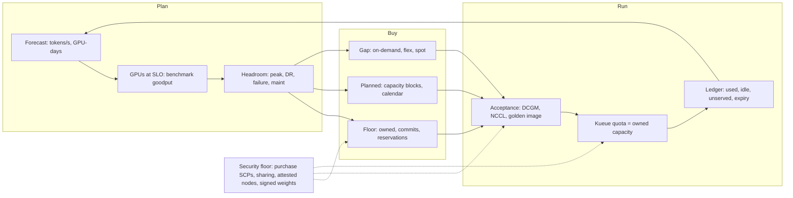

# Lesson 38 — AI/ML platform: GPU fleet capacity planning & procurement — demand forecasting, reservation mix & lead-time risk for inference and training

*2026-10-16*

## What interviewers are really probing

[Lesson 36](/lessons/36-multi-region-dr-failover-inference) and [Lesson 37](/lessons/37-chaos-engineering-dr-game-days-gpu-inference) ended on the same uncomfortable finding: **the most common DR failure is no GPU capacity in the survivor.** [Lesson 26](/lessons/26-gpu-cost-attribution-reclaim-spot) taught you to *attribute* and *reclaim* GPU spend. This lesson is the step before both: **how many GPUs should exist, where, bought how, and how early?** At 10K+ nodes, a capacity plan is a multi-million-dollar bet made months before the demand shows up, and the platform team is usually the one holding the spreadsheet when it is wrong.

The interview version: *"Product says chat traffic doubles next quarter and research wants a 6-week 512-GPU run in February. Walk me through how you'd plan and buy the capacity."* They are listening for **demand converted to GPUs at SLO** (not at 100% utilisation), **explicit headroom terms** (peak, N+1, DR survivor, failure tax), a **portfolio of purchase instruments** matched to demand shape, **lead time treated as a risk with owners and dates**, and the boring truth that **new capacity is untrusted until it passes acceptance**.

Cross-links: [L18](/lessons/18-gpu-node-pools-mig-timeslicing) (SKU pools), [L19](/lessons/19-gpu-topology-nvlink-rdma-nccl) (topology), [L20](/lessons/20-training-inference-scheduling-kueue-volcano) (Kueue), [L21](/lessons/21-inference-serving-slos-ttft-tpot-kvcache) (KV seats, TTFT/TPOT), [L23](/lessons/23-gpu-observability-dcgm-nccl-roofline) (DCGM/NCCL), [L24](/lessons/24-multi-cluster-inference-routing-capacity) (multi-cluster routing), [L25](/lessons/25-multi-tenant-gpu-isolation-quota) (quota), [L26](/lessons/26-gpu-cost-attribution-reclaim-spot) (reserved vs spot $), [L27](/lessons/27-gpu-supply-chain-weight-registry-hydrate) (hydrate), [L28](/lessons/28-inference-autoscaling-scale-to-zero) (autoscaling), [L29](/lessons/29-training-reliability-checkpoint-elastic) (checkpointing), [L36](/lessons/36-multi-region-dr-failover-inference)/[L37](/lessons/37-chaos-engineering-dr-game-days-gpu-inference) (DR). Fuel: [wafer-ai/gpu-perf-engineering-resources](https://github.com/wafer-ai/gpu-perf-engineering-resources).

What they check for:

- **Demand in the right unit.** Inference is forecast in **tokens/s per model per tier at peak**, then converted with a **benchmarked goodput-per-node at SLO**. Training is forecast in **GPU-days per run** on a calendar. "GPU utilisation" is not a demand unit.
- **Headroom you can name.** Peak burst (cold start is minutes, [L28](/lessons/28-inference-autoscaling-scale-to-zero)), N+1 cell or region for DR ([L36](/lessons/36-multi-region-dr-failover-inference)), a **failure tax** for nodes in repair, a maintenance tax for driver rollouts, and fragmentation loss from whole-node TP replicas.
- **Instruments matched to shape.** Owned or committed for the sure floor, capacity reservations for what must be guaranteed, **time-boxed blocks** for planned training, flexible/queued provisioning for deferrable batch, on-demand and spot for the rest ([L26](/lessons/26-gpu-cost-attribution-reclaim-spot)).
- **Lead time is the planning horizon.** New SKUs arrive in allocations months out, owned racks are gated by power and network, and reservations have **expiry cliffs**. Quota is not capacity.
- **A loop, not a plan.** Forecast error, reserved utilisation, unserved demand and expiry dates are reviewed on a cadence and fed back into the next buy.
- **Security on the buying side.** Purchasing APIs are a spend and blast-radius risk, shared reservations are a cross-account trust edge, and fresh or rented capacity must not receive model weights until it is attested.

**Interview sentence:** "I forecast inference in peak tokens/s per model and tier at P50 and P90, convert it with a goodput-per-node number I benchmarked at the TTFT/TPOT SLO, then add named headroom: DR survivor for paid traffic, a failure tax, maintenance and fragmentation. I **reserve the floor I'd be fired for not having**, which is usually the paid-tier DR posture, and rent the P90 gap with on-demand, capacity blocks or flex provisioning. Training runs get time-boxed blocks booked with slip buffer and a checkpoint plan for the end of the block. Every new node passes DCGM and NCCL acceptance on a signed golden image before Kueue counts it as quota or it ever sees a weight."

## Core diagram: Forecast → GPUs at SLO → Headroom → Supply portfolio → Accept & place → Ledger (+ security floor)




**How to read it:** the arrow from the ledger back to the forecast is the whole job. A plan that is not compared against what actually happened becomes a ritual. Headroom fans out into three supply tiers because no single instrument is both cheap and guaranteed and flexible. Everything funnels through acceptance, because capacity you have not tested is a liability with a bill attached.

## Idiosyncrasies / operator depth

### 1. Convert demand to GPUs at SLO, not at peak throughput

The single most common capacity mistake is using the vendor's or the max-throughput benchmark number. Throughput at saturation is the number you get when TTFT is already blown. You want **goodput at SLO**: the highest load where TTFT p99 and TPOT p99 still meet target on **your** prompt and output length mix ([L21](/lessons/21-inference-serving-slos-ttft-tpot-kvcache)).

| Input | How you get it | Gotcha |
|---|---|---|
| **Peak tokens/s per model per tier** | Router/gateway metrics, 5-minute peaks, not daily averages | Daily averages hide a 2–3x diurnal peak |
| **Prompt/output length mix** | Sampled from production logs (lengths only, never content) | Agent workloads ([L34](/lessons/34-agent-tool-sandboxing-egress-policy)) have long prompts; prefill-heavy mixes collapse goodput |
| **Goodput per node at SLO** | Load test the exact engine, quantisation, TP degree and SKU | Re-benchmark every engine or weight upgrade; a new version can move it 30% either way |
| **Replica granularity** | TP x PP GPUs per replica, whole nodes for NVLink domains ([L19](/lessons/19-gpu-topology-nvlink-rdma-nccl)) | 3 GPUs needed means 4 bought; fragmentation is real |
| **Training GPU-days** | Model FLOPs / (per-GPU FLOPs x MFU) plus restart and eval overhead | MFU assumptions are optimistic; budget 10–20% for failures and restarts ([L29](/lessons/29-training-reliability-checkpoint-elastic)) |

**Gotcha:** "GPU utilisation is only 40%, we're over-provisioned." For decode-bound inference, `DCGM_FI_DEV_GPU_UTIL` says almost nothing about headroom ([L23](/lessons/23-gpu-observability-dcgm-nccl-roofline)). KV cache occupancy and TTFT burn are the capacity signals.

### 2. Name every headroom term (worked example)

*Illustrative numbers for the method, not real benchmarks.* A 70B chat model, three active-active regions, benchmark says one 8-GPU node serves **9,000 output tokens/s at SLO**.

| Term | Value | Nodes |
|---|---|---|
| P50 peak forecast (all tiers) | 1.8M tok/s | 200 |
| P90 peak forecast (all tiers) | 2.4M tok/s | 267 |
| Paid tier share | 60% of tokens | P90 paid = 160 |
| DR posture | Survive loss of 1 of 3 regions **for paid tier at SLO**; free tier sheds | Any two regions must hold 160, so fleet = 160 x 3/2 = **240** |
| Failure + maintenance tax | ~4% in repair, ~3% draining for rollouts | divide by 0.93 |
| **Guaranteed floor** | max(P50 all tiers, DR paid) / 0.93 = max(200, 240) / 0.93 | **≈258 reserved** |
| **P90 normal** | 267 / 0.93 | ≈287 |
| **Rented gap** | 287 − 258 | **≈29 nodes** on-demand / blocks for launch weeks |

Two things interviewers love here:

- **DR headroom must be reserved, not rented.** The moment you need survivor capacity is the moment every other tenant in that region is also failing over. On-demand during a regional event is a lottery ([L37](/lessons/37-chaos-engineering-dr-game-days-gpu-inference) drills ICE on purpose).
- **Headroom is fungible only if policy allows it.** When all three regions are healthy, that DR slack is idle. Lend it to preemptible batch and eval through Kueue cohorts ([L20](/lessons/20-training-inference-scheduling-kueue-volcano)) so reserved-idle is not pure burn, with reclaim fast enough to meet the RTO.

### 3. The instrument menu (and what each is actually for)

| Instrument | Guarantee | Commitment | Best for | Operator gotcha |
|---|---|---|---|---|
| **Owned / colo racks** | Yes, once racked | Years, capex | Huge steady base load | 6–12+ month lead; gated by power, cooling and IB/RoCE fabric; you own the RMA queue |
| **1–3 yr commits / savings plans / CUDs** | Price only (usually no capacity guarantee) | 1–3 yr spend | Sure baseline | A discount is not a capacity guarantee; pair with reservations |
| **On-Demand Capacity Reservations (ODCR)** / Azure capacity reservations / GCP reservations | Yes, in a zone | Pay whether used or not; future-dated ODCRs add a start date and commitment term | Inference floor, DR survivor | `targeted` vs `open` matching; idle reservation still bills |
| **EC2 Capacity Blocks for ML** | Yes, for a fixed window | Prepaid block, 1 day up to 26 weeks, bookable up to 8 weeks ahead, up to 64 instances | Planned training, launches, benchmarks | Hard end time: instances are reclaimed at block end, so checkpoint before it |
| **GCP DWS Calendar mode (future reservations)** | Yes, for the window | Up to 90 days | Fine-tunes, short runs with fixed dates | Supported SKUs vary; check the consumption-option table |
| **GCP DWS Flex-start (queued provisioning)** | Eventual, all-or-nothing gangs | Pay as you go, runs up to 7 days | Deferrable batch, small training | Requests can wait days; set a validity window |
| **On-demand** | None | None | Unpredicted spikes | Insufficient-capacity errors exactly at peak |
| **Spot / preemptible** | None, interruptible | None | Checkpointed batch, eval | Never the DR plan, never SLO inference ([L26](/lessons/26-gpu-cost-attribution-reclaim-spot)) |
| **Neocloud / second cloud** | Contractual | Often multi-month | Overflow, new SKUs early | New trust boundary: identity, network, weight transport (see Security) |

**Rule of thumb:** reserve the P50 floor and the DR posture, book blocks for anything with a date, queue anything deferrable, and rent only the remaining P90 gap.

### 4. Training capacity is a calendar problem

- A 6-week, 512-GPU run on 8-GPU nodes is 64 nodes, which happens to be exactly one maximum-size Capacity Block. Larger runs need multiple blocks, which might not land in the same UltraCluster or spine, so check placement before you assume NCCL bandwidth ([L19](/lessons/19-gpu-topology-nvlink-rdma-nccl)).
- **Book slip buffer.** Data pipelines and code freeze always slip. A block that starts before you are ready is spend with no output; a block that ends mid-run without a checkpoint loses days ([L29](/lessons/29-training-reliability-checkpoint-elastic)).
- **Chain or overlap blocks** for long runs, and rehearse moving the job between blocks: restore from checkpoint on new nodes, re-run acceptance, re-verify NCCL rings.
- **Spare nodes inside the block.** Budget 2–5% spare nodes so a failed node is replaced from the block, not from on-demand.

### 5. Lead-time risk register (own it like an SLO)

| Risk | Signal | Mitigation |
|---|---|---|
| **New SKU allocation slips** | Vendor/provider date moves | Plan on the current SKU; treat the new SKU as upside until racked and accepted |
| **Reservation expiry cliff** | Expiry inside 8 weeks with no renewal | Expiry calendar alerts at 8/4/2 weeks; renew or migrate before, not after |
| **Quota is not capacity** | Quota approved, `InsufficientInstanceCapacity` at launch | Only reservations and blocks count as guaranteed in the plan |
| **AZ/region concentration** | More than ~50% of a model's floor in one AZ | Spread reservations; route with [L24](/lessons/24-multi-cluster-inference-routing-capacity) |
| **Acceptance fallout** | 1–5% of new nodes fail burn-in | Order with overage; RMA tracked in the ledger |
| **Power and fabric (owned)** | Rack delivered, no power or IB ports | Facilities and network in the same critical path as the PO |
| **Forecast error** | MAPE trending up for a model | Widen P90 band, shift more to flexible instruments |

### 6. The capacity ledger and review cadence

The ledger is one table, versioned, and it drives Kueue quota and the buy plan:

- Per **SKU x region x AZ x instrument**: owned count, accepted count, in-repair count, allocated quota, actual peak used, idle, expiry date.
- **Unserved demand**: queue wait time in Kueue, 429s and shed requests at the router, insufficient-capacity error counts. Idle and unserved together tell you whether you are over-bought or in the wrong place.
- **Weekly**: forecast vs actual per model, reserved utilisation, expiries in 8 weeks. **Monthly**: re-plan buys. **Quarterly**: exec view in $ per 1M tokens and $ per training run.
- Capacity changes (reservations, NodePool limits, Kueue quotas) go through Git and review like Terraform ([L15](/lessons/15-terraform-atlantis-fleet-scale)).

### 7. Classic gotchas

- Sizing from max-throughput benchmarks instead of goodput at SLO.
- Counting approved quota or a savings plan as guaranteed capacity.
- Kueue `nominalQuota` higher than accepted nodes, so admitted workloads sit Pending forever.
- One giant reservation in one AZ "for packing efficiency" that becomes your single point of failure.
- Capacity Block ends mid-run because the training start slipped a week.
- Upgrading the engine or quantisation and not re-benchmarking, so the plan is off by 30%.
- New capacity joining the fleet straight from the provider image, before acceptance and before the hardened golden image.

## Concrete commands & config

### Inventory: what do we actually have?

```bash
# Nodes by SKU, capacity type and reservation (Karpenter labels)
kubectl get nodes -L node.kubernetes.io/instance-type,karpenter.sh/capacity-type,karpenter.k8s.aws/capacity-reservation-id,karpenter.k8s.aws/capacity-reservation-type,topology.kubernetes.io/zone \
  | sort -k6

# GPUs allocatable vs requested, fleet-wide
kubectl get nodes -o json | jq -r '[.items[] | (.status.allocatable["nvidia.com/gpu"] // "0" | tonumber)] | add'
kubectl get pods -A -o json | jq -r '[.items[] | select(.status.phase=="Running") | .spec.containers[].resources.requests["nvidia.com/gpu"] // "0" | tonumber] | add'

# AWS: reservations, utilisation and expiry
aws ec2 describe-capacity-reservations \
  --query 'CapacityReservations[].[CapacityReservationId,InstanceType,AvailabilityZone,TotalInstanceCount,AvailableInstanceCount,State,EndDate,ReservationType]' \
  --output table
```

`AvailableInstanceCount` greater than zero for days is reserved-idle: either lend it through Kueue or shrink the reservation at renewal.

### AWS: find and buy a Capacity Block for a training run

```bash
# 64 x p5.48xlarge for 14 days (336 h), starting within a window
aws ec2 describe-capacity-block-offerings \
  --instance-type p5.48xlarge --instance-count 64 \
  --capacity-duration-hours 336 \
  --start-date-range 2026-12-01T00:00:00Z --end-date-range 2026-12-15T00:00:00Z \
  --query 'CapacityBlockOfferings[].[CapacityBlockOfferingId,AvailabilityZone,StartDate,EndDate,UpfrontFee]' --output table

# Purchase (capacity account only; gated by SCP + approval, see Security)
aws ec2 purchase-capacity-block \
  --capacity-block-offering-id cb-0123456789abcdef0 \
  --instance-platform Linux/UNIX \
  --tag-specifications 'ResourceType=capacity-reservation,Tags=[{Key=team,Value=research},{Key=run,Value=llm-405b-pretrain}]'
```

### AWS: an inference floor reservation (future-dated)

```bash
# --commitment-duration is in seconds (1209600 = 14-day minimum term in this example)
aws ec2 create-capacity-reservation \
  --instance-type p5.48xlarge --instance-platform Linux/UNIX \
  --availability-zone us-east-1a --instance-count 32 \
  --instance-match-criteria targeted \
  --start-date 2026-11-15T00:00:00Z --commitment-duration 1209600 \
  --end-date-type unlimited \
  --tag-specifications 'ResourceType=capacity-reservation,Tags=[{Key=pool,Value=serve-chat-floor}]'
```

`targeted` means only launches that name the reservation (or a Karpenter EC2NodeClass that selects it) consume it, so random on-demand launches cannot eat your DR floor.

### Karpenter: consume reservations first, then on-demand

```yaml
apiVersion: karpenter.k8s.aws/v1
kind: EC2NodeClass
metadata: {name: gpu-reserved}
spec:
  amiSelectorTerms:
  - alias: bottlerocket@latest        # pin a signed golden AMI id in prod instead of @latest
  role: KarpenterNodeRole-gpu
  subnetSelectorTerms: [{tags: {karpenter.sh/discovery: serve-us-east-1}}]
  securityGroupSelectorTerms: [{tags: {karpenter.sh/discovery: serve-us-east-1}}]
  capacityReservationSelectorTerms:
  - tags: {pool: serve-chat-floor}
    ownerID: "111122223333"           # capacity account; never "any account that shares with us"
---
apiVersion: karpenter.sh/v1
kind: NodePool
metadata: {name: gpu-serve-floor}
spec:
  weight: 100
  template:
    spec:
      nodeClassRef: {group: karpenter.k8s.aws, kind: EC2NodeClass, name: gpu-reserved}
      requirements:
      - {key: karpenter.sh/capacity-type, operator: In, values: ["reserved", "on-demand"]}
      - {key: node.kubernetes.io/instance-type, operator: In, values: ["p5.48xlarge"]}
      taints:
      - {key: nvidia.com/gpu, effect: NoSchedule}
      - {key: capacity.acme.io/unaccepted, effect: NoSchedule}   # removed by acceptance job
  limits:
    nvidia.com/gpu: "2304"            # 288 nodes x 8: the P90 plan, not infinity
```

Karpenter prioritises selected reservations before on-demand. The `limits` block is the plan encoded; without it, a runaway autoscaler is an unplanned purchase.

### Kueue: quota tracks accepted, owned capacity

```yaml
apiVersion: kueue.x-k8s.io/v1beta2    # v1beta1 on older Kueue releases (L20)
kind: ResourceFlavor
metadata: {name: h100-reserved}
spec:
  nodeLabels: {karpenter.sh/capacity-type: reserved, node.kubernetes.io/instance-type: p5.48xlarge}
---
apiVersion: kueue.x-k8s.io/v1beta2
kind: ProvisioningRequestConfig
metadata: {name: gpu-check-capacity}
spec:
  provisioningClassName: check-capacity.autoscaling.x-k8s.io   # admit only if capacity can be provisioned
  managedResources: ["nvidia.com/gpu"]
  retryStrategy: {backoffLimitCount: 2, backoffBaseSeconds: 60, backoffMaxSeconds: 1800}
```

Set each ClusterQueue's `nominalQuota` for `h100-reserved` from the ledger's **accepted** count, and let batch borrow DR slack within the cohort with reclaim. On GKE, the `queued-provisioning.gke.io` class backs DWS Flex-start all-or-nothing gangs.

### GKE: flex-start node pool for deferrable batch

```bash
gcloud container node-pools create batch-h100-flex \
  --cluster=train-us-central1 --location=us-central1 \
  --machine-type=a3-highgpu-8g --accelerator=type=nvidia-h100-80gb,count=8 \
  --flex-start --enable-queued-provisioning \
  --enable-autoscaling --num-nodes=0 --total-min-nodes=0 --total-max-nodes=32 \
  --reservation-affinity=none --no-enable-autorepair
```

Queued provisioning wants autorepair off so nodes are not swapped mid-gang; pair it with your own health remediation ([L23](/lessons/23-gpu-observability-dcgm-nccl-roofline)).

### Acceptance: no node counts until it passes

```bash
# Per node: long DCGM diagnostic (run level 3; level 4 for new SKUs/vendors)
dcgmi diag -r 3 -j | jq '.DCGM_GPU_Diagnostic.test_categories[].tests[] | select(.results[].status != "Pass")'

# Per rack / block: NCCL all-reduce bus bandwidth vs baseline (nccl-tests)
mpirun -np 64 -N 8 --hostfile block.hosts \
  ./build/all_reduce_perf -b 1G -e 8G -f 2 -g 1 | tee nccl-accept.log
# Fail the node set if busbw is more than ~10% below the SKU baseline

# Only then: remove the unaccepted taint and record in the ledger
kubectl taint node "$NODE" capacity.acme.io/unaccepted:NoSchedule-
kubectl label node "$NODE" capacity.acme.io/accepted=$(date +%F) capacity.acme.io/baseline=nccl-ok
```

### Forecast vs actual (PromQL sketches)

```promql
# Peak output tokens/s per model, 5m resolution, last 28 days
max_over_time(sum by (model) (rate(llm_output_tokens_total[5m]))[28d:5m])

# Reserved-idle GPUs (reserved nodes with no GPU pods)
sum(kube_node_status_allocatable{resource="nvidia_com_gpu"} * on(node) group_left kube_node_labels{label_karpenter_sh_capacity_type="reserved"})
  - sum(kube_pod_container_resource_requests{resource="nvidia_com_gpu"} * on(node) group_left kube_node_labels{label_karpenter_sh_capacity_type="reserved"})

# Unserved demand: Kueue workloads waiting for GPU quota
sum by (cluster_queue) (kueue_pending_workloads{status="inadmissible"})
```

## Failures & fixes

| Symptom | Likely cause | Fix / mitigation |
|---|---|---|
| Plan said 200 nodes, TTFT blown at 150 | Sized from max-throughput, not goodput at SLO; long-prompt mix | Re-benchmark at SLO with production length mix; re-run on every engine upgrade |
| `InsufficientInstanceCapacity` during failover | DR survivor relied on on-demand | Reserve the DR posture for paid tiers; drill it ([L37](/lessons/37-chaos-engineering-dr-game-days-gpu-inference)) |
| Reservations 30% idle for months | Forecast bias high; floor sized to P90 | Lend slack to preemptible batch via Kueue cohorts; resize at renewal; floor to P50/DR only |
| Training run lost 3 days at block end | Start slipped, block end is hard | Slip buffer, chained blocks, checkpoint cadence tied to block end |
| Workloads admitted, pods Pending | Kueue quota > accepted nodes | Quota from the ledger's accepted count; `check-capacity` ProvisioningRequest |
| Random dev launch consumed the DR floor | Reservation `open` matching | `targeted` reservations selected only by the serving NodeClass |
| New nodes cause NCCL hangs in week one | Skipped acceptance; bad cable or GPU | Unaccepted taint until DCGM diag + NCCL baseline pass; RMA fallout tracked |
| Whole model down with one AZ | Floor concentrated in one AZ | Spread reservations; router can shift ([L24](/lessons/24-multi-cluster-inference-routing-capacity)) |
| Expiry surprise on Monday | No expiry calendar | Alerts at 8/4/2 weeks; renewals owned in the ledger |
| Surprise six-figure bill | Someone bought a block in a sandbox account | SCP deny purchase APIs outside the capacity account; budget alarms |

## Security & hardening

**Capacity is money, trust and blast radius at once.** Whoever can buy, share or launch into GPU capacity can spend millions, plant capacity in an unmonitored account, or bring up nodes that receive your model weights. Treat the procurement path with the same rigour as the deploy path ([L12](/lessons/12-node-container-hardening-supply-chain)–[L14](/lessons/14-ml-inference-training-deploy-hardening)).

### Procurement APIs and accounts

| Control | Threat | Practice |
|---|---|---|
| **Dedicated capacity account** | Reservations scattered across team accounts, nobody sees idle or expiry | Buy in one capacity account; share out deliberately |
| **SCP deny outside it** | Compromised or careless principal buys blocks or reservations | SCP deny `ec2:PurchaseCapacityBlock`, `ec2:CreateCapacityReservation`, `ec2:PurchaseReservedInstancesOffering`, savings plan purchase, outside the capacity account and approved regions |
| **Two-person approval** | One person commits $ millions | Purchases go through a reviewed PR + pipeline role (Atlantis, [L15](/lessons/15-terraform-atlantis-fleet-scale)); humans have no direct purchase permission |
| **Budgets and anomaly alerts** | Silent spend from a runaway NodePool or a stolen key mining on GPUs | Cost anomaly detection, NodePool `limits`, alarms on new GPU instances outside expected accounts |
| **Audit** | No trail of who bought or launched what | CloudTrail on purchase, share and `RunInstances` with reservation id; stored in a read-only evidence bucket |

```json
{
  "Version": "2012-10-17",
  "Statement": [{
    "Sid": "DenyGpuCapacityPurchaseOutsideCapacityAccount",
    "Effect": "Deny",
    "Action": [
      "ec2:PurchaseCapacityBlock",
      "ec2:CreateCapacityReservation",
      "ec2:PurchaseReservedInstancesOffering",
      "savingsplans:CreateSavingsPlan"
    ],
    "Resource": "*",
    "Condition": {
      "StringNotEquals": {"aws:PrincipalAccount": "111122223333"}
    }
  }]
}
```

### Shared reservations are a cross-account trust edge

| Control | Threat | Practice |
|---|---|---|
| **Share to named accounts** | Reservation shared to the whole org; any account can consume DR capacity | AWS RAM share to specific serving accounts only, never the org root |
| **Pin `ownerID`** in Karpenter selectors | Node class consumes a reservation shared by an unexpected account | `capacityReservationSelectorTerms` with `ownerID` of the capacity account |
| **`targeted` matching** | Unrelated workloads drain the floor | Only the serving NodeClass can launch into it |

### New, rented or second-cloud capacity is untrusted until accepted

| Control | Threat | Practice |
|---|---|---|
| **Golden signed image only** | Provider default image with extra agents or stale drivers | Pinned, signed AMI/OS image with known driver, CUDA, fabric manager and firmware baseline |
| **Unaccepted taint** | Workloads land before burn-in | Nothing schedules until DCGM diag and NCCL acceptance pass |
| **Firmware and driver attestation** | Unknown firmware on rented bare metal | Record GPU VBIOS, NIC and BMC firmware versions in the ledger; reject unknowns; measured boot or TPM attestation where the provider supports it |
| **Neocloud isolation** | Shared tenancy, flat networks, provider admin access | Dedicated nodes, private interconnect, your own CNI policy ([L09](/lessons/09-networkpolicy-multi-nic-sflow)), no provider-managed shared storage for weights |

### Model weights, checkpoints & deployments on new capacity

| Control | Threat | Practice |
|---|---|---|
| **Signed weights only** | "Just copy the checkpoint to the new cluster" over an ad hoc bucket | Regional signed mirror, cosign/digest verification at admission ([L13](/lessons/13-ml-weights-checkpoint-hardening)/[L27](/lessons/27-gpu-supply-chain-weight-registry-hydrate)) |
| **GetObject-only identity** | New cluster's workload role can write to `models/*` | Per-cluster workload identity, read-only on the promoted prefix; KMS key per region |
| **No public-hub fallback** | New region without a mirror pulls from a public hub | Pre-hydrate before the capacity is counted; admission denies unknown digests |
| **Checkpoint residency** | Training checkpoints shipped to a second cloud in another jurisdiction | Data-residency check and encryption with your keys before any transfer; checkpoints never served directly ([L14](/lessons/14-ml-inference-training-deploy-hardening)) |
| **Same deploy floor** | Capacity rush deploys with `privileged: true` or hostPath model mounts | PSS restricted, admission and NetworkPolicy identical to existing clusters ([L11](/lessons/11-cluster-security-pss-admission-rbac)) |

## Interview soundbites

- "I forecast inference in peak tokens per second per model and tier, and I convert it with goodput I measured at the SLO, not the benchmark's max throughput."
- "Headroom is a list of named terms: peak, DR survivor, failure tax, maintenance, fragmentation. If you can't name it, you can't defend it to finance."
- "DR capacity has to be reserved. During a regional event everyone else wants the same on-demand GPUs."
- "I reserve the floor I'd be fired for not having, book blocks for anything with a date, queue anything deferrable, and rent the rest."
- "Quota isn't capacity, and a savings plan isn't a reservation."
- "Idle reservation is lent to preemptible batch through Kueue, with reclaim fast enough to hit the RTO."
- "Every training block has a slip buffer and a checkpoint planned for its end time."
- "New capacity is untrusted until it passes DCGM and NCCL acceptance on a signed golden image. Only then does Kueue count it or does it see a weight."
- "Only one account can buy GPU capacity, through a reviewed pipeline. Everyone else is denied by SCP."

## How this maps to the JD

At 100+ clusters and 10K+ nodes ([L1](/lessons/01-hyperscale-mental-model)), GPU capacity is the largest line item and the hardest constraint. The JD's "design tradeoffs" bullet ([L17](/lessons/17-systems-design-tradeoffs)) shows up here as reserved-vs-rented, cost-vs-DR-posture and owned-vs-cloud decisions. Kueue quotas ([L20](/lessons/20-training-inference-scheduling-kueue-volcano)/[L25](/lessons/25-multi-tenant-gpu-isolation-quota)), Karpenter NodePools and reservations as code (Terraform/Atlantis, [L15](/lessons/15-terraform-atlantis-fleet-scale)) are the tools you encode the plan in. For a DevSecOps or Platform role, being the person who can say "here is the forecast, the headroom math, the buy, and the SCP that stops anyone else buying" is senior-level signal.

## Watch (talks & demos)

### AWS re:Invent 2025 — Managing Amazon EC2 capacity and availability (CMP331)

AWS Events. Covers how On-Demand, capacity reservations, Capacity Blocks for ML and spot fit together, when to use blocks (planned training, launches, experiments before committing), sharing unused capacity across an organisation, and EC2 Capacity Manager for central visibility. Operator takeaway: the vocabulary and trade-offs behind the reservation-mix table above.

<iframe width="100%" height="360" src="https://www.youtube.com/embed/soZfsq46bbA" title="AWS re:Invent 2025 - Managing Amazon EC2 capacity and availability (CMP331)" frameBorder="0" allow="accelerometer; autoplay; clipboard-write; encrypted-media; gyroscope; picture-in-picture; web-share" allowFullScreen></iframe>

[Open on YouTube](https://www.youtube.com/watch?v=soZfsq46bbA)

### Improve GPU/TPU Obtainability with DWS Flex Start on GKE

Google Cloud Tech, about 10 minutes. Dynamic Workload Scheduler Flex-start and Calendar mode, gang scheduling with queued provisioning, and a mapping of workload types to consumption options. Operator takeaway: how to move deferrable training and batch off the guaranteed floor without losing all-or-nothing gang semantics.

<iframe width="100%" height="360" src="https://www.youtube.com/embed/oG-E4-1uQCM" title="Improve GPU/TPU Obtainability with DWS Flex Start on GKE" frameBorder="0" allow="accelerometer; autoplay; clipboard-write; encrypted-media; gyroscope; picture-in-picture; web-share" allowFullScreen></iframe>

[Open on YouTube](https://www.youtube.com/watch?v=oG-E4-1uQCM)

### Intelligent compute infrastructure: Design for performance, reliability, and cost

Google Cloud Events. Walks through Calendar mode vs Flex-start vs reservations with concrete scenarios (a fixed training week vs "one day sometime next week" vs continuous demand). Operator takeaway: a clean way to explain to an interviewer why different demand shapes deserve different instruments.

<iframe width="100%" height="360" src="https://www.youtube.com/embed/-C3WogRTNUU" title="Intelligent compute infrastructure: Design for performance, reliability, and cost" frameBorder="0" allow="accelerometer; autoplay; clipboard-write; encrypted-media; gyroscope; picture-in-picture; web-share" allowFullScreen></iframe>

[Open on YouTube](https://www.youtube.com/watch?v=-C3WogRTNUU)

## References

- AWS: [Capacity Blocks for ML](https://aws.amazon.com/ec2/capacityblocks/) · [Capacity Blocks user guide](https://docs.aws.amazon.com/AWSEC2/latest/UserGuide/ec2-capacity-blocks.html) · [On-Demand Capacity Reservations](https://docs.aws.amazon.com/AWSEC2/latest/UserGuide/ec2-capacity-reservations.html) · [Shared reservations](https://docs.aws.amazon.com/AWSEC2/latest/UserGuide/capacity-reservations-shared.html) · [EC2 Capacity Manager](https://docs.aws.amazon.com/AWSEC2/latest/UserGuide/capacity-manager.html) · [`describe-capacity-block-offerings`](https://docs.aws.amazon.com/cli/latest/reference/ec2/describe-capacity-block-offerings.html) · [`purchase-capacity-block`](https://docs.aws.amazon.com/cli/latest/reference/ec2/purchase-capacity-block.html) · [Service Quotas](https://docs.aws.amazon.com/servicequotas/latest/userguide/intro.html) · [SCPs](https://docs.aws.amazon.com/organizations/latest/userguide/orgs_manage_policies_scps.html)
- GCP: [GKE accelerator consumption options](https://docs.cloud.google.com/kubernetes-engine/docs/concepts/consumption-option) · [Flex-start (DWS)](https://docs.cloud.google.com/kubernetes-engine/docs/concepts/dws) · [Future reservations in calendar mode](https://docs.cloud.google.com/compute/docs/instances/future-reservations-calendar-mode-overview)
- Azure: [On-demand capacity reservation](https://learn.microsoft.com/en-us/azure/virtual-machines/capacity-reservation-overview)
- Kubernetes: [Karpenter NodeClasses (capacityReservationSelectorTerms)](https://karpenter.sh/docs/concepts/nodeclasses/) · [Karpenter NodePools](https://karpenter.sh/docs/concepts/nodepools/) · [Kueue ProvisioningRequest admission check](https://kueue.sigs.k8s.io/docs/concepts/admission_check/provisioning_request/) · [MultiKueue](https://kueue.sigs.k8s.io/docs/concepts/multikueue/)
- Acceptance: [DCGM diagnostics](https://docs.nvidia.com/datacenter/dcgm/latest/user-guide/dcgm-diagnostics.html) · [nccl-tests](https://github.com/NVIDIA/nccl-tests)
- [wafer-ai/gpu-perf-engineering-resources](https://github.com/wafer-ai/gpu-perf-engineering-resources) — AI/ML platform fuel
- Prior: [37 — Chaos / DR game days](/lessons/37-chaos-engineering-dr-game-days-gpu-inference) · [36 — Multi-region DR](/lessons/36-multi-region-dr-failover-inference) · [29 — Training reliability](/lessons/29-training-reliability-checkpoint-elastic) · [28 — Inference autoscaling](/lessons/28-inference-autoscaling-scale-to-zero) · [27 — GPU supply chain / hydrate](/lessons/27-gpu-supply-chain-weight-registry-hydrate) · [26 — GPU cost / reclaim / spot](/lessons/26-gpu-cost-attribution-reclaim-spot) · [25 — Multi-tenant quota](/lessons/25-multi-tenant-gpu-isolation-quota) · [24 — Multi-cluster routing](/lessons/24-multi-cluster-inference-routing-capacity) · [21 — Inference SLOs](/lessons/21-inference-serving-slos-ttft-tpot-kvcache) · [20 — Kueue / Volcano](/lessons/20-training-inference-scheduling-kueue-volcano) · [19 — Topology / NCCL](/lessons/19-gpu-topology-nvlink-rdma-nccl) · [18 — SKU pools](/lessons/18-gpu-node-pools-mig-timeslicing) · [15 — Terraform / Atlantis](/lessons/15-terraform-atlantis-fleet-scale) · [13 — ML weights](/lessons/13-ml-weights-checkpoint-hardening)
- Next: **Lesson 39 — AI/ML platform: GPU fleet lifecycle — node acceptance, burn-in, firmware/driver rollouts & RMA at 10K+ GPUs**

## Quick self-check

Out loud, in under two minutes each:

1. Product forecasts 2.4M output tokens/s at P90 peak. Walk from that number to a node count, naming every headroom term and where the per-node figure came from.
2. Why must the paid-tier DR survivor capacity be reserved rather than on-demand, and how do you stop that reserved slack from being pure waste on a normal day?
3. Research wants 512 GPUs for 6 weeks starting "early February." Which instrument, how far ahead, what buffer, and what happens on the block's last day?
4. Your Kueue ClusterQueue admits jobs that then sit Pending for hours. Name two capacity-plan causes and the fix for each.
5. A neocloud offers 1,000 H100s next month. List the security conditions that must be true before a single model weight lands on those nodes.
