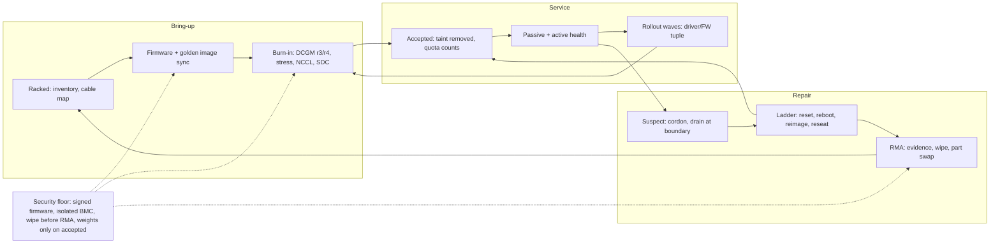

# Lesson 39 — AI/ML platform: GPU fleet lifecycle — node acceptance, burn-in, firmware/driver rollouts & RMA at 10K+ GPUs

*2026-10-17*

## What interviewers are really probing

[Lesson 38](/lessons/38-gpu-fleet-capacity-planning-procurement) ended with a rule: **new capacity is untrusted until it passes acceptance.** This lesson is what "acceptance" actually means, and what happens for the next three to five years of that node's life: burn-in, a steady stream of driver and firmware rollouts, a slow trickle of hardware faults, and the RMA loop that sends parts back to the vendor and brings nodes back into the fleet. At 10K+ GPUs this is not an occasional event. On any given day some percentage of your fleet is being burned in, upgraded, quarantined or waiting on a replacement part, and the platform team's job is to make that a boring, automated state machine instead of a Slack thread.

The interview version: *"2,000 new H100 nodes land next month, and the same week NVIDIA publishes a driver security bulletin. Walk me through how those nodes get into production and how you roll the fix across 10,000 GPUs without killing a 4,000-GPU training run."* They are listening for **an explicit node state machine**, **burn-in that tests what production actually uses** (NVLink, the fabric, sustained thermals, not just "GPU detected"), **one versioned compatibility tuple** for driver, CUDA, fabric manager and firmware, **waves scoped by blast radius with automatic halts**, **failure classification** so you don't RMA a GPU for a user's bug, and **a repair budget** that stops automation from draining the fleet when the real problem is systemic.

Cross-links: [L03](/lessons/03-cluster-provisioning-lifecycle) (cluster lifecycle), [L12](/lessons/12-node-container-hardening-supply-chain) (node hardening), [L15](/lessons/15-terraform-atlantis-fleet-scale) (change as code), [L16](/lessons/16-temporal-argo-workflows) (workflow engines), [L18](/lessons/18-gpu-node-pools-mig-timeslicing) (SKU pools), [L19](/lessons/19-gpu-topology-nvlink-rdma-nccl) (NVLink/NCCL), [L20](/lessons/20-training-inference-scheduling-kueue-volcano) (Kueue), [L23](/lessons/23-gpu-observability-dcgm-nccl-roofline) (DCGM, Xid, NCCL canaries), [L27](/lessons/27-gpu-supply-chain-weight-registry-hydrate) (hydrate), [L29](/lessons/29-training-reliability-checkpoint-elastic) (checkpoints, hot spares), [L35](/lessons/35-fleet-incident-response-gpu-inference-agent-runbooks) (runbooks), [L37](/lessons/37-chaos-engineering-dr-game-days-gpu-inference) (drills), [L38](/lessons/38-gpu-fleet-capacity-planning-procurement) (failure and maintenance tax). Fuel: [wafer-ai/gpu-perf-engineering-resources](https://github.com/wafer-ai/gpu-perf-engineering-resources).

What they check for:

- **Lifecycle as a state machine.** Racked, burn-in, accepted, in service, suspect, repair, RMA, retired. Each state is a label or taint with exactly one controller allowed to move a node between states.
- **Burn-in that matches production.** Long DCGM diagnostics, sustained stress with thermal and power checks, single-node NVLink and multi-node fabric bandwidth against a baseline, and silent-data-corruption checks. Most hardware failures are infant mortality, so this is where you catch them cheaply.
- **One compatibility tuple.** Driver, CUDA user-mode, fabric manager, GPU VBIOS, NVSwitch firmware, NIC firmware and driver, BMC and kernel are versioned together and rolled together. Fabric manager must match the driver version.
- **Waves with halts.** Canary racks, then a small slice of one cell, then cells, each with a bake time and automatic stop on Xid rate, NCCL bandwidth or TTFT regressions. Training rolls at job or checkpoint boundaries.
- **Classify before you remediate.** Xid 13 or 31 is usually the application; Xid 79 is usually the hardware. A remediation ladder (reset, reboot, reimage, reseat, RMA) with repeat-offender tracking.
- **Budgets.** A repair budget and a maintenance budget per pool, and a circuit breaker that stops auto-remediation when too many nodes look broken at once.
- **Security across the lifecycle.** Firmware is supply chain, BMCs are a high-value target, diagnostics run privileged, and nodes going out for RMA carry your weights and credentials unless you wipe them.

**Interview sentence:** "Every node is a state machine encoded as labels and taints. New and repaired nodes come in tainted, run 24 to 72 hours of burn-in (DCGM level 3 or 4, sustained stress, NVLink and fabric NCCL against the SKU baseline, an SDC check) on a signed golden image with the fleet's firmware tuple, and only then does Kueue count them or do they see a weight. Driver and firmware changes are one versioned tuple rolled in waves: canary racks, five percent of a cell, then cell by cell with `maxUnavailable` scoped per pool, a bake window, and an automatic halt on Xid rate or NCCL bandwidth. Training pools roll between jobs or at checkpoints. Faults get classified by Xid before anything happens, go through a reset-reboot-reimage-RMA ladder, and a MachineHealthCheck-style `maxUnhealthy` breaker stops automation from draining the fleet when the real cause is a bad rollout."

## Core diagram: Rack → Burn-in → Accepted → Suspect → Repair/RMA → back to Burn-in (+ rollout waves and security floor)

![GPU fleet lifecycle: a five-stage pipeline from rack and bring-up through 24 to 72 hour burn-in, accepted and in service, suspect and quarantine, and repair or RMA, with a return arrow showing repaired nodes re-entering burn-in; below it firmware and driver rollout waves, an Xid failure taxonomy and the fleet ledger with repair and maintenance budgets, all resting on a security floor for firmware supply chain, golden images, privileged diagnostics, sanitisation before RMA and weight access only on accepted nodes](/gpu-fleet-lifecycle-acceptance-rma.png)



**How to read it:** there are two ways back into burn-in, and both are the point. A node that comes back from RMA is a **new node** (new parts, possibly new firmware) and goes through the full gauntlet. A node that takes a major driver or firmware wave gets a short re-validation before it rejoins. The only arrow that skips burn-in is a light-touch fix on the ladder (a GPU reset that clears a pending row remap, a reboot), and even that must pass a short diagnostic before the taint comes off.

## Idiosyncrasies / operator depth

### 1. The node is a state machine; encode it, and give it one owner

| State | Encoding | Who moves it out | Counts as capacity? |
|---|---|---|---|
| **racked** | Inventory record only; not joined or joined with `lifecycle=racked` taint | Bring-up workflow | No |
| **burn-in** | Taint `lifecycle.acme.io/burnin:NoSchedule`, label `lifecycle.acme.io/state=burnin` | Burn-in controller after verdict | No |
| **accepted** | Taint removed, label `state=accepted`, `baseline=<tuple-id>` | Health controller (to suspect) or rollout controller (to upgrading) | **Yes** |
| **upgrading** | GPU Operator `nvidia.com/gpu-driver-upgrade-state` or your firmware workflow's label | Rollout controller | Counted against the maintenance budget |
| **suspect** | `NoSchedule` taint, NodeCondition `GPUHardwareFault=True` | Remediation workflow | No (failure tax) |
| **repair / RMA** | `state=rma`, node deleted or drained, ticket id label | Datacenter ops, vendor | No |
| **retired** | Removed from inventory, sanitised | — | No |

Gotchas:

- **Two controllers fighting.** The GPU Operator's upgrade controller uncordons a node at `uncordon-required`, while your health controller just cordoned it for a fault. Pick one owner per transition, and make the others check the lifecycle label before acting. The operator's `nvidia.com/gpu-driver-upgrade.skip=true` label exists for exactly this.
- **Cordon is not a state.** `kubectl cordon` is a flag anyone can flip. Use a named taint plus a label so you can query "how many nodes are in repair" and so a human uncordoning a node by habit does not silently put a bad GPU back in service.
- **Kueue quota follows the accepted count**, not the node count ([L38](/lessons/38-gpu-fleet-capacity-planning-procurement)). If quota includes nodes in burn-in or repair, workloads get admitted and sit Pending.

### 2. Burn-in: test what production uses, for long enough

Hardware failures follow a bathtub curve: a spike of infant mortality in the first days or weeks, a long flat middle, then wear-out. Burn-in exists to move the infant-mortality spike out of your training runs and into a tainted node pool where it costs nothing but time.

| Check | What it catches | Tool |
|---|---|---|
| **Inventory match** | Wrong SKU, missing GPU, mixed VBIOS, wrong NIC count | `nvidia-smi -q`, `lspci`, `ibstat`, compare against the build manifest |
| **DCGM diagnostics** | Memory, PCIe, SM stress, targeted power, NVLink | `dcgmi diag -r 3` (long); `-r 4` (extended) for new SKUs, new vendors or returned parts |
| **Sustained stress + telemetry** | Thermal throttling, power-cap violations, fan or cooling faults that only appear after hours | Long stress run while sampling DCGM throttle reasons, temperature, power every few seconds |
| **Single-node NVLink** | Bad NVSwitch, degraded NVLink lanes | `all_reduce_perf` on 8 GPUs, `nvbandwidth`, compare bus bandwidth to SKU baseline |
| **Multi-node fabric** | Bad cables or transceivers, wrong rail cabling, IB port errors | `ibdiagnet`, per-port error counters, NCCL across the rack/rail against baseline ([L19](/lessons/19-gpu-topology-nvlink-rdma-nccl)) |
| **Silent data corruption (SDC)** | GPUs that compute wrong answers without crashing | Known-answer workloads with result checks (Meta's open-source CP-Bench is one example) |
| **ECC / row remap state** | Uncorrectable errors, pending or failed row remaps | `nvidia-smi -q -d ECC,ROW_REMAPPER` must be clean at the end |

How long? AMD's reference design for Instinct fleets gates new nodes on a **24-hour** burn-in with continuous telemetry; many operators run 24 to 72 hours for new deliveries. The trade-off is explicit: each extra day of burn-in is a day of capacity you paid for but cannot use, against a node that fails mid-run and costs a multi-thousand-GPU job its progress since the last checkpoint ([L29](/lessons/29-training-reliability-checkpoint-elastic)). A common split: full burn-in for new and RMA-returned nodes, a short (minutes to an hour) re-validation after reimage or major upgrades, and a periodic short active check between jobs.

**Gotcha:** passing `dcgmi diag -r 1` means the GPU is present and responding. It says nothing about whether it can hold clocks for six hours at 700 W in a hot aisle.

**Gotcha:** **slow is worse than dead.** A dead node gets evicted. A node with one degraded NVLink lane or a flapping IB port runs at 70% bus bandwidth and drags every collective in a synchronous job down to its speed. Acceptance must compare against a **baseline number**, not just pass/fail.

### 3. One compatibility tuple, versioned like code

A GPU node's software and firmware stack is a dependency chain where most pairs have hard constraints:

| Layer | Constraint that bites |
|---|---|
| **Kernel** | Driver kernel modules must build or be prebuilt for it; an unplanned kernel bump breaks the driver container |
| **Driver** (includes GSP firmware on recent GPUs) | Sets the maximum CUDA version supported; GSP firmware ships with the driver |
| **Fabric manager** (NVSwitch systems) | **Must be the same version as the driver.** Mismatch means fabric manager fails to start and CUDA apps fail to initialise on HGX |
| **CUDA user-mode / containers** | Newer toolkit than the driver supports needs the forward-compat package, and only on supported datacenter GPUs |
| **GPU VBIOS, NVSwitch firmware, HGX baseboard firmware** | Often requires a power-cycle, not just a reboot; vendor publishes a supported bundle per driver branch |
| **NIC firmware + driver (ConnectX / DOCA-OFED)** | GPUDirect RDMA (peer memory module) and NCCL behaviour depend on it ([L19](/lessons/19-gpu-topology-nvlink-rdma-nccl)) |
| **BMC firmware** | Owns power-cycle, Redfish update path and thermal control |
| **Container toolkit / device plugin / DCGM** | Toolkit CVEs are a container-escape surface (see Security) |

Treat the whole thing as one artifact: a **baseline id** (for example `h100-hgx-2026.10.1`) that maps to exact versions and digests, stored in Git, referenced by the golden image build, the GPU Operator config and the firmware workflow. Nodes carry a `baseline` label, and a drift report lists every node not on the current tuple.

Meta's description of how they maintain hundreds of thousands of GPUs makes the same point from the other direction: keep the **job layer** (the CUDA libraries inside the training container) consistent across hosts, roll the **host layer** (driver, firmware) underneath it gradually, and serialise all disruptive operations through one orchestrator so overlapping maintenance never takes too much of one domain down at once.

### 4. Rollout waves: blast radius by cell, bake by signal

| Wave | Scope | Bake | Halt if |
|---|---|---|---|
| **0 — canary** | 1–2 racks in a non-critical pool, full re-validation | 24 h | Any diag failure, any new Xid class |
| **1 — slice** | ~5% of one cell, mixed workloads | 24–72 h | Xid rate per 1K GPU-hours above baseline; NCCL busbw drop; TTFT/TPOT p99 regression |
| **2..n — cells** | One cell or AZ at a time, never fleet-wide in parallel | 24 h per cell | Same signals plus upgrade-failed count |
| **Emergency (CVE)** | Same waves, compressed bake (hours), with explicit exec sign-off | Hours | Same signals |

Operator details that come up:

- **Training pools roll between jobs.** A driver reload kills every process on the GPU. The GPU Operator's `waitForCompletion.podSelector` holds a node until matching jobs finish. For long runs, coordinate with the job: checkpoint, release a domain, upgrade, re-validate, rejoin. Roll **whole NVLink domains or racks together** so a job never straddles two driver versions mid-run.
- **Inference pools roll by draining through the router** ([L24](/lessons/24-multi-cluster-inference-routing-capacity)): keep N+1 replicas per model in the cell before taking a node, and hydrate weights on the upgraded node before it takes traffic ([L27](/lessons/27-gpu-supply-chain-weight-registry-hydrate)).
- **Scope `maxUnavailable` per pool.** The `NVIDIADriver` custom resource lets each node pool carry its own upgrade policy; a single `ClusterPolicy` applies one policy to every GPU node in the cluster.
- **Maintenance and repair share a budget.** The upgrade controller counts already-cordoned nodes toward `maxUnavailable`, so a pool with many nodes in repair stops upgrading. That is a feature: do not raise the limit to "get the rollout done."
- **Firmware is out-of-band.** VBIOS, NVSwitch and BMC updates go through the BMC (Redfish or the vendor's tool) and usually need a power-cycle. Sequence it as: drain, firmware via BMC, power-cycle, driver if needed, short re-validation, uncordon.

### 5. Detection: passive signals, active checks, and the Xid table

**Passive** (always on, [L23](/lessons/23-gpu-observability-dcgm-nccl-roofline)): DCGM health watches, Xid events from the kernel log, ECC counters, row-remap state, throttle reasons, IB port counters. **Active** (scheduled): short DCGM diag and a single-node NCCL test between jobs, rack-level NCCL canaries on idle capacity. Databricks' DBRX talk and the NVIDIA fault-tolerance talk (see Watch) both land on the same design: passive monitoring catches the loud failures, active checks catch the slow ones.

| Xid | Usually means | First action |
|---|---|---|
| **13, 31, 43** | Graphics engine exception, MMU fault, GPU stopped processing; very often **application or user code** | Do not quarantine on first occurrence; correlate with job; quarantine if repeated across jobs |
| **48** | Double-bit (uncorrectable) ECC error | Drain; check row remap state; reset |
| **63** | Row remap pending (or page retirement recorded on older GPUs) | Drain and **reset the GPU** to apply the remap |
| **64** | Row remap failure | Quarantine; RMA candidate |
| **74** | NVLink error | Check NVLink and NVSwitch state; if multi-node, check the rack; reseat or RMA |
| **79** | GPU has fallen off the bus | Drain; reboot or power-cycle; repeat → RMA |
| **92** | High single-bit ECC rate | Watch; schedule RMA if trending |
| **94 / 95** | Contained / uncontained ECC error | 94: affected process killed, GPU usable after cleanup; 95: reset required |
| **119 / 120** | GSP RPC timeout / GSP error | Reset; track rate per driver version (often a driver issue → rollout signal) |

Look up the current table in NVIDIA's Xid catalogue when you build rules; codes are added with new architectures and driver branches.

### 6. The remediation ladder and repeat offenders

1. **Retry / reschedule the job** on other nodes (app-class Xids, transient NCCL timeouts).
2. **GPU reset** (no processes on the GPU; clears pending row remaps and some GSP states).
3. **Reboot**, then **power-cycle via BMC** (fallen off bus, some firmware states).
4. **Reimage** to the golden baseline (driver drift, corrupted node state).
5. **Physical**: reseat GPU or cable, swap transceiver (NVLink and IB errors).
6. **RMA**: collect evidence, wipe, open vendor ticket, swap part or whole node.

After every rung, run a **short re-validation** before the node is accepted again. Keep a **repeat-offender rule**: a second hardware-class failure on the same GPU serial inside, say, 30 days skips the ladder and goes straight to RMA. Track by **GPU serial and UUID**, not hostname, because parts move between chassis.

Run the ladder in a durable workflow engine ([L16](/lessons/16-temporal-argo-workflows)) with one workflow per node, not a cron script: steps take hours, involve humans in the datacenter, and must survive controller restarts.

### 7. RMA mechanics nobody tells you about

- **Evidence is the ticket.** Vendors want `nvidia-bug-report.sh` output, DCGM diag JSON, and often their own field diagnostic results before accepting an RMA. Automate the evidence bundle at quarantine time, while the fault is still reproducible.
- **Spares change everything.** On-site spare GPUs, boards or whole nodes turn a multi-week vendor turnaround into hours of downtime. Size spares from your observed failure rate, and budget the repair-in-flight count in the capacity plan ([L38](/lessons/38-gpu-fleet-capacity-planning-procurement) failure tax).
- **A returned node is a new node.** New serials, possibly newer firmware than your baseline. It goes back through full burn-in and firmware sync to the fleet tuple.
- **Cloud is different but not exempt.** On managed GPU instances you cannot RMA a GPU, but you still quarantine, collect evidence, and replace the instance (terminate and relaunch, or the provider's repair API). The ladder becomes: reset, reboot, replace. Track which instance ids you returned so the same bad host does not come straight back.

### 8. Budgets and the circuit breaker

| Budget | Typical guardrail | Why |
|---|---|---|
| **Repair budget** | A few percent of a pool in suspect or repair at once | Above that, it is probably not hardware: suspect a bad rollout, a fabric event, a cooling event or a monitoring bug |
| **Maintenance budget** | `maxUnavailable` per cell, shared with repair | Rollouts must not compound with failures |
| **Auto-remediation breaker** | Cluster API `MachineHealthCheck.maxUnhealthy`, or the same logic in your controller | Stops automation from draining 30% of a cluster because an exporter started emitting false positives |

When the breaker trips, **page a human and freeze rollouts** in that pool. This is the single most important guardrail interviewers want to hear, because the classic outage is automation correctly following its rules into a fleet-wide drain.

### 9. Classic gotchas

- Accepting nodes on "GPU detected" or `dcgmi diag -r 1` without sustained stress and a bandwidth baseline.
- Driver upgraded but fabric manager left on the old version: CUDA fails on every HGX node in the wave.
- Kernel auto-updated by the OS image pipeline, driver modules fail to load on reboot.
- Rolling a pool with a 4,000-GPU job straddling it, so half the ranks run a different driver.
- Quarantining on Xid 13 and draining nodes for a user's out-of-bounds kernel.
- Health controller and upgrade controller both cordoning and uncordoning the same node.
- RMA-returned node rejoining on its shipped firmware, two versions behind the fleet.
- Tracking faults by hostname, so a swapped GPU inherits the old GPU's history (or loses its own).
- No breaker: a broken exporter marks 800 nodes unhealthy and automation drains them all.

## Concrete commands & config

### Lifecycle encoding

```bash
# New or returned node joins tainted
kubectl taint node "$NODE" lifecycle.acme.io/burnin=true:NoSchedule
kubectl label node "$NODE" lifecycle.acme.io/state=burnin --overwrite

# After a PASS verdict (burn-in controller only)
kubectl taint node "$NODE" lifecycle.acme.io/burnin:NoSchedule-
kubectl label node "$NODE" lifecycle.acme.io/state=accepted \
  lifecycle.acme.io/baseline=h100-hgx-2026.10.1 \
  lifecycle.acme.io/accepted-on=$(date +%F) --overwrite

# Fleet view: how many nodes in each state, per pool
kubectl get nodes -L lifecycle.acme.io/state,lifecycle.acme.io/baseline,nvidia.com/gpu-driver-upgrade-state \
  --no-headers | awk '{print $6}' | sort | uniq -c
```

### Burn-in and acceptance checks (per node)

```bash
# Inventory and firmware: compare to the build manifest
nvidia-smi --query-gpu=index,uuid,serial,vbios_version,driver_version,pci.bus_id --format=csv
nvidia-smi -q | grep -iE "Inforom|VBIOS|GSP Firmware"
ibstat | grep -E "CA '|Firmware version|State|Rate"
systemctl is-active nvidia-fabricmanager && nvidia-smi -q | grep -iA3 "Fabric"

# Long diagnostics (machine-readable)
dcgmi diag -r 3 -j > /results/$NODE-dcgm-r3.json
jq -r '.. | objects | select(.status? and .status != "Pass" and .status != "Skip") ' /results/$NODE-dcgm-r3.json

# ECC and row remapping must be clean at the end of burn-in
nvidia-smi -q -d ECC | grep -iE "Uncorrectable|Volatile|Aggregate" | head -20
nvidia-smi -q -d ROW_REMAPPER   # "Pending: Yes" needs a GPU reset; "Remapping Failure Occurred: Yes" is an RMA

# Single-node NVLink bandwidth vs baseline (nccl-tests)
./build/all_reduce_perf -b 8M -e 8G -f 2 -g 8 | tee /results/$NODE-nccl-8gpu.log

# Fabric: port errors and link state for the rack
ibdiagnet --pc -o /results/ibdiag-$RACK
```

### Burn-in Job (privileged, locked namespace)

```yaml
apiVersion: batch/v1
kind: Job
metadata:
  name: burnin-gpu-n0412
  namespace: gpu-lifecycle            # no tenant workloads, no access to weights
spec:
  backoffLimit: 0
  activeDeadlineSeconds: 172800       # 48 h hard stop
  template:
    spec:
      serviceAccountName: burnin-runner   # can only patch node labels via the controller, not secrets
      nodeName: gpu-n0412
      restartPolicy: Never
      tolerations:
      - {key: lifecycle.acme.io/burnin, operator: Exists, effect: NoSchedule}
      - {key: nvidia.com/gpu, operator: Exists, effect: NoSchedule}
      containers:
      - name: burnin
        image: registry.internal/gpu-lifecycle/burnin@sha256:9f2c...   # pinned digest, cosign-verified at admission
        args: ["--dcgm-level=3", "--stress-hours=24", "--nccl-baseline=h100-8gpu", "--results=s3://gpu-lifecycle-results/"]
        securityContext:
          privileged: true            # DCGM diag needs it; this is why the namespace is locked down
        resources:
          limits: {nvidia.com/gpu: 8}
```

### GPU Operator: per-pool driver rollout policy

```yaml
apiVersion: nvidia.com/v1alpha1
kind: NVIDIADriver
metadata:
  name: h100-train
spec:
  version: 580.95.05               # from the baseline tuple, bumped by a reviewed PR
  nodeSelector:
    pool: h100-train
  upgradePolicy:
    autoUpgrade: true
    maxParallelUpgrades: 8         # one rack of 8-GPU nodes at a time
    maxUnavailable: 5%             # includes nodes already cordoned for repair
    waitForCompletion:
      podSelector: "workload.acme.io/kind=training"
      timeoutSeconds: 0            # wait for training pods to finish; never kill a run
    podDeletion:
      force: false
      timeoutSeconds: 300
    drain:
      enable: false                # pod deletion first; drain evicts unrelated pods too
```

```bash
# Watch the wave
kubectl get node -l nvidia.com/gpu.present \
  -o jsonpath='{range .items[*]}{.metadata.name}{"\t"}{.metadata.labels.nvidia\.com/gpu-driver-upgrade-state}{"\n"}{end}' \
  | awk '{print $2}' | sort | uniq -c

# Halt: pause auto-upgrade for this pool only
kubectl patch nvidiadrivers.nvidia.com/h100-train --type merge -p '{"spec":{"upgradePolicy":{"autoUpgrade":false}}}'

# Exclude a node under investigation from the rollout
kubectl label node gpu-n0412 nvidia.com/gpu-driver-upgrade.skip=true
```

### Firmware via the BMC (Redfish)

```bash
# Inventory: what firmware is actually on this box (short-lived creds from the vault, never inline)
curl -sk -u "$BMC_USER:$BMC_TOKEN" https://$BMC/redfish/v1/UpdateService/FirmwareInventory \
  | jq -r '.Members[]."@odata.id"' \
  | xargs -I{} curl -sk -u "$BMC_USER:$BMC_TOKEN" https://$BMC{} | jq -r '[.Id, .Version] | @tsv'

# Stage a vendor-signed bundle from the internal mirror (hash checked before this call)
curl -sk -u "$BMC_USER:$BMC_TOKEN" -X POST \
  https://$BMC/redfish/v1/UpdateService/Actions/UpdateService.SimpleUpdate \
  -H 'Content-Type: application/json' \
  -d '{"ImageURI":"https://fw-mirror.internal/hgx/h100/2026.10.1/bundle.fwpkg","TransferProtocol":"HTTPS"}'
```

Vendors also ship their own tools for HGX bundles (NVIDIA's `nvfwupd`, OEM utilities). Whatever the tool, the workflow owns drain, update, power-cycle, re-validation and uncordon as one durable unit.

### Xid → NodeCondition (Node Problem Detector custom kernel monitor)

```json
{
  "plugin": "kmsg",
  "logPath": "/dev/kmsg",
  "lookback": "5m",
  "bufferSize": 10,
  "source": "gpu-xid-monitor",
  "conditions": [
    {"type": "GPUHardwareFault", "reason": "NoFatalXid", "message": "no hardware-class Xid seen"}
  ],
  "rules": [
    {"type": "permanent", "condition": "GPUHardwareFault", "reason": "XidFallenOffBus", "pattern": "NVRM: Xid \\(PCI:[0-9a-fA-F:.]+\\): 79,.*"},
    {"type": "permanent", "condition": "GPUHardwareFault", "reason": "XidRowRemapFailure", "pattern": "NVRM: Xid \\(PCI:[0-9a-fA-F:.]+\\): 64,.*"},
    {"type": "permanent", "condition": "GPUHardwareFault", "reason": "XidUncontainedECC", "pattern": "NVRM: Xid \\(PCI:[0-9a-fA-F:.]+\\): 95,.*"},
    {"type": "temporary", "reason": "XidNVLink", "pattern": "NVRM: Xid \\(PCI:[0-9a-fA-F:.]+\\): 74,.*"},
    {"type": "temporary", "reason": "XidAppClass", "pattern": "NVRM: Xid \\(PCI:[0-9a-fA-F:.]+\\): (13|31|43),.*"}
  ]
}
```

App-class Xids become events, not conditions, so they are counted and correlated but do not quarantine a node on their own. NVIDIA's open-source NVSentinel packages the same idea (GPU health monitors, analysis, cordon and drain, NodeConditions, remediation hooks) if you would rather not build it.

### The breaker: MachineHealthCheck with `maxUnhealthy`

```yaml
apiVersion: cluster.x-k8s.io/v1beta1
kind: MachineHealthCheck
metadata: {name: h100-train-gpu-health, namespace: fleet}
spec:
  clusterName: train-use1-a
  selector:
    matchLabels: {pool: h100-train}
  maxUnhealthy: 5%                 # above this, stop remediating and page a human
  nodeStartupTimeout: 45m
  unhealthyConditions:
  - {type: GPUHardwareFault, status: "True", timeout: 0s}
  - {type: Ready, status: "False", timeout: 10m}
  - {type: Ready, status: Unknown, timeout: 10m}
```

### Rollout and repair signals (PromQL sketches)

```promql
# Hardware-class Xids per node by driver version during a wave (dcgm-exporter reports the last Xid value)
count by (driver_version) (DCGM_FI_DEV_XID_ERRORS == 79 or DCGM_FI_DEV_XID_ERRORS == 64 or DCGM_FI_DEV_XID_ERRORS == 95)

# Row remap failures and uncorrectable remapped rows
sum by (Hostname) (DCGM_FI_DEV_ROW_REMAP_FAILURE) > 0
sum by (Hostname) (increase(DCGM_FI_DEV_UNCORRECTABLE_REMAPPED_ROWS[24h])) > 0

# Repair budget: fraction of a pool not accepted
count(kube_node_labels{label_pool="h100-train", label_lifecycle_acme_io_state!="accepted"})
  / count(kube_node_labels{label_pool="h100-train"})

# Driver upgrade health
gpu_operator_nodes_upgrades_failed > 0
```

## Failures & fixes

| Symptom | Likely cause | Fix / mitigation |
|---|---|---|
| New nodes pass acceptance, training jobs hang in week one | Burn-in skipped fabric NCCL or ran too short; bad cables or infant-mortality GPUs | Multi-node NCCL against baseline in burn-in; 24 h minimum for new deliveries |
| CUDA fails to initialise on every node in a wave | Fabric manager version does not match the new driver | Driver and fabric manager in one tuple; canary wave catches it |
| Driver pods crash-loop after node reboot | Kernel bumped outside the baseline | Pin kernel in the golden image; kernel is part of the tuple |
| Upgrade wave stalls at `cordon-required` for days | `maxUnavailable` already consumed by nodes in repair | Working as intended: clear the repair backlog or accept a slower wave; do not raise the limit blindly |
| Training run crashes mid-wave | Driver reload under a running job; job straddled two versions | `waitForCompletion.podSelector` on training pods; roll whole racks or domains between runs |
| 400 nodes drained in an hour | Exporter bug or fabric event read as GPU faults; no breaker | `maxUnhealthy` breaker, page and freeze; classify before remediating |
| Same GPU fails every few weeks | No repeat-offender rule; history tracked by hostname | Track by GPU serial; second hardware failure in 30 days goes to RMA |
| Nodes drained for user bugs | Quarantine on app-class Xids (13, 31, 43) | Count and correlate; quarantine only when repeated across different jobs |
| RMA rejected by vendor | No evidence bundle; fault gone after reboot | Collect `nvidia-bug-report.sh`, DCGM JSON and field diagnostic at quarantine time |
| Returned node behaves differently from its neighbours | Came back on vendor-shipped firmware | Returned node is a new node: firmware sync and full burn-in |
| Rack is 20% slower than peers, nothing alerting | Degraded NVLink lane or IB port, slow-not-dead | Active NCCL canaries vs baseline; alert on bandwidth, not only errors |

## Security & hardening

**The node lifecycle is a supply chain with physical steps.** Firmware is code you run below the OS, BMCs can power-cycle and reflash your fleet, burn-in runs privileged, and a node shipped for RMA can leave the building with your model weights on its NVMe. Every stage needs the same rigour as the deploy path ([L12](/lessons/12-node-container-hardening-supply-chain)–[L14](/lessons/14-ml-inference-training-deploy-hardening)).

### Firmware and BMC

| Control | Threat | Practice |
|---|---|---|
| **Vendor-signed bundles only** | Tampered or unofficial firmware | Download from the vendor portal, verify signature and hash, store in an internal mirror; hashes pinned in the baseline tuple in Git |
| **Updates through one pipeline** | Ad hoc flashing from a laptop | Firmware workflow is the only principal with update rights; changes land via reviewed PR ([L15](/lessons/15-terraform-atlantis-fleet-scale)) |
| **Isolated BMC network** | BMC reachable from tenant or prod networks; BMC exploits give out-of-band control | Dedicated management VLAN, no route from workload networks, jump host or automation only |
| **No default or shared BMC creds** | One leaked password opens every BMC | Unique per-node creds from a vault, rotated after RMA; Redfish over TLS; disable IPMI-over-LAN where possible |
| **Firmware drift detection** | Node silently on unexpected firmware | Inventory read via Redfish on every acceptance and daily; drift fails acceptance |

### Golden image and drivers

| Control | Threat | Practice |
|---|---|---|
| **Signed, SBOM'd golden image** | Unknown packages or agents on GPU nodes | Image built in CI, signed, SBOM attached; measured boot / TPM attestation where the platform supports it |
| **Driver and toolkit by digest** | Mutable `:latest` driver container, registry compromise | Driver, toolkit, device plugin and DCGM images pulled by digest from the private registry; cosign-verified at admission |
| **Driver and toolkit CVEs as a rollout trigger** | Container escape via the GPU stack (for example CVE-2024-0132 in the NVIDIA Container Toolkit) | Subscribe to NVIDIA security bulletins; the emergency wave path exists for exactly this; track exposure by baseline label |

### Privileged diagnostics

| Control | Threat | Practice |
|---|---|---|
| **Locked lifecycle namespace** | Privileged burn-in pod reused as an escape hatch | `gpu-lifecycle` namespace with admission allowing privileged only for signed burn-in images; no tenant workloads |
| **Minimal service account** | Diag job reads secrets or weights | No secrets, no weight bucket access; results written to a dedicated write-only bucket |
| **Egress deny** | Diag image exfiltrates or pulls tools at runtime | NetworkPolicy deny-all egress except the results bucket endpoint and registry ([L09](/lessons/09-networkpolicy-multi-nic-sflow)) |

### Model weights, checkpoints and deployments

| Control | Threat | Practice |
|---|---|---|
| **Weights only on accepted nodes** | Model pods scheduled onto burn-in or suspect nodes | Lifecycle taint blocks model pods; admission requires `lifecycle.acme.io/state=accepted` before a weight-hydrate init container runs ([L27](/lessons/27-gpu-supply-chain-weight-registry-hydrate)) |
| **Quarantine revokes access** | Suspect node keeps pulling weights while under investigation | On quarantine, delete the node's workload identity bindings or block its pod identity from the weights bucket |
| **Local caches are disposable** | Cached weights or checkpoint shards linger on NVMe | Weights cached on encrypted ephemeral volumes; purge on drain |
| **Same deploy floor after repair** | "Quick fix" redeploys with relaxed PSS | Re-accepted nodes get the same admission, PSS and NetworkPolicy as any other ([L11](/lessons/11-cluster-security-pss-admission-rbac)) |

### Sanitisation and chain of custody before RMA or retirement

| Control | Threat | Practice |
|---|---|---|
| **Crypto-erase local storage** | Weights, checkpoints, KV dumps or logs leave on NVMe | `nvme sanitize` or crypto-erase via `nvme format --ses=2`; if the drive cannot be wiped (dead), keep it and ship the node without it |
| **Clear GPU and host memory** | Residual data in HBM or RAM | Power-cycle and reimage before the node leaves your control |
| **Revoke node identity** | Returned or resold node still holds valid creds | Revoke kubelet certs, delete the Node object, rotate BMC creds, remove from any cloud IAM role |
| **Chain of custody** | Drives or boards lost in transit | Ticketed handoff, serials recorded at each step, drives with sensitive data destroyed on site per policy |
| **Treat returns as untrusted** | Part came back with unknown firmware or modifications | Full burn-in, firmware sync to the fleet tuple and inventory match before acceptance |

```bash
# Before a node leaves for RMA (sketch; run from the lifecycle workflow)
kubectl drain "$NODE" --ignore-daemonsets --delete-emptydir-data --timeout=30m
kubectl delete node "$NODE"                                  # revoke kubelet cert in your PKI as well
ssh "$NODE" 'for d in /dev/nvme*n1; do sudo nvme sanitize "$d" --sanact=4; done'   # crypto erase, if supported
# Rotate this node's BMC credential in the vault; record serials and ticket id in the ledger
```

## Interview soundbites

- "A GPU node is a state machine: racked, burn-in, accepted, suspect, repair, RMA. Only accepted counts as capacity, and each transition has exactly one owner."
- "Burn-in tests what production uses: long DCGM diag, hours of sustained stress, NVLink and fabric bandwidth against a baseline, and an SDC check. Slow is worse than dead."
- "Driver, fabric manager, firmware and kernel are one versioned tuple. Fabric manager has to match the driver, so they ship together."
- "I roll in waves: canary racks, five percent of a cell, then cell by cell, with a bake window and an automatic halt on Xid rate or NCCL bandwidth."
- "Training pools roll between jobs. I never let a running job straddle two driver versions."
- "I classify before I remediate. Xid 13 is usually the user. Xid 79 is usually the hardware."
- "The repair ladder is reset, reboot, reimage, reseat, RMA, and a second hardware failure on the same serial in 30 days skips straight to RMA."
- "Every remediation controller has a breaker. If more than a few percent of a pool looks broken, it's not the GPUs, so automation stops and a human looks."
- "A node going out for RMA gets its NVMe crypto-erased and its identity revoked. A node coming back is a new node and gets full burn-in."

## How this maps to the JD

At 100+ clusters and 10K+ nodes ([L01](/lessons/01-hyperscale-mental-model)), the fleet is never fully healthy and never fully on one version. This lesson is the operational core of "run a fleet under partial failure": a lifecycle state machine, safe change systems for drivers and firmware ([L15](/lessons/15-terraform-atlantis-fleet-scale), [L16](/lessons/16-temporal-argo-workflows)), and guardrails that keep automation from amplifying incidents ([L35](/lessons/35-fleet-incident-response-gpu-inference-agent-runbooks)). For a DevSecOps or Platform role, owning the firmware supply chain, BMC isolation and RMA sanitisation is the kind of security depth that separates you from candidates who only talk about container scanning.

## Watch (talks & demos)

### Enabling Fault Tolerance for GPU Accelerated AI Workloads in Kubernetes — Arpit Singh & Abhijit Paithankar, NVIDIA (KubeCon NA 2024)

CNCF. Walks through why GPU hardware is complex enough to fail constantly at scale, infrastructure bring-up and validation, and the four pillars of fault tolerance: monitoring, propagation (node and pod conditions, node-problem-detector), recovery and remediation, including hot spares and replacing faulty nodes. Operator takeaway: the vocabulary and building blocks behind the NodeCondition and ladder sections above.

<iframe width="100%" height="360" src="https://www.youtube.com/embed/yPkljSjo3qg" title="Enabling Fault Tolerance for GPU Accelerated AI Workloads in Kubernetes - A. Singh & A. Paithankar" frameBorder="0" allow="accelerometer; autoplay; clipboard-write; encrypted-media; gyroscope; picture-in-picture; web-share" allowFullScreen></iframe>

[Open on YouTube](https://www.youtube.com/watch?v=yPkljSjo3qg)

### Operationalizing High-Performance GPU Clusters in Kubernetes: Lessons Learned from Training Databricks DBRX — Will Gleich & Wai Wu (KubeCon NA 2024)

CNCF. Lessons from running a 400-node, 3,072-GPU training cluster: GPU health detection with DCGM exporter and Prometheus, monitoring GPUDirect RDMA (which bypasses the CPU and is hard to observe), real failure cases during training, active health checks with auto-mitigation, and how GPU driver management through the GPU Operator should be tested before you trust auto-update. Operator takeaway: a real fleet's version of passive plus active detection.

<iframe width="100%" height="360" src="https://www.youtube.com/embed/DPVFqvkIo5M" title="Operationalizing High-Performance GPU Clusters in Kubernetes: Lessons Learned from Training Databricks DBRX" frameBorder="0" allow="accelerometer; autoplay; clipboard-write; encrypted-media; gyroscope; picture-in-picture; web-share" allowFullScreen></iframe>

[Open on YouTube](https://www.youtube.com/watch?v=DPVFqvkIo5M)

Also worth your time: [Maintaining Large Scale AI Capacity @ Meta](https://atscaleconference.com/videos/maintaining-large-scale-ai-capacity-meta/) (Systems @Scale 2024), on rolling kernel drivers and firmware continuously across hundreds of thousands of GPUs with deep health checks and a single orchestrator for disruptive work.

## References

- NVIDIA GPU Operator: [GPU driver upgrades (upgrade controller, state machine, NVIDIADriver upgradePolicy)](https://docs.nvidia.com/datacenter/cloud-native/gpu-operator/latest/gpu-driver-upgrades.html)
- NVIDIA: [DCGM diagnostics](https://docs.nvidia.com/datacenter/dcgm/latest/user-guide/dcgm-diagnostics.html) · [Xid errors catalogue](https://docs.nvidia.com/deploy/xid-errors/index.html) · [GPU memory error management (row remapping)](https://docs.nvidia.com/deploy/a100-gpu-mem-error-mgmt/index.html) · [Fabric Manager user guide](https://docs.nvidia.com/datacenter/tesla/fabric-manager-user-guide/index.html) · [NVSentinel](https://github.com/NVIDIA/NVSentinel) · [NVSentinel blog](https://developer.nvidia.com/blog/automate-kubernetes-ai-cluster-health-with-nvsentinel/) · [nccl-tests](https://github.com/NVIDIA/nccl-tests) · [dcgm-exporter](https://github.com/NVIDIA/dcgm-exporter)
- Kubernetes: [Node Problem Detector](https://github.com/kubernetes/node-problem-detector) · [Cluster API MachineHealthCheck](https://cluster-api.sigs.k8s.io/tasks/automated-machine-management/healthchecking)
- AMD: [Instinct GPU health check and 24 h burn-in reference design](https://instinct.docs.amd.com/projects/advanced-micro-devices-k8s-reference-arch/en/latest/reference/gpu-health-check.html)
- Meta: [CP-Bench (hardware failure, degradation and SDC test suite)](https://github.com/facebookincubator/CP-Bench) · [Maintaining large scale AI capacity](https://atscaleconference.com/videos/maintaining-large-scale-ai-capacity-meta/)
- Firmware: [DMTF Redfish](https://www.dmtf.org/standards/redfish) (UpdateService, FirmwareInventory)
- Security: [CVE-2024-0132 (NVIDIA Container Toolkit)](https://nvd.nist.gov/vuln/detail/CVE-2024-0132) · [NVIDIA product security](https://www.nvidia.com/en-us/security/)
- [wafer-ai/gpu-perf-engineering-resources](https://github.com/wafer-ai/gpu-perf-engineering-resources) — AI/ML platform fuel
- Prior: [38 — Capacity planning & procurement](/lessons/38-gpu-fleet-capacity-planning-procurement) · [37 — Chaos / DR game days](/lessons/37-chaos-engineering-dr-game-days-gpu-inference) · [35 — Incident response](/lessons/35-fleet-incident-response-gpu-inference-agent-runbooks) · [29 — Training reliability](/lessons/29-training-reliability-checkpoint-elastic) · [27 — GPU supply chain / hydrate](/lessons/27-gpu-supply-chain-weight-registry-hydrate) · [23 — DCGM / NCCL / roofline](/lessons/23-gpu-observability-dcgm-nccl-roofline) · [19 — Topology / NCCL](/lessons/19-gpu-topology-nvlink-rdma-nccl) · [16 — Temporal / Argo](/lessons/16-temporal-argo-workflows) · [15 — Terraform / Atlantis](/lessons/15-terraform-atlantis-fleet-scale) · [12 — Node hardening](/lessons/12-node-container-hardening-supply-chain) · [03 — Cluster lifecycle](/lessons/03-cluster-provisioning-lifecycle)
- Next: **Lesson 40 — AI/ML platform: InfiniBand / RoCE fabric operations at scale — subnet management, congestion control, link flaps & fabric health for 10K+ GPU clusters**

## Quick self-check

Out loud, in under two minutes each:

1. 2,000 new H100 nodes arrive. List every state they pass through before a training job can land on them, what moves them between states, and what burn-in actually tests.
2. Why must fabric manager, driver and firmware be versioned as one tuple? What breaks first if you roll the driver alone on HGX systems?
3. A driver security bulletin drops while a 4,000-GPU run is mid-flight. Design the waves, the halt conditions, and how the training pool gets upgraded without killing the run.
4. Xid 13 on one node, Xid 79 on another, Xid 63 on a third. What do you do with each, and which one might be the user's fault?
5. At 2 a.m. automation marks 600 nodes unhealthy in ten minutes. What stops it from draining them, what do you suspect, and who gets paged?
6. A node is going out for RMA. What must happen before it leaves the building, and what happens when it comes back?
