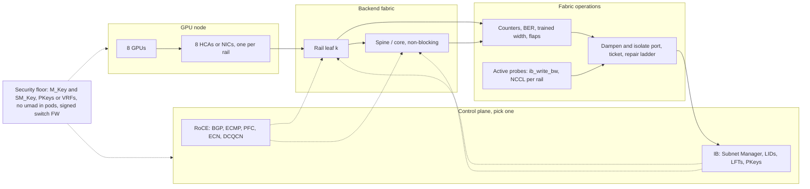

# Lesson 40 — AI/ML platform: InfiniBand / RoCE fabric operations at scale — subnet management, congestion control, link flaps & fabric health for 10K+ GPU clusters

*2026-10-18*

## What interviewers are really probing

[Lesson 19](/lessons/19-gpu-topology-nvlink-rdma-nccl) explained why GPUs need RDMA and how NCCL picks rings and trees. [Lesson 39](/lessons/39-gpu-fleet-lifecycle-acceptance-burn-in-rma) made every node a state machine. This lesson is about the thing in between: the **backend fabric**, the dedicated InfiniBand or RoCEv2 network that carries collectives between thousands of GPUs. At 10K GPUs with eight rails per node you are operating roughly 80,000 host ports, a similar number of switch ports on each tier, and well over 100,000 optics. Something in that fabric is failing every day. Because training is synchronous, one bad link does not cost you one node; it stretches the step time of every job whose traffic crosses it.

The interview version: *"Your 4,000-GPU training job's step time went up 15% overnight and nothing is down. Or: every few hours, a different job dies with NCCL transport errors. Walk me through how you find it, how you fix it, and how you stop it from happening again."* They want to hear that you know **how the control plane works** (the Subnet Manager on IB, BGP, ECMP and PFC/ECN on RoCE), **why link flaps hurt more than link failures**, **which counters mean what**, **how congestion control actually behaves under collective incast**, and that you run the fabric as a fleet with a ledger, active probes and budgets, not as a LAN someone set up once.

Cross-links: [L05](/lessons/05-cloud-networking-vpc-tgw) and [L06](/lessons/06-cloud-interconnect-nat-bgp) (BGP, ECMP), [L08](/lessons/08-cni-cilium-ebpf) and [L09](/lessons/09-networkpolicy-multi-nic-sflow) (multi-NIC pods, NetworkPolicy limits), [L13](/lessons/13-ml-weights-checkpoint-hardening) (weights), [L19](/lessons/19-gpu-topology-nvlink-rdma-nccl) (NVLink, GPUDirect, NCCL), [L20](/lessons/20-training-inference-scheduling-kueue-volcano) (topology-aware scheduling), [L23](/lessons/23-gpu-observability-dcgm-nccl-roofline) (NCCL canaries), [L25](/lessons/25-multi-tenant-gpu-isolation-quota) (tenant isolation), [L29](/lessons/29-training-reliability-checkpoint-elastic) (checkpoints, restarts), [L35](/lessons/35-fleet-incident-response-gpu-inference-agent-runbooks) (runbooks), [L39](/lessons/39-gpu-fleet-lifecycle-acceptance-burn-in-rma) (burn-in, ladder, breakers). Fuel: [wafer-ai/gpu-perf-engineering-resources](https://github.com/wafer-ai/gpu-perf-engineering-resources).

What they check for:

- **Rail-optimized topology.** Eight GPUs, eight NICs, and NIC *k* on every node in a scalable unit plugs into leaf *k*. Same-rail traffic is one hop; cross-rail traffic hops over NVLink first (NCCL's PXN). A miswired cable silently doubles hops for one rail.
- **IB control plane.** The Subnet Manager (opensm, UFM, or a switch-embedded SM) discovers the fabric, assigns LIDs, computes forwarding tables with a routing engine, and programs partitions. Every port state change triggers a re-sweep. Master and standby SMs, priority, and sweep behaviour are operator decisions.
- **RoCE control plane.** Routed Clos with BGP and ECMP, made "lossless enough" with PFC on one priority, ECN marking, and DCQCN rate control on the NICs. Low flow entropy breaks ECMP; PFC breaks in its own ways (pause storms, head-of-line blocking, deadlock).
- **Flaps over failures.** A clean link-down is handled by routing and NCCL retries. A link that bounces every few minutes causes repeated re-sweeps or reconvergence, transport retry timeouts, and job crashes all over the fabric. Dampen and isolate the port, not the node.
- **Slow-not-dead detection.** A 4x link that trained at 2x, an NDR port running at HDR, rising FEC-corrected errors, or one hot uplink. Nothing alerts, but bus bandwidth drops. Only active probes against a baseline find these.
- **Fabric as a fleet.** Per-port ledger, topology diff against the cable plan, error budgets, staged firmware and SM changes, and a repair ladder for optics and cables like the one for GPUs in L39.
- **Security.** RDMA bypasses the kernel, so iptables and NetworkPolicy do not see it. Isolation is the fabric's job: PKeys, M_Key and SM_Key on IB, VRFs, ACLs and DSCP rewrite on RoCE, plus never exposing management interfaces to tenant pods.

**Interview sentence:** "The backend fabric is rail-optimized and separate from the frontend network. On InfiniBand, the Subnet Manager runs master and standby on dedicated hosts, uses a fat-tree routing engine with adaptive routing, and every port is protected with M_Key so only the SM can change it; tenants live in PKeys with limited membership. On RoCE, it's BGP and ECMP with PFC on exactly one priority, ECN marking set well below the PFC threshold, DCQCN on the NICs, a PFC watchdog on every switch, and enough queue pairs per connection to give ECMP some entropy. Link flaps get dampened: N flaps in T minutes and automation isolates the port and opens a ticket with both cable ends. We track every port's errors, flaps, BER and trained width in a ledger, diff the discovered topology against the cable plan daily, and run NCCL and `ib_write_bw` probes per rail so we catch slow links, not just dead ones."

## Core diagram: Node rails → rail-optimized leaf → spine, IB vs RoCE control plane, flap pipeline and security floor

![InfiniBand and RoCE fabric operations: GPU nodes with eight rails feeding rail-optimized leaves and a non-blocking spine, then two alternative control planes, the InfiniBand Subnet Manager with LIDs, routing engines and PKeys and the RoCEv2 stack with PFC, ECN, DCQCN and a PFC watchdog; below, a link-flap and degradation pipeline, congestion and tail-latency notes, and a fabric health ledger with SLOs, all resting on a security floor of M_Key and SM_Key, PKey and VRF isolation, RDMA device RBAC, weight encryption and signed switch firmware](/infiniband-roce-fabric-operations.png)



## Idiosyncrasies / operator depth

### 1. The topology is a contract, and the cable plan is its source of truth

A rail-optimized scalable unit (NVIDIA calls it an SU; many shops call it a pod) connects NIC *k* of every node to leaf *k*. NCCL assumes that: it builds rings per rail, and with PXN it moves data across NVLink to the GPU that sits on the right rail before sending it over the network. Two consequences operators miss:

- **A swapped cable is not a down link.** If node 37's rail 2 and rail 3 cables are swapped, everything stays up, ping works, and `ibstat` is green. But traffic that should be one hop now crosses the spine, and one rail of every job on that node is slower. You only catch it by diffing discovered topology (`ibnetdiscover`, LLDP on RoCE) against the plan.
- **Oversubscription is a decision, not an accident.** Training fabrics are built 1:1 leaf to spine within an SU. Some shops oversubscribe at the core across SUs and keep big jobs inside an SU with topology-aware scheduling ([L20](/lessons/20-training-inference-scheduling-kueue-volcano)). If the scheduler doesn't know the topology, the fabric pays for it.

### 2. InfiniBand: what the Subnet Manager actually does

- **Discovery and addressing.** The SM walks the fabric with SMPs (subnet management packets), assigns each port a LID, and computes linear forwarding tables (LFTs) for every switch with a routing engine: `ftree` or `updn` for fat trees, `dor`/`torus-2QoS` for tori, `minhop` as the simple default. Pick the engine for your topology and pin it; the default can produce credit loops or uneven paths on a fat tree.
- **Master and standby.** Several SMs can run; the one with the highest `sm_priority` (0 to 15) wins and the others poll it. If the standbys can't reach the master within the polling timeout, one takes over. Run SMs on dedicated, redundant hosts (or UFM in HA), never on compute nodes, and make sure exactly one host image is allowed to run `opensm`.
- **Sweeps.** A light sweep runs on an interval and checks for changes. A port state change raises a trap and causes a heavy sweep: rediscover, recompute routes, reprogram switches. On a large fabric a heavy sweep takes real time, and while routes are being reprogrammed, traffic can be dropped or misrouted. **This is why a flapping port hurts the whole fabric**: every bounce is another heavy sweep.
- **Partitions.** PKeys are IB's VLANs. A port is a full or limited member; limited members can talk only to full members, never to each other. The default partition `0x7fff` should give hosts limited membership so tenants can't reach each other through it.
- **Adaptive routing and SHARP.** Quantum switches can pick among equal paths per packet (AR) and do reductions in the switch (SHARP). Both need SM support and NCCL support (`NCCL_IB_ADAPTIVE_ROUTING`, the SHARP/CollNet plugin). Both are worth a lot at scale and both are things to roll in waves, not flip fleet-wide.

### 3. RoCEv2: lossless Ethernet is a set of trade-offs

- **RDMA hates loss.** RoCE NICs mostly use go-back-N retransmission, so one dropped packet means resending everything after it. That is why RoCE fabrics run PFC (priority flow control) on one traffic class: switches send pause frames upstream when a queue fills, instead of dropping.
- **PFC has side effects.** Pause frames spread upstream and block innocent flows that share a queue (head-of-line blocking). A NIC or host that stops draining its receive queue can send pause frames forever and freeze a whole tier (a **pause storm**). Cyclic buffer dependencies can deadlock. Every switch needs a **PFC watchdog** that notices a queue stuck in pause and starts dropping on it.
- **ECN and DCQCN do the real work.** Switches mark packets with ECN when queues pass a threshold; the receiving NIC sends a CNP (congestion notification packet) back; the sender's NIC cuts its rate (DCQCN). The rule is **ECN must kick in well before PFC**, so PFC is a last-resort backstop, not the steady-state brake. Getting DCQCN parameters right for collective traffic is genuinely hard; Meta reported in their SIGCOMM 2024 paper that for their 400G training fabric they ended up relying on PFC plus receiver-driven traffic admission in their collective library instead of DCQCN. Know that this is a real design choice, not a mistake.
- **Low entropy breaks ECMP.** A training job produces a few huge, long-lived flows. ECMP hashes on the 5-tuple, so two elephant flows can land on the same uplink while another sits idle (hash polarization). Fixes: more queue pairs per connection (`NCCL_IB_QPS_PER_CONNECTION`, which spreads data across more UDP source ports), adaptive routing or packet spraying on switches that support it (NVIDIA Spectrum-X, the Ultra Ethernet direction), and keeping jobs inside a leaf where possible.
- **Config has to match end to end.** DSCP trust on every switch and NIC, the same priority for RoCE and for CNPs on every hop, MTU large enough for 4096-byte RDMA path MTU (Ethernet MTU of at least 4200, usually 9000), and the right GID index (RoCEv2 over IPv4 is usually index 3, but check with `show_gids`). One switch with the wrong trust mode silently turns lossless into lossy for every flow crossing it.

### 4. Why flaps kill jobs

NCCL over verbs uses reliable-connected queue pairs with a hardware retry timer of 4.096 µs × 2^`NCCL_IB_TIMEOUT` and `NCCL_IB_RETRY_CNT` retries. If a path is gone longer than timeout × retries (re-sweep, BGP reconvergence, a port bouncing), the QP errors out with `IBV_WC_RETRY_EXC_ERR` (status 12), NCCL aborts the communicator, and the whole job restarts from its last checkpoint ([L29](/lessons/29-training-reliability-checkpoint-elastic)). Raising the timeout buys tolerance to short blips at the cost of slower detection of real failures; it doesn't fix the flap. Meta's Llama 3 paper attributed roughly 8% of unexpected interruptions over a 54-day, 16K-GPU run to network switches and cables, so this is a measurable slice of your goodput.

### 5. The counters that actually matter

| Signal | Where | What it usually means |
|---|---|---|
| `SymbolErrorCounter`, `LinkErrorRecoveryCounter` rising | `perfquery`, `ibqueryerrors`, UFM | Marginal link: dirty connector, bad optic or cable. Leading indicator of flaps |
| `LinkDownedCounter` increments | same | Link actually went down. Two or more in a day means isolate |
| Effective or raw physical BER climbing, FEC-corrected rising | `mlxlink -c`, switch CLI | Optic degrading. NDR and 400G Ethernet depend on FEC; watch the trend, not only uncorrectable errors |
| Width or speed below expected (`4X` to `2X`, `NDR` to `HDR`) | `iblinkinfo`, `ibstat`, `ethtool` | Slow-not-dead. Link trained down; treat like a failure |
| `PortXmitWait` high | `perfquery -x` | Congestion: the port had data but no credits to send it |
| `PortXmitDiscards` | `perfquery` | Packets dropped at the switch (timeouts, bad routes during re-sweep) |
| `rx_prioN_pause`, `tx_prioN_pause` | `ethtool -S` | PFC activity. Steady pause means ECN is set too high or a receiver is stuck |
| `np_ecn_marked_roce_packets`, `np_cnp_sent`, `rp_cnp_handled` | `/sys/class/infiniband/*/ports/1/hw_counters` | ECN and DCQCN are working. Zero everywhere under load is suspicious |
| `out_of_sequence`, `packet_seq_err`, `local_ack_timeout_err` | same | Loss on a "lossless" class, or timeouts. Check PFC and DSCP config on the path |
| Optic temperature, Rx power drifting | `mlxlink -m`, switch DDM | Optic about to fail. Replace before it starts flapping |

### 6. Fabric health is an SLO, not a dashboard

Define health the way jobs feel it: **bus bandwidth for a given collective and job size is at least 90% of the baseline for that fabric**. Run per-rail `ib_write_bw` pairs and small NCCL all-reduce canaries continuously across SUs ([L23](/lessons/23-gpu-observability-dcgm-nccl-roofline)), keep a per-port ledger (errors per hour, flaps per day, BER, trained width, optic serials, last change), and give the fabric its own budget: for example, no more than 1% of ports isolated per SU before a human looks. Same idea as the `maxUnhealthy` breaker in L39.

## Concrete commands & config

### InfiniBand: state, topology and errors

```bash
# Local HCA state: expect State Active, Physical state LinkUp, Rate 400 (NDR), link layer InfiniBand
ibstat mlx5_0
ibv_devinfo -d mlx5_0 | egrep 'state|active_mtu|link_layer'

# Who is the master SM, and its priority/state
sminfo
saquery -s            # list SMs known to the SA

# Every link in the fabric with width/speed; flag anything not at 4X NDR
iblinkinfo --switches-only | egrep -v '4X +106.25 Gbps' | head    # NDR = 4X 106.25 Gbps per lane

# Discover topology and diff against the planned cable map (generated from your DCIM)
ibnetdiscover -p > /var/tmp/topo.$(date +%F).txt
# normalise both sides to "switchGUID port peerGUID peerPort" with your parser, then diff
./topo-normalise /var/tmp/topo.$(date +%F).txt | sort > discovered.txt
diff <(sort planned-links.txt) discovered.txt     # any line here is a miswire or a missing link

# Fabric-wide error scan: ports over threshold, then per-port extended counters
ibqueryerrors --details
perfquery -x 0x1a2 17          # LID 0x1a2, port 17: PortXmitWait, SymbolErrors, LinkDowned...
perfquery -R 0x1a2 17          # reset counters after a repair so the next trend is clean

# Full fabric diagnostic (writes CSV/DB under /var/tmp/ibdiagnet2/): links, BER, cable info, PM counters
ibdiagnet --pc -P all=1 --pm_pause_time 600 --get_cable_info
# then grep the report for "Warning" / "Error" and non-optimal links

# Physical layer on a host port: BER, FEC, module (optic) temperature and power
mlxlink -d mlx5_0 -c -m
```

### opensm: the knobs you actually set

```ini
# /etc/opensm/opensm.conf (excerpt)
routing_engine ftree            # match the topology; pin it, don't rely on minhop
sm_priority 14                  # master; standby gets 13
sweep_interval 10               # light sweep seconds
sminfo_polling_timeout 10000    # ms before a standby considers master dead
polling_retry_number 4
m_key 0x5ec4e7f00d000001         # per-fabric secret, stored in your vault
m_key_protection_level 2        # SMPs that read or set port info need the M_Key
m_key_lease_period 60
sm_key 0x5ec4e7f00d000002        # SMs authenticate each other
partition_config_file /etc/opensm/partitions.conf
qos TRUE
```

```text
# /etc/opensm/partitions.conf
# Default partition: hosts are LIMITED so they can't talk to each other via 0x7fff, SM/UFM SELF is full
Default=0x7fff, ipoib : ALL=limited, SELF=full ;
# One partition per tenant, full membership only for that tenant's port GUIDs
tenant-a=0x8001, ipoib, mtu=5 : 0x1070fd0300a1b2c3=full, 0x1070fd0300a1b2c4=full ;
tenant-b=0x8002, ipoib, mtu=5 : 0x1070fd0300d4e5f6=full ;
```

UFM wraps the same model in an HA appliance with a REST API for topology compare, port isolation, PKey management and telemetry. Most large IB fleets automate against UFM, not raw opensm.

### RoCEv2: host side

```bash
# Trust DSCP, enable PFC only on priority 3 (RoCE), see the mapping
mlnx_qos -i ens1f0np0 --trust dscp --pfc 0,0,0,1,0,0,0,0
mlnx_qos -i ens1f0np0

# Default ToS for RDMA-CM traffic: DSCP 26 with ECN capable bits = ToS 106
cma_roce_tos -d mlx5_0 -t 106

# Confirm GID index for RoCEv2 over IPv4 (NCCL_IB_GID_INDEX must match)
show_gids mlx5_0

# MTU: at least 4200 for a 4096 RDMA MTU; most fabrics use 9000 end to end
ip link set ens1f0np0 mtu 9000

# Is congestion control doing anything? (counters should move under load)
cd /sys/class/infiniband/mlx5_0/ports/1/hw_counters
grep . np_ecn_marked_roce_packets np_cnp_sent rp_cnp_handled out_of_sequence packet_seq_err local_ack_timeout_err

# PFC activity on the RoCE priority
ethtool -S ens1f0np0 | egrep 'prio3_pause|rx_discards_phy|rx_out_of_buffer'
```

### RoCEv2: switch side (SONiC-style; same ideas on any NOS)

```bash
show interfaces counters          # errors, drops per port
show pfc counters                 # pause frames per priority; one queue paused nonstop = storm
show queue counters Ethernet64    # per-queue drops and ECN marks
pfcwd start --action drop --restoration-time 400 all 400   # watchdog: detect stuck queue in 400 ms, drop
pfcwd show stats
# ECN/WRED profile on the lossless queue: mark early (KB scale), well under the PFC xoff threshold
```

### NCCL settings that interact with the fabric

```bash
export NCCL_IB_HCA=mlx5_0,mlx5_1,mlx5_2,mlx5_3,mlx5_4,mlx5_5,mlx5_6,mlx5_7   # backend rails only
export NCCL_SOCKET_IFNAME=eth0          # bootstrap over frontend, never the backend
export NCCL_IB_GID_INDEX=3              # RoCEv2; check show_gids
export NCCL_IB_TC=106                   # RoCE: match the DSCP the fabric treats as lossless
export NCCL_IB_SL=0                     # IB: service level mapped to the right VL
export NCCL_IB_QPS_PER_CONNECTION=4     # more flows for ECMP entropy on RoCE
export NCCL_IB_TIMEOUT=22               # 4.096us * 2^22 ~= 17s per retry; tolerate short blips
export NCCL_IB_RETRY_CNT=7
export NCCL_DEBUG=INFO NCCL_DEBUG_SUBSYS=INIT,NET   # logs which NIC/GID/rail each rank used
```

### Kubernetes: giving pods RDMA without giving them the fabric

```yaml
# NVIDIA Network Operator: RDMA device plugin exposes verbs (uverbs), not umad
apiVersion: mellanox.com/v1alpha1
kind: NicClusterPolicy
metadata:
  name: nic-cluster-policy
spec:
  rdmaSharedDevicePlugin:
    image: k8s-rdma-shared-dev-plugin
    repository: nvcr.io/nvidia/cloud-native
    version: network-operator-v25.4.0      # pin by version, mirror and verify by digest
    config: |
      {"configList": [{"resourceName": "rdma_shared_device_a", "rdmaHcaMax": 63,
        "selectors": {"ifNames": ["ibp24s0","ibp41s0","ibp64s0","ibp79s0"]}}]}
---
# Training pod: RDMA resource + IPC_LOCK for pinned memory, nothing broader
spec:
  containers:
  - name: trainer
    securityContext:
      capabilities:
        add: ["IPC_LOCK"]          # not privileged, not NET_ADMIN, no hostNetwork
    resources:
      limits:
        nvidia.com/gpu: 8
        rdma/rdma_shared_device_a: 1
```

```bash
# Host: put RDMA devices in exclusive network-namespace mode so a pod only sees its own
rdma system set netns exclusive
rdma system show
```

### Flap dampening policy (pseudo-config for your fabric controller)

```yaml
fabricHealth:
  flapDampening:
    window: 30m
    maxLinkDowns: 2               # 3rd down in 30 min isolates the port
    action: isolatePort           # UFM port disable / switch shutdown, not node drain
    ticket: {include: [cableId, bothEnds, opticSerials, berHistory, lastChange]}
  degradedLink:
    expectWidth: 4X
    expectSpeed: NDR
    action: isolatePort           # slow-not-dead is a failure
  breaker:
    maxIsolatedPortsPerSU: 1%     # past this, stop and page: suspect firmware, SM or power, not optics
  repairLadder: [clean-and-reseat, swap-optic, swap-cable, swap-switch-port]
  returnToService: [ib_write_bw-per-rail, nccl-allreduce-baseline, counters-clean-24h]
```

## Failures & fixes

| Symptom | Likely cause | Fix / mitigation |
|---|---|---|
| Different jobs die every few hours with `IBV_WC_RETRY_EXC_ERR` / "transport retry counter exceeded" | A flapping port causing heavy sweeps or reconvergence | Find `LinkDownedCounter` deltas; dampen and isolate the port; ticket with both cable ends |
| Step time up 10–20%, nothing down | Link trained at reduced width/speed, swapped rail cable, or one hot uplink | `iblinkinfo` for non-4X/NDR; topology diff vs cable plan; per-rail `ib_write_bw` probes |
| Whole fabric hiccups when one node reboots | SM heavy sweep on a large fabric, or SM running on a compute node | Dedicated HA SMs; tune sweep; check that SM priority/host placement is as designed |
| Two SMs fighting, routes flapping | Rogue or misconfigured SM with equal/higher priority (often a host image with opensm enabled) | Remove opensm from compute images; SM_Key; M_Key protection; alert on SM state changes |
| RoCE throughput collapses fabric-wide, pause counters pinned on one queue | PFC storm from a stuck NIC or host | PFC watchdog on every switch; find the source port; drain that node |
| Lots of PFC pauses, almost no ECN marks | ECN threshold above PFC xoff, or DSCP not trusted somewhere | ECN marks before PFC; audit DSCP trust and queue mapping on every hop |
| `out_of_sequence` climbing on RoCE | Packet loss on the "lossless" class: wrong priority on one switch, MTU mismatch | Path audit of DSCP/priority/MTU; fix the outlier, not the timeout |
| One uplink at 100%, its neighbour idle | ECMP hash polarization with few elephant flows | More QPs per connection, adaptive routing/spraying, keep jobs inside a leaf |
| NCCL picks the wrong NIC or falls back to TCP | `NCCL_IB_HCA`/GID index wrong, pod lacks RDMA device or IPC_LOCK | `NCCL_DEBUG=INFO` to see chosen devices; fix device plugin and env |
| New SU passes `ibstat` but jobs are slow | Cabling errors, some links at lower speed, bad optics batch | Burn-in must include topology diff, `ibdiagnet` and multi-node NCCL vs baseline ([L39](/lessons/39-gpu-fleet-lifecycle-acceptance-burn-in-rma)) |
| Automation isolated 200 ports in an hour | Switch firmware bug, power event or SM issue, not 200 bad optics | `maxIsolatedPortsPerSU` breaker; freeze and page |
| Tenant A can reach tenant B's nodes over IB | Hosts are full members of the default partition | Default partition limited for hosts; per-tenant PKeys; audit with `saquery` |

## Security & hardening

**RDMA traffic goes around the kernel network stack.** iptables, eBPF CNI policy and Kubernetes NetworkPolicy ([L09](/lessons/09-networkpolicy-multi-nic-sflow)) never see it. On the backend fabric, isolation is enforced by the fabric itself (PKeys, VRFs, ACLs) and by what you let pods touch on the host. And that fabric carries your most valuable data: gradients, activations, checkpoints and model weights moving between GPUs and storage.

### Fabric control plane

| Control | Threat | Practice |
|---|---|---|
| M_Key per port, protection level 2 | Anyone with SMP access reconfigures ports, LIDs or routes | Fabric-wide M_Key from the vault, rotated on a schedule; only SM/UFM hosts know it |
| SM_Key | A rogue SM takes over as master | SM_Key set on all SMs; alert on any new SM GUID or SM state change |
| No opensm on compute images | Host images accidentally running an SM | Remove the package from the golden image ([L12](/lessons/12-node-container-hardening-supply-chain)); CI check on the image SBOM |
| Partitions with limited default | Tenants reach each other over the default partition | Hosts limited in `0x7fff`; one PKey per tenant; PKey assignment driven by the scheduler, audited |
| RoCE backend VRF and ACLs | Backend reachable from the frontend or internet; cross-tenant RDMA | Backend in its own VRF with no route to frontend; per-tenant VLAN/VNI and ACLs at the leaf |
| DSCP rewrite at the edge | A tenant marks traffic as the lossless class or as CNPs to starve others | Leaf rewrites or re-trusts DSCP from hosts according to policy; only expected classes accepted |
| Management plane isolation | Switch CLI, UFM REST or BMCs reachable from tenant networks | Out-of-band management network; SSO and RBAC on UFM and switch AAA; every change audited |
| Signed, staged firmware | Malicious or buggy switch, NIC or optic firmware | Vendor-signed images, hash-pinned in Git, rolled in waves with the same halts as L39 |

### Host and pod boundary

- **Expose verbs, never management.** Pods get `/dev/infiniband/uverbs*` through the RDMA device plugin. They must not get `umad*` or `issm*`, which let a process send management datagrams and talk to the SM. Never run training pods privileged, with `hostNetwork`, or with `NET_ADMIN`; `IPC_LOCK` is the only capability RDMA needs.
- **RDMA namespace isolation.** `rdma system set netns exclusive` so devices are bound to one network namespace; SR-IOV VFs with a PKey per VF (`ib-kubernetes`) for hard multi-tenancy ([L25](/lessons/25-multi-tenant-gpu-isolation-quota)).
- **Admission control.** Policy that rejects pods requesting RDMA resources outside approved namespaces, any pod mounting `/dev/infiniband` via hostPath, and privileged pods in GPU namespaces ([L11](/lessons/11-cluster-security-pss-admission-rbac)).
- **Pinned, verified images.** Network Operator, device plugin, OFED driver containers and NCCL plugins pulled by digest from your registry and signature-verified at admission. These run privileged on every GPU node, so they are supply chain, not tooling.

### Weights, checkpoints and data on the fabric

- **The fabric is not an authentication boundary.** Checkpoint writes and weight hydrates often run over RDMA or GPUDirect Storage. Storage still has to authenticate the client: scoped bucket or filesystem IAM per job identity, not a shared fabric-wide credential ([L13](/lessons/13-ml-weights-checkpoint-hardening), [L27](/lessons/27-gpu-supply-chain-weight-registry-hydrate)).
- **Encryption.** RDMA traffic is generally unencrypted on the wire. Encrypt weights and checkpoints at rest, rely on physical and tenant isolation for the backend, and where the threat model needs it, use NIC inline crypto (IPsec or MACsec offload on supported NICs) for traffic that leaves a trusted hall.
- **Integrity.** Verify checkpoint and weight digests after transfer and before load. A degraded link with FEC failing can corrupt data in rare cases; a digest check turns silent corruption into a loud retry.
- **Telemetry hygiene.** UFM, sFlow and packet captures on the backend can contain tensor payloads. Treat captures as sensitive data with retention limits and access control.

### Runbook: isolate a suspect port safely

```bash
# 1. Evidence first (before counters reset or the optic is pulled)
perfquery -x $LID $PORT > /evidence/$TICKET/perfquery.txt
mlxlink -d mlx5_3 -c -m > /evidence/$TICKET/mlxlink.txt        # host end, if a host link
ibdiagnet --get_cable_info -o /evidence/$TICKET/ibdiag

# 2. Isolate the port, not the node: the node keeps 7 of 8 rails; the scheduler marks it degraded
#    (UFM REST port disable, or switch CLI shutdown on the leaf port), recorded in the fabric ledger
kubectl label node $NODE fabric.example.com/rail3=isolated --overwrite
kubectl taint node $NODE fabric.example.com/degraded=true:NoSchedule   # no new big jobs; running ones finish

# 3. Repair ladder, then return only after: ib_write_bw on the rail, NCCL baseline, 24h of clean counters
```

## Interview soundbites

- "On a synchronous training job, the slowest link sets the step time, so I care more about degraded links than dead ones."
- "A flapping port is worse than a dead one. Every bounce is another SM heavy sweep or BGP reconvergence, and NCCL's retry timer is what turns that into a crashed job."
- "I dampen flaps and isolate the port, not the node. The node keeps seven rails and finishes what it's running."
- "Rail-optimized means NIC k goes to leaf k. A swapped cable doesn't alarm anything; I catch it by diffing discovered topology against the cable plan."
- "On RoCE, ECN does the braking and PFC is the backstop. If I see lots of pauses and few ECN marks, the thresholds are wrong."
- "Every RoCE switch runs a PFC watchdog, because one stuck NIC can freeze a whole tier."
- "ECMP and training traffic don't get along: a handful of elephant flows hash onto the same uplink. More queue pairs per connection, adaptive routing, and keeping jobs inside a leaf."
- "Fabric health is an SLO: bus bandwidth at least 90% of baseline per job size, measured by probes, not inferred from 'all links up'."
- "RDMA bypasses NetworkPolicy, so isolation lives in the fabric: PKeys with limited default membership and M_Key on IB, VRFs and ACLs on RoCE. Pods get verbs, never umad."

## How this maps to the JD

"100+ clusters and 10K+ nodes" ([L01](/lessons/01-hyperscale-mental-model)) with AI/ML workloads means owning or deeply partnering with the backend fabric team. This lesson ties cloud and cluster networking ([L05](/lessons/05-cloud-networking-vpc-tgw)–[L09](/lessons/09-networkpolicy-multi-nic-sflow)) to GPU operations ([L19](/lessons/19-gpu-topology-nvlink-rdma-nccl), [L23](/lessons/23-gpu-observability-dcgm-nccl-roofline), [L39](/lessons/39-gpu-fleet-lifecycle-acceptance-burn-in-rma)): the same ledger, waves, breakers and repair ladders, applied to ports and optics. For a DevSecOps or Platform role, knowing that RDMA bypasses NetworkPolicy, and what replaces it (PKeys, M_Key, VRFs, device-plugin RBAC), is a sharp security answer most candidates don't have.

## Watch (talks & demos)

### RDMA over Ethernet for Distributed AI Training at Meta Scale — Adi Gangidi, Meta (ACM SIGCOMM 2024)

ACM SIGCOMM. Meta's five years of running dedicated RoCEv2 backend fabrics across three hardware generations: why training needed a separate backend network, how collective patterns (full mesh versus hierarchical) shape topology and oversubscription, routing for low-entropy flows, and the congestion control story, including why they moved away from relying on DCQCN. Operator takeaway: the real-world version of sections 3 and 4 above, from people who ran it at tens of thousands of GPUs.

<iframe width="100%" height="360" src="https://www.youtube.com/embed/wLW3UzUw5rY" title="RDMA over Ethernet for Distributed AI Training at Meta Scale (SIGCOMM'24)" frameBorder="0" allow="accelerometer; autoplay; clipboard-write; encrypted-media; gyroscope; picture-in-picture; web-share" allowFullScreen></iframe>

[Open on YouTube](https://www.youtube.com/watch?v=wLW3UzUw5rY)

### How to Deploy UFM in an OpenStack-Based Cloud Environment — NVIDIA Developer

Four minutes, and directly on the security section: UFM in HA mode isolating tenants with PKeys driven by a cloud control plane, recommended settings (`m_key_per_port`, limited default partition), and live demos of UFM blocking a cross-tenant `NodeInfo` MAD with a bad M_Key, blocking a tenant that starts its own subnet manager, and the switch rejecting traffic with a bad PKey. Operator takeaway: what fabric-level tenant isolation looks like when it works.

<iframe width="100%" height="360" src="https://www.youtube.com/embed/wecvydZo4Wk" title="How to Deploy UFM in an OpenStack-Based Cloud Environment" frameBorder="0" allow="accelerometer; autoplay; clipboard-write; encrypted-media; gyroscope; picture-in-picture; web-share" allowFullScreen></iframe>

[Open on YouTube](https://www.youtube.com/watch?v=wecvydZo4Wk)

Also worth your time: [Scaling RoCE Networks for AI Training](https://atscaleconference.com/videos/scaling-roce-networks-for-ai-training/) (Networking @Scale 2023), the earlier, more conversational version of Meta's RoCE story.

## References

- Meta: [RDMA over Ethernet for Distributed AI Training at Meta Scale (SIGCOMM 2024 paper)](https://cs.stanford.edu/~keithw/sigcomm2024/sigcomm24-final246-acmpaginated.pdf) · [The Llama 3 Herd of Models (interruption breakdown)](https://arxiv.org/abs/2407.21783)
- NVIDIA InfiniBand: [UFM documentation](https://docs.nvidia.com/networking/category/ufm) · [Simplifying network operations for AI with Quantum InfiniBand](https://developer.nvidia.com/blog/simplifying-network-operations-for-ai-with-nvidia-quantum-infiniband/) · [linux-rdma/opensm](https://github.com/linux-rdma/opensm) · [rdma-core (ibstat, ibv_devinfo, rdma tool)](https://github.com/linux-rdma/rdma-core) · [infiniband-diags](https://github.com/linux-rdma/rdma-core/tree/master/infiniband-diags)
- RoCE: [NVIDIA RoCE configuration and DCQCN notes](https://docs.nvidia.com/networking/display/mlnxofedv24100700/rdma+over+converged+ethernet+(roce)) · [DCQCN paper (SIGCOMM 2015)](https://conferences.sigcomm.org/sigcomm/2015/pdf/papers/p523.pdf) · [SONiC PFC watchdog design](https://github.com/sonic-net/SONiC/wiki/PFC-Watchdog-Design) · [Ultra Ethernet Consortium](https://ultraethernet.org/)
- NCCL: [Environment variables](https://docs.nvidia.com/deeplearning/nccl/user-guide/docs/env.html) · [nccl-tests](https://github.com/NVIDIA/nccl-tests) · [perftest (ib_write_bw)](https://github.com/linux-rdma/perftest)
- Kubernetes: [NVIDIA Network Operator](https://docs.nvidia.com/networking/display/kubernetes2540/index.html) · [k8s-rdma-shared-dev-plugin](https://github.com/Mellanox/k8s-rdma-shared-dev-plugin) · [ib-kubernetes (PKeys for SR-IOV pods)](https://github.com/Mellanox/ib-kubernetes)
- [wafer-ai/gpu-perf-engineering-resources](https://github.com/wafer-ai/gpu-perf-engineering-resources) — AI/ML platform fuel
- Prior: [39 — GPU fleet lifecycle](/lessons/39-gpu-fleet-lifecycle-acceptance-burn-in-rma) · [35 — Incident response](/lessons/35-fleet-incident-response-gpu-inference-agent-runbooks) · [29 — Training reliability](/lessons/29-training-reliability-checkpoint-elastic) · [25 — Multi-tenant GPU isolation](/lessons/25-multi-tenant-gpu-isolation-quota) · [23 — DCGM / NCCL / roofline](/lessons/23-gpu-observability-dcgm-nccl-roofline) · [20 — Kueue / Volcano](/lessons/20-training-inference-scheduling-kueue-volcano) · [19 — Topology / NCCL](/lessons/19-gpu-topology-nvlink-rdma-nccl) · [13 — Weights hardening](/lessons/13-ml-weights-checkpoint-hardening) · [11 — Admission / RBAC](/lessons/11-cluster-security-pss-admission-rbac) · [09 — NetworkPolicy / multi-NIC](/lessons/09-networkpolicy-multi-nic-sflow) · [06 — BGP / interconnect](/lessons/06-cloud-interconnect-nat-bgp)
- Next: **Lesson 41 — AI/ML platform: power, cooling & facility constraints for GPU fleets — rack power budgets, liquid cooling failures, power capping & thermal throttling**

## Quick self-check

Out loud, in under two minutes each:

1. Step time on a 4,000-GPU job rose 15% overnight with no alerts. List the fabric causes you'd check, in order, and the exact command or counter for each.
2. Explain what the Subnet Manager does when a single port flaps, and why that can crash jobs that never touched that port.
3. On RoCE, why must ECN marking kick in before PFC? Describe a pause storm, how it spreads, and what stops it.
4. Why does ECMP struggle with training traffic, and what three things do you do about it?
5. A tenant can reach another tenant's nodes over InfiniBand. What's misconfigured, and which controls (PKeys, M_Key, SM_Key, device plugin) close it?
6. RDMA bypasses NetworkPolicy. How do you protect checkpoint and weight transfers that run over the backend fabric?
