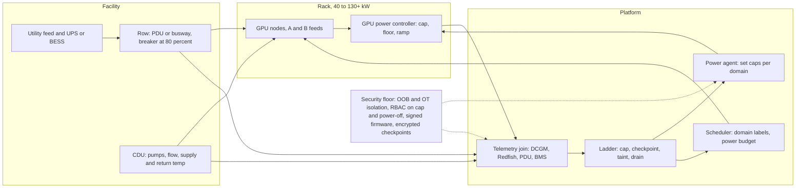

# Lesson 41 — AI/ML platform: power, cooling & facility constraints for GPU fleets — rack power budgets, liquid cooling failures, power capping & thermal throttling

*2026-10-20*

## What interviewers are really probing

[Lesson 38](/lessons/38-gpu-fleet-capacity-planning-procurement) said capacity is planned in megawatts, not just GPUs. [Lesson 39](/lessons/39-gpu-fleet-lifecycle-acceptance-burn-in-rma) made every node a state machine, and [Lesson 40](/lessons/40-infiniband-roce-fabric-operations) did the same for every fabric port. This lesson is about the layer underneath all of them: the **building**. Every GPU sits inside a power budget and a thermal envelope that the platform team does not own but absolutely has to model. An 8-GPU H100 server draws roughly 10 kW at full load; a GB200 NVL72 rack is in the 120 kW+ class and cannot be air-cooled at all. At 10K+ GPUs you are a multi-megawatt load, and a synchronous training job makes that load swing by megawatts within milliseconds every time it checkpoints or hits a collective.

The interview version: *"A CDU in hall 3 lost a pump. Two hundred GPUs started thermal throttling and a 4,000-GPU training job slowed by 30%. What do you do in the first five minutes, and what should the platform have done automatically?"* Or: *"Facilities says row 12 is at 92% of breaker. Product wants 40 more nodes in that row tomorrow. What do you say?"* They want to hear that you understand **where power and heat actually go**, **why throttling a few GPUs slows a whole job**, **the difference between a software power cap and a hardware slowdown**, **that capping is a remediation tool you reach for before draining**, and that facility domains (rack, PDU, row, CDU, hall) show up in your scheduler, your telemetry and your incident runbooks.

Cross-links: [L01](/lessons/01-hyperscale-mental-model) (failure domains), [L18](/lessons/18-gpu-node-pools-mig-timeslicing) (GPU pools), [L20](/lessons/20-training-inference-scheduling-kueue-volcano) (gang scheduling, quotas), [L23](/lessons/23-gpu-observability-dcgm-nccl-roofline) (DCGM), [L26](/lessons/26-gpu-cost-attribution-reclaim-spot) (cost and stranded capacity), [L29](/lessons/29-training-reliability-checkpoint-elastic) (checkpoints), [L35](/lessons/35-fleet-incident-response-gpu-inference-agent-runbooks) (runbooks), [L36](/lessons/36-multi-region-dr-failover-inference) and [L37](/lessons/37-chaos-engineering-dr-game-days-gpu-inference) (DR and drills), [L38](/lessons/38-gpu-fleet-capacity-planning-procurement), [L39](/lessons/39-gpu-fleet-lifecycle-acceptance-burn-in-rma), [L40](/lessons/40-infiniband-roce-fabric-operations). Fuel: [wafer-ai/gpu-perf-engineering-resources](https://github.com/wafer-ai/gpu-perf-engineering-resources).

What they check for:

- **The power chain.** Utility feed, substation and transformers, UPS and batteries, switchgear, busway or PDUs, rack power shelves, PSUs, the GPU's own power controller. Each has a rating, and the smallest one in your path is your budget.
- **Breaker math.** Continuous loads are planned at 80% of breaker rating. Three-phase power is roughly `1.73 × V × I × PF`. A rack on a 415 V, 60 A three-phase circuit has about 34 kW of usable continuous power, which is three, not four, 10 kW H100 servers if you want any headroom.
- **Redundant feeds.** A and B feeds only protect you if either one can carry the whole rack alone. Load the rack past one feed's rating and losing a feed trips the other one.
- **Liquid cooling is now the default for top-end GPUs.** Direct-to-chip (DLC) cold plates, a coolant distribution unit (CDU) per rack or row, a technology cooling loop separated from facility water. Pumps, flow, filters, leaks, condensation and chemistry become platform failure modes.
- **Throttling semantics.** A software power cap lowers clocks gently and predictably. A hardware slowdown (thermal or power brake) is abrupt. Both show up as stragglers in synchronous training, where the slowest GPU sets the step time.
- **Power swings.** Synchronous training moves every GPU between compute-heavy and communication-heavy phases together. At tens of thousands of GPUs that becomes megawatt-scale oscillation the utility and the UPS care about. Mitigations: GPU power floors and ramp rates, software smoothing, and rack or site energy storage.
- **Capping as a tool.** Lowering the power limit by 20–30% usually costs much less than 20–30% of throughput, because GPUs run past their perf-per-watt sweet spot at the top. That makes caps the way to oversubscribe power safely and the first move in a cooling emergency.
- **Security.** The BMC, PDU, CDU and power-capping APIs can switch off or slow down the whole fleet. They are a control plane and need the same isolation, RBAC, signing and audit as Kubernetes.

**Interview sentence:** "I model the facility as failure domains, rack, PDU, row, CDU and hall, and they are node labels the scheduler uses. Power budgets are set per row from breaker ratings at 80% minus headroom, and we oversubscribe only where a capping path exists: a power agent on every node can lower GPU limits in seconds. Every node exports DCGM power, temperature and clock-event reasons, and we join that with BMC, PDU and CDU telemetry so we can tell a software cap from a hardware thermal slowdown. When cooling degrades, automation caps power in that domain first, triggers a checkpoint, taints the domain, then drains, so hardware thermal shutdown is the last thing that happens, not the first. The BMC, PDU and cap APIs live on an isolated management network with SSO, two-person approval for bulk actions and signed firmware, because a power-off API is a fleet-wide kill switch."

## Core diagram: Utility → row → rack → GPU → scheduler, failure ladder, telemetry join and security floor

![Power, cooling and facility constraints for GPU fleets: a chain from utility and hall to row, PDU and busway, to a 40 to 130 kilowatt rack with direct liquid cooling, to GPU power and thermal controls, to scheduler labels and power budgets; below, a failure ladder for cooling or power events, a telemetry join across DCGM, BMC, PDU and BMS data, and power budgets and SLOs, all resting on a security floor of isolated management networks, guarded power-cap APIs, a signed power agent, encrypted emergency checkpoints and signed facility firmware](/power-cooling-facility-constraints.png)



## Idiosyncrasies / operator depth

### 1. Power is a tree of budgets, and the tightest one wins

A hall has a contracted capacity from the utility. Inside it, each row's busway or PDU has a breaker, each rack has circuits, each server has PSUs, and each GPU has a power limit. Two rules matter:

- **Plan continuous load at 80% of the breaker.** A breaker that is loaded at 100% for hours trips. Facilities teams will quote "usable kW" already derated; ask which number you are looking at.
- **Nameplate is not draw.** An H100 SXM is a 700 W part and a DGX H100 system is specified at about 10.2 kW maximum. Real training draws are often below nameplate on average but hit it in bursts. Provisioning on nameplate strands power; provisioning on average trips breakers. The usual answer is to provision on measured p99 or p99.9 per workload class *and* have a cap path that guarantees you never exceed the breaker. This is how Meta's Dynamo and similar systems let data centers oversubscribe power safely.

**Stranded power** is the expensive failure: megawatts you pay for with no GPUs on them, because one rack per row was planned at nameplate or because a row's cooling, not its power, is the real limit. Track it like stranded GPUs ([L26](/lessons/26-gpu-cost-attribution-reclaim-spot)).

### 2. Redundancy math is not intuitive

- **2N (A and B feeds)**: every rack has two independent feeds. If the rack draws 30 kW, each feed carries 15 kW normally, and either one must be able to carry 30 kW when the other fails. If you let the rack grow to 40 kW on two 34 kW feeds, everything works until maintenance on feed A, and then feed B trips. This is one of the most common "nothing changed and the whole row went dark" stories.
- **N+1 PSUs inside the server**: losing one PSU is fine only if the remaining PSUs can carry peak draw. Some GPU servers drop into a lower power mode or assert a power-brake signal when PSU redundancy is lost. Your node health check should treat "PSU redundancy lost" as degraded, not as healthy.
- **UPS and generators**: the UPS carries the load for seconds to minutes while generators start. Large AI loads with fast swings stress both, which is why newer designs add rack-level or site-level batteries.

### 3. Liquid cooling changes the failure modes

Air cooling tops out around 30–40 kW per rack in practice. Above that, you use **direct-to-chip liquid cooling**: cold plates on GPUs and CPUs, a manifold in the rack, and a **CDU** that pumps a technology cooling loop (often water with 25% propylene glycol) and exchanges heat with the facility water loop. Things operators learn the hard way:

- **Not all heat goes to liquid.** Memory, NICs, optics, PSUs and drives may still be air-cooled. A meaningful share of rack heat, often 15–30% depending on design, still goes to room air. A CRAH failure can still throttle a liquid-cooled rack.
- **Loss of flow is fast.** A cold plate with no flow overheats in seconds to tens of seconds, far faster than an air-cooled room warms up. Thermal slowdown arrives before any human sees the alert. Automation has to act.
- **Flow drops slowly before it fails.** Clogged filters, a pump wearing out, air trapped after maintenance, or a partially closed valve show up as falling flow rate or a growing supply/return temperature difference (delta-T). Alert on trends, not just thresholds.
- **Condensation.** If supply water is below the room's dew point, pipes sweat. CDUs control supply temperature above dew point for this reason, and a BMS that drives supply temperature down to "help" can cause water where you don't want it.
- **Leaks.** Rack leak-detection cables and drip trays trigger alarms and, in many designs, automatic shutoff valves. A closed valve means that rack is about to lose cooling, so the platform must treat a leak alarm as "this rack is going away within a minute."
- **Chemistry.** Coolant chemistry, corrosion inhibitors, biological growth and hose material ageing are facilities topics, but they surface as slow thermal degradation across many racks of the same build. Correlate thermal margin by CDU, not only by node.
- **Maintenance windows exist.** CDU filter changes and pump swaps take a rack or row through reduced cooling. Plan them like firmware waves ([L39](/lessons/39-gpu-fleet-lifecycle-acceptance-burn-in-rma)): cap first, drain if needed, confirm flow, then release.

### 4. Software cap versus hardware slowdown

The GPU exposes *why* it is not running at full clocks. `nvidia-smi` and DCGM report **clock event reasons** (older drivers call them throttle reasons):

| Reason | What it means | What you do |
|---|---|---|
| `sw_power_cap` | Running at the configured power limit. Normal under heavy load or by policy. | Expected if you capped. Unexpected on a node you didn't cap: check the agent and limits. |
| `sw_thermal_slowdown` | Driver reducing clocks because GPU or HBM is above a software thermal target | Early warning. Check flow, inlet temp, fans, the rack's CDU. |
| `hw_thermal_slowdown` | Hardware forcing clocks down because temperature crossed the slowdown threshold | Urgent. Cooling is failing on that GPU or rack. |
| `hw_power_brake_slowdown` | External power-brake signal asserted, often by the system when PSU or power-shelf limits are hit | Check PSUs, power shelf, feed. Often a rack-level power event. |
| `hw_slowdown` | Umbrella for hardware slowdowns | Read the more specific bits. |

`nvidia-smi -q -d TEMPERATURE` shows the GPU's slowdown, shutdown and max operating temperatures, and HBM has its own limit. HBM often runs out of thermal margin before the GPU core does, especially on memory-bound inference.

**Why it matters for training:** a synchronous job runs at the speed of its slowest rank ([L19](/lessons/19-gpu-topology-nvlink-rdma-nccl), [L23](/lessons/23-gpu-observability-dcgm-nccl-roofline)). Ten throttled GPUs out of 4,000 cost the whole job. A uniform 10% cap on all 4,000 GPUs often costs less than one hot rack throttling unpredictably. Uniform and predictable beats fast and noisy.

### 5. Power swings and smoothing

During every training step, GPUs go from compute (high power) to communication (lower power) and back, all in lockstep. At checkpoint time or job start and stop, power swings from near idle to peak. Meta's Llama 3 paper notes power consumption across the data center fluctuating by tens of megawatts during training, and a 2025 paper from Microsoft and industry collaborators is entirely about stabilizing it. Three layers of mitigation:

1. **GPU hardware controls.** Recent NVIDIA parts and drivers expose **power smoothing** (`nvidia-smi power-smoothing`): a power floor (a minimum percentage of total module power the GPU holds even when idle-ish), ramp-up and ramp-down rates, and a ramp-down hysteresis. The floor burns energy on purpose so the load doesn't drop off a cliff.
2. **Software shaping.** Framework or scheduler-level tricks: staggered job starts, avoiding thousands of GPUs going idle at the same instant, background "filler" work during communication phases.
3. **Energy storage.** Rack-level capacitors or batteries smooth sub-second swings; site batteries (BESS) handle longer ones and protect utility ramp-rate limits.

The platform implication: power smoothing settings are fleet configuration, versioned and rolled out in waves like drivers, and they change your energy bill.

### 6. Capping is how you buy time and capacity

GPUs at their maximum power limit are past their best perf-per-watt point. Lowering the limit often costs a modest fraction of throughput for a larger fraction of power. The exact curve depends on the model and whether it is compute-bound or memory-bound, so **measure it per workload** with a sweep on a representative node and keep the curve in your capacity model ([L38](/lessons/38-gpu-fleet-capacity-planning-procurement)).

Uses:

- **Oversubscription:** put more racks behind a breaker than nameplate allows, with an agent that caps GPUs if the row approaches its limit.
- **Emergency:** a cooling or power event in a domain triggers a cap on every GPU in that domain within seconds. That reduces heat immediately and buys minutes for a checkpoint and an orderly drain.
- **Priority:** in a shortfall, cap batch and training first and protect latency-sensitive inference, or the reverse if a training job is the business priority this week. Write the policy down before the incident.

### 7. Facility domains belong in the scheduler

Label nodes with `rack`, `pdu`, `row`, `cdu` and `hall` from the DCIM inventory, not from hand-maintained files. Then:

- **Training** wants packing (same leaf, same rack) for the fabric ([L40](/lessons/40-infiniband-roce-fabric-operations)) but that concentrates power and cooling risk. Accept it, and make sure checkpoints are frequent enough that losing a CDU costs minutes of work, not hours ([L29](/lessons/29-training-reliability-checkpoint-elastic)).
- **Inference** wants spreading across CDUs and rows with topology spread constraints, so one cooling failure removes a slice of capacity, not a whole model's replicas ([L24](/lessons/24-multi-cluster-inference-routing-capacity), [L36](/lessons/36-multi-region-dr-failover-inference)).
- **Power budgets** can be modelled as quota per domain: an extended resource per row, or Kueue resource flavors per power domain ([L20](/lessons/20-training-inference-scheduling-kueue-volcano)), so admission refuses a job that would push a row over budget.

### 8. Weather and diurnal effects are real

Facility water and air-side economizers are less effective on hot afternoons. Meta reported a diurnal 1–2% throughput variation on Llama 3 405B training, tied to higher mid-day temperatures. If your throughput dashboards show a daily sine wave, look at facility supply temperature before blaming the software.

## Concrete commands & config

### GPU power and thermal state

```bash
# Current draw, limits, temps, and why clocks are reduced
nvidia-smi --query-gpu=index,power.draw,power.limit,enforced.power.limit,temperature.gpu,temperature.memory,clocks.sm,clocks.max.sm,clocks_event_reasons.active \
  --format=csv -l 5

# Full detail: power limits (default/min/max), slowdown/shutdown temps, current event reasons
nvidia-smi -q -d POWER,TEMPERATURE,PERFORMANCE

# Set a power limit (root; resets on reboot or driver reload unless your agent re-applies it)
sudo nvidia-smi -i 0 -pl 550
# On modules where the limit applies to the whole module, use the module scope
sudo nvidia-smi -i 0 -pl 900 -s 1

# Power smoothing on supported GPUs and drivers: inspect, then select a preset profile
nvidia-smi power-smoothing -h
nvidia-smi -q -d POWER          # shows TMP floor, ramp up/down rates, hysteresis when supported
```

### DCGM: fleet view and group caps

```bash
# Field IDs: 155 power (W), 150 GPU temp, 140 HBM temp, 100 SM clock,
#            112 clock event reasons, 240 power-violation ns, 241 thermal-violation ns, 156 energy (mJ)
dcgmi dmon -e 155,150,140,100,112,240,241 -d 1000

# Cap every GPU in a group (for example, all GPUs in one rack) through the host engine
dcgmi group -c rack-r12-07 --default
dcgmi config -g 1 --set -P 550     # use the group ID printed by the previous command
dcgmi config -g 1 --get
```

`DCGM_FI_DEV_POWER_VIOLATION` and `DCGM_FI_DEV_THERMAL_VIOLATION` are cumulative nanoseconds spent limited. Rate them in Prometheus: a GPU spending 30% of wall time thermally limited is a cooling problem even if its temperature looks "only" warm.

```yaml
# Prometheus rules (dcgm-exporter metric names)
groups:
- name: gpu-thermal-power
  rules:
  - record: gpu:thermal_limited_ratio:5m
    expr: rate(DCGM_FI_DEV_THERMAL_VIOLATION[5m]) / 1e9
  - alert: GPUThermalSlowdownSustained
    expr: gpu:thermal_limited_ratio:5m > 0.05
    for: 5m
    labels: {severity: page}
    annotations:
      summary: "GPU {{ $labels.gpu }} on {{ $labels.Hostname }} thermally limited >5% of time"
  - alert: RackThermalMarginCollapsing
    # many GPUs in one CDU domain heating together = facility, not node
    expr: count by (cdu) (DCGM_FI_DEV_GPU_TEMP > 80) > 16
    for: 2m
    labels: {severity: page}
```

(The `cdu` label comes from a node label joined in via `kube_node_labels` or relabelling; without that join, the facility alert can't exist.)

### BMC, PDU and facility telemetry

```bash
# Node-level power from the BMC (DCMI)
ipmitool -I lanplus -H $BMC -U $USER -E dcmi power reading
ipmitool -I lanplus -H $BMC -U $USER -E sdr type Temperature

# Redfish: newer schema uses PowerSubsystem and EnvironmentMetrics (older BMCs: /Power, /Thermal)
curl -s -u "$RF_USER:$RF_PASS" https://$BMC/redfish/v1/Chassis/1/EnvironmentMetrics | jq '.PowerWatts, .TemperatureCelsius'
curl -s -u "$RF_USER:$RF_PASS" https://$BMC/redfish/v1/Chassis/1/PowerSubsystem/PowerSupplies | jq '.Members'
```

PDUs usually speak SNMP or Redfish; CDUs and building systems speak BACnet or Modbus into a BMS or DCIM. The platform should consume those through a **read-only gateway** that publishes metrics with `rack`, `row`, `cdu` labels. Never give the platform write access to building controls.

### Kubernetes: domains, spreading and taints

```yaml
# Node labels from DCIM (applied by your node-lifecycle controller, L39)
# facility.example.com/hall=h3  facility.example.com/row=r12  facility.example.com/rack=r12-07
# facility.example.com/pdu=r12-pdu-a  facility.example.com/cdu=h3-cdu-04
---
# Inference: spread replicas across CDUs so one cooling failure removes a slice, not the model
apiVersion: apps/v1
kind: Deployment
metadata: {name: llm-serve, namespace: inference}
spec:
  replicas: 24
  template:
    spec:
      topologySpreadConstraints:
      - maxSkew: 1
        topologyKey: facility.example.com/cdu
        whenUnsatisfiable: DoNotSchedule
        labelSelector: {matchLabels: {app: llm-serve}}
      - maxSkew: 2
        topologyKey: facility.example.com/row
        whenUnsatisfiable: ScheduleAnyway
        labelSelector: {matchLabels: {app: llm-serve}}
```

```bash
# Cooling-degraded domain: stop new placements first, then decide on drain
for n in $(kubectl get nodes -l facility.example.com/cdu=h3-cdu-04 -o name); do
  kubectl taint "$n" facility.example.com/cooling=degraded:NoSchedule --overwrite
done
```

### Power agent policy (pseudo-config for your controller)

```yaml
powerPolicy:
  domains:
    row:
      budgetSource: dcim            # breaker rating x 0.8, minus headroom
      headroomPercent: 5
      onBudgetExceeded:
        capOrder: [batch, training, inference]   # who gets capped first
        minGpuWatts: {h100: 400, b200: 600}       # floor below which we drain instead
    cdu:
      onFlowLow:                     # flow below X% of design for 30s
        - capAllGpus: {percentOfDefault: 70}      # within 10s
        - requestCheckpoint: {jobs: all-in-domain, deadlineSeconds: 300}
        - taint: facility.example.com/cooling=degraded:NoSchedule
        - drainIfStillDegradedAfter: 10m
      onLeakDetected:
        - capAllGpus: {percentOfDefault: 50}
        - requestCheckpoint: {deadlineSeconds: 60}
        - drain: immediate
  breakers:
    maxNodesCappedPerMinute: 500     # beyond this, freeze automation and page a human
    maxDomainsDrainedPerHour: 2
  audit: required
  changeApproval: {bulkCapAbovePercentOfFleet: 10, approvers: 2}
```

## Failures & fixes

| Symptom | Likely cause | Fix / mitigation |
|---|---|---|
| Training step time up 20–30%, a few hundred GPUs show `hw_thermal_slowdown` in the same CDU domain | CDU pump failure, low flow, closed valve | Cap the domain, checkpoint, taint, drain; open a facilities incident with CDU ID; don't RMA the GPUs |
| One node always slower, `sw_power_cap` active, nobody capped it | Stale power limit from a previous emergency, or limit not reset after driver reload | Power agent reconciles desired limits continuously; desired state in Git; alert on limit drift |
| Whole row lost power during feed A maintenance | Racks loaded beyond what one feed can carry alone | Per-feed budget = 100% of rack draw on one feed; cap racks before maintenance |
| Throughput has a daily sine wave of 1–2% | Facility supply temperature rising mid-day | Correlate with BMS supply temp; accept, shift batch to cooler hours, or cap uniformly to avoid stragglers |
| HBM temperature at limit while GPU core is fine, memory-bound inference slow | Memory thermal margin, poor airflow to HBM area on hybrid-cooled designs | Check `temperature.memory`; airflow and inlet temp; cap; rebalance replicas across racks |
| `hw_power_brake_slowdown` on all nodes in one rack | Power shelf or PSU fault, PSU redundancy lost | Check BMC PSU status; treat "redundancy lost" as degraded in node health; repair before releasing |
| Breaker trip when a large job starts | Thousands of GPUs ramping to peak at once | Stagger starts, power smoothing ramp rates, measured p99 budget, cap path |
| Utility or UPS alarms on oscillating load | Synchronous training phase swings | Power floor and ramp rates via power smoothing; software shaping; rack or site energy storage |
| Condensation or leak alarms after a BMS change | Supply temperature driven below dew point | CDU dew-point control; change control on BMS setpoints; leak alarm wired to platform drain |
| Automation capped 3,000 nodes in two minutes | Bad telemetry (gateway bug, wrong labels), not a real event | `maxNodesCappedPerMinute` breaker; require two independent signals (BMS flow and GPU temps) before bulk action |
| Stranded MW in new hall, racks half full | Planned at nameplate; or cooling, not power, is the limit | Re-plan on measured draw with caps; compare power and cooling limits per row; feed back into L38 capacity model |

## Security & hardening

**The facility is a control plane.** Whoever can turn off PDU outlets, change GPU power limits, close valves or flash BMC firmware can take down or slow the fleet without touching Kubernetes. And emergency procedures are where shortcuts happen with model weights and checkpoints.

### Management and OT networks

| Control | Threat | Practice |
|---|---|---|
| Out-of-band network for BMCs and PDUs | Tenant pod or compromised node reaches BMCs and powers off neighbours | Separate OOB VRF; no route from production or tenant networks; jump hosts with SSO and MFA |
| OT segmentation for BMS, CDU, chillers | IT compromise pivots into building controls (BACnet and Modbus have little or no auth) | Facility OT network isolated; platform reads through a one-way or read-only gateway; no write path from IT |
| Default credentials | BMCs and PDUs ship with known passwords | Rotate at acceptance ([L39](/lessons/39-gpu-fleet-lifecycle-acceptance-burn-in-rma)); per-device credentials from a vault; disable IPMI-over-LAN where Redfish is used |
| Redfish and IPMI hygiene | Weak ciphers, cleartext sessions | Redfish over TLS with real certificates; IPMI cipher suite 0 disabled; session timeouts; audit log export |
| Signed firmware | Malicious or buggy BMC, PSU, PDU, CDU controller or GPU VBIOS | Vendor-signed images, hash-pinned in Git, staged in waves with halts; secure boot on BMCs where supported |

### Power-cap and power-off APIs

- **These are kill switches.** A bulk power-off or a fleet-wide cap to minimum watts is a denial-of-service. Require two-person approval for bulk actions above a threshold, rate limits, and blast-radius breakers in the automation itself.
- **Only one writer.** A signed, digest-pinned power agent DaemonSet in a locked namespace is the only workload allowed to change power limits. Its image is verified at admission ([L11](/lessons/11-cluster-security-pss-admission-rbac), [L12](/lessons/12-node-container-hardening-supply-chain)), its service account is scoped, every change is logged with who, what and why.
- **Tenant pods can't cap.** Setting a power limit needs root on the host or access to the DCGM host engine. Deny privileged pods in GPU namespaces, hostPath mounts of `/dev/nvidiactl` or the DCGM socket, and `CAP_SYS_ADMIN`. A tenant who can cap other tenants' GPUs, or raise their own above policy, has broken isolation ([L25](/lessons/25-multi-tenant-gpu-isolation-quota)).
- **Telemetry is sensitive.** Fine-grained per-GPU power traces can leak information about the workload running on it, and research has shown power side channels against ML models. Give tenants aggregated power for their own jobs, not raw high-rate traces of shared hardware.

### Weights, checkpoints and deployments during facility events

- **Emergency checkpoints follow normal rules.** A cooling event triggers checkpoints from thousands of GPUs at once. They must go to the same encrypted, IAM-scoped buckets as normal checkpoints ([L13](/lessons/13-ml-weights-checkpoint-hardening), [L29](/lessons/29-training-reliability-checkpoint-elastic)), never to a shared scratch volume or an open NFS export because "it was faster." Pre-provision the bandwidth and the permissions so the secure path is also the fast path.
- **Local caches are encrypted.** Weight caches and checkpoint staging on local NVMe ([L27](/lessons/27-gpu-supply-chain-weight-registry-hydrate)) must be encrypted with keys bound to the node (TPM) or wiped on release. After a leak or flood, technicians pull drives and whole servers; an unencrypted drive is a weight leak.
- **Failover uses verified artifacts.** When a hall or region loses cooling and inference fails over ([L36](/lessons/36-multi-region-dr-failover-inference)), the target already holds signed images and digest-verified weights. Don't let an emergency skip signature verification at admission.
- **Physical access.** Facility incidents bring vendors and contractors onto the floor. Cage access, escorted work, and a log of which racks were opened tie into your RMA chain of custody ([L39](/lessons/39-gpu-fleet-lifecycle-acceptance-burn-in-rma)).

### Runbook: cooling-degraded domain

```bash
# 0. Confirm with two independent signals: BMS/CDU flow or delta-T, and GPU temps or thermal violations
#    (a telemetry bug should not drain a hall)

# 1. Cap the domain (agent API, audited), target 70% of default limit
#    powerctl is a stand-in for your power agent's audited API or CLI
powerctl cap --domain cdu=h3-cdu-04 --percent 70 --reason "INC-4821 CDU pump fault"

# 2. Stop new placements
kubectl get nodes -l facility.example.com/cdu=h3-cdu-04 -o name | \
  xargs -I{} kubectl taint {} facility.example.com/cooling=degraded:NoSchedule --overwrite

# 3. Ask running training jobs to checkpoint now (to the encrypted, scoped bucket), then drain if not recovered in 10 minutes
# 4. Inference: shift traffic away from the domain at the router before draining (L24, L36)
# 5. Release only after facilities confirms flow and 30 minutes of normal delta-T; remove caps last
```

## Interview soundbites

- "The smallest rating in the power path is the budget: breaker at 80%, feed redundancy, PSU redundancy, then the GPU limit."
- "A and B feeds only help if either one can carry the whole rack. Otherwise maintenance on A trips B."
- "Liquid cooling fails faster than air. A cold plate with no flow overheats in seconds, so automation has to cap before a human sees the page."
- "I want to know *why* a GPU is slow. `sw_power_cap` is policy, `hw_thermal_slowdown` is a cooling incident, `hw_power_brake` is a power event."
- "In synchronous training the slowest GPU sets the step time, so a uniform 10% cap often costs less than one hot rack throttling."
- "Capping is my first move in a facility incident: it cuts heat immediately and buys time to checkpoint and drain in order."
- "We oversubscribe power on measured p99, never without a cap path that guarantees we stay under the breaker."
- "Training packs and accepts the facility risk with frequent checkpoints; inference spreads across CDUs and rows."
- "BMC, PDU and power-cap APIs are a control plane. A power-off API is a fleet-wide kill switch, so it gets OOB isolation, two-person approval and signed firmware."
- "Emergency checkpoints go to the same encrypted, scoped bucket as normal ones. Emergencies are when people dump weights to scratch."

## How this maps to the JD

"100+ clusters and 10K+ nodes" ([L01](/lessons/01-hyperscale-mental-model)) with AI/ML workloads means the platform is bounded by megawatts and cooling loops, not only by GPU counts. This lesson connects capacity planning ([L38](/lessons/38-gpu-fleet-capacity-planning-procurement)), node lifecycle ([L39](/lessons/39-gpu-fleet-lifecycle-acceptance-burn-in-rma)), observability ([L23](/lessons/23-gpu-observability-dcgm-nccl-roofline)), scheduling ([L20](/lessons/20-training-inference-scheduling-kueue-volcano)) and incident response ([L35](/lessons/35-fleet-incident-response-gpu-inference-agent-runbooks)) to the building. For a DevSecOps or Platform role, the security angle is the differentiator: treating BMC, PDU, OT and power-cap APIs as a privileged control plane, and keeping weights and checkpoints protected during emergencies, is an answer most candidates don't give.

## Watch (talks & demos)

### First Principles: Data Center Innovations to Power Gigawatt Scale Superclusters — Oracle (OCI)

OCI's Pradeep Vincent on how AI campuses deal with large, fast power swings from thousands of synchronized GPUs: the three control layers (software workload shaping, GPU ramp-rate and minimum-power controls, and energy storage from rack supercapacitors up to campus batteries), and why the aggregate effect of many devices changing power at once is the real electrical design problem. Operator takeaway: section 5 of this lesson, from a team building gigawatt campuses.

<iframe width="100%" height="360" src="https://www.youtube.com/embed/vppmD1gUYZQ" title="First Principles: Data Center Innovations to Power Gigawatt Scale Superclusters" frameBorder="0" allow="accelerometer; autoplay; clipboard-write; encrypted-media; gyroscope; picture-in-picture; web-share" allowFullScreen></iframe>

[Open on YouTube](https://www.youtube.com/watch?v=vppmD1gUYZQ)

### End-to-End Critical Power and Cooling Reference Designs for NVIDIA GB200 NVL72 — Vertiv

A short vendor overview, but a useful mental model of the full chain from grid to chip: switchgear, UPS, busway, racks at 100–150 kW, and the mix of direct-to-chip liquid cooling and rear-door heat exchangers needed because not all heat goes to liquid. Watch it to get the vocabulary facilities teams use before you sit in a design review with them.

<iframe width="100%" height="360" src="https://www.youtube.com/embed/m0cehU9JHOA" title="End-to-End Critical Power and Cooling Reference Designs for NVIDIA GB200 NVL72 System" frameBorder="0" allow="accelerometer; autoplay; clipboard-write; encrypted-media; gyroscope; picture-in-picture; web-share" allowFullScreen></iframe>

[Open on YouTube](https://www.youtube.com/watch?v=m0cehU9JHOA)

## References

- Power swings: [Power Stabilization for AI Training Datacenters (Choukse et al., Microsoft and collaborators, 2025)](https://arxiv.org/abs/2508.14318) · [EasyRider: mitigating power transients at rack level](https://sing.stanford.edu/site/assets/publications/jensen-arxiv26.pdf) · [The Llama 3 Herd of Models (power fluctuation and diurnal throughput notes)](https://arxiv.org/abs/2407.21783)
- Power capping and oversubscription: [Dynamo: Facebook's data-center-wide power management system (ISCA 2016)](https://research.facebook.com/publications/dynamo-facebooks-data-center-wide-power-management-system/)
- NVIDIA: [nvidia-smi documentation (power limits, power smoothing, clock event reasons)](https://docs.nvidia.com/deploy/nvidia-smi/index.html) · [DCGM feature overview](https://docs.nvidia.com/datacenter/dcgm/latest/user-guide/feature-overview.html) · [DCGM field IDs](https://docs.nvidia.com/datacenter/dcgm/latest/dcgm-api/dcgm-api-field-ids.html) · [dcgm-exporter](https://github.com/NVIDIA/dcgm-exporter) · [GB200 NVL72](https://www.nvidia.com/en-us/data-center/gb200-nvl72/)
- Facility: [OCP Cooling Environments project](https://www.opencompute.org/projects/cooling-environments) · [ASHRAE Datacom series (thermal and liquid cooling guidelines)](https://www.ashrae.org/technical-resources/bookstore/datacom-series) · [OCP Global Summit 2026 recorded sessions (power oscillation and liquid cooling talks)](https://www.opencompute.org/events/ocp-summit/2026-ocp-global-summit/recorded-content/)
- Kubernetes: [Topology spread constraints](https://kubernetes.io/docs/concepts/scheduling-eviction/topology-spread-constraints/) · [node-problem-detector](https://github.com/kubernetes/node-problem-detector)
- [wafer-ai/gpu-perf-engineering-resources](https://github.com/wafer-ai/gpu-perf-engineering-resources) — AI/ML platform fuel
- Prior: [40 — InfiniBand / RoCE fabric ops](/lessons/40-infiniband-roce-fabric-operations) · [39 — GPU fleet lifecycle](/lessons/39-gpu-fleet-lifecycle-acceptance-burn-in-rma) · [38 — Capacity planning](/lessons/38-gpu-fleet-capacity-planning-procurement) · [37 — Chaos / DR game days](/lessons/37-chaos-engineering-dr-game-days-gpu-inference) · [36 — Multi-region DR](/lessons/36-multi-region-dr-failover-inference) · [35 — Incident response](/lessons/35-fleet-incident-response-gpu-inference-agent-runbooks) · [29 — Training reliability](/lessons/29-training-reliability-checkpoint-elastic) · [27 — Weight registry / hydrate](/lessons/27-gpu-supply-chain-weight-registry-hydrate) · [25 — Multi-tenant isolation](/lessons/25-multi-tenant-gpu-isolation-quota) · [23 — DCGM](/lessons/23-gpu-observability-dcgm-nccl-roofline) · [20 — Kueue / Volcano](/lessons/20-training-inference-scheduling-kueue-volcano) · [13 — Weights hardening](/lessons/13-ml-weights-checkpoint-hardening) · [11 — Admission / RBAC](/lessons/11-cluster-security-pss-admission-rbac)
- Next: **Lesson 42 — AI/ML platform: fleet-scale node OS & kernel management — immutable images, kernel/driver ABI coupling & live patching across 10K+ GPU nodes**

## Quick self-check

Out loud, in under two minutes each:

1. A rack has A and B feeds, each a 415 V, 60 A three-phase circuit. How much can the rack draw, and how many 10 kW GPU servers fit? Show the math and say why the answer isn't "two circuits' worth."
2. A 4,000-GPU job slowed 30%. DCGM shows `hw_thermal_slowdown` on 200 GPUs, all under one CDU. Walk through the first five minutes, what automation should have done, and in which order.
3. Explain the difference between `sw_power_cap`, `sw_thermal_slowdown`, `hw_thermal_slowdown` and `hw_power_brake_slowdown`, and what each tells you to go check.
4. Why do synchronous training jobs create megawatt-scale power swings, and what three layers mitigate them?
5. Facilities says a row is at 92% of breaker and product wants 40 more nodes there. What do you propose, and what has to exist before you oversubscribe?
6. Who in your platform can change GPU power limits or power off a rack? How do you stop a tenant, a compromised node or a buggy controller from doing it, and how do you protect checkpoints written during the emergency?
