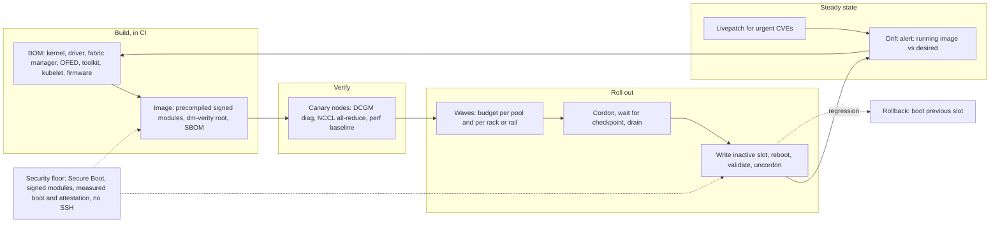

# Lesson 42 — AI/ML platform: fleet-scale node OS & kernel management — immutable images, kernel/driver ABI coupling & live patching across 10K+ GPU nodes

*2026-10-21*

## What interviewers are really probing

[Lesson 39](/lessons/39-gpu-fleet-lifecycle-acceptance-burn-in-rma) rolled firmware and drivers through a node state machine. [Lesson 40](/lessons/40-infiniband-roce-fabric-operations) did the fabric and [Lesson 41](/lessons/41-power-cooling-facility-constraints-gpu-fleets) did the building. This lesson is the layer every one of those depends on: **the operating system image and the kernel on 10K+ GPU nodes**. On a CPU fleet a kernel update is mostly a reboot. On a GPU fleet the kernel is welded to out-of-tree modules: the NVIDIA driver, `nvidia-peermem` or DMA-BUF for GPUDirect RDMA, the Mellanox/DOCA-OFED stack, sometimes GDS and vendor storage clients. Change the kernel without the matching modules and the node comes up `Ready` with **zero allocatable GPUs**. Change the driver without the matching fabric manager and every NVSwitch system in the pool loses NVLink.

The interview version: *"A critical kernel CVE drops on Tuesday. You have 12,000 GPU nodes, a 6,000-GPU training run that checkpoints every 30 minutes, and inference with a 99.9% SLO. How do you patch, how long does it take, and how do you know you didn't break anything?"* Or: *"Half a pool came back from a reboot with `nvidia-smi` failing. What happened?"* They want to hear **immutable, versioned node images** rather than package drift, **the full bill of materials** (kernel, driver, fabric manager, OFED, toolkit, firmware) treated as one artifact, **precompiled and signed modules instead of DKMS on the node**, **rollouts that respect gangs, checkpoints and failure domains**, **when live patching is worth its sharp edges**, and that the node image is the **root of trust** for every model weight that lands on it.

Cross-links: [L03](/lessons/03-cluster-provisioning-lifecycle) (provisioning lifecycle), [L12](/lessons/12-node-container-hardening-supply-chain) (node hardening, supply chain), [L13](/lessons/13-ml-weights-checkpoint-hardening) (weights), [L18](/lessons/18-gpu-node-pools-mig-timeslicing) (GPU pools), [L19](/lessons/19-gpu-topology-nvlink-rdma-nccl) (NVLink, RDMA, NCCL), [L20](/lessons/20-training-inference-scheduling-kueue-volcano) (gangs), [L23](/lessons/23-gpu-observability-dcgm-nccl-roofline) (DCGM), [L24](/lessons/24-multi-cluster-inference-routing-capacity) (traffic shift), [L27](/lessons/27-gpu-supply-chain-weight-registry-hydrate) (local weight caches), [L29](/lessons/29-training-reliability-checkpoint-elastic) (checkpoints), [L35](/lessons/35-fleet-incident-response-gpu-inference-agent-runbooks) (incidents), [L39](/lessons/39-gpu-fleet-lifecycle-acceptance-burn-in-rma), [L40](/lessons/40-infiniband-roce-fabric-operations), [L41](/lessons/41-power-cooling-facility-constraints-gpu-fleets). Fuel: [wafer-ai/gpu-perf-engineering-resources](https://github.com/wafer-ai/gpu-perf-engineering-resources).

What they check for:

- **Immutable images, not pets.** Nodes boot a versioned, read-only image (Bottlerocket, Flatcar, Talos, COS, or your own image built from Ubuntu or RHEL). You don't `apt upgrade` a GPU node; you replace its image. The image ID is a label the scheduler and dashboards can see.
- **The BOM is one unit.** Kernel build, NVIDIA driver branch, open versus proprietary modules, fabric manager, DOCA-OFED, container toolkit, kubelet and the firmware set from L39 are tested and shipped together. A "kernel-only" change is a myth on GPU nodes.
- **ABI coupling.** Out-of-tree modules are built against one kernel's exact headers and config (`vermagic`). Linux has no stable in-kernel ABI, so a kernel bump means rebuilding every out-of-tree module.
- **Build in CI, not on the node.** DKMS compiling the driver at boot is slow, needs compilers and headers on production nodes, fails when a mirror is down, and produces unsigned modules. Precompiled, signed modules baked into the image are the fleet answer.
- **Rollout mechanics.** Cordon, wait for jobs, drain, reboot into the new slot, validate, uncordon, with a budget per pool and per failure domain and automatic halt on regression. A GPU server can take 10–20 minutes to POST and validate, so reboot time is a capacity cost.
- **Live patching.** Kernel livepatch applies function-level fixes in seconds without a reboot. It's a bridge for urgent CVEs, not a substitute for converging to a new image.
- **Security.** Secure Boot, signed kernels and modules, dm-verity, measured boot and attestation, no SSH, and a patch SLA by severity. Weight caches on local NVMe are only as safe as the kernel that holds their keys.

**Interview sentence:** "Every GPU pool runs one immutable node image whose bill of materials is kernel, driver, fabric manager, OFED, toolkit, kubelet and firmware, built and signed in CI with precompiled modules, never DKMS on the node. A new image goes to canaries, which must pass DCGM diagnostics, an NCCL all-reduce across the fabric and a perf baseline, then rolls in waves sized per pool and per rack or rail, draining training only right after a checkpoint and shifting inference traffic before draining. Nodes have A/B slots, so rollback is booting the previous slot. For a critical CVE we ship a signed livepatch in hours to buy time, but we still converge the fleet to a patched image within the SLA. Secure Boot, signed modules, dm-verity and TPM attestation mean a node only gets weights and secrets if it proves it booted the image we built."

## Core diagram: BOM → CI image → canary → waves → steady state, coupling failures, patch paths and security floor

![Fleet-scale node OS and kernel management: a pipeline from pinning the bill of materials, to building a signed image in CI with precompiled modules, to verifying on canaries with NCCL and DCGM, to rolling out in waves with drains and A/B slots, to steady state with livepatch and drift alerts; below, the kernel and driver coupling failures, the patch paths chosen by urgency, the scheduler and controllers involved, and a security floor of Secure Boot, signed modules, measured boot, sealed weight-cache keys, no SSH and signed livepatches](/node-os-kernel-management.png)



## Idiosyncrasies / operator depth

### 1. The kernel has no stable module ABI, and GPU nodes live on out-of-tree modules

Linux keeps the userspace ABI stable and deliberately does not keep the in-kernel ABI stable. Every module records the kernel it was built for in `vermagic` (release string, SMP, preempt model, module versioning). Load `nvidia.ko` built for `6.8.0-45` into `6.8.0-47` and you get `disagree about version of symbol` or `Exec format error` in `dmesg`, and the device plugin advertises zero GPUs. Things that break this way on a GPU node:

- `nvidia`, `nvidia-uvm`, `nvidia-modeset`, `nvidia-drm` (the driver itself)
- `nvidia-peermem` (GPUDirect RDMA via the old peer-memory API; needs the driver *and* OFED to agree)
- DOCA-OFED / MLNX_OFED modules if you run them instead of the inbox RDMA stack
- GDS (`nvidia-fs`), Lustre or other parallel-filesystem clients, vendor storage drivers
- Anything else your security or observability vendor ships as a kernel module

Distribution-signed driver packages (for example Ubuntu's `linux-modules-nvidia-*` that track each kernel ABI) and NVIDIA's precompiled driver containers exist exactly to remove the compile step. NVIDIA's precompiled containers only exist for listed OS, kernel flavour and driver combinations; for any other kernel you build and publish your own.

### 2. Open versus proprietary kernel modules is now a hardware decision

NVIDIA ships two kernel module flavours from the same driver branch: the original proprietary modules and the open kernel modules (MIT/GPLv2). Since the R560 branch, the open modules are the default install, and Blackwell-generation GPUs are supported only by the open modules. Hopper works with either. Operator implications: your image pipeline must pick the flavour per SKU pool, the GPU Operator needs the matching setting, and GPUDirect RDMA through DMA-BUF (instead of `nvidia-peermem`) requires the open modules and a reasonably recent kernel. Mixed pools with mixed flavours are a common source of "works on half the nodes."

### 3. Fabric manager, driver and NVSwitch must match exactly

On HGX/DGX systems with NVSwitch, `nvidia-fabricmanager` must be the *same version* as the driver. Upgrade the driver in a container and leave fabric manager on the host at the old version and the service refuses to start. GPUs show up, but NVLink training fails and CUDA reports errors on peer access, so NCCL falls back or hangs ([L19](/lessons/19-gpu-topology-nvlink-rdma-nccl)). On NVL72-class racks the NVLink switch trays have their own firmware and management software, which joins the BOM. This is why the BOM is one versioned unit and why canaries must run a multi-GPU NCCL test, not just `nvidia-smi`.

### 4. Immutable OS options and what they mean for GPUs

| OS | Update model | GPU story | Gotcha |
|---|---|---|---|
| **Bottlerocket** (AWS) | A/B partitions, signed images, dm-verity root, API (`apiclient`) | NVIDIA variants ship the driver in the image | Variant is your BOM; you wait for a release with your driver branch or build a custom variant |
| **Flatcar** | A/B `/usr` partition, dm-verity, update engine | Drivers via systemd-sysext extensions | Sysext must match the exact OS version |
| **Talos** | API-only, no SSH, squashfs root, `talosctl upgrade` | NVIDIA system extensions built per Talos version | No shell; debugging is through the API and debug containers |
| **Container-Optimized OS** (GKE) | Google-managed, verified boot | Google-installed drivers by version | You don't own the kernel cadence |
| **Your own image** (Ubuntu/RHEL built with Packer or image-builder) | Golden image per BOM, reprovision or A/B | Full control, precompiled modules baked in | You own the security patch pipeline and the drift |

Most hyperscale GPU fleets end up with "your own image" built immutably: a general-purpose distro is easier for the RDMA stack and vendor tooling, but it's built in CI, read-only at runtime, and replaced wholesale. The mistake is a mutable general-purpose distro where nodes drift by `unattended-upgrades`; one night a kernel package lands, DKMS fails on 3% of nodes, and you find out at the next reboot.

### 5. Reboots are expensive on GPU nodes

A CPU VM reboots in under a minute. A bare-metal 8-GPU server with many NICs, NVMe drives and BMC checks can take 5–15 minutes to POST, then needs driver load, fabric manager start, IB link training, and health validation. At 10,000 nodes with a 2% concurrent budget (200 nodes), a 20-minute cycle gives roughly 600 nodes an hour, so about 17 hours of wall clock for the fleet *if* drains are free. Drains aren't free: a training gang can't lose a node without stopping, so you either wait for a checkpoint boundary or the job's own restart ([L29](/lessons/29-training-reliability-checkpoint-elastic)). That's why fleets batch kernel, driver and firmware changes into one image roll, and why reboot time is in the capacity model ([L38](/lessons/38-gpu-fleet-capacity-planning-procurement)).

**kexec** skips firmware POST and can cut minutes off each reboot. But it also skips the firmware reset of GPUs and NICs, and devices can come up in odd states. Treat kexec as a per-SKU feature you qualify with burn-in, not a default.

### 6. Rollouts must understand gangs, topology and inference

- **Training:** a 1,024-node job is one unit. Draining 5 of its nodes costs the whole job a restart. Better patterns: drain all nodes of a job together right after a checkpoint, or roll nodes that are idle or held by preemptible work first, and let Kueue place the next job on patched nodes ([L20](/lessons/20-training-inference-scheduling-kueue-volcano)). Some fleets mark the desired image on the queue so new gangs only land on patched capacity.
- **Topology:** don't take out a whole rail or leaf at once when jobs are spread across it, and don't take out every node of a rack-scale NVLink domain one by one; roll the domain as a block.
- **Inference:** shift traffic away at the router, then drain ([L24](/lessons/24-multi-cluster-inference-routing-capacity)). Keep replicas spread so a wave never removes more than one replica of a model per failure domain.
- **Budgets:** a percentage per pool *and* a per-domain cap (rack, row, CDU from [L41](/lessons/41-power-cooling-facility-constraints-gpu-fleets)).

### 7. The GPU Operator upgrade controller is a state machine

With the NVIDIA GPU Operator running the driver as a DaemonSet, driver upgrades are coordinated per node through the label `nvidia.com/gpu-driver-upgrade-state`, which walks through states such as `upgrade-required`, `cordon-required`, `wait-for-jobs-required`, `pod-deletion-required`, `drain-required`, `pod-restart-required`, `validation-required`, `uncordon-required`, `upgrade-done` and `upgrade-failed`. Knobs live under `driver.upgradePolicy` (`autoUpgrade`, `maxParallelUpgrades`, `maxUnavailable`, wait-for-completion pod selector, drain settings). Two operator truths: a node stuck in `wait-for-jobs-required` is usually a long-running job you forgot to label, and in an immutable-image fleet you often turn the in-cluster driver upgrade off and ship the driver inside the node image instead, so there's only one thing rolling at a time.

### 8. Live patching is a sharp, useful tool

Kernel livepatch replaces individual kernel functions at runtime using ftrace. kpatch-build (or your distro's livepatch service) produces a special module; loading it starts a **transition** where each task switches to the new code once it's not running the old function. Meta's LPC 2022 talk describes running livepatches across millions of servers with fully automated rollouts and health checks; their lessons carry over:

- **Not every fix is patchable.** Changes to data structure layout, init code or assembly usually aren't. Many CVE fixes are, which is why the distros ship livepatches for high-severity ones.
- **Transitions stall.** A task sleeping inside a patched function blocks the transition; `/sys/kernel/livepatch/<patch>/transition` stays `1`. Busy GPU nodes with long-blocked driver threads are exactly where this happens.
- **Tracing conflicts.** Livepatch and some ftrace, kprobe or eBPF users fight over the same functions; your observability agents can block or be broken by a patch.
- **Taint.** A livepatched kernel sets the `K` taint flag. GPU nodes already carry `O` (out-of-tree) and often `E` (unsigned) or `P` (proprietary). Know which flags are expected so a new one stands out.
- **It's a bridge.** Patch in hours, then roll a new image in the next window, and delete the livepatch from the desired state once the fleet has converged. A fleet that accumulates livepatches is a fleet whose running kernel nobody can reproduce.

### 9. Drift is the real enemy

The goal is that `running image ID == desired image ID` on every node, and the exceptions are visible. Sources of drift: nodes that failed an upgrade and were manually uncordoned, nodes back from RMA on an old image ([L39](/lessons/39-gpu-fleet-lifecycle-acceptance-burn-in-rma)), someone's debug `modprobe`, a livepatch that never got removed, kernel command-line overrides from a past incident. Export the running image, kernel release, driver version and loaded-module set as node labels and metrics, alert on mismatches, and let automation reprovision rather than hand-fix.

## Concrete commands & config

### Inspect the coupling on one node

```bash
uname -r                                    # running kernel release
cat /proc/cmdline                           # boot parameters (iommu, hugepages, overrides)
cat /proc/driver/nvidia/version             # loaded driver build
modinfo -F vermagic nvidia                  # kernel this module was built for
modinfo -F signer nvidia                    # who signed it (empty = unsigned)
modinfo -F license nvidia                   # "Dual MIT/GPL" = open modules, "NVIDIA" = proprietary
nvidia-smi --query-gpu=driver_version,vbios_version --format=csv
systemctl status nvidia-fabricmanager       # must be same version as driver on NVSwitch systems
nv-fabricmanager --version
lsmod | grep -E 'nvidia|peermem|mlx5|ib_core|nvidia_fs'
ofed_info -s 2>/dev/null                    # DOCA/MLNX OFED version if installed
cat /proc/sys/kernel/tainted                # bitmask; decode against kernel docs
dmesg -T | grep -iE 'nvidia|NVRM|vermagic|module verification|Lockdown'
mokutil --sb-state                          # Secure Boot on or off
dkms status 2>/dev/null                     # should be empty in an immutable fleet
```

### Livepatch status

```bash
ls /sys/kernel/livepatch/
cat /sys/kernel/livepatch/*/enabled         # 1 = active
cat /sys/kernel/livepatch/*/transition      # 1 = still transitioning (stalled if it stays 1)
kpatch list                                 # kpatch-managed patches (RHEL family)
canonical-livepatch status --verbose        # Ubuntu Livepatch service
```

### Immutable OS upgrade primitives

```bash
# Bottlerocket (via admin or control container, or SSM)
apiclient update check
apiclient update apply --reboot

# Flatcar
update_engine_client -status

# Talos
talosctl -n 10.0.0.21 upgrade --image ghcr.io/siderolabs/installer:v1.8.3
talosctl -n 10.0.0.21 get extensions        # confirm NVIDIA extensions match the Talos version
```

### GPU Operator: precompiled drivers and controlled upgrades

```yaml
# ClusterPolicy excerpt
spec:
  driver:
    enabled: true
    usePrecompiled: true                     # no compile on the node
    repository: registry.internal.example.com/nvidia   # private mirror
    image: driver
    version: "570"                           # branch; precompiled tag resolves per kernel
    upgradePolicy:
      autoUpgrade: true
      maxParallelUpgrades: 10
      maxUnavailable: 5%
      waitForCompletion:
        podSelector: "training.example.com/gang=true"
        timeoutSeconds: 3600
      drain:
        enable: true
        force: false
        timeoutSeconds: 1800
```

```bash
kubectl get nodes -L nvidia.com/gpu-driver-upgrade-state,feature.node.kubernetes.io/kernel-version.full
kubectl get nodes -l nvidia.com/gpu-driver-upgrade-state=upgrade-failed
kubectl -n gpu-operator logs ds/nvidia-driver-daemonset -c nvidia-driver-ctr --tail=50
```

### Node labels for image and kernel (your agent or NFD)

```yaml
metadata:
  labels:
    node.example.com/os-image: gpu-h100-2026.10.2      # the BOM ID
    node.example.com/driver: "570.172.08"
    feature.node.kubernetes.io/kernel-version.full: 6.8.0-47-generic   # from Node Feature Discovery
```

```bash
# Drift report: nodes not on the desired image for their pool
kubectl get nodes -l pool=h100-train -L node.example.com/os-image --no-headers | \
  awk '$NF != "gpu-h100-2026.10.2"' | wc -l
```

### Reboot coordination with kured (when the OS signals reboot-required)

```yaml
# kured DaemonSet args (excerpt)
args:
  - --reboot-sentinel=/var/run/reboot-required
  - --period=10m
  - --start-time=09:00
  - --end-time=17:00
  - --time-zone=America/New_York
  - --blocking-pod-selector=training.example.com/gang=true   # never reboot under a gang
  - --lock-annotation=kured.example.com/lock
  - --concurrency=5
```

For image-replacement fleets, the same role is played by Cluster API `MachineDeployment` rollouts (`maxUnavailable`, `maxSurge`), Karpenter drift on a changed node class AMI, or your own controller. The rules don't change: budget per pool and domain, respect gangs, halt on regression.

### Rollout policy (pseudo-config for your controller)

```yaml
imageRollout:
  image: gpu-h100-2026.10.2
  bom:
    kernel: 6.8.0-47-generic
    driver: 570.172.08         # open kernel modules
    fabricManager: 570.172.08
    ofed: doca-2.9
    containerToolkit: 1.17.x
    kubelet: 1.31.x
    firmwareSet: h100-fw-2026q3   # from L39
  canary:
    nodes: 16                  # across 2 racks, 2 rails
    gates: [dcgmDiagLevel2, ncclAllReduce16Node, ibLinksUp, perfWithin2pct, expectedTaintFlagsOnly]
  waves: [1%, 5%, 25%, 100%]
  budget:
    maxUnavailablePerPool: 3%
    maxPerRack: 1
    maxPerNvlinkDomain: whole-domain-or-none
  training:
    drainOn: checkpointComplete
    maxWaitPerGang: 2h
  halt:
    - gpusAllocatableDrop > 0.5%
    - xid79OrFallenOffBusRate > baseline*2
    - ncclBusBwDrop > 5%
  rollback: bootPreviousSlot
```

## Failures & fixes

| Symptom | Likely cause | Fix / mitigation |
|---|---|---|
| Node `Ready`, device plugin advertises 0 GPUs after reboot | Kernel updated, `nvidia.ko` built for old kernel (`vermagic` mismatch) or DKMS failed | Precompiled modules in the image; node health check fails the node if allocatable GPUs is 0; block package-level kernel updates |
| `nvidia-fabricmanager` fails to start, NCCL hangs or uses PCIe | Driver and fabric manager versions differ | Ship both in one image; canary must run multi-GPU NCCL; alert on fabric manager down |
| IB ports up, GPUDirect RDMA bandwidth collapses | `nvidia-peermem` not loaded or built against different OFED; DMA-BUF path unavailable with proprietary modules | Treat OFED and peermem as BOM items; test RDMA bandwidth on canaries ([L40](/lessons/40-infiniband-roce-fabric-operations)) |
| `module verification failed` or `Lockdown: unsigned module loading is restricted` | Secure Boot on, module signed with a key not enrolled | Sign modules in CI with an enrolled key; never disable Secure Boot as the fix |
| Driver upgrade stuck for days on some nodes | Upgrade controller in `wait-for-jobs-required` behind a long job | Time-box waits per gang; schedule upgrades at checkpoint boundaries; page on stuck states |
| Half the pool on old kernel a month later | Failed upgrades manually uncordoned; RMA returns on old image | Drift metric and alert; reprovision non-conforming nodes automatically |
| Livepatch rolled, `transition` stays 1 on GPU nodes | Tasks blocked in patched function (often long driver or I/O waits) | Halt wave; retry later or reboot those nodes into the patched image; track transition time as a rollout gate |
| Latency regression after livepatch | Conflict with ftrace/eBPF tooling, or patch on a hot path | Canary with production observability agents loaded; compare to same kernel without patch |
| After kernel update, local NVMe weight cache won't unlock | Disk key sealed to TPM PCRs that include the kernel measurement | Use signed PCR policies or re-seal during the update; fall back to rehydrate from registry ([L27](/lessons/27-gpu-supply-chain-weight-registry-hydrate)) |
| kexec reboot, GPUs show XID errors or wrong state | Firmware reset skipped | Full reboot for that SKU; qualify kexec per SKU with burn-in |
| Image roll takes a week instead of a day | Every training gang drained separately; 15-minute POST | Batch changes; drain gangs as a unit after checkpoint; budget per domain not per node |
| Training job crashed when 3 of its nodes rebooted | Rollout ignored gang membership | Blocking pod selector or wait-for-completion; gang-aware controller |

## Security & hardening

**The node image is the root of trust for every model weight, checkpoint and secret on the node.** Whoever controls the kernel can read GPU memory, NVMe weight caches, service-account tokens and registry credentials. Kernel and driver supply chain is model-weight security.

### Boot chain and modules

| Control | Threat | Practice |
|---|---|---|
| UEFI Secure Boot with signed kernel | Bootkit or tampered kernel on a node | Secure Boot on in every pool; vendor or your own signing key in firmware DB; checked at acceptance ([L39](/lessons/39-gpu-fleet-lifecycle-acceptance-burn-in-rma)) |
| Module signing and enforcement | Malicious or tampered `.ko` (including a fake "driver") | Sign NVIDIA, OFED and any vendor modules in CI with a key held in an HSM; `module.sig_enforce=1` or lockdown so unsigned modules fail |
| Kernel lockdown | Root user tampers with running kernel (`/dev/mem`, kexec of unsigned kernels) | Lockdown integrity mode; signed kexec only |
| dm-verity read-only root | Persistent changes to binaries on the node | Read-only, verified root; writable state only in known paths |
| Measured boot and attestation | Node booted something other than the approved image | TPM measurements checked by an attestation service before the node gets secrets, registry credentials or weights |
| No module loading from pods | Privileged container loads a module | Deny `CAP_SYS_MODULE`, privileged pods and hostPath to `/lib/modules` in tenant namespaces ([L11](/lessons/11-cluster-security-pss-admission-rbac)) |

### Images, registries and drivers

- **The driver container is the most privileged workload you run.** It loads kernel modules on every GPU node. Pull it from a private mirror, pin by digest, verify signatures at admission with cosign or your policy engine ([L12](/lessons/12-node-container-hardening-supply-chain)), and lock its namespace so only the platform team can change it.
- **One SBOM per image ID.** Kernel, driver, OFED, toolkit and every package, so a CVE query answers "which pools are exposed" in minutes. Scan the image, not the running nodes.
- **Patch SLA by severity.** For example: critical kernel CVE livepatched in 48 hours and imaged in 14 days; high in 30 days. Track exposure per pool on a dashboard leadership can read.
- **Livepatches are kernel code.** Build them in the same pipeline, sign them, roll them with the same canary and halt gates, and audit who approved them.
- **No SSH by default.** API-driven OS (Talos, Bottlerocket) or break-glass access with SSO, time-boxed, recorded. A debugging session that `modprobe`s something leaves drift; reprovision after break-glass.

### Model weights, checkpoints and deployments

- **Weight caches on local NVMe** ([L27](/lessons/27-gpu-supply-chain-weight-registry-hydrate)) are encrypted with keys released only to attested nodes. If keys are sealed to TPM PCRs, use a signed PCR policy so a legitimate kernel update doesn't lock the cache and an unapproved kernel can't open it. Wipe or crypto-erase on reimage and RMA.
- **Checkpoints written during drains** go to the normal encrypted, IAM-scoped bucket ([L13](/lessons/13-ml-weights-checkpoint-hardening), [L29](/lessons/29-training-reliability-checkpoint-elastic)). Rollouts trigger many checkpoints at once; size bandwidth so nobody "temporarily" writes to scratch.
- **Inference deployments only land on attested, current images.** Use a node label for the image ID plus admission or scheduling policy so a serving pod with production weights can't be placed on a drifted or quarantined node ([L14](/lessons/14-ml-inference-training-deploy-hardening)).
- **Old images are retired.** Keep the previous slot for rollback, but remove images with known critical CVEs from the bootable set and from the provisioning catalog, so an RMA return can't come back on them.
- **Bulk reboot is a kill switch.** A fleet-wide image roll triggered by a bad config is an outage. Two-person approval for rollouts above a percentage, rate limits in the controller, and halts that a human must clear.

### Runbook: critical kernel CVE

```bash
# 0. Exposure: which pools run an affected kernel? (from image SBOMs, not node scans)
#    imagectl is a stand-in for your image catalog or BOM service
imagectl exposure --cve CVE-2026-XXXXX

# 1. Mitigate by config if possible (sysctl, module blocklist) via image or node config channel

# 2. Livepatch: signed patch to canaries, check transition and taint
cat /sys/kernel/livepatch/*/transition    # expect 0 within minutes

# 3. Waves: 1% -> 10% -> 100% with halt gates (latency, XID rate, NCCL bus bandwidth)

# 4. Build the patched image (new BOM ID), canary with DCGM diag + NCCL, roll in the next window

# 5. Remove the livepatch from desired state once drift report shows 0 nodes on the old image
kubectl get nodes -L node.example.com/os-image | awk '{print $NF}' | sort | uniq -c
```

## Interview soundbites

- "On a GPU node there's no such thing as a kernel-only change. Kernel, driver, fabric manager and OFED ship as one image ID."
- "Linux doesn't promise a stable module ABI, so every kernel bump means rebuilding every out-of-tree module. I do that in CI and ship signed, precompiled modules; DKMS on production nodes is how you get 3% of a pool with zero GPUs after a reboot."
- "The scariest failure is `Ready` with zero allocatable GPUs. My node health check fails a node that should have eight GPUs and has none."
- "Canaries run NCCL across nodes, not just `nvidia-smi`, because driver and fabric manager mismatch only shows up on NVLink and RDMA."
- "Reboots cost 10–20 minutes on bare-metal GPU servers, so I batch kernel, driver and firmware into one roll and drain training gangs as a unit after a checkpoint."
- "A/B slots make rollback a reboot, not a reinstall."
- "Livepatch buys time on a critical CVE, but the fleet still converges to a new image. Accumulated livepatches mean nobody can reproduce what's running."
- "My north-star metric is the percentage of nodes whose running image matches desired, per pool."
- "The node image is the root of trust for model weights. Secure Boot, signed modules, dm-verity and attestation decide whether a node gets weight-cache keys at all."
- "The GPU driver container loads kernel modules on every node. It's pinned by digest, signature-verified and locked down like the control plane."

## How this maps to the JD

- **100+ clusters / 10K+ nodes:** image pipelines, wave rollouts, drift metrics and patch SLAs are how a small team keeps a huge fleet uniform.
- **K8s internals:** device plugin and allocatable resources, cordon/drain, PDBs, gang-aware waits, NFD labels, GPU Operator state machine, Cluster API and Karpenter drift.
- **Security:** boot chain, module signing, lockdown, attestation, supply chain for kernels and drivers, weight-cache key release.
- **Terraform/Atlantis and Temporal/Argo:** the image BOM lives in Git; Atlantis or Argo applies the desired image per pool; a Temporal workflow is a natural fit for long, resumable, halt-able fleet rollouts ([L15](/lessons/15-terraform-atlantis-fleet-scale), [L16](/lessons/16-temporal-argo-workflows)).
- **Design tradeoffs:** managed immutable OS versus your own image, livepatch versus reboot, kexec versus full POST, rollout speed versus training disruption.

## Watch (talks & demos)

### Kernel Live Patching at Scale — Song Liu, Rik van Riel, David Vernet (Meta), Linux Plumbers 2022

How Meta builds, rolls out and monitors kernel livepatches on millions of servers: packaging patches like any other package, fully automated rollouts with health checks that halt on the first sign of trouble, and the real failure modes (performance hits when applying, conflicts with tracing, transitions that fail depending on what the kernel is doing). Operator takeaway: section 8 of this lesson, from the team that runs it at the largest scale.

<iframe width="100%" height="360" src="https://www.youtube.com/embed/N4zIIASwTok" title="Kernel Live Patching at Scale - Song Liu, Rik van Riel, David Vernet" frameBorder="0" allow="accelerometer; autoplay; clipboard-write; encrypted-media; gyroscope; picture-in-picture; web-share" allowFullScreen></iframe>

[Open on YouTube](https://www.youtube.com/watch?v=N4zIIASwTok)

### Special Purpose Operating Systems: The Next Step in OS Evolution or One-Trick Ponies? — CNCF panel (KubeCon EU 2024)

People behind Talos, Flatcar, Bottlerocket, Kairos, Container-Optimized OS and Unikraft on immutable node operating systems: atomic updates and rollback, API-driven nodes, extending a minimal image with sysext, and the honest tradeoff between tiny images and GPU or accelerator support. Watch it to argue the "managed immutable OS versus our own image" decision with real vocabulary.

<iframe width="100%" height="360" src="https://www.youtube.com/embed/uD-T9LdfvrM" title="Special Purpose Operating Systems: The Next Step in OS Evolution or One-Trick Ponies?" frameBorder="0" allow="accelerometer; autoplay; clipboard-write; encrypted-media; gyroscope; picture-in-picture; web-share" allowFullScreen></iframe>

[Open on YouTube](https://www.youtube.com/watch?v=uD-T9LdfvrM)

## References

- Live patching: [Kernel Live Patching at Scale (LPC 2022 slides and video)](https://lpc.events/event/16/contributions/1199/) · [Linux kernel livepatch documentation](https://docs.kernel.org/livepatch/livepatch.html) · [kpatch](https://github.com/dynup/kpatch)
- Kernel ABI and taint: [The Linux Kernel Driver Interface (stable-api-nonsense)](https://docs.kernel.org/process/stable-api-nonsense.html) · [Tainted kernels](https://docs.kernel.org/admin-guide/tainted-kernels.html) · [Kernel module signing](https://docs.kernel.org/admin-guide/module-signing.html) · [dm-verity](https://docs.kernel.org/admin-guide/device-mapper/verity.html)
- NVIDIA: [GPU Operator precompiled driver containers](https://docs.nvidia.com/datacenter/cloud-native/gpu-operator/latest/precompiled-drivers.html) · [GPU Operator driver upgrades](https://docs.nvidia.com/datacenter/cloud-native/gpu-operator/latest/gpu-driver-upgrades.html) · [open-gpu-kernel-modules](https://github.com/NVIDIA/open-gpu-kernel-modules) · [Fabric Manager user guide](https://docs.nvidia.com/datacenter/tesla/fabric-manager-user-guide/index.html)
- Immutable OS: [Bottlerocket](https://github.com/bottlerocket-os/bottlerocket) · [Flatcar](https://www.flatcar.org/docs/latest/) · [Talos Linux](https://www.talos.dev/) · [Container-Optimized OS](https://cloud.google.com/container-optimized-os/docs)
- Kubernetes: [kured](https://github.com/kubereboot/kured) · [Node Feature Discovery](https://kubernetes-sigs.github.io/node-feature-discovery/) · [Cluster API](https://cluster-api.sigs.k8s.io/) · [Karpenter drift](https://karpenter.sh/docs/concepts/disruption/)
- [wafer-ai/gpu-perf-engineering-resources](https://github.com/wafer-ai/gpu-perf-engineering-resources) — AI/ML platform fuel
- Prior: [41 — Power & cooling](/lessons/41-power-cooling-facility-constraints-gpu-fleets) · [40 — InfiniBand / RoCE fabric ops](/lessons/40-infiniband-roce-fabric-operations) · [39 — GPU fleet lifecycle](/lessons/39-gpu-fleet-lifecycle-acceptance-burn-in-rma) · [29 — Training reliability](/lessons/29-training-reliability-checkpoint-elastic) · [27 — Weight registry / hydrate](/lessons/27-gpu-supply-chain-weight-registry-hydrate) · [23 — DCGM](/lessons/23-gpu-observability-dcgm-nccl-roofline) · [20 — Kueue / Volcano](/lessons/20-training-inference-scheduling-kueue-volcano) · [19 — NVLink / RDMA / NCCL](/lessons/19-gpu-topology-nvlink-rdma-nccl) · [14 — Inference/training deploy hardening](/lessons/14-ml-inference-training-deploy-hardening) · [13 — Weights hardening](/lessons/13-ml-weights-checkpoint-hardening) · [12 — Node hardening & supply chain](/lessons/12-node-container-hardening-supply-chain) · [03 — Provisioning lifecycle](/lessons/03-cluster-provisioning-lifecycle)
- Next: **Lesson 43 — AI/ML platform: GPU node bootstrap & bare-metal provisioning at scale — PXE/iPXE, Redfish automation, cluster join & zero-touch onboarding of new racks**

## Quick self-check

Out loud, in under two minutes each:

1. Why does a kernel update on a GPU node need a driver rebuild, and what goes wrong if you do the rebuild with DKMS at boot across 10,000 nodes?
2. Half a pool came back from a reboot with 0 allocatable GPUs; the other half is fine. Name three possible causes and the one command that distinguishes each.
3. Lay out your BOM for an H100 training pool and explain why fabric manager and OFED are in it.
4. A critical kernel CVE drops. Walk through hours 0–48 and days 2–14 for a fleet with a 6,000-GPU training job and a 99.9% inference SLO.
5. When is livepatch the right call, when is it not, and what three signals tell you a livepatch rollout should halt?
6. How do Secure Boot, module signing, dm-verity and TPM attestation together decide whether a node may hold production model weights, and how do you keep a legitimate kernel update from locking the weight cache?
