# Lesson 43 — AI/ML platform: GPU node bootstrap & bare-metal provisioning at scale — PXE/iPXE, Redfish automation, cluster join & zero-touch onboarding of new racks

*2026-10-22*

## What interviewers are really probing

[Lesson 42](/lessons/42-node-os-kernel-management-gpu-fleets) built the signed node image. [Lesson 39](/lessons/39-gpu-fleet-lifecycle-acceptance-burn-in-rma) burned nodes in and sent bad ones back. This lesson is the part in between: **a truck drops off 32 racks of GPU servers, and they have to become schedulable capacity without anyone typing on a console.** At 10K+ nodes this is a factory, not a ticket. Every hour a $300K server sits racked but not schedulable is money you already spent, and every manual step is a place where a wrong cable, a factory BMC password or a leaked join token gets into production.

The interview version: *"We're bringing up 4,000 new H100 nodes over six weeks across two data halls. Design the path from 'rack is powered' to 'GPUs are in the training pool.' How do you know each node is the node you think it is, cabled where you think it is, running the image you built?"* Or the incident version: *"We powered on 16 racks at once and half of them never finished PXE. What happened?"* They want to hear **a source of truth for hardware** (serials, MACs, rack position, cabling), **Redfish as the control API** for the baseboard management controller (BMC), **network boot that scales** (iPXE over HTTPS, not TFTP storms), **inspection that compares the real hardware to what was ordered**, **attestation before any credential**, **per-node identity for cluster join**, and a **state machine that is idempotent and resumable**, because something will fail halfway on hundreds of nodes.

Cross-links: [L03](/lessons/03-cluster-provisioning-lifecycle) (cluster provisioning lifecycle), [L12](/lessons/12-node-container-hardening-supply-chain) (node hardening, supply chain), [L13](/lessons/13-ml-weights-checkpoint-hardening) (weights), [L18](/lessons/18-gpu-node-pools-mig-timeslicing) (GPU pools), [L19](/lessons/19-gpu-topology-nvlink-rdma-nccl) (topology), [L23](/lessons/23-gpu-observability-dcgm-nccl-roofline) (DCGM), [L27](/lessons/27-gpu-supply-chain-weight-registry-hydrate) (weight hydrate), [L38](/lessons/38-gpu-fleet-capacity-planning-procurement) (procurement), [L39](/lessons/39-gpu-fleet-lifecycle-acceptance-burn-in-rma), [L40](/lessons/40-infiniband-roce-fabric-operations), [L41](/lessons/41-power-cooling-facility-constraints-gpu-fleets), [L42](/lessons/42-node-os-kernel-management-gpu-fleets). Fuel: [wafer-ai/gpu-perf-engineering-resources](https://github.com/wafer-ai/gpu-perf-engineering-resources).

What they check for:

- **Hardware has a source of truth.** The vendor manifest (serial, BMC MAC, NIC MACs, GPU serials) lands in DCIM (NetBox or similar) *before* the rack is powered. Rack, U position, PDU outlet, leaf and rail ports come from the cabling plan. Provisioning reads from it; it never invents it.
- **The BMC is the API.** Redfish over HTTPS on an isolated out-of-band (OOB) network does power, boot order, virtual media, BIOS attributes, firmware updates and inventory. IPMI is a legacy fallback with weak crypto and should be off.
- **Network boot that scales.** UEFI firmware → iPXE (signed) → kernel and ramdisk over HTTPS from a cache near the rack. TFTP is slow, lossy under load and unauthenticated; at 500 simultaneous boots it falls over.
- **Inspect, then trust.** A ramdisk agent reports what is really there: 8 GPUs with the right PCI IDs, NVLink/NVSwitch, 8 IB or RoCE HCAs, NVMe count, DIMMs, firmware versions, LLDP neighbors. Compare against the SKU profile and the cabling plan. Any mismatch goes to quarantine, not to the pool.
- **Attestation gates identity.** The node writes the [L42](/lessons/42-node-os-kernel-management-gpu-fleets) image, boots with Secure Boot and measured boot, and proves its TPM measurements before it receives a per-node join credential. No shared bootstrap token baked into an image.
- **Join is not "schedulable."** The node joins tainted, runs [L39](/lessons/39-gpu-fleet-lifecycle-acceptance-burn-in-rma) burn-in (DCGM diag, NCCL across its rail), gets topology labels, and only then is untainted.
- **Pacing and idempotency.** You bring up racks in batches sized to DHCP, image cache, BMC and power limits ([L41](/lessons/41-power-cooling-facility-constraints-gpu-fleets)). Every step can be re-run safely and records where it stopped.

**Interview sentence:** "The rack's manifest and cabling plan are in DCIM before power-on. A controller (Metal3/Ironic or Tinkerbell) claims each BMC on the out-of-band network over Redfish, rotates the factory password into a vault, sets the firmware baseline and BIOS attributes, and netboots a signed iPXE over HTTPS into an inspection ramdisk. Inspection must match the SKU profile and the cabling plan via LLDP, or the node is quarantined. Then we write the signed node image to an A/B slot, boot with Secure Boot and measured boot, and the node gets a short-lived per-node join credential only after TPM attestation. It joins tainted, passes burn-in and NCCL on its rail, gets rack and rail labels, and is untainted. We pace it in rack batches, every step is idempotent, and we track time-to-schedulable per rack, because the slowest stage is the backlog."

## Core diagram: manifest → Redfish → netboot & inspect → image & attest → join & burn-in

```mermaid
flowchart LR
  subgraph TRUTH["Source of truth"]
    M["Vendor manifest: serials, MACs, BMC MAC"]
    C["Cabling plan: rack, U, PDU, leaf and rail ports"]
  end

  subgraph OOB["Out-of-band, Redfish"]
    B["Claim BMC, rotate password into vault"]
    F["Firmware baseline and BIOS attributes"]
    P["Boot override and power on"]
  end

  subgraph BOOT["Netboot"]
    X["UEFI HTTP boot or DHCP to signed iPXE"]
    R["Inspection ramdisk over HTTPS"]
    I["Inspect: GPUs, NVLink, HCAs, NVMe, LLDP"]
  end

  subgraph ID["Image and identity"]
    W["Write signed node image to A/B slot"]
    A["Measured boot, TPM attestation"]
    J["Per-node join credential, short TTL"]
  end

  subgraph K8S["Cluster"]
    T["Join tainted not-validated"]
    G["Burn-in: DCGM diag, NCCL on rail"]
    S["Labels: pool, rack, rail, image. Untaint"]
  end

  Q["Quarantine: mismatch or failed check"]

  M --> B
  C --> I
  B --> F --> P --> X --> R --> I --> W --> A --> J --> T --> G --> S
  I -.->|mismatch| Q
  A -.->|bad PCRs| Q
  G -.->|fail| Q
```




## Idiosyncrasies / operator depth

### 1. DCIM first, or you're provisioning guesses

The single biggest cause of slow bring-up is not software; it's data. The vendor's manifest has a typo in a MAC, a server was swapped at the integrator, two cables on the rail leaf are crossed. Load the manifest and the cabling plan into DCIM *before* power-on, and make every later step a comparison against it: the BMC that answered DHCP has a MAC you expected, the host's LLDP neighbors match the cable plan, the GPU serials match the manifest. When they disagree, DCIM is not automatically right; open a discrepancy and quarantine. A training job scheduled assuming rail-optimized cabling ([L19](/lessons/19-gpu-topology-nvlink-rdma-nccl), [L40](/lessons/40-infiniband-roce-fabric-operations)) on a node whose NIC 3 is on rail 5 will be slow in a way nobody can explain for weeks.

### 2. The BMC is a computer, and a weak one

Every GPU server has a BMC (iDRAC, iLO, XClarity, Supermicro, or OpenBMC on many ODM boards). It runs its own firmware, its own web server and its own network stack.

- **Redfish is the standard, OEM extensions are the reality.** `Systems/{id}`, `Managers/{id}`, `UpdateService` and `TaskService` are portable. BIOS attribute names, firmware update methods and virtual-media quirks are vendor-specific. Your controller needs a driver layer per vendor (Ironic has `redfish`, `idrac-redfish`, `ilo` interfaces for this reason).
- **BMCs are slow and fragile under concurrency.** One BMC handles a few sessions; firmware updates take 10–40 minutes and restart the BMC; tasks return `202 Accepted` and you must poll `TaskMonitor`. Set per-BMC concurrency to 1 and pace across BMCs.
- **Factory credentials.** Many ship with a per-unit password on a pull tag (good), some still ship a default (bad). Claiming a BMC means logging in with the factory credential once, creating your own account with a unique random password stored in a vault, and disabling or rotating the factory one.
- **BMC firmware is part of the baseline.** An old BMC may lack Redfish features you rely on (HTTP boot URI, `BootSourceOverrideTarget: UefiHttp`, certificate management). Update BMC first, then BIOS, then NICs and GPUs ([L39](/lessons/39-gpu-fleet-lifecycle-acceptance-burn-in-rma) firmware set).

### 3. Network boot: TFTP is the bottleneck you don't see in the lab

Classic PXE is DHCP → TFTP a small boot loader → TFTP kernel and initrd. TFTP uses lock-step 512-byte blocks by default over UDP; a 200 MB ramdisk to 500 nodes at once collapses into timeouts and retries. The scale answer:

- **Chainload iPXE** (or use UEFI HTTP Boot directly) and fetch kernel and initrd over **HTTPS** from a cache in each hall or row.
- **Pick the right NIC.** GPU servers have a 1/10/25G management NIC plus 8 high-speed HCAs (ConnectX-7, BlueField). Firmware may try to PXE on every port, including IB ports that have no DHCP. Set boot order explicitly via Redfish, and disable PXE on fabric ports in NIC firmware.
- **DHCP relay and scope sizing.** With per-rack L3 networks, the top-of-rack switch relays DHCP. 500 nodes booting at once also means 500 BMC and host leases; check scope size, lease time and relay rate limits.
- **Virtual media as an alternative.** Redfish `VirtualMedia.InsertMedia` mounts an ISO over HTTPS from the BMC. No DHCP needed, works across L3, but BMC download speed is slow (often single-digit MB/s) and some BMCs only accept HTTP or specific TLS versions.
- **UEFI only.** Legacy BIOS PXE has no Secure Boot. GPU servers should be UEFI with Secure Boot keys enrolled from day one.

### 4. Inspection is where bad hardware gets caught cheaply

The inspection ramdisk (Ironic Python Agent, Tinkerbell's Hook/tink-worker, or your own) collects inventory and reports it. Check, per SKU profile:

- GPU count and PCI IDs (`lspci -d 10de:`), NVSwitch presence, GPU serials vs manifest. "7 of 8 GPUs" after shipping is common: reseating fixes some; others are RMA ([L39](/lessons/39-gpu-fleet-lifecycle-acceptance-burn-in-rma)).
- PCIe link width and speed for each GPU and HCA (`lspci -vv | grep LnkSta`). A GPU at x8 instead of x16 will pass `nvidia-smi` and halve host-to-device bandwidth.
- HCA count, firmware version, port state, link speed; LLDP neighbor per port vs cabling plan.
- NVMe count and model, DIMM count and size, CPU model, BIOS and BMC versions.

Fail closed: the node does not go further until inventory matches.

### 5. Join: the bootstrap credential is the crown jewel

The simplest kubeadm setup bakes a bootstrap token into the image or ramdisk. That token lets anyone who reads it register a node, and a rogue node can attract pods, secrets and model weights. At scale:

- **Per-node, short-lived credentials** minted only after attestation. On cloud this is instance identity (EKS uses the node's IAM role; GKE uses the instance identity and Shielded VM). On bare metal you build it: TPM attestation (e.g. SPIFFE/SPIRE with a TPM node attestor, Keylime, or your own attestation service) issues a credential bound to the node's identity.
- **CSR approval is a policy, not a rubber stamp.** Kubelet client CSRs get auto-approved for known bootstrap identities; kubelet serving CSRs must be checked against the node's expected name and IPs. A controller that approves every `kubernetes.io/kubelet-serving` CSR lets a node claim another node's identity.
- **NodeRestriction admission** keeps a kubelet from editing other nodes and from setting labels in `node-restriction.kubernetes.io/`. Put security-relevant labels (pool, attested, trust tier) there, set by a controller, not by the kubelet.

### 6. Pacing: power, DHCP, image cache and BMCs all have limits

Bringing up 512 nodes at once hits every shared resource: inrush current on PDUs ([L41](/lessons/41-power-cooling-facility-constraints-gpu-fleets)), DHCP relay, image cache bandwidth (512 × 10 GB image = 5 TB), the provisioning controller's worker pool, and the cluster API server when 512 kubelets join and start watches. Batch by rack, stagger power-on by a few seconds per node, pre-warm image caches, and cap concurrent joins per cluster. Measure time per stage per rack.

### 7. Control plane choices

- **Metal3 + Ironic.** `BareMetalHost` CRs in Kubernetes; Ironic does the BMC work (Redfish, virtual media, inspection, cleaning). Cluster API Provider Metal3 (CAPM3) turns hosts into `Machine`s. Ironic Standalone Operator simplifies running Ironic.
- **Tinkerbell.** `Hardware`, `Template`, `Workflow` CRs; Smee (DHCP/iPXE), Hegel (metadata), Hook (in-memory OS) running workflow actions as containers. CAPT for Cluster API.
- **MAAS, Foreman, or in-house.** Many hyperscalers write their own on top of Redfish because they also own the DCIM, the image pipeline and the fleet state machine ([L39](/lessons/39-gpu-fleet-lifecycle-acceptance-burn-in-rma)). The pattern matters more than the tool.

Whichever you pick, the node states are explicit (`registering → inspecting → available → provisioning → provisioned → joined → validated`), every transition is idempotent, and every failure records a reason code you can count.

### 8. Cleaning and re-provisioning

The same pipeline runs in reverse when a node leaves a tenant, goes to RMA, or changes pools: drain, wipe (NVMe crypto erase via `nvme format -s 1` or `-s 2`), reset BIOS attributes to baseline, reset or re-key the TPM if the node changes trust domain, and re-inspect. Ironic calls this "cleaning." If you skip it, the next tenant gets the last tenant's cached weights ([L27](/lessons/27-gpu-supply-chain-weight-registry-hydrate)).

## Concrete commands & config

### Redfish: inventory, firmware, BIOS, boot override

```bash
BMC=https://10.200.12.34; AUTH="-u svc-prov:$(vault kv get -field=pw secret/bmc/SN12345)"
# CA bundle for BMC certs you issued; never -k in production
CURL="curl -s --cacert /etc/pki/bmc-ca.pem $AUTH"

$CURL $BMC/redfish/v1/Systems | jq '.Members'
$CURL $BMC/redfish/v1/Systems/1 | jq '{Model,SerialNumber,PowerState,BiosVersion,Boot}'
$CURL $BMC/redfish/v1/UpdateService/FirmwareInventory?\$expand=.  | jq '.Members[] | {Id,Version}'

# BIOS attributes (names are vendor-specific; read the registry first)
$CURL $BMC/redfish/v1/Systems/1/Bios | jq '.Attributes | with_entries(select(.key|test("Sriov|Iommu|SecureBoot|Pxe";"i")))'
$CURL -X PATCH -H 'Content-Type: application/json' $BMC/redfish/v1/Systems/1/Bios/Settings \
  -d '{"Attributes":{"SriovGlobalEnable":"Enabled"}}'   # applied on next reboot

# One-time UEFI HTTP boot to the inspection image
$CURL -X PATCH -H 'Content-Type: application/json' $BMC/redfish/v1/Systems/1 -d '{
  "Boot":{"BootSourceOverrideEnabled":"Once","BootSourceOverrideMode":"UEFI",
          "BootSourceOverrideTarget":"UefiHttp","HttpBootUri":"https://boot.hall2.example/ipxe.efi"}}'
$CURL -X POST -H 'Content-Type: application/json' $BMC/redfish/v1/Systems/1/Actions/ComputerSystem.Reset \
  -d '{"ResetType":"On"}'

# Firmware update: returns a Task; poll it, don't fire and forget
$CURL -X POST -H 'Content-Type: application/json' $BMC/redfish/v1/UpdateService/Actions/UpdateService.SimpleUpdate \
  -d '{"ImageURI":"https://fw.hall2.example/bmc-2.14.bin","TransferProtocol":"HTTPS"}' -D - | grep -i location
```

### iPXE script (embedded in a signed iPXE binary)

```text
#!ipxe
dhcp net0 || goto fail
# Trust only our CA; HTTPS only
imgtrust --permanent
chain --autofree https://boot.hall2.example/boot/${net0/mac:hexhyp}.ipxe || goto fail
:fail
echo boot failed, retrying in 30s
sleep 30
reboot
```

### Metal3 BareMetalHost

```yaml
apiVersion: v1
kind: Secret
metadata: {name: bmc-sn12345, namespace: metal3}
type: Opaque
stringData: {username: svc-prov, password: <from external-secrets, never in git>}
---
apiVersion: metal3.io/v1alpha1
kind: BareMetalHost
metadata:
  name: h100-r12-u20
  namespace: metal3
  labels: {sku: hgx-h100-8, rack: r12, hall: "2"}
spec:
  online: true
  bootMACAddress: "b8:3f:d2:aa:10:20"     # mgmt NIC from the manifest
  bootMode: UEFISecureBoot
  bmc:
    address: redfish-virtualmedia://10.200.12.34/redfish/v1/Systems/1
    credentialsName: bmc-sn12345
    disableCertificateVerification: false
  rootDeviceHints: {model: "SAMSUNG MZ1L2960"}   # don't let it pick the data NVMe
  firmware: {sriovEnabled: true, virtualizationEnabled: true}
  image:
    url: https://images.hall2.example/node-h100-2026.10.3.raw
    checksum: https://images.hall2.example/node-h100-2026.10.3.raw.sha256
    checksumType: sha256
    diskFormat: raw
```

```bash
kubectl -n metal3 get bmh -o custom-columns=NAME:.metadata.name,STATE:.status.provisioning.state,ERR:.status.errorType,POWER:.status.poweredOn
kubectl -n metal3 get hardwaredata h100-r12-u20 -o json | jq '.spec.hardware.nics | length'
```

### Tinkerbell equivalent (sketch)

```yaml
apiVersion: tinkerbell.org/v1alpha1
kind: Hardware
metadata: {name: h100-r12-u20, namespace: tink}
spec:
  bmcRef: {apiGroup: bmc.tinkerbell.org, kind: Machine, name: h100-r12-u20}
  interfaces:
  - dhcp: {mac: "b8:3f:d2:aa:10:20", hostname: h100-r12-u20, ip: {address: 10.12.20.20, netmask: 255.255.255.0, gateway: 10.12.20.1}}
    netboot: {allowPXE: true, allowWorkflow: true}
```

### Inspection checks (in the ramdisk or as a burn-in pre-step)

```bash
lspci -d 10de: | grep -c '3D controller'             # expect 8 GPUs
for d in $(lspci -d 10de: -D | awk '/3D/{print $1}'); do lspci -vvs $d | grep -o 'LnkSta: Speed [^,]*, Width x[0-9]*'; done
ibstat | grep -E 'CA |State|Rate'                     # 8 HCAs, Active, 400
lldptool -t -n -i eth2 -V sysName; lldptool -t -n -i eth2 -V portID   # neighbor vs cabling plan
nvme list; dmidecode -t memory | grep -c 'Size: 64 GB'
tpm2_pcrread sha256:0,2,4,7                           # boot measurements for attestation
```

### Join: tainted until validated

```yaml
# KubeletConfiguration / kubeadm JoinConfiguration excerpt
nodeRegistration:
  taints:
  - {key: gpu.example.com/not-validated, value: "true", effect: NoSchedule}
  kubeletExtraArgs:
    node-labels: "node.example.com/image=h100-2026.10.3"
```

```bash
# A controller (not the kubelet) sets trusted labels after burn-in and attestation
kubectl label node h100-r12-u20 node-restriction.kubernetes.io/attested=true \
  topology.example.com/rack=r12 topology.example.com/rail-group=rg3 pool=train-h100
kubectl taint node h100-r12-u20 gpu.example.com/not-validated-
kubectl get csr -o wide | grep -v Approved            # anything pending is a signal
```

## Failures & fixes

| Symptom | Likely cause | Fix / mitigation |
|---|---|---|
| Half of 16 racks never finish PXE; TFTP timeouts in logs | TFTP and DHCP relay overloaded by simultaneous power-on | iPXE/UEFI HTTP boot over HTTPS from a hall cache; stagger power-on; size DHCP scopes; batch by rack |
| Node PXE-boots from an IB/ConnectX port and hangs | Boot order includes fabric NICs; no DHCP on that network | Set boot order via Redfish; disable PXE in HCA firmware; `bootMACAddress` pinned to mgmt NIC |
| Redfish PATCH returns 200 but BIOS setting never applies | Settings apply on next reboot; job queued but reset not done, or vendor needs a config job | Read `@Redfish.Settings` and pending jobs; reboot; verify by reading `Bios` after boot, not by trusting the PATCH |
| Firmware update "succeeded" and BMC is unreachable for 15 min | BMC reboots after its own firmware update | Poll the task, then wait for BMC to answer; per-BMC concurrency 1; don't mark failed early |
| Node joins, 0 allocatable GPUs or 7 GPUs | GPU missing after shipping, PCIe training issue, or image/driver mismatch ([L42](/lessons/42-node-os-kernel-management-gpu-fleets)) | Inspection must count GPUs and link width before image write; quarantine; reseat or RMA |
| NCCL bandwidth low on new rack only | Rail cabling swapped; GPU NIC on wrong leaf | LLDP check vs cabling plan during inspection; `ibnetdiscover` against expected topology ([L40](/lessons/40-infiniband-roce-fabric-operations)) |
| CSRs stuck `Pending`, nodes `NotReady` | Clock skew (no NTP before TLS), approver controller down, or SAN mismatch | NTP/PTP in ramdisk and image; alert on pending CSR age; approver checks name and IPs |
| Image write slow, provisioning queue backs up | All nodes pulling a 10 GB image from one origin | Per-hall image cache; streaming raw images with checksum; limit concurrent writes |
| Node provisioned with wrong disk as root, data NVMe wiped | Root device chosen by enumeration order | `rootDeviceHints` by model/serial/WWN; inspect first |
| Same node re-provisioned twice, duplicate Node object | Non-idempotent controller after a crash | Key everything on hardware serial; reconcile, don't "create"; delete stale Node before rejoin |
| Rack powered on, PDU breaker trips | Inrush with all PSUs at once | Stagger power-on per node; respect rack power budget ([L41](/lessons/41-power-cooling-facility-constraints-gpu-fleets)) |

## Security & hardening

Bootstrap is the moment a node goes from "untrusted box from a shipping dock" to "machine that holds model weights and cluster credentials." Every control below exists to make that transition provable.

### Out-of-band network and BMCs

- **Isolate the OOB network.** BMCs live on their own VLAN/VRF with no route from tenant networks, pods, or the host OS's data interfaces. Only the provisioning controller and a jump path for break-glass reach it. A BMC compromise means power control, virtual media (boot anything) and console access.
- **Unique credentials per BMC**, generated at claim time, stored in a vault, rotated on a schedule and on every RMA. Never one shared fleet password. Disable default accounts and IPMI-over-LAN; if IPMI must stay, at least disable cipher 0.
- **BMC TLS certificates** issued by your CA, so the controller verifies them; `disableCertificateVerification: true` is a lab setting.
- **BMC firmware** is patched like any other firmware, with signed images only, and is part of the [L39](/lessons/39-gpu-fleet-lifecycle-acceptance-burn-in-rma) baseline. Watch vendor advisories; BMC CVEs are frequent.

### Boot chain

- **UEFI Secure Boot from first boot**, with your own keys (or vendor keys plus your MOK) enrolled via Redfish `SecureBoot` resources. Signed iPXE, signed inspection kernel, signed node image with signed modules ([L42](/lessons/42-node-os-kernel-management-gpu-fleets)).
- **HTTPS everywhere in boot.** iPXE `imgtrust` with a pinned CA, images verified by checksum *and* signature, no TFTP for anything security-relevant.
- **Measured boot.** Firmware, boot loader, kernel and command line are measured into TPM PCRs. Your attestation service keeps the expected values per image ID and rejects anything else.
- **Supply-chain checks on arrival.** Compare firmware versions and hashes against the vendor's signed manifest; platform certificates (TCG) where the vendor supports them. An integrator-inserted change shows up as unexpected firmware or PCR values.

### Identity and join

- **No shared bootstrap token in images or ramdisks.** Anyone who extracts it can join a rogue node. Per-node credentials minted after TPM attestation, short TTL, single use.
- **CSR approval checks identity**: node name, IPs and the attested hardware serial must match DCIM.
- **NodeRestriction** on, and trust labels (`attested`, pool, tenant tier) only in the `node-restriction.kubernetes.io/` prefix, set by a controller.
- **Taint until validated**, and keep workloads with secrets off nodes that are not attested (node affinity on the attested label in admission policy, [L14](/lessons/14-ml-inference-training-deploy-hardening)).

### Model weights, checkpoints and deployments

- **Weights only after attestation.** The local NVMe weight cache ([L27](/lessons/27-gpu-supply-chain-weight-registry-hydrate)) is encrypted with a key released by your KMS only to a node whose attestation passed, ideally sealed to TPM PCRs of the expected image. A node that boots something else can't decrypt the cache.
- **Bucket IAM is per pool, not per fleet.** The node identity minted at join maps to a role that can read only the weight prefixes its pool serves; training pools' checkpoint write access is scoped to their job prefixes ([L13](/lessons/13-ml-weights-checkpoint-hardening)).
- **Registries.** Nodes pull images only from your mirrors, with signature verification (cosign/Notation policy) enforced by admission ([L12](/lessons/12-node-container-hardening-supply-chain)); the bootstrap path itself pulls nothing from the public internet.
- **Decommission and re-tenant.** Crypto-erase NVMe, destroy the cache key in KMS, revoke the node's identity, reset BMC credentials. Verify by inspection that no partitions or keys survive.

### Runbook: rack bring-up

```bash
# 0. Manifest + cabling plan in DCIM; diff vendor manifest vs PO (serials, SKUs)
# 1. Power on rack in staggered batches; BMCs get DHCP on OOB VLAN only
# 2. Claim: verify BMC MAC in DCIM -> create unique account -> vault -> disable factory creds
# 3. Baseline: BMC fw -> BIOS -> NIC/HCA -> GPU fw (poll tasks); BIOS attrs; Secure Boot keys
# 4. Inspect via signed iPXE over HTTPS: GPU count, PCIe width, HCAs, LLDP vs plan, NVMe, DIMMs
# 5. Write signed image (A/B), boot, TPM attest -> per-node join credential
# 6. Join tainted; burn-in (L39) + NCCL on rail; label rack/rail/pool via controller; untaint
# 7. Record time per stage and failure reason; quarantine queue reviewed daily
```

## Interview soundbites

- "DCIM is the source of truth; provisioning compares against it and quarantines on mismatch. A crossed rail cable caught at inspection costs minutes; caught in production it costs weeks of slow NCCL."
- "Redfish is the control API for the hardware. Per-BMC concurrency of one, poll every task, and patch BMC firmware first because older BMCs can't do the HTTP boot I need."
- "TFTP doesn't scale to 500 simultaneous boots. Signed iPXE or UEFI HTTP Boot over HTTPS from a hall cache does."
- "The bootstrap credential is the crown jewel. No shared join token: TPM attestation first, then a short-lived per-node credential, and the CSR approver checks the node's name and IPs against DCIM."
- "Joined isn't schedulable. Nodes join tainted, pass burn-in and NCCL on their rail, get topology labels from a controller, then get untainted."
- "Model weights are released only to attested nodes: the cache key is sealed to the image's PCRs, so a node that booted anything else can't read it."
- "The metric is rack-delivered to GPUs-schedulable, per stage. The slowest stage is the backlog, and failure reason codes tell me whether it's hardware, cabling or my pipeline."

## How this maps to the JD

- **100+ clusters / 10K+ nodes:** bring-up is a continuous factory, not a project; idempotent state machines and pacing are the job.
- **Cloud & cluster networking:** OOB isolation, DHCP relay, HTTP boot, LLDP-verified rail cabling.
- **Security:** Secure Boot, measured boot, attestation-gated identity, BMC credential hygiene, weight release only to attested nodes.
- **Terraform/Atlantis, Temporal/Argo:** DCIM-driven declarative inventory (CRs in git or generated from NetBox), long-running bring-up workflows with retries in Temporal or Argo Workflows.
- **Design tradeoffs:** Metal3 vs Tinkerbell vs in-house; virtual media vs PXE; speed of bring-up vs strictness of inspection.

## Watch (talks & demos)

### Baremetal could not be easier: using Metal3 and Ironic for rapid provisioning — Dmitry Tantsur, Riccardo Pittau (OpenInfra, 2025)

Ironic maintainers walk through Metal3's Bare Metal Operator, the Ironic Standalone Operator and the Ironic image, then provision machines with virtual-media boot, inspection and deployment, including tearing down and restoring the management plane for day-2 work like firmware updates. Watch it to talk about `BareMetalHost` states and Ironic drivers from real experience.

<iframe width="100%" height="360" src="https://www.youtube.com/embed/3AyQuAguNf8" title="Baremetal could not be easier: using Metal3 and Ironic for rapid provisioning" frameBorder="0" allow="accelerometer; autoplay; clipboard-write; encrypted-media; gyroscope; picture-in-picture; web-share" allowFullScreen></iframe>

[Open on YouTube](https://www.youtube.com/watch?v=3AyQuAguNf8)

### Bare-Metal Chronicles: Tinkerbell, Cluster API & GitOps — Katie Gamanji (GOTO 2022)

How Tinkerbell and Cluster API combine with Argo CD so a bare-metal cluster is a declarative resource, with a live demo. Good for the "Metal3 versus Tinkerbell, and where Cluster API fits" part of the design question.

<iframe width="100%" height="360" src="https://www.youtube.com/embed/PHrUSpEydRM" title="Bare-Metal Chronicles: Tinkerbell, Cluster API & GitOps" frameBorder="0" allow="accelerometer; autoplay; clipboard-write; encrypted-media; gyroscope; picture-in-picture; web-share" allowFullScreen></iframe>

[Open on YouTube](https://www.youtube.com/watch?v=PHrUSpEydRM)

## References

- Redfish: [DMTF Redfish standard](https://www.dmtf.org/standards/redfish) · [Redfish resource and schema guide (DSP2046)](https://www.dmtf.org/dsp/DSP2046) · [OpenBMC](https://github.com/openbmc/openbmc)
- Network boot: [iPXE](https://ipxe.org/) · [iPXE crypto and code signing](https://ipxe.org/crypto) · [UEFI HTTP Boot (UEFI spec)](https://uefi.org/specifications)
- Metal3 / Ironic: [Metal3 user guide](https://book.metal3.io/) · [BareMetalHost API](https://book.metal3.io/bmo/introduction.html) · [Ironic Standalone Operator](https://book.metal3.io/irso/introduction.html) · [Ironic docs](https://docs.openstack.org/ironic/latest/)
- Tinkerbell: [tinkerbell.org](https://tinkerbell.org/) · [Cluster API Provider Tinkerbell](https://github.com/tinkerbell/cluster-api-provider-tinkerbell)
- Kubernetes join: [TLS bootstrapping](https://kubernetes.io/docs/reference/access-authn-authz/kubelet-tls-bootstrapping/) · [NodeRestriction](https://kubernetes.io/docs/reference/access-authn-authz/admission-controllers/#noderestriction) · [Cluster API](https://cluster-api.sigs.k8s.io/)
- Attestation: [SPIFFE / SPIRE](https://spiffe.io/docs/latest/spire-about/) · [Keylime](https://keylime.dev/) · [NetBox](https://netbox.dev/)
- [wafer-ai/gpu-perf-engineering-resources](https://github.com/wafer-ai/gpu-perf-engineering-resources) — AI/ML platform fuel
- Prior: [42 — Node OS & kernel](/lessons/42-node-os-kernel-management-gpu-fleets) · [41 — Power & cooling](/lessons/41-power-cooling-facility-constraints-gpu-fleets) · [40 — InfiniBand / RoCE fabric ops](/lessons/40-infiniband-roce-fabric-operations) · [39 — GPU fleet lifecycle](/lessons/39-gpu-fleet-lifecycle-acceptance-burn-in-rma) · [38 — Capacity planning](/lessons/38-gpu-fleet-capacity-planning-procurement) · [27 — Weight registry / hydrate](/lessons/27-gpu-supply-chain-weight-registry-hydrate) · [19 — NVLink / RDMA / NCCL](/lessons/19-gpu-topology-nvlink-rdma-nccl) · [14 — Deploy hardening](/lessons/14-ml-inference-training-deploy-hardening) · [13 — Weights hardening](/lessons/13-ml-weights-checkpoint-hardening) · [12 — Node hardening & supply chain](/lessons/12-node-container-hardening-supply-chain) · [03 — Provisioning lifecycle](/lessons/03-cluster-provisioning-lifecycle)
- Next: **Lesson 44 — AI/ML platform: GPU cluster control-plane scaling — API server, etcd and controller load from 10K+ GPU nodes, DaemonSet fan-out & watch storms**

## Quick self-check

Out loud, in under two minutes each:

1. Walk a new HGX node from "rack powered" to "untainted in the training pool." Name every check that can send it to quarantine.
2. Sixteen racks powered on together and half never finished netboot. What's your first hypothesis, what do you look at, and what do you change for next time?
3. Why is a shared kubeadm bootstrap token in the node image dangerous, and what replaces it on bare metal?
4. A Redfish BIOS PATCH returned 200 but the setting isn't there after boot. What happened, and how should the controller verify settings?
5. Metal3 versus Tinkerbell versus in-house on Redfish: what would make you pick each?
6. How does attestation decide whether a fresh node can decrypt its local model-weight cache, and what happens to that key at decommission?
