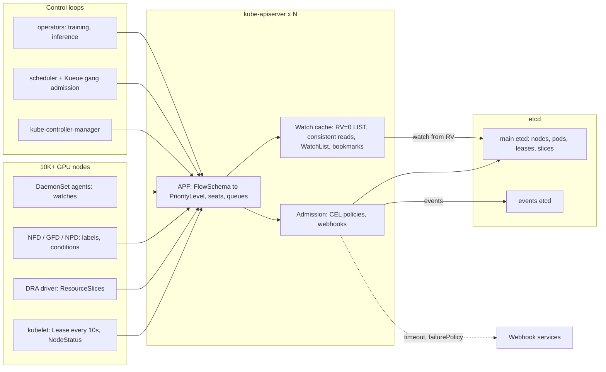

# Lesson 44 — AI/ML platform: GPU cluster control-plane scaling — API server, etcd and controller load from 10K+ GPU nodes, DaemonSet fan-out & watch storms

*2026-10-23*

## What interviewers are really probing

[Lesson 2](/lessons/02-k8s-control-plane) covered how the control plane works. [Lesson 43](/lessons/43-gpu-node-bootstrap-bare-metal-provisioning) put 4,000 new nodes into it. This lesson covers what happens to kube-apiserver and etcd once those nodes are all there and all talking. A GPU node is not a quiet object. It renews a Lease every 10 seconds, reports status, publishes DRA ResourceSlices, gets relabeled by NFD and GPU feature discovery, runs 8–15 DaemonSet pods that each hold watches, and belongs to gang-scheduled jobs that create 4,000 pods at once. Multiply by 10,000 and the control plane becomes a real distributed system, with its own capacity plan, overload policy and failure modes.

The interview version: *"You run a 12,000-node GPU training cluster. After a routine kube-apiserver rollout, the cluster is unusable for 40 minutes: kubectl times out, nodes flap NotReady, and the scheduler stops. What happened, and how do you make sure it can't happen again?"* Or the design version: *"One 20K-node cluster, or ten 2K-node clusters?"* They want to hear that you **know where the load comes from** (writes per second from nodes, watchers per DaemonSet, LIST cost), **know the overload controls** (API Priority and Fairness, watch cache, consistent reads from cache, WatchList, bookmarks), **know etcd's hard limits** (fsync latency, db size quota, compaction and defrag, object size), **can read the metrics**, and **pick a cell size on purpose**.

Cross-links: [L02](/lessons/02-k8s-control-plane) (control plane internals), [L03](/lessons/03-cluster-provisioning-lifecycle) (provisioning), [L11](/lessons/11-cluster-security-pss-admission-rbac) (admission, RBAC), [L12](/lessons/12-node-container-hardening-supply-chain) (supply chain), [L13](/lessons/13-ml-weights-checkpoint-hardening) (weights), [L18](/lessons/18-gpu-node-pools-mig-timeslicing) (GPU node pools), [L20](/lessons/20-training-inference-scheduling-kueue-volcano) (Kueue, Volcano, gang scheduling), [L23](/lessons/23-gpu-observability-dcgm-nccl-roofline) (DCGM), [L24](/lessons/24-multi-cluster-inference-routing-capacity) (multi-cluster), [L35](/lessons/35-fleet-incident-response-gpu-inference-agent-runbooks) (incident response), [L42](/lessons/42-node-os-kernel-management-gpu-fleets) (node OS), [L43](/lessons/43-gpu-node-bootstrap-bare-metal-provisioning) (bootstrap and join). Fuel: [wafer-ai/gpu-perf-engineering-resources](https://github.com/wafer-ai/gpu-perf-engineering-resources).

What they check for:

- **You can do the arithmetic.** 10,000 nodes × 1 Lease renew per 10 s = 1,000 writes/s before any workload exists. 10,000 nodes × 12 DaemonSets = 120,000 pods, and if each one watches something, 120,000+ watches. A cluster-wide pod LIST at 200K pods is hundreds of MB of JSON.
- **APF is overload protection, not decoration.** Requests are classified by FlowSchema into PriorityLevels with concurrency *seats*. Node heartbeats, leader election and system controllers have their own levels so a tenant's LIST storm gets HTTP 429 instead of starving kubelets and causing mass NotReady.
- **Reads come from the watch cache.** `resourceVersion=0` LISTs, consistent reads from cache (KEP-2340), streaming WatchList (KEP-3157) and watch bookmarks exist so that 10K clients don't pull everything from etcd.
- **etcd is the hard ceiling.** WAL fsync p99 under 10 ms, db size inside the quota (default 2 GiB, practical max 8 GiB), compaction every 5 min, defrag one member at a time, events in a separate etcd, and 1.5 MiB max request size.
- **Controllers are clients too.** kube-controller-manager and scheduler have client-side QPS and burst. Too low, and jobs sit unscheduled. Too high, and they become the storm.
- **Webhooks are on the hot path.** A slow or down webhook with `failurePolicy: Fail` on pods turns into "no pods can be created anywhere."
- **Cells beat one giant cluster** unless a single job truly needs more nodes than one cell has.

**Interview sentence:** "I treat the control plane like any other service with a capacity plan. I know the baseline: Lease and NodeStatus writes per node, watchers per DaemonSet, and the cost of every LIST pattern. APF has separate priority levels for kubelets, leader election and system controllers, so a misbehaving client gets 429s instead of taking the cluster down. Reads are served from the watch cache: informers start with `resourceVersion=0` or WatchList, consistent reads come from cache, and bookmarks prevent relists after reconnects. etcd runs on dedicated NVMe, with WAL fsync p99 under 10 ms, events in a separate cluster, an 8 GiB quota with alerts at 70%, and rolling defrag. Webhooks have `matchConditions` and short timeouts and skip node and lease traffic. Then I size cells at a few thousand GPU nodes aligned to a fabric unit, and only build a giant cluster when one job needs it."

## Core diagram: node writers → APF → watch cache → etcd, with controllers on top




## Idiosyncrasies / operator depth

### 1. Know the baseline load per GPU node

Before any job runs, each node produces:

- **Lease renewals** in `kube-node-lease`: one small write every ~10 s (`nodeLeaseDurationSeconds: 40`, renew at 25%). This is the cheap heartbeat; it replaced full NodeStatus heartbeats for this reason.
- **NodeStatus** updates: every `nodeStatusUpdateFrequency` (10 s) the kubelet computes status, but it only *writes* when something changed or every `nodeStatusReportFrequency` (5 min). GPU nodes change more than CPU nodes: conditions from node-problem-detector, the image list (`nodeStatusMaxImages`, default 50; multi-GB images with many tags make Node objects large), and allocatable when a device plugin re-registers.
- **Device state.** The classic device plugin reports `nvidia.com/gpu` capacity through the kubelet into NodeStatus. With DRA (resource.k8s.io), the driver publishes **ResourceSlices**, one or more per node per driver, with per-device attributes (model, memory, MIG profiles, PCIe root, NVLink domain). A driver that republishes on every health check, or puts a changing value like temperature into an attribute, turns 10K nodes into a constant write stream.
- **Labels.** NFD and GPU feature discovery (GFD) relabel nodes on an interval. If nothing changed, the patch is a no-op and costs little. A label or annotation that carries a timestamp, a driver build hash that differs per node, or a "last checked" value makes every interval a real write and a watch event to every Node watcher.
- **DaemonSet pods.** Device plugin, DCGM exporter, NFD worker, CNI agent, CSI node, log shipper, node-problem-detector, security agent, fabric manager helpers. 10–15 per node. Each one that runs an informer is a watch (sometimes several). Each pod is also a Pod object updated through its lifecycle.

At 10K nodes: about 1,000 Lease writes/s, 100K–150K DaemonSet pods, and 100K+ watches. Write this down in the design. It is what you scale against.

### 2. Who watches what: DaemonSet fan-out

The dangerous pattern is an agent on every node that watches a **cluster-wide** resource: all Pods, all Nodes, all EndpointSlices. Every change is sent to 10K watchers. One rollout that updates 4,000 pods becomes 4,000 × 10,000 = 40M watch events to serialize and send. The apiserver serializes each object once per encoding (cached), but the per-watcher send and filtering cost is still paid, and the apiserver's memory and NIC become the limit.

Fixes, in order of value:

- **Scope the watch.** Agents watch Pods with `fieldSelector=spec.nodeName=$NODE`. The watch cache has an index on `spec.nodeName` for pods, so this filter is cheap. Nodes watch only their own Node via `metadata.name`.
- **Use informers that start with `resourceVersion=0`** (served from the watch cache) or WatchList, never a paginated LIST with no resourceVersion, which goes to etcd.
- **Move cluster-wide knowledge to a central controller** that writes a small per-node object, instead of 10K agents each computing it.
- **Use separate service accounts per agent** so APF can identify and throttle them as distinct flows (see §3).

### 3. API Priority and Fairness: how it actually works

APF (flowcontrol.apiserver.k8s.io/v1, GA in 1.29) replaces the old flat `--max-requests-inflight` limits. The total concurrency is still `--max-requests-inflight` + `--max-mutating-requests-inflight` (defaults 400 + 200) per apiserver, divided among PriorityLevelConfigurations by `nominalConcurrencyShares`.

- **FlowSchemas** match requests by user, group or service account, verb, and resource, and assign a priority level and a *flow distinguisher* (by user or namespace). The lowest `matchingPrecedence` wins.
- **Priority levels** have seats. Within a level, flows are **shuffle-sharded** into queues, so one noisy flow fills a few queues, not all of them. When queues are full, the request gets **429 with Retry-After**. client-go retries with backoff.
- **Built-in levels:** `exempt` (system:masters, health checks), `system` (system:nodes, i.e., kubelets), `node-high` (node Lease and status updates), `leader-election`, `workload-high` (built-in controllers), `workload-low` (service accounts in general), `global-default`, `catch-all`.
- **Work estimation.** A LIST does not cost one seat. APF estimates seats from the number of objects it will return (up to a maximum width). A watch costs seats while it's being set up and sending initial events. Mutating requests have extra "width" for the watch notifications they cause. So one LIST of 200K pods can take many seats at once.
- **Borrowing.** `lendablePercent` and `borrowingLimitPercent` let busy levels borrow idle seats. Tune them before raising total inflight limits.

What you do at GPU scale: put each heavy agent and operator on **its own FlowSchema** with distinguisher `ByUser` and a dedicated level, so one broken DaemonSet hits its own wall. Protect `node-high` and `leader-election`; if Lease renewals get 429s, nodes go NotReady and the node lifecycle controller starts tainting and evicting, which is far worse than slow kubectl.

### 4. The watch cache, consistent reads and WatchList

The apiserver keeps an in-memory **watch cache** per resource type, fed by one etcd watch, with a sliding window of recent events.

- **`resourceVersion=0` LIST** is served from cache, may be slightly stale, costs no etcd read. This is what informers use on start.
- **A LIST with no resourceVersion** asks for a *consistent* read. Historically that was a quorum range read from etcd for the whole collection: the classic etcd killer. **Consistent reads from cache (KEP-2340)** fixes that: the apiserver gets the current etcd revision, waits until the cache has caught up (using etcd progress notifications), then serves from memory. It has been beta and on by default since 1.31. It needs etcd watch progress notify to work.
- **Pagination** (`limit` + `continue`) of an older snapshot used to go to etcd. The snapshottable cache (KEP-4988, beta in recent releases) serves those from cache too. Check your version before you rely on it.
- **WatchList / streaming lists (KEP-3157):** the client opens a watch with `sendInitialEvents=true` and `resourceVersionMatch=NotOlderThan`. It gets the initial state as a stream of ADDED events followed by a bookmark, instead of one huge LIST response held in apiserver memory. This avoids the memory spikes that OOM apiservers during relist storms. It's feature-gated on both server and client-go (`WatchListClient`), so check the defaults for your version.
- **Bookmarks** keep a watcher's resourceVersion current even when its filtered stream is quiet. Without them, a reconnect after the cache window has moved returns **410 Gone**, and the client does a full relist.

### 5. Relist storms after an apiserver restart

This is the classic incident. An apiserver restarts (upgrade, OOM, node drain). All its watches drop. Clients reconnect to the remaining apiservers, which now carry a much heavier load. The restarted apiserver comes back with an empty cache and has to initialize it from etcd (a full LIST per resource), and clients that reconnect to it may get 410 Gone and relist. With 100K+ watchers this becomes a self-sustaining storm: apiserver memory spikes, OOM, restart, again.

Mitigations:

- APF limits, so relists queue instead of stampeding.
- WatchList and bookmarks to cut relist cost; `resourceVersion=0` initial LISTs.
- **`--goaway-chance`** (for example 0.001) so HTTP/2 clients get rebalanced across apiservers over time, instead of staying pinned to whichever survived the last restart.
- Roll apiservers **one at a time with soak time**, check `apiserver_watch_cache_*` init and request latency before the next one.
- Apiserver memory headroom: size for the relist peak, not the steady state.

### 6. etcd at GPU-fleet scale

- **Disk is everything.** etcd fsyncs its WAL on every write. Use dedicated local NVMe (not a network volume, not shared with apiserver logs). Targets: `etcd_disk_wal_fsync_duration_seconds` p99 under 10 ms, `etcd_disk_backend_commit_duration_seconds` p99 under 25 ms. Slow fsync shows up as leader elections and apiserver write latency.
- **Size quota.** Default `--quota-backend-bytes` is 2 GiB; 8 GiB is the commonly recommended max. When it's exceeded, etcd raises a **NOSPACE alarm** and rejects writes: the cluster can read but can't change anything, including Leases. Alert at 60–70%.
- **Compaction vs defrag.** The apiserver compacts old revisions every 5 min (`--etcd-compaction-interval`). Compaction frees space *inside* the db file; **defrag** returns it to the filesystem. Defrag blocks that member while it runs. Do it one member at a time, followers first, leader last, never `--cluster` on a busy production cluster. Compare `etcd_mvcc_db_total_size_in_bytes` with `..._in_use_in_bytes` to decide.
- **Events go elsewhere.** `--etcd-servers-overrides=/events#https://etcd-events-0:2379;...` moves Events to a separate etcd cluster. GPU fleets generate many events (FailedScheduling for gang pods, node conditions, probes). `--event-ttl` (1 h) also controls their volume.
- **Object size.** etcd rejects requests over `--max-request-bytes` (1.5 MiB default). Big ConfigMaps of serving config, huge CRs with per-node status, and Node objects with long image lists hit it. Design CRDs so status scales by sharding objects, not growing one.
- **Object count by kind.** Watch `apiserver_storage_objects` (or `apiserver_resource_objects` in newer versions). ResourceSlices, ResourceClaims, Events and completed Job pods grow fastest in GPU clusters. Set TTLs (`ttlSecondsAfterFinished`) and garbage-collect.

### 7. Controllers, scheduler and gang workloads

- **Client-side limits.** kube-controller-manager `--kube-api-qps` / `--kube-api-burst` (defaults 20/30) are too low for 10K nodes; GPU-scale clusters run 100–300+. The scheduler's `clientConnection.qps`/`burst` (50/100) similarly. Raise them together with APF levels, not instead of them.
- **Worker counts.** `--concurrent-deployment-syncs`, `--concurrent-job-syncs` (newer versions), `--concurrent-gc-syncs` and similar. Look at `workqueue_depth` and `workqueue_queue_duration_seconds` per controller to find the bottleneck.
- **Node lifecycle controller.** On mass NotReady (network partition between a rack and the control plane, or Lease writes starving), it rate-limits evictions (`--node-eviction-rate`, `--unhealthy-zone-threshold`, `--secondary-node-eviction-rate`). Know these: they decide whether a control-plane hiccup becomes an eviction of 2,000 training pods.
- **Scheduler throughput.** For 10K+ nodes, `percentageOfNodesToScore` limits how many feasible nodes are scored. Gang scheduling ([L20](/lessons/20-training-inference-scheduling-kueue-volcano)) adds a twist: Kueue admits a whole workload once quota and topology allow, then 4,000 pods are created within seconds. Pod creation, admission webhooks and the scheduler all see a spike at once. Measure pods/s end to end, not scheduler latency alone.
- **Leader election.** Controllers that lose their Lease because of apiserver latency restart their informers, which relists, which adds load: another feedback loop. Keep leader-election on its own protected priority level.

### 8. Webhooks on the hot path

Every pod creation can hit several mutating and validating webhooks (sidecar injectors, image policy, GPU-quota checks, security agents). At gang-scheduling bursts, a webhook with p99 of 500 ms and limited replicas becomes the scheduler.

- Set `timeoutSeconds` low (1–3 s, default 10).
- Use **`matchConditions`** (CEL, GA in 1.30) and `namespaceSelector`/`objectSelector` to skip traffic that doesn't need the webhook: kube-system, leases, nodes, events.
- Prefer **ValidatingAdmissionPolicy** (CEL, in-process, GA in 1.30) for simple checks; no network round-trip, no availability dependency.
- `failurePolicy: Fail` is right for security policy (signed images) and wrong for convenience mutations. Decide per webhook, and run security webhooks with replicas, PDBs and priority class like control-plane components.

### 9. Cells vs one huge cluster

Upstream SIG Scalability tests 5,000 nodes / 150K pods as the standard SLO envelope. Managed providers go much further (GKE supports 65K nodes and has shown 130K experimentally, using a different storage backend; EKS has announced support for 100K nodes), and they do it with control-plane changes you don't have in a self-managed cluster.

- **Many cells (2–5K GPU nodes each):** smaller blast radius, upgrades per cell, etcd in its comfort zone, aligned to a fabric unit ([L40](/lessons/40-infiniband-roce-fabric-operations)) and power domain ([L41](/lessons/41-power-cooling-facility-constraints-gpu-fleets)). Cost: multi-cluster scheduling and placement ([L24](/lessons/24-multi-cluster-inference-routing-capacity)), more control planes to operate, and fleet tooling.
- **One big cluster:** needed when a single training job spans more nodes than a cell. Cost: everything in this lesson, at maximum stress.
- Common answer: cells for inference and most training; a small number of large training clusters with very tight rules on DaemonSets, CRDs and webhooks.

## Concrete commands & config

### Is APF rejecting or queueing, and who?

```bash
kubectl get flowschemas -o custom-columns=NAME:.metadata.name,PL:.spec.priorityLevelConfiguration.name,PREC:.spec.matchingPrecedence
kubectl get prioritylevelconfigurations

# Live state per priority level and per queue
kubectl get --raw /debug/api_priority_and_fairness/dump_priority_levels
kubectl get --raw /debug/api_priority_and_fairness/dump_queues | head -50

# Which FlowSchema handled my request? (response headers)
kubectl get pods -A --limit=1 -v=8 2>&1 | grep -i 'X-Kubernetes-PF'
```

PromQL:

```promql
# 429s by level and schema
sum by (priority_level, flow_schema) (rate(apiserver_flowcontrol_rejected_requests_total[5m]))
# Queue wait p99 per level
histogram_quantile(0.99, sum by (le, priority_level) (rate(apiserver_flowcontrol_request_wait_duration_seconds_bucket[5m])))
# Seat utilization
sum by (priority_level) (apiserver_flowcontrol_current_executing_seats) / sum by (priority_level) (apiserver_flowcontrol_nominal_limit_seats)
# LIST latency by resource, excluding watches
histogram_quantile(0.99, sum by (le, resource) (rate(apiserver_request_duration_seconds_bucket{verb="LIST"}[5m])))
# Watch fan-out by kind
sum by (kind) (rate(apiserver_watch_events_total[5m]))
# Biggest object counts
topk(10, apiserver_storage_objects)
```

### Give a noisy DaemonSet its own lane

```yaml
apiVersion: flowcontrol.apiserver.k8s.io/v1
kind: PriorityLevelConfiguration
metadata:
  name: node-agents
spec:
  type: Limited
  limited:
    nominalConcurrencyShares: 20
    lendablePercent: 50
    limitResponse:
      type: Queue
      queuing:
        queues: 64
        handSize: 6
        queueLengthLimit: 50
---
apiVersion: flowcontrol.apiserver.k8s.io/v1
kind: FlowSchema
metadata:
  name: gpu-node-agents
spec:
  priorityLevelConfiguration:
    name: node-agents
  matchingPrecedence: 1000      # before the built-in service-accounts schema (9000)
  distinguisherMethod:
    type: ByUser                # each agent SA is its own flow
  rules:
  - subjects:
    - kind: ServiceAccount
      serviceAccount: {name: dcgm-exporter, namespace: gpu-operator}
    - kind: ServiceAccount
      serviceAccount: {name: nfd-worker, namespace: node-feature-discovery}
    - kind: ServiceAccount
      serviceAccount: {name: security-agent, namespace: security}
    resourceRules:
    - verbs: ["*"]
      apiGroups: ["*"]
      resources: ["*"]
      clusterScope: true
      namespaces: ["*"]
```

### Agent informer: scoped and cheap (client-go)

```go
factory := informers.NewSharedInformerFactoryWithOptions(cs, 0,
    informers.WithTweakListOptions(func(o *metav1.ListOptions) {
        o.FieldSelector = fields.OneTermEqualSelector("spec.nodeName", nodeName).String()
    }))
// Initial LIST uses resourceVersion=0 (watch cache) by default via reflector.
// Enable streaming lists where supported: KUBE_FEATURE_WatchListClient=true
podInformer := factory.Core().V1().Pods().Informer()
```

### etcd health, size, defrag

```bash
export ETCDCTL_API=3
E="--endpoints=https://etcd-0:2379,https://etcd-1:2379,https://etcd-2:2379 --cacert=/etc/etcd/ca.crt --cert=/etc/etcd/admin.crt --key=/etc/etcd/admin.key"

etcdctl $E endpoint status -w table      # DB SIZE, IS LEADER, RAFT INDEX per member
etcdctl $E endpoint health -w table
etcdctl $E alarm list                    # NOSPACE?

# Which prefixes are big? (keys only; count per resource)
etcdctl $E get /registry/ --prefix --keys-only | awk -F/ '{print $3}' | sort | uniq -c | sort -rn | head

# Defrag one member at a time: followers first, leader last
etcdctl --endpoints=https://etcd-1:2379 --cacert=... --cert=... --key=... defrag
# After freeing space, clear the alarm
etcdctl $E alarm disarm
```

etcd flags worth knowing:

```bash
--quota-backend-bytes=8589934592            # 8 GiB
--auto-compaction-mode=periodic --auto-compaction-retention=5m   # if apiserver isn't compacting
--experimental-watch-progress-notify-interval=5s  # needed by consistent reads from cache
--snapshot-count=10000
--heartbeat-interval=100 --election-timeout=1000  # raise for cross-AZ latency
```

### kube-apiserver flags at GPU scale

```bash
--max-requests-inflight=1600
--max-mutating-requests-inflight=800
--etcd-servers=https://etcd-0:2379,https://etcd-1:2379,https://etcd-2:2379
--etcd-servers-overrides=/events#https://etcd-ev-0:2379;https://etcd-ev-1:2379;https://etcd-ev-2:2379
--goaway-chance=0.001
--event-ttl=1h
--default-watch-cache-size=...              # most resources size dynamically now; check your version
--encryption-provider-config=/etc/kubernetes/enc/encryption-config.yaml
--audit-policy-file=/etc/kubernetes/audit/policy.yaml
--profiling=false
--anonymous-auth=false
```

### Controller-manager and scheduler

```bash
# kube-controller-manager
--kube-api-qps=200 --kube-api-burst=400
--node-monitor-grace-period=50s
--node-eviction-rate=0.1 --secondary-node-eviction-rate=0.01 --unhealthy-zone-threshold=0.55
```

```yaml
# KubeSchedulerConfiguration
apiVersion: kubescheduler.config.k8s.io/v1
kind: KubeSchedulerConfiguration
clientConnection:
  qps: 300
  burst: 600
percentageOfNodesToScore: 10
parallelism: 32
```

### Webhook that stays off the hot path

```yaml
apiVersion: admissionregistration.k8s.io/v1
kind: ValidatingWebhookConfiguration
metadata:
  name: gpu-quota-check
webhooks:
- name: gpu-quota.platform.example.com
  failurePolicy: Ignore           # convenience check; security webhooks are Fail
  timeoutSeconds: 2
  sideEffects: None
  admissionReviewVersions: ["v1"]
  namespaceSelector:
    matchExpressions:
    - {key: kubernetes.io/metadata.name, operator: NotIn, values: [kube-system, kube-node-lease]}
  matchConditions:
  - name: only-gpu-pods
    expression: "object.spec.containers.exists(c, has(c.resources.limits) && 'nvidia.com/gpu' in c.resources.limits)"
  rules:
  - apiGroups: [""]
    apiVersions: ["v1"]
    operations: ["CREATE"]
    resources: ["pods"]
  clientConfig:
    service: {name: gpu-quota, namespace: platform, path: /validate}
```

## Failures & fixes

| Symptom | Likely cause | Fix / mitigation |
|---|---|---|
| After apiserver rollout, kubectl times out for 30+ min; apiserver memory spikes and OOMs | Relist storm: 100K+ watchers reconnect, 410 Gone, full LISTs; restarted apiserver re-initializing cache | One apiserver at a time with soak; APF queues; WatchList and bookmarks; `--goaway-chance`; memory headroom for the relist peak |
| Hundreds of nodes flap NotReady with no node problem | Lease renewals starved (429 or latency) by a LIST storm; or etcd fsync slow | Protect `node-high`/`system` levels; find the noisy flow in `rejected_requests_total`; check `etcd_disk_wal_fsync` |
| All writes fail with `etcdserver: mvcc: database space exceeded` | etcd NOSPACE alarm; db hit quota (often Events or a runaway CRD) | Compact, defrag member by member, `alarm disarm`; find the growing prefix; move events out; raise quota toward 8 GiB with alerting |
| etcd leader changes every few minutes, write latency jumps | Slow disk (noisy neighbor, network volume) or CPU starvation on etcd hosts | Dedicated NVMe; check `wal_fsync` and `backend_commit` p99; isolate etcd from apiserver; tune heartbeat/election for real RTT |
| No pods can be created anywhere; events show `failed calling webhook` | Webhook down or slow with `failurePolicy: Fail` and broad match | Fix or scale webhook; narrow with `matchConditions`/selectors; short timeouts; replace with ValidatingAdmissionPolicy where possible |
| One DaemonSet rollout makes the whole cluster slow | Each pod's agent LISTs cluster-wide Pods without resourceVersion, or watches all Pods | Field-selector by `spec.nodeName`; RV=0 or WatchList; own FlowSchema per agent SA; pace DaemonSet `maxUnavailable` |
| Steady high write rate on Nodes with nothing changing | Label/annotation churn (timestamps from discovery agents) or DRA driver republishing ResourceSlices | Diff successive objects (`kubectl get node -w -o yaml`); remove changing values from labels; only republish slices on real change |
| Gang job of 4,000 pods takes 10+ min to start | Scheduler/controller client QPS too low, webhook latency per pod, or APF `workload-low` saturated | Raise QPS/burst with matching APF shares; measure pods/s by stage; trim webhooks on pod CREATE |
| Large LISTs slow and costly on etcd | Clients doing consistent LISTs on old versions, or paginated LISTs going to etcd | Upgrade for consistent reads from cache; make clients use informers; check `apiserver_cache_list_*` vs `etcd_request_duration` |
| `etcdserver: request is too large` creating a CR | Object over 1.5 MiB: per-node status packed into one object | Shard the CR (one per node or per rack); keep status small |
| Mass eviction of training pods after a brief network partition | Node lifecycle controller treats unreachable nodes as dead | Tune `--unhealthy-zone-threshold`, eviction rates and `tolerationSeconds` for GPU workloads; topology spread of control plane |

## Security & hardening

**The control plane is the most valuable target in a GPU cluster.** Anyone who can write to the API can schedule a pod with any service account in reach, and in an AI platform those service accounts can read model weights, write checkpoints, pull from private registries and mint cloud credentials. Scaling work and security work meet here, because the scaling knobs (webhooks, APF, audit, etcd layout) are also security controls.

### apiserver and etcd

- **Private endpoint only.** No public kube-apiserver. Access through a private load balancer from known networks, VPN or identity-aware proxy. `--anonymous-auth=false`, `--profiling=false`.
- **etcd reachable only by the apiserver.** Separate network, firewall to apiserver IPs only, client cert auth with a **dedicated etcd CA** (not the cluster CA), peer TLS between members. Anyone with etcd access reads every Secret and can write any object, bypassing RBAC and admission.
- **Encryption at rest with KMS v2** (GA in 1.29) for Secrets, and for any CRD that holds credentials or signed URLs. Keys live in a cloud KMS or HSM; etcd snapshots and backups are useless without them. Rotate keys and verify by reading the raw key from etcd (it should start with `k8s:enc:kms:v2:`).
- **Backups are as sensitive as etcd.** Encrypt them, restrict access, test restores.

```yaml
apiVersion: apiserver.config.k8s.io/v1
kind: EncryptionConfiguration
resources:
- resources: ["secrets", "configmaps"]
  providers:
  - kms:
      apiVersion: v2
      name: cloud-kms
      endpoint: unix:///var/run/kmsplugin/socket.sock
      timeout: 3s
  - identity: {}     # only for reading old data during migration; remove after rewrite
```

```bash
# Verify encryption; rewrite all Secrets after enabling or rotating
etcdctl $E get /registry/secrets/default/my-secret | hexdump -C | head -3   # expect k8s:enc:kms:v2:
kubectl get secrets -A -o json | kubectl replace -f -
```

### Identity and RBAC for controllers

- **One identity per controller and per agent.** No shared "platform" service account. Each gets the minimum verbs on the minimum resources. That also makes APF fair (distinguisher `ByUser`) and audit readable.
- **Node agents are scoped to their node.** NodeRestriction for kubelets ([L43](/lessons/43-gpu-node-bootstrap-bare-metal-provisioning)); DaemonSet agents get read access to their own node's pods, not `list pods` cluster-wide, and never `secrets` cluster-wide.
- **Watch for dangerous verbs:** `create pods` in privileged namespaces, `create serviceaccounts/token`, `escalate`, `bind`, `impersonate`, and `update` on `mutatingwebhookconfigurations` / `validatingwebhookconfigurations`. Whoever can edit webhooks can turn off image signing for everyone.
- **Short-lived credentials.** Projected service account tokens with audience and expiry; no long-lived token Secrets.

### APF as DoS protection

APF is the control plane's built-in rate limiter against both bugs and attackers. A compromised tenant workload with a token can still LIST everything it's allowed to see in a loop. Put tenant service accounts on bounded priority levels with `ByUser` or `ByNamespace` distinguishers, and keep `exempt` for `system:masters` only. **Nobody** should run as `system:masters` day to day; it bypasses APF and RBAC.

### Audit policy cost at scale

Full `RequestResponse` audit at 10K nodes is a second etcd-sized write stream. Log what matters:

```yaml
apiVersion: audit.k8s.io/v1
kind: Policy
omitStages: ["RequestReceived"]
rules:
- level: None                         # heartbeats: huge volume, no value
  resources: [{group: "coordination.k8s.io", resources: ["leases"]}]
- level: None
  users: ["system:kube-proxy"]
  verbs: ["watch"]
- level: None
  verbs: ["get", "list", "watch"]
  resources: [{group: "", resources: ["events", "nodes", "nodes/status"]}]
- level: Metadata                     # never log Secret bodies
  resources: [{group: "", resources: ["secrets", "configmaps", "serviceaccounts/token"]}]
- level: RequestResponse              # changes to the security boundary
  resources:
  - {group: "admissionregistration.k8s.io"}
  - {group: "rbac.authorization.k8s.io"}
  - {group: "flowcontrol.apiserver.k8s.io"}
- level: Request
  verbs: ["create", "update", "patch", "delete"]
- level: Metadata
```

Use batched webhook or log backends (`--audit-log-maxsize`, `--audit-webhook-batch-max-size`) so audit doesn't add latency to every request.

### Webhook failurePolicy risks

- **Security webhooks fail closed** (`Fail`): image signature verification, policy that blocks privileged pods. Run them like control-plane components: 3+ replicas, PDB, high priority class, spread across zones, short timeouts, and exclude kube-system so you can still repair the cluster.
- **Convenience webhooks fail open** (`Ignore`), so their outage doesn't stop the cluster.
- A webhook is a privileged MITM on every matching request. A **mutating** webhook can inject a sidecar, an env var or a volume into every training pod. Treat webhook images and configs as part of the trusted computing base: signed, reviewed, and their configs audited at `RequestResponse`.

### How control-plane compromise reaches model weights and the supply chain

- **Model weights and checkpoints.** With `create pods` in a namespace whose service account maps to cloud IAM through workload identity (IRSA, GKE Workload Identity, Azure Workload Identity), an attacker reads the weight bucket or overwrites checkpoints. Mitigate with **per-namespace, per-pool IAM roles** scoped to bucket prefixes ([L13](/lessons/13-ml-weights-checkpoint-hardening)), write access only for training jobs' own prefixes, object versioning and retention locks on released weights, and alerts on unusual reads.
- **Token minting.** `create serviceaccounts/token` lets someone mint tokens for any SA in that namespace, including ones federated to cloud IAM. Restrict it like a cloud admin permission.
- **Image registries and signing.** Admission is where signed-image policy is enforced (Sigstore policy-controller, Kyverno `verifyImages`, or Ratify with Gatekeeper). An attacker who can delete or edit that webhook config, or add a namespace label that excludes it, can run unsigned images. Lock webhook configs with RBAC, alert on any change, and add a second check at the node (containerd image verification or registry mirror allowlist, [L12](/lessons/12-node-container-hardening-supply-chain)). Registry pull credentials are Secrets: KMS-encrypted and scoped per namespace.
- **Secrets.** etcd access or broad `get secrets` gives every API key, HF token and registry credential. Prefer external secret stores (CSI secret store driver, Vault) with workload identity, so many secrets never enter etcd.
- **Network isolation.** Control-plane nodes and etcd in their own subnet. Pods cannot reach etcd at all, and reach the apiserver only through the service VIP with NetworkPolicy limiting which namespaces may. Block pod access to cloud metadata endpoints so a pod can't steal the node's credentials. Kubelet API (10250) not reachable from pods.
- **Provenance of the control plane itself.** Control-plane images signed and pinned by digest, static pod manifests managed by config management, and changes to FlowSchemas, webhooks and RBAC go through GitOps review, not kubectl.

## Interview soundbites

- "10,000 GPU nodes is 1,000 Lease writes a second before a single job runs. I start every control-plane design with that arithmetic."
- "APF is my overload policy. Kubelets, leader election and system controllers get protected lanes. A broken DaemonSet gets 429s in its own lane instead of making nodes go NotReady."
- "The worst incident pattern is the relist storm after an apiserver restart. I prevent it with one-at-a-time rollouts, WatchList and bookmarks, `--goaway-chance`, and memory sized for the relist peak."
- "etcd's limits are fsync latency and db size. Dedicated NVMe, WAL fsync p99 under 10 ms, events in their own cluster, 8 GiB quota with alerts at 70%, and defrag one member at a time."
- "A DaemonSet that watches all pods is 10,000 watchers. Agents use field selectors on `spec.nodeName`, informers from the watch cache, and their own service account so APF can tell them apart."
- "Whoever can edit admission webhooks can turn off image signing, and whoever can create pods with the right service account can read the weights. Control-plane RBAC is model-weight security."
- "I'd rather run ten 2,000-node cells than one 20,000-node cluster, unless a single training job needs the whole thing."

## How this maps to the JD

- **100+ clusters / 10K+ nodes:** cell sizing, control-plane capacity planning, and fleet-wide APF, audit and webhook standards.
- **Kubernetes internals:** APF, watch cache, consistent reads, WatchList, etcd compaction and defrag, node lifecycle controller.
- **Security:** etcd isolation, KMS v2, per-controller identity, webhook failure policy, audit cost, signed-image admission, workload identity and bucket IAM.
- **Terraform/Atlantis, Temporal/Argo:** control-plane config (flags, FlowSchemas, audit policy) as code with review; apiserver rollouts as gated workflows with soak checks.
- **Design tradeoffs:** cells vs mega-cluster, fail-open vs fail-closed webhooks, audit detail vs cost.

## Watch (talks & demos)

### The Cluster Killer Bug: Learning API Priority and Fairness the Hard Way — Eddie Zaneski (KubeCon NA 2023)

A controller bug that made clusters look bricked, traced through APF metrics and logs. Watch it for the mental model of FlowSchemas, priority levels and seats, and for how to debug "everything times out" from the apiserver's side.

<iframe width="100%" height="360" src="https://www.youtube.com/embed/4mYUyAeyr-U" title="The Cluster Killer Bug: Learning API Priority and Fairness the Hard Way" frameBorder="0" allow="accelerometer; autoplay; clipboard-write; encrypted-media; gyroscope; picture-in-picture; web-share" allowFullScreen></iframe>

[Open on YouTube](https://www.youtube.com/watch?v=4mYUyAeyr-U)

### Keynote: Kubernetes and etcd Features That Unlocked 15k Node Clusters — Wojciech Tyczyński, Google (KubeCon NA 2020)

A short keynote from GKE's scalability lead on the changes that made 15K-node clusters work: watch bookmarks, concurrent etcd reads, Go runtime fixes, and how they validated them. Good background for why bookmarks and cache-served reads matter.

<iframe width="100%" height="360" src="https://www.youtube.com/embed/1SNbxd-3L1E" title="Keynote: Kubernetes and etcd Features That Unlocked 15k Node Clusters" frameBorder="0" allow="accelerometer; autoplay; clipboard-write; encrypted-media; gyroscope; picture-in-picture; web-share" allowFullScreen></iframe>

[Open on YouTube](https://www.youtube.com/watch?v=1SNbxd-3L1E)

(For etcd operations specifically, see the Datadog/Google etcd talk embedded in [Lesson 2](/lessons/02-k8s-control-plane).)

## References

- APF: [API Priority and Fairness docs](https://kubernetes.io/docs/concepts/cluster-administration/flow-control/) · [KEP-1040](https://github.com/kubernetes/enhancements/tree/master/keps/sig-api-machinery/1040-priority-and-fairness)
- Watch cache and lists: [KEP-2340 consistent reads from cache](https://github.com/kubernetes/enhancements/tree/master/keps/sig-api-machinery/2340-Consistent-reads-from-cache) · [KEP-3157 WatchList](https://github.com/kubernetes/enhancements/tree/master/keps/sig-api-machinery/3157-watch-list) · [KEP-4988 snapshottable cache](https://github.com/kubernetes/enhancements/tree/master/keps/sig-api-machinery/4988-snapshottable-api-server-cache) · [API concepts: resource versions, watch bookmarks](https://kubernetes.io/docs/reference/using-api/api-concepts/)
- etcd: [Operating etcd for Kubernetes](https://kubernetes.io/docs/tasks/administer-cluster/configure-upgrade-etcd/) · [etcd maintenance (compaction, defrag, quota)](https://etcd.io/docs/v3.5/op-guide/maintenance/) · [etcd hardware and tuning](https://etcd.io/docs/v3.5/op-guide/hardware/)
- Scale: [Considerations for large clusters](https://kubernetes.io/docs/setup/best-practices/cluster-large/) · [SIG Scalability thresholds](https://github.com/kubernetes/community/blob/master/sig-scalability/configs-and-limits/thresholds.md) · [How we built a 130,000-node GKE cluster](https://cloud.google.com/blog/products/containers-kubernetes/how-we-built-a-130000-node-gke-cluster) · [OpenAI: Scaling Kubernetes to 7,500 nodes](https://openai.com/index/scaling-kubernetes-to-7500-nodes/)
- Nodes and devices: [Node heartbeats and Leases](https://kubernetes.io/docs/concepts/architecture/leases/) · [Dynamic Resource Allocation](https://kubernetes.io/docs/concepts/scheduling-eviction/dynamic-resource-allocation/) · [Node Feature Discovery](https://kubernetes-sigs.github.io/node-feature-discovery/)
- Admission and security: [Dynamic admission control, matchConditions](https://kubernetes.io/docs/reference/access-authn-authz/extensible-admission-controllers/) · [ValidatingAdmissionPolicy](https://kubernetes.io/docs/reference/access-authn-authz/validating-admission-policy/) · [KMS v2 encryption](https://kubernetes.io/docs/tasks/administer-cluster/kms-provider/) · [Auditing](https://kubernetes.io/docs/tasks/debug/debug-cluster/audit/) · [Sigstore policy-controller](https://docs.sigstore.dev/policy-controller/overview/)
- [wafer-ai/gpu-perf-engineering-resources](https://github.com/wafer-ai/gpu-perf-engineering-resources) — AI/ML platform fuel
- Prior: [43 — Bootstrap & bare metal](/lessons/43-gpu-node-bootstrap-bare-metal-provisioning) · [42 — Node OS & kernel](/lessons/42-node-os-kernel-management-gpu-fleets) · [41 — Power & cooling](/lessons/41-power-cooling-facility-constraints-gpu-fleets) · [40 — Fabric ops](/lessons/40-infiniband-roce-fabric-operations) · [24 — Multi-cluster](/lessons/24-multi-cluster-inference-routing-capacity) · [20 — Kueue / Volcano](/lessons/20-training-inference-scheduling-kueue-volcano) · [18 — GPU node pools](/lessons/18-gpu-node-pools-mig-timeslicing) · [13 — Weights hardening](/lessons/13-ml-weights-checkpoint-hardening) · [12 — Supply chain](/lessons/12-node-container-hardening-supply-chain) · [11 — Admission / RBAC](/lessons/11-cluster-security-pss-admission-rbac) · [02 — Control plane](/lessons/02-k8s-control-plane)
- Next: **Lesson 45 — AI/ML platform: fleet-wide Kubernetes upgrades for GPU clusters — version skew, control-plane and node-pool upgrade waves, API deprecations & training-job-safe drains**

## Quick self-check

Out loud, in under two minutes each:

1. Estimate the steady-state write rate and watch count for a 10K-node GPU cluster with 12 DaemonSets. Where do the numbers come from?
2. After an apiserver rollout, the cluster is unusable for 40 minutes. Walk through the relist storm and the five things you change.
3. A tenant controller LISTs all pods every 10 seconds. What does APF do, what does the tenant see, and what does a kubelet see?
4. etcd raised NOSPACE. What breaks, how do you recover safely, and how do you find what filled it?
5. When should a webhook fail closed, and how do you keep a fail-closed webhook from taking down pod creation fleet-wide?
6. Someone got `update` on `validatingwebhookconfigurations` and `create pods` in the inference namespace. What can they reach — weights, registries, cloud buckets — and which controls stop each step?
7. One 20K-node cluster or ten 2K-node cells? Defend your answer for a training-heavy fleet.
