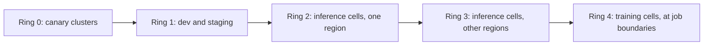

# Lesson 45 — AI/ML platform: fleet-wide Kubernetes upgrades for GPU clusters — version skew, control-plane and node-pool upgrade waves, API deprecations & training-job-safe drains

*2026-10-24*

## What interviewers are really probing

[Lesson 3](/lessons/03-cluster-provisioning-lifecycle) introduced cluster lifecycle. [Lesson 44](/lessons/44-gpu-cluster-control-plane-scaling) showed how fragile a 10K-node control plane is during an apiserver restart. This lesson is about doing that restart, on purpose, on every cluster in the fleet, three times a year, without breaking a 4,000-GPU training run or an inference SLO. Kubernetes ships three minor releases a year and each one gets roughly 14 months of patches. With 100+ clusters, upgrades are not a project. They are a pipeline that never stops.

The interview version: *"You run 120 clusters, half of them GPU training cells with multi-week jobs. You're two minors behind and the oldest version leaves support in 10 weeks. Plan the upgrade."* Or the incident version: *"After a node-pool upgrade, a 2,048-GPU job restarted from a checkpoint six hours old and three inference cells lost 30% capacity. What went wrong?"* They want to hear that you **know the version skew rules** and use them, **find removed APIs before the upgrade instead of after**, **order control plane, addons and nodes correctly**, **drain GPU nodes in a way that respects checkpoints and gangs**, and **run the fleet in rings with automatic gates**.

Cross-links: [L02](/lessons/02-k8s-control-plane) (control plane), [L03](/lessons/03-cluster-provisioning-lifecycle) (lifecycle), [L11](/lessons/11-cluster-security-pss-admission-rbac) (PSA, admission), [L12](/lessons/12-node-container-hardening-supply-chain) (supply chain), [L13](/lessons/13-ml-weights-checkpoint-hardening) (weights), [L15](/lessons/15-terraform-atlantis-fleet-scale) (Terraform/Atlantis), [L16](/lessons/16-temporal-argo-workflows) (Temporal/Argo), [L20](/lessons/20-training-inference-scheduling-kueue-volcano) (Kueue, gangs), [L27](/lessons/27-gpu-supply-chain-weight-registry-hydrate) (weight hydrate), [L29](/lessons/29-training-reliability-checkpoint-elastic) (checkpoints), [L36](/lessons/36-multi-region-dr-failover-inference) (DR pairs), [L39](/lessons/39-gpu-fleet-lifecycle-acceptance-burn-in-rma) (driver rollouts), [L42](/lessons/42-node-os-kernel-management-gpu-fleets) (node OS), [L44](/lessons/44-gpu-cluster-control-plane-scaling) (control-plane scaling). Fuel: [wafer-ai/gpu-perf-engineering-resources](https://github.com/wafer-ai/gpu-perf-engineering-resources).

What they check for:

- **Skew rules, from memory.** HA apiservers within one minor of each other. kube-controller-manager, scheduler and cloud-controller-manager never newer than the apiserver and at most one minor older. kubelet and kube-proxy never newer than the apiserver and up to **three** minors older (since 1.28; it was two). kubectl within one minor either way. The control plane moves **one minor at a time**; no skipping.
- **Use the kubelet skew on purpose.** Control plane goes N, N+1, N+2, N+3; GPU training nodes go from N to N+3 in **one** drain. That is three node disruptions saved per cycle.
- **Removed APIs break deploy pipelines, not running pods.** Pods keep running; your Helm release, Argo CD sync or Terraform apply fails the next time it touches a manifest. Find them with the `apiserver_requested_deprecated_apis` metric and audit annotations, not by grepping Git alone.
- **Order:** pre-flight, etcd snapshot, apiservers one at a time, controllers, addons (CNI, CoreDNS, GPU Operator, DRA drivers, policy engines), then node pools in waves.
- **GPU drains are special.** One evicted rank kills the whole gang. Drain at a checkpoint boundary, or wait for the job to end, or move the whole job. PDBs don't express "the whole gang or nothing" well.
- **Rings across the fleet** with soak time and automatic halt conditions, and a cap on how much GPU capacity is in flight.

**Interview sentence:** "I treat upgrades as a continuous pipeline. Every cluster is labeled with a ring; a workflow upgrades ring 0 canaries first and the big training cells last. Before each cluster, a pre-flight job checks the deprecated-API metric, the addon compatibility matrix and webhook health, and takes an etcd snapshot. The control plane goes one minor at a time, one apiserver at a time with a soak. GPU nodes use the three-minor kubelet skew, so training cells get one node upgrade for every three control-plane upgrades. Inference pools use surge with PDBs. Training pools are cordoned and drained only when the job checkpoints or finishes, and Kueue requeues the gang. Gates check GPU allocatable, an NCCL smoke test and inference p99 before the next wave, and the workflow halts on its own."

## Core diagram: pre-flight → control plane → addons → node pools → fleet rings

```mermaid
flowchart LR
  subgraph PRE["Pre-flight per cluster"]
    A1["Deprecated API scan"]
    A2["Addon and operator compat"]
    A3["etcd snapshot"]
  end

  subgraph CP["Control plane N to N+1"]
    B1["apiserver 1, soak"]
    B2["apiserver 2, soak"]
    B3["apiserver 3, soak"]
    B4["controller-manager, scheduler"]
  end

  subgraph ADD["Addons"]
    C1["CNI, CoreDNS, kube-proxy"]
    C2["GPU Operator, DRA driver"]
    C3["Kueue, operators, policy engines"]
  end

  subgraph NODES["Node pools"]
    D1["Inference: surge + PDB"]
    D2["Training: cordon, drain at checkpoint"]
  end

  G{"Gates: allocatable, NCCL, p99, 429s"}
  NEXT["Next cluster in ring"]
  HALT["Halt and page"]

  A1 --> A2 --> A3 --> B1 --> B2 --> B3 --> B4
  B4 --> C1 --> C2 --> C3
  C3 --> D1
  C3 --> D2
  D1 --> G
  D2 --> G
  G -->|pass| NEXT
  G -->|fail| HALT
```






## Idiosyncrasies / operator depth

### 1. Version skew is a scheduling tool, not just a rule

The skew policy ([version-skew-policy](https://kubernetes.io/releases/version-skew-policy/)) tells you what's *allowed* to coexist:

| Component | Relative to kube-apiserver |
|---|---|
| Other kube-apiservers (HA) | Within 1 minor |
| kube-controller-manager, kube-scheduler, cloud-controller-manager | Not newer; up to 1 minor older |
| kubelet | Not newer; up to 3 minors older (1.28+) |
| kube-proxy | Not newer; up to 3 minors older, and within 3 of its kubelet |
| kubectl | 1 minor older or newer |

What that means in practice:

- **Never upgrade a node before the control plane.** A newer kubelet against an older apiserver is out of policy and can send fields the apiserver doesn't know.
- **The control plane can't skip.** 1.31 to 1.33 means 1.32 in between, each with its own storage and API changes. Managed services enforce this.
- **Skip-level node upgrades.** Since the kubelet may lag three minors, you can move a training cell's control plane through three releases and upgrade the nodes once. For GPU training cells, where every node disruption costs GPU-hours, that is the single biggest saving. The catch: by the third control-plane hop, you're at the edge of the policy, so the node upgrade can't slip. Track "max skew per cluster" as a fleet metric.
- **During the upgrade itself, HA apiservers are mixed.** A request may hit the old or new apiserver. New API versions or fields served only by the new one can look "flaky" to clients for the length of the rollout. Don't let CD apply manifests that use brand-new APIs until every apiserver is on N+1.
- Newer releases add **compatibility versions** (KEP-4330, `--emulated-version`), so a new binary can serve the previous minor's API and feature set. Check its maturity in your version before you plan around it.

### 2. Support windows drive the calendar

Upstream ships about three minors a year and patches each for roughly 14 months. Managed providers add their own: EKS standard support is about 14 months with paid extended support after; GKE release channels auto-upgrade unless you set maintenance windows and exclusions; AKS has its own N-2 support. At 100+ clusters, write the policy down: "every cluster at N or N-1 of the newest supported minor, patch releases within 30 days, critical CVEs within 7." Then measure it. Falling behind turns three calm upgrades into a forced, back-to-back march near the support deadline, which is exactly when mistakes happen.

### 3. API deprecations and removals

The Kubernetes deprecation policy gives GA APIs long lives, but beta APIs get removed. Past examples everyone remembers: `extensions/v1beta1` Ingress and Deployments (1.16/1.22), PodSecurityPolicy (removed 1.25), `batch/v1beta1` CronJob (1.25), `autoscaling/v2beta2` HPA (1.26), `flowcontrol.apiserver.k8s.io/v1beta2` (1.29). See the [deprecation guide](https://kubernetes.io/docs/reference/using-api/deprecation-guide/).

What actually breaks:

- **Running objects are fine.** The apiserver stores objects in etcd at a storage version and converts on read. A Deployment created as `extensions/v1beta1` years ago is served as `apps/v1`.
- **Clients and manifests break.** A Helm chart, Kustomize base, Terraform `kubernetes_manifest` or operator that still *sends* a removed version gets 404 / "no matches for kind". Helm is the classic trap: the release secret records the old API version, so upgrades and rollbacks fail even after you fix the chart. The `helm-mapkubeapis` plugin rewrites the release metadata.
- **Operators and controllers** compiled against old client libraries may watch a removed version and crash-loop after the upgrade. This includes GPU-related operators.

How to find them, in order of reliability:

1. **What clients actually call:** the apiserver metric `apiserver_requested_deprecated_apis` (labels: group, version, resource, `removed_release`) and audit annotations `k8s.io/deprecated` and `k8s.io/removed-release`. This catches the operator nobody owns.
2. **What's in Git and Helm:** `pluto` and `kubent` (kube-no-trouble) on manifests, rendered charts and Helm release secrets.
3. **Provider checks:** EKS upgrade insights, GKE deprecation insights, AKS similar. They read the same audit data.

Run the scan in CI for every repo against the *next two* minors, and block merges that add soon-removed APIs.

### 4. CRDs, storage versions and conversion webhooks

CRDs have their own versioning. Before a CRD version is dropped from `spec.versions`, every stored object must be rewritten in the new version and the old one removed from `status.storedVersions`. Otherwise the apiserver can't read old objects. Kueue, JobSet, training operators, GPU Operator `ClusterPolicy`, KServe and others have all shipped CRD version changes.

- Storage migration: read and write back every object (the `kube-storage-version-migrator`, or the in-tree StorageVersionMigration API in newer releases, check maturity), then patch `storedVersions`.
- **Conversion webhooks** sit on every read of a non-storage version. A broken conversion webhook makes the CRD unreadable, and every controller watching it fails. Treat it like an admission webhook ([L44](/lessons/44-gpu-cluster-control-plane-scaling)): replicas, PDB, priority class.
- Upgrade **operators before** removing old CRD versions, and **CRDs before** the operator version that needs the new fields. Read each operator's upgrade notes; Helm doesn't upgrade CRDs in `crds/` on `helm upgrade`.

### 5. Order of operations per cluster

1. **Pre-flight:** deprecated API metric is zero for APIs removed in N+1; addon matrix says every addon supports N+1 (CNI, CSI, CoreDNS, GPU Operator, DRA drivers, Kueue, policy engines, service mesh); webhooks healthy; etcd healthy and under 60% of quota; fresh **etcd snapshot** stored off-cluster and encrypted.
2. **Control plane:** apiservers one at a time with soak (watch 429s, relists, memory, request latency, as in [L44](/lessons/44-gpu-cluster-control-plane-scaling)); then controller-manager and scheduler. etcd minor upgrades are separate and rarer; do them alone, never in the same window.
3. **Addons** that must follow the control plane: kube-proxy (or Cilium kube-proxy replacement), CoreDNS, CNI, CSI, GPU Operator and DRA drivers, Kueue, operators, policy engines.
4. **Node pools** in waves (below).
5. **Post-checks** and cleanup: removed feature gates, PSA `enforce-version` bump, old node pools deleted.

**Rollback** is the hard truth: there is no supported minor-version downgrade of the control plane. Once the new apiserver has written objects at a new storage version, going back means restoring etcd from the snapshot and losing everything written since. That's why canaries and pre-flight matter. Node pools are the opposite: blue/green pools make node rollback cheap.

### 6. Node-pool upgrade strategies

- **In-place (kubeadm, package upgrade):** drain, upgrade kubelet and containerd, uncordon. Cheap in capacity, slow, and mixes OS change with Kubernetes change. Prefer immutable images ([L42](/lessons/42-node-os-kernel-management-gpu-fleets)).
- **Surge / rolling replace:** add new nodes, drain old ones (`maxSurge`, `maxUnavailable`). Default in managed services, Cluster API `MachineDeployment` and Karpenter drift. With GPUs, surge needs spare GPUs, which you usually don't have. A surge of 1 on a pool of 500 H100 nodes takes days.
- **Blue/green pools:** create the full new pool, move workloads, keep the old one for rollback during a soak, then delete it. Fastest rollback, but needs double capacity for the pool. Works for inference pools if you have headroom or can shrink low-priority work; rarely possible for large training pools.
- **Bare-metal GPU cells:** "surge" means borrowing from the spare or burn-in pool ([L39](/lessons/39-gpu-fleet-lifecycle-acceptance-burn-in-rma)). Upgrade in units that match the fabric and power domains ([L40](/lessons/40-infiniband-roce-fabric-operations), [L41](/lessons/41-power-cooling-facility-constraints-gpu-fleets)): a rail group or a rack set, so a topology-aware scheduler can still place full gangs on the rest.

### 7. GPU-specific coupling

A Kubernetes upgrade on a GPU node is never only Kubernetes:

- **Driver and toolkit.** The NVIDIA driver, container toolkit and fabric manager are tied to the kernel ([L42](/lessons/42-node-os-kernel-management-gpu-fleets)). If the node image changes for the kubelet, decide on purpose whether the driver changes too. One variable per wave when possible.
- **GPU Operator / device plugin / DRA driver.** Each release lists supported Kubernetes versions. DRA (`resource.k8s.io`) moved through several API versions on its way to GA; a DRA driver must publish ResourceSlices in a version the apiserver still serves. Upgrade the driver before the control plane drops what it uses.
- **Container runtime and cgroups.** Recent Kubernetes releases have been dropping support for cgroup v1 and older containerd lines. Read the release notes for the kubelet's runtime requirements before you build the image.
- **Feature gates and kubelet config.** Topology Manager, CPU Manager, and Memory Manager policies (needed for NUMA-aligned GPU pods) have changed defaults and graduated over releases. Diff the effective `KubeletConfiguration` (`/configz`) between old and new nodes.
- **Validation after upgrade:** GPU allocatable equals expected per node, DCGM diagnostics level 1, no new XID errors, an NCCL all-reduce smoke test across a few nodes that hits the expected bus bandwidth ([L23](/lessons/23-gpu-observability-dcgm-nccl-roofline)). A node that registers Ready with 7 GPUs instead of 8 is worse than a node that fails.

### 8. Training-job-safe drains

`kubectl drain` evicts pods one by one, respecting PDBs. That model fits replicated services. It does not fit a 512-pod gang where losing one pod restarts all of them from the last checkpoint.

Options, from best to worst:

1. **Wait for the job.** Cordon the pool (or taint it `NoSchedule`) so no new jobs land, then drain each node when it is empty. Fine for short jobs, too slow for multi-week runs.
2. **Drain at a checkpoint.** The upgrade controller asks the job to checkpoint (annotation, API call or signal your training framework understands), waits for checkpoint success ([L29](/lessons/29-training-reliability-checkpoint-elastic)), then deletes the whole gang together. Kueue requeues the workload and readmits it, with topology, on upgraded nodes. Lost work: minutes.
3. **Graceful termination with checkpoint on SIGTERM.** Set `terminationGracePeriodSeconds` long enough to write a checkpoint (often 300–900 s for large models), and make rank 0 handle SIGTERM. Works only if *all* ranks get the signal close together; a per-node drain doesn't do that.
4. **Elastic training** (TorchElastic, elastic Horovod) can shrink and grow, but at 1,000+ GPUs most teams still run fixed-size gangs.
5. **Plain drain.** Kills a rank, the job restarts from the last checkpoint, and you lose up to a checkpoint interval times the whole job's GPUs. This is the incident from the interview question.

PDB details that matter:

- A PDB with `minAvailable` equal to the replica count, or `maxUnavailable: 0`, **blocks drain forever**. The eviction API returns 429 ("Cannot evict pod as it would violate the pod's disruption budget") and `kubectl drain` retries until its timeout. Managed upgrades give up after a timeout and either force-evict or fail, depending on provider settings. Know which.
- `unhealthyPodEvictionPolicy: AlwaysAllow` lets you evict pods that are already not Ready, so a crash-looping pod doesn't block the drain.
- `kubectl drain --disable-eviction` deletes pods directly and **ignores PDBs**. It is a break-glass tool.
- Karpenter: pod annotation `karpenter.sh/do-not-disrupt: "true"` keeps voluntary disruption (including drift) off that node; NodePool disruption budgets limit how many nodes it replaces at once and when.

For inference pools: PDBs per model deployment, surge capacity so replicas come up on new nodes before old ones go, and a **weight hydrate** plan ([L27](/lessons/27-gpu-supply-chain-weight-registry-hydrate)). Replacing 200 nodes means 200 cold nodes pulling multi-hundred-GB weights. Pace the wave by hydrate bandwidth, not just by PDBs.

### 9. Fleet rings and gates

- **Rings by risk:** canary clusters with synthetic workloads, then dev/staging, then one region of inference, then the rest, then training cells. Never upgrade both halves of a DR pair ([L36](/lessons/36-multi-region-dr-failover-inference)) in the same ring.
- **Concurrency limits:** at most N clusters at once fleet-wide, and at most X% of GPU capacity unavailable at once. Training cells upgrade one at a time.
- **Soak per ring** (24–72 h) before promotion. Patch releases can move faster than minors.
- **Automatic halt** on: apiserver 429 or latency regressions, node NotReady spikes, GPU allocatable below expected, NCCL bandwidth below baseline, inference p99 TTFT/TPOT regression, job restart rate up.
- **Implementation:** a Temporal or Argo workflow per cluster ([L16](/lessons/16-temporal-argo-workflows)), versions declared in Git (Terraform/Atlantis or Cluster API `ClusterClass` `topology.version`, [L15](/lessons/15-terraform-atlantis-fleet-scale)), and a fleet report of "version and skew per cluster" that everyone can read.

## Concrete commands & config

### Pre-flight: who still calls removed APIs?

```bash
# From the apiserver itself: any non-zero series for removed_release <= target is a blocker
kubectl get --raw /metrics | grep apiserver_requested_deprecated_apis

# Static scans: manifests, rendered charts, Helm release secrets
pluto detect-files -d ./deploy --target-versions k8s=v1.34.0
pluto detect-helm -o wide --target-versions k8s=v1.34.0
kubent --target-version 1.34.0

# Fix Helm releases that recorded a removed apiVersion
helm mapkubeapis my-release -n my-namespace

# CRDs whose storedVersions still include versions you plan to drop
kubectl get crd -o custom-columns=NAME:.metadata.name,STORED:.status.storedVersions
```

PromQL for the gate:

```promql
# Deprecated APIs called in the last day, by what will remove them
sum by (group, version, resource, removed_release) (increase(apiserver_requested_deprecated_apis[1d]))
```

Audit query (who is calling): filter audit events with annotation `k8s.io/deprecated="true"` and group by `user.username` and `userAgent`.

### Control plane: kubeadm and managed

```bash
# kubeadm, first control-plane node
kubeadm upgrade plan
kubeadm upgrade apply v1.34.2
# other control-plane nodes, one at a time
kubeadm upgrade node
# then kubelet on that node: drain, upgrade package, restart, uncordon

# EKS
aws eks list-insights --cluster-name gpu-train-07 --filter categories=UPGRADE_READINESS
aws eks update-cluster-version --name gpu-train-07 --kubernetes-version 1.34
aws eks update-nodegroup-version --cluster-name gpu-train-07 --nodegroup-name h100-a

# GKE: blue/green node pool upgrade with soak
gcloud container clusters upgrade inf-use1-03 --master --cluster-version 1.34
gcloud container node-pools update h100-serve --cluster inf-use1-03 \
  --enable-blue-green-upgrade --node-pool-soak-duration=7200s \
  --standard-rollout-policy=batch-node-count=4,batch-soak-duration=600s
gcloud container clusters upgrade inf-use1-03 --node-pool h100-serve
```

### etcd snapshot before every control-plane minor

```bash
ETCDCTL_API=3 etcdctl --endpoints=https://etcd-0:2379 \
  --cacert=/etc/etcd/ca.crt --cert=/etc/etcd/admin.crt --key=/etc/etcd/admin.key \
  snapshot save /backup/etcd-$(date +%F)-pre-1.34.db
etcdutl snapshot status /backup/etcd-$(date +%F)-pre-1.34.db -w table
# encrypt and ship off-cluster; the snapshot contains every Secret (KMS-encrypted if configured)
```

### Cluster API: declare the version, let the topology controller roll

```yaml
apiVersion: cluster.x-k8s.io/v1beta1
kind: Cluster
metadata:
  name: gpu-train-07
  labels:
    upgrade-ring: "4"          # training cells last
spec:
  topology:
    class: gpu-training-cell
    version: v1.34.2           # control plane first, then MachineDeployments
    workers:
      machineDeployments:
      - class: h100-sxm
        name: h100-a
        replicas: 512
```

```yaml
# MachineDeployment strategy for a GPU pool with little spare capacity
spec:
  strategy:
    type: RollingUpdate
    rollingUpdate:
      maxSurge: 0
      maxUnavailable: 8        # one rail group / rack set at a time
```

### PDBs that don't block upgrades forever

```yaml
apiVersion: policy/v1
kind: PodDisruptionBudget
metadata:
  name: llama-serve
  namespace: inference
spec:
  maxUnavailable: 10%
  unhealthyPodEvictionPolicy: AlwaysAllow
  selector:
    matchLabels: {app: llama-serve}
```

```bash
# Who is blocking the drain?
kubectl get pdb -A -o custom-columns=NS:.metadata.namespace,NAME:.metadata.name,ALLOWED:.status.disruptionsAllowed | awk '$3==0'
kubectl drain gpu-node-0412 --ignore-daemonsets --delete-emptydir-data --timeout=20m
```

### Training pool: cordon, checkpoint, then move the gang

```bash
# 1. Stop new work landing on the rack set being upgraded
kubectl cordon -l topology.example.com/rack-set=rs-14

# 2. Ask running jobs on those nodes to checkpoint (your training controller watches this)
kubectl annotate jobset -n train llm-pretrain-7b platform.example.com/checkpoint-and-yield=requested

# 3. When the job reports checkpoint success, stop it as a unit; Kueue requeues it
kubectl patch workload -n train jobset-llm-pretrain-7b-abc12 --type=merge -p '{"spec":{"active":false}}'
# ...upgrade nodes, validate, uncordon...
kubectl patch workload -n train jobset-llm-pretrain-7b-abc12 --type=merge -p '{"spec":{"active":true}}'
```

```yaml
# Karpenter: keep training nodes from being replaced mid-run; bound inference churn by time
apiVersion: karpenter.sh/v1
kind: NodePool
metadata:
  name: h100-inference
spec:
  disruption:
    consolidationPolicy: WhenEmptyOrUnderutilized
    budgets:
    - nodes: "5%"
    - nodes: "0"
      schedule: "0 13 * * mon-fri"   # no voluntary disruption during peak (UTC)
      duration: 8h
---
# on training pods
metadata:
  annotations:
    karpenter.sh/do-not-disrupt: "true"
```

### Post-upgrade validation on a GPU node

```bash
kubectl get node gpu-node-0412 -o jsonpath='{.status.nodeInfo.kubeletVersion} {.status.allocatable.nvidia\.com/gpu}{"\n"}'
kubectl get --raw /api/v1/nodes/gpu-node-0412/proxy/configz | jq '.kubeletconfig | {topologyManagerPolicy, cpuManagerPolicy, memoryManagerPolicy}'
dcgmi diag -r 1
# NCCL smoke test across 2-4 upgraded nodes; compare busbw with the pool baseline
all_reduce_perf -b 1G -e 8G -f 2 -g 8

# Fleet skew report
kubectl get nodes -o custom-columns=NAME:.metadata.name,KUBELET:.status.nodeInfo.kubeletVersion | awk 'NR>1{print $2}' | sort | uniq -c
```

### Pin Pod Security Admission versions

```bash
# 'latest' changes meaning with every upgrade; pin, then bump deliberately after testing
kubectl label ns inference \
  pod-security.kubernetes.io/enforce=restricted \
  pod-security.kubernetes.io/enforce-version=v1.33 \
  pod-security.kubernetes.io/warn=restricted \
  pod-security.kubernetes.io/warn-version=latest --overwrite
```

## Failures & fixes

| Symptom | Likely cause | Fix / mitigation |
|---|---|---|
| After control-plane upgrade, CD and Helm upgrades fail with "no matches for kind" | Manifests or Helm release metadata use a removed API | Gate on `apiserver_requested_deprecated_apis`; pluto/kubent in CI against next two minors; `helm mapkubeapis` |
| Operator crash-loops right after upgrade | Built against an API version that is no longer served | Upgrade operator before the control plane; addon compatibility matrix in pre-flight |
| CRD objects unreadable after operator upgrade | Old version removed from `spec.versions` while still in `storedVersions`, or conversion webhook down | Storage migration first, then patch `storedVersions`; conversion webhook with replicas and PDB |
| `kubectl drain` hangs for hours | PDB with zero disruptions allowed, or a not-Ready pod counted against the budget | `unhealthyPodEvictionPolicy: AlwaysAllow`; percentage PDBs; list PDBs with 0 allowed before each wave |
| 2,048-GPU job restarts from an old checkpoint during node upgrade | Per-node drain evicted one rank of a gang | Cordon, checkpoint-and-yield, stop the gang as a unit; `do-not-disrupt` on training pods; upgrade training cells at job boundaries |
| Node upgraded and Ready, but GPU allocatable is 0 or 7 of 8 | Driver or device plugin mismatch with the new image, DRA driver API version not served | Post-upgrade gate on allocatable; upgrade GPU Operator / DRA driver first; one variable per wave |
| NUMA-aligned GPU pods rejected with TopologyAffinityError after upgrade | Kubelet config defaults changed (Topology, CPU or Memory Manager) | Diff `/configz` old vs new; set policies explicitly in the image |
| Pods rejected in a namespace that worked yesterday | PSA level pinned to `latest`; the new release tightened the restricted profile | Pin `enforce-version`; test the bump in warn mode first |
| Inference cell loses 30% capacity during upgrade | Wave too large; new nodes slow to hydrate weights; surge capacity absent | Pace by hydrate bandwidth; warm caches on new nodes before shifting traffic; cap GPU capacity in flight |
| Upgrade wave goes bad and you want to roll back the control plane | No supported downgrade | Restore etcd from pre-upgrade snapshot (data loss since), so: canaries, pre-flight, soak |
| Some clusters drift three minors behind and fall out of support | Upgrades treated as projects; training cells always "too busy" | Ring policy with deadlines; skip-level node upgrades; fleet skew dashboard reviewed weekly |
| Mixed apiservers during rollout: clients see intermittent 404 on a new API | New API served only by upgraded apiservers | Don't apply manifests using new APIs until all apiservers are upgraded |

## Security & hardening

**Upgrades are a security control.** An unsupported Kubernetes version gets no CVE fixes, and the upgrade pipeline itself is one of the most privileged systems you run: it can replace every node image and every control-plane binary in the fleet. In an AI platform, that means it can also touch every node that caches model weights and every pod that reads them.

### Stay patched, on purpose

- **Patch SLOs:** critical CVEs in the apiserver, kubelet, container runtime or GPU container toolkit within days; regular patch releases within 30 days. Track "days behind latest patch" per cluster. GPU-specific CVEs (container toolkit escapes, driver bugs) need the same pipeline, which is another reason to run node images through rings ([L42](/lessons/42-node-os-kernel-management-gpu-fleets)).
- **Out of support is out of compliance.** Make it an alert, not a spreadsheet.

### Verify what you install

- Kubernetes release binaries and images are signed with Sigstore. Verify them before they go into your image build, and pin images by **digest** in the node image and static pod manifests.

```bash
cosign verify registry.k8s.io/kube-apiserver-amd64:v1.34.2 \
  --certificate-identity krel-trust@k8s-releng-prod.iam.gserviceaccount.com \
  --certificate-oidc-issuer https://accounts.google.com
```

- Mirror everything (Kubernetes images, GPU Operator, driver containers, CNI) into a **private registry** with signature verification on import and admission ([L12](/lessons/12-node-container-hardening-supply-chain)). New node pools during a blue/green upgrade pull every image fresh; that's the moment an unpinned tag or a public registry dependency hurts you.
- Node images are built in CI from pinned inputs, signed, and recorded with an SBOM. The upgrade workflow only accepts images whose signature and provenance verify.

### Lock down the upgrade pipeline

- **Dedicated identity** for the upgrade controller (Temporal worker, Cluster API, Atlantis), with permissions only for upgrade actions. No human admin credentials in the pipeline. Version changes go through Git review, with two-person approval for the production rings.
- **Break-glass** steps (`--disable-eviction`, force-delete pods, etcd restore) are logged, alerting, and require a second approver.
- **etcd snapshots contain every Secret.** Encrypt them, store them in a restricted bucket, expire them. With KMS v2 encryption at rest ([L44](/lessons/44-gpu-cluster-control-plane-scaling)), make sure the KMS key is still available to a restored cluster, or the restore is useless.

### Don't lose policy across an upgrade

- **Admission comes first.** PodSecurityPolicy removal in 1.25 left clusters that hadn't moved to PSA or a policy engine with **no pod security enforcement** after the upgrade. Every time an API or feature goes away, check which security control depended on it.
- Upgrade **policy engines** (Kyverno, Gatekeeper, Sigstore policy-controller) to versions that support N+1 before the control plane, and verify the signed-image policy still blocks an unsigned test image after each wave. A policy engine that silently fails open after an upgrade is the worst outcome.
- **Pin PSA versions** and bump them deliberately. A pinned version can't drift silently; `latest` can.
- **Diff RBAC after the upgrade.** New releases add default ClusterRoles and aggregated rules. Review what changed for `system:` roles and your own aggregated roles.
- Watch for **removed legacy auth paths**: long-lived service-account token Secrets are cleaned up in newer releases. Workloads that still use them break; fix them to use projected tokens rather than re-creating static ones.

### Model weights, checkpoints and deployments during an upgrade

- **Drains move workloads, and workloads carry credentials.** Re-check workload identity (IRSA, GKE Workload Identity) mappings after node and addon upgrades. The rescheduled training job must still write only its own checkpoint prefix ([L13](/lessons/13-ml-weights-checkpoint-hardening)). Run a post-wave check that a test pod in each namespace can read what it should and *cannot* read what it shouldn't.
- **Retired nodes hold sensitive data.** Blue/green pools delete hundreds of nodes with local NVMe weight caches and checkpoint scratch. Crypto-erase or wipe local disks on retirement (encrypted local volumes with per-boot keys make this a key discard), and on bare metal follow the same sanitization as RMA ([L39](/lessons/39-gpu-fleet-lifecycle-acceptance-burn-in-rma)).
- **Hydrate storms are also an access-pattern anomaly.** Hundreds of nodes reading full model weights at once looks like exfiltration. Tag upgrade-driven hydrates (dedicated identity or job label) so detection can tell them apart, and still alert on reads from unexpected principals.
- **Checkpoint-and-yield writes a fresh checkpoint** to the bucket. That checkpoint gets the same protections: integrity hashes, versioning, and an immutable copy for released weights.
- **Inference deployments** come back on new nodes with images resolved by digest, signed, and admitted by the same policy. Do not let an upgrade wave become the moment someone "temporarily" relaxes admission to get capacity back.
- **Network policy:** CNI upgrades are where NetworkPolicy enforcement can briefly change. After the CNI wave, run a policy test (pods in tenant namespaces cannot reach the weight cache service of other tenants, cannot reach cloud metadata, cannot reach the kubelet API).

## Interview soundbites

- "Upgrades aren't a project, they're a pipeline. Every cluster has a ring, and ring 0 is canaries with synthetic GPU jobs."
- "The kubelet can be three minors behind. I use that on training cells: three control-plane upgrades, one node upgrade."
- "Removed APIs don't break running pods. They break the next deploy. I find them with the apiserver's deprecated-API metric, because it shows the operator nobody remembers."
- "There's no control-plane downgrade. Rollback is an etcd restore with data loss, so the safety comes from pre-flight checks and canaries."
- "A per-node drain on a training cell kills a rank and restarts the whole gang. I cordon, checkpoint, stop the gang as a unit, and let Kueue requeue it on upgraded nodes."
- "A node that says Ready with seven GPUs is worse than one that fails. Allocatable and an NCCL smoke test are gates on every wave."
- "PSP's removal left some clusters with no pod security at all. Every upgrade, I check which security control depends on what's being removed."

## How this maps to the JD

- **100+ clusters / 10K+ nodes:** ring-based fleet upgrades, skew tracking, concurrency and capacity caps.
- **Kubernetes internals:** skew policy, storage versions, CRD conversion, PDB and eviction semantics, kubelet config drift.
- **Security:** patch SLOs, signed release artifacts, pipeline identity, policy continuity across API removals, weight-cache wipe on retired nodes.
- **Terraform/Atlantis, Temporal/Argo:** versions in Git, per-cluster upgrade workflows with gates and automatic halt.
- **Design tradeoffs:** surge vs blue/green, skip-level node upgrades vs drift risk, upgrade speed vs GPU-hours lost.

## Watch (talks & demos)

### Zero Downtime Upgrades at Scale: How Okta Manages Hundreds of Clusters Daily — Jérémy Albuixech & Kahou Lei (KubeCon NA 2024)

Okta upgrades by standing up a new cluster, validating it, and shifting traffic, with rollback by traffic shift. Watch it for the "replace the cluster" end of the design space and how it changes rollback, compared with in-place rolling upgrades. That approach is a good fit for stateless inference cells.

<iframe width="100%" height="360" src="https://www.youtube.com/embed/p5owrjrBm2w" title="Zero Downtime Upgrades at Scale: How Okta Manages Hundreds of Clusters Daily" frameBorder="0" allow="accelerometer; autoplay; clipboard-write; encrypted-media; gyroscope; picture-in-picture; web-share" allowFullScreen></iframe>

[Open on YouTube](https://www.youtube.com/watch?v=p5owrjrBm2w)

### How to Migrate 700 Kubernetes Clusters to Cluster API with Zero Downtime — Tobias Giese & Sean Schneeweiss, Mercedes-Benz (KubeCon)

A fleet of 700 (now 900) clusters moved from Terraform-based lifecycle to Cluster API without user impact. Watch it for declarative fleet lifecycle, how Cluster API rolls control planes and machines, and the lessons from doing it at fleet scale.

<iframe width="100%" height="360" src="https://www.youtube.com/embed/KzYV-fJ_wH0" title="How to Migrate 700 Kubernetes Clusters to Cluster API with Zero Downtime" frameBorder="0" allow="accelerometer; autoplay; clipboard-write; encrypted-media; gyroscope; picture-in-picture; web-share" allowFullScreen></iframe>

[Open on YouTube](https://www.youtube.com/watch?v=KzYV-fJ_wH0)

## References

- Policy: [Version skew policy](https://kubernetes.io/releases/version-skew-policy/) · [Release cycle and support](https://kubernetes.io/releases/) · [Deprecation policy](https://kubernetes.io/docs/reference/using-api/deprecation-policy/) · [Deprecated API migration guide](https://kubernetes.io/docs/reference/using-api/deprecation-guide/)
- Upgrades: [Upgrading kubeadm clusters](https://kubernetes.io/docs/tasks/administer-cluster/kubeadm/kubeadm-upgrade/) · [Cluster API: upgrading with ClusterClass](https://cluster-api.sigs.k8s.io/tasks/experimental-features/cluster-class/) · [EKS: updating cluster version](https://docs.aws.amazon.com/eks/latest/userguide/update-cluster.html) · [GKE node pool upgrade strategies](https://cloud.google.com/kubernetes-engine/docs/concepts/node-pool-upgrade-strategies) · [AKS Fleet Manager update orchestration](https://learn.microsoft.com/en-us/azure/kubernetes-fleet/update-orchestration)
- Disruption: [PodDisruptionBudgets and the eviction API](https://kubernetes.io/docs/tasks/run-application/configure-pdb/) · [Safely drain a node](https://kubernetes.io/docs/tasks/administer-cluster/safely-drain-node/) · [Karpenter disruption](https://karpenter.sh/docs/concepts/disruption/) · [Kueue](https://kueue.sigs.k8s.io/docs/)
- CRDs: [Versions in CustomResourceDefinitions](https://kubernetes.io/docs/tasks/extend-kubernetes/custom-resources/custom-resource-definition-versioning/) · [kube-storage-version-migrator](https://github.com/kubernetes-sigs/kube-storage-version-migrator)
- Tools: [pluto](https://github.com/FairwindsOps/pluto) · [kubent](https://github.com/doitintl/kube-no-trouble) · [helm-mapkubeapis](https://github.com/helm/helm-mapkubeapis)
- Security: [Verify signed Kubernetes artifacts](https://kubernetes.io/docs/tasks/administer-cluster/verify-signed-artifacts/) · [Pod Security Admission](https://kubernetes.io/docs/concepts/security/pod-security-admission/) · [PSP to PSA migration](https://kubernetes.io/docs/tasks/configure-pod-container/migrate-from-psp/)
- GPU: [NVIDIA GPU Operator platform support](https://docs.nvidia.com/datacenter/cloud-native/gpu-operator/latest/platform-support.html) · [Dynamic Resource Allocation](https://kubernetes.io/docs/concepts/scheduling-eviction/dynamic-resource-allocation/)
- [wafer-ai/gpu-perf-engineering-resources](https://github.com/wafer-ai/gpu-perf-engineering-resources) — AI/ML platform fuel
- Prior: [44 — Control-plane scaling](/lessons/44-gpu-cluster-control-plane-scaling) · [42 — Node OS & kernel](/lessons/42-node-os-kernel-management-gpu-fleets) · [39 — Fleet lifecycle](/lessons/39-gpu-fleet-lifecycle-acceptance-burn-in-rma) · [36 — Multi-region DR](/lessons/36-multi-region-dr-failover-inference) · [29 — Checkpoints](/lessons/29-training-reliability-checkpoint-elastic) · [27 — Weight hydrate](/lessons/27-gpu-supply-chain-weight-registry-hydrate) · [20 — Kueue / Volcano](/lessons/20-training-inference-scheduling-kueue-volcano) · [16 — Temporal / Argo](/lessons/16-temporal-argo-workflows) · [15 — Terraform / Atlantis](/lessons/15-terraform-atlantis-fleet-scale) · [13 — Weights hardening](/lessons/13-ml-weights-checkpoint-hardening) · [12 — Supply chain](/lessons/12-node-container-hardening-supply-chain) · [11 — PSA / admission](/lessons/11-cluster-security-pss-admission-rbac) · [03 — Lifecycle](/lessons/03-cluster-provisioning-lifecycle)

## Quick self-check

Out loud, in under two minutes each:

1. Recite the skew rules for apiserver, controller-manager, kubelet and kubectl. How do you use the kubelet rule to cut node disruptions on training cells, and what's the risk?
2. The control plane is at 1.31 and you need 1.34. Write the sequence, including where you take etcd snapshots and what you check before each hop.
3. Your deprecated-API metric is non-zero for a resource removed in the next minor, but nothing in Git uses it. How do you find the caller?
4. A 2,048-GPU job lost six hours during a node upgrade. Explain why, and design a drain flow that loses minutes instead.
5. A drain has been stuck for three hours. List the three most likely causes and what you check for each.
6. After a wave, nodes are Ready but one pool shows 7 GPUs per node. What gates should have caught it, and what changed?
7. Which security controls can silently disappear during an upgrade, and how do you prove after each wave that signed-image admission, PSA, network policy and bucket IAM still hold?

## Next

**Lesson 46 — AI/ML platform: GPU cluster networking at fleet scale — CNI choices for GPU nodes, multi-NIC (Multus/DRA network), IP address management for 10K+ nodes & east-west isolation for training and inference**
