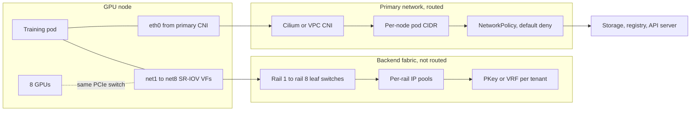
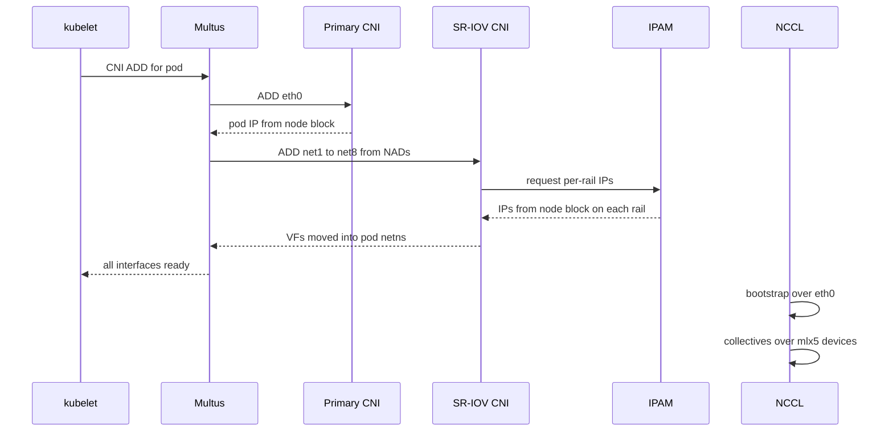

# Lesson 46 — AI/ML platform: GPU cluster networking at fleet scale — CNI choices for GPU nodes, multi-NIC (Multus/DRA network), IP address management for 10K+ nodes & east-west isolation for training and inference

*2026-10-25*

## What interviewers are really probing

[Lesson 8](/lessons/08-cni-cilium-ebpf) covered CNI and Cilium. [Lesson 9](/lessons/09-networkpolicy-multi-nic-sflow) introduced NetworkPolicy and multi-NIC. [Lesson 40](/lessons/40-infiniband-roce-fabric-operations) ran the InfiniBand/RoCE fabric itself. This lesson joins them: how a GPU node actually gets **two networks**, how you hand out addresses to **10K+ nodes without running out**, and how you keep tenants apart when the network that carries the expensive traffic **can't be seen by NetworkPolicy at all**.

The interview version: *"Design pod networking for a 12,000-node GPU fleet. Each node has 8 GPUs and 8 x 400G RDMA NICs plus a front-end NIC. Training and inference tenants share some clusters."* Or the incident version: *"A new training cell came up, the job runs, but all-reduce bus bandwidth is a tenth of the last cell's. Separately, pods in another cell are stuck in ContainerCreating."* They want to hear that you **split the primary pod network from the RDMA backend**, **size IPAM to how many pods a GPU node really runs**, **attach NICs with GPU affinity**, **know NCCL's fallback behavior**, and **enforce isolation in the fabric** (PKeys, VRFs), not just in Kubernetes.

Cross-links: [L05](/lessons/05-cloud-networking-vpc-tgw) (VPC), [L06](/lessons/06-cloud-interconnect-nat-bgp) (BGP/NAT), [L08](/lessons/08-cni-cilium-ebpf) (Cilium), [L09](/lessons/09-networkpolicy-multi-nic-sflow) (NetworkPolicy, multi-NIC), [L11](/lessons/11-cluster-security-pss-admission-rbac) (admission/RBAC), [L13](/lessons/13-ml-weights-checkpoint-hardening) (weights), [L14](/lessons/14-ml-inference-training-deploy-hardening) (deploy hardening), [L18](/lessons/18-gpu-node-pools-mig-timeslicing) (GPU pools), [L19](/lessons/19-gpu-topology-nvlink-rdma-nccl) (NVLink/RDMA/NCCL), [L23](/lessons/23-gpu-observability-dcgm-nccl-roofline) (NCCL observability), [L25](/lessons/25-multi-tenant-gpu-isolation-quota) (multi-tenant), [L34](/lessons/34-agent-tool-sandboxing-egress-policy) (egress), [L40](/lessons/40-infiniband-roce-fabric-operations) (fabric ops), [L43](/lessons/43-gpu-node-bootstrap-bare-metal-provisioning) (bootstrap), [L44](/lessons/44-gpu-cluster-control-plane-scaling) (control plane), [L45](/lessons/45-fleet-kubernetes-upgrades-gpu-clusters) (upgrades). Fuel: [wafer-ai/gpu-perf-engineering-resources](https://github.com/wafer-ai/gpu-perf-engineering-resources).

What they check for:

- **Two planes.** The primary pod network (`eth0`, the CNI) carries API calls, DNS, metrics, storage, image pulls and the NCCL *bootstrap*. The backend fabric (IB or RoCEv2, usually 8 rails) carries the collectives. They have different IPAM, different MTU, different failure modes and different isolation tools.
- **IPAM math out loud.** 10,000 nodes with a /24 each (maxPods 110) is 2.56M addresses, which needs a /10. GPU nodes run maybe 20 to 40 pods, so a /26 per node gives 640K addresses and fits in a /12. That one decision saves a /11 of RFC 1918 space per cluster.
- **Attach with affinity.** Multus plus SR-IOV, or a DRA network driver, gives each pod the NICs on the same PCIe switch as its GPUs. Wrong NIC means traffic crosses the CPU interconnect and bandwidth drops.
- **NCCL falls back silently.** If the RDMA device isn't in the pod, NCCL uses TCP sockets on `eth0` and the job still "works", just very slowly. Gate on `NET/IB` in the logs and on bus bandwidth.
- **NetworkPolicy stops at `eth0`.** RDMA bypasses the kernel, so iptables and eBPF never see it. Tenant isolation on the backend lives in the fabric: IB partition keys, or VLAN/VRF on RoCE.

**Interview sentence:** "Every GPU node gets a routed primary network from Cilium with a /26 per node, sized to the real pod count, and default-deny policy. The eight RDMA rails are a separate, non-routed fabric attached through Multus and SR-IOV, or DRA on newer clusters, so pods get the NICs that sit next to their GPUs. Backend IPs come from per-rail pools with per-node blocks so there's no cluster-wide lock. Tenants are separated in the fabric with a partition key or VRF per tenant, because NetworkPolicy can't see RDMA. Gates check that NCCL picked IB, bus bandwidth per rail, and IPAM headroom."

## Core diagram: primary network → attach layer → RDMA backend






## Idiosyncrasies / operator depth

**1. The two planes have opposite design goals.**

| | Primary pod network | Backend RDMA fabric |
|---|---|---|
| Traffic | API, DNS, metrics, storage, pulls, NCCL bootstrap | NCCL collectives, maybe GPUDirect Storage |
| Routed? | Yes, to VPC, storage, registry | No, ideally no gateway at all |
| Who programs it | CNI (Cilium, Calico, VPC CNI) | Multus + SR-IOV/ib-sriov/host-device, or DRA driver |
| IPAM | Per-node CIDR from the CNI or cloud | Per-rail pools (nv-ipam, whereabouts, static) |
| Isolation | NetworkPolicy, Cilium identities | IB PKeys, RoCE VLAN/VRF, cloud security groups |
| MTU | Often 1500 or 8500/9001 minus overlay | 4096 IB MTU, 9000 on RoCE, end to end |

Keep storage on its own path if you can (a separate NIC or the front-end NIC), so checkpoint writes from [L29](/lessons/29-training-reliability-checkpoint-elastic) don't fight with pod traffic.

**2. IPAM sizing for 10K+ nodes.** The default kubelet `maxPods` is 110, and many CNIs default to a /24 per node. On a GPU node that wastes most of the block.

| Per-node block | Usable pods | 10,000 nodes need | Fits in |
|---|---|---|---|
| /24 | ~250 | 2.56M addresses | /10 |
| /25 | ~125 | 1.28M | /11 |
| /26 | ~60 | 640K | /12 |
| /27 | ~30 | 320K | /13 |

Count what really runs on a GPU node: GPU Operator pieces, CNI agent, DCGM exporter, log and metric agents, CSI, node-problem-detector, plus a handful of workload pods. That's usually 20 to 40. Pick /26, set `maxPods` to match, and leave room for surge during upgrades ([L45](/lessons/45-fleet-kubernetes-upgrades-gpu-clusters)). Changing the per-node mask later usually means rebuilding nodes, and in Cilium cluster-pool you can't change `clusterPoolIPv4MaskSize` at all; you can only append new CIDRs to the list.

**3. Where the address space comes from.**

- **Island mode** (overlay or routed pod CIDRs not visible to the VPC): reuse the same pod CIDR in every cluster. Cheapest in addresses. Pods reach outside through SNAT, so you lose pod-IP visibility in flow logs.
- **Flat / VPC-native** (AWS VPC CNI, GKE VPC-native, Azure CNI): pods get VPC addresses. Great for visibility and security groups, terrible for address space. On AWS, use **prefix delegation** (each ENI slot gets a /28) and secondary CIDRs from `100.64.0.0/10` with custom networking. On GKE, size the secondary range for pods per node pool.
- **IPv6** removes the problem for the primary network. The cost is every addon, scanner and old library that assumes IPv4. Many fleets go dual-stack on new cells first.
- **Services** have a separate range. The legacy IPv4 flag caps it at /12. The ServiceCIDR API lets you add ranges to a live cluster in recent releases, which is your escape hatch if you sized it too small.

**4. Routing the primary network at scale.** Per-node pod CIDRs have to be reachable. Cloud route tables have hard limits, so at thousands of nodes you either use VPC-native addressing (no routes), announce pod CIDRs over **BGP** to the top-of-rack switches (Cilium BGP control plane, Calico), or run an overlay (VXLAN/Geneve, with the MTU tax). On bare metal, BGP to the leaf is the normal answer and keeps L2 domains small.

**5. Flat L2 kills you through the neighbor table.** Linux defaults are `gc_thresh1=128`, `gc_thresh2=512`, `gc_thresh3=1024` neighbor entries. A node that talks to thousands of peers on one L2 segment logs `neighbour table overflow` and drops packets. Raise the thresholds, or better, route at the leaf so the neighbor table only holds the gateway.

**6. kube-proxy at 10K nodes.** iptables mode rewrites huge rule sets on every Service or EndpointSlice change. Use Cilium kube-proxy replacement (eBPF) or the nftables mode. This ties directly to the control-plane load in [L44](/lessons/44-gpu-cluster-control-plane-scaling): EndpointSlice churn is fan-out to every node.

**7. Attaching the RDMA NICs.**

- **Multus** is a meta-CNI. It calls the primary CNI for `eth0` and then one CNI per `NetworkAttachmentDefinition` (NAD) listed in the pod annotation.
- **SR-IOV** splits each physical NIC into virtual functions (VFs). The SR-IOV Network Operator configures VFs per node from a `SriovNetworkNodePolicy`; changing the VF count often needs a node drain and reboot, so treat it like a firmware change ([L39](/lessons/39-gpu-fleet-lifecycle-acceptance-burn-in-rma)).
- **Whole-NIC pods** (one training pod per node using all 8 GPUs) can use `host-device` or the RDMA shared device plugin instead of VFs. Simpler, but no per-pod isolation of the NIC.
- **IB** uses `ib-sriov` CNI and `ib-kubernetes`, which sets VF GUIDs and adds them to the right partition key through the subnet manager (UFM).
- **NVIDIA Network Operator** installs the driver (DOCA-OFED), device plugins, Multus, the SR-IOV pieces and `nv-ipam`, much like the GPU Operator does for GPUs.

**8. DRA is replacing "device plugin + CNI that don't talk to each other".** With device plugins, the GPU plugin, the RDMA plugin and the CNI each decide on their own, so a pod with 2 GPUs might get NICs on the wrong PCIe switch. Topology Manager with `single-numa-node` helps, but NUMA is coarser than a PCIe switch. **Dynamic Resource Allocation** (`resource.k8s.io/v1`, GA in 1.34) lets one claim ask for GPUs and NICs together with a constraint that they share an attribute such as the PCIe root. Network DRA drivers (for example Google's DraNet, Spiderpool's DRA support) then configure the interface. Expect a mixed fleet for a while: older cells on Multus, new cells on DRA.

**9. RDMA namespaces.** By default the RDMA subsystem is in *shared* mode: every network namespace can see every RDMA device. Set *exclusive* mode so a pod only sees the RDMA devices moved into its namespace. Without it, one tenant's pod can open another NIC's device files.

**10. Backend IPAM.** RoCEv2 runs over UDP/IP, so every RDMA interface needs an IP (and the GID table is built from it). IB doesn't need IPs for RDMA, but IPoIB and NCCL's interface selection often use them.

- **Per-rail subnets:** rail *i* gets its own range, e.g. `10.200.i.0/16`. Same node, same host offset on every rail makes debugging much easier.
- **whereabouts** is cluster-wide IPAM backed by CRDs. At scale it serializes allocations on a shared pool and can leak addresses when a node dies mid-allocation; run its reconciler and watch free counts.
- **nv-ipam** hands each node a block per pool (`perNodeBlockSize`), so allocation is node-local and fast. This is the better shape for thousands of nodes.

**11. NCCL must be told which NICs to use.** It bootstraps over a socket interface (`NCCL_SOCKET_IFNAME=eth0`) and runs collectives over the HCAs in `NCCL_IB_HCA`. On RoCEv2 the GID index matters (`NCCL_IB_GID_INDEX`, commonly 3 for RoCEv2 over IPv4, but check `show_gids`). With `NCCL_DEBUG=INFO`, look for `NET/IB : Using [0]mlx5_0:1/RoCE` or `/IB`. If you see `NET/Socket`, RDMA isn't working.

**12. Cloud variants.**

- **AWS:** EFA devices are requested as `vpc.amazonaws.com/efa`. EFA's SRD traffic needs a security group that allows all traffic to and from itself. Instances live in a cluster placement group.
- **GCP:** A3 Mega uses GPUDirect-TCPXO; A3 Ultra and A4 use RDMA over RoCE. Extra NICs attach through GKE multi-networking (`Network` and `GKENetworkParamSet` objects), each NIC in its own VPC.
- **Azure:** ND-series VMs expose InfiniBand; the Network Operator or the AKS IB setup handles drivers and device plugins.

## Concrete commands & config

**Size and inspect primary IPAM**

```bash
# Per-node pod CIDRs (kube-controller-manager node IPAM)
kubectl get nodes -o custom-columns=NAME:.metadata.name,CIDR:.spec.podCIDR | head

# Cilium cluster-pool: what each node got, and how full it is
kubectl get ciliumnodes -o custom-columns=NAME:.metadata.name,CIDRS:.spec.ipam.podCIDRs
cilium status --verbose | grep -A3 IPAM

# Real pod count per GPU node (to justify /26)
kubectl get pods -A -o wide --field-selector spec.nodeName=gpu-node-0042 --no-headers | wc -l
```

```yaml
# Cilium Helm values: cluster-pool with a /26 per node, room to append
ipam:
  mode: cluster-pool
  operator:
    clusterPoolIPv4PodCIDRList:
      - 10.64.0.0/12
    clusterPoolIPv4MaskSize: 26
kubeProxyReplacement: true
bgpControlPlane:
  enabled: true
```

```yaml
# KubeletConfiguration fragment for GPU pools: match maxPods to the /26
apiVersion: kubelet.config.k8s.io/v1beta1
kind: KubeletConfiguration
maxPods: 48
topologyManagerPolicy: single-numa-node
cpuManagerPolicy: static
```

```bash
# AWS VPC CNI: prefix delegation + warm prefixes
kubectl -n kube-system set env daemonset/aws-node \
  ENABLE_PREFIX_DELEGATION=true WARM_PREFIX_TARGET=1
```

**Neighbor table and MTU checks**

```bash
ip -s neigh show | wc -l
sysctl net.ipv4.neigh.default.gc_thresh1 net.ipv4.neigh.default.gc_thresh2 net.ipv4.neigh.default.gc_thresh3
dmesg | grep -i "neighbour table overflow"

# Path MTU test without fragmentation (8972 = 9000 - 28 bytes of headers)
ping -M do -s 8972 -c 3 10.200.1.17
```

**SR-IOV VFs for RDMA (SR-IOV Network Operator)**

```yaml
apiVersion: sriovnetwork.openshift.io/v1
kind: SriovNetworkNodePolicy
metadata:
  name: rail1
  namespace: nvidia-network-operator
spec:
  resourceName: rail1
  nodeSelector:
    node.kubernetes.io/gpu-pool: h100-train
  numVfs: 8
  nicSelector:
    pfNames: ["ens1f0np0"]   # pin by PCI address in practice; names drift across images
  deviceType: netdevice
  isRdma: true
```

**Per-rail IP pool with per-node blocks (nv-ipam) and the NAD that uses it**

```yaml
apiVersion: nv-ipam.nvidia.com/v1alpha1
kind: IPPool
metadata:
  name: rail1
  namespace: nvidia-network-operator
spec:
  subnet: 10.201.0.0/16
  perNodeBlockSize: 16
  gateway: ""          # backend rails are not routed
  nodeSelector:
    nodeSelectorTerms:
      - matchExpressions:
          - key: node.kubernetes.io/gpu-pool
            operator: In
            values: ["h100-train"]
---
apiVersion: k8s.cni.cncf.io/v1
kind: NetworkAttachmentDefinition
metadata:
  name: rail1
  namespace: team-llm
  annotations:
    k8s.v1.cni.cncf.io/resourceName: nvidia.com/rail1
spec:
  config: |
    {
      "cniVersion": "0.3.1",
      "name": "rail1",
      "type": "sriov",
      "mtu": 9000,
      "ipam": { "type": "nv-ipam", "poolName": "rail1" }
    }
```

**Training pod using eight rails**

```yaml
apiVersion: v1
kind: Pod
metadata:
  name: trainer-0
  namespace: team-llm
  annotations:
    k8s.v1.cni.cncf.io/networks: rail1,rail2,rail3,rail4,rail5,rail6,rail7,rail8
spec:
  containers:
    - name: trainer
      image: registry.internal/llm/trainer@sha256:REPLACE_WITH_DIGEST
      securityContext:
        capabilities:
          add: ["IPC_LOCK"]       # RDMA memory pinning; no privileged
      env:
        - { name: NCCL_SOCKET_IFNAME, value: "eth0" }
        - { name: NCCL_IB_HCA, value: "=mlx5_0,mlx5_1,mlx5_2,mlx5_3,mlx5_4,mlx5_5,mlx5_6,mlx5_7" }
        - { name: NCCL_IB_GID_INDEX, value: "3" }
        - { name: NCCL_DEBUG, value: "INFO" }
      resources:
        limits:
          nvidia.com/gpu: 8
          nvidia.com/rail1: 1
          nvidia.com/rail2: 1
          nvidia.com/rail3: 1
          nvidia.com/rail4: 1
          nvidia.com/rail5: 1
          nvidia.com/rail6: 1
          nvidia.com/rail7: 1
          nvidia.com/rail8: 1
```

**DRA shape: GPUs and NICs that share a PCIe root**

```yaml
apiVersion: resource.k8s.io/v1
kind: ResourceClaimTemplate
metadata:
  name: gpu-plus-nic
  namespace: team-infer
spec:
  spec:
    devices:
      requests:
        - name: gpu
          exactly:
            deviceClassName: gpu.nvidia.com
            count: 2
        - name: nic
          exactly:
            deviceClassName: rdma-nic.example.com   # your network DRA driver's class
            count: 2
      constraints:
        - requests: ["gpu", "nic"]
          # attribute name depends on what your drivers publish; check `kubectl get resourceslices -o yaml`
          matchAttribute: resource.kubernetes.io/pcieRoot
```

**Inside the pod: prove RDMA, not sockets**

```bash
ip -br addr                     # eth0 + net1..net8 with per-rail IPs
rdma link show                  # mlx5_* devices visible in this netns only
ibv_devinfo | grep -E "hca_id|state|link_layer"
show_gids | grep -i v2          # pick the RoCEv2 GID index
# Host-level: make sure namespaces are exclusive
rdma system show                # expect: netns exclusive

# Point-to-point bandwidth on one rail
ib_write_bw -d mlx5_0 --report_gbits                # server
ib_write_bw -d mlx5_0 --report_gbits 10.201.0.18    # client

# NCCL: grep the transport and run a bus-bandwidth smoke test
grep -E "NET/(IB|Socket)" /tmp/nccl.log
all_reduce_perf -b 1G -e 8G -f 2 -g 8
```

**Isolation on the primary network**

```yaml
apiVersion: networking.k8s.io/v1
kind: NetworkPolicy
metadata:
  name: default-deny
  namespace: team-llm
spec:
  podSelector: {}
  policyTypes: ["Ingress", "Egress"]
---
apiVersion: cilium.io/v2
kind: CiliumNetworkPolicy
metadata:
  name: trainer-egress
  namespace: team-llm
spec:
  endpointSelector:
    matchLabels: { app: trainer }
  egress:
    - toEndpoints:
        - matchLabels: { app: trainer }          # NCCL bootstrap between ranks
    - toEndpoints:
        - matchLabels:
            k8s:io.kubernetes.pod.namespace: kube-system
            k8s-app: kube-dns
      toPorts:
        - ports: [{ port: "53", protocol: ANY }]
    - toFQDNs:
        - matchName: registry.internal
        - matchName: ckpt-bucket.storage.internal
      toPorts:
        - ports: [{ port: "443", protocol: TCP }]
```

**Multus: stop cross-namespace NAD references**

```json
{
  "name": "multus-cni-network",
  "type": "multus",
  "namespaceIsolation": true,
  "globalNamespaces": "nvidia-network-operator",
  "clusterNetwork": "cilium"
}
```

## Failures & fixes

| Symptom | Likely cause | Fix |
|---|---|---|
| Pods stuck `ContainerCreating`, events show CNI ADD `failed to allocate` | Primary node block or backend pool exhausted | Check free IPs per node and pool; append a CIDR (never edit existing entries); right-size `maxPods` |
| New cell's all-reduce bus bandwidth is ~10x lower, job otherwise healthy | NCCL fell back to `NET/Socket`; RDMA device or `IPC_LOCK` missing in the pod | Grep NCCL logs for the transport; check `rdma link show` in the pod; fail admission on GPU pods without RDMA resources |
| Bandwidth is lower on some ranks only | GPU and NIC on different PCIe roots or NUMA nodes | Topology Manager `single-numa-node`, or DRA with a PCIe-root constraint; compare `nvidia-smi topo -m` |
| NCCL hangs at init on RoCE | Wrong GID index, MTU mismatch, or PFC/ECN misconfig on a rail | `show_gids`; `ping -M do -s 8972` per rail; check switch counters ([L40](/lessons/40-infiniband-roce-fabric-operations)) |
| Backend IPs "in use" by pods that no longer exist | whereabouts leak after node failure | Run the reconciler; move to per-node blocks (nv-ipam) |
| Packet drops, `neighbour table overflow` in dmesg | Big flat L2, default `gc_thresh3=1024` | Raise thresholds now; route at the leaf (BGP) long-term |
| Service changes slow, nodes burn CPU on iptables | kube-proxy iptables mode at 10K nodes | eBPF kube-proxy replacement or nftables mode |
| After an OS image bump, SR-IOV pods fail on a whole pool | NIC renamed; NAD or node policy references the old name | Select NICs by PCI address or vendor/device ID; add to image acceptance tests ([L42](/lessons/42-node-os-kernel-management-gpu-fleets)) |
| Node routes missing for new nodes in cloud | Route-table quota hit with routed pod CIDRs | VPC-native addressing, BGP, or overlay |
| Pod in tenant A has an interface on tenant B's network | Pod annotation referenced `team-b/rail1`; no namespace isolation | Multus `namespaceIsolation`; RBAC on NADs; admission check |
| Changing VF count leaves nodes NotReady | SR-IOV config needs drain and reboot | Roll VF changes as a wave with drains, at checkpoint boundaries ([L45](/lessons/45-fleet-kubernetes-upgrades-gpu-clusters)) |

## Security & hardening

> **The big point: NetworkPolicy only protects `eth0`. RDMA traffic skips the kernel, so iptables, eBPF and Cilium never see it. Isolation for the backend has to be built into the fabric and into which devices a pod can open.**

**Backend fabric isolation**

- **One partition per tenant on IB.** Give each tenant its own PKey and have `ib-kubernetes` add VF GUIDs to that PKey through the subnet manager. Members of different partitions can't talk. Keep the default partition for management only.
- **One VRF or VLAN per tenant on RoCE.** Tag VFs with the tenant's VLAN at the NIC (`vlan` in the SR-IOV config), turn on `spoofchk`, and keep `trust` off so a pod can't change its MAC or VLAN.
- **Exclusive RDMA namespaces** so a pod can only open the RDMA devices moved into it.
- **Non-routed by design.** The backend rails have no gateway and no route to storage, the internet or other cells. If weights could leave over RDMA, someone will eventually find a way; don't give them a path.
- **No `privileged: true`.** RDMA needs `IPC_LOCK` for memory pinning and a locked memlock limit, not full privilege. Block `privileged`, `hostNetwork` and `NET_ADMIN` on tenant pods with Pod Security Admission or your policy engine ([L11](/lessons/11-cluster-security-pss-admission-rbac)). `hostNetwork: true` puts a pod outside every NetworkPolicy.
- **Know what's encrypted.** RDMA traffic is usually plaintext. If tenants share physical switches and the threat model needs it, use the NIC's inline crypto (IPsec or MACsec offload) or dedicate nodes and rails per tenant ([L25](/lessons/25-multi-tenant-gpu-isolation-quota)).

**Who can attach to which network**

- `NetworkAttachmentDefinition` objects are namespaced, but Multus accepts `namespace/name` references unless you turn on `namespaceIsolation`. Turn it on.
- Only the platform team creates NADs, IP pools and SR-IOV policies. Tenants get `get` on NADs in their namespace, nothing more.
- Admission rules: GPU training pods must request their tenant's rails; inference pods get no backend rails at all.

**Primary network controls**

- **Default deny** for ingress and egress in every tenant namespace. Then allow DNS, rank-to-rank bootstrap inside the job, and exact egress.
- **Training egress** only to the image registry, the checkpoint bucket and the metrics endpoint. **Inference egress** only to the weight store at startup and whatever the serving path needs. No internet. This is the network half of weight protection ([L13](/lessons/13-ml-weights-checkpoint-hardening), [L34](/lessons/34-agent-tool-sandboxing-egress-policy)).
- **No east-west between training and inference cells**, and no path from a tenant namespace to the API server beyond what its service account needs.

**Model weights, checkpoints and registries**

- Reach buckets and registries through **private endpoints** (VPC endpoints, Private Service Connect). Bucket policies allow access only from those endpoints and only for the workload's identity (for example `aws:SourceVpce` plus the IRSA or Pod Identity role). A stolen credential used from outside the VPC then fails.
- Checkpoint buckets are per tenant, encrypted with a per-tenant KMS key, and writable only by that tenant's training identity ([L27](/lessons/27-gpu-supply-chain-weight-registry-hydrate)).
- Pull images and weights by **digest**, from a private mirror, with signature verification at admission ([L12](/lessons/12-node-container-hardening-supply-chain)).

**The networking stack itself is part of the supply chain**

- CNI binaries live in `/opt/cni/bin` on the host. Any pod with a writable `hostPath` there can install a CNI plugin that runs as root on every pod start. Block `hostPath` for everything except the signed CNI and operator DaemonSets.
- Sign and pin the Network Operator, Multus, SR-IOV and CNI images. They're privileged DaemonSets on every GPU node.
- Watch for policy gaps: alert on pods with `hostNetwork`, pods in namespaces without a default-deny policy, and backend interfaces on pods whose namespace doesn't own that NAD.

## Interview soundbites

- "Two planes: a routed primary network for everything Kubernetes, and a non-routed RDMA fabric for collectives. Different IPAM, MTU, failures and isolation."
- "A GPU node runs about 30 pods. A /24 per node wastes a /11 across 10K nodes; a /26 fits the fleet in a /12."
- "In Cilium cluster-pool you can't change the per-node mask later. You can only append CIDRs, so get it right at cell creation."
- "If NCCL says `NET/Socket`, RDMA isn't working. I gate every new cell on the NCCL transport and bus bandwidth per rail."
- "NetworkPolicy can't see RDMA. Tenants on the backend are separated by IB partition keys or RoCE VRFs, plus exclusive RDMA namespaces."
- "DRA lets one claim ask for GPUs and NICs on the same PCIe root. Device plugins plus a CNI can't promise that."
- "Weights only leave through private endpoints to buckets that trust those endpoints. The backend fabric has no route anywhere."

## How this maps to the JD

- **100+ clusters / 10K+ nodes:** IPAM plans per cell, BGP to the leaf, eBPF kube-proxy replacement, per-node IP blocks.
- **Cloud & cluster networking:** VPC-native vs island mode, prefix delegation, EFA, GKE multi-networking, route-table limits.
- **K8s internals:** Multus, CNI ADD flow, device plugins vs DRA, Topology Manager.
- **Security:** default-deny primary, fabric-level tenant isolation, NAD RBAC, private endpoints for weights.
- **Terraform/Atlantis:** pod CIDRs, pools and NAD templates as code per cell ([L15](/lessons/15-terraform-atlantis-fleet-scale)).

## Watch (talks & demos)

**Spiderpool updates for AI workloads: DRA, NRI and RDMA observability (KubeCon EU 2025, 5 min)**. Why watch: a short look at the exact problem in item 8, giving a pod only the RDMA NICs that sit next to its GPUs, plus per-pod RDMA metrics.

<iframe width="100%" height="360" src="https://www.youtube.com/embed/Cx5c-IueP78" title="Spiderpool Updates For AI Workloads: DRA, NRI, and RDMA Observability" frameBorder="0" allow="accelerometer; autoplay; clipboard-write; encrypted-media; gyroscope; picture-in-picture; web-share" allowFullScreen></iframe>

[Open on YouTube](https://www.youtube.com/watch?v=Cx5c-IueP78)

**Adapting Kubernetes to constrained IP address environments (KubeCon NA 2019)**. Why watch: the IPAM math from item 2, island mode, right-sizing per-node CIDRs and adding non-contiguous ranges. Old, but still the clearest explanation of why pod IPs run out.

<iframe width="100%" height="360" src="https://www.youtube.com/embed/TNLwDEfMfMY" title="Adapting Kubernetes to Constrained IP Address Environments" frameBorder="0" allow="accelerometer; autoplay; clipboard-write; encrypted-media; gyroscope; picture-in-picture; web-share" allowFullScreen></iframe>

[Open on YouTube](https://www.youtube.com/watch?v=TNLwDEfMfMY)

## References

- Kubernetes: [Cluster networking](https://kubernetes.io/docs/concepts/cluster-administration/networking/) · [Network policies](https://kubernetes.io/docs/concepts/services-networking/network-policies/) · [Dynamic Resource Allocation](https://kubernetes.io/docs/concepts/scheduling-eviction/dynamic-resource-allocation/) · [Topology Manager](https://kubernetes.io/docs/tasks/administer-cluster/topology-manager/) · [Extend Service IP ranges](https://kubernetes.io/docs/tasks/network/extend-service-ip-ranges/)
- CNI and IPAM: [Cilium cluster-pool IPAM](https://docs.cilium.io/en/latest/network/concepts/ipam/cluster-pool/) · [Cilium BGP control plane](https://docs.cilium.io/en/latest/network/bgp-control-plane/bgp-control-plane/) · [Multus CNI](https://github.com/k8snetworkplumbingwg/multus-cni) · [whereabouts](https://github.com/k8snetworkplumbingwg/whereabouts) · [SR-IOV Network Operator](https://github.com/k8snetworkplumbingwg/sriov-network-operator) · [ib-kubernetes](https://github.com/Mellanox/ib-kubernetes)
- NVIDIA: [Network Operator docs](https://docs.nvidia.com/networking/display/kubernetes2410/index.html) · [nv-ipam](https://github.com/Mellanox/nvidia-k8s-ipam) · [Network Operator 1.0 blog](https://developer.nvidia.com/blog/streamlining-kubernetes-networking-in-scale-out-gpu-clusters-with-the-new-nvidia-network-operator-1-0/) · [NCCL environment variables](https://docs.nvidia.com/deeplearning/nccl/user-guide/docs/env.html)
- DRA networking: [DraNet](https://github.com/google/dranet) · [Spiderpool](https://github.com/spidernet-io/spiderpool)
- Cloud: [EKS prefix delegation](https://docs.aws.amazon.com/eks/latest/userguide/cni-increase-ip-addresses.html) · [EFA on EKS](https://docs.aws.amazon.com/eks/latest/userguide/node-efa.html) · [GKE multi-network for pods](https://cloud.google.com/kubernetes-engine/docs/how-to/setup-multinetwork-support-for-pods) · [GKE GPUDirect-TCPXO](https://cloud.google.com/kubernetes-engine/docs/how-to/gpu-bandwidth-gpudirect-tcpx)
- [wafer-ai/gpu-perf-engineering-resources](https://github.com/wafer-ai/gpu-perf-engineering-resources) — AI/ML platform fuel
- Prior: [45 — Fleet upgrades](/lessons/45-fleet-kubernetes-upgrades-gpu-clusters) · [44 — Control-plane scaling](/lessons/44-gpu-cluster-control-plane-scaling) · [40 — IB/RoCE fabric ops](/lessons/40-infiniband-roce-fabric-operations) · [34 — Egress policy](/lessons/34-agent-tool-sandboxing-egress-policy) · [25 — Multi-tenant GPU](/lessons/25-multi-tenant-gpu-isolation-quota) · [19 — NVLink/RDMA/NCCL](/lessons/19-gpu-topology-nvlink-rdma-nccl) · [13 — Weights hardening](/lessons/13-ml-weights-checkpoint-hardening) · [11 — PSA / admission](/lessons/11-cluster-security-pss-admission-rbac) · [09 — NetworkPolicy & multi-NIC](/lessons/09-networkpolicy-multi-nic-sflow) · [08 — Cilium](/lessons/08-cni-cilium-ebpf) · [05 — VPC](/lessons/05-cloud-networking-vpc-tgw)

## Quick self-check

Out loud, in under two minutes each:

1. Draw the two planes on a GPU node. Which traffic goes on each, and why does NCCL bootstrap still use `eth0`?
2. Do the IPAM math for 12,000 GPU nodes at /24 and at /26. Which CIDR does each need, and what sets the right per-node size?
3. A new cell's all-reduce bandwidth is a tenth of normal. Walk through how you prove whether NCCL is on IB or sockets, and the three most likely causes.
4. Why can't NetworkPolicy isolate RDMA traffic? What do you use instead on IB and on RoCE?
5. Compare whereabouts and per-node block IPAM for backend rails at 10K nodes.
6. What does DRA give you for GPU and NIC placement that device plugins plus Topology Manager don't?
7. A tenant could exfiltrate weights. List every network path you'd close, on both planes, and how bucket policy makes a stolen credential useless outside the VPC.

## Next

**Lesson 47 — AI/ML platform: DNS, service discovery & east-west load balancing at fleet scale — CoreDNS and NodeLocal DNSCache at 10K+ nodes, EndpointSlice fan-out, conntrack limits & inference gateway traffic**
