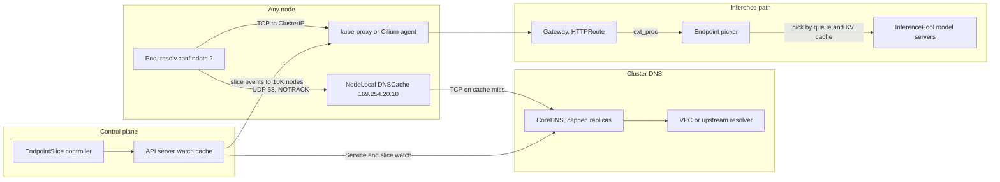

# Lesson 47 — AI/ML platform: DNS, service discovery & east-west load balancing at fleet scale — CoreDNS and NodeLocal DNSCache at 10K+ nodes, EndpointSlice fan-out, conntrack limits & inference gateway traffic

*2026-10-26*

## What interviewers are really probing

[Lesson 46](/lessons/46-gpu-cluster-networking-fleet-scale) gave every GPU node two networks. This lesson is about what runs on the first one all day: **name lookups, service discovery and east-west connections**. At 10K+ nodes these are the quiet killers. DNS is the most common "the whole cluster is flaky" incident, EndpointSlice churn is a top source of API server watch load ([L44](/lessons/44-gpu-cluster-control-plane-scaling)), conntrack tables fill on busy inference nodes, and plain ClusterIP load balancing is the wrong tool for long-lived LLM streams.

The interview version: *"Design DNS and service discovery for a 10,000-node cluster that runs 4,000-pod training jobs and a large inference fleet."* Or the incident version: *"After a big training job starts, random pods across the cluster see 5-second stalls on outbound calls, CoreDNS is at 100% CPU, and the inference p99 TTFT doubled. Go."* They want to hear that you **know the resolver path byte by byte** (ndots, search domains, A plus AAAA), **cache on the node**, **understand the conntrack race behind the famous 5-second timeout**, **can reason about EndpointSlice fan-out as watch traffic**, and **route inference by load, not by connection**.

Cross-links: [L02](/lessons/02-k8s-control-plane) (control plane), [L07](/lessons/07-edge-lb-ddos-armor-shield) (edge LB), [L08](/lessons/08-cni-cilium-ebpf) (Cilium/eBPF), [L10](/lessons/10-service-mesh-istio-linkerd-mtls) (mesh, mTLS), [L11](/lessons/11-cluster-security-pss-admission-rbac) (RBAC/admission), [L13](/lessons/13-ml-weights-checkpoint-hardening) (weights), [L14](/lessons/14-ml-inference-training-deploy-hardening) (deploy hardening), [L21](/lessons/21-inference-serving-slos-ttft-tpot-kvcache) (inference SLOs, KV cache), [L24](/lessons/24-multi-cluster-inference-routing-capacity) (multi-cluster routing), [L28](/lessons/28-inference-autoscaling-scale-to-zero) (autoscaling), [L34](/lessons/34-agent-tool-sandboxing-egress-policy) (egress), [L44](/lessons/44-gpu-cluster-control-plane-scaling) (watch storms), [L45](/lessons/45-fleet-kubernetes-upgrades-gpu-clusters) (drains), [L46](/lessons/46-gpu-cluster-networking-fleet-scale) (two planes). Fuel: [wafer-ai/gpu-perf-engineering-resources](https://github.com/wafer-ai/gpu-perf-engineering-resources).

What they check for:

- **Query amplification.** Default pod `resolv.conf` has `ndots:5` and three cluster search domains plus whatever the node adds. A lookup of `s3.us-east-1.amazonaws.com` (3 dots) walks every search domain first, for A and AAAA. That is up to 10 to 12 queries for one name, most of them NXDOMAIN.
- **The 5-second timeout.** glibc sends A and AAAA in parallel from the same UDP socket. Both packets hit the kube-dns ClusterIP DNAT at once, one loses the conntrack insert race and is dropped, and glibc waits its 5-second timeout. NodeLocal DNSCache fixes it by skipping DNAT and conntrack for DNS and talking TCP upstream.
- **CoreDNS is a watcher.** Every CoreDNS replica watches all Services, EndpointSlices and Namespaces. Scaling replicas linearly with nodes (625 replicas at 10K nodes with default autoscaler settings) adds API server load. Cache on the node and keep CoreDNS small and fat.
- **Fan-out math.** One EndpointSlice update goes to every kube-proxy or Cilium agent: 10,000 watch events. A 4,000-pod job behind a headless Service, rolling through Pending to Ready, can make hundreds of thousands of events in a minute.
- **L4 is not enough for inference.** ClusterIP balances connections, not requests. HTTP/2 and gRPC clients keep one connection, so one pod gets everything. LLM serving also has wildly uneven request cost. You need an L7 gateway that picks the endpoint from queue depth and KV cache state.

**Interview sentence:** "Every node runs NodeLocal DNSCache on a link-local IP with NOTRACK, talking TCP to a capped, well-fed CoreDNS, so there's no UDP conntrack race and CoreDNS load scales with cache misses, not nodes. Workloads set `ndots` low and use FQDNs with trailing dots for external names. EndpointSlice churn is batched, and big training jobs use per-job headless Services that only their own pods resolve. Conntrack and eBPF CT maps are sized per node type and alarmed. Inference goes through a Gateway API gateway with an endpoint picker that routes on queue depth, KV cache use and prefix hits. DNS is locked down too: egress port 53 only to the node cache, FQDN allowlists, and weight downloads that verify digests, so a hijacked name can't swap a model."

## Core diagram: lookup → discovery → connection

![DNS, service discovery and east-west load balancing at fleet scale: the name resolution path (ndots and search domains, NodeLocal DNSCache on 169.254.20.10 with NOTRACK, TCP to CoreDNS, cache and serve_stale), service discovery fan-out (EndpointSlices of 100 endpoints, watch events to every node, batching, trafficDistribution, terminating conditions), and east-west and inference load balancing (ClusterIP L4 pinning, conntrack sizing, Gateway API with InferencePool and an endpoint picker); below, how it breaks, signals and gates, and a security floor](/dns-service-discovery-east-west-lb.png)



## Idiosyncrasies / operator depth

**1. What `ndots:5` really costs.** A pod in namespace `serving` gets roughly this:

```text
search serving.svc.cluster.local svc.cluster.local cluster.local ec2.internal
nameserver 10.96.0.10
options ndots:5
```

Any name with fewer than five dots is tried with each search suffix first. `api.vendor.com` becomes `api.vendor.com.serving.svc.cluster.local`, `...svc.cluster.local`, `...cluster.local`, `...ec2.internal`, then the real name. glibc asks for A and AAAA each time, so that's 10 queries and 8 NXDOMAINs before the answer. Inference pods that call tokenizer services, object storage, telemetry and model registries multiply this. Fixes, in order of safety: put a trailing dot on external FQDNs in config (`storage.googleapis.com.`), set `dnsConfig.options ndots: "2"` per workload, and strip node search domains you don't need. CoreDNS `autopath` can answer the search walk server side, but it needs `pods verified`, which watches every pod in the cluster. At 10K nodes that's a big memory and watch cost, so most large fleets skip it.

**2. The conntrack race, precisely.** Kernel netfilter creates the conntrack entry when a packet is confirmed, after DNAT. Two UDP packets from the same source port to the same ClusterIP arrive together. Both get NAT'd, and the second fails `nf_conntrack_confirm` with an insert collision and is dropped. You see it as `insert_failed` climbing in `conntrack -S`. glibc retries after `timeout:5`. Kernel patches around 5.0 reduced it for the same-destination case, but with several CoreDNS backends DNAT can still pick different ones, so it never fully went away. `options single-request-reopen` helps glibc. musl (Alpine) ignores most resolver options. NodeLocal DNSCache is the real fix.

**3. How NodeLocal DNSCache actually hooks in.** It's a CoreDNS build running as a hostNetwork DaemonSet. It adds a dummy interface with a link-local IP (`169.254.20.10` by convention) and, in iptables kube-proxy mode, also binds the kube-dns ClusterIP and installs `NOTRACK` rules for port 53. Pods keep their old nameserver and get the cache with no kubelet change. In IPVS mode the ClusterIP trick doesn't work, so you point kubelet `clusterDNS` at the link-local IP, which means a node roll. With Cilium kube-proxy replacement you use a **Local Redirect Policy** to send kube-dns traffic to the node-local pod. On a cache miss it forwards to CoreDNS over **TCP** (`force_tcp`), which sidesteps the UDP race and keeps a few long connections instead of millions of short flows.

**4. The NodeLocal failure mode nobody mentions.** On graceful shutdown the iptables-mode cache removes its rules, so traffic falls back to kube-dns. If the pod is OOM-killed or the node is under pressure and it dies hard, the `NOTRACK` and interface may remain while nothing listens. DNS on that node is a black hole until the DaemonSet restarts it. Give it a `system-node-critical` priority class, guaranteed QoS, a sensible memory limit for the cache size, and roll it with `maxUnavailable: 1` style care or surge. Probe it from a node agent, not just from its own liveness check.

**5. Sizing CoreDNS at 10K nodes.** The cluster-proportional-autoscaler default linear params (`coresPerReplica: 256`, `nodesPerReplica: 16`) give `max(cores/256, nodes/16)` replicas. With 10,000 nodes that's 625 replicas, each holding a full copy of every Service and EndpointSlice and each a watcher on the API server. With NodeLocal in front, CoreDNS only sees cache misses. Run 10 to 40 big replicas per cluster, set a `max` on the autoscaler, spread them across zones, and give them real CPU without throttling. Memory scales with Services times endpoints, so measure it on your biggest cluster.

**6. CoreDNS knobs that matter.** `cache` with `prefetch` keeps hot names warm, `serve_stale` answers from cache when upstream is broken (DNS survives a short upstream outage), and `forward ... { max_concurrent 1000 }` sheds load with SERVFAIL instead of piling goroutines until OOM. The `kubernetes` plugin's `ttl` defaults to 5 seconds, so cluster names churn through the node cache often. Raising it to 30 cuts load but delays Service IP changes, which are rare. Headless records churn with pods, so keep their TTL short.

**7. Upstream resolver limits are real.** AWS's VPC resolver allows 1,024 packets per second per network interface. CoreDNS replicas forwarding all external lookups from a 10K-node cluster can hit that and get silently dropped, which looks like random SERVFAIL. Node caches, fewer NXDOMAIN walks, and spreading CoreDNS across many nodes (many ENIs) fix it. GCP and Azure have similar per-VM limits. Know your provider's number.

**8. EndpointSlice mechanics.** The controller packs at most 100 endpoints per slice by default (`--max-endpoints-per-slice`, max 1000). It prefers to leave slices partly full rather than rebalance, to avoid churn. Each slice change is a watch event to every kube-proxy or Cilium agent, plus CoreDNS, plus meshes and gateways. `--endpointslice-updates-batch-period` in kube-controller-manager batches changes over a window (for example `1s`), which can cut events a lot during big rollouts. The legacy Endpoints API truncates at 1,000 addresses (`endpoints.kubernetes.io/over-capacity: truncated`) and is deprecated, so anything still reading Endpoints breaks on big Services.

**9. Headless Services for training jobs.** JobSet and StatefulSet-based training use headless Services so rank N can resolve rank 0. A 4,000-pod job gets a 4,000-address DNS answer for the Service name. That reply is too big for UDP, gets truncated, and retries over TCP. Each pod start and readiness flip changes slices, and every node in the cluster hears about it. Use one headless Service per job, resolve per-pod hostnames instead of the Service name, set `publishNotReadyAddresses: true` so ranks can find each other before readiness and slices don't flap, and tear the Service down with the job.

**10. Topology-aware routing.** `spec.trafficDistribution: PreferClose` tells kube-proxy or Cilium to prefer endpoints in the same zone, which cuts cross-zone cost and latency. It's a hint. If a zone has no endpoints you fall back cluster-wide, and if load is uneven by zone you overload the small zone. Newer releases add more specific values such as same-node preference. `internalTrafficPolicy: Local` goes further and drops traffic when the node has no local endpoint, which is right for node agents and wrong for anything else.

**11. Conntrack and eBPF CT maps.** kube-proxy sets `nf_conntrack_max` from `--conntrack-max-per-core` (32,768 per core, minimum 131,072). An inference node doing lots of short calls, or a gateway node, can fill that. The kernel logs `nf_conntrack: table full, dropping packet` and new connections fail randomly. Cilium with kube-proxy replacement keeps its own BPF CT maps, sized by `bpf-map-dynamic-size-ratio` or explicit `bpf-ct-global-tcp-max`. When full you see drops with reason `CT: Map insertion failed`. Size both for the worst node type and alarm at 70%.

**12. Why ClusterIP is bad for LLM traffic.** kube-proxy and Cilium pick a backend per connection. A gRPC or HTTP/2 client keeps one connection and sends every request on it, so one model server gets all of a client's traffic. Even with many clients, LLM requests differ a lot in cost (a 100-token prompt vs a 100K-token prompt), and the expensive state is the KV cache on each server ([L21](/lessons/21-inference-serving-slos-ttft-tpot-kvcache)). Round robin by connection ignores both. Use an L7 proxy that balances per request, and for LLMs one that scores endpoints by live load.

**13. Gateway API Inference Extension.** An `InferencePool` is a group of model server pods with an **endpoint picker** (EPP). The gateway (Envoy-based: Envoy Gateway, kgateway, Istio, GKE Gateway and others) calls the EPP through Envoy `ext_proc` for each request. The EPP scrapes model server metrics (queue length, KV cache use, loaded LoRA adapters) and picks a pod, often preferring one that already has the prompt prefix cached. This is the same idea as the cross-cell routing in [L24](/lessons/24-multi-cluster-inference-routing-capacity), inside one cluster. The EPP is in the hot path: if it's slow, every request is slow, and you need a fail-open or fail-closed choice.

**14. Long streams and drains.** LLM responses stream for minutes over SSE or gRPC. Cloud LB idle timeouts (AWS NLB 350 seconds by default, ALB 60 seconds), proxy `stream_idle_timeout` and route timeouts all have to exceed the longest stream. On scale-down or upgrade ([L45](/lessons/45-fleet-kubernetes-upgrades-gpu-clusters)), the endpoint goes `serving: true, terminating: true`. The proxy must stop sending new requests but let streams finish. Set `terminationGracePeriodSeconds` longer than your longest generation, add a `preStop` sleep so the endpoint removal reaches every proxy before the server stops accepting, and make the server finish in-flight requests on SIGTERM.

## Concrete commands & config

**Prove the amplification and the race:**

```bash
# What a pod actually resolves with
kubectl -n serving exec deploy/vllm-llama -- cat /etc/resolv.conf

# Count queries for one external name (run tcpdump on the node, in the pod's netns)
PID=$(crictl inspect --output go-template --template '{{.info.pid}}' "$(crictl ps --name vllm -q | head -1)")
nsenter -t "$PID" -n tcpdump -ni any udp port 53 -c 40 &
kubectl -n serving exec deploy/vllm-llama -- getent hosts storage.googleapis.com

# Conntrack race evidence on the node
conntrack -S | awk '{for(i=1;i<=NF;i++) if($i ~ /insert_failed|drop/) print $1, $i}'
cat /proc/sys/net/netfilter/nf_conntrack_count /proc/sys/net/netfilter/nf_conntrack_max
dmesg -T | grep -i 'nf_conntrack: table full'
conntrack -L -p udp --dport 53 2>/dev/null | wc -l
```

**Lower ndots for a workload:**

```yaml
spec:
  dnsPolicy: ClusterFirst
  dnsConfig:
    options:
      - name: ndots
        value: "2"
      - name: single-request-reopen   # glibc only; musl ignores it
      - name: timeout
        value: "2"
      - name: attempts
        value: "2"
```

**Install NodeLocal DNSCache (iptables kube-proxy mode, from the upstream manifest):**

```bash
kubedns=$(kubectl -n kube-system get svc kube-dns -o jsonpath='{.spec.clusterIP}')
domain=cluster.local
localdns=169.254.20.10
curl -sLO https://raw.githubusercontent.com/kubernetes/kubernetes/master/cluster/addons/dns/nodelocaldns/nodelocaldns.yaml
sed -i "s/__PILLAR__LOCAL__DNS__/$localdns/g; s/__PILLAR__DNS__DOMAIN__/$domain/g; s/__PILLAR__DNS__SERVER__/$kubedns/g" nodelocaldns.yaml
kubectl apply -f nodelocaldns.yaml
kubectl -n kube-system rollout status ds/node-local-dns
# IPVS mode instead: also set kubelet clusterDNS to 169.254.20.10 and roll nodes
```

**Cilium kube-proxy replacement: redirect kube-dns to the node-local pod:**

```yaml
apiVersion: cilium.io/v2
kind: CiliumLocalRedirectPolicy
metadata:
  name: nodelocaldns
  namespace: kube-system
spec:
  redirectFrontend:
    serviceMatcher:
      serviceName: kube-dns
      namespace: kube-system
  redirectBackend:
    localEndpointSelector:
      matchLabels:
        k8s-app: node-local-dns
    toPorts:
      - port: "53"
        name: dns
        protocol: UDP
      - port: "53"
        name: dns-tcp
        protocol: TCP
```

**A CoreDNS Corefile for a large cluster:**

```text
.:53 {
    errors
    health { lameduck 10s }
    ready
    kubernetes cluster.local in-addr.arpa ip6.arpa {
        pods disabled           # no pod watch; no autopath
        fallthrough in-addr.arpa ip6.arpa
        ttl 30
    }
    prometheus :9153
    forward . /etc/resolv.conf {
        max_concurrent 1000     # shed with SERVFAIL instead of OOM
        prefer_udp
    }
    cache 300 {
        success 9984 300
        denial 9984 30
        prefetch 10 1m 10%
        serve_stale 1h
    }
    loop
    reload
    loadbalance
}
```

**Cap the CoreDNS autoscaler:**

```bash
kubectl -n kube-system patch configmap dns-autoscaler --type merge -p \
  '{"data":{"linear":"{\"coresPerReplica\":2048,\"nodesPerReplica\":512,\"min\":6,\"max\":40,\"preventSinglePointFailure\":true}"}}'
```

**Watch the key metrics (PromQL):**

```text
histogram_quantile(0.99, sum by (le) (rate(coredns_dns_request_duration_seconds_bucket[5m])))
sum(rate(coredns_dns_responses_total{rcode="SERVFAIL"}[5m]))
sum(rate(coredns_cache_misses_total[5m])) / sum(rate(coredns_cache_requests_total[5m]))
sum by (rcode) (rate(coredns_dns_responses_total{job="node-local-dns"}[5m]))
max by (node) (node_nf_conntrack_entries / node_nf_conntrack_entries_limit)
sum by (reason) (rate(cilium_drop_count_total{reason=~"CT.*"}[5m]))
sum(rate(apiserver_watch_events_total{kind="EndpointSlice"}[5m]))
```

**EndpointSlice inspection and batching:**

```bash
kubectl -n train get endpointslices -l kubernetes.io/service-name=job-7f2a -o wide
kubectl -n train get endpointslices -l kubernetes.io/service-name=job-7f2a -o json \
  | jq '.items[] | {name: .metadata.name, endpoints: (.endpoints | length)}'
kubectl get --raw /metrics | grep -E 'endpoint_slice_controller_(changes|syncs)'

# kube-controller-manager flags (self-managed control planes)
#   --max-endpoints-per-slice=100
#   --endpointslice-updates-batch-period=1s
```

**Per-job headless Service for a training job:**

```yaml
apiVersion: v1
kind: Service
metadata:
  name: job-7f2a
  namespace: train
spec:
  clusterIP: None
  publishNotReadyAddresses: true   # ranks resolve before Ready; slices don't flap
  selector:
    job-name: job-7f2a
  ports:
    - name: rendezvous
      port: 29500
```

**Zone-preferring east-west Service:**

```yaml
apiVersion: v1
kind: Service
metadata:
  name: tokenizer
  namespace: serving
spec:
  selector:
    app: tokenizer
  ports:
    - port: 8080
  trafficDistribution: PreferClose
```

**Inference gateway with an InferencePool (Gateway API Inference Extension; check field names against your release):**

```yaml
apiVersion: inference.networking.k8s.io/v1
kind: InferencePool
metadata:
  name: llama-70b
  namespace: serving
spec:
  selector:
    matchLabels:
      app: vllm-llama-70b
  targetPorts:
    - number: 8000
  endpointPickerRef:
    name: llama-70b-epp
    port:
      number: 9002
---
apiVersion: gateway.networking.k8s.io/v1
kind: HTTPRoute
metadata:
  name: llama-70b
  namespace: serving
spec:
  parentRefs:
    - name: inference-gw
  rules:
    - matches:
        - path:
            type: PathPrefix
            value: /v1
      backendRefs:
        - group: inference.networking.k8s.io
          kind: InferencePool
          name: llama-70b
      timeouts:
        request: 900s     # longer than the longest generation
```

**Drain-safe model server:**

```yaml
spec:
  terminationGracePeriodSeconds: 960
  containers:
    - name: vllm
      lifecycle:
        preStop:
          sleep:
            seconds: 15   # let endpoint removal reach every proxy first
```

**Conntrack sizing on inference and gateway nodes:**

```bash
# kube-proxy config: conntrack.maxPerCore: 131072 (or set min)
sysctl -w net.netfilter.nf_conntrack_max=1048576
sysctl -w net.netfilter.nf_conntrack_udp_timeout=10      # short-lived DNS flows
sysctl -w net.netfilter.nf_conntrack_tcp_timeout_time_wait=30
# Cilium: helm --set bpf.mapDynamicSizeRatio=0.005  (or bpf.ctTcpMax / bpf.ctAnyMax)
cilium-dbg bpf ct list global | wc -l
```

**Synthetic DNS probe from every node pool:**

```bash
for n in $(kubectl get nodes -l pool=gpu-h100 -o name | shuf -n 20); do
  kubectl debug "$n" -q --profile=general --image=busybox:1.36 -- \
    sh -c 'for i in 1 2 3 4 5; do time nslookup kubernetes.default.svc.cluster.local. 169.254.20.10 >/dev/null; done' 2>&1 \
    | grep real | sed "s|^|$n |"
done
```

## Failures & fixes

| Symptom | Likely cause | Fix |
|---|---|---|
| Random 5 s stalls on outbound calls, worse at peak | UDP DNS conntrack insert race at kube-dns DNAT; `insert_failed` climbing | NodeLocal DNSCache with NOTRACK and TCP upstream; `single-request-reopen` for glibc |
| CoreDNS at 100% CPU, SERVFAIL spikes after a big job starts | NXDOMAIN storm from `ndots:5` search walks; headless Service with thousands of records | Lower `ndots`, trailing dots, node caches, per-job Services, bigger CoreDNS replicas |
| One node can't resolve anything; others fine | NodeLocal pod died hard, NOTRACK rules and interface left behind | `system-node-critical`, guaranteed QoS, per-node DNS probe from a node agent, auto-restart and cordon on failure |
| External names fail randomly, cluster names fine | Upstream resolver per-interface packet limit (for example VPC 1,024 pps) | Cache more (`prefetch`, longer success TTL), cut NXDOMAINs, spread CoreDNS, add a regional resolver tier |
| API server CPU jumps during job launch; kube-proxy or Cilium agents lag | EndpointSlice churn fan-out to 10K watchers | `--endpointslice-updates-batch-period`, `publishNotReadyAddresses`, one Service per job, fewer selectors matching huge pod sets |
| Service with more than 1,000 pods missing endpoints in an old tool | Reading the legacy Endpoints API, truncated at 1,000 | Move clients to EndpointSlices; check the `over-capacity` annotation |
| New connections fail at random on gateway nodes | `nf_conntrack` table full or Cilium CT map full | Raise limits per node type, shorten UDP and TIME_WAIT timeouts, alarm at 70% |
| One model server at 100% KV cache, others idle | HTTP/2 or gRPC connection pinned by L4 ClusterIP | L7 gateway with per-request balancing; InferencePool endpoint picker by load |
| TTFT p99 jumps for every request through the gateway | Endpoint picker slow or overloaded; metrics scrape lag | Scale and spread the EPP, tune its scrape interval, set fail-open with a plain fallback route |
| Long generations cut off at a fixed time | LB idle timeout or proxy route timeout shorter than the stream | Raise NLB/ALB idle timeouts, proxy `stream_idle_timeout` and route timeout; send keepalive events |
| 502s during model server rollouts | Server stops before endpoint removal reaches proxies | `preStop` sleep, grace period longer than the longest request, graceful SIGTERM handling |
| Cross-zone bill spikes after enabling PreferClose elsewhere | Zone imbalance: small zone overloaded or fallback cluster-wide | Balance replicas per zone; don't use PreferClose for skewed services |

## Security & hardening

DNS and service discovery decide **where every byte goes**. Whoever controls them controls traffic, including where model weights are downloaded from and which pod gets a tenant's prompts.

**DNS as an exfiltration and command channel.**

- Pods should reach port 53 only on the node cache and CoreDNS. Block direct DNS to the internet in NetworkPolicy and at the VPC firewall. Otherwise a compromised inference pod can tunnel prompts or weights out in DNS queries.
- Use FQDN-aware egress policy ([L34](/lessons/34-agent-tool-sandboxing-egress-policy)), for example Cilium `toFQDNs` with DNS visibility, so pods only reach the names you allow. Alarm on high-entropy subdomains and query bursts to one domain, which are classic tunneling signs.
- On the upstream side, forward to a resolver with logging and threat feeds (Route 53 Resolver DNS Firewall, Cloud DNS response policies) and use DNS over TLS where the resolver supports it.

**Protect the resolver config itself.**

- Write access to the `coredns` ConfigMap in `kube-system` is a cluster-wide traffic hijack: one `rewrite` or `hosts` line can point a registry or bucket name anywhere. Manage the Corefile and NodeLocal config through GitOps with review, and give almost nobody `update` on `kube-system` ConfigMaps. Audit-log every change ([L11](/lessons/11-cluster-security-pss-admission-rbac)).
- Keep `pods disabled` (or `verified`). The old `pods insecure` mode answers for any IP-shaped name without checking.

**Protect service discovery.**

- Creating an EndpointSlice with label `kubernetes.io/service-name: X` adds backends to someone else's Service. Only controllers should have `create` on `endpointslices`. Review RBAC for wildcards that grant it by accident.
- Turn on the `DenyServiceExternalIPs` admission plugin or block `spec.externalIPs` with policy (CVE-2020-8554, where a user could intercept traffic to any IP). Restrict `ExternalName` Services, which turn a cluster name into an arbitrary DNS alias.
- Use mTLS east-west ([L10](/lessons/10-service-mesh-istio-linkerd-mtls)) so a wrong endpoint fails the handshake instead of receiving traffic.

**Model weights, registries and DNS.**

- Weight buckets and image registries should resolve through **private DNS zones** to private endpoints (VPC endpoints, Private Service Connect, Private Link). Bucket policies should allow only those endpoints ([L13](/lessons/13-ml-weights-checkpoint-hardening)), so a stolen credential is useless from outside.
- Never trust DNS alone for weights. Pull by **digest**, verify **signatures** on images and on model artifacts (cosign, sigstore model signing), and check checksums on checkpoints before loading. A poisoned DNS answer then fails verification instead of serving a swapped model.
- Hydration jobs ([L27](/lessons/27-gpu-supply-chain-weight-registry-hydrate)) should use TLS with full certificate validation. Never disable verification to "fix" a DNS or proxy problem.

**Harden the inference gateway and endpoint picker.**

- Model server pods should accept traffic only from the gateway (NetworkPolicy on the pod, plus mTLS). Nothing else in the cluster should be able to call `vllm:8000` directly and skip authn, quotas and logging.
- The EPP sees request headers and, with body processing, **prompts**. Treat it like data plane: minimal RBAC (read pods and its pool only), signed image, no prompt logging by default, and its own NetworkPolicy.
- Do authn, per-tenant rate limits and request size limits at the gateway ([L14](/lessons/14-ml-inference-training-deploy-hardening), [L25](/lessons/25-multi-tenant-gpu-isolation-quota)). Use separate InferencePools per tenant or model sensitivity so one tenant's routing can't land on another's adapters.
- Decide fail-open vs fail-closed for the EPP deliberately. Fail-open keeps serving with plain balancing; fail-closed protects isolation if routing decisions carry tenant rules.

**Availability is security too.** CoreDNS and NodeLocal DNSCache need `system-cluster-critical` and `system-node-critical` priority, PodDisruptionBudgets, and anti-affinity, so a noisy tenant or a bad rollout can't take out name resolution for the whole cell.

## Interview soundbites

- "`ndots:5` turns one external lookup into about ten queries. I lower it per workload and use trailing dots for external names."
- "The 5-second DNS timeout is a conntrack insert race between parallel A and AAAA packets at the kube-dns DNAT. NodeLocal DNSCache with NOTRACK and TCP upstream removes it."
- "CoreDNS replicas are watchers. With node caches in front, I run a few big replicas, not hundreds of small ones."
- "Every EndpointSlice change goes to every node. At 10K nodes a big job launch is a watch storm, so I batch updates and give each job its own headless Service."
- "ClusterIP balances connections, not requests. For LLMs I route per request on queue depth and KV cache with an InferencePool endpoint picker."
- "Whoever can edit the Corefile or create EndpointSlices can redirect traffic. Those are tier-zero permissions."
- "Weights resolve through private DNS to private endpoints, and I verify digests and signatures, so a hijacked name can't swap a model."

## How this maps to the JD

- **100+ clusters / 10K+ nodes:** NodeLocal DNSCache everywhere, capped CoreDNS, EndpointSlice batching, conntrack sizing per node type.
- **K8s internals:** resolver behavior, kube-proxy and eBPF service handling, EndpointSlice controller, watch fan-out ([L44](/lessons/44-gpu-cluster-control-plane-scaling)).
- **Cloud & cluster networking:** VPC resolver limits, private DNS zones, LB idle timeouts, zone-aware routing.
- **Security:** DNS egress control, resolver config as tier-zero, EndpointSlice RBAC, externalIPs, gateway and EPP hardening.
- **Design tradeoffs:** autopath vs ndots, TTL vs freshness, EPP fail-open vs fail-closed, PreferClose vs balance.

## Watch (talks & demos)

**Going from 5s to 5ms: Benefits of a Node-Local DNSCache (KubeCon EU 2019)**. Why watch: the people who built NodeLocal DNSCache explain the conntrack race behind the 5-second timeout, the NOTRACK design and the production numbers. This is the source for items 2 to 4.

<iframe width="100%" height="360" src="https://www.youtube.com/embed/XbkViBUuScE" title="Going from 5s to 5ms: Benefits of a Node-Local DNSCache" frameBorder="0" allow="accelerometer; autoplay; clipboard-write; encrypted-media; gyroscope; picture-in-picture; web-share" allowFullScreen></iframe>

[Open on YouTube](https://www.youtube.com/watch?v=XbkViBUuScE)

**Enhancing DNS Reliability in Kubernetes With Node Local DNSCache (KubeCon India 2025, New Relic)**. Why watch: a recent operator story of rolling the cache across hundreds of clusters and tens of thousands of nodes, with the testing strategy, CoreDNS metrics before and after, and the lessons learned.

<iframe width="100%" height="360" src="https://www.youtube.com/embed/ueMe_LLxfVI" title="Enhancing DNS Reliability in Kubernetes With Node Local DNSCache" frameBorder="0" allow="accelerometer; autoplay; clipboard-write; encrypted-media; gyroscope; picture-in-picture; web-share" allowFullScreen></iframe>

[Open on YouTube](https://www.youtube.com/watch?v=ueMe_LLxfVI)

## References

- Kubernetes: [DNS for Services and Pods](https://kubernetes.io/docs/concepts/services-networking/dns-pod-service/) · [NodeLocal DNSCache](https://kubernetes.io/docs/tasks/administer-cluster/nodelocaldns/) · [Debugging DNS resolution](https://kubernetes.io/docs/tasks/administer-cluster/dns-debugging-resolution/) · [Autoscale the DNS service](https://kubernetes.io/docs/tasks/administer-cluster/dns-horizontal-autoscaling/) · [EndpointSlices](https://kubernetes.io/docs/concepts/services-networking/endpoint-slices/) · [Traffic distribution](https://kubernetes.io/docs/concepts/services-networking/service/#traffic-distribution) · [Virtual IPs and service proxies](https://kubernetes.io/docs/reference/networking/virtual-ips/)
- CoreDNS: [cache plugin](https://coredns.io/plugins/cache/) · [forward plugin](https://coredns.io/plugins/forward/) · [kubernetes plugin](https://coredns.io/plugins/kubernetes/) · [autopath](https://coredns.io/plugins/autopath/)
- Background: [Racy conntrack and DNS lookup timeouts (Weaveworks)](https://www.weave.works/blog/racy-conntrack-and-dns-lookup-timeouts) · [Cilium Local Redirect Policy](https://docs.cilium.io/en/stable/network/kubernetes/local-redirect-policy/) · [AWS VPC DNS quotas](https://docs.aws.amazon.com/vpc/latest/userguide/AmazonDNS-concepts.html#vpc-dns-limits)
- Inference routing: [Gateway API Inference Extension](https://gateway-api-inference-extension.sigs.k8s.io/) · [Gateway API](https://gateway-api.sigs.k8s.io/)
- Security: [CVE-2020-8554](https://github.com/kubernetes/kubernetes/issues/97076) · [Cilium DNS-based policy](https://docs.cilium.io/en/stable/security/policy/language/#dns-based)
- [wafer-ai/gpu-perf-engineering-resources](https://github.com/wafer-ai/gpu-perf-engineering-resources) — AI/ML platform fuel
- Prior: [46 — GPU cluster networking](/lessons/46-gpu-cluster-networking-fleet-scale) · [45 — Fleet upgrades](/lessons/45-fleet-kubernetes-upgrades-gpu-clusters) · [44 — Control-plane scaling](/lessons/44-gpu-cluster-control-plane-scaling) · [34 — Egress policy](/lessons/34-agent-tool-sandboxing-egress-policy) · [27 — Weight supply chain](/lessons/27-gpu-supply-chain-weight-registry-hydrate) · [24 — Multi-cluster routing](/lessons/24-multi-cluster-inference-routing-capacity) · [21 — Inference SLOs](/lessons/21-inference-serving-slos-ttft-tpot-kvcache) · [13 — Weights hardening](/lessons/13-ml-weights-checkpoint-hardening) · [10 — Service mesh](/lessons/10-service-mesh-istio-linkerd-mtls) · [08 — Cilium](/lessons/08-cni-cilium-ebpf)

## Quick self-check

Out loud, in under two minutes each:

1. Write a pod's `resolv.conf` and count the packets for `api.vendor.com`. Give three ways to cut that number and the cost of each.
2. Explain the 5-second DNS timeout down to the conntrack step. Why does NodeLocal DNSCache fix it, and how does it hook in under iptables, IPVS and Cilium?
3. How many CoreDNS replicas does the default autoscaler give a 10K-node cluster, and why is that a problem? What do you run instead?
4. A 4,000-pod job launches and the API server spikes. Do the fan-out math and list the fixes.
5. Why does ClusterIP balance LLM traffic badly? What does an InferencePool endpoint picker look at, and what happens when it's down?
6. Long generations are cut off at exactly 350 seconds. Where do you look?
7. Name every permission or path that lets someone redirect traffic or swap model weights through DNS or service discovery, and the control for each.

## Next

**Lesson 48 — AI/ML platform: workload identity, secrets & PKI at fleet scale — SPIFFE/SPIRE, cloud workload identity federation, certificate rotation across 10K+ nodes & scoped access to weight buckets**
