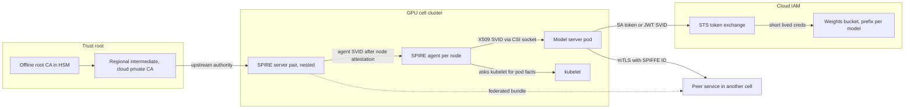

# Lesson 48 — AI/ML platform: workload identity, secrets & PKI at fleet scale — SPIFFE/SPIRE, cloud workload identity federation, certificate rotation across 10K+ nodes & scoped access to weight buckets

*2026-10-27*

## What interviewers are really probing

[Lesson 47](/lessons/47-dns-service-discovery-east-west-lb) decided **where** traffic goes. This lesson is about **who** is on each end of it. At 10K+ nodes and 100+ clusters, you can't hand out keys by hand. Every node, every pod, every hydrate job and every training rank needs an identity it can prove. That identity has to come from a short-lived credential that rotates itself. And when a model server asks for weights, it should be able to read one model's prefix in one bucket and nothing else.

The interview version: *"Design workload identity for 150 GPU clusters across AWS, GCP and on-prem bare metal. Services need mTLS to each other and short-lived access to cloud storage holding model weights. No static keys."* Or the incident version: *"At 03:00 the mesh starts failing with `x509: certificate has expired or is not yet valid` in one region. SPIRE server pods look healthy. Half the inference cells are down. Go."* They want to hear that you **separate attestation from issuance from authorization**, **know the TTL math** (outage budget equals SVID TTL minus rotation point), **can federate Kubernetes identities into cloud IAM without static keys**, **can operate the boring PKI** (kubelet certs, etcd, apiserver, the SA signing key) and **scope weight access per model and per tenant**.

Cross-links: [L02](/lessons/02-k8s-control-plane) (control plane), [L03](/lessons/03-cluster-provisioning-lifecycle) (provisioning), [L10](/lessons/10-service-mesh-istio-linkerd-mtls) (mesh, mTLS), [L11](/lessons/11-cluster-security-pss-admission-rbac) (RBAC/admission/IAM), [L12](/lessons/12-node-container-hardening-supply-chain) (supply chain, signing), [L13](/lessons/13-ml-weights-checkpoint-hardening) (weights hardening), [L14](/lessons/14-ml-inference-training-deploy-hardening) (deploy hardening, secrets), [L15](/lessons/15-terraform-atlantis-fleet-scale) (Terraform), [L25](/lessons/25-multi-tenant-gpu-isolation-quota) (multi-tenant), [L27](/lessons/27-gpu-supply-chain-weight-registry-hydrate) (weight registry, hydrate), [L29](/lessons/29-training-reliability-checkpoint-elastic) (checkpoints), [L34](/lessons/34-agent-tool-sandboxing-egress-policy) (egress, agent creds), [L42](/lessons/42-node-os-kernel-management-gpu-fleets) (immutable images, TPM), [L43](/lessons/43-gpu-node-bootstrap-bare-metal-provisioning) (bootstrap, join), [L44](/lessons/44-gpu-cluster-control-plane-scaling) (watch load), [L45](/lessons/45-fleet-kubernetes-upgrades-gpu-clusters) (upgrades), [L46](/lessons/46-gpu-cluster-networking-fleet-scale) (networking), [L47](/lessons/47-dns-service-discovery-east-west-lb) (DNS, gateway). Fuel: [wafer-ai/gpu-perf-engineering-resources](https://github.com/wafer-ai/gpu-perf-engineering-resources).

What they check for:

- **Attestation, not configuration.** A workload's identity should come from facts the platform can check: the node's cloud instance document or TPM, and the pod's namespace, service account and image as reported by the kubelet. It should never come from a secret someone copied into a ConfigMap.
- **TTL math.** SPIRE's default X509-SVID TTL is 1 hour, and agents rotate at about half of it. If the SPIRE server is down for more than about 30 minutes, workloads start to lose valid certificates. That number drives your HA design.
- **Fleet math.** 10,000 nodes times 30 pods is 300,000 workloads. With 1-hour SVIDs rotated at half-life, that's about 170 signatures per second all day, plus a cache that every agent keeps in sync. CA rotation means pushing a new bundle to every one of them before anything is signed by the new key.
- **Cloud federation.** GKE Workload Identity Federation, EKS IRSA and Pod Identity, and Azure Workload Identity all exchange a short-lived, audience-bound Kubernetes token for cloud credentials. Each has its own sharp edges at fleet scale: shared identity pools, trust-policy size limits, provider quotas, federated-credential caps.
- **The boring PKI.** kubelet client and serving certs, apiserver and etcd certs, the front-proxy CA and the service account signing key all expire or need rotation. One-year certs on 10K nodes bootstrapped in the same month will all expire in the same month.
- **Weight-bucket scoping.** "The inference SA can read the bucket" is the wrong answer. Per-model prefixes, per-tenant buckets or access points, read-only for serving, write-only without delete for training, reachable only through private endpoints.

**Interview sentence:** "Every cell runs its own SPIRE server pair, nested under a regional SPIRE whose CA comes from a cloud private CA chained to an offline HSM root. Nodes attest with projected SA tokens in Kubernetes and TPM or instance identity on bare metal, and workloads get 1-hour X.509 SVIDs from the local agent through the CSI driver. Trust bundles federate across cells and clouds. For cloud APIs, pods exchange audience-bound SA tokens or JWT-SVIDs through workload identity federation, so there are no static keys anywhere. IAM on weight buckets is per model prefix and per tenant, read-only for servers, write-only for trainers, and private-endpoint only. Images and checkpoints are signed keyless with Sigstore against the CI identity and verified at admission and at load. CA keys live in KMS or HSM, every CA rotates on a schedule we rehearse, and kubelet and control-plane certs rotate automatically with an expiry exporter as the backstop."

## Core diagram: attest → issue → exchange → scope

![Workload identity, secrets and PKI at fleet scale: attestation of nodes (k8s_psat, aws_iid, gcp_iit, TPM DevID) and workloads (kubelet, namespace, service account, image) into SPIFFE IDs; the PKI tree from an offline HSM root through regional intermediates and nested SPIRE per cell with 1-hour SVIDs and federated bundles; exchange of SA tokens and JWT-SVIDs for cloud credentials (GKE Workload Identity, EKS Pod Identity and IRSA, Azure Workload Identity) scoped to per-model weight bucket prefixes; below, how it breaks, signals and gates, and a security floor](/workload-identity-secrets-pki.png)



## Idiosyncrasies / operator depth

**1. SPIFFE IDs and trust domains are an org chart decision.** A SPIFFE ID is a URI: `spiffe://<trust-domain>/<path>`. An X509-SVID carries it as the **only** URI SAN, and a JWT-SVID carries it as `sub` with a mandatory `aud`. The trust domain is the unit of a CA and a bundle. One trust domain for the whole company means one key compromise is a global incident and every rotation is global. One per cluster means 150 bundles to federate. The usual answer is one trust domain per environment and region or per cell (`prod-use1.example`), with paths that encode `ns` and `sa` (`/ns/serving/sa/vllm-llama-70b`). Don't put pod names or node names in the path: authorization policy has to match on the ID, and IDs that change every rollout make policy impossible.

**2. SPIRE server vs agent, precisely.** The **server** holds the signing CA (or an intermediate from an upstream), the registration entries and the datastore (SQLite by default, MySQL or Postgres for HA). It runs **node attestors** and signs SVIDs. The **agent** runs on each node, attests once to get its own agent SVID, then syncs the entries it is allowed to serve (every 5 seconds by default) and pre-fetches SVIDs for them. It exposes the **Workload API** on a Unix socket. When a process connects, the agent works out who it is from the kernel (PID via `SO_PEERCRED`, cgroups) and the kubelet. It turns that into selectors (`k8s:ns:serving`, `k8s:sa:vllm`, `k8s:pod-image:...`) and returns the SVIDs whose selectors match. The Workload API is **unauthenticated on purpose**: the caller's identity is what's being determined. So anyone who can reach the socket and fake a matching process gets that identity. Socket access is a security boundary.

**3. Node attestation choices.**

- `k8s_psat` (projected SA token): the agent DaemonSet presents a projected token with audience `spire-server`. The server calls **TokenReview** against that cluster's API server and gets node and pod facts. This works anywhere Kubernetes runs, but the server needs API access to every cluster it attests. `k8s_sat` (legacy, unbound tokens) is deprecated; don't use it.
- `aws_iid`, `gcp_iit`, `azure_imds`: the signed instance identity document proves the VM, the account and the project. Pair them with an account or project allowlist, or anyone's VM can attest.
- `tpm_devid` and similar TPM plugins: for bare-metal GPU nodes ([L43](/lessons/43-gpu-node-bootstrap-bare-metal-provisioning)), the DevID key lives in the TPM and was provisioned at manufacture or acceptance ([L39](/lessons/39-gpu-fleet-lifecycle-acceptance-burn-in-rma)). This is the only option here that resists a stolen disk image.
- `join_token`: a one-time bootstrap token. It's fine for labs and dangerous at scale, because it's a bearer secret in your provisioning pipeline.
- `x509pop`: proves possession of a pre-installed cert. That's good when you already have a device PKI.

Agents re-attest when their SVID expires on attestors that support it (psat, x509pop, TPM). Older non-reattestable flows renew the agent SVID instead. An agent that's been offline past its SVID expiry has to re-attest, and with join tokens it can't. Plan node reprovisioning for that case.

**4. Registration at fleet scale.** Hand-written entries don't scale. Run **spire-controller-manager** with a `ClusterSPIFFEID` per class of workload. Its template (for example `spiffe://{{ .TrustDomain }}/ns/{{ .PodMeta.Namespace }}/sa/{{ .PodSpec.ServiceAccountName }}`) turns every matching pod into an entry. 300K pods means 300K entries, and each agent has to be told which subset applies to it. Older SPIRE versions recomputed authorized entries by polling the full datastore, which melted at this size. Modern releases have an **events-based entry cache** (check `events_based_cache` for your version), SQL **read replicas** (`ro_connection_string`), and an agent **LRU SVID cache** (`x509_svid_cache_max_size`) so a node doesn't hold SVIDs for entries it isn't running. Uber's write-up of running SPIRE across hundreds of thousands of hosts is the reference for these knobs.

**5. TTLs and the outage budget.** Defaults: `default_x509_svid_ttl` 1h, `default_jwt_svid_ttl` 5m, `ca_ttl` 24h for the server's signing CA, and agents rotate an SVID at about half its lifetime. So:

- **Outage budget** for the SPIRE server is about `SVID_TTL / 2`. In that window agents keep serving cached SVIDs. After it they can't renew, and SVIDs start to expire.
- Longer TTLs buy outage budget but make revocation slower. SPIRE has no CRL or OCSP for SVIDs. **Short TTL is the revocation mechanism.**
- JWT-SVIDs are bearer tokens. Keep them at minutes, always set a narrow `aud`, and never log them.
- CA rotation: the server prepares the next CA key well before the current one expires and publishes it in the trust bundle **before** signing with it. Every agent and every federated peer must pick up the new bundle in that window. If a peer's bundle refresh is broken, the failure shows up as "unknown authority" errors hours later, at activation time, not at rotation time.

**6. HA and nesting at 10K+ nodes.** A single SPIRE deployment for a whole region is a blast-radius and latency problem. The fleet pattern:

- **Per cell:** two or more SPIRE servers sharing one HA SQL datastore. Each server has its **own** signing key, and all of them are in the bundle, so any server can sign. That's why the bundle has several X.509 authorities at once.
- **Nested:** each cell's servers use the `spire` **UpstreamAuthority** to get their intermediate CA from a regional SPIRE, whose own UpstreamAuthority is a cloud private CA (AWS Private CA, Google CAS) or Vault, chained to an **offline root**. Workloads in any cell verify each other through the shared root, and a cell can sign for hours even if the regional tier is down, as long as its intermediate is valid.
- **Federation** is for separate trust domains (another company, another environment, a vendor's inference cluster). Each side serves a **bundle endpoint** (`https_spiffe` or `https_web` profile). The other side polls it and stores the bundle, and entries say `federatesWith`. In Kubernetes, `ClusterFederatedTrustDomain` manages this.

**7. Workload API delivery in Kubernetes.** Don't mount the agent socket with `hostPath` into every pod. Use the **SPIFFE CSI driver** (`csi.spiffe.io`), which mounts only the socket, read-only, without hostPath rights in the pod spec. Workloads then use go-spiffe or java-spiffe, `spiffe-helper` (writes cert files and signals the process), or a mesh that consumes SVIDs directly (Istio can use SPIRE through the SDS socket, and Envoy speaks SDS natively). Files written by a helper need the app to **reload** on change. A server that read its cert once at startup will fail an hour later.

**8. Projected SA tokens and OIDC discovery are the federation glue.** Since bound tokens, the kubelet mounts a projected token with an audience and expiry (default about 1 hour; `expirationSeconds` minimum 600). The kubelet refreshes it at about 80% of its lifetime, and the token is invalidated when the pod is deleted. The API server signs these tokens with the **service account signing key** (`--service-account-signing-key-file`), names itself in `--service-account-issuer`, and publishes `/.well-known/openid-configuration` and `/openid/v1/jwks`. Cloud STS validates tokens by fetching that JWKS. On managed clusters the cloud hosts it. For **self-managed or bare-metal GPU clusters**, you host the discovery doc and JWKS somewhere the cloud can reach (a public, read-only object with only public keys in it) and point the issuer URL at it. Rotating the SA signing key means **adding** the new public key to `--service-account-key-file` and to the JWKS first, then switching the signing key, then removing the old key only after every token signed with it has expired. Gotcha: `--service-account-extend-token-expiration` (default true) silently gives tokens issued for the legacy default lifetime a **1-year** validity to ease migration. Check `serviceaccount_stale_tokens_total` before you rely on 1-hour expiry.

**9. Cloud workload identity: the three, and their fleet edges.**

- **GKE Workload Identity Federation for GKE.** The pool is `PROJECT_ID.svc.id.goog`, and the GKE metadata server DaemonSet intercepts `169.254.169.254`. You can now grant IAM **directly** to the Kubernetes principal (`principal://iam.googleapis.com/projects/NUM/locations/global/workloadIdentityPools/PROJECT_ID.svc.id.goog/subject/ns/NS/sa/KSA`) with no Google service account. **Identity sameness:** every cluster in the same project shares the pool, so `ns/serving/sa/vllm` in a dev cluster gets the same identity as in prod if they share a project. Fix it with project-per-environment, unique namespace names, or `principalSet` bindings that include a cluster attribute where supported.
- **EKS IRSA.** Each cluster has an IAM OIDC provider. The pod identity webhook injects `AWS_ROLE_ARN` and `AWS_WEB_IDENTITY_TOKEN_FILE`, and the role's trust policy pins `oidc...:sub = system:serviceaccount:NS:SA` and `aud = sts.amazonaws.com`. Fleet edges: one OIDC provider per cluster against an account quota (100 by default). Role trust policies have a size limit (2,048 characters by default, raisable to 4,096), so "one role trusted by 150 clusters" won't fit. And a trust policy that checks only `aud` and not `sub` lets **any** SA in the cluster assume the role.
- **EKS Pod Identity.** The `eks-pod-identity-agent` DaemonSet serves creds on `169.254.170.23`, and associations are an EKS API object (cluster, namespace, SA, role), not an annotation. The trust principal is `pods.eks.amazonaws.com`, so one role works across clusters without per-cluster OIDC providers. It also adds **session tags** (`eks-cluster-name`, `kubernetes-namespace`, `kubernetes-service-account`, `kubernetes-pod-name`) that you can use in ABAC bucket policies. It needs SDKs recent enough to use the container credentials provider.
- **Azure Workload Identity.** Label the pod `azure.workload.identity/use: "true"` and annotate the SA with the client ID. A **federated identity credential** on a user-assigned managed identity matches issuer plus subject exactly, and a managed identity allows only 20 federated credentials. So "one identity, 150 clusters" fails at cluster 21. Use flexible federated credentials where available, or one identity per cell.
- **Common to all:** block pod access to the **node's** metadata credentials. On AWS set IMDSv2 with hop limit 1. On GKE the metadata server does this for you. Otherwise every pod silently has the node role, and the node role usually has ECR pull and more.

**10. SPIFFE into cloud IAM.** You don't need a Kubernetes token to federate. SPIRE's **OIDC Discovery Provider** publishes a JWKS for JWT-SVIDs, so an AWS IAM OIDC provider, a GCP workload identity pool provider or Vault's JWT auth can trust `spiffe://prod-use1.example/ns/train/sa/trainer` directly. That gives bare-metal training nodes, VMs and Kubernetes pods **one** identity system for cloud access. Map `sub` with an attribute condition (`assertion.sub.startsWith("spiffe://prod-use1.example/ns/train/")`). Never accept any token from the pool without one.

**11. cert-manager and trust-manager.** cert-manager issues certs for ingress, webhooks and internal TLS from `Issuer` and `ClusterIssuer` objects (ACME, Vault, cloud CAs, CA). It renews at **2/3 of the duration** by default (`renewBefore` overrides that). At fleet scale:

- Use `approver-policy` so namespaces can't request arbitrary SANs from a powerful ClusterIssuer.
- Use **csi-driver** or csi-driver-spiffe for per-pod certs whose private keys never reach etcd.
- Watch ACME rate limits if you use a public CA for many clusters.

**trust-manager** distributes CA bundles (`Bundle`, newer `ClusterBundle`) into ConfigMaps in target namespaces. It's how you roll a new root to every app. It's also a fan-out: one bundle into 2,000 namespaces is 2,000 writes and watch events ([L44](/lessons/44-gpu-cluster-control-plane-scaling)), so target by label.

**12. kubelet cert rotation.** Two certs per node:

- **Client cert** (kubelet to API server). With `rotateCertificates: true`, the kubelet submits a CSR at about 70 to 90% of its lifetime (jittered). kube-controller-manager auto-approves `kubernetes.io/kube-apiserver-client-kubelet` CSRs for nodes with the right RBAC.
- **Serving cert** (API server to kubelet, for `logs`, `exec`, metrics). With `serverTLSBootstrap: true` the kubelet requests `kubernetes.io/kubelet-serving`, and **nothing auto-approves those**, because the controller can't verify that the node owns the IPs and DNS names it asked for. You need an approver that checks SANs against the Node object (for example postfinance `kubelet-csr-approver`). Without one, CSRs pile up as `Pending`, and `kubectl logs` fails with `remote error: tls: internal error`. Never blanket-approve: a node that gets a cert for another node's IP can impersonate it.
- `--cluster-signing-duration` defaults to 1 year. Nodes bootstrapped together rotate together, and nodes powered off longer than their cert lifetime (spares, RMA returns, [L39](/lessons/39-gpu-fleet-lifecycle-acceptance-burn-in-rma)) come back with expired client certs and must re-bootstrap ([L43](/lessons/43-gpu-node-bootstrap-bare-metal-provisioning)).

**13. Control-plane and etcd PKI.** kubeadm-style clusters have separate CAs for the cluster (apiserver, kubelet client), **etcd** (peer, server, apiserver-etcd-client), **front-proxy** (aggregation layer), plus the SA key pair. kubeadm leaf certs last 1 year and CAs 10 years. `kubeadm upgrade` renews leaves, so clusters that upgrade at least once a year never notice ([L45](/lessons/45-fleet-kubernetes-upgrades-gpu-clusters)). The one cluster that was "too risky to upgrade" is the one that goes dark on its anniversary, and `admin.conf` expires with it. Renewing leaf files doesn't reload static pods. You have to restart apiserver, controller-manager, scheduler and etcd. **CA rotation** is multi-step and slow:

1. Distribute a bundle that holds both the old and new CA everywhere: kubelets, kubeconfigs, webhooks, aggregated APIs.
2. Reissue every leaf from the new CA.
3. Roll every component.
4. Remove the old CA.

Rehearse it on a canary cell first.

**14. Secrets: what's left after workload identity.** Some secrets don't go away: third-party API keys, database passwords, Hugging Face tokens, signing keys for legacy systems.

- **KMS v2 envelope encryption** of Secrets in etcd (GA in 1.29): the API server encrypts each object with a DEK, and the DEK is wrapped by a KEK in cloud KMS or an HSM through a local plugin socket. v2 caches DEKs and generates new ones on key rotation, so reads keep working through short KMS blips, unlike v1, which called KMS per object. Rotating the KEK doesn't re-encrypt old data. You rewrite every Secret, which at 10K Secrets per cluster is a throttled job, not a one-liner at peak.
- **Vault:** prefer the **JWT/OIDC auth method** validating the cluster's JWKS over the **Kubernetes auth method**. Kubernetes auth calls TokenReview back into each cluster, which means Vault needs network and credentials for 150 API servers. Use short Vault token TTLs and dynamic secrets where the backend supports them.
- **External Secrets Operator** syncs provider secrets into Kubernetes Secrets. `refreshInterval: 1m` times 10K ExternalSecrets is about 170 requests per second to Secrets Manager or Secret Manager, which hits provider throttling. Use longer intervals, `ClusterSecretStore` per cell with its own identity, and push-on-change where possible.
- **Secrets Store CSI Driver** mounts secrets as files straight from the provider, optionally without a Kubernetes Secret (`syncSecret` off). Rotation polls (`--rotation-poll-interval`, 2 minutes by default when rotation is enabled). Env vars and `subPath` mounts **never** update, so apps must read files.

**15. Scoped access to weight buckets.** Model weights are your most valuable files. Treat the IAM like a database permission model ([L13](/lessons/13-ml-weights-checkpoint-hardening), [L27](/lessons/27-gpu-supply-chain-weight-registry-hydrate)):

- **Layout:** one bucket per tenant or sensitivity tier, and one prefix per model and version (`gs://weights-tenant-a/llama-70b/v3/`). GCS **managed folders** and S3 **access points** let you put IAM on a prefix without one giant bucket policy.
- **Roles by job:** the **hydrator** identity reads one model prefix and writes to the node-local or regional cache. The **model server** identity reads only the local cache and has no bucket access at all. The **trainer** writes checkpoints to its run prefix with no `Delete` and no `GetObject` on other runs. **Eval** reads candidate checkpoints. **Release** promotes by copy, not by widening read access.
- **ABAC instead of a role per model:** EKS Pod Identity session tags or GCP IAM conditions on `resource.name.startsWith(...)` let one policy say "a namespace can read the prefix named after it", instead of 400 roles.
- **Network:** a bucket policy that requires a VPC endpoint or VPC Service Controls perimeter, so a stolen short-lived credential still fails from outside.

## Concrete commands & config

**SPIRE server config (nested cell server, HA datastore, KMS-backed keys):**

```hcl
server {
  bind_address        = "0.0.0.0"
  bind_port           = "8081"
  trust_domain        = "prod-use1.example"
  data_dir            = "/run/spire/data"
  log_level           = "INFO"
  ca_ttl              = "24h"
  default_x509_svid_ttl = "1h"
  default_jwt_svid_ttl  = "5m"
  ca_key_type         = "ec-p256"
  ca_subject { organization = ["example"] common_name = "cell-a-spire" }
}

plugins {
  DataStore "sql" {
    plugin_data {
      database_type        = "postgres"
      connection_string    = "dbname=spire host=spire-db.cell-a sslmode=verify-full"
      ro_connection_string = "dbname=spire host=spire-db-ro.cell-a sslmode=verify-full"
    }
  }
  KeyManager "aws_kms" {
    plugin_data { region = "us-east-1" key_policy_file = "/run/spire/kms-policy.json" }
  }
  NodeAttestor "k8s_psat" {
    plugin_data {
      clusters = {
        "cell-a-gpu" = {
          service_account_allow_list = ["spire:spire-agent"]
          audience = ["spire-server"]
        }
      }
    }
  }
  UpstreamAuthority "spire" {
    plugin_data {
      server_address      = "spire-regional.use1.internal"
      server_port         = 8081
      workload_api_socket = "/run/spire/upstream/agent.sock"
    }
  }
}

health_checks { listener_enabled = true bind_port = "8080" live_path = "/live" ready_path = "/ready" }
telemetry { Prometheus { port = 9988 } }
```

**Agent side, Kubernetes workload attestor and socket via CSI driver:**

```hcl
agent {
  trust_domain   = "prod-use1.example"
  server_address = "spire-server.spire"
  server_port    = "8081"
  socket_path    = "/run/spire/agent-sockets/spire-agent.sock"
  x509_svid_cache_max_size = 1000
}
plugins {
  NodeAttestor "k8s_psat" { plugin_data { cluster = "cell-a-gpu" } }
  WorkloadAttestor "k8s" {
    plugin_data { node_name_env = "MY_NODE_NAME" use_new_container_locator = true }
  }
  KeyManager "memory" { plugin_data {} }
}
```

```yaml
# In the workload pod: mount only the Workload API socket, read-only
volumes:
  - name: spiffe-workload-api
    csi:
      driver: csi.spiffe.io
      readOnly: true
containers:
  - name: vllm
    env:
      - name: SPIFFE_ENDPOINT_SOCKET
        value: unix:///spiffe-workload-api/spire-agent.sock
    volumeMounts:
      - name: spiffe-workload-api
        mountPath: /spiffe-workload-api
        readOnly: true
```

**Registration by template (spire-controller-manager):**

```yaml
apiVersion: spire.spiffe.io/v1alpha1
kind: ClusterSPIFFEID
metadata:
  name: serving-workloads
spec:
  spiffeIDTemplate: "spiffe://{{ .TrustDomain }}/ns/{{ .PodMeta.Namespace }}/sa/{{ .PodSpec.ServiceAccountName }}"
  namespaceSelector:
    matchLabels: { identity.example/tier: serving }
  podSelector:
    matchLabels: { identity.example/enabled: "true" }
  workloadSelectorTemplates:
    - "k8s:ns:{{ .PodMeta.Namespace }}"
    - "k8s:sa:{{ .PodSpec.ServiceAccountName }}"
  ttl: 1h
  federatesWith: ["partner-inference.example"]
---
apiVersion: spire.spiffe.io/v1alpha1
kind: ClusterFederatedTrustDomain
metadata:
  name: partner-inference
spec:
  trustDomain: partner-inference.example
  bundleEndpointURL: https://spire-bundle.partner.example:8443
  bundleEndpointProfile:
    type: https_spiffe
    endpointSPIFFEID: spiffe://partner-inference.example/spire/server
```

**Day-2 SPIRE commands:**

```bash
# Server health, agents, entries
kubectl -n spire exec sts/spire-server -c spire-server -- /opt/spire/bin/spire-server healthcheck
kubectl -n spire exec sts/spire-server -c spire-server -- /opt/spire/bin/spire-server agent count
kubectl -n spire exec sts/spire-server -c spire-server -- /opt/spire/bin/spire-server entry count
kubectl -n spire exec sts/spire-server -c spire-server -- \
  /opt/spire/bin/spire-server entry show -spiffeID spiffe://prod-use1.example/ns/serving/sa/vllm-llama-70b

# What a pod actually gets (run inside a debug container that shares the socket)
spire-agent api fetch x509 -socketPath /spiffe-workload-api/spire-agent.sock -write /tmp/svid
openssl x509 -in /tmp/svid/svid.0.pem -noout -subject -enddate -ext subjectAltName
spire-agent api fetch jwt -audience sts.amazonaws.com -socketPath /spiffe-workload-api/spire-agent.sock

# Bundles and CA rotation (local authority commands exist in recent SPIRE releases)
spire-server bundle show -format spiffe
spire-server bundle list                     # federated bundles
spire-server localauthority x509 show        # active / prepared / old authorities
spire-server localauthority x509 prepare     # stage next CA early
spire-server localauthority x509 activate -authorityID <id>
spire-server localauthority x509 taint -authorityID <old-id>   # compromise: force re-sign
spire-server localauthority x509 revoke -authorityID <old-id>  # after everything re-signed
spire-server agent evict -spiffeID spiffe://prod-use1.example/spire/agent/k8s_psat/cell-a-gpu/<node-uid>
```

**Projected SA token for a specific audience:**

```yaml
volumes:
  - name: sts-token
    projected:
      sources:
        - serviceAccountToken:
            audience: sts.amazonaws.com
            expirationSeconds: 3600
            path: token
```

```bash
# Inspect the issuer and JWKS the cloud will fetch
kubectl get --raw /.well-known/openid-configuration | jq '{issuer, jwks_uri}'
kubectl get --raw /openid/v1/jwks | jq '.keys[] | {kid, alg}'
# Decode a pod's token claims (aud, exp, kubernetes.io.pod)
kubectl -n serving create token vllm --audience sts.amazonaws.com --duration 10m \
  | cut -d. -f2 | base64 -d 2>/dev/null | jq '{iss, aud, sub, exp}'
```

**GKE: grant a Kubernetes SA read on one model's managed folder:**

```bash
PROJECT_NUMBER=$(gcloud projects describe "$PROJECT" --format='value(projectNumber)')
P="principal://iam.googleapis.com/projects/${PROJECT_NUMBER}/locations/global/workloadIdentityPools/${PROJECT}.svc.id.goog/subject/ns/hydrate/sa/hydrator-llama-70b"
gcloud storage managed-folders create gs://weights-tenant-a/llama-70b/
gcloud storage managed-folders add-iam-policy-binding gs://weights-tenant-a/llama-70b/ \
  --member="$P" --role=roles/storage.objectViewer
# Or prefix-scoped with an IAM condition on the bucket
gcloud storage buckets add-iam-policy-binding gs://weights-tenant-a --member="$P" \
  --role=roles/storage.objectViewer \
  --condition='title=llama70b-only,expression=resource.name.startsWith("projects/_/buckets/weights-tenant-a/objects/llama-70b/")'
```

**EKS Pod Identity, with an ABAC bucket policy keyed on namespace:**

```bash
aws eks create-pod-identity-association --cluster-name cell-a-gpu \
  --namespace hydrate --service-account hydrator --role-arn arn:aws:iam::111122223333:role/weights-hydrator
```

```json
{
  "Version": "2012-10-17",
  "Statement": [
    {
      "Sid": "ReadOwnModelPrefixOnlyViaVpce",
      "Effect": "Allow",
      "Action": ["s3:GetObject"],
      "Resource": "arn:aws:s3:::weights-tenant-a/${aws:PrincipalTag/kubernetes-namespace}/*",
      "Condition": {
        "StringEquals": {
          "aws:SourceVpce": "vpce-0abc123",
          "aws:PrincipalTag/eks-cluster-name": ["cell-a-gpu", "cell-b-gpu"]
        }
      }
    }
  ]
}
```

**IRSA trust policy that pins both audience and subject:**

```json
{
  "Effect": "Allow",
  "Principal": { "Federated": "arn:aws:iam::111122223333:oidc-provider/oidc.eks.us-east-1.amazonaws.com/id/EXAMPLED539D4633E53DE1B71EXAMPLE" },
  "Action": "sts:AssumeRoleWithWebIdentity",
  "Condition": {
    "StringEquals": {
      "oidc.eks.us-east-1.amazonaws.com/id/EXAMPLED539D4633E53DE1B71EXAMPLE:aud": "sts.amazonaws.com",
      "oidc.eks.us-east-1.amazonaws.com/id/EXAMPLED539D4633E53DE1B71EXAMPLE:sub": "system:serviceaccount:train:trainer-run-7f2a"
    }
  }
}
```

**Azure Workload Identity federated credential:**

```bash
az identity federated-credential create --name cell-a-serving \
  --identity-name weights-reader --resource-group ml-prod \
  --issuer "$(az aks show -g ml-prod -n cell-a --query oidcIssuerProfile.issuerUrl -o tsv)" \
  --subject system:serviceaccount:serving:vllm --audiences api://AzureADTokenExchange
```

**kubelet rotation and CSR hygiene:**

```yaml
# KubeletConfiguration
rotateCertificates: true
serverTLSBootstrap: true
```

```bash
kubectl get csr --sort-by=.metadata.creationTimestamp | awk '$NF=="Pending"' | wc -l
kubectl get csr -o json | jq -r '.items[] | select(.spec.signerName=="kubernetes.io/kubelet-serving" and (.status.conditions|not)) | .metadata.name' | head
# On a node: when does the kubelet client cert expire?
openssl x509 -in /var/lib/kubelet/pki/kubelet-client-current.pem -noout -enddate
openssl x509 -in /var/lib/kubelet/pki/kubelet-server-current.pem -noout -enddate -ext subjectAltName
```

**Control-plane cert expiry (kubeadm-managed):**

```bash
kubeadm certs check-expiration
kubeadm certs renew all && crictl ps --name 'kube-apiserver|etcd|kube-controller-manager|kube-scheduler' -q | xargs crictl stop
# etcd cert, from the outside
openssl s_client -connect 10.0.0.11:2379 -servername etcd </dev/null 2>/dev/null | openssl x509 -noout -enddate
```

**KMS v2 envelope encryption and verification:**

```yaml
apiVersion: apiserver.config.k8s.io/v1
kind: EncryptionConfiguration
resources:
  - resources: ["secrets"]
    providers:
      - kms:
          apiVersion: v2
          name: cloudkms
          endpoint: unix:///var/run/kmsplugin/socket.sock
          timeout: 3s
      - identity: {}      # read-only fallback for not-yet-migrated objects
```

```bash
ETCDCTL_API=3 etcdctl get /registry/secrets/serving/hf-token --print-value-only | head -c 32 | xxd
# expect a k8s:enc:kms:v2:cloudkms: prefix, not plaintext
kubectl get --raw '/livez/kms-providers'
# Re-encrypt after KEK rotation, one namespace at a time
for ns in $(kubectl get ns -o name | cut -d/ -f2); do
  kubectl -n "$ns" get secrets -o json | kubectl replace -f - >/dev/null; sleep 2; done
```

**Vault JWT auth against a cluster's OIDC discovery (no TokenReview callback):**

```bash
vault auth enable -path=k8s-cell-a jwt
vault write auth/k8s-cell-a/config oidc_discovery_url="https://oidc.cell-a.example" bound_issuer="https://oidc.cell-a.example"
vault write auth/k8s-cell-a/role/hydrator role_type=jwt user_claim=sub \
  bound_audiences=vault bound_subject="system:serviceaccount:hydrate:hydrator" \
  token_policies=hf-read token_ttl=10m token_max_ttl=30m
```

**ESO with a sane refresh interval:**

```yaml
apiVersion: external-secrets.io/v1
kind: ExternalSecret
metadata: { name: hf-token, namespace: hydrate }
spec:
  refreshInterval: 1h
  secretStoreRef: { kind: ClusterSecretStore, name: cell-a-secrets-manager }
  target: { name: hf-token, creationPolicy: Owner }
  data:
    - secretKey: token
      remoteRef: { key: prod/hydrate/hf-token }
```

**Keyless signing and verification, images and models:**

```bash
# In CI (GitHub Actions OIDC -> Fulcio cert -> Rekor entry)
cosign sign --yes ghcr.io/example/vllm-server@sha256:abc...
cosign verify ghcr.io/example/vllm-server@sha256:abc... \
  --certificate-identity-regexp '^https://github.com/example/serving/.github/workflows/release.yml@refs/tags/v' \
  --certificate-oidc-issuer https://token.actions.githubusercontent.com
# Model artifacts (sigstore model-transparency; check flags for your version)
model_signing sign sigstore ./llama-70b-v3 --signature llama-70b-v3.sig
model_signing verify sigstore ./llama-70b-v3 --signature llama-70b-v3.sig \
  --identity https://github.com/example/train/.github/workflows/promote.yml@refs/heads/main \
  --identity_provider https://token.actions.githubusercontent.com
```

**Admission: only signed images, by identity (Kyverno):**

```yaml
apiVersion: kyverno.io/v1
kind: ClusterPolicy
metadata: { name: verify-serving-images }
spec:
  validationFailureAction: Enforce
  webhookTimeoutSeconds: 15
  rules:
    - name: keyless-release-identity
      match: { any: [ { resources: { kinds: [Pod], namespaces: ["serving", "train"] } } ] }
      verifyImages:
        - imageReferences: ["ghcr.io/example/*"]
          mutateDigest: true
          attestors:
            - entries:
                - keyless:
                    subjectRegExp: "^https://github.com/example/.+/.github/workflows/release.yml@refs/tags/v.+$"
                    issuer: https://token.actions.githubusercontent.com
                    rekor: { url: https://rekor.sigstore.dev }
```

**PromQL / alerts worth having:**

```text
# Certificate expiry anywhere (x509-certificate-exporter or similar)
min by (cluster, secret_namespace, secret_name) (x509_cert_not_after - time()) < 14*24*3600
# SPIRE server signing load and errors (names vary by version; check /metrics)
sum(rate(spire_server_svid_issued_total[5m]))
sum(rate(spire_server_rpc_svid_v1_svid_batch_new_x509svid_total{status!="OK"}[5m]))
# Pending kubelet-serving CSRs
count(kube_certificatesigningrequest_condition{condition="approved"} == 0)
# KMS plugin health from the apiserver
apiserver_envelope_encryption_kms_operations_latency_seconds_bucket
```

## Failures & fixes

| Symptom | Likely cause | Fix |
|---|---|---|
| Mesh-wide `x509: certificate has expired` in one cell, SPIRE pods "healthy" | SPIRE server can't sign (datastore down, KMS key access denied, upstream authority unreachable) for longer than SVID TTL / 2 | Alert on **minimum remaining SVID TTL per node**, not pod liveness; HA datastore; cache-friendly TTLs; check KMS and upstream errors in server logs |
| `x509: certificate signed by unknown authority` hours after a CA rotation | Peer or federated trust domain didn't refresh its bundle before the new key activated | Monitor bundle age at every consumer; prepare CAs well ahead; canary rotations weekly; `localauthority x509 show` before activate |
| SPIRE server CPU and datastore saturated, agents lag on new pods | Full entry recompute at 300K entries; every agent polling | Events-based cache, SQL read replicas, LRU agent cache, fewer and broader ClusterSPIFFEIDs, per-cell servers |
| New pods wait seconds to minutes for SVID; app crashes on startup | Entry not yet synced to the agent (5 s sync, controller lag) | Apps retry on Workload API, init container that blocks until SVID present, spiffe-helper with readiness |
| App fails exactly ~1 h after start | Read cert files once at startup; never reloaded the rotated SVID | Use the Workload API streaming client, or spiffe-helper plus reload signal; test with 5 min TTL in staging |
| `kubectl logs/exec` fails: `remote error: tls: internal error` on new nodes | kubelet-serving CSRs pending; nothing approves them | Deploy a SAN-checking CSR approver; alert on pending CSR count; never blanket-approve |
| Nodes back from RMA or long power-off stay NotReady | kubelet client cert expired while offline | Re-bootstrap path in provisioning ([L43](/lessons/43-gpu-node-bootstrap-bare-metal-provisioning)); re-image on return |
| Whole control plane down on a date, `admin.conf` rejected | kubeadm 1-year leaf certs on a cluster that never upgraded | `kubeadm certs check-expiration` in fleet inventory; expiry exporter; upgrade or renew at least yearly; restart static pods after renew |
| Pod gets `AccessDenied` from STS after cluster rebuild | New cluster has new OIDC issuer/provider; trust policy still names the old one | Pod Identity (no per-cluster OIDC), or Terraform the provider plus trust policy with the cluster ([L15](/lessons/15-terraform-atlantis-fleet-scale)) |
| Can't add the 101st cluster's IRSA provider, or trust policy update fails on size | IAM OIDC provider quota; trust policy character limit | Pod Identity with session tags; quota increase; one role per cell, not per fleet |
| Dev workload can read prod weights on GCP | Identity sameness: same project pool, same `ns/sa` name | Project per environment, distinct namespaces, IAM on managed folders per env |
| Azure WI works for 20 clusters, fails on the 21st | 20 federated credentials per managed identity | Identity per cell or flexible federated credentials |
| Every pod can read ECR and S3 although no role is attached | Pods reach node IMDS and use the instance role | IMDSv2 hop limit 1, NetworkPolicy deny 169.254.169.254, least-privilege node role |
| API server errors reading Secrets, `/livez/kms-providers` failing | KMS plugin or cloud KMS unreachable, KEK disabled | Run the plugin as a static pod with priority, alert on KMS latency, never disable a KEK before re-encrypting |
| Secrets Manager 429s, ExternalSecrets `SecretSyncedError` across the fleet | Short `refreshInterval` times thousands of ExternalSecrets | Longer intervals, per-cell stores, event-driven refresh, jitter |
| Rotated secret not picked up by the app | Consumed via env var or `subPath` mount | Mount as a whole-directory volume and watch the file, or roll pods on rotation |
| Admission rejects all pods after Rekor or Fulcio outage | Verify policy needs online transparency log, webhook fail-closed | Cache verification results, use offline bundle verification, scoped `failurePolicy`, break-glass namespace with audit |

## Security & hardening

Identity is the **control plane of security**. Every other control in this curriculum (NetworkPolicy, mTLS, bucket IAM, admission, egress) means something only if the identity it checks can't be forged or stolen. In an AI/ML fleet, the target is concrete: **model weights and checkpoints**, the **images** that load them, and the **credentials** that reach both.

**Model weights and checkpoints: bucket IAM per model and per tenant.**

- **One identity per job type per model, never per node.** A node role that can read the weights bucket gives every pod on every GPU node every model. Hydrators, servers, trainers, eval and release each get their own SA and their own federated identity.
- **Scope to the prefix.** Use per-tenant buckets (or S3 access points / GCS managed folders) and per-model and per-version prefixes. Grant `GetObject` only on the prefix the job is hydrating. Use ABAC keyed on namespace or session tags so policy stays one document as models multiply ([L25](/lessons/25-multi-tenant-gpu-isolation-quota)).
- **Separate read from write.** Serving is read-only, and ideally reads only the local cache, not the bucket. Training writes checkpoints to its own run prefix with **no `Delete`** and **no read of other runs**. Turn on object versioning plus Object Lock or retention on promoted checkpoints, so a stolen trainer credential can't destroy or overwrite the release ([L29](/lessons/29-training-reliability-checkpoint-elastic)).
- **Private network path only.** Bucket policy requires the VPC endpoint (`aws:SourceVpce`) or a VPC Service Controls perimeter, so a credential exfiltrated by a compromised agent tool ([L34](/lessons/34-agent-tool-sandboxing-egress-policy)) fails from the internet.
- **Audit at the object level.** Turn on data-access logs for weight buckets and alert on reads of a model prefix from an identity that has never read it before.

**Short-lived credentials everywhere.**

- X509-SVIDs at 1 hour, JWT-SVIDs and cloud session creds at minutes to 1 hour, Vault tokens at 10 to 30 minutes. **No static cloud keys, no long-lived SA token Secrets** (find and delete `kubernetes.io/service-account-token` Secrets, and check `serviceaccount_stale_tokens_total`).
- Narrow audiences on every token: `sts.amazonaws.com`, `vault`, a specific gateway. A token minted for one audience must be useless to another service.
- Block node metadata credentials from pods (IMDSv2 hop limit 1 plus NetworkPolicy), or the short-lived design is moot.

**Signed and encrypted checkpoints.**

- **Encrypt** checkpoints at rest with a **customer-managed KMS key per tenant** (SSE-KMS / CMEK), and give the KMS key policy only to the trainer and hydrator identities. Bucket access without key access gets ciphertext. For high-value weights, add **client-side envelope encryption** so the storage provider and anyone with bucket admin still can't read them.
- **Sign** every promoted checkpoint and model directory (sigstore `model_signing`, or cosign on an OCI-packaged model, [L13](/lessons/13-ml-weights-checkpoint-hardening)). **Verify at load time** in the hydrator against the expected signer identity, and refuse to serve unsigned or mismatched weights. Digest pinning plus signature beats DNS hijack, bucket tampering and a confused release script ([L47](/lessons/47-dns-service-discovery-east-west-lb)).

**Registry pull identity.**

- Image pulls by the **node** identity mean any pod on the node can pull any image the node can. Prefer kubelet **credential providers** that use the **pod's** service account token (the projected-token mode for image credential providers, beta in recent Kubernetes). Failing that, use per-namespace pull secrets minted from workload identity, never a shared static `dockerconfigjson`.
- Watch out for cached images on shared nodes: a pod without pull rights can still run an image another tenant already pulled, if `imagePullPolicy` lets it. Use `Always` for sensitive images, or enable the kubelet's "ensure secret pulled images" verification where available.
- Private registries reached through private endpoints only, with pull-through caches per region ([L27](/lessons/27-gpu-supply-chain-weight-registry-hydrate)).

**Image signing and provenance: keyless Sigstore tied to workload identity.**

- In CI, `cosign sign` keyless: the CI job's **OIDC identity** (GitHub Actions, GitLab, or a SPIFFE JWT-SVID for in-house builders) gets a short-lived Fulcio cert, and the signature goes into Rekor. There's no long-lived signing key to steal.
- Verify by **identity**, not by "has a signature": pin `certificate-identity` (the exact release workflow and ref) and `certificate-oidc-issuer`. Attach SLSA provenance and SBOM attestations and verify them too ([L12](/lessons/12-node-container-hardening-supply-chain)).
- Run a private Fulcio/Rekor (or a cached TUF root) for air-gapped GPU cells, so verification doesn't depend on the public internet at admission time.

**Admission and RBAC.**

- Enforce image signature and provenance at admission (Kyverno `verifyImages`, Sigstore policy-controller, or ValidatingAdmissionPolicy plus a verifier) for `serving` and `train` namespaces, with `mutateDigest` so tags can't move after verification ([L11](/lessons/11-cluster-security-pss-admission-rbac)).
- **Tier-zero RBAC:** `create` on `serviceaccounts/token` (it mints identity), `impersonate`, `update` on `ClusterSPIFFEID` and `ClusterFederatedTrustDomain` (they decide who gets which identity and whom you trust), `approve` on CSRs (`certificatesigningrequests/approval` and `signers`), and write on the SPIRE namespace, cert-manager `ClusterIssuer`s and trust-manager bundles. Audit-log every use.
- Pod Security `restricted` for workloads, so nobody mounts the SPIRE agent socket or kubelet PKI with `hostPath`. The CSI driver is the only door.
- Block arbitrary SAN requests: cert-manager approver-policy, and a kubelet-serving CSR approver that checks the Node object.

**Network isolation for the identity plane.**

- SPIRE servers accept only agent traffic from their own cell's node CIDRs. The bundle endpoint is the only thing exposed to federation peers. The datastore and KMS are reachable only from servers.
- The Workload API socket is local only. The OIDC discovery endpoint publishes **public keys only**, served read-only and integrity-monitored, because whoever can change your JWKS can mint any identity your clouds trust.
- mTLS everywhere east-west, with authorization on the **SPIFFE ID** (`/ns/serving/sa/gateway` may call `/ns/serving/sa/vllm-*`), not just "has a valid cert" ([L10](/lessons/10-service-mesh-istio-linkerd-mtls), [L46](/lessons/46-gpu-cluster-networking-fleet-scale)).

**Secret sprawl.**

- Inventory every long-lived secret (Hugging Face tokens, vendor API keys, DB passwords) with an owner, a TTL and a rotation runbook. Move each to dynamic or federated credentials when the provider supports it.
- Keep secrets out of env vars, images, notebooks, Helm values and CI logs. Scan for them (gitleaks/trufflehog on repos, registry image scans for embedded keys).
- KMS v2 envelope encryption on, with a per-cluster KEK. Restrict `get`/`list` on `secrets` hard: `list` returns every value in the namespace.
- Rehearse **revocation**: kill a token, evict a SPIRE agent, taint a CA, rotate a KEK, and measure how long until it's actually unusable everywhere.

**CA key protection and HSM.**

- **Offline root** in an HSM, used only in a ceremony to sign regional intermediates. Intermediates in cloud KMS/HSM (AWS Private CA, Google CAS, Vault with HSM seal), and SPIRE `KeyManager` on KMS so signing keys are never on disk.
- Path-length and name constraints on intermediates where your clients enforce them, so a cell CA can't issue for another trust domain.
- The SA signing key and the etcd and front-proxy CAs are CA keys too. Keep them out of node images and backups in plaintext, and rotate them on a schedule.
- Have a **compromise runbook** per CA: who can taint and revoke, how bundles drop the old key, how long until every workload has re-issued, and how you prove it (SVID issuer census across the fleet).

## Interview soundbites

- "Identity is attested from facts the platform can verify, never configured. Node by TPM, instance document or projected token; workload by kubelet and kernel."
- "SPIRE's outage budget is about half the SVID TTL. That's why each cell has its own HA servers nested under a regional tier, and why I alert on minimum remaining SVID TTL, not pod health."
- "Short TTL is the revocation mechanism. There's no CRL for SVIDs, so I keep X.509 at an hour and JWTs at minutes with narrow audiences."
- "CA rotation is a bundle-propagation problem: publish the new key everywhere, including federated peers, before anything is signed with it."
- "Cloud access is a token exchange. GKE principal bindings, EKS Pod Identity with session tags, Azure federated credentials. I know each one's fleet limit: identity sameness, trust-policy size, 20 credentials per identity."
- "kubelet-serving CSRs are never auto-approved. Without a SAN-checking approver, `kubectl logs` breaks on every new node."
- "Weights get per-model, per-tenant IAM: hydrator reads one prefix, servers read only the cache, trainers write without delete, all through private endpoints, all signed and KMS-encrypted."
- "Images and models are signed keyless against the CI identity and verified by identity at admission and at load."

## How this maps to the JD

- **100+ clusters / 10K+ nodes:** per-cell nested SPIRE, entry-cache scaling, TTL math, fleet cert-expiry inventory, CSR approval at node-bootstrap rate.
- **K8s internals:** projected SA tokens, OIDC discovery, SA signing key rotation, kubelet cert rotation, control-plane and etcd PKI, KMS v2 envelope encryption.
- **Cloud & cluster networking:** IMDS isolation, private endpoints for buckets and registries, federation bundle endpoints, mTLS authorization by SPIFFE ID.
- **Security:** attestation, short-lived credentials, CA keys in HSM, admission-time signature verification, secret sprawl and revocation drills.
- **Terraform/Atlantis:** OIDC providers, trust policies, Pod Identity associations, managed folders and IAM bindings as code ([L15](/lessons/15-terraform-atlantis-fleet-scale)).
- **Design tradeoffs:** trust-domain granularity, TTL vs outage budget, Vault Kubernetes auth vs JWT auth, IRSA vs Pod Identity, fail-open vs fail-closed signature admission.

## Watch (talks & demos)

**Scaling SPIRE for Performance and Availability — Tyler Julian, Uber (KubeCon NA 2019)**. Why watch: how SPIRE serves hundreds of thousands of workloads, agent-side caching, per-host vs per-cluster registrations and real TTL tradeoffs. This is the source for items 4 and 5.

<iframe width="100%" height="360" src="https://www.youtube.com/embed/uF_fU-ngXxY" title="Scaling SPIRE for Performance and Availability - Tyler Julian, Uber" frameBorder="0" allow="accelerometer; autoplay; clipboard-write; encrypted-media; gyroscope; picture-in-picture; web-share" allowFullScreen></iframe>

[Open on YouTube](https://www.youtube.com/watch?v=uF_fU-ngXxY)

**Running SPIRE In Large Scale, Enterprise-Grade Environments — Andrew Harding, HPE (KubeCon EU 2020)**. Why watch: a SPIRE maintainer on HA, nested deployments across availability zones, upstream CA integration, observability and monitoring. This is item 6 in practice.

<iframe width="100%" height="360" src="https://www.youtube.com/embed/sKvDHi6vZTw" title="Running SPIRE In Large Scale, Enterprise-Grade Environments - Andrew Harding, HPE" frameBorder="0" allow="accelerometer; autoplay; clipboard-write; encrypted-media; gyroscope; picture-in-picture; web-share" allowFullScreen></iframe>

[Open on YouTube](https://www.youtube.com/watch?v=sKvDHi6vZTw)

**Tutorial: Demystifying and Enabling Workload Identity Across the Cloud Native Ecosystem (CloudNativeSecurityCon NA 2024)**. Why watch: hands-on, end to end. SPIRE via Helm, node and workload attestation, then Vault plus a CSI sidecar replacing a hardcoded credential with short-lived, audience-bound JWTs.

<iframe width="100%" height="360" src="https://www.youtube.com/embed/JHZYTC-OBgU" title="Tutorial: Demystifying and Enabling Workload Identity Across the Cloud Native Ecosystem" frameBorder="0" allow="accelerometer; autoplay; clipboard-write; encrypted-media; gyroscope; picture-in-picture; web-share" allowFullScreen></iframe>

[Open on YouTube](https://www.youtube.com/watch?v=JHZYTC-OBgU)

## References

- SPIFFE/SPIRE: [SPIFFE concepts](https://spiffe.io/docs/latest/spiffe-about/spiffe-concepts/) · [SPIRE concepts](https://spiffe.io/docs/latest/spire-about/spire-concepts/) · [Server configuration](https://spiffe.io/docs/latest/deploying/spire_server/) · [Agent configuration](https://spiffe.io/docs/latest/deploying/spire_agent/) · [Scaling SPIRE (nested, HA)](https://spiffe.io/docs/latest/planning/scaling_spire/) · [Federation](https://spiffe.io/docs/latest/architecture/federation/readme/) · [spire-controller-manager](https://github.com/spiffe/spire-controller-manager) · [SPIFFE CSI driver](https://github.com/spiffe/spiffe-csi) · [Uber: adopting SPIFFE/SPIRE at scale](https://www.uber.com/blog/our-journey-adopting-spiffe-spire/)
- Kubernetes: [Service account tokens](https://kubernetes.io/docs/reference/access-authn-authz/service-accounts-admin/) · [ServiceAccount token volume projection](https://kubernetes.io/docs/tasks/configure-pod-container/configure-service-account/#serviceaccount-token-volume-projection) · [Kubelet TLS bootstrapping](https://kubernetes.io/docs/reference/access-authn-authz/kubelet-tls-bootstrapping/) · [Certificate rotation](https://kubernetes.io/docs/tasks/tls/certificate-rotation/) · [kubeadm certificate management](https://kubernetes.io/docs/tasks/administer-cluster/kubeadm/kubeadm-certs/) · [PKI certificates and requirements](https://kubernetes.io/docs/setup/best-practices/certificates/) · [KMS provider for data encryption](https://kubernetes.io/docs/tasks/administer-cluster/kms-provider/) · [Kubelet image credential providers](https://kubernetes.io/docs/tasks/administer-cluster/kubelet-credential-provider/)
- Cloud: [GKE Workload Identity Federation](https://cloud.google.com/kubernetes-engine/docs/concepts/workload-identity) · [GCS managed folders](https://cloud.google.com/storage/docs/managed-folders) · [EKS Pod Identity](https://docs.aws.amazon.com/eks/latest/userguide/pod-identities.html) · [EKS IRSA](https://docs.aws.amazon.com/eks/latest/userguide/iam-roles-for-service-accounts.html) · [IAM quotas](https://docs.aws.amazon.com/IAM/latest/UserGuide/reference_iam-quotas.html) · [Azure Workload Identity](https://azure.github.io/azure-workload-identity/docs/) · [Entra federated identity credential limits](https://learn.microsoft.com/en-us/entra/workload-id/workload-identity-federation-considerations)
- cert-manager & secrets: [cert-manager](https://cert-manager.io/docs/) · [trust-manager](https://cert-manager.io/docs/trust/trust-manager/) · [approver-policy](https://cert-manager.io/docs/policy/approval/approver-policy/) · [kubelet-csr-approver](https://github.com/postfinance/kubelet-csr-approver) · [External Secrets Operator](https://external-secrets.io/) · [Secrets Store CSI Driver](https://secrets-store-csi-driver.sigs.k8s.io/) · [Vault JWT/OIDC auth](https://developer.hashicorp.com/vault/docs/auth/jwt)
- Signing: [Sigstore cosign keyless](https://docs.sigstore.dev/cosign/signing/overview/) · [sigstore/model-transparency](https://github.com/sigstore/model-transparency) · [Kyverno verifyImages](https://kyverno.io/docs/writing-policies/verify-images/sigstore/)
- [wafer-ai/gpu-perf-engineering-resources](https://github.com/wafer-ai/gpu-perf-engineering-resources) — AI/ML platform fuel
- Prior: [47 — DNS & service discovery](/lessons/47-dns-service-discovery-east-west-lb) · [46 — GPU cluster networking](/lessons/46-gpu-cluster-networking-fleet-scale) · [45 — Fleet upgrades](/lessons/45-fleet-kubernetes-upgrades-gpu-clusters) · [43 — Bare-metal bootstrap](/lessons/43-gpu-node-bootstrap-bare-metal-provisioning) · [34 — Egress policy](/lessons/34-agent-tool-sandboxing-egress-policy) · [29 — Checkpoints](/lessons/29-training-reliability-checkpoint-elastic) · [27 — Weight supply chain](/lessons/27-gpu-supply-chain-weight-registry-hydrate) · [14 — Deploy hardening](/lessons/14-ml-inference-training-deploy-hardening) · [13 — Weights hardening](/lessons/13-ml-weights-checkpoint-hardening) · [12 — Supply chain](/lessons/12-node-container-hardening-supply-chain) · [11 — RBAC/admission](/lessons/11-cluster-security-pss-admission-rbac) · [10 — Service mesh](/lessons/10-service-mesh-istio-linkerd-mtls)

## Quick self-check

Out loud, in under two minutes each:

1. Draw the path from a bare-metal GPU node powering on to a model server holding an X509-SVID. Name each attestation step and what it proves.
2. SVID TTL is 1 hour. How long can the SPIRE server be down before mTLS starts failing, and what three designs make that window irrelevant?
3. Walk through a SPIRE CA rotation across 150 cells and two federated partners. Where does it break, and what do you monitor?
4. Compare GKE Workload Identity, EKS IRSA, EKS Pod Identity and Azure Workload Identity. Give one fleet-scale limit or gotcha for each.
5. A new node pool can't serve `kubectl logs`. What's pending, why isn't it auto-approved, and what must an approver check?
6. Rotate the service account signing key on a self-managed cluster that federates into AWS without breaking any pod. Give the order of operations.
7. Write the IAM for hydrator, model server, trainer and eval on a per-tenant weights bucket. Which identity can delete, which can read other models, and how do signatures and KMS keys fit in?
8. Name every permission that lets someone mint or redirect identity in this design, and the control for each.

## Next

**Lesson 49 — AI/ML platform: fleet observability pipelines at scale — metrics, logs & traces from 10K+ GPU nodes, Prometheus sharding vs Thanos/Mimir, cardinality budgets for DCGM & inference metrics, and telemetry cost control**
