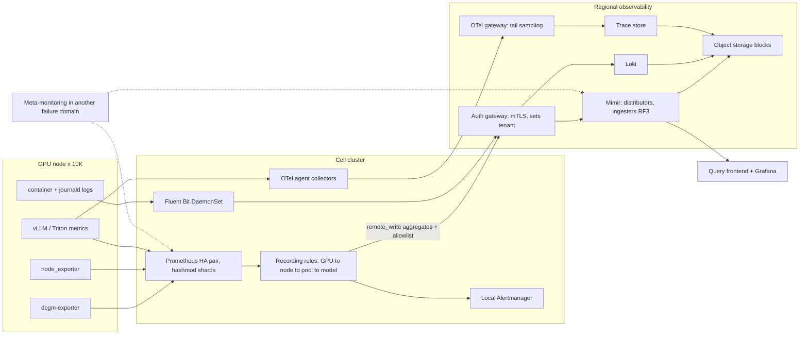

# Lesson 49 — AI/ML platform: fleet observability pipelines at scale — metrics, logs & traces from 10K+ GPU nodes, Prometheus sharding vs Thanos/Mimir, cardinality budgets for DCGM & inference metrics, and telemetry cost control

*2026-10-28*

## What interviewers are really probing

[Lesson 23](/lessons/23-gpu-observability-dcgm-nccl-roofline) was about **what** to measure on a GPU: which DCGM fields matter, XIDs, NCCL canaries, roofline. This lesson is about **moving and storing** that data for 10,000+ nodes and 100+ clusters without the observability stack becoming the biggest, most fragile and most expensive service you run. At this size the hard problems aren't dashboards. They're series counts, churn, remote-write backpressure, ingester memory, query fan-out, log volume and who's allowed to see what.

The interview version: *"Design metrics, logs and traces for 150 GPU clusters, 80,000 GPUs, and an inference fleet with per-model SLOs. Budget it."* Or the incident version: *"A new vLLM release went out at 14:00. At 14:20 the regional Mimir starts returning 429s, half the cells' dashboards go blank, and the on-call can't see whether the rollout is healthy. Go."* They want to hear that you **do the series math before choosing a backend**, **treat every label as a multiplier**, **alert locally and aggregate globally**, **know how remote_write queues and ingester limits fail**, **cut cost at the source rather than at the bill**, and **keep prompts, secrets and weight-access signals in the right hands**.

Cross-links: [L02](/lessons/02-k8s-control-plane) (control plane), [L17](/lessons/17-systems-design-tradeoffs) (tradeoffs), [L21](/lessons/21-inference-serving-slos-ttft-tpot-kvcache) (TTFT/TPOT SLOs), [L23](/lessons/23-gpu-observability-dcgm-nccl-roofline) (DCGM fields, XIDs), [L24](/lessons/24-multi-cluster-inference-routing-capacity) (multi-cluster), [L25](/lessons/25-multi-tenant-gpu-isolation-quota) (tenancy), [L26](/lessons/26-gpu-cost-attribution-reclaim-spot) (cost attribution), [L13](/lessons/13-ml-weights-checkpoint-hardening) (weights), [L14](/lessons/14-ml-inference-training-deploy-hardening) (deploy hardening), [L34](/lessons/34-agent-tool-sandboxing-egress-policy) (egress), [L35](/lessons/35-fleet-incident-response-gpu-inference-agent-runbooks) (incident response), [L40](/lessons/40-infiniband-roce-fabric-operations) (fabric telemetry), [L44](/lessons/44-gpu-cluster-control-plane-scaling) (watch load), [L45](/lessons/45-fleet-kubernetes-upgrades-gpu-clusters) (upgrades), [L47](/lessons/47-dns-service-discovery-east-west-lb) (DNS), [L48](/lessons/48-workload-identity-secrets-pki-fleet-scale) (identity, bucket IAM). Fuel: [wafer-ai/gpu-perf-engineering-resources](https://github.com/wafer-ai/gpu-perf-engineering-resources).

What they check for:

- **Series math first.** 10,000 nodes × 8 GPUs × 40 DCGM fields is **3.2M series** before any pod labels. A 2-socket GPU host with 224 logical CPUs exposes `node_cpu_seconds_total` with 8 modes per CPU: **1,792 series per node, ~18M fleet-wide, from one metric**. You should say numbers like these before you say "Thanos".
- **Churn, not just cardinality.** Series that carry `pod`, `container` or `instance` labels die and get recreated on every rollout. A fleet-wide deploy can double active head series for hours. Head memory follows series created, not just series alive.
- **Topology.** Scrape in the cell, alert in the cell, `remote_write` only what's needed globally, and keep the global store out of the alerting path for anything a cell can decide alone.
- **Backend tradeoffs.** Prometheus shards, Thanos (sidecar or receive) and Mimir solve different problems. Know which failure each one introduces.
- **Cost control at the source.** Drop, aggregate and downsample before data leaves the cell. Bills follow active series, samples per second, log GB per day and spans stored.
- **Security.** Telemetry carries tenant names, unreleased model names, prompts, tokens in log lines and the evidence trail for weight exfiltration. The pipeline is a data system with its own IAM.

**Interview sentence:** "Each cell runs an HA pair of Prometheus shards per job class, with recording rules that roll per-GPU data up to node, pool and model. Alerts that a cell can act on fire in the cell. We remote_write aggregates plus a curated raw allowlist to a regional Mimir with zone-aware replication and per-tenant series and ingestion limits, where the tenant header is stamped by the gateway, not the client. Raw per-GPU and per-CPU series stay in the cell for 7 days. Logs go through Fluent Bit to Loki with six low-cardinality labels and everything else as structured metadata. Traces go through an OTel gateway tier with traceID-aware load balancing and tail sampling that keeps errors and slow requests. Every team gets a budget in active series, log GB per day and spans, and a CI check flags new labels. Prompts never enter telemetry, the pipeline's identities can't read weight buckets, and the weight buckets' data-access logs go to an immutable SIEM where we alert on bytes read per identity."

## Core diagram: emit → collect → ship → store → query




## Idiosyncrasies / operator depth

**1. Do the series budget on a whiteboard.** Rough per-node numbers for an 8-GPU HGX host (measure your own with the TSDB status API):

| Source | Series per node | Fleet at 10K nodes | Notes |
|---|---|---|---|
| dcgm-exporter, 40 fields | ~320 | 3.2M | Each GPU-level series also gets `pod`, `namespace`, `container` when pod mapping is on, so it churns with pods |
| node_exporter, defaults | 2,000–5,000 | 20–50M | Dominated by per-CPU (`cpu`, softnet) and per-device (NICs, block devs, filesystems) series. 8 RDMA NICs and many mounts add up |
| kubelet / cAdvisor | 1,000–3,000 | 10–30M | Per container × many metrics. Drop the ones you never query |
| Inference server | 500–5,000 per pod | depends | Histograms × `model_name` × buckets. One extra label can multiply by 10 |
| kube-state-metrics | per object | 1–5M per large cluster | Scales with pods and labels exported via `--metric-labels-allowlist` |

Then samples per second: series ÷ scrape interval. 40M series at 30 s is ~1.3M samples/s. With Mimir's default replication factor of 3, ingesters write ~4M samples/s. That number sets the ingester count, the WAL disk throughput and the bill.

**2. A single Prometheus has a practical ceiling.** In the KubeCon talk "The Great Cardinality Disasters of Our Time", Cortex maintainers put it plainly: one Prometheus can hold over 10 million series in memory, but startup takes 15+ minutes and heap can pass 100 GB, and queries touching more than ~100,000 series for one metric are painfully slow. Restarts replay the WAL, so a big Prometheus that OOMs stays blind for its whole replay time. Size shards so a restart is minutes, not a quarter-hour.

**3. Three scaling shapes, three failure modes.**

- **Functional and hashmod sharding of Prometheus.** Split by job class (GPU, node, inference, control plane), then hashmod targets across N shards. Prometheus Operator does this with `spec.shards`. Simple, no new database. But a query across shards needs a global layer, and resharding moves targets, which creates series churn.
- **Thanos.** Sidecar uploads 2-hour TSDB blocks to object storage and serves recent data through the Store API. Querier fans out to sidecars and store gateways and deduplicates HA replicas by a replica label. Compactor merges and downsamples (5-minute resolution after 40 hours, 1-hour after 10 days). Failure modes: query fan-out to hundreds of Store API endpoints, and a **compactor that halts** on overlapping blocks. Overlaps usually come from two Prometheus replicas with identical `external_labels`. Thanos **Receive** gives you a push model with a hashring, but hashring changes are risky and need careful rollout.
- **Mimir (or Cortex).** Push via remote_write to distributors, which shard series to ingesters by hash with replication (RF 3, zone-aware), and ingesters ship blocks to object storage. Store gateways, compactor, query frontend with splitting, sharding and caching. Per-tenant limits are first-class. Failure modes: ingester OOM and slow rollouts, because each ingester holds the head for its share of series; per-tenant limit 429s; and a hot tenant hurting neighbors if shuffle sharding isn't on. **Mimir 3.0** adds an ingest-storage architecture where a Kafka-compatible log decouples writes from ingesters, which changes how ingester loss behaves.

The usual hyperscale answer is hybrid: **Prometheus in every cell for scrape, rules and local alerting**, **remote_write to a regional Mimir (or Thanos Receive)** for global views and long retention.

**4. `metric_relabel_configs` vs `write_relabel_configs`.** The first runs at scrape time and decides what the **local** TSDB stores. The second runs per remote_write endpoint and decides what **leaves the cell**. This is the most useful cost lever you have: keep raw per-CPU and per-GPU series locally for 7 days for debugging, and send only recording-rule aggregates plus an allowlist upstream. Note that recording rules can only use what `metric_relabel_configs` kept, so drop locally only what nobody will ever aggregate.

**5. HA pairs and dedup.** Run two identical Prometheus replicas per shard. They must have the **same** identifying external labels plus one **distinct** replica label (`prometheus_replica` or `__replica__`). Thanos dedups at query time with `--query.replica-label`. Mimir's **HA tracker** accepts samples from one replica per `cluster` label and drops the other, failing over after a timeout. Get the labels wrong and you either double-count everything or the Thanos compactor halts on overlaps.

**6. remote_write queues, precisely.** Each remote endpoint has its own queue manager reading from the WAL. Shards (default max 50) each hold a buffer (`capacity`, default 10,000) and send batches (`max_samples_per_send`, default 2,000, or every `batch_send_deadline`, default 5 s). Prometheus raises the shard count when it falls behind, up to `max_shards`. On a 429 it backs off; on 5xx it retries; on other 4xx it drops. If the remote is down longer than the WAL keeps segments (about 2 hours of head), data is lost. Watch `prometheus_remote_storage_highest_timestamp_in_seconds` minus `prometheus_remote_storage_queue_highest_sent_timestamp_seconds`. That's your lag. A desired-shards metric pinned at max means the remote can't keep up, or the network between cell and region is too slow.

**7. Churn kills ingesters before steady state does.** A rolling update of 2,000 inference pods creates 2,000 new label sets for every per-pod series. Old series sit in the head until compaction (up to ~3 hours), so a rollout briefly needs **twice** the memory. Mimir's `max_global_series_per_user` counts the old and new series. That's the classic "deploy at 14:00, 429s at 14:20". Fixes: strip `pod` and `instance` from inference metrics before remote_write and aggregate to `model`, `deployment` and `cell`, and size limits with rollout headroom.

**8. DCGM at fleet scale.** dcgm-exporter collects every 30 s by default (`DCGM_EXPORTER_INTERVAL`, ms) from a CSV of fields (`DCGM_EXPORTER_COLLECTORS`). Every field you add is ×80,000 GPUs. Profiling fields (`DCGM_FI_PROF_*`, such as SM active, tensor pipe active and DRAM active) are the ones worth having for utilization truth ([L23](/lessons/23-gpu-observability-dcgm-nccl-roofline)), but they cost more to collect and some GPUs multiplex them. Pod mapping comes from the kubelet pod-resources API, which ties GPU series to pod churn. With MIG, series multiply by instance (`GPU_I_ID`). Pick a fleet field set of about 20–40, send per-GPU raw only within the cell, and roll up to pool and model for the region.

**9. Inference histograms are the stealth multiplier.** A classic histogram with 20 buckets is 22 series per label set (`_bucket` × 20 plus `_sum` and `_count`). TTFT, TPOT, end-to-end latency, queue time and prompt and generation token counts, × `model_name` × `pod` × status, gets large fast. Options: drop `pod` before remote_write and aggregate with `sum by (le, model_name)`; cut buckets to the ones that bracket your SLO thresholds ([L21](/lessons/21-inference-serving-slos-ttft-tpot-kvcache)); or use **native histograms** (one series with dynamic buckets; enabled by feature flag or scrape config depending on Prometheus version, and supported by Mimir), which cut series a lot but need end-to-end support.

**10. Logs: labels are indexes, so keep them few.** Loki indexes only labels; each unique label set is a stream. Use about 5–8 labels (`cluster`, `namespace`, `app`, `container`, `level`, `node_pool`) and put `pod`, `trace_id` and `request_id` in **structured metadata** or the log line. Hot spots at GPU fleet scale: XID and NCCL warnings spamming the same line thousands of times per second during a fabric event ([L40](/lessons/40-infiniband-roce-fabric-operations)), and debug logging left on in a model server. Fluent Bit needs a filesystem buffer (`storage.type filesystem`) so a Loki outage doesn't OOM the DaemonSet or drop everything, plus rate limits or throttle filters per container.

**11. Traces: tail sampling needs routing.** Head sampling at 1% loses the rare slow request you need. Tail sampling decides after the trace completes, which only works if **every span of a trace reaches the same collector**. Run a two-tier OTel setup: agents export through the `loadbalancing` exporter keyed on trace ID to a gateway tier that runs `tail_sampling` (keep errors, keep latency over the SLO, keep 1% of the rest). Scaling the gateway tier reshuffles trace routing, so expect a short window of broken traces during scale events.

**12. Alert in the cell, aggregate in the region.** If XID 79 on a node or a stuck NCCL job pages from the regional store, then a regional outage blinds every cell at once. Cell Prometheus plus local Alertmanager handles node, GPU and pod alerts. The regional layer handles cross-cell SLOs, burn rates for global inference endpoints and capacity. Meta-monitoring (a dead man's switch `Watchdog` alert, remote-write lag, ingester health) lives in a **different failure domain** from what it watches.

**13. Telemetry cost per GPU-hour.** Put observability in the same cost model as GPUs ([L26](/lessons/26-gpu-cost-attribution-reclaim-spot)): active series, samples per second, log GB per day and spans stored, divided by GPU-hours per team. A few cents per GPU-hour is fine. A team at 10x the median is usually one bad label. Give each team a budget and a dashboard, and enforce with per-tenant limits rather than with surprise invoices.

## Concrete commands & config

### Find what's eating the series budget

```bash
# Top metrics, labels and label pairs by series count (cheap: reads head stats)
curl -s localhost:9090/api/v1/status/tsdb | jq '.data.seriesCountByMetricName[:15]'
curl -s localhost:9090/api/v1/status/tsdb | jq '.data.labelValueCountByLabelName[:15]'

# Offline, on a copy of the data dir: churn and label cardinality per block
promtool tsdb analyze /prometheus --limit=20

# Churn rate: new series per second (rollouts show up as spikes)
# rate(prometheus_tsdb_head_series_created_total[5m])

# Series count for one suspect metric, split by a label
# count by (model_name) (vllm:time_to_first_token_seconds_bucket)
```

Avoid `count by (__name__) ({__name__=~".+"})` on a large server. It touches every series and is itself a cardinality disaster. Use the status API.

### Scrape limits and drops (per job)

```yaml
scrape_configs:
  - job_name: node
    sample_limit: 8000            # whole scrape fails if exceeded; alerts via up == 0
    label_limit: 40
    label_value_length_limit: 200
    metric_relabel_configs:
      # Never-queried, high-count families on 224-CPU hosts
      - source_labels: [__name__]
        regex: node_(softnet_.*|cpu_guest_seconds_total|scrape_collector_.*)
        action: drop
      # Ephemeral mounts and virtual NICs
      - source_labels: [__name__, mountpoint]
        regex: node_filesystem_.*;/(run|var/lib/kubelet/pods)/.*
        action: drop
      - source_labels: [__name__, device]
        regex: node_network_.*;(veth|cali|lxc).*
        action: drop
```

### Aggregate in the cell, send only aggregates upstream

```yaml
# PrometheusRule (recording rules)
groups:
  - name: gpu-rollups
    interval: 30s
    rules:
      - record: pool:dcgm_gpu_util:avg
        expr: avg by (cluster, node_pool, gpu_model) (DCGM_FI_DEV_GPU_UTIL)
      - record: pool:dcgm_sm_active:avg
        expr: avg by (cluster, node_pool) (DCGM_FI_PROF_SM_ACTIVE)
      - record: model:vllm_ttft_seconds_bucket:rate5m
        expr: sum by (cluster, model_name, le) (rate(vllm:time_to_first_token_seconds_bucket[5m]))
      - record: node:cpu_busy:ratio
        expr: 1 - avg by (cluster, instance) (rate(node_cpu_seconds_total{mode="idle"}[5m]))
```

```yaml
# Prometheus remote_write: aggregates plus a curated raw allowlist
remote_write:
  - url: https://obs-gw.use1.internal/api/v1/push
    tls_config:
      cert_file: /etc/prom-tls/tls.crt     # SVID or cert-manager cert (L48)
      key_file: /etc/prom-tls/tls.key
      ca_file: /etc/prom-tls/ca.crt
    write_relabel_configs:
      - source_labels: [__name__]
        regex: '(.+:.+|up|DCGM_FI_DEV_XID_ERRORS|kube_node_status_condition|ALERTS)'
        action: keep
    queue_config:
      capacity: 20000
      max_shards: 100
      max_samples_per_send: 4000
      batch_send_deadline: 5s
      min_backoff: 100ms
      max_backoff: 30s
```

### Prometheus Operator: shards, HA, tenant hygiene

```yaml
apiVersion: monitoring.coreos.com/v1
kind: Prometheus
metadata:
  name: gpu
  namespace: monitoring
spec:
  replicas: 2                  # HA pair per shard
  shards: 4                    # hashmod over targets
  replicaExternalLabelName: prometheus_replica
  externalLabels:
    cluster: gpu-use1-c07
  retention: 7d
  retentionSize: 400GB
  enforcedSampleLimit: 10000   # caps every ServiceMonitor's sample_limit
  enforcedNamespaceLabel: namespace   # tenants can't spoof namespace label
  serviceMonitorNamespaceSelector:
    matchLabels:
      obs.example.com/scrape: "true"
  resources:
    requests: {memory: 64Gi, cpu: "8"}
```

```bash
# kube-state-metrics on a big cluster: shard it
# --shard=N --total-shards=M per replica, or the StatefulSet auto-sharding mode
kubectl -n monitoring get sts kube-state-metrics -o jsonpath='{.spec.replicas}'
```

### dcgm-exporter field budget

```bash
# fleet.csv: ~25 fields; per-GPU raw stays in cell
cat <<'CSV' > fleet.csv
DCGM_FI_DEV_GPU_UTIL,        gauge, GPU utilization (%)
DCGM_FI_PROF_SM_ACTIVE,      gauge, SM active ratio
DCGM_FI_PROF_PIPE_TENSOR_ACTIVE, gauge, Tensor pipe active ratio
DCGM_FI_PROF_DRAM_ACTIVE,    gauge, Memory BW active ratio
DCGM_FI_DEV_FB_USED,         gauge, Framebuffer used (MiB)
DCGM_FI_DEV_POWER_USAGE,     gauge, Power (W)
DCGM_FI_DEV_GPU_TEMP,        gauge, GPU temp (C)
DCGM_FI_DEV_XID_ERRORS,      gauge, Last XID
DCGM_FI_DEV_ROW_REMAP_PENDING, gauge, Row remap pending
DCGM_FI_PROF_NVLINK_TX_BYTES, gauge, NVLink TX bytes/s
CSV
kubectl -n gpu-operator create configmap dcgm-fleet-fields --from-file=fleet.csv
# then set DCGM_EXPORTER_COLLECTORS=/etc/dcgm-exporter/fleet.csv
#          DCGM_EXPORTER_INTERVAL=30000   (ms)
```

### Mimir: per-tenant limits (runtime overrides)

```yaml
overrides:
  cell-gpu-use1:
    max_global_series_per_user: 30000000
    ingestion_rate: 1500000          # samples/s
    ingestion_burst_size: 3000000
    max_label_names_per_series: 40
    max_fetched_series_per_query: 500000
    out_of_order_time_window: 10m    # cells that lag after partitions
  team-inference:
    max_global_series_per_user: 5000000
    ingestion_tenant_shard_size: 24  # shuffle sharding: blast radius
```

```bash
# Who's near the limit? (Mimir exports per-tenant usage)
# cortex_ingester_active_series by user vs the configured limit
# Errors to grep in distributor logs:
#   err-mimir-max-series-per-user   err-mimir-ingestion-rate-limited
kubectl -n mimir logs deploy/distributor | grep -E 'err-mimir-(max-series|ingestion-rate)' | head
```

### Thanos: compactor and query guardrails

```bash
thanos compact \
  --objstore.config-file=/etc/thanos/bucket.yml \
  --data-dir=/var/thanos/compact --wait \
  --deduplication.replica-label=prometheus_replica \
  --retention.resolution-raw=30d \
  --retention.resolution-5m=180d \
  --retention.resolution-1h=2y
# Exactly ONE compactor per block stream. Halted? check:
#   thanos_compact_halted == 1  -> logs mention overlapping blocks
thanos tools bucket verify --objstore.config-file=/etc/thanos/bucket.yml --issues=overlapped_blocks
```

### Loki and Fluent Bit: bounded streams and buffers

```yaml
# Loki limits_config
limits_config:
  max_label_names_per_series: 8
  ingestion_rate_mb: 64
  ingestion_burst_size_mb: 128
  per_stream_rate_limit: 5MB
  max_global_streams_per_user: 200000
  allow_structured_metadata: true
```

```ini
# Fluent Bit: survive a Loki outage, cap noisy containers
[SERVICE]
    storage.path          /var/fluent-bit/buffer
    storage.max_chunks_up 128
[INPUT]
    Name              tail
    Path              /var/log/containers/*.log
    storage.type      filesystem
    Mem_Buf_Limit     64MB
[FILTER]
    Name       throttle
    Match      kube.*
    Rate       2000
    Window     10
    Interval   1s
```

### OTel: two-tier traces with redaction

```yaml
# Agent tier (DaemonSet): enrich, redact, route by trace ID
processors:
  memory_limiter: {check_interval: 1s, limit_percentage: 80, spike_limit_percentage: 20}
  k8sattributes: {}
  redaction:
    allow_all_keys: false
    allowed_keys: [http.route, http.response.status_code, gen_ai.request.model,
                   gen_ai.usage.input_tokens, gen_ai.usage.output_tokens, k8s.namespace.name]
    blocked_values: ['(?i)bearer\s+[a-z0-9._-]+', 'AKIA[0-9A-Z]{16}']
  batch: {}
exporters:
  loadbalancing:
    routing_key: traceID
    protocol: {otlp: {tls: {insecure: false}}}
    resolver: {k8s: {service: otel-gateway.observability}}
---
# Gateway tier: keep what matters
processors:
  tail_sampling:
    decision_wait: 10s
    policies:
      - {name: errors, type: status_code, status_code: {status_codes: [ERROR]}}
      - {name: slow, type: latency, latency: {threshold_ms: 2000}}
      - {name: base, type: probabilistic, probabilistic: {sampling_percentage: 1}}
```

### Alerts that protect the pipeline itself

```yaml
- alert: RemoteWriteBehind
  expr: |
    (max_over_time(prometheus_remote_storage_highest_timestamp_in_seconds[5m])
      - ignoring(remote_name, url) group_right
     max_over_time(prometheus_remote_storage_queue_highest_sent_timestamp_seconds[5m])) > 120
  for: 15m
- alert: RemoteWriteShardsMaxed
  expr: prometheus_remote_storage_shards_desired > prometheus_remote_storage_shards_max
  for: 15m
- alert: HeadSeriesNearBudget
  expr: prometheus_tsdb_head_series > 0.8 * 8e6
  for: 30m
- alert: SeriesChurnSpike
  expr: rate(prometheus_tsdb_head_series_created_total[10m]) > 5000
  for: 10m
- alert: ScrapeSampleLimitHit
  expr: increase(prometheus_target_scrapes_exceeded_sample_limit_total[10m]) > 0
```

## Failures & fixes

| Symptom | Likely cause | Fix |
|---|---|---|
| 20 minutes after a model-server rollout, regional store returns 429; dashboards blank | Per-pod labels on inference histograms; old and new series both count toward `max_global_series_per_user` | Strip `pod`/`instance` before remote_write, aggregate to model and cell; size limits with 2x rollout headroom; churn alert |
| Cell Prometheus OOMs, then stays down 15+ minutes | Head series grew past the shard's size; WAL replay on restart | More hashmod shards; `sample_limit` per job; drop at scrape; memory limit sized for peak churn, not steady state |
| `samples_pending` climbs, desired shards pinned at max, gaps in global graphs | Remote slow or rate-limited, or the cell's egress too small | Raise `max_shards` and `capacity` only if remote is healthy; check 429s; send aggregates only; alert before WAL retention runs out |
| Global graphs show exactly double the values | HA replicas both accepted (missing replica label or HA tracker off) | Distinct replica label per replica, same `cluster` label; enable Mimir HA tracker or Thanos dedup |
| Thanos compactor halted, bucket grows, queries slow | Overlapping blocks from duplicate `external_labels`, or two compactors on the same bucket | Fix labels; one compactor per stream; `thanos tools bucket verify`, mark bad blocks for deletion |
| Global query times out or OOMs queriers | Unbounded selector over 30 days of raw per-GPU data | Query-frontend splitting and sharding, `max_fetched_series_per_query`, downsampled data for long ranges, recording rules |
| Loki rejects with stream limit errors | `pod` or `request_id` used as a label | Move to structured metadata; label budget in CI; `max_label_names_per_series` |
| Fluent Bit pods OOMKilled during fabric incident | XID/NCCL log flood plus Loki backpressure with memory buffering | Filesystem buffers; throttle filter; drop duplicate lines at source; separate high-priority stream for alerts |
| Traces missing spans or broken in the UI | Tail sampling on a gateway that only saw part of the trace | Load-balancing exporter by trace ID; stable gateway membership; `decision_wait` longer than p99 trace duration |
| Every cell loses alerting during a regional outage | Alerts evaluated only in the global store | Alert locally in cell; global only for cross-cell SLOs; meta-monitoring in another region |
| Telemetry bill doubles in a month with no new GPUs | New exporter version or team added a high-cardinality label | Per-team series budgets, diff top-N metrics weekly, CI review of new labels, per-tenant limits |

## Security & hardening

The observability pipeline sees **everything**: every namespace, every node, every model name, and often the content of requests. It runs privileged collectors on every GPU node and holds credentials into every cluster. Treat it as a **tier-0 data system**, with its own threat model.

**Model weights and checkpoints: keep them out of telemetry's reach, and use telemetry to guard them.**

- **Collectors can't read weights.** Node-level DaemonSets (Fluent Bit, OTel agents, node_exporter) mount host paths. A collector that mounts `/` or `/mnt` on a GPU node can read the local weight cache and in-progress checkpoints ([L27](/lessons/27-gpu-supply-chain-weight-registry-hydrate), [L29](/lessons/29-training-reliability-checkpoint-elastic)). Mount only `/var/log`, `/proc` and `/sys` read-only, and block other `hostPath` with admission (Kyverno or ValidatingAdmissionPolicy, [L11](/lessons/11-cluster-security-pss-admission-rbac)).
- **Separate identities, separate buckets.** Metrics, logs and trace blocks live in their own buckets with their own KMS keys. The compactor's identity can delete **only** in the telemetry bucket. No observability identity has any access to weight or checkpoint buckets ([L48](/lessons/48-workload-identity-secrets-pki-fleet-scale)).
- **Turn weight-bucket access logs into detection.** Enable object-level data-access logs (CloudTrail S3 data events scoped by advanced event selectors, or GCS Data Access audit logs) on weight and checkpoint buckets only, since logging every bucket gets expensive. Ship them to a SIEM in a separate account with object lock. Alert on bytes read per identity versus baseline, reads from an identity that isn't a hydrator, reads of models a tenant doesn't own, and any `Delete` on promoted checkpoints.
- **Model names are sensitive.** Labels like `model_name="frontier-v7-rc2"` leak release plans to anyone with Grafana read. Isolate by tenant (Mimir tenant or Grafana org per team); Mimir has no per-label ACLs, so isolation is by tenant.

**Prompts, completions and secrets never enter telemetry.**

- OpenTelemetry's GenAI semantic conventions treat message content as **opt-in**. Keep it off in production. Allow only attributes on an allowlist (model, token counts, latency, status) through the OTel `redaction` processor, and add value patterns for bearer tokens and cloud keys.
- Model servers must not log request bodies at info level. Treat a debug flag in production as an incident. Run secret-pattern scans on log streams and alert, and have a purge procedure (Loki delete requests, bucket lifecycle) for when something leaks.
- Retention is a privacy control: short raw retention for logs from inference paths, longer for aggregates.

**Multi-tenant isolation in the store.**

- The `X-Scope-OrgID` tenant header must be set by an **authenticating gateway** from the client's mTLS or workload identity, never trusted from the client. Otherwise any cell can write into, or read from, another tenant.
- Prometheus Operator: `enforcedNamespaceLabel` stops a tenant's ServiceMonitor from relabeling its series into another namespace. Restrict `serviceMonitorNamespaceSelector`, and remember the operator reads Secrets referenced by monitors, so a tenant who can create monitors can reference credentials. Limit who can create ServiceMonitors and PodMonitors with RBAC.
- Per-tenant limits are a security control as well as a cost one: one noisy or malicious tenant can't DoS shared ingesters (shuffle sharding limits the blast radius).

**Transport and endpoints.**

- mTLS (SVIDs or cert-manager certs) or SigV4 or OAuth2 on every remote_write, OTLP and Loki push ([L48](/lessons/48-workload-identity-secrets-pki-fleet-scale)). Private endpoints only; no public ingestion URLs.
- `/metrics` and `/debug/pprof` behind kube-rbac-proxy or NetworkPolicy. pprof on a model server can expose memory contents. dcgm-exporter needs `SYS_ADMIN` for profiling fields. Grant that one capability rather than `privileged: true`, and keep it in a locked-down namespace.
- Egress for collectors only to the regional gateway ([L34](/lessons/34-agent-tool-sandboxing-egress-policy)), so a compromised collector can't ship data anywhere else.

**Supply chain and deployments.**

- Collector images (Prometheus, OTel, Fluent Bit, dcgm-exporter) come from your private registry, mirrored and **signed**, and verified at admission like workload images ([L12](/lessons/12-node-container-hardening-supply-chain)). A malicious collector on every node is the perfect exfiltration tool.
- Config changes (relabel rules, redaction processor config, limits) go through GitOps and review ([L15](/lessons/15-terraform-atlantis-fleet-scale)). Removing a redaction rule is a security change.
- Kubernetes **audit logs** and the SIEM pipeline are separate from operational logs: separate account, immutable storage, and not deletable by platform admins.

## Interview soundbites

- "Every label is a multiplier. I do series math per node before I pick a backend: DCGM is about 3 million series fleet-wide, node_exporter on 224-CPU hosts is more than that, and inference histograms are the stealth one."
- "Scrape and alert in the cell, aggregate in the region. The global store is for cross-cell views and long retention, not for paging on an XID."
- "`metric_relabel_configs` decides what the cell stores; `write_relabel_configs` decides what leaves. Raw per-GPU data stays local for a week; aggregates go upstream."
- "Churn is the real limit. A rollout of 2,000 pods with per-pod labels doubles head series for hours. That's the 429 storm twenty minutes after a deploy."
- "Thanos is coordination-free and cheap to start, but you pay in query fan-out and compactor care. Mimir gives per-tenant limits and sharded ingestion, but you pay in ingester operations."
- "HA pairs need one distinct replica label and identical everything else, or you double-count or halt the compactor."
- "Tail sampling only works if every span of a trace lands on the same gateway, so I route by trace ID."
- "Telemetry has a budget per team in series, log GB and spans, priced per GPU-hour."
- "The pipeline can't read weights, prompts never enter it, the tenant header comes from the gateway, and weight-bucket access logs go to an immutable SIEM with alerts on bytes read per identity."

## How this maps to the JD

- **100+ clusters / 10K+ nodes:** series math, hashmod shards, per-cell HA pairs, regional stores, churn budgets, kube-state-metrics sharding.
- **K8s internals:** kubelet and cAdvisor metrics cost, pod-resources API for GPU mapping, Prometheus Operator CRDs, API-server load from watching every pod ([L44](/lessons/44-gpu-cluster-control-plane-scaling)).
- **Cloud & cluster networking:** cross-region remote_write bandwidth, private endpoints, egress policy for collectors.
- **Security:** tenant isolation, redaction, collector host-path limits, weight-bucket data-access detection, signed collector images.
- **Terraform/Atlantis:** buckets, KMS keys, IAM and Mimir limits as code ([L15](/lessons/15-terraform-atlantis-fleet-scale)).
- **Design tradeoffs:** Thanos vs Mimir, push vs pull, local vs global alerting, raw retention vs cost, head vs tail sampling.

## Watch (talks & demos)

**The Great Cardinality Disasters of Our Time — Bryan Boreham & Chris Marchbanks (KubeCon NA 2019)**. Why watch: real cardinality failures from Cortex and Prometheus maintainers, with the numbers used in item 2, plus how to find and remove offending series with `promtool`, relabeling and limits.

<iframe width="100%" height="360" src="https://www.youtube.com/embed/6f9z9JSNOGk" title="The Great Cardinality Disasters of Our Time - Bryan Boreham, Chris Marchbanks" frameBorder="0" allow="accelerometer; autoplay; clipboard-write; encrypted-media; gyroscope; picture-in-picture; web-share" allowFullScreen></iframe>

[Open on YouTube](https://www.youtube.com/watch?v=6f9z9JSNOGk)

**For billion series scale or home IoT projects, get started in minutes with Grafana Mimir (Grafana)**. Why watch: the Mimir architecture end to end, including replication, object storage, query sharding and how it's run on Kubernetes. This is item 3's push model.

<iframe width="100%" height="360" src="https://www.youtube.com/embed/rZNNUWxpdTQ" title="For billion series scale or home IoT projects, get started in minutes with Grafana Mimir" frameBorder="0" allow="accelerometer; autoplay; clipboard-write; encrypted-media; gyroscope; picture-in-picture; web-share" allowFullScreen></iframe>

[Open on YouTube](https://www.youtube.com/watch?v=rZNNUWxpdTQ)

**PromCon 2018: Thanos — Prometheus at Scale**. Why watch: the original design of sidecars, the Store API, global query and object-storage retention. It's the clearest explanation of the coordination-free tradeoff in item 3.

<iframe width="100%" height="360" src="https://www.youtube.com/embed/Fb_lYX01IX4" title="PromCon 2018: Thanos - Prometheus at Scale" frameBorder="0" allow="accelerometer; autoplay; clipboard-write; encrypted-media; gyroscope; picture-in-picture; web-share" allowFullScreen></iframe>

[Open on YouTube](https://www.youtube.com/watch?v=Fb_lYX01IX4)

## References

- Prometheus: [remote_write tuning](https://prometheus.io/docs/practices/remote_write/) · [Configuration (scrape limits, relabeling)](https://prometheus.io/docs/prometheus/latest/configuration/configuration/) · [TSDB status API](https://prometheus.io/docs/prometheus/latest/querying/api/#tsdb-stats) · [Agent mode](https://prometheus.io/blog/2021/11/16/agent/) · [Native histograms](https://prometheus.io/docs/specs/native_histograms/)
- Prometheus Operator: [Sharding](https://prometheus-operator.dev/docs/platform/sharding/) · [Prometheus CRD API](https://prometheus-operator.dev/docs/api-reference/api/) · [kube-state-metrics sharding](https://github.com/kubernetes/kube-state-metrics#horizontal-sharding)
- Mimir: [Architecture](https://grafana.com/docs/mimir/latest/references/architecture/) · [HA deduplication](https://grafana.com/docs/mimir/latest/configure/configure-high-availability-deduplication/) · [Shuffle sharding](https://grafana.com/docs/mimir/latest/configure/configure-shuffle-sharding/) · [Scaling to 1 billion active series](https://grafana.com/blog/how-we-scaled-our-new-prometheus-tsdb-grafana-mimir-to-1-billion-active-series/)
- Thanos: [Components and design](https://thanos.io/tip/thanos/design.md/) · [Compactor](https://thanos.io/tip/components/compact.md/) · [Receive](https://thanos.io/tip/components/receive.md/)
- Logs & traces: [Loki labels best practices](https://grafana.com/docs/loki/latest/get-started/labels/bp-labels/) · [Loki structured metadata](https://grafana.com/docs/loki/latest/get-started/labels/structured-metadata/) · [Fluent Bit buffering](https://docs.fluentbit.io/manual/administration/buffering-and-storage) · [OTel tail sampling processor](https://github.com/open-telemetry/opentelemetry-collector-contrib/tree/main/processor/tailsamplingprocessor) · [OTel load-balancing exporter](https://github.com/open-telemetry/opentelemetry-collector-contrib/tree/main/exporter/loadbalancingexporter) · [OTel redaction processor](https://github.com/open-telemetry/opentelemetry-collector-contrib/tree/main/processor/redactionprocessor) · [OTel GenAI semantic conventions](https://opentelemetry.io/docs/specs/semconv/gen-ai/)
- GPU: [dcgm-exporter](https://github.com/NVIDIA/dcgm-exporter) · [DCGM field identifiers](https://docs.nvidia.com/datacenter/dcgm/latest/dcgm-api/dcgm-api-field-ids.html)
- Security: [CloudTrail data events](https://docs.aws.amazon.com/awscloudtrail/latest/userguide/logging-data-events-with-cloudtrail.html) · [GCS audit logging](https://cloud.google.com/storage/docs/audit-logging) · [kube-rbac-proxy](https://github.com/brancz/kube-rbac-proxy)
- [wafer-ai/gpu-perf-engineering-resources](https://github.com/wafer-ai/gpu-perf-engineering-resources) — AI/ML platform fuel
- Prior: [48 — Identity & PKI](/lessons/48-workload-identity-secrets-pki-fleet-scale) · [47 — DNS & service discovery](/lessons/47-dns-service-discovery-east-west-lb) · [44 — Control-plane scaling](/lessons/44-gpu-cluster-control-plane-scaling) · [40 — Fabric operations](/lessons/40-infiniband-roce-fabric-operations) · [35 — Incident response](/lessons/35-fleet-incident-response-gpu-inference-agent-runbooks) · [26 — Cost attribution](/lessons/26-gpu-cost-attribution-reclaim-spot) · [23 — GPU observability](/lessons/23-gpu-observability-dcgm-nccl-roofline) · [21 — Serving SLOs](/lessons/21-inference-serving-slos-ttft-tpot-kvcache) · [13 — Weights hardening](/lessons/13-ml-weights-checkpoint-hardening) · [12 — Supply chain](/lessons/12-node-container-hardening-supply-chain)

## Quick self-check

Out loud, in under two minutes each:

1. Estimate active series and samples per second for 10,000 8-GPU nodes running dcgm-exporter, node_exporter and cAdvisor. Which three cuts give you the most back?
2. Draw cell-to-region topology. Which alerts fire in the cell, which in the region, and what watches the watcher?
3. Thanos sidecar vs Thanos Receive vs Mimir: give one failure mode and one operational cost for each.
4. A rollout causes 429s from the regional store 20 minutes later. Explain the mechanism and three fixes, one immediate and two structural.
5. What's the difference between `metric_relabel_configs` and `write_relabel_configs`, and how do recording rules interact with each?
6. Your global graphs show doubled values for one cell. What's misconfigured, and how do Thanos and Mimir each dedup?
7. Design trace sampling that keeps every error and every request slower than the TTFT SLO, at 1% of the cost of keeping everything.
8. List every way this pipeline could leak a prompt, a secret, a model name or model weights, and the control for each.

## Next

**Lesson 50 — AI/ML platform: SLOs, error budgets & alerting design at fleet scale — multi-window burn-rate alerts for inference endpoints, alert routing across 100+ clusters, paging hygiene and GPU-fleet health signals that actually page**
