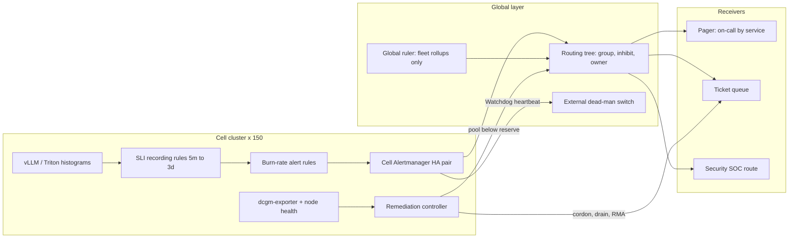

# Lesson 50 — AI/ML platform: SLOs, error budgets & alerting design at fleet scale — multi-window burn-rate alerts for inference endpoints, alert routing across 100+ clusters, paging hygiene and GPU-fleet health signals that actually page

*2026-10-29*

## What interviewers are really probing

[Lesson 21](/lessons/21-inference-serving-slos-ttft-tpot-kvcache) defined **what** an inference SLO is (TTFT, TPOT, availability, KV-cache pressure). [Lesson 49](/lessons/49-fleet-observability-pipelines-scale) built the pipeline that **moves** the data. This lesson is the part between the data and a human's phone: which conditions are allowed to wake someone, how 150 clusters avoid sending 150 copies of the same page, and what a GPU fleet should page on versus quietly fix with automation.

The interview version: *"You own 120 inference endpoints across 150 clusters and 80,000 GPUs. On-call gets 40 pages a week and half are noise. Redesign alerting."* Or the incident version: *"A regional object store blips at 03:10. Every cell's Alertmanager fires `ModelHydrationFailed`, `PodCrashLooping` and `TTFTHigh`. The on-call gets 300 pages in four minutes and misses the one that mattered: a real XID 79 storm in another region."* They want to hear that you **page on symptoms tied to an error budget**, **use multi-window, multi-burn-rate alerts instead of thresholds**, **route by ownership and dedupe by blast radius**, **let automation handle per-node faults**, **guard every SLI against missing data**, and **protect the alerting system itself from tampering**, because silencing an alert is the easiest way to hide weight exfiltration.

Cross-links: [L17](/lessons/17-systems-design-tradeoffs) (tradeoffs), [L21](/lessons/21-inference-serving-slos-ttft-tpot-kvcache) (TTFT/TPOT SLOs), [L23](/lessons/23-gpu-observability-dcgm-nccl-roofline) (DCGM fields, XIDs), [L24](/lessons/24-multi-cluster-inference-routing-capacity) (multi-cluster routing), [L28](/lessons/28-inference-autoscaling-scale-to-zero) (scale-to-zero), [L29](/lessons/29-training-reliability-checkpoint-elastic) (training goodput), [L31](/lessons/31-evaluation-release-gating-canary-weights) (canary gates), [L35](/lessons/35-fleet-incident-response-gpu-inference-agent-runbooks) (incident response), [L36](/lessons/36-multi-region-dr-failover-inference) (DR), [L38](/lessons/38-gpu-fleet-capacity-planning-procurement) (capacity reserve), [L39](/lessons/39-gpu-fleet-lifecycle-acceptance-burn-in-rma) (RMA automation), [L40](/lessons/40-infiniband-roce-fabric-operations) (fabric), [L13](/lessons/13-ml-weights-checkpoint-hardening) (weights), [L48](/lessons/48-workload-identity-secrets-pki-fleet-scale) (identity), [L49](/lessons/49-fleet-observability-pipelines-scale) (pipelines). Fuel: [wafer-ai/gpu-perf-engineering-resources](https://github.com/wafer-ai/gpu-perf-engineering-resources).

What they check for:

- **Budget math in your head.** 99.9% over 30 days is **43.2 minutes** of full outage, or 0.1% of requests. 99.5% is 3.6 hours. A burn rate of 1 spends exactly the budget in the window; 14.4 spends 2% of a 30-day budget in one hour.
- **Symptoms page, causes ticket.** GPU temperature, a single XID, CPU at 90% and pod restarts are causes. Users feel TTFT, errors and lost training progress. Page on the latter.
- **Multi-window logic.** The long window gives significance, the short window makes the alert reset quickly once the problem stops. Knowing why the short window is 1/12 of the long one is the tell that you've actually run this.
- **Fleet topology.** Evaluate SLO rules in the cell where the data lives, route by `team`/`service`, group by blast radius, inhibit downstream symptoms, and keep a dead-man's switch outside the system it watches.
- **GPU-specific judgement.** One bad GPU out of 80,000 is a ticket and an automated cordon. The healthy-GPU count dropping below the capacity reserve, or XID 79 appearing on 40 nodes in ten minutes, is a page.
- **Hygiene as a process.** Page budget per shift, every page actionable, weekly review, and an error-budget policy that actually freezes launches.

**Interview sentence:** "Every endpoint has two SLOs per model and tier: availability, and TTFT under a threshold that matches a histogram bucket. Sloth generates recording rules and four multi-window burn-rate alerts. Two of them page (14.4x over 1h and 5m, 6x over 6h and 30m) and two open tickets. Rules evaluate in each cell's Prometheus, so a regional store outage doesn't blind us. A small global ruler only does fleet rollups. Alertmanager groups by alertname, service and region, inhibits cell symptoms when a region-level alert is firing, and routes on the owner label. Per-GPU faults go to the remediation controller, which cordons, drains and files the RMA. Humans get paged only when the pool's healthy capacity crosses its reserve or the fault is correlated across many nodes. A Watchdog alert feeds an external dead-man's switch. Silences need an owner, a ticket and a maximum duration, and security alerts like weight-bucket read anomalies go to a route that service teams can't silence."

## Core diagram: SLI → burn rate → route → human or robot




## Idiosyncrasies / operator depth

**1. The burn-rate table, and where the numbers come from.** For an SLO target `T` over window `W`, the error budget is `1 − T`. The burn rate is `observed error ratio ÷ (1 − T)`. To fire when fraction `f` of the budget is spent in a long window `L`: `burn = f × W ÷ L`. With W = 30 days (720h):

| Severity | Budget spent | Long window | Short window | Burn rate | Error ratio at 99.9% |
|---|---|---|---|---|---|
| Page | 2% | 1h | 5m | 14.4 | 1.44% |
| Page | 5% | 6h | 30m | 6 | 0.6% |
| Ticket | 10% | 1d | 2h | 3 | 0.3% |
| Ticket | 10% | 3d | 6h | 1 | 0.1% |

The short window is 1/12 of the long one. Without it, a 1h window keeps firing for up to an hour after the problem is fixed, because the bad minutes are still inside it. The `AND` with a 5m window makes the alert clear about 5 minutes after recovery. At 100% errors, the 14.4x alert fires in about 52 seconds (1.44% of 60 minutes). That's fast enough to page. A gentle 0.2% error ratio never pages, but it opens a ticket within a day.

**2. Tight SLOs change the math.** At 99.99% the budget is 4.3 minutes a month. A 14.4x page fires at a 0.144% error ratio, which is inside the noise for a low-traffic model. Either don't promise 99.99% on a single region (see [L36](/lessons/36-multi-region-dr-failover-inference)), or measure the SLI at the global edge after failover, where the user actually sees it.

**3. Low traffic breaks ratios.** A model that serves 30 requests an hour gets a 3.3% error ratio from one failure, which is a 33x burn. Three fixes: a minimum-event guard in the alert (`and sum(rate(requests_total[1h])) > 0.1`), synthetic probes that add a steady stream of valid events, and grouping small models into a shared "long-tail" SLO. Scale-to-zero endpoints ([L28](/lessons/28-inference-autoscaling-scale-to-zero)) need a separate cold-start SLO, or every first request after idle counts as a TTFT failure.

**4. Missing data never pages by itself.** `0/0` is NaN, and a NaN comparison is false. If the vLLM pods stop exporting or the scrape job is renamed during an upgrade ([L45](/lessons/45-fleet-kubernetes-upgrades-gpu-clusters)), every burn-rate alert goes quiet exactly when the endpoint is down. Every SLI needs an `absent()` or `absent_over_time()` companion alert, plus a "scrape target count dropped by more than 30%" alert per job.

**5. Latency SLIs must line up with histogram buckets.** `histogram_quantile` interpolates, so p99 alerts are an estimate. A ratio SLI is exact only if the threshold is a bucket boundary: `vllm:time_to_first_token_seconds_bucket{le="1.0"}` divided by `_count`. If the bucket layout is `0.5, 0.75, 1.5` and the SLO is 1s, you're measuring 1.5s and nobody notices. Native histograms help, but pin the classic bucket list in serving config ([L33](/lessons/33-prompt-tool-catalog-versioning-serving-config)) and test it.

**6. Which TTFT you measure matters.** Engine-side TTFT excludes gateway queueing, auth and the router's endpoint pick ([L47](/lessons/47-dns-service-discovery-east-west-lb)). Measure availability and latency at the inference gateway or load balancer for the SLO, and use engine metrics for diagnosis. Streaming responses that send a 200 and then fail mid-stream are errors too: count `finish_reason="error"` or aborted streams as bad events.

**7. Where rules evaluate.** Rules on a global Mimir or Thanos querier depend on remote_write lag, the query path and the global store's health. That's three new failure modes in the paging path. Evaluate SLO rules in the cell's Prometheus, where the data is local. Use the global ruler only for fleet-level rollups, such as "healthy GPUs per SKU across regions", and label those alerts so you know they can be late. Thanos queriers need `partial_response` turned off for SLO rules, or a missing store makes the error ratio look better than it is.

**8. Alertmanager at fleet scale.** Alertmanager HA is a gossip mesh that dedupes notifications. It doesn't replicate silences consistently under a partition, and it doesn't shard. Common shape: each cell runs a pair for local routing, and they forward to a regional or global routing tier, or each Prometheus sends to both. Every alert carries `cluster`, `cell` and `region` from `external_labels`. `group_by: [alertname, service, region]` turns "150 clusters failing to pull from the same registry" into one notification with 150 alerts inside it. Never `group_by: ['...']` (one group per label set) for page routes.

**9. Inhibition is your storm control.** When `RegionObjectStoreDown` fires, inhibit `ModelHydrationFailed` and `PodCrashLooping` with `equal: [region]`. When `ClusterUnreachable` fires, inhibit everything else from that `cluster`. The `equal` list matters: without it, one region's outage mutes alerts in every region, which is how the XID storm in the incident above got missed.

**10. GPU signals: page on the pool, ticket the node.** At 80,000 GPUs, roughly 0.1–0.3% have a fault at any time. That's 80–240 GPUs, every day. Single-GPU XID 48/63/64/74/79/94/95, ECC row-remap failures and NVLink errors ([L23](/lessons/23-gpu-observability-dcgm-nccl-roofline)) go to the remediation controller: taint, drain respecting training checkpoints ([L29](/lessons/29-training-reliability-checkpoint-elastic)), run diagnostics, open the RMA ([L39](/lessons/39-gpu-fleet-lifecycle-acceptance-burn-in-rma)). A human gets paged when:
   - healthy schedulable GPUs in a pool drop below the capacity reserve ([L38](/lessons/38-gpu-fleet-capacity-planning-procurement)), or will within 2 hours at the current rate;
   - the same fault appears on many nodes at once (more than 20 nodes with XID 79 in 15 minutes points to a driver, firmware, power or cooling problem, [L41](/lessons/41-power-cooling-facility-constraints-gpu-fleets), not bad luck);
   - a fabric partition takes out many links together ([L40](/lessons/40-infiniband-roce-fabric-operations));
   - training goodput falls, or a priority job hasn't written a checkpoint in 2× its interval;
   - the remediation controller itself stops making progress (its queue grows, or it's been rate-limited for 30 minutes).

**11. Error-budget policy is the actual product.** The alerts are only half of it. Write down what happens at 50%, 75% and 100% budget spent: weight and engine rollouts pause ([L31](/lessons/31-evaluation-release-gating-canary-weights)), canaries need SRE sign-off, and reliability work is prioritized. Wire it into CD: Argo Rollouts or Flagger analysis queries the 1h burn rate and aborts a canary above 2x. A policy nobody enforces is decoration.

**12. Paging hygiene metrics.** Track pages per shift (target is 2 or fewer), the percentage actionable, time to acknowledge, pages outside working hours per person, and the top 10 noisiest rules. Any rule that pages and gets acked with no action three times gets demoted to a ticket or deleted. Every page links a runbook ([L35](/lessons/35-fleet-incident-response-gpu-inference-agent-runbooks)) and a dashboard already filtered to the cluster and model.

## Concrete commands & config

**SLI recording rules (cell Prometheus), availability and TTFT for one model:**

```yaml
groups:
- name: slo-inference-llama-70b
  interval: 30s
  rules:
  - record: slo:sli_error:ratio_rate5m
    labels: {service: inference, slo: availability, model: llama-70b}
    expr: |
      sum(rate(gateway_requests_total{model="llama-70b",code=~"5..|429"}[5m]))
      /
      sum(rate(gateway_requests_total{model="llama-70b"}[5m]))
  - record: slo:sli_error:ratio_rate5m
    labels: {service: inference, slo: ttft-1s, model: llama-70b}
    expr: |
      1 - (
        sum(rate(vllm:time_to_first_token_seconds_bucket{model_name="llama-70b",le="1.0"}[5m]))
        /
        sum(rate(vllm:time_to_first_token_seconds_count{model_name="llama-70b"}[5m]))
      )
  # repeat for 30m, 1h, 2h, 6h, 1d, 3d (Sloth/Pyrra generate these)
```

Whether 429 counts as an error is a policy call. If quota rejections are the tenant's own fault ([L25](/lessons/25-multi-tenant-gpu-isolation-quota)), exclude per-tenant quota 429s and keep capacity 429s.

**Multi-window, multi-burn-rate alerts (99.9%, 30 days):**

```yaml
- alert: InferenceErrorBudgetBurn
  expr: |
    (
      slo:sli_error:ratio_rate1h{slo="availability"} > (14.4 * 0.001)
      and
      slo:sli_error:ratio_rate5m{slo="availability"} > (14.4 * 0.001)
    )
    or
    (
      slo:sli_error:ratio_rate6h{slo="availability"} > (6 * 0.001)
      and
      slo:sli_error:ratio_rate30m{slo="availability"} > (6 * 0.001)
    )
  for: 2m
  labels: {severity: page, team: inference-platform}
  annotations:
    summary: "{{ $labels.model }} in {{ $labels.cluster }} burning error budget fast"
    runbook_url: https://runbooks.internal/inference/error-budget-burn
    dashboard: https://grafana.internal/d/slo?var-model={{ $labels.model }}&var-cluster={{ $labels.cluster }}

- alert: InferenceSLIMissing
  expr: absent_over_time(gateway_requests_total{model="llama-70b"}[10m])
  for: 5m
  labels: {severity: page, team: inference-platform}
```

**Generate it instead of hand-writing it (Sloth):**

```yaml
version: "prometheus/v1"
service: "inference"
labels: {owner: inference-platform}
slos:
  - name: "llama-70b-availability"
    objective: 99.9
    sli:
      events:
        error_query: sum(rate(gateway_requests_total{model="llama-70b",code=~"5.."}[{{.window}}]))
        total_query: sum(rate(gateway_requests_total{model="llama-70b"}[{{.window}}]))
    alerting:
      name: LlamaAvailabilityBurn
      page_alert: {labels: {severity: page}}
      ticket_alert: {labels: {severity: ticket}}
```

```bash
sloth generate -i slos/llama-70b.yaml -o rules/llama-70b.rules.yaml
promtool check rules rules/*.yaml
promtool test rules tests/llama-70b.test.yaml   # feed synthetic series, assert the page fires and clears
```

**Unit test a burn-rate alert (`promtool test rules`):**

```yaml
rule_files: [../rules/llama-70b.rules.yaml]
evaluation_interval: 30s
tests:
- interval: 30s
  input_series:
  - series: 'gateway_requests_total{model="llama-70b",code="200"}'
    values: '0+970x240'
  - series: 'gateway_requests_total{model="llama-70b",code="503"}'
    values: '0+30x240'           # 3% errors, about a 30x burn
  alert_rule_test:
  - eval_time: 70m
    alertname: InferenceErrorBudgetBurn
    exp_alerts:
    - exp_labels: {severity: page, team: inference-platform, service: inference, slo: availability, model: llama-70b}
```

**GPU pool alerts that page (rollup, not per-GPU):**

```yaml
- alert: GPUPoolBelowReserve
  expr: |
    sum by (region, sku, pool) (gpu_node_schedulable_gpus)
      < on (region, sku, pool) gpu_pool_capacity_reserve_gpus
  for: 10m
  labels: {severity: page, team: gpu-fleet}

- alert: CorrelatedXIDStorm
  expr: |
    count by (region, sku, driver_version) (
      increase(DCGM_FI_DEV_XID_ERRORS_TOTAL{xid=~"79|94|95"}[15m]) > 0
    ) > 20
  labels: {severity: page, team: gpu-fleet}
  annotations:
    summary: "{{ $value }} nodes with fatal XIDs on driver {{ $labels.driver_version }} in {{ $labels.region }}"

- alert: TrainingCheckpointStalled
  expr: time() - training_last_checkpoint_timestamp_seconds{priority="p0"} > 2 * training_checkpoint_interval_seconds
  for: 5m
  labels: {severity: page, team: training-platform}
```

The `DCGM_FI_DEV_XID_ERRORS` field reports the last XID by default. Check what your dcgm-exporter version emits (some setups export a counter via a custom field or a node-problem-detector condition) before you write the expression, and grouping by `driver_version` is what turns "bad luck" into "bad rollout".

**Alertmanager: group, inhibit, route by owner:**

```yaml
route:
  receiver: default-ticket
  group_by: [alertname, service, region]
  group_wait: 30s
  group_interval: 5m
  repeat_interval: 4h
  routes:
  - matchers: [team="security"]
    receiver: soc-pager
    continue: false
  - matchers: [severity="page", team="inference-platform"]
    receiver: inference-pager
  - matchers: [severity="page", team="gpu-fleet"]
    receiver: gpu-fleet-pager
  - matchers: [alertname="Watchdog"]
    receiver: deadman
    repeat_interval: 1m
    group_wait: 0s
  - matchers: [severity="ticket"]
    receiver: ticket-queue

inhibit_rules:
- source_matchers: [alertname="RegionObjectStoreDown"]
  target_matchers: [alertname=~"ModelHydrationFailed|PodCrashLooping|InferenceErrorBudgetBurn"]
  equal: [region]
- source_matchers: [alertname="ClusterUnreachable"]
  target_matchers: [severity=~"page|ticket"]
  equal: [cluster]
```

Inhibiting `InferenceErrorBudgetBurn` under a region alert is safe only if the region alert itself pages. Otherwise you've built a way to hide a user-facing outage.

**Operating it:**

```bash
amtool check-config alertmanager.yml
amtool config routes show --config.file=alertmanager.yml
amtool config routes test --config.file=alertmanager.yml severity=page team=gpu-fleet region=us-east
# -> gpu-fleet-pager   (put a table of these in CI so routing changes are tested)

amtool silence add alertname=CorrelatedXIDStorm region=us-east \
  --duration=2h --author=rgudi --comment="INC-4412 driver rollback in progress"
amtool silence query --expired=false -o extended
amtool alert query severity=page

# Which rules page the most? (from Alertmanager or the pager's export)
topk(10, sum by (alertname) (increase(ALERTS{alertstate="firing",severity="page"}[7d])))
```

**Gate canaries on burn rate (Argo Rollouts AnalysisTemplate):**

```yaml
apiVersion: argoproj.io/v1alpha1
kind: AnalysisTemplate
metadata: {name: slo-burn-gate}
spec:
  args: [{name: model}]
  metrics:
  - name: burn-1h
    interval: 5m
    failureLimit: 1
    successCondition: result[0] < 2
    provider:
      prometheus:
        address: http://prometheus.monitoring:9090
        query: |
          slo:sli_error:ratio_rate1h{model="{{args.model}}",slo="availability"} / 0.001
```

## Failures & fixes

| Symptom | Cause | Fix |
|---|---|---|
| 300 pages in 4 minutes during a regional blip | `group_by` includes `cluster`/`pod`; no inhibition | Group by alertname, service, region; inhibit symptoms under region alerts with `equal: [region]` |
| A real outage elsewhere was muted | Inhibit rule without `equal` | Always scope inhibitions; test with `amtool` and in a game day ([L37](/lessons/37-chaos-engineering-dr-game-days-gpu-inference)) |
| Endpoint fully down, no page | Metrics stopped; `0/0` is NaN | `absent_over_time` per SLI, target-count alerts, synthetic probes |
| TTFT SLO "green", users complain | Threshold isn't a bucket boundary, or engine-side TTFT excludes gateway queueing | Pin buckets; measure at the gateway; add a probe from outside |
| Alert fires an hour after recovery | Single long window | Add the 1/12 short window with `and` |
| Low-traffic model pages on one error | Ratio with tiny denominator | Min-event guard, probes, pooled long-tail SLO |
| SLO alerts all blind during Mimir 429s ([L49](/lessons/49-fleet-observability-pipelines-scale)) | Rules evaluate in the global store | Evaluate in the cell; global only for rollups; separate meta-monitoring |
| On-call buried in single-GPU XIDs | Cause alerts on the pager | Remediation controller handles node faults; page on pool reserve and correlation |
| Last week's silence hid today's outage | Broad silence, long duration | Max duration (for example 24h), required ticket, matchers must include `cluster` or `model` |
| Pages for a deleted cluster for weeks | Stale rules or targets after decommission | Cluster lifecycle removes rules and routes ([L03](/lessons/03-cluster-provisioning-lifecycle)); alert on rules with no series |
| No page at all for an hour | Alertmanager or pager integration broken | Watchdog to an external dead-man's switch; weekly test page |
| Budget at 0% but launches continue | Policy not wired to CD | Burn-rate gate in Argo Rollouts/Flagger; freeze label checked by the deploy pipeline |

## Security & hardening

Alerting is a security control. Detection of weight exfiltration, unsigned images and admission bypasses all ends in an alert, so whoever can silence, reroute or delete alerts can hide an attack. Treat the alert path like production IAM.

- **Lock down the Alertmanager API.** Its API and UI have no authentication by default. Anyone who can reach port 9093 can create a silence for `alertname=~".*"`. Put it behind an authenticating proxy (OAuth2 proxy or kube-rbac-proxy), restrict it with NetworkPolicy to the ruler, Grafana and the on-call tooling, and turn on the web config's TLS and basic auth at minimum. The same goes for Prometheus's `/api/v1/admin` endpoints (keep `--web.enable-admin-api` off) and the Mimir ruler and Alertmanager APIs, which need a tenant-scoped auth gateway ([L49](/lessons/49-fleet-observability-pipelines-scale)).
- **Govern silences.** Require author, comment with a ticket and a maximum duration, enforced by a small controller that expires anything longer and alerts on silences that match more than N alerts or have no `cluster`/`model` matcher. Ship Alertmanager logs, including silence creation, to the immutable audit store.
- **A security route nobody else can mute.** Security alerts (`team="security"`) route first with `continue: false` to the SOC. They're evaluated by a separate ruler or Prometheus that service teams can't edit, and silences that match them need security approval. Inhibition rules must never target `team="security"`.
- **Page on weight and model threats, explicitly.** At minimum:
  - **Weight-bucket reads:** bytes read per identity from weight and checkpoint buckets (from CloudTrail S3 data events or GCS data-access logs) far above that identity's baseline, or any read by an identity that isn't a serving or training workload ([L13](/lessons/13-ml-weights-checkpoint-hardening), [L48](/lessons/48-workload-identity-secrets-pki-fleet-scale)).
  - **Weights from the wrong place:** a pod mounting weights whose digest isn't in the model registry, or pulling from a bucket outside the allowlist ([L27](/lessons/27-gpu-supply-chain-weight-registry-hydrate)).
  - **Image provenance:** admission denials for unsigned images, or any pod running an image without a verified signature (policy in audit mode is a gap, so alert on it), plus changes to the admission webhook or its `failurePolicy` ([L11](/lessons/11-cluster-security-pss-admission-rbac), [L12](/lessons/12-node-container-hardening-supply-chain)).
  - **Deployment drift:** changes to inference Deployments outside GitOps, new `hostPath`/privileged pods on GPU nodes, and egress from inference pods to unknown destinations ([L14](/lessons/14-ml-inference-training-deploy-hardening), [L34](/lessons/34-agent-tool-sandboxing-egress-policy)).
  - **KMS:** decrypt calls on weight-encryption keys from unexpected principals.
- **Alert on the alerting.** Meta-alerts fire when the number of loaded rules in a group drops (`prometheus_rule_group_rules`), when a `PrometheusRule` in the security or SLO namespace is deleted (from the Kubernetes audit log), when the Watchdog stops, or when Alertmanager config changes outside the pipeline. Deleting a rule is a quieter attack than silencing it.
- **Rules, routes and SLOs as code.** Store `PrometheusRule`, Sloth/Pyrra SLO objects and `alertmanager.yml` in Git with CODEOWNERS (security owns security rules), and validate them in CI with `promtool test rules` and `amtool config routes test`. Restrict RBAC on `PrometheusRule`, `AlertmanagerConfig` and SLO CRDs. An `AlertmanagerConfig` in a team namespace can add receivers, so only let the operator merge them into a namespaced subtree.
- **Protect receiver secrets.** PagerDuty integration keys, Slack webhooks and SNS topics come from the secret store via the operator, never in a ConfigMap, and they're rotated. A leaked webhook lets an attacker flood on-call to cover a real attack. Rate-limit inbound alerts per source at the pager.
- **Keep payloads clean.** No prompts, completions, tokens, user IDs or unreleased model names in alert labels or annotations sent to third-party pagers. Templates link to internal dashboards instead of embedding data. Alert text leaves your trust boundary.
- **Signed, pinned images.** Run Prometheus, Alertmanager, Sloth/Pyrra and the remediation controller from signed images pinned by digest. The remediation controller can cordon and drain the fleet, so give it a narrow ServiceAccount, rate limits (no more than X% of a pool per hour) and its own alert when it hits the limit.

## Interview soundbites

- "I page on burn rate, not thresholds. 14.4x over an hour and 6x over six hours page; slower burns open tickets."
- "The short window exists so the alert clears five minutes after recovery, not an hour later."
- "NaN never pages. Every SLI has an absent alert, or a dead exporter looks like a healthy service."
- "If the SLO is TTFT under one second, there's a histogram bucket at exactly 1.0, or the SLI is fiction."
- "Rules evaluate in the cell. The global store is for rollups, because I don't want my paging path to depend on remote_write lag."
- "Group by blast radius, inhibit with `equal`, route by owner. One registry outage is one page, not 150."
- "One bad GPU is a robot's job. Forty nodes with XID 79 on the same driver in fifteen minutes is mine."
- "Whoever can silence alerts can hide an exfiltration, so silences are audited, capped and can't touch the security route."

## How this maps to the JD

- **100+ clusters / 10K+ nodes:** cell-local evaluation, external labels, grouping and inhibition across clusters, pool-level GPU signals, remediation automation.
- **K8s internals:** Prometheus Operator CRDs, `PrometheusRule`/`AlertmanagerConfig` RBAC, audit-log meta-alerts, drains and taints from the remediation controller.
- **Cloud & cluster networking:** fabric-partition alerts, NetworkPolicy around Alertmanager, external dead-man's switch reachability.
- **Security:** silence governance, unsilenceable security route, weight-bucket and provenance alerts, receiver secret handling.
- **Terraform/Atlantis & Temporal/Argo:** pager services and escalation policies as code ([L15](/lessons/15-terraform-atlantis-fleet-scale)), Argo Rollouts burn-rate gates, remediation as workflows ([L16](/lessons/16-temporal-argo-workflows)).
- **Design tradeoffs:** symptom vs cause, local vs global evaluation, SLO tightness vs alert noise, automation vs human judgement.

## Watch (talks & demos)

**SLO-Based Observability For All Kubernetes Cluster Components — Matthias Loibl & Nadine Vehling (KubeCon NA 2022)**. Why watch: Pyrra generating recording rules and four multi-burn-rate alerts for etcd, the API server, kubelet and CoreDNS, then a live CoreDNS outage showing how the severities fire. It's item 1 and the Sloth example, running.

<iframe width="100%" height="360" src="https://www.youtube.com/embed/AC38JtXXE50" title="SLO-Based Observability For All Kubernetes Cluster Components - Matthias Loibl & Nadine Vehling" frameBorder="0" allow="accelerometer; autoplay; clipboard-write; encrypted-media; gyroscope; picture-in-picture; web-share" allowFullScreen></iframe>

[Open on YouTube](https://www.youtube.com/watch?v=AC38JtXXE50)

**Improving Reliability with Error Budgets & SRE — Liz Fong-Jones (LeadDev New York)**. Why watch: the clearest short case for symptom-based alerting and error-budget policy as a negotiation between product and operations. Use it for the "what happens at 100% budget" part of item 11.

<iframe width="100%" height="360" src="https://www.youtube.com/embed/9kphSZi69tg" title="Improving Reliability w/ Error Budgets & SRE - Liz Fong-Jones" frameBorder="0" allow="accelerometer; autoplay; clipboard-write; encrypted-media; gyroscope; picture-in-picture; web-share" allowFullScreen></iframe>

[Open on YouTube](https://www.youtube.com/watch?v=9kphSZi69tg)

**Lightning Talk: Pyrra — Making SLOs with Prometheus Manageable (PrometheusDay Europe 2022)**. Why watch: five minutes on SLO CRDs, error-budget graphs and keeping the alerting path in Prometheus, including the Thanos settings from item 7.

<iframe width="100%" height="360" src="https://www.youtube.com/embed/8Ox0M6HIE3w" title="Lightning Talk: Pyrra - Making SLOs with Prometheus Manageable, Accessible, and Easy to Use - Matthias Loibl" frameBorder="0" allow="accelerometer; autoplay; clipboard-write; encrypted-media; gyroscope; picture-in-picture; web-share" allowFullScreen></iframe>

[Open on YouTube](https://www.youtube.com/watch?v=8Ox0M6HIE3w)

## References

- Google SRE: [Alerting on SLOs (SRE Workbook ch. 5)](https://sre.google/workbook/alerting-on-slos/) · [Implementing SLOs](https://sre.google/workbook/implementing-slos/) · [Error budget policy example](https://sre.google/workbook/error-budget-policy/) · [Monitoring distributed systems](https://sre.google/sre-book/monitoring-distributed-systems/)
- Tooling: [Sloth](https://github.com/slok/sloth) · [Pyrra](https://github.com/pyrra-dev/pyrra) · [OpenSLO spec](https://github.com/OpenSLO/OpenSLO)
- Prometheus: [Alerting rules](https://prometheus.io/docs/prometheus/latest/configuration/alerting_rules/) · [Unit testing rules](https://prometheus.io/docs/prometheus/latest/configuration/unit_testing_rules/) · [Histograms and summaries](https://prometheus.io/docs/practices/histograms/) · [Alerting practices](https://prometheus.io/docs/practices/alerting/)
- Alertmanager: [Configuration (routes, inhibit_rules)](https://prometheus.io/docs/alerting/latest/configuration/) · [High availability](https://github.com/prometheus/alertmanager#high-availability) · [amtool](https://github.com/prometheus/alertmanager#amtool) · [HTTPS and auth](https://prometheus.io/docs/alerting/latest/https/)
- Progressive delivery: [Argo Rollouts analysis](https://argo-rollouts.readthedocs.io/en/stable/features/analysis/) · [Flagger metrics](https://docs.flagger.app/usage/metrics)
- GPU: [NVIDIA XID errors](https://docs.nvidia.com/deploy/xid-errors/index.html) · [dcgm-exporter](https://github.com/NVIDIA/dcgm-exporter)
- Security: [CloudTrail data events](https://docs.aws.amazon.com/awscloudtrail/latest/userguide/logging-data-events-with-cloudtrail.html) · [GCS audit logging](https://cloud.google.com/storage/docs/audit-logging) · [kube-rbac-proxy](https://github.com/brancz/kube-rbac-proxy)
- [wafer-ai/gpu-perf-engineering-resources](https://github.com/wafer-ai/gpu-perf-engineering-resources) — AI/ML platform fuel
- Prior: [49 — Observability pipelines](/lessons/49-fleet-observability-pipelines-scale) · [48 — Identity & PKI](/lessons/48-workload-identity-secrets-pki-fleet-scale) · [39 — Lifecycle & RMA](/lessons/39-gpu-fleet-lifecycle-acceptance-burn-in-rma) · [38 — Capacity planning](/lessons/38-gpu-fleet-capacity-planning-procurement) · [35 — Incident response](/lessons/35-fleet-incident-response-gpu-inference-agent-runbooks) · [31 — Release gating](/lessons/31-evaluation-release-gating-canary-weights) · [23 — GPU observability](/lessons/23-gpu-observability-dcgm-nccl-roofline) · [21 — Serving SLOs](/lessons/21-inference-serving-slos-ttft-tpot-kvcache) · [13 — Weights hardening](/lessons/13-ml-weights-checkpoint-hardening)

## Quick self-check

Out loud, in under two minutes each:

1. Derive the 14.4x burn rate for a 99.9% / 30-day SLO. How long does it take to fire at 100% errors, and at 2% errors?
2. Why does each page alert pair a long window with a short one? What goes wrong with only the long window, and with only the short one?
3. A model gets 20 requests an hour. Design its SLO and alerts so one failure doesn't page.
4. Your vLLM exporter disappears after an upgrade. Walk through why no burn-rate alert fires and the three alerts that would catch it.
5. Write the `group_by` and inhibit rules that turn a regional object-store outage across 40 clusters into one page, without muting other regions.
6. List three GPU conditions that page and three that only ticket at 80,000 GPUs, and the threshold logic for each.
7. Should SLO rules evaluate in the cell or the global store? Defend it, including what happens when the global store returns 429s.
8. An attacker has a foothold in the monitoring namespace. List four ways they could hide weight exfiltration through the alerting system, and the control for each.

## Next

**Lesson 51 — AI/ML platform: GitOps & progressive delivery across 100+ clusters — Argo CD ApplicationSets and Flux at fleet scale, sync waves and rollout rings, drift detection, SLO-gated promotion and securing the GitOps control plane**
