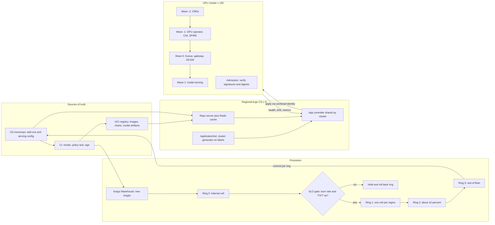

# Lesson 51 — AI/ML platform: GitOps & progressive delivery across 100+ clusters — Argo CD ApplicationSets and Flux at fleet scale, sync waves and rollout rings, drift detection, SLO-gated promotion and securing the GitOps control plane

*2026-10-30*

## What interviewers are really probing

[Lesson 15](/lessons/15-terraform-atlantis-fleet-scale) covered changes to cloud infrastructure through Terraform and Atlantis. [Lesson 45](/lessons/45-fleet-kubernetes-upgrades-gpu-clusters) covered upgrading the clusters themselves. This lesson is about everything that runs *inside* those clusters: the 60 to 120 add-ons (CNI, GPU operator, DCGM exporter, Kueue, cert-manager, SPIRE agents, the inference gateway) plus every model-serving deployment, kept identical, or deliberately different, across 150 clusters. And it covers how a change moves from one canary cell to the whole fleet without a human copying YAML around.

The interview version: *"You run 150 GPU clusters. A platform team wants to ship a new DCGM exporter, a new vLLM image and a changed NetworkPolicy every week. Design the delivery system."* Or the incident version: *"Someone renamed a label on cluster secrets. Twenty minutes later the ApplicationSet controller deleted 4,000 Applications and the GPU operator vanished from 60 clusters. What happened, and what would have stopped it?"* They want to hear that you **template per-cluster config from cluster metadata, not copy-paste**, **promote by rings with automatic SLO gates**, **know where Argo CD falls over at 10,000+ Applications and how to shard it**, **treat drift as a signal, not just something to overwrite**, and **understand that the GitOps controller is the most privileged thing in the fleet**. Whoever can merge to `main` can change 150 clusters.

Cross-links: [L03](/lessons/03-cluster-provisioning-lifecycle) (cluster lifecycle), [L11](/lessons/11-cluster-security-pss-admission-rbac) (admission/RBAC), [L12](/lessons/12-node-container-hardening-supply-chain) (supply chain), [L13](/lessons/13-ml-weights-checkpoint-hardening) (weights), [L15](/lessons/15-terraform-atlantis-fleet-scale) (Terraform/Atlantis), [L16](/lessons/16-temporal-argo-workflows) (Argo Workflows), [L27](/lessons/27-gpu-supply-chain-weight-registry-hydrate) (weight registries), [L31](/lessons/31-evaluation-release-gating-canary-weights) (canary weights), [L33](/lessons/33-prompt-tool-catalog-versioning-serving-config) (serving config as code), [L44](/lessons/44-gpu-cluster-control-plane-scaling) (API server load), [L45](/lessons/45-fleet-kubernetes-upgrades-gpu-clusters) (upgrade waves), [L48](/lessons/48-workload-identity-secrets-pki-fleet-scale) (workload identity), [L50](/lessons/50-slo-error-budget-alerting-fleet-scale) (burn-rate gates). Fuel: [wafer-ai/gpu-perf-engineering-resources](https://github.com/wafer-ai/gpu-perf-engineering-resources).

What they check for:

- **Count the objects.** 150 clusters times 80 add-ons is 12,000 Applications before a single model is deployed. Argo CD scales per *destination cluster*, not per app, and a default install starts to strain around 1,500 apps (Adobe's KubeCon 2022 benchmark guidance). Saying the number out loud is the tell.
- **Push vs pull.** A central Argo CD that holds credentials to every cluster, or Flux or argocd-agent running inside each cluster and pulling. Each has a different blast radius, credential story and failure mode when the hub is down.
- **Rings, not environments.** `dev/staging/prod` doesn't describe a fleet. Ring 0 is one internal cell, ring 1 is one cell per region, ring 2 is about 10% of clusters, ring 3 is the rest. Promotion between rings is automatic when SLOs hold and stops when burn rate rises.
- **Ordering inside a cluster.** CRDs before operators, operators before their custom resources, GPU operator before anything that requests `nvidia.com/gpu`. Sync waves and `dependsOn`, plus the health checks that make the waves actually wait.
- **Drift judgement.** HPA replicas, mutating webhooks and the GPU operator rewriting its own ClusterPolicy all show up as drift. Ignore what's expected, alert on the rest, and make break-glass edits a visible, timed exception.
- **AI/ML specifics.** Model versions pinned by digest, training jobs kept away from pruning, huge CRDs that break client-side apply, and promotion gated on TTFT and error budget rather than "pods are Ready."

**Interview sentence:** "Cluster metadata lives as labels on Argo CD cluster secrets: region, cell, ring, GPU SKU, security tier. One ApplicationSet per add-on uses a cluster generator on those labels, so a new cluster gets its 80 add-ons the moment it's registered. Each add-on version is pinned per ring in Git, and Kargo promotes a release from ring 0 to ring 3 by writing commits, with an Argo Rollouts analysis between rings that checks the 1-hour burn rate and TTFT from Lesson 50. Argo CD runs as one instance per region with the controller sharded by cluster, webhook-driven refresh and `manifest-generate-paths` so a monorepo push doesn't rerender 12,000 apps. ApplicationSets use `create-update` policy and `preserveResourcesOnDeletion`, so a bad generator can't delete the fleet. Drift on anything not in `ignoreDifferences` is a ticket, and self-heal reverts it. Security-wise, Argo uses workload identity instead of stored bearer tokens, projects pin repos and destinations, commits and OCI artifacts are signature-verified, and model weights are referenced by digest and checked by admission in the cluster."

## Core diagram: Git → render → promote by ring → reconcile → verify




**Read it top-down:** CI renders and signs; Kargo turns each new version into "freight" and promotes it ring by ring by committing to Git; regional Argo CD instances expand ApplicationSets into per-cluster Applications and reconcile them in waves; every cluster's admission controller refuses anything unsigned or not pinned by digest; health and SLO data flow back to decide the next promotion.

## Idiosyncrasies / operator depth

**Argo CD's scaling unit is the destination cluster.** The application controller is a StatefulSet; each replica owns a set of clusters, and every Application targeting that cluster lands on that shard. One huge cluster (say, a 4,000-node training cluster with 300,000 objects) pins one shard no matter how many replicas you add. GoTo Financial's KubeCon NA 2023 talk on reaching 10,000+ apps hit exactly this and moved to manual shard assignment. The knobs: `controller.sharding.algorithm` (`legacy` hash, `round-robin`, or `consistent-hashing` in newer releases), a `shard` field on the cluster secret to pin it, and since v2.9 dynamic distribution that rebalances when replicas change. The CNOE benchmark (50,000 apps on 500 clusters) went from 75 to 21 minutes per full sync by moving from 3 to 9 shards, but only because the shards had CPU to use.

**Fix the churn before you shard.** Most "Argo is slow" problems are self-inflicted: every Application refreshes every 180s (`timeout.reconciliation`), a push to a monorepo triggers a webhook that invalidates the manifest cache for every app using that repo, and the controller watches every resource kind in every cluster, including `Events`, `EndpointSlices` and `Leases` that change constantly. The fixes are `argocd.argoproj.io/manifest-generate-paths` (only refresh apps whose path changed), `resource.exclusions` for high-churn kinds you never manage, a longer reconciliation timeout with jitter when webhooks are reliable, and `controller.status.processors` / `controller.operation.processors` raised from the defaults of 20 and 10. GoTo ran about 50 and 25 per 1,000 apps.

**The repo server is the CPU hog.** Rendering a Helm chart or a Kustomize tree runs a real binary per app per revision. A cold cache after a Redis restart means 12,000 renders at once, `ARGOCD_EXEC_TIMEOUT` (90s default) expiring, and apps stuck at `ComparisonError: context deadline exceeded`. Size it with `reposerver.parallelism.limit`, give it HPA headroom, and consider rendered manifests: CI renders to plain YAML in a hydrated branch or OCI artifact, and Argo only applies. Argo CD 3.x has a source hydrator for this; Kargo calls the pattern "rendered branches". Rendering in CI also means the exact bytes that get applied are what was reviewed and signed.

**ApplicationSets can delete things very quickly.** The controller's job is to make the set of Applications match what the generators return. If a cluster generator's label selector stops matching (someone renames `ring` to `rollout-ring`), or a Git file generator's glob breaks, the generator returns nothing and the controller deletes every generated Application. If those Applications have the `resources-finalizer.argocd.argoproj.io` finalizer, Argo cascades the delete into the clusters. Three guards stack: `syncPolicy.applicationsSync: create-update` (or the controller flag `--policy create-update`) so the controller never deletes Applications, `syncPolicy.preserveResourcesOnDeletion: true` so if it does, workloads stay, and `goTemplateOptions: ["missingkey=error"]` so a missing label fails loudly instead of rendering an empty string.

**Progressive Syncs exist, but know their limits.** ApplicationSet `strategy.type: RollingSync` updates apps in steps chosen by label (`ring In [0]`, then `ring In [1]` with `maxUpdate: 10%`). It's behind a feature flag (`applicationsetcontroller.enable.progressive.syncs`), it turns off auto-sync on generated apps, and it only gates on Argo health, not your SLOs. Adobe's ArgoCon 2023 talk found it didn't respect sync windows at the time. For fleet promotion, most teams keep the ring as a Git fact (`rings/ring1/values.yaml` pins `version: 1.42.0`) and let Kargo, or a Temporal/Argo Workflow ([L16](/lessons/16-temporal-argo-workflows)), move versions between ring files.

**Sync waves only wait if health is real.** Within a sync, Argo applies resources by phase (PreSync, Sync, PostSync), then by `argocd.argoproj.io/sync-wave`, then by kind and name, and waits for each wave to be healthy before the next. "Healthy" depends on a health check existing for that kind. A CRD with no health check is healthy immediately, so a `ClusterPolicy` for the GPU operator in wave -1 doesn't actually wait for the driver DaemonSet. Write Lua health checks (`resource.customizations.health.nvidia.com_ClusterPolicy`) that read `.status.state`. And app-of-apps waves don't wait on child Applications at all since Argo 1.8 unless you add the `argoproj.io_Application` health check back.

**Flux behaves differently.** Flux runs controllers in every cluster and pulls. A `Kustomization` reconciles on `spec.interval`, applies with server-side apply, and with `prune: true` garbage-collects anything it applied that left Git. Ordering is `dependsOn` between Kustomizations, and `wait: true` / `healthChecks` make it block on readiness. Drift is simply corrected on the next interval. There's no central UI showing a diff for 150 clusters, which is the price of having no hub. Flux's multi-tenancy lockdown is controller flags: `--no-cross-namespace-refs=true` and `--default-service-account=` so every tenant Kustomization impersonates a limited service account instead of running as the controller's cluster-admin.

**Drift has three sources and only one is bad.** Expected drift: HPA or KEDA owns `spec.replicas`, a mutating webhook injects sidecars or a `nvidia.com/gpu` toleration, cert-manager fills `caBundle`. Handle these with `ignoreDifferences` (`jqPathExpressions`, or `managedFieldsManagers: [kube-controller-manager]`) plus `RespectIgnoreDifferences=true` so sync doesn't stomp them. Operator drift: the GPU operator and some CNIs rewrite their own config; ignore those fields or stop templating them. Human drift: someone ran `kubectl edit` at 3 a.m. That's the one to alert on, and self-heal will undo it 5 seconds later unless the break-glass process suspends the app first.

**Big CRDs break client-side apply.** `kubectl apply` stores the whole object in the `kubectl.kubernetes.io/last-applied-configuration` annotation, and annotations are capped at 256 KiB. The GPU operator, Kueue, Prometheus Operator and KServe CRDs exceed that, and sync fails with `metadata.annotations: Too long`. Use `ServerSideApply=true` per app or per resource. SSA brings its own surprises: field-ownership conflicts with whatever controller last touched the field, which you resolve deliberately rather than with a blanket `--force-conflicts`.

**Training jobs and GitOps don't mix by default.** A `PyTorchJob` or `JobSet` that's been running for 14 hours is an expensive object to prune because someone moved a file in Git. Keep long-running training out of auto-pruned Applications: submit through Kueue from a pipeline, or annotate with `argocd.argoproj.io/sync-options: Prune=false,Delete=false`. GitOps is for the *platform* (queues, quotas, priority classes) and long-lived *serving*, not for individual runs.

**Model rollouts are two artifacts.** An inference deployment pins both a serving image digest (vLLM, Triton) and a model artifact digest (an OCI ModelCar or a `gs://.../sha256-...` path from [L27](/lessons/27-gpu-supply-chain-weight-registry-hydrate)). Promote them as a pair. Kargo calls the pair "freight", and the pair is what passed eval in [L31](/lessons/31-evaluation-release-gating-canary-weights). Rolling a new image against old weights, or the reverse, is how an untested combination ends up in production.

**Sync windows are your change freeze.** AppProject `syncWindows` with `kind: deny` and a cron `schedule` block automatic syncs during peak traffic or an error-budget freeze ([L50](/lessons/50-slo-error-budget-alerting-fleet-scale)), and `manualSync: true` leaves a lane open for emergency fixes. Tie the deny window to the error-budget policy so it's enforced by the system, not by a Slack message.

## Concrete commands & config

**Cluster metadata as labels (the generator's input).**

```yaml
apiVersion: v1
kind: Secret
metadata:
  name: gpu-use1-c07
  namespace: argocd
  labels:
    argocd.argoproj.io/secret-type: cluster
    region: us-east1
    cell: c07
    ring: "2"
    gpu-sku: h200
    tier: serving-restricted   # weight-serving security tier
type: Opaque
stringData:
  name: gpu-use1-c07
  server: https://10.40.7.2
  # no bearer token: GKE workload identity via argocd-k8s-auth
  config: |
    {"execProviderConfig": {"command": "argocd-k8s-auth", "args": ["gcp"], "apiVersion": "client.authentication.k8s.io/v1beta1"},
     "tlsClientConfig": {"caData": "LS0t..."}}
```

**One ApplicationSet per add-on, version pinned per ring, delete-proof.**

```yaml
apiVersion: argoproj.io/v1alpha1
kind: ApplicationSet
metadata:
  name: dcgm-exporter
  namespace: argocd
spec:
  goTemplate: true
  goTemplateOptions: ["missingkey=error"]
  generators:
  - clusters:
      selector:
        matchExpressions:
        - {key: gpu-sku, operator: Exists}
        - {key: ring, operator: In, values: ["0","1","2","3"]}
  syncPolicy:
    applicationsSync: create-update      # never delete Applications
    preserveResourcesOnDeletion: true
  template:
    metadata:
      name: 'dcgm-exporter-{{.name}}'
      labels: {ring: '{{index .metadata.labels "ring"}}', addon: dcgm-exporter}
      annotations:
        argocd.argoproj.io/manifest-generate-paths: /addons/dcgm-exporter
    spec:
      project: platform-addons
      source:
        repoURL: https://git.example.com/platform/fleet.git
        targetRevision: main
        # wrapper chart per ring: Chart.yaml pins the upstream dcgm-exporter version
        path: 'addons/dcgm-exporter/rings/ring{{index .metadata.labels "ring"}}'
        helm:
          valueFiles:
          - '../../sku/{{index .metadata.labels "gpu-sku"}}.yaml'
      destination: {name: '{{.name}}', namespace: gpu-monitoring}
      syncPolicy:
        automated: {prune: true, selfHeal: true}
        syncOptions: [ServerSideApply=true, RespectIgnoreDifferences=true, CreateNamespace=true]
```

Each ring directory is a tiny wrapper chart whose `Chart.yaml` pins the upstream version, so promotion is a one-line commit to `rings/ring1/Chart.yaml`, and the ApplicationSet itself never changes during a rollout.

**Controller and repo-server tuning (`argocd-cmd-params-cm`, `argocd-cm`).**

```yaml
# argocd-cmd-params-cm
data:
  controller.sharding.algorithm: consistent-hashing
  controller.status.processors: "150"
  controller.operation.processors: "75"
  controller.kubectl.parallelism.limit: "40"
  reposerver.parallelism.limit: "20"
  applicationsetcontroller.policy: create-update
  applicationsetcontroller.enable.progressive.syncs: "false"
---
# argocd-cm
data:
  timeout.reconciliation: 600s          # webhooks do the fast path
  timeout.reconciliation.jitter: 120s
  admin.enabled: "false"
  exec.enabled: "false"
  resource.exclusions: |
    - apiGroups: ["", "events.k8s.io"]
      kinds: ["Event"]
      clusters: ["*"]
    - apiGroups: ["discovery.k8s.io"]
      kinds: ["EndpointSlice"]
      clusters: ["*"]
    - apiGroups: ["coordination.k8s.io"]
      kinds: ["Lease"]
      clusters: ["*"]
  resource.customizations.ignoreDifferences.apps_Deployment: |
    managedFieldsManagers: [kube-controller-manager]
    jqPathExpressions: ['.spec.replicas']
  resource.customizations.health.nvidia.com_ClusterPolicy: |
    hs = {status = "Progressing", message = "waiting for GPU operator"}
    if obj.status ~= nil and obj.status.state == "ready" then
      hs.status = "Healthy"; hs.message = "ClusterPolicy ready"
    elseif obj.status ~= nil and obj.status.state == "notReady" then
      hs.status = "Degraded"; hs.message = "ClusterPolicy notReady"
    end
    return hs
  resource.customizations.health.argoproj.io_Application: |
    hs = {status = "Progressing", message = ""}
    if obj.status ~= nil and obj.status.health ~= nil then
      hs.status = obj.status.health.status
      if obj.status.health.message ~= nil then hs.message = obj.status.health.message end
    end
    return hs
```

**Wave annotations for a GPU cluster's add-on stack.**

```yaml
# CRDs first, then the GPU operator, then things that need GPUs
metadata:
  annotations:
    argocd.argoproj.io/sync-wave: "-2"   # CRDs (gpu-operator, kueue, kserve)
---
    argocd.argoproj.io/sync-wave: "-1"   # gpu-operator ClusterPolicy, CNI, SPIRE agent
---
    argocd.argoproj.io/sync-wave: "0"    # kueue ClusterQueues, dcgm-exporter, gateway
---
    argocd.argoproj.io/sync-wave: "1"    # model serving (vLLM Deployments, InferencePools)
---
# a long-running training object that must never be pruned by GitOps
    argocd.argoproj.io/sync-options: Prune=false,Delete=false
```

**AppProject: pin sources, destinations, kinds, signers and windows.**

```yaml
apiVersion: argoproj.io/v1alpha1
kind: AppProject
metadata: {name: inference-serving, namespace: argocd}
spec:
  sourceRepos: ["https://git.example.com/ml/serving.git", "oci://registry.example.com/charts"]
  destinations:
  - {name: "gpu-*", namespace: "serving-*"}
  clusterResourceWhitelist: []                 # tenants get no cluster-scoped kinds
  namespaceResourceBlacklist:
  - {group: "", kind: ResourceQuota}
  - {group: rbac.authorization.k8s.io, kind: RoleBinding}
  signatureKeys:
  - keyID: 4AEE18F83AFDEB23                    # only commits signed by release keys sync
  syncWindows:
  - {kind: deny, schedule: "0 13 * * 1-5", duration: 6h, applications: ["*"], manualSync: true}  # US peak
  roles:
  - name: serving-oncall
    policies: ["p, proj:inference-serving:serving-oncall, applications, sync, inference-serving/*, allow"]
    groups: ["sso:serving-oncall"]
```

**Kargo: promote freight ring by ring, gated by SLO analysis.**

```yaml
apiVersion: kargo.akuity.io/v1alpha1
kind: Warehouse
metadata: {name: llama-serving, namespace: serving-promo}
spec:
  subscriptions:
  - image: {repoURL: registry.example.com/serving/vllm, imageSelectionStrategy: SemVer, constraint: ^0.9.0}
  - image: {repoURL: registry.example.com/models/llama-70b-instruct, imageSelectionStrategy: Digest}  # ModelCar
---
apiVersion: kargo.akuity.io/v1alpha1
kind: Stage
metadata: {name: ring1, namespace: serving-promo}
spec:
  requestedFreight:
  - origin: {kind: Warehouse, name: llama-serving}
    sources: {stages: [ring0]}                 # only freight that passed ring0
  promotionTemplate:
    spec:
      steps:
      - uses: git-clone            # clone fleet repo
      - uses: yaml-update          # set image + model digests in rings/ring1.yaml
      - uses: git-commit
      - uses: git-push
      - uses: argocd-update        # trigger sync of ring1 apps
  verification:
    analysisTemplates:
    - name: slo-gate
```

```yaml
apiVersion: argoproj.io/v1alpha1
kind: AnalysisTemplate
metadata: {name: slo-gate, namespace: serving-promo}
spec:
  metrics:
  - name: burn-rate-1h
    interval: 5m
    count: 6                                   # 30 minutes of soak
    failureLimit: 1
    successCondition: result[0] < 2
    provider:
      prometheus:
        address: https://thanos-query.example.com
        query: |
          max(slo:sli_error:ratio_rate1h{service="llama-70b", ring="1"}) / (1 - 0.999)
  - name: ttft-p95
    interval: 5m
    count: 6
    successCondition: result[0] < 1.0
    provider:
      prometheus:
        address: https://thanos-query.example.com
        query: |
          histogram_quantile(0.95, sum by (le) (rate(vllm:time_to_first_token_seconds_bucket{ring="1"}[10m])))
```

**Flux equivalent (pull mode, per cluster).**

```yaml
apiVersion: source.toolkit.fluxcd.io/v1beta2
kind: OCIRepository
metadata: {name: fleet-addons, namespace: flux-system}
spec:
  interval: 5m
  url: oci://registry.example.com/fleet/addons
  ref: {tag: ring2}
  verify:
    provider: cosign
    matchOIDCIdentity:
    - issuer: "^https://token.actions.githubusercontent.com$"
      subject: "^https://github.com/example/fleet/.github/workflows/release.yml@refs/heads/main$"
---
apiVersion: kustomize.toolkit.fluxcd.io/v1
kind: Kustomization
metadata: {name: gpu-operator, namespace: flux-system}
spec:
  interval: 10m
  retryInterval: 2m
  timeout: 15m
  sourceRef: {kind: OCIRepository, name: fleet-addons}
  path: ./gpu-operator
  prune: true
  wait: true
  dependsOn: [{name: crds}]
  serviceAccountName: platform-addons          # impersonation, not controller cluster-admin
  postBuild:
    substituteFrom: [{kind: ConfigMap, name: cluster-vars}]   # region, cell, gpu-sku
```

**Day-two commands.**

```bash
# Argo CD: where is load going?
argocd admin cluster shards                 # cluster-to-shard map and app counts
argocd admin cluster stats                  # resources/apps per cluster
argocd app list -l addon=dcgm-exporter -o wide | awk '$5!="Synced" || $6!="Healthy"'
argocd app diff dcgm-exporter-gpu-use1-c07 --local-repo-root . --server-side-generate
argocd app get gpu-operator-gpu-use1-c07 --hard-refresh
argocd appset generate appset-dcgm.yaml -o yaml | yq '.[] .metadata.name' | wc -l   # preview before apply

# Break-glass: stop self-heal before a manual edit, then restore
kubectl -n argocd patch app vllm-gpu-use1-c07 --type merge -p '{"spec":{"syncPolicy":{"automated":null}}}'
# ... fix, then re-enable through Git, not by hand

# Flux
flux get kustomizations -A --status-selector ready=false
flux diff kustomization gpu-operator --path ./gpu-operator
flux tree kustomization gpu-operator
flux suspend kustomization vllm-serving && flux resume kustomization vllm-serving
flux events --for Kustomization/gpu-operator
```

```promql
# Argo CD health of the delivery system itself
histogram_quantile(0.95, sum by (le, shard) (rate(argocd_app_reconcile_bucket[10m])))
sum by (name) (workqueue_depth{namespace="argocd"})
sum by (server) (argocd_cluster_api_resource_objects)            # per-cluster object count
sum by (repo) (rate(argocd_git_request_total{request_type="fetch"}[5m]))
count by (sync_status) (argocd_app_info{project="platform-addons"})
# Fleet version skew for one add-on: how many clusters per version
count by (version) (kube_deployment_labels{deployment="dcgm-exporter", label_app_kubernetes_io_version!=""})
```

## Failures & fixes

| Symptom | Cause | Fix |
|---|---|---|
| Thousands of Applications deleted, workloads gone from 60 clusters | Cluster generator selector stopped matching after a label rename; apps had cascade finalizer | `applicationsSync: create-update`, `preserveResourcesOnDeletion`, `missingkey=error`, preview with `argocd appset generate` in CI |
| One controller shard at 100% CPU, others idle | 4,000-node training cluster pins one shard (sharding is per cluster) | Manual `shard` on that cluster secret, give that replica more CPU, exclude churny kinds, split the cluster's add-ons across Argo instances |
| Every push to the monorepo makes all apps `Progressing` / refresh for minutes | Webhook invalidates cache for every app on the repo | `manifest-generate-paths` annotation; split hot paths into their own repo or OCI artifact |
| `ComparisonError: context deadline exceeded` fleet-wide after Redis restart | Cold manifest cache, repo server rendering 12,000 apps at once | Raise repo-server replicas and `reposerver.parallelism.limit`, render in CI (hydrated manifests), stagger with reconciliation jitter |
| Sync fails `metadata.annotations: Too long` | Large CRD with client-side apply | `ServerSideApply=true` |
| GPU workloads start before the driver is ready, crash with `nvidia-smi` errors | Wave -1 ClusterPolicy has no health check, so wave 1 ran immediately | Lua health check on `ClusterPolicy`; `wait`/`healthChecks` in Flux |
| App permanently `OutOfSync` on `spec.replicas` or `caBundle` | HPA or cert-manager owns the field | `ignoreDifferences` with `managedFieldsManagers` plus `RespectIgnoreDifferences=true` |
| On-call's emergency fix disappeared 5 seconds later | Self-heal reverted a manual edit | Break-glass runbook: disable automated sync, fix, land it in Git, re-enable; alert on long-disabled apps |
| A 14-hour training run killed on a routine merge | Job lived in a pruned Application | Training through Kueue/pipelines, or `Prune=false,Delete=false` |
| Ring 2 shipped a vLLM image that tripled TTFT | Promotion gated on pod readiness only | Kargo verification / Rollouts analysis on burn rate and TTFT, with a soak period |
| New image rolled with old weights, garbage outputs | Image and model promoted separately | Promote as one freight with both digests; admission rejects mismatched pairs |
| Hub Argo down, no deploys anywhere for 2 hours | Single global push hub | One instance per region (or pull agents); regional failure only freezes that region's deploys |
| Clusters slowly drift to 6 different add-on versions | Rings pinned but promotions stalled silently | Version-skew metric with an SLO ("90% of fleet within N-1 within 14 days"), ticket on stalled freight |

## Security & hardening

**The GitOps control plane is the fleet's root of trust.** It can write anything to every cluster, so treat it like you treat the CA from [L48](/lessons/48-workload-identity-secrets-pki-fleet-scale), not like a CI tool.

- **Git is the control plane, so protect it like one.** Branch protection on `main` and ring files, `CODEOWNERS` for each add-on and for every security-relevant path (RBAC, NetworkPolicy, admission policy, anything touching weights), two-person review for ring 3 promotions, and no direct pushes, including from bots. Kargo's commits come from a dedicated identity whose write scope is limited to ring files.
- **Verify what you sync.** Argo CD `signatureKeys` on AppProjects refuses unsigned commits. Flux `verify` on `GitRepository` (GPG) or `OCIRepository` (cosign keyless with `matchOIDCIdentity` pinned to the release workflow) refuses unsigned artifacts. Rendering in CI and signing the rendered output means the bytes in the cluster are the bytes that were reviewed.
- **Admission in every cluster is the last check.** Kyverno `verifyImages` or Sigstore policy-controller require signed images *by digest* from approved registries, and the same for model artifacts: a ModelCar image or weight manifest must carry a signature and SLSA provenance from the training/eval pipeline ([L13](/lessons/13-ml-weights-checkpoint-hardening), [L27](/lessons/27-gpu-supply-chain-weight-registry-hydrate)). If the GitOps controller is compromised, the cluster still refuses an unsigned vLLM image or a swapped checkpoint.
- **No stored cluster-admin tokens.** A hub Argo CD with 150 long-lived bearer tokens in Secrets is one Secret read from fleet compromise. Use workload identity (`argocd-k8s-auth gcp`, EKS `awsAuthConfig` with IRSA or Pod Identity, Azure workload identity) so credentials are short-lived and revocable centrally, or use pull mode (Flux, argocd-agent) so the hub holds no cluster credentials. Scope the identity Argo uses in each cluster below cluster-admin where you can, especially in the weight-serving tier.
- **Split by security tier.** Clusters that serve frontier weights (`tier: serving-restricted`) get their own Argo instance or agent, their own AppProject, and their own Git paths with stricter owners. A compromise of the general add-on pipeline shouldn't be able to roll out a sidecar into the pods holding decrypted weights.
- **Lock down AppProjects.** No use of the `default` project. Pin `sourceRepos` and `destinations`, set `clusterResourceWhitelist: []` for tenant projects, blacklist `RoleBinding`/`ClusterRoleBinding`, `ResourceQuota`, `MutatingWebhookConfiguration` and `ValidatingWebhookConfiguration` for tenants, and set `sourceNamespaces` deliberately if you enable apps-in-any-namespace. In Flux, `--no-cross-namespace-refs` and `--default-service-account` give the same tenant boundary.
- **Harden Argo itself.** SSO only (`admin.enabled: "false"`), `policy.default` empty instead of `role:readonly` (readonly still exposes every app's manifests and parameters), `exec.enabled: "false"`, Redis with auth and a NetworkPolicy (CVE-2024-31989 was unauthenticated Redis leading to privilege escalation), repo-server with no outbound access except Git and registries, and Config Management Plugins treated as code execution. Path-traversal bugs in Helm value-file handling (CVE-2022-24348) are why you patch Argo on a schedule and keep repo-server sandboxed.
- **Secrets never live in Git as plaintext.** External Secrets Operator pulling from the cloud secret manager with per-namespace identity, or SOPS with KMS keys that only the in-cluster controller can decrypt. Weight-bucket credentials should not be delivered by GitOps at all; serving pods get them through workload identity scoped to one model's prefix, with IAM changes going through Terraform/Atlantis review ([L15](/lessons/15-terraform-atlantis-fleet-scale)).
- **Drift is a security signal.** An unexpected diff on a `Role`, a `NetworkPolicy`, a webhook config or the serving Deployment's volume mounts is a SOC alert, not just a self-heal event. Ship Argo CD and Flux events plus Kubernetes audit logs for writes not made by the GitOps identity to the SIEM. Alert when an Application stays with automated sync disabled for more than its break-glass window.
- **Network isolation.** Argo's API and UI sit behind SSO and private ingress, never public. The controller-to-cluster path uses private endpoints. Notifications controller secrets (Slack, PagerDuty tokens) are scoped and rotated.

## Interview soundbites

- "Argo CD shards by destination cluster, not by app. So fix churn first with exclusions, webhooks and generate-paths, and only then add shards. A giant training cluster gets a shard of its own."
- "An ApplicationSet's default behaviour is to delete what the generator stops returning. At fleet scale I run `create-update` and `preserveResourcesOnDeletion`, so a typo can't uninstall the GPU operator from 60 clusters."
- "Rings are a Git fact and promotion is a commit. Kargo moves image and model digests together from ring 0 to ring 3, and each hop waits 30 minutes on burn rate and TTFT from the SLO rules."
- "Sync waves only wait on kinds with a health check, so I write Lua checks for ClusterPolicy and for child Applications."
- "Expected drift goes in `ignoreDifferences`, human drift pages security, and break-glass means turning off self-heal on purpose, with a timer."
- "The GitOps controller is the root of trust. Signed commits, signed OCI artifacts, workload identity instead of tokens, per-tier instances, and admission in each cluster that still refuses an unsigned model even if Argo is owned."

## How this maps to the JD

- **100+ clusters / 10K+ nodes:** cluster-label generators, controller sharding, regional instances or pull agents, version-skew SLOs.
- **K8s internals:** server-side apply and field managers, finalizers and cascading deletes, health assessment, admission, impersonation.
- **Cloud & cluster networking:** private control-plane endpoints, repo-server egress, regional hub failure domains.
- **Security:** signed commits and artifacts, AppProject boundaries, tiered instances, weight digest pinning and admission, secret delivery.
- **Terraform/Atlantis & Temporal/Argo:** Terraform registers clusters and IAM, Argo/Flux deliver in-cluster state, Kargo or Workflows orchestrate promotion ([L15](/lessons/15-terraform-atlantis-fleet-scale), [L16](/lessons/16-temporal-argo-workflows)).
- **Design tradeoffs:** push vs pull, central visibility vs blast radius, Progressive Syncs vs an external promoter, rendered manifests vs in-cluster rendering.

## Watch (talks & demos)

**Manage More Clusters with Less Hassle, with Argo CD ApplicationSets — Jonathan West & Kshama Jain**. Why watch: the maintainers walk through cluster, Git and matrix generators, which is exactly the "cluster labels in, Applications out" model this lesson builds on.

<iframe width="100%" height="360" src="https://www.youtube.com/embed/GcvHKc2IHi8" title="Manage More Clusters with Less Hassle, with Argo CD Application Sets - Jonathan West & Kshama Jain" frameBorder="0" allow="accelerometer; autoplay; clipboard-write; encrypted-media; gyroscope; picture-in-picture; web-share" allowFullScreen></iframe>

[Open on YouTube](https://www.youtube.com/watch?v=GcvHKc2IHi8)

**Kargo — Multi-Stage Deployment Pipelines using GitOps — Jesse Suen & Kent Rancourt**. Why watch: the Argo creators show freight, stages and verification, the building blocks for ring-by-ring promotion with an SLO gate.

<iframe width="100%" height="360" src="https://www.youtube.com/embed/0B_JODxyK0w" title="Kargo - Multi-Stage Deployment Pipelines using GitOps - Jesse Suen / Kent Rancourt" frameBorder="0" allow="accelerometer; autoplay; clipboard-write; encrypted-media; gyroscope; picture-in-picture; web-share" allowFullScreen></iframe>

[Open on YouTube](https://www.youtube.com/watch?v=0B_JODxyK0w)

**Running ArgoCD at scale for 1000+ applications — Saeid Bostandoust**. Why watch: deploys 1,000 apps on an untuned install, shows what breaks, then tunes the controller, repo server and Redis. It's the "fix churn before sharding" section, live.

<iframe width="100%" height="360" src="https://www.youtube.com/embed/H3T-Nkxdywg" title="Running ArgoCD at scale for 1000+ applications - Saeid Bostandoust" frameBorder="0" allow="accelerometer; autoplay; clipboard-write; encrypted-media; gyroscope; picture-in-picture; web-share" allowFullScreen></iframe>

[Open on YouTube](https://www.youtube.com/watch?v=H3T-Nkxdywg)

## References

- Argo CD: [High availability & scaling](https://argo-cd.readthedocs.io/en/stable/operator-manual/high_availability/) · [Dynamic cluster distribution](https://argo-cd.readthedocs.io/en/latest/operator-manual/dynamic-cluster-distribution/) · [ApplicationSet controller](https://argo-cd.readthedocs.io/en/stable/operator-manual/applicationset/) · [Progressive Syncs](https://argo-cd.readthedocs.io/en/stable/operator-manual/applicationset/Progressive-Syncs/) · [Sync waves & phases](https://argo-cd.readthedocs.io/en/stable/user-guide/sync-waves/) · [Diffing customization](https://argo-cd.readthedocs.io/en/stable/user-guide/diffing/) · [Resource health](https://argo-cd.readthedocs.io/en/stable/operator-manual/health/) · [Sync windows](https://argo-cd.readthedocs.io/en/stable/user-guide/sync_windows/) · [GnuPG verification](https://argo-cd.readthedocs.io/en/stable/user-guide/gpg-verification/) · [Security](https://argo-cd.readthedocs.io/en/stable/operator-manual/security/)
- Scale write-ups: [Akuity: How to scale Argo CD](https://akuity.io/blog/argo-cd-ultimate-scalability) · [CNOE: Argo CD benchmarking & sharding](https://cnoe.io/blog/argo-cd-application-scalability) · [GoTo Financial: towards 10k+ Argo CD apps (slides)](https://static.sched.com/hosted_files/kccncna2023/68/Towards%2010k%2B%20ArgoCD%20Apps%20-%20KubeCon%20%2B%20CloudNativeCon%20North%20America%202023.pdf) · [Okta/Auth0: one dozen to one thousand clusters (KubeCon NA 2025)](https://kccncna2025.sched.com/event/01e0bad28406239fda7e2ae01f6907de)
- Pull model: [Flux Kustomization](https://fluxcd.io/flux/components/kustomize/kustomizations/) · [Flux OCIRepository verification](https://fluxcd.io/flux/components/source/ocirepositories/) · [Flux multi-tenancy lockdown](https://fluxcd.io/flux/installation/configuration/multitenancy/) · [argocd-agent](https://github.com/argoproj-labs/argocd-agent)
- Promotion: [Kargo docs](https://docs.kargo.io/) · [Argo Rollouts analysis](https://argo-rollouts.readthedocs.io/en/stable/features/analysis/) · [Flagger](https://docs.flagger.app/)
- Supply chain: [Kyverno verifyImages](https://kyverno.io/docs/writing-policies/verify-images/) · [Sigstore policy-controller](https://docs.sigstore.dev/policy-controller/overview/) · [SLSA](https://slsa.dev/) · [External Secrets Operator](https://external-secrets.io/)
- [wafer-ai/gpu-perf-engineering-resources](https://github.com/wafer-ai/gpu-perf-engineering-resources) — AI/ML platform fuel
- Prior: [50 — SLOs & alerting](/lessons/50-slo-error-budget-alerting-fleet-scale) · [48 — Identity & PKI](/lessons/48-workload-identity-secrets-pki-fleet-scale) · [45 — Fleet upgrades](/lessons/45-fleet-kubernetes-upgrades-gpu-clusters) · [33 — Serving config as code](/lessons/33-prompt-tool-catalog-versioning-serving-config) · [31 — Release gating](/lessons/31-evaluation-release-gating-canary-weights) · [27 — Weight registries](/lessons/27-gpu-supply-chain-weight-registry-hydrate) · [16 — Temporal/Argo](/lessons/16-temporal-argo-workflows) · [15 — Terraform/Atlantis](/lessons/15-terraform-atlantis-fleet-scale) · [13 — Weights hardening](/lessons/13-ml-weights-checkpoint-hardening)

## Quick self-check

Out loud, in under two minutes each:

1. 150 clusters, 80 add-ons, 40 models. How many Applications, how many controller shards, and why won't adding shards fix one 4,000-node cluster?
2. Walk through how a label rename on cluster secrets deletes the GPU operator fleet-wide, and the three settings that each would have stopped it.
3. Design rings for 150 clusters across 5 regions. What lives in Git, what moves a version between rings, and what exactly does the gate query?
4. Your GPU operator wave "completes" but vLLM pods crash because the driver isn't loaded. Why, and what's the fix in Argo and in Flux?
5. Push hub vs pull agents: compare credential exposure, blast radius of a hub outage, and fleet-wide visibility.
6. Name three kinds of expected drift on a GPU serving cluster and how you ignore each without hiding the dangerous kind.
7. An attacker gets write access to the Argo CD namespace on the hub. What can they do, and which controls in the clusters still stop a swapped model checkpoint?
8. Why should image and model weights be promoted as one unit, and how does admission enforce the pairing?

## Next

**Lesson 52 — Agent runtime infra: MCP & A2A at fleet scale — tool and agent gateways (AgentGateway, IBM ContextForge, ToolHive), OAuth 2.1 auth and token exchange, tool registries, and the MCP threat model (tool poisoning, rug pulls, confused deputy, token passthrough)**
