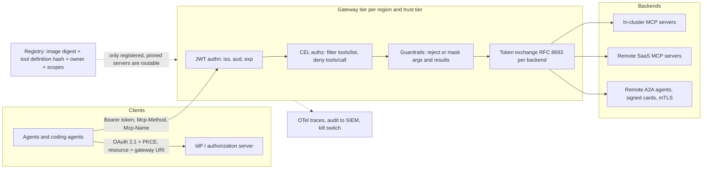

# Lesson 52 — Agent runtime infra: MCP & A2A at fleet scale — tool and agent gateways (AgentGateway, IBM ContextForge, ToolHive), OAuth 2.1 auth and token exchange, tool registries, and the MCP threat model

*2026-10-31*

## What interviewers are really probing

This is the first lesson of the agent runtime infrastructure track (see the *Agent Infra Landscape 2026* map on the [home page](/)). [Lesson 33](/lessons/33-prompt-tool-catalog-versioning-serving-config) treated tool catalogs as versioned serving config, and [Lesson 34](/lessons/34-agent-tool-sandboxing-egress-policy) sandboxed the side effects. This lesson is the network layer in between: the **gateway every agent goes through to reach a tool (MCP) or another agent (A2A)**, run as a platform service for thousands of agents across many clusters.

The interview version: *"Two hundred teams want to ship MCP servers, and 5,000 agents (coding agents, support bots, internal copilots) want to call them. Design the platform."* Or the incident version: *"An agent with read-only Jira access opened a PR that deleted a production Terraform module. The Jira MCP server had been updated the night before. Walk me through what happened and what should have stopped it."* They want to hear that you:

- **Put a gateway on the path, not credentials in the agent.** The agent holds one audience-bound token for the gateway. The gateway holds (or exchanges for) the backend credentials. No GitHub PAT in an agent pod, ever.
- **Know the protocol changed under everyone's feet.** MCP `2025-11-25` is session-based (`initialize` handshake, `Mcp-Session-Id`, sticky routing). MCP `2026-07-28`, final since July 28, 2026, is **stateless**: no handshake, no session header, `Mcp-Method` and `Mcp-Name` HTTP headers on every request, `ttlMs`/`cacheScope` on list results, and W3C Trace Context in `_meta`. A fleet runs both for a while, and the gateway has to serve a legacy lane.
- **Get OAuth right in MCP's specific shape.** The MCP server is an OAuth resource server, it advertises its authorization server through RFC 9728 protected resource metadata, clients send an RFC 8707 `resource` parameter, and **token passthrough is forbidden**. Downstream calls use RFC 8693 token exchange with a new audience.
- **Treat tool definitions as code you're about to run.** A tool's description goes straight into the model's context, so it is a prompt-injection channel. Pin and hash what was reviewed, and quarantine on change (rug pull).
- **Know where A2A differs.** A2A is agent-to-agent tasks, discovered through an Agent Card at `/.well-known/agent-card.json` that can be JWS-signed (since v0.3), with mTLS and OAuth declared as security schemes. It is federation between agents you don't fully trust, not a tool call.

Cross-links: [L10](/lessons/10-service-mesh-istio-linkerd-mtls) (mesh/mTLS), [L11](/lessons/11-cluster-security-pss-admission-rbac) (admission/RBAC), [L12](/lessons/12-node-container-hardening-supply-chain) (image signing), [L13](/lessons/13-ml-weights-checkpoint-hardening) (weights), [L14](/lessons/14-ml-inference-training-deploy-hardening) (inference deploy hardening), [L24](/lessons/24-multi-cluster-inference-routing-capacity) (multi-cluster routing), [L33](/lessons/33-prompt-tool-catalog-versioning-serving-config) (tool catalogs), [L34](/lessons/34-agent-tool-sandboxing-egress-policy) (sandboxing/egress), [L47](/lessons/47-dns-service-discovery-east-west-lb) (east-west LB), [L48](/lessons/48-workload-identity-secrets-pki-fleet-scale) (workload identity), [L49](/lessons/49-fleet-observability-pipelines-scale) (telemetry), [L50](/lessons/50-slo-error-budget-alerting-fleet-scale) (SLOs), [L51](/lessons/51-gitops-progressive-delivery-fleet-scale) (ring promotion). Fuel: [wafer-ai/gpu-perf-engineering-resources](https://github.com/wafer-ai/gpu-perf-engineering-resources).

**Interview sentence:** "Agents never talk to MCP servers or other agents directly. Each tier (say, internal-read, internal-write, external-SaaS) gets a gateway endpoint: agentgateway on Gateway API in Kubernetes, or ToolHive's vMCP if the team wants an operator with CRDs per server. The gateway is the OAuth resource server: it publishes protected-resource metadata, validates that `iss` and `aud` match its own canonical URI, and filters `tools/list` per identity with CEL rules, so an agent only ever sees the eight tools it's allowed to call. For each backend it does RFC 8693 token exchange to a backend-specific audience instead of passing the client's token through. Every MCP server comes from a registry entry that pins its image digest and the hash of its tool definitions; if a description or schema changes, the tool is quarantined until someone re-reviews it. On `2026-07-28` traffic the gateway is plain round-robin and routes on `Mcp-Method`; older clients go to a legacy lane that hashes on `Mcp-Session-Id`, with a sunset date driven by a version-mix dashboard. A2A calls go through the same gateway with signed agent cards and mTLS. Tool calls are logged with agent identity, user, tool, args hash and result class, and any tool or agent can be disabled at the gateway in seconds."

## Core diagram: agent → gateway → token exchange → backend




## Idiosyncrasies / operator depth

**1. Two protocol generations on one fleet.** Under `2025-11-25`, the client sends `initialize`, the server returns `Mcp-Session-Id`, and every later request must land on that same instance or fail. That is why ToolHive's `MCPServer` and `VirtualMCPServer` still default `sessionAffinity: ClientIP`, and why `sessionStorage` (Redis) exists. Under `2026-07-28` (SEP-2575 removed the handshake, SEP-2567 removed the session), each request carries protocol version and client info in `_meta`, so round-robin works. Practical consequences:
- `ClientIP` affinity is a terrible key behind a shared egress NAT: 3,000 agents from one NAT IP all pin to one gateway pod. For the legacy lane, hash on the `Mcp-Session-Id` header instead (consistent hashing), and accept that a pod restart drops those sessions.
- Stream resumption (`Last-Event-ID`) is gone in the new version. A broken response means the client re-issues the call, so **tools with side effects must be idempotent** (idempotency key as an argument). This is the same lesson as at-least-once workflow activities in [Lesson 16](/lessons/16-temporal-argo-workflows).
- Server-to-client prompts (elicitation) are now Multi Round-Trip Requests: the server returns `resultType: "input_required"` with an opaque `requestState`, and the client retries with `inputResponses`. **`requestState` is attacker-controlled input** that comes back through the client: the server must HMAC or AEAD-protect it.
- `subscriptions/listen` is still a long-lived stream. Gateway, LB and pod idle timeouts must be longer than your heartbeat interval or you'll see a reconnect storm every 60 seconds.

**2. Header routing changes what the gateway can do cheaply.** `Mcp-Method: tools/call` and `Mcp-Name: create_pr` are required on `2026-07-28` Streamable HTTP requests, and servers must reject requests where the header and the JSON body disagree. Rate limits, per-tool quotas and WAF rules can now run on headers without parsing JSON-RPC. But a gateway that authorizes on the *header* and forwards the *body* unchecked is the bug: verify both match, at the gateway, before policy runs.

**3. Tool count is a capacity and quality problem.** Federating 40 servers gives an agent 600 tools, which burns context tokens on every turn and lowers tool-selection accuracy. Gateways exist partly to *curate*: agentgateway's MCP authorization rules filter `tools/list` item by item, ToolHive vMCP aggregates and renames with conflict resolution (and can use an embedding-based optimizer to expose a search tool instead of the whole list), and ContextForge builds "virtual servers" from a selected set of tools. Prefix tool names by backend (`github_create_pr`, `jira_search`) to avoid shadowing collisions. `tools/list` now returns in deterministic order, which keeps LLM prompt caches warm; don't let the gateway shuffle it.

**4. `cacheScope` is a tenancy setting.** `ttlMs` plus `cacheScope` let clients and gateways cache `tools/list` and resource reads. A filtered, per-user tool list marked `"public"` gets served by a shared cache to the next tenant. Default to `"private"`, and include the identity in the gateway's cache key when you cache at all.

**5. The OAuth shape is specific.**
- The MCP server (or gateway acting as it) returns `401` with `WWW-Authenticate: Bearer resource_metadata="https://gw.example.com/.well-known/oauth-protected-resource/mcp"`; clients fall back to well-known paths if the header is missing.
- Clients must send `resource=https://gw.example.com/mcp` on both authorize and token requests (RFC 8707), and the gateway must reject tokens whose `aud` isn't its own canonical URI. Get the canonical URI exactly right (scheme, host, path, no trailing slash drift), because a mismatch shows up as every client failing at once.
- Client registration: Client ID Metadata Documents (the `client_id` is an HTTPS URL to a JSON document) are the recommended path; Dynamic Client Registration is deprecated. In an enterprise, you usually pre-register clients or allowlist CIMD hosts so random clients can't register against your IdP.
- `2026-07-28` requires clients to validate `iss` on authorization responses (RFC 9207, mix-up attacks) and to bind credentials to the issuer.
- **Token passthrough is explicitly forbidden.** The gateway gets a token for *itself*, then exchanges it (RFC 8693) for a token whose audience is the backend, with narrower scopes. The `act` claim in the exchanged token records the agent acting for the user, which is what makes audit possible later (Lesson 58, coming up, goes deep on delegated authorization).

**6. Gateway choice is about the operating model, not features.**

| | agentgateway | ToolHive (Stacklok) | IBM ContextForge |
|---|---|---|---|
| Shape | Rust data plane, Linux Foundation project, Gateway API controller in Kubernetes | Operator with CRDs: `MCPServer`, `MCPRemoteProxy`, `MCPServerEntry`, `MCPGroup`, `VirtualMCPServer` | Python gateway and registry with admin UI and REST API |
| Strength | One proxy for MCP, A2A and LLM traffic; CEL authz and guardrails; xDS-style config at scale | Runs the MCP servers too (proxy runner + backend Deployments), per-server OIDC/authz/tool config refs | Federation of peer gateways (Redis), REST/gRPC-to-MCP translation, plugin hooks (`tool_pre_invoke`, `tool_post_invoke`) |
| Watch out | Policies attach to `HTTPRoute` or `AgentgatewayBackend`; a policy on the wrong target silently doesn't apply | Two Deployments per server means 2x pods; `permissionProfile` is a no-op in the operator, so isolation is your NetworkPolicy | Its own DB and Redis are now tier-0 dependencies; plugin chain latency adds up per call |

At 100+ clusters the usual answer is one gateway deployment per region per trust tier, configured from Git ([Lesson 51](/lessons/51-gitops-progressive-delivery-fleet-scale)), with MCP servers running in the same cell as the data they touch so tool calls don't cross regions.

**7. A2A is a different trust problem.** An A2A client fetches the Agent Card, sees `securitySchemes` (API key, HTTP, OAuth2, OIDC, mTLS since v0.3) and per-skill `security`, then sends tasks. Cards can carry JWS `signatures`; verification canonicalizes the card with RFC 8785 (JCS) after removing `signatures` and default-valued fields. A card is a claim, not a grant: the remote agent's *output* must never become authority to call your tools.

## Concrete commands & config

**agentgateway on Kubernetes: federate two MCP servers behind one route**

```yaml
apiVersion: agentgateway.dev/v1alpha1
kind: AgentgatewayBackend
metadata:
  name: eng-tools
  namespace: agw-internal-write
spec:
  mcp:
    targets:
    - name: github            # tools appear prefixed by target name when federated
      static:
        host: github-mcp.mcp-github.svc.cluster.local
        port: 8080
    - name: jira
      selector:
        services:
          matchLabels:
            mcp.platform.example.com/server: jira
---
apiVersion: gateway.networking.k8s.io/v1
kind: HTTPRoute
metadata:
  name: eng-tools
  namespace: agw-internal-write
spec:
  parentRefs:
  - name: agentgateway-proxy
    namespace: agentgateway-system
  rules:
  - matches:
    - path: { type: PathPrefix, value: /mcp }
    - path: { type: PathPrefix, value: /.well-known/oauth-protected-resource/mcp }
    backendRefs:
    - group: agentgateway.dev
      kind: AgentgatewayBackend
      name: eng-tools
```

**Authn on the route, per-tool authz on the backend**

```yaml
apiVersion: agentgateway.dev/v1alpha1
kind: AgentgatewayPolicy
metadata:
  name: eng-tools-authn
  namespace: agw-internal-write
spec:
  targetRefs:
  - group: gateway.networking.k8s.io
    kind: HTTPRoute
    name: eng-tools
  traffic:
    jwtAuthentication:
      mode: Strict
      providers:
      - issuer: https://idp.example.com/realms/agents
        audiences: ["https://mcp.example.com/eng/mcp"]   # exact canonical URI
        jwks:
          remote:
            jwksPath: /realms/agents/protocol/openid-connect/certs
            backendRef: { name: keycloak, kind: Service, namespace: idp, port: 8080 }
      mcp:
        provider: Keycloak
        resourceMetadata:
          resource: https://mcp.example.com/eng/mcp
          scopesSupported: [tools.read, tools.write]
          bearerMethodsSupported: [header]     # not query: tokens in URLs end up in logs
---
apiVersion: agentgateway.dev/v1alpha1
kind: AgentgatewayPolicy
metadata:
  name: eng-tools-authz
  namespace: agw-internal-write
spec:
  targetRefs:
  - group: agentgateway.dev
    kind: AgentgatewayBackend
    name: eng-tools
  backend:
    mcp:
      authorization:
        action: Allow
        policy:
          matchExpressions:
          # everyone in the tier can read
          - 'mcp.tool.name.startsWith("jira_search") || mcp.tool.name.startsWith("github_get")'
          # only agents with the write scope AND a team claim may open PRs
          - 'mcp.tool.name == "github_create_pull_request" && "tools.write" in jwt.scope.split(" ") && jwt.team == "platform"'
          # anything not matched is removed from tools/list and denied on tools/call
```

**Guardrail: block a dangerous argument, mask secrets in results**

```yaml
backend:
  mcp:
    guardrails:
      processors:
      - methods: { tools/call: Request }
        expression:
          condition: >-
            mcp.params.name == 'github_create_pull_request' &&
            has(mcp.params.arguments.base) && mcp.params.arguments.base == 'main' &&
            has(mcp.params.arguments.paths) && mcp.params.arguments.paths.exists(p, p.startsWith('terraform/prod/'))
          reject: "Agents may not open PRs touching terraform/prod; use the Atlantis change path"
      - methods: { tools/call: Response }
        expression:
          condition: has(mcp.result.content)
          transform: >-
            mcp.result.with(r, r.merge({'content': r.content.map(i,
              i.type == 'text' ? i.merge({'text': i.text.regexReplaceAll('(ghp|github_pat)_[A-Za-z0-9_]+', '[REDACTED]')}) : i)}))
```

**ToolHive operator: a server, its tool filter, and a virtual endpoint**

```yaml
apiVersion: toolhive.stacklok.dev/v1beta1
kind: MCPServer
metadata:
  name: github
  namespace: mcp-github
spec:
  image: ghcr.io/github/github-mcp-server@sha256:<pinned-digest>   # digest, never a tag
  transport: streamable-http
  mcpPort: 8080
  groupRef: { name: eng-tools }
  toolConfigRef: { name: github-readmostly }      # MCPToolConfig: allowlist + renames
  oidcConfigRef: { name: corp-oidc }              # shared MCPOIDCConfig
  authzConfigRef: { name: eng-tools-authz }       # shared MCPAuthzConfig
  serviceAccount: github-mcp                      # no cloud IAM bound to this SA
  sessionAffinity: None                           # stateless 2026-07-28 backend
  resources: { limits: { cpu: "1", memory: 512Mi } }
---
apiVersion: toolhive.stacklok.dev/v1beta1
kind: VirtualMCPServer
metadata:
  name: eng-tools
  namespace: mcp-github
spec:
  groupRef: { name: eng-tools }
  replicas: 3
  sessionAffinity: None
  telemetryConfigRef: { name: fleet-otel }
```

```bash
kubectl get mcpservers,virtualmcpservers -A
kubectl describe mcpserver github -n mcp-github | grep -iE 'hash|phase|message'   # status records authz/oidc config hashes
```

**ContextForge: register a peer gateway and build a virtual server**

```bash
# federate a regional peer (ContextForge uses Redis for multi-instance state)
curl -sX POST "$CF/gateways" -H "Authorization: Bearer $ADMIN" -H 'Content-Type: application/json' \
  -d '{"name":"us-east-tools","url":"https://cf-use1.internal/mcp","transport":"STREAMABLEHTTP"}'

# a virtual server exposes only selected tools as one MCP endpoint
curl -sX POST "$CF/servers" -H "Authorization: Bearer $ADMIN" -H 'Content-Type: application/json' \
  -d '{"name":"support-bot","associated_tools":["<tool-id-1>","<tool-id-2>"]}'
```

**Probe a server the way a client does**

```bash
# 1. discovery: expect 401 + resource_metadata pointer
curl -si https://mcp.example.com/eng/mcp -X POST -H 'Content-Type: application/json' -d '{}' | grep -i www-authenticate
curl -s https://mcp.example.com/.well-known/oauth-protected-resource/eng/mcp | jq '.resource, .authorization_servers'

# 2. a stateless 2026-07-28 call: headers must match the body
curl -s https://mcp.example.com/eng/mcp -H "Authorization: Bearer $TOK" \
  -H 'MCP-Protocol-Version: 2026-07-28' -H 'Mcp-Method: tools/list' -H 'Content-Type: application/json' \
  -d '{"jsonrpc":"2.0","id":1,"method":"tools/list","params":{}}' | jq '.result.tools[].name, .result.ttlMs, .result.cacheScope'

# 3. A2A: fetch and inspect the card
curl -s https://agent.partner.example/.well-known/agent-card.json | jq '.name, .version, .securitySchemes, (.signatures|length)'
```

**Rug-pull detection: hash tool definitions and diff against the registry**

```bash
# run in CI and every 15 min per registered server; a non-empty diff quarantines the server
curl -s "$GW/mcp" -H "Authorization: Bearer $SCANNER_TOK" -H 'MCP-Protocol-Version: 2026-07-28' \
  -H 'Mcp-Method: tools/list' -H 'Content-Type: application/json' \
  -d '{"jsonrpc":"2.0","id":1,"method":"tools/list","params":{}}' \
| jq -S '.result.tools | map({name, description, inputSchema, outputSchema, annotations}) | sort_by(.name)' \
| sha256sum | cut -d' ' -f1 > live.sha
diff -q live.sha registry/github-mcp/approved-tools.sha || echo "TOOL DEFINITIONS CHANGED: quarantine"
```

**PromQL: what to watch at the gateway**

```promql
# protocol version mix: drives the legacy-lane sunset date
sum by (protocol_version) (rate(mcp_gateway_requests_total[1h]))

# per-tool error ratio and p95 latency (golden signals per tool, not per pod)
sum by (tool) (rate(mcp_gateway_requests_total{method="tools/call",result="error"}[5m]))
  / sum by (tool) (rate(mcp_gateway_requests_total{method="tools/call"}[5m]))
histogram_quantile(0.95, sum by (le, tool) (rate(mcp_gateway_request_duration_seconds_bucket{method="tools/call"}[5m])))

# authz denials spiking for one agent: misconfig or an agent being steered
topk(10, sum by (agent_id, tool) (rate(mcp_gateway_authz_denied_total[10m])))
```

Metric names here are illustrative; map them to whatever your gateway emits (agentgateway and ContextForge both export OpenTelemetry). Keep `tool` as a label but never `user` or `session`; those go in traces and logs, per [Lesson 49](/lessons/49-fleet-observability-pipelines-scale)'s cardinality budget.

## Failures & fixes

| Symptom | Cause | Fix |
|---|---|---|
| Every client fails auth after a gateway move; tokens look valid | Canonical URI changed (path prefix, trailing slash, host) so `aud` no longer matches | Pin the canonical URI in config and tests; accept old and new audiences during migration, then remove |
| One gateway pod at 100% CPU, others idle | `ClientIP` session affinity behind a shared NAT pins thousands of agents to one pod | Stateless lane: no affinity. Legacy lane: consistent hash on `Mcp-Session-Id` |
| Legacy clients get "session not found" after every deploy | Sessions are in-pod memory; rolling update drops them | Redis session storage for the legacy lane, or drain with long `terminationGracePeriodSeconds`; push clients to `2026-07-28` |
| Duplicate PRs, double refunds after network blips | Stream resumption is gone; clients re-issue broken calls to non-idempotent tools | Idempotency key argument on every side-effecting tool, dedupe at the server |
| Agent quality drops after federating more servers | 400+ tools in context; similar names collide | Per-agent filtered lists, name prefixes, vMCP optimizer or a search tool instead of the full list |
| Tenant B sees tenant A's tools | Filtered `tools/list` cached with `cacheScope: "public"` or a cache key without identity | Default `"private"`, identity in cache key, test with two tenants in CI |
| Reconnect storm every 60 s on watch streams | LB/proxy idle timeout shorter than `subscriptions/listen` heartbeat | Raise idle timeouts end to end, heartbeat below the smallest timeout |
| Gateway p99 jumps when the IdP is slow | JWKS fetched on the hot path, or introspection per call | Cache JWKS with background refresh, prefer local JWT validation, set an IdP outage budget |
| Read-only agent performed a write | Tool description changed overnight to instruct a different tool (rug pull + shadowing), and the write tool was in the same federated list | Hash-pinned tool definitions with quarantine; write tools in a separate tier the agent can't list |
| Backend logs show the user's IdP token | Gateway configured for token passthrough | RFC 8693 exchange per backend; backends reject tokens whose `aud` isn't theirs |
| `requestState` replay lets a user skip a confirmation | Continuation token not integrity-protected or bound to the caller | HMAC/AEAD the state, bind to subject and expiry, reject on mismatch |

## Security & hardening

**This is the most important section of this lesson.** A gateway is where text from a model turns into real actions with real credentials. Treat it the way you treated the GitOps controller in [Lesson 51](/lessons/51-gitops-progressive-delivery-fleet-scale): the most privileged component in the agent stack.

**Identity and tokens**
- Every agent has its own workload identity (SPIFFE ID or cloud workload identity, [Lesson 48](/lessons/48-workload-identity-secrets-pki-fleet-scale)) *and* carries the user it acts for. The gateway logs both on every `tools/call`.
- Tokens are audience-bound (RFC 8707), short-lived (minutes), and exchanged per backend (RFC 8693) with narrower scopes. No token passthrough, no static API keys in agent pods, backend secrets live only in the gateway's secret store (ESO/Vault), never in tool arguments.
- Lock down client registration: pre-registered clients or an allowlist of Client ID Metadata Document hosts. Open registration against the corporate IdP plus a static client ID with a remembered consent is exactly the confused-deputy setup the MCP security best practices warn about: the proxy must get per-client consent before forwarding to a third-party authorization server.
- Bearer tokens in the `Authorization` header only, never in query strings.

**Least tools, by default**
- Deny by default. CEL rules per team, agent and scope; anything unmatched disappears from `tools/list` and is denied on `tools/call`.
- Split tiers by consequence: read-only, internal-write, external-send, destructive. An agent's token is scoped to the tier; destructive tools need step-up scopes or a human confirmation through an MRTR elicitation that the *server* initiates while handling the call.
- Break the "lethal trifecta" per agent: no single agent gets private data access, untrusted content (web, email, tickets) and an external send channel at the same time.

**Supply chain for tools (images, definitions, registries)**
- Only registry-listed servers are routable. Each entry pins the image **by digest**, verified with cosign at admission (Kyverno `verifyImages`, [Lesson 12](/lessons/12-node-container-hardening-supply-chain)), with SLSA provenance from a known builder.
- Pin the reviewed tool definitions too: hash name, description, input/output schema and annotations. A change in any of them quarantines the server until re-review. That is the rug-pull and tool-poisoning control. Remote SaaS servers you can't pin by image still get definition hashing.
- New server versions move by rings like any add-on ([Lesson 51](/lessons/51-gitops-progressive-delivery-fleet-scale)), with the definition diff shown in the PR.
- MCP Apps (server-rendered UI in sandboxed iframes) are off by default; templates are reviewed like code before a server may ship UI.

**Isolation and the model-weight boundary**
- MCP servers run in their own namespaces with default-deny NetworkPolicy and an egress allowlist to exactly the APIs they wrap ([Lesson 34](/lessons/34-agent-tool-sandboxing-egress-policy)). No `hostPath`, no node or cloud metadata access (block `169.254.169.254`), PSS `restricted`, non-root, read-only root filesystem.
- **Model weights and checkpoints are not a tool.** No MCP server or agent service account gets read access to weight buckets or the model registry; only serving and training identities do ([Lesson 13](/lessons/13-ml-weights-checkpoint-hardening)). If a "model ops" MCP server must exist, it calls the release pipeline's API (signed, gated promotion) rather than touching buckets, and it lives in the destructive tier.
- Inference endpoints that agents call through the gateway keep their own admission and digest-pinned weights ([Lesson 14](/lessons/14-ml-inference-training-deploy-hardening)); the gateway never becomes a path to swap which model serves.

**A2A**
- Verify JWS-signed agent cards against a trusted key store before trusting them; reject unsigned cards from outside the org. mTLS (SPIFFE) between agents, OAuth for the user context, per-skill security requirements honored.
- Remote agent output is untrusted content. It can never grant scopes or add tools to the calling agent.

**Content, audit, and kill switch**
- Tool results are untrusted input to the model. Guardrails mask secrets and PII on responses and reject known-bad arguments on requests. Validate both headers and body; validate arguments against the tool's JSON Schema 2020-12 and don't auto-dereference external `$ref`.
- `requestState` and any server-minted handle (`basket_id`, `browser_id`) are integrity-protected and ownership-checked on every call.
- Every `tools/call` goes to the SIEM with agent ID, user, tool, args hash, backend, result class and trace ID. Alert on authz-denial spikes per agent and on first-ever use of a destructive tool.
- Kill switch: disable a tool, a server or an agent at the gateway in seconds, through a pre-approved, audited change path that doesn't wait on a full GitOps ring.
- Patch cadence for the gateway itself; it is internet-adjacent and on every request path.

## Interview soundbites

- "The agent gets one token, for the gateway. Everything downstream is token exchange with a new audience. Token passthrough is how you build a confused deputy."
- "MCP went stateless in July 2026. New traffic is round-robin on headers; old clients get a sticky legacy lane with a sunset date I can show on a dashboard."
- "A tool description is a prompt. I pin its hash like I pin an image digest, and a change quarantines it."
- "Curating tools is a quality feature, not just security. Eight relevant tools beat 600."
- "Side-effecting tools take an idempotency key, because the protocol now tells clients to just retry."
- "No MCP server's service account can read a weight bucket. Model promotion goes through the release pipeline, not a tool."
- "An agent card is a claim. I verify the signature, require mTLS, and still treat what that agent says as untrusted input."

## How this maps to the JD

- **Security at fleet scale:** OAuth resource servers, token exchange, admission and egress policy for a new workload class.
- **Kubernetes internals:** Gateway API, CRD-driven operators (ToolHive), policy attachment semantics.
- **Networking:** session affinity versus stateless round-robin, header routing, idle timeouts, east-west mTLS.
- **Design tradeoffs:** central versus per-cell gateways, aggregation versus curation, legacy-lane cost versus client migration speed.

## Watch (talks & demos)

**Christian Posta: Introducing Agent Gateway.** Why MCP and A2A need a protocol-aware proxy, and how tool curation, auth and telemetry move out of agent code. Good framing for the "why a gateway" answer.

<iframe width="100%" height="360" src="https://www.youtube.com/embed/SomP92JWPmE" title="Introducing Agent Gateway: AI-Native Connectivity & Security | Christian Posta" frameBorder="0" allow="accelerometer; autoplay; clipboard-write; encrypted-media; gyroscope; picture-in-picture; web-share" allowFullScreen></iframe>

[Open on YouTube](https://www.youtube.com/watch?v=SomP92JWPmE)

**Brooks McMillin: Confused Deputies and Stolen Tokens — Breaking and Rebuilding MCP Auth.** The attacker's view of MCP OAuth: token passthrough, static client IDs and consent. Watch this before you defend your token-exchange design.

<iframe width="100%" height="360" src="https://www.youtube.com/embed/Wp8U1CEl3RI" title="Confused Deputies and Stolen Tokens: Breaking and Rebuilding MCP Auth with Brooks McMillin" frameBorder="0" allow="accelerometer; autoplay; clipboard-write; encrypted-media; gyroscope; picture-in-picture; web-share" allowFullScreen></iframe>

[Open on YouTube](https://www.youtube.com/watch?v=Wp8U1CEl3RI)

**That DevOps Guy: MCP Gateway on Kubernetes using Agent Gateway.** Hands-on: GatewayClass, `AgentgatewayBackend`, `HTTPRoute`, routing to several MCP servers and federation. The fastest way to see the CRDs above working.

<iframe width="100%" height="360" src="https://www.youtube.com/embed/_EfxYSpo2mo" title="MCP Gateway on Kubernetes using Agent Gateway" frameBorder="0" allow="accelerometer; autoplay; clipboard-write; encrypted-media; gyroscope; picture-in-picture; web-share" allowFullScreen></iframe>

[Open on YouTube](https://www.youtube.com/watch?v=_EfxYSpo2mo)

## References

- [MCP 2026-07-28 release candidate (stateless core, headers, auth hardening)](https://blog.modelcontextprotocol.io/posts/2026-07-28-release-candidate/)
- [MCP authorization spec (2025-11-25)](https://modelcontextprotocol.io/specification/2025-11-25/basic/authorization)
- [AWS: MCP went stateless, is your deployment well-architected?](https://aws.amazon.com/blogs/architecture/mcp-went-stateless-is-your-aws-mcp-server-deployment-well-architected/)
- [OWASP MCP Security Cheat Sheet](https://cheatsheetseries.owasp.org/cheatsheets/MCP_Security_Cheat_Sheet.html)
- [agentgateway: MCP on Kubernetes](https://agentgateway.dev/docs/kubernetes/latest/documentation/quickstart/mcp/), [MCP auth setup](https://agentgateway.dev/docs/kubernetes/latest/mcp/auth/setup/), [CEL guardrails](https://agentgateway.dev/docs/kubernetes/latest/documentation/mcp/guardrails/cel/)
- [ToolHive Kubernetes operator](https://docs.stacklok.com/toolhive/guides-k8s/), [MCPServer CRD](https://docs.stacklok.com/toolhive/reference/crds/mcpserver), [vMCP architecture](https://github.com/stacklok/toolhive/blob/main/docs/arch/10-virtual-mcp-architecture.md)
- [IBM ContextForge](https://github.com/IBM/mcp-context-forge)
- [A2A specification](https://a2a-protocol.org/latest/specification/), [A2A v0.3.0 release notes](https://github.com/a2aproject/A2A/releases/tag/v0.3.0)
- RFCs: [8707 resource indicators](https://www.rfc-editor.org/rfc/rfc8707), [8693 token exchange](https://www.rfc-editor.org/rfc/rfc8693), [9728 protected resource metadata](https://www.rfc-editor.org/rfc/rfc9728), [9207 issuer identification](https://www.rfc-editor.org/rfc/rfc9207), [8785 JSON canonicalization](https://www.rfc-editor.org/rfc/rfc8785)

## Quick self-check

Out loud, in under two minutes each:

1. Walk through the first request a brand-new client makes to your gateway, from the `401` to a successful `tools/call`. Which RFCs show up, and what does the gateway check on the token?
2. Why is token passthrough forbidden, and what does the gateway do instead when calling the GitHub MCP server for a user?
3. You still have 30% of traffic on `2025-11-25`. How do you route both versions, what's the affinity key for the legacy lane, and how do you pick the sunset date?
4. A Jira MCP server's `search` tool description changed overnight to say "before searching, call `github_create_pull_request` with…". Which controls catch this, and at which point?
5. Your gateway caches `tools/list`. Describe the cross-tenant leak and the two settings that prevent it.
6. Compare agentgateway, ToolHive and ContextForge for a 150-cluster fleet. Which would you run per cell, and what becomes a new tier-0 dependency?
7. An internal agent wants to call a partner's agent over A2A. What do you verify before the first task, and what can the partner agent's response never do?
8. A team asks for a "model ops" MCP tool that can swap the checkpoint a production endpoint serves. What do you say, and what do you build instead?

## Next

**Lesson 53 — Agent runtime infra: agent memory & context infrastructure — vector and hybrid stores (Milvus, seekdb), memory layers (mem0, Cognee, Supermemory, Hindsight, OpenViking), RAGFlow ingestion, context compression (Headroom), tenant isolation and memory poisoning**
