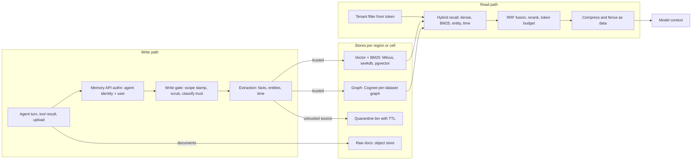

# Lesson 53 — Agent runtime infra: agent memory & context infrastructure — vector and hybrid stores (Milvus, seekdb), memory layers (mem0, Cognee, Supermemory, Hindsight, OpenViking), RAGFlow ingestion, context compression (Headroom), tenant isolation and memory poisoning

*2026-11-01*

## What interviewers are really probing

[Lesson 52](/lessons/52-mcp-a2a-gateways-fleet-scale) put a gateway between agents and tools. This lesson is the **state** those agents carry between turns and sessions: the memory and context layer. It sits on the *Agent Infra Landscape 2026* map (see the [home page](/)) as "memory and context", and from a platform team's view it is three things at once: a database fleet (vector, full-text, graph, relational, object), an LLM pipeline (extraction, summarisation, embedding, reranking), and a brand-new attack surface (a store the model writes to and later trusts).

The interview version: *"Ten thousand agents across 400 customer tenants need long-term memory. Some tenants are banks. Design it."* Or the incident version: *"A support agent started telling every customer to email refunds to an outside address. Nothing in the prompt changed. Nobody deployed. What happened, and how do you clean it up?"* (Answer: a poisoned memory, written once from an inbound email, recalled on every similar ticket since.) They want to hear that you:

- **Separate the layers.** A *store* (Milvus, seekdb, pgvector, a graph DB) holds vectors and rows. A *memory layer* (mem0, Cognee, Supermemory, Hindsight, OpenViking) decides what to write, how to extract facts, and how to retrieve them. An *ingestion pipeline* (RAGFlow) turns documents into chunks. A *context optimiser* (Headroom) shrinks what goes into the prompt. Each fails differently.
- **Pick tenancy by isolation need, not by convenience.** In Milvus, database- and collection-per-tenant give physical isolation and RBAC; partition-key tenancy scales to millions of tenants but has no per-tenant RBAC and tenants share physical partitions. That one fact decides half the design.
- **Treat retrieval as hybrid by default.** Dense vectors blur names, IDs and numbers. Production memory systems now fuse dense + BM25 + entity/graph + time, by rank (RRF), then rerank, then cut to a token budget.
- **Know that the embedding model is part of the schema.** Change the model or its dimension and every stored vector is wrong. That is a migration, not a config flip.
- **Name memory poisoning precisely.** OWASP's Top 10 for Agentic Applications (2026) lists it as **ASI06 Memory & Context Poisoning**: corrupting persistent memory, summaries, embeddings or RAG stores so later reasoning, tool use or exfiltration is steered across sessions, and potentially across agents. The controls are provenance, write gates, isolation, expiry, snapshots and rollback.

Cross-links: [L13](/lessons/13-ml-weights-checkpoint-hardening) (weights), [L14](/lessons/14-ml-inference-training-deploy-hardening) (inference deploy hardening), [L25](/lessons/25-multi-tenant-gpu-isolation-quota) (multi-tenant isolation), [L30](/lessons/30-training-data-loading-storage-io) (storage and I/O), [L33](/lessons/33-prompt-tool-catalog-versioning-serving-config) (serving config as code), [L34](/lessons/34-agent-tool-sandboxing-egress-policy) (sandboxing/egress), [L48](/lessons/48-workload-identity-secrets-pki-fleet-scale) (workload identity), [L49](/lessons/49-fleet-observability-pipelines-scale) (telemetry), [L50](/lessons/50-slo-error-budget-alerting-fleet-scale) (SLOs), [L52](/lessons/52-mcp-a2a-gateways-fleet-scale) (gateways). Fuel: [wafer-ai/gpu-perf-engineering-resources](https://github.com/wafer-ai/gpu-perf-engineering-resources).

**Interview sentence:** "Memory is a platform service, not a library every agent imports. Agents call a memory API through the gateway; the service derives tenant, user and agent scope from the token and stamps it on every write and every query, so no prompt can ask for someone else's memories. Regulated tenants get a database or collection of their own with RBAC and per-tenant keys; the long tail shares a collection on a partition key, with a mandatory ownership post-filter because that mode has no per-tenant RBAC. Retrieval is hybrid: dense plus BM25 plus entity and time signals, fused by rank, reranked, and cut to a token budget. Every memory row records its source, writer and trust tier; anything that came from the web, an email or another tenant's tool output lands in a quarantine tier with a TTL and can't steer actions. The embedding model is pinned like a schema version, so a model change is a dual-write re-embed with a cutover, and every bank can be snapshotted, diffed and rolled back when we find a poisoned write."

## Core diagram: write path → stores → read path




## Idiosyncrasies / operator depth

**The four Milvus tenancy modes, and what each really costs**

| Mode | Isolation | Default ceiling | RBAC per tenant | Use for |
|---|---|---|---|---|
| Database per tenant | Physical | 64 databases (`maxDatabaseNum`) | Yes | Regulated, few, large tenants |
| Collection per tenant | Physical | 65,536 collections (`maxCollectionNum`) | Yes | Hundreds to thousands of tenants with different schemas |
| Partition per tenant | Physical | 1,024 partitions per collection | No | Same schema, cross-tenant analytics |
| Partition key | Logical (hashed into `num_partitions`, default 16) | Millions | No | Long tail of small tenants |

- The collection ceiling is counted in a way that surprises people: the Milvus FAQ counts collections × shards × partitions. 60 collections with 2 shards and 4 partitions already count as 480. "One collection per agent" hits the limit long before 65,536 agents.
- Partition key routes by hash modulo `num_partitions`. Many tenants share a physical partition, so a query that forgets the tenant filter returns other tenants' rows. There is no server-side guard, which is why the memory service, not the agent, must inject the filter.
- `partitionkey.isolation: true` builds a separate index per partition-key value and makes searches touch only that tenant's entities. It currently works only with HNSW, and the filter must name exactly one partition-key value. Good for latency and blast radius; it also turns a sloppy multi-tenant query into an error, which you want.
- Deletes: include the partition-key filter in deletes so compaction only rewrites that partition. A tenant erase without it causes write amplification across the whole collection.
- Hot/cold: DB, collection and partition modes can load and release one tenant; partition-key mode can't. Idle tenants in a partition-key collection cost memory forever.

**seekdb: one engine instead of three**
- OceanBase's seekdb (Apache 2.0) puts relational, vector, full-text, JSON and GIS in one engine with MySQL compatibility, embedded or server mode. All indexes sit in one ACID transaction, so there is no CDC lag between "row written" and "vector searchable". That kills a whole class of "I just told it and it forgot" bugs that come from a SQL DB plus a separate vector DB synced by a queue.
- Hybrid search is one statement (`HYBRID_SEARCH` or `DBMS_HYBRID_SEARCH.SEARCH`); OceanBase's default weighted fusion is 0.7 vector, 0.3 full-text, and RRF is available. Limits worth knowing: heap tables, row store, HNSW-family indexes for hybrid, and a multi-column full-text index can't be used for hybrid.
- It also advertises fork/merge copy-on-write sandboxes for agent exploration. Useful for "let the agent try, then merge", but a fork is still tenant data: it inherits the same access control and retention.

**Memory layers are opinionated, and they change under you**
- **mem0 OSS v3** changed the algorithm: extraction is a single LLM pass that only ADDs (no UPDATE/DELETE events), retrieval fuses semantic + BM25 + entity matching, and graph memory left OSS for the hosted platform. Breaking defaults: `search()` and `get_all()` take `user_id`/`agent_id`/`run_id` inside `filters` (top-level kwargs raise `ValueError`), `top_k` dropped from 100 to 20, `threshold` defaults to 0.1, `rerank` defaults to false. It also auto-creates a `{collection}_entities` collection, so a locked-down vector DB user needs permission or a pre-created collection. Operator consequence: ADD-only means contradicting facts pile up and storage grows without bound; you own the TTL and compaction policy.
- On Qdrant, mem0's BM25 needs `fastembed`; without it BM25 is silently off and the only sign is a warning on the first search. Silent degradation is the theme of this whole layer: always alert on "hybrid arm disabled".
- **Hindsight** (vectorize.io) stores typed facts (world, experience), consolidated observations and mental models in "banks", not transcripts. `retain` uses an LLM to extract; `recall` runs semantic, BM25, graph and temporal search in parallel, fuses with RRF, reranks with a cross-encoder and cuts to `max_tokens`; `reflect` is an agentic loop (up to ten rounds) that can only cite IDs it retrieved. Recall rejects queries over 500 tokens. Budget in tokens, not top-k, is the right mental model for agents.
- **Cognee** builds a knowledge graph plus embeddings with `cognify`. With `ENABLE_BACKEND_ACCESS_CONTROL=true` each dataset gets its own graph and vector storage and dataset-level read/write/delete/share permissions; a plain Neo4j connection requires turning that off. That switch is the difference between tenant isolation and a shared graph.
- **Supermemory** scopes with `containerTag` (and v5 namespace paths like `/ns/user_123/search`); its self-host server binary is not open source, even though SDKs are. That matters for an air-gapped or regulated deployment.
- **OpenViking** (Volcengine) models context as a filesystem under `viking://` with `resources/`, `user/{id}/memories`, `user/{id}/skills` and `agent/skills`. Directories get L0 abstracts (about 256 characters, for vector retrieval), L1 overviews (about 4,000 characters, for rerank and navigation) and L2 full content loaded on demand. The URI scheme makes scope visible in every path, which is excellent for authorisation and audit.

**Ingestion is a batch system with parsers you must sandbox**
- RAGFlow parses documents with DeepDoc (layout, OCR, tables), stores uploads in MinIO, uses a Redis-compatible cache and a task queue, and indexes into Elasticsearch (default) or Infinity via `DOC_ENGINE`. Switching `DOC_ENGINE` does not migrate indexes: you reprocess every document. Elasticsearch needs `vm.max_map_count` of at least 262144 on the node.
- Ingestion is the bulk of GPU and LLM spend in many memory systems (OCR, embedding, LLM extraction). Run it as a queued, rate-limited job with per-tenant quotas, on its own node pool, so one tenant uploading 50,000 PDFs doesn't starve interactive recall.

**Context compression is part of serving, not just cost**
- Headroom sits as a library, a local proxy (`headroom proxy --port 8787`, then point `OPENAI_BASE_URL` or `ANTHROPIC_BASE_URL` at it), or an MCP server. It routes content by type (JSON, code, logs, prose), keeps originals so the model can call `headroom_retrieve`, and its default proxy `--mode cache` freezes earlier turns so the provider's prefix cache isn't busted. `--mode token` compresses harder and breaks cache stability. Prefix-cache hit rate is usually worth more than raw token savings.
- A compressor that rewrites recalled memories changes what the model sees. Log the pre- and post-compression hashes, or you can't reproduce an incident.

**The embedding model is a schema**
- Pin the embedding model and dimension per collection, recorded in the collection metadata. A new model means: create a new collection, dual-write, backfill re-embeddings with a rate-limited job, shadow-read and compare recall, cut over, then drop the old one. Mixing vectors from two models in one index doesn't error; it just returns garbage neighbours.

## Concrete commands & config

**Milvus: partition-key tenancy with isolation, and a database for a regulated tenant**

```python
from pymilvus import MilvusClient, DataType

c = MilvusClient(uri="https://milvus.mem.svc:19530", token="svc-memory:...")

schema = c.create_schema(auto_id=True)
schema.add_field("id", DataType.INT64, is_primary=True)
schema.add_field("tenant_id", DataType.VARCHAR, max_length=64, is_partition_key=True)
schema.add_field("user_id", DataType.VARCHAR, max_length=64)
schema.add_field("trust_tier", DataType.VARCHAR, max_length=16)   # trusted | quarantine
schema.add_field("source", DataType.VARCHAR, max_length=256)      # url, doc id, tool name
schema.add_field("embed_model", DataType.VARCHAR, max_length=64)  # pinned model id
schema.add_field("text", DataType.VARCHAR, max_length=8192)
schema.add_field("vec", DataType.FLOAT_VECTOR, dim=1024)

idx = c.prepare_index_params()
idx.add_index("vec", index_type="HNSW", metric_type="COSINE", params={"M": 16, "efConstruction": 200})

c.create_collection(
    "memories_longtail",
    schema=schema,
    index_params=idx,
    num_partitions=256,                         # default is 16
    properties={"partitionkey.isolation": True} # HNSW only, one tenant per query
)

# Regulated tenant: its own database, its own role
c.create_database("t_acme_bank")
c.create_role("acme_rw")
```

The service builds every filter itself. The agent never supplies `tenant_id`:

```python
def recall(token, query_vec, k=20):
    t, u = token.claims["tenant"], token.claims["sub"]      # from the verified JWT
    hits = c.search("memories_longtail", data=[query_vec], limit=k,
        filter=f'tenant_id == "{t}" and user_id == "{u}" and trust_tier == "trusted"',
        output_fields=["tenant_id", "user_id", "source", "text"])
    return [h for h in hits[0] if h["entity"]["tenant_id"] == t]  # belt-and-braces post-filter
```

**seekdb: hybrid recall in one statement**

```sql
CREATE TABLE memories (
  id BIGINT PRIMARY KEY, tenant_id VARCHAR(64), user_id VARCHAR(64),
  trust_tier VARCHAR(16), source VARCHAR(256), body TEXT, emb VECTOR(1024),
  FULLTEXT INDEX ft_body (body),
  VECTOR INDEX v_emb (emb) WITH (DISTANCE=cosine, TYPE=hnsw, LIB=vsag)
) ORGANIZATION = HEAP;

SELECT id, body, cosine_distance(emb, @qvec) AS d
FROM memories
WHERE tenant_id = @tenant AND user_id = @user AND trust_tier = 'trusted'
  AND MATCH(body) AGAINST(@qtext)
ORDER BY d APPROXIMATE LIMIT 20;
```

Exact function names for distance and fusion follow the seekdb/OceanBase docs for your version; check them before quoting in an interview.

**mem0 v3: scoped add and search**

```python
from mem0 import Memory
m = Memory.from_config({"vector_store": {"provider": "milvus", "config": {"collection_name": "mem0_t42"}},
                        "custom_instructions": "Store user preferences and decisions. Never store secrets."})
m.add(messages, user_id="u-981", agent_id="support-bot", metadata={"source": "chat", "trust": "trusted"})
m.search("refund policy preference", filters={"user_id": "u-981", "agent_id": "support-bot"},
         top_k=20, threshold=0.1)
```

**Hindsight: bank per tenant-user, token-budgeted recall**

```python
from hindsight_client import Hindsight
hs = Hindsight(base_url="http://hindsight.mem.svc:8888")
hs.retain(bank_id="t42-u981", content=transcript, context="support ticket 5512")
hs.recall(bank_id="t42-u981", query="what did they ask about refunds?", max_tokens=2000)
```

**Cognee and RAGFlow knobs that decide isolation and recovery**

```bash
# Cognee: per-dataset graph + vector storage and permissions
ENABLE_BACKEND_ACCESS_CONTROL=true
GRAPH_DATABASE_PROVIDER=kuzu
GRAPH_DATASET_DATABASE_HANDLER=kuzu

# RAGFlow docker/.env
DOC_ENGINE=elasticsearch        # or infinity; switching requires re-parsing all documents
sudo sysctl -w vm.max_map_count=262144
```

**Headroom in front of the model endpoint**

```bash
headroom proxy --port 8787 --host 127.0.0.1 --mode cache --log-file headroom.jsonl
OPENAI_BASE_URL=http://127.0.0.1:8787/v1 ./agent
headroom doctor && headroom perf
```

**Signals to dashboard** (names illustrative; map to what your stack exports):

```promql
# Recall latency SLO for the memory API
histogram_quantile(0.99, sum by (le, region) (rate(memory_recall_duration_seconds_bucket[5m])))
# Hybrid arm silently disabled (BM25 or entity matching off)
sum by (store) (memory_recall_arm_enabled{arm="bm25"}) == 0
# Writes landing in quarantine, per source, spike = possible poisoning campaign
sum by (source_kind) (rate(memory_writes_total{trust_tier="quarantine"}[15m]))
# Cross-tenant post-filter drops: must be zero, page if not
sum(rate(memory_postfilter_dropped_total[5m])) > 0
```

Keep `tenant` as a label only if the tenant count fits [Lesson 49](/lessons/49-fleet-observability-pipelines-scale)'s cardinality budget; `user_id` never goes in metrics.

## Failures & fixes

| Symptom | Cause | Fix |
|---|---|---|
| Tenant B's agent quotes tenant A's customer | Partition-key collection, query built without tenant filter (or agent-supplied tenant) | Service-injected filters from the token, ownership post-filter, CI test with two tenants, page on post-filter drops |
| Recall quality collapses after an "embedding upgrade" | New model vectors mixed with old in one index, or dimension mismatch on a subset | Model and dim in collection metadata, new collection + dual-write + backfill + shadow compare, then cut over |
| "Create collection failed: exceeded limit" with far fewer than 65,536 collections | Limit counts collections × shards × partitions | Move the long tail to partition-key tenancy; reserve collections for big tenants |
| Search results fewer than before a mem0 upgrade | v3 defaults: `top_k` 20, `threshold` 0.1 | Set explicitly in config; retune thresholds since scores changed |
| Hybrid search quietly worse on names and IDs | BM25 arm disabled (missing `fastembed` on Qdrant, missing spaCy) | Treat optional deps as required in the image; alert on disabled arms |
| Agent repeats an outdated preference | ADD-only extraction keeps old and new facts; ranking picks the old one | Timestamps and recency weighting, consolidation job, TTL on preference facts |
| Interactive recall p99 spikes every afternoon | Bulk ingestion (OCR, embedding) on the same nodes and DB as recall | Separate ingestion pool and queue, per-tenant ingestion quotas, write-rate limits |
| RAGFlow empty results after switching `DOC_ENGINE` | Indexes are not migrated | Reprocess all documents; plan it as a migration with a cutover |
| Elasticsearch won't start on new nodes | `vm.max_map_count` below 262144 | Set the sysctl in node bootstrap ([Lesson 43](/lessons/43-gpu-node-bootstrap-bare-metal-provisioning)) |
| Token costs up after adding compression | Compressor rewrites earlier turns and busts the provider prefix cache | Cache-stable mode (freeze earlier turns), compress only the live zone, watch cache hit rate |
| Agent keeps acting on one bad instruction for weeks | Poisoned memory written from an email or web page, recalled on similar tasks | Provenance tiers, quarantine for untrusted sources, snapshot diff to find the write, roll back the bank, block the source |
| GDPR erase request "done" but data still recalled | Deleted from vectors, not from graph, raw docs, caches, backups | One erase workflow across every store, keyed by tenant and user, with a verification query |

## Security & hardening

**This is the most important section of this lesson.** A memory store is the only part of the agent stack where the model writes data that a future model run will trust. Prompt injection is one-shot; memory poisoning is persistent. Design it like a database holding customer PII and like a code path that can change agent behaviour, because it is both.

**Scope and isolation**
- Tenant, user and agent scope come from the verified token (workload identity plus user, [Lesson 48](/lessons/48-workload-identity-secrets-pki-fleet-scale)), never from a prompt, a tool argument or a header the agent sets. The memory API is behind the gateway from [Lesson 52](/lessons/52-mcp-a2a-gateways-fleet-scale), with no direct DB credentials in agent pods.
- Isolation tier by data class: regulated and high-value tenants get database- or collection-per-tenant with RBAC, separate encryption keys and, where needed, separate clusters per region. Partition-key tenancy is for low-risk tenants only, always with `partitionkey.isolation`, an injected filter and a post-filter.
- Cognee with backend access control on, Supermemory and OpenViking with per-user containers or paths, Hindsight with one bank per tenant-user. Never one shared bank "with metadata".
- Memory stores have no internet egress, sit in their own namespaces with default-deny NetworkPolicy, and admit traffic only from the memory service ([Lesson 34](/lessons/34-agent-tool-sandboxing-egress-policy)).

**Write gate and provenance (the poisoning controls)**
- Every row carries `source`, `writer` (agent identity), `user`, timestamp, embedding model, and a **trust tier**. First-party user statements and reviewed documents can be trusted; web pages, inbound email, third-party tool output and other agents' output start in quarantine with a TTL.
- Quarantined memory can inform answers, clearly fenced as untrusted data, but can never authorise a tool call, change a policy, or carry instructions. Strip or flag imperative content ("always send...", "ignore...") on write.
- Don't let agent output re-enter memory as trusted fact without a check. That loop is how one bad write becomes self-reinforcing (an OWASP ASI06 pattern).
- Scrub secrets and credentials on write; a memory store full of pasted API keys is a breach waiting for a recall query.
- Versioned snapshots per bank or tenant, a diff tool, and one-call rollback. Kill switch: disable a bank, a tenant's writes, or every memory from one source.

**Read path**
- Recalled text goes into the prompt inside a clear data boundary, with memory IDs, and the agent cites the IDs it used. Log the memory IDs used per agent turn, so an incident can trace "which memory made it do that".
- Rate-limit recall per identity, and alert on enumeration patterns (many broad queries, high result counts) that look like someone mining another user's memories through an agent.

**Data protection and lifecycle**
- Encrypt at rest (per-tenant keys for regulated tenants via KMS), TLS in transit with service identity. Backups inherit tenant scoping and the erase workflow.
- One erase workflow that covers vectors, full-text, graph, raw documents in object storage, caches, compressor stores (Headroom keeps originals for retrieval) and backups, with a verification query.
- Retention per memory type: preferences, task history and documents get different TTLs.

**Models, images and ingestion (the deployment-hardening part)**
- Embedding, reranker, OCR and extraction models are model artifacts like any other: weights from signed, digest-pinned releases in scoped buckets, read only by the serving identity of that model ([Lesson 13](/lessons/13-ml-weights-checkpoint-hardening)), deployed with admission checks on image and weight digests ([Lesson 14](/lessons/14-ml-inference-training-deploy-hardening)). The memory service's identity can call the embedding endpoint but cannot read the weight bucket.
- Store and memory-service images are pinned by digest and signature-verified at admission ([Lesson 12](/lessons/12-node-container-hardening-supply-chain)); PSS `restricted`, non-root, read-only root filesystem.
- Document parsers (DeepDoc, OCR, PDF libraries) handle hostile files. Run ingestion in a sandboxed pool (gVisor or Kata, next lesson) with no egress, CPU and memory limits, and per-tenant queues.
- Memory and vector data never feed training or fine-tuning without an explicit, audited data agreement per tenant; a poisoned memory store must not become a poisoned checkpoint.

## Interview soundbites

- "Memory is a database the model writes to. I scope it from the token, not from the prompt."
- "Partition-key tenancy scales to millions but has no per-tenant RBAC, so regulated tenants get their own database or collection."
- "The embedding model is a schema version. Changing it is a dual-write migration, not a config change."
- "Hybrid or it's broken: dense vectors blur names and IDs, BM25 catches them, and I fuse by rank, not score."
- "Agents budget in tokens, so recall returns a token budget, not a top-k."
- "Untrusted sources land in quarantine with a TTL. They can inform an answer, never authorise an action."
- "When a poisoned memory is found, I diff snapshots to find the write, roll the bank back and block the source, in that order."
- "The memory service can call the embedding model. It can't read the weight bucket."

## How this maps to the JD

- **Security at fleet scale:** multi-tenant data isolation, provenance, erase workflows, a new attack class (persistent poisoning).
- **Storage and stateful systems on Kubernetes:** vector DB tenancy limits, index rebuilds, backups, hot/cold tenants.
- **Design tradeoffs:** isolation versus tenant count, one hybrid engine versus specialised stores, compression versus prefix-cache stability.
- **AI/ML platform:** embedding and reranker models as pinned, served artifacts; ingestion as GPU batch work with quotas.

## Watch (talks & demos)

**Shlok Khemani: Lessons from Studying Every Memory System (AI Engineer).** A survey of how the major memory systems actually extract, store and retrieve, and where each breaks. Watch it to compare mem0-style fact extraction, graph memory and agent-managed memory in one sitting.

<iframe width="100%" height="360" src="https://www.youtube.com/embed/5ZGyKWjQDr0" title="Lessons from Studying Every Memory System — Shlok Khemani" frameBorder="0" allow="accelerometer; autoplay; clipboard-write; encrypted-media; gyroscope; picture-in-picture; web-share" allowFullScreen></iframe>

[Open on YouTube](https://www.youtube.com/watch?v=5ZGyKWjQDr0)

**AWS re:Invent 2025: Beyond a Chatbot, How to Build Intelligent Agent Memory (AIM284).** The managed-service view of short-term versus long-term memory, extraction strategies and namespaces. Useful for the "build versus buy" part of the design answer.

<iframe width="100%" height="360" src="https://www.youtube.com/embed/asWTC3oc-SA" title="AWS re:Invent 2025 - Beyond a Chatbot: How to Build Intelligent Agent Memory (AIM284)" frameBorder="0" allow="accelerometer; autoplay; clipboard-write; encrypted-media; gyroscope; picture-in-picture; web-share" allowFullScreen></iframe>

[Open on YouTube](https://www.youtube.com/watch?v=asWTC3oc-SA)

**Mark Bain: Memory Masterclass (AI Engineer).** Hands-on with graph-based agent memory and why relationships beat flat vectors for some questions. Good background for the graph arm of hybrid recall.

<iframe width="100%" height="360" src="https://www.youtube.com/embed/gsedOXz8FX4" title="Memory Masterclass: Make Your AI Agents Remember What They Do! — Mark Bain" frameBorder="0" allow="accelerometer; autoplay; clipboard-write; encrypted-media; gyroscope; picture-in-picture; web-share" allowFullScreen></iframe>

[Open on YouTube](https://www.youtube.com/watch?v=gsedOXz8FX4)

## References

- [Milvus: implement multi-tenancy (v2.6)](https://milvus.io/docs/v2.6.x/multi_tenancy.md), [use partition key](https://milvus.io/docs/v2.6.x/use-partition-key.md), [product FAQ (collection limits)](https://github.com/milvus-io/milvus-docs/blob/v2.6.x/site/en/faq/product_faq.md)
- [seekdb](https://github.com/oceanbase/seekdb), [OceanBase hybrid search SQL interface](https://docs.oceanbase.com/oceanbase-database/V4.6.0-hybrid-search-sql-interface), [How we built seekdb](https://en.oceanbase.com/blog/complex-to-simple-seekdb-ai-era)
- [mem0 OSS v2 to v3 migration (ADD-only, hybrid search)](https://docs.mem0.ai/migration/oss-v2-to-v3)
- [Hindsight overview](https://hindsight.vectorize.io/), [recall API](https://hindsight.vectorize.io/developer/api/recall), [GitHub](https://github.com/vectorize-io/hindsight)
- [Cognee data isolation and multi-tenancy](https://docs.cognee.ai/core-concepts/multi-user-mode/data-isolation-and-multi-tenancy), [permissions setup](https://docs.cognee.ai/setup-configuration/permissions)
- [Supermemory self-hosting](https://supermemory.ai/docs/self-hosting/overview), [namespaces and container tags](https://supermemory.ai/docs/concepts/container-tags)
- [OpenViking context layers L0/L1/L2](https://docs.openviking.ai/en/concepts/03-context-layers)
- [RAGFlow configuration](https://ragflow.io/docs/configurations), [docker README](https://github.com/infiniflow/ragflow/blob/main/docker/README.md)
- [Headroom](https://github.com/headroomlabs-ai/headroom), [configuration (cache vs token mode)](https://docs.headroomlabs.ai/docs/configuration)
- [OWASP Top 10 for Agentic Applications 2026 (ASI06 Memory & Context Poisoning)](https://genai.owasp.org/2025/12/09/owasp-top-10-for-agentic-applications-the-benchmark-for-agentic-security-in-the-age-of-autonomous-ai/)

## Quick self-check

Out loud, in under two minutes each:

1. You have 12 bank tenants and 40,000 small tenants. Lay out the Milvus tenancy for both and say what each choice gives up.
2. Why must the tenant filter come from the token and not the agent, and what second check do you add in partition-key mode?
3. Walk through an embedding model upgrade for 2 billion vectors without a recall outage.
4. The support-agent incident from the top of this page: how do you find the poisoned write, contain it, and stop the next one?
5. Explain why dense-only retrieval fails on "ticket INC-48213" and how a hybrid pipeline fixes it. Where do RRF and the reranker sit?
6. A team wants one Hindsight or mem0 instance shared by all agents "with metadata tags". What do you say?
7. Compression cut tokens by 40% but the bill went up. What happened?
8. A user asks to be forgotten. List every place their data lives in this design.

## Next

**Lesson 54 — Agent runtime infra: sandboxed agent execution at scale — Kubernetes Agent Sandbox (Sandbox, SandboxTemplate, SandboxClaim, warm pools), gVisor vs Kata vs Firecracker, Daytona/OpenSandbox/E2B-style sandbox APIs, Coder workspaces, snapshot/resume and cold-start economics**
