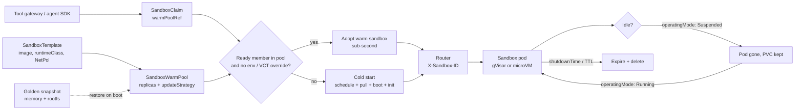

# Lesson 54 — Agent runtime infra: sandboxed agent execution at scale — Kubernetes Agent Sandbox (Sandbox, SandboxTemplate, SandboxClaim, warm pools), gVisor vs Kata vs Firecracker, Daytona/OpenSandbox/E2B-style sandbox APIs, Coder workspaces, snapshot/resume and cold-start economics

*2026-11-02*

## What interviewers are really probing

[Lesson 34](/lessons/34-agent-tool-sandboxing-egress-policy) answered *"is it safe?"*: isolation tiers, the tool gateway, default-deny egress. This lesson answers the question that comes right after: *"is it fast and cheap enough that nobody routes around it?"* A sandbox platform that takes 45 seconds to hand out a box gets bypassed by the first team on a deadline, and that bypass is your next incident. So the platform is a **latency and capacity product built on top of an isolation product**.

The interview version: *"Coding and data agents need a fresh Linux box per task. Peak is 300 new sandboxes a second, p95 time-to-first-command under one second, sessions can idle for hours and resume. Some code is hostile. Design it."* Or the incident version: *"After Tuesday's template change, a fifth of sessions fail with `ModuleNotFoundError`, claim latency went from 200 ms to 40 s, and the security team says two sandboxes produced identical TLS session keys. What happened?"* (Answers below: stale warm pool on `OnReplenish`, claims that set `spec.env` silently cold-starting, and clones restored from one memory snapshot without reseeding entropy.) They want to hear that you:

- **Separate the API from the runtime.** The orchestrator (Kubernetes [agent-sandbox](https://github.com/kubernetes-sigs/agent-sandbox), E2B's runtime, OpenSandbox's server, Daytona) hands out and tracks sandboxes. The runtime (gVisor, Kata, Firecracker, Cloud Hypervisor) is the boundary. Speed tricks live in between: warm pools, snapshots, lazy memory, copy-on-write disks.
- **Know where cold-start time actually goes.** Scheduling + image pull + kernel or Sentry boot + *runtime init*. Runtime init (`pip install`, `node_modules`, cloning the repo, loading a tokenizer) usually dominates, and only a memory snapshot or a pre-warmed pool removes it.
- **Know the agent-sandbox v1beta1 API cold.** `Sandbox` (`agents.x-k8s.io`), plus extensions `SandboxTemplate`, `SandboxWarmPool`, `SandboxClaim` (`extensions.agents.x-k8s.io`). `v1alpha1` was removed in v1.0.0. Suspend/resume is `spec.operatingMode: Running | Suspended`, not `replicas: 0`.
- **Size warm pools with math, not vibes.** Pool size is a function of burst rate, refill rate and refill latency; idle pool cost is replicas × requests × hours. And there are hard controller ceilings you must shard around.
- **Treat snapshots as both a performance feature and a secret.** A memory snapshot contains everything the process had in RAM. Clone it a thousand times and you have a thousand copies of its RNG state, host keys and any token you forgot to keep out.

Cross-links: [L11](/lessons/11-cluster-security-pss-admission-rbac) (admission/RBAC), [L12](/lessons/12-node-container-hardening-supply-chain) (node hardening, images), [L13](/lessons/13-ml-weights-checkpoint-hardening) (weights), [L25](/lessons/25-multi-tenant-gpu-isolation-quota) (multi-tenant isolation), [L27](/lessons/27-gpu-supply-chain-weight-registry-hydrate) (image and weight hydrate), [L28](/lessons/28-inference-autoscaling-scale-to-zero) (scale-to-zero economics), [L34](/lessons/34-agent-tool-sandboxing-egress-policy) (sandboxing and egress), [L44](/lessons/44-gpu-cluster-control-plane-scaling) (apiserver, etcd, APF), [L48](/lessons/48-workload-identity-secrets-pki-fleet-scale) (workload identity), [L52](/lessons/52-mcp-a2a-gateways-fleet-scale) (gateways), [L53](/lessons/53-agent-memory-context-infrastructure) (memory). Fuel: [wafer-ai/gpu-perf-engineering-resources](https://github.com/wafer-ai/gpu-perf-engineering-resources).

**Interview sentence:** "Sandboxes are a platform service with one front door: the tool gateway asks for a claim against a named, admin-owned template, and users can't create raw pods or sandboxes. Each template pins a signed image and a runtime class by threat, gVisor for density and microVMs for hostile or credentialed work, on tainted pools with no service-account token and default-deny egress. Latency comes from warm pools sized to our p99 burst times refill time, sharded so no single pool exceeds the controller's per-pool refill ceiling, and from golden memory snapshots taken before any secret or tenant data exists, with entropy reseeded on every restore. Idle sessions suspend to disk and resume on demand, so we pay for storage, not cores. We watch warm-hit ratio and claim-to-ready latency per template as SLIs, and we treat the snapshot bucket like a secrets store."

## Core diagram

![Sandboxed agent execution at scale: a request path where the tool gateway creates a SandboxClaim against a warm pool, warm hits adopt in sub-second time while claims setting env or volume templates cold-start, routed via X-Sandbox-ID; a control plane where the agent-sandbox controller reconciles templates and warm pools with per-pool workqueues, an expectations gate, refill pacing, sharding and an APF overlay; a data plane of gVisor, Kata and Firecracker tiers with snapshot restore, GKE Pod Snapshots, E2B, OpenSandbox and Coder prebuilt workspaces; cold-start economics; snapshot and pool hazards; and a six-point security floor](/sandboxed-agent-execution-scale.png)



## Idiosyncrasies / operator depth

### 1. The agent-sandbox object model (v1beta1, v1.0+)

| Object | Group | Who creates it | What it really is |
|---|---|---|---|
| `Sandbox` | `agents.x-k8s.io` | Controller (via claim or pool), or an admin | A singleton, stateful, stable-identity pod + headless Service + optional PVCs. `spec.podTemplate`, `volumeClaimTemplates`, `operatingMode`, `shutdownTime`, `shutdownPolicy` |
| `SandboxTemplate` | `extensions.agents.x-k8s.io` | Platform team | The blueprint: pod template, plus `networkPolicy` / `networkPolicyManagement` (`Managed` default), `envVarsInjectionPolicy` and `volumeClaimTemplatesPolicy` (both `Disallowed` by default) |
| `SandboxWarmPool` | extensions | Platform team | `replicas` + `sandboxTemplateRef` + `updateStrategy` (`OnReplenish` default, or `Recreate`) |
| `SandboxClaim` | extensions | The agent / gateway | `warmPoolRef`, optional `lifecycle` (`shutdownTime`, `ttlSecondsAfterFinished`, `shutdownPolicy`), `additionalPodMetadata`, `env`, `volumeClaimTemplates` |

Things that bite:

1. **Warm adoption has silent opt-outs.** A claim that sets `spec.env` or `spec.volumeClaimTemplates` *always* cold-starts, even with a full pool, because you can't inject env into a running pod. `additionalPodMetadata` is applied in place and doesn't break adoption. If an SDK helpfully passes the user's API key as env, your warm-hit ratio drops to zero and nobody notices until p95 explodes. Pass per-task data over the sandbox's API after adoption instead.
2. **Ownership transfers on claim.** Once claimed, the sandbox belongs to the claim, not the pool. The pool refills; template updates never touch claimed sandboxes. So a rollout of a template only reaches new claims.
3. **`OnReplenish` keeps stale members.** Change the image in the template and the pool keeps its old, Ready members until each is claimed or deleted. Fine for a cosmetic change; terrible for a CVE fix or a broken dependency. Use `Recreate` for security rollouts (stale unclaimed members are deleted immediately, at the cost of a cold-start dip). Metadata-only template edits never mark members stale.
4. **Two lifecycles.** `Sandbox.shutdownTime` expires the sandbox (pod + Service torn down; object retained by default with `Ready=False, reason SandboxExpired`). `SandboxClaim.lifecycle.shutdownTime` is enforced by the claim controller and *not* copied down. Default `shutdownPolicy` is `Retain` on both, which means expired objects pile up in etcd unless you set `Delete` or `ttlSecondsAfterFinished`.
5. **Suspend is a pod delete, not a freeze.** `operatingMode: Suspended` terminates the pod and keeps the Sandbox and its PVCs. `Running` creates a *new* pod from the *current* pod template that reattaches the volumes. Disk survives; process memory does not (unless a snapshot provider like GKE Pod Snapshots restores it). The old `replicas: 0/1` alpha trick was replaced because it collided with `/scale` semantics.
6. **Upgrading from 0.4/0.5 is a two-hop.** v1.0.0 removed `v1alpha1`. Go to 0.5.x, run the storage migration, confirm every CRD's `status.storedVersions` is only `["v1beta1"]`, apply CRDs *before* `helm upgrade` (Helm doesn't upgrade `crds/`), then clean up the orphaned conversion-webhook Service/Secret/Role/RoleBinding. Don't delete the cluster-scoped `ClusterRole`; the controller still needs it.

### 2. Controller throughput is a real ceiling

Numbers from the project's own performance guide, and they're the ones to quote:

- **Burst warm adoption** (draining a Ready pool, no pod creation on the hot path): about **300 claims/s per cluster at p90 ≤ 200 ms**.
- **Sustained adoption with concurrent refill**: about **70–85 sandboxes/s per `SandboxWarmPool`**. Reconciles are serialized per pool key, so `--sandbox-warm-pool-concurrent-workers` only helps *across* pools.
- **The expectations gate.** After a create batch, a pool waits until its informer has seen the `ADD` events before creating more. Watch lag of 10–30 s under write load freezes refill for that pool; the fallback timeout is 5 minutes. Fix with `--separate-watch-connection=true` and `--api-connections=4`.
- **Unpaced refill hurts.** Default `--sandbox-warm-pool-max-refill-rate=0` means bursts up to `--sandbox-warm-pool-max-batch-size` (default 300). Each `Sandbox` is about 10 KB in etcd (inlined pod template plus `managedFields`), so a 300-create burst spikes MVCC and the watch cache. Pace it, and **shard pools above ~500–1,000 replicas or ~30 claims/s sustained** (4 × 450 beats 1 × 1,800).
- **Under watch lag, rate is capped by batches per round-trip.** Effective refill ≈ `min(rate, batch) / L` for lag `L` seconds, so size `rate ≥ claims/s × L / pools`.
- **Everything shares `workload-low` by default.** The controller's traffic hits the built-in `service-accounts` FlowSchema. The optional APF overlay splits it into *claim path* (non-lendable floor) > *bulk refill* (mostly lendable) > *events* (sacrificial). It's an isolation guarantee, not a latency trick: on an idle apiserver it changes nothing. On a shared control plane it stops a noisy tenant (or your own refill storm) from queuing adoption writes. Tie this to [L44](/lessons/44-gpu-cluster-control-plane-scaling).

### 3. Cold-start economics

Break claim-to-first-command into four terms and attack the biggest:

| Term | Typical driver | Lever |
|---|---|---|
| Pool wait / adopt | pool empty, refill behind | pool sizing, sharding, refill pacing |
| Schedule | no node capacity, taints, quota | headroom nodes on the sandbox pool (low-priority placeholder pods), cluster-autoscaler warm buffer |
| Image | multi-GB images, cold node | slim images, pre-pulled on node image, lazy-pull snapshotters, local registry mirror ([L27](/lessons/27-gpu-supply-chain-weight-registry-hydrate)) |
| Boot + runtime init | gVisor Sentry start, VM boot, interpreter + deps + repo | memory snapshot restore; golden-snapshot warm pools |

**Pool sizing.** A pool must absorb the burst while refill catches up: `replicas ≈ peak_claims/s × refill_time_s` (refill time = cold-start p95, not p50), plus headroom for template rollouts. Example: 40 claims/s peak with a 45 s cold start needs ~1,800 warm members, which is four pools of 450 by the sharding rule. Idle cost is `replicas × requests × hours`: at 0.5 vCPU / 1 GiB each, 1,800 members reserve 900 vCPU and 1.8 TiB *doing nothing*. That's why you size per template, by time of day, and keep sandboxes' *requests* small with *limits* higher.

**Snapshot restore changes the curve.** E2B's runtime makes *every* create a resume: templates are pre-booted Firecracker VMs stored in object storage, memory is served lazily on page fault with `userfaultfd`, and the rootfs is a copy-on-write overlay, so fresh creates, resumes and forks take the same path. Firecracker itself `mmap`s the memory file `MAP_PRIVATE`, so pages load on demand and clones share clean pages (a density win). On GKE, Pod Snapshots + agent-sandbox can build a **golden warm pool**: snapshot one "primer" sandbox (memory + rootfs) to GCS, and every pool member whose distilled pod spec matches the policy boots already restored from it. OpenSandbox's Firecracker runtime advertises 64 ms P50 serial creation with pause/resume of memory and disk.

**Suspend instead of keeping idle sessions hot.** An interactive coding session idles most of its life. Suspend after N minutes idle: you keep a PVC (cheap) and drop cores and RAM (expensive). Resume costs a pod start, so pair it with a pre-pulled image. Watch `agent_sandbox_resume_latency_ms` and `agent_sandbox_resume_total{result="error"}`.

### 4. The landscape, as an operator sees it

| Option | What it is | Isolation | Operator notes |
|---|---|---|---|
| **agent-sandbox** (SIG Apps) | K8s CRDs + controller + router | Delegated to `runtimeClassName` (gVisor, Kata) | You run it on your clusters; quotas, RBAC, NetPol, APF are yours. Roadmap: auto suspend/resume, 1,000+ claims/s, first-class router, MCP server |
| **E2B runtime** (`e2b-dev/runtime`, Apache-2.0) | Control-plane API, per-node orchestrator, in-VM agent, edge router, template builder | Firecracker microVMs | Snapshot-first design; needs KVM (bare metal or nested virt) and fast object storage near nodes |
| **OpenSandbox** (AAIF project) | Sandbox server + SDKs/CLI/MCP; Docker locally, Kubernetes operator in cluster | Containers or Firecracker "Fast Sandbox" | Per-sandbox egress policies, ingress gateway, credential vault, resource pools for RL/eval batches |
| **Daytona** | Sandbox platform with snapshots, volumes, network limits | Dedicated kernel per sandbox | The public OSS repo stopped being maintained in June 2026 (development moved private). Self-hosting it means owning a fork |
| **Coder** | Workspaces from Terraform templates | Whatever the template provisions (pod, VM) | Built for humans plus their agents; prebuilt workspaces are the warm pool equivalent. Long-lived, so patching and idle shutdown matter more than claim latency |

### 5. gVisor, Kata and Firecracker in this context

L34 covered the boundary. What changes at fleet scale:

- **gVisor** wins on density and start time (no guest kernel) and supports checkpoint/restore (`runsc checkpoint` / `runsc restore`), which is what GKE Pod Snapshots builds on. Syscall- and small-file-heavy init (`pip`, `npm`) is where it's slowest, so snapshotting *after* dependency install pays the most here.
- **Kata** gives a guest kernel per pod through the normal CRI path, so it fits agent-sandbox unchanged, but needs KVM and carries per-VM memory overhead; account for it with `RuntimeClass.overhead` or your bin-packing lies.
- **Firecracker** directly (E2B, OpenSandbox Fast Sandbox) gives the fastest snapshot clone path, but you inherit its rules: snapshot integrity is only a 64-bit CRC on the VM state file (memory and disk files aren't verified), network connections aren't guaranteed to survive restore, vsock connections are closed, and snapshots taken during early boot can crash on resume.

## Concrete commands & config

### Template, pool and claim (v1beta1)

```yaml
apiVersion: extensions.agents.x-k8s.io/v1beta1
kind: SandboxTemplate
metadata:
  name: py-data-v14
  namespace: sbx-tenant-acme
spec:
  podTemplate:
    metadata:
      labels: {sandbox.corp/template: py-data-v14}
    spec:
      runtimeClassName: gvisor-untrusted
      automountServiceAccountToken: false     # also the controller's default via templates
      nodeSelector: {sandbox.corp/pool: gvisor}
      tolerations:
      - {key: sandbox.corp/tier, value: untrusted, effect: NoSchedule}
      containers:
      - name: runtime
        image: registry.corp/sbx/py-data@sha256:4f1c...   # digest, signed
        resources:
          requests: {cpu: 250m, memory: 512Mi}
          limits:   {cpu: "2", memory: 4Gi, ephemeral-storage: 8Gi}
        securityContext:
          runAsNonRoot: true
          allowPrivilegeEscalation: false
          capabilities: {drop: ["ALL"]}
  networkPolicyManagement: Managed   # default: ingress only from router; egress public only,
                                     # RFC1918 + metadata blocked. Add sidecar ports explicitly.
  envVarsInjectionPolicy: Disallowed
  volumeClaimTemplatesPolicy: Disallowed
---
apiVersion: extensions.agents.x-k8s.io/v1beta1
kind: SandboxWarmPool
metadata: {name: py-data-v14-a, namespace: sbx-tenant-acme}
spec:
  replicas: 450
  sandboxTemplateRef: {name: py-data-v14}
  updateStrategy: {type: Recreate}   # security rollouts must not leave stale members
---
apiVersion: extensions.agents.x-k8s.io/v1beta1
kind: SandboxClaim
metadata:
  generateName: task-
  namespace: sbx-tenant-acme
spec:
  warmPoolRef: {name: py-data-v14-a}
  lifecycle:
    shutdownTime: "2026-11-02T16:00:00Z"   # hard wall-clock cap for this task
    ttlSecondsAfterFinished: 300
    shutdownPolicy: Delete
  # no env, no volumeClaimTemplates: keeps the claim on the warm path
```

### Suspend, resume, inspect

```bash
# Suspend an idle session (pod deleted, PVC + Sandbox kept)
kubectl -n sbx-tenant-acme patch sandbox task-7k2qp --type merge \
  -p '{"spec":{"operatingMode":"Suspended"}}'
kubectl -n sbx-tenant-acme get sandbox task-7k2qp \
  -o jsonpath='{range .status.conditions[*]}{.type}={.status} {.reason}{"\n"}{end}'

# Resume (new pod from the CURRENT podTemplate, reattaches volumes)
kubectl -n sbx-tenant-acme patch sandbox task-7k2qp --type merge \
  -p '{"spec":{"operatingMode":"Running"}}'

# Pool health: total vs ready, and stale members after a template change
kubectl -n sbx-tenant-acme get sandboxwarmpool \
  -o custom-columns=NAME:.metadata.name,REPLICAS:.status.replicas,READY:.status.readyReplicas

# Pre-upgrade gate for v1.0.0
for crd in sandboxes.agents.x-k8s.io sandboxclaims.extensions.agents.x-k8s.io \
           sandboxtemplates.extensions.agents.x-k8s.io sandboxwarmpools.extensions.agents.x-k8s.io; do
  printf '%s: ' "$crd"; kubectl get crd "$crd" -o jsonpath='{.status.storedVersions}'; echo
done
```

### Controller flags for high claim rates

```yaml
args:
- --leader-elect=true
- --extensions=true
- --separate-watch-connection=true      # writes can't starve the watch that clears expectations
- --api-connections=4
- --sandbox-warm-pool-max-refill-rate=25   # pace refill; size >= claims/s * watchLag / pools
- --sandbox-warm-pool-max-batch-size=200
- --sandbox-warm-pool-concurrent-workers=4 # = number of active pools (per-pool serialization)
- --disable-sandbox-events=true
- --disable-claim-events=true
- --disable-claim-observability-annotations=true
- --cache-label-selectors=true          # informer holds sandbox pods only (matters >5k pods)
```

Then apply the APF overlay from `examples/apf-insulation/` if the control plane is shared.

### SLIs and alerts

```promql
# Warm-hit ratio per template (target > 0.95 for interactive templates)
sum by (sandbox_template) (rate(agent_sandbox_claim_creation_total{launch_type="warm"}[10m]))
/ sum by (sandbox_template) (rate(agent_sandbox_claim_creation_total[10m]))

# Claim-to-ready p95 by launch type
histogram_quantile(0.95, sum by (le, launch_type, sandbox_template)
  (rate(agent_sandbox_claim_controller_startup_latency_ms_bucket[5m])))

# Pool draining: ready fraction of each pool below 20% (sandbox_status: ready|pending|succeeded|failed)
sum by (namespace, warmpool_name) (agent_sandbox_warmpool_size{sandbox_status="ready"})
/ sum by (namespace, warmpool_name) (agent_sandbox_warmpool_size) < 0.2

# Resume failures
sum by (sandbox_template) (increase(agent_sandbox_resume_total{result="error"}[15m])) > 0
```

### Golden snapshot hygiene (Firecracker-style or GKE Pod Snapshots)

```bash
# Inside the primer, BEFORE snapshot: no secrets, no tenant data, no per-instance identity
rm -f /var/lib/systemd/random-seed /etc/ssh/ssh_host_*   # regenerate on restore
test -z "$(env | grep -Ei 'token|secret|key=' )" || { echo "secret in env, refusing"; exit 1; }

# On restore (or via the VMM's snapshot-load notification): reseed the guest CSPRNG
# kernels >= 5.18 reseed on VMGenID; for older guests or zero race window, issue
# RNDADDENTROPY + RNDRESEEDCRNG (Firecracker random-for-clones.md, Annex 1)

# Snapshot bucket: uniform access, CMK, only the snapshot identity can read/write
gcloud storage buckets create gs://acme-sbx-snapshots --location=us-central1 \
  --uniform-bucket-level-access --default-encryption-key=projects/p/locations/us-central1/keyRings/sbx/cryptoKeys/snap
```

## Failures & fixes

| Symptom | Root cause | Fix |
|---|---|---|
| Warm pool full, yet claim p95 is 40 s | Claims set `spec.env` (or `volumeClaimTemplates`), forcing cold start | Pass per-task data over the sandbox API after adoption; keep `envVarsInjectionPolicy: Disallowed`; alert on warm-hit ratio |
| `ModuleNotFoundError` in a fraction of sessions after a template change | `OnReplenish` pool still serving stale members | `updateStrategy: Recreate` for breaking or security changes; version template names (`py-data-v14`) and repoint pools |
| Pool stuck below target for minutes after a burst | Expectations gate waiting on lagging watch events | `--separate-watch-connection`, `--api-connections=4`, more pools, paced refill |
| Apiserver 429s and etcd growth during refills | 300-create unpaced bursts, events and annotations on every transition | `--sandbox-warm-pool-max-refill-rate`, smaller batch size, disable events/annotations, APF overlay |
| Other teams' controllers slow down when agents spike | Sandbox controller shares `workload-low` | APF overlay or a dedicated sandbox cluster per cell |
| Two sandboxes produce identical "random" values | Cloned from one memory snapshot without reseeding | Reseed on restore (VMGenID on ≥5.18, ioctls otherwise), regenerate host keys and IDs, no RNG use before snapshot |
| Resume works but process state is gone | Suspend kept disk only; no memory snapshot provider | Expected behavior; checkpoint app state to the PVC, or use a snapshot-capable runtime |
| Restored VMs lose network | Snapshot captured live connections and old addressing | Re-plumb networking after restore; reconnect in the guest agent; follow Firecracker's network-for-clones guidance |
| Sidecar health checks fail in sandboxes | Managed NetworkPolicy is default-deny ingress except router | Add the sidecar ports to the template's `networkPolicy.ingress` |
| Expired sandboxes pile up in etcd | `shutdownPolicy: Retain` default | `Delete` + `ttlSecondsAfterFinished`, and a janitor for orphaned PVCs |
| Upgrade to v1.0.0 rejected by apiserver | `v1alpha1` still in `storedVersions` | Hop through 0.5.x, run the storage migration, prune storedVersions, apply CRDs before `helm upgrade` |
| Cold start fine in test, 50 s in prod | Image pull on fresh nodes during scale-up | Pre-pull into node images, mirror registry in-cell, headroom placeholder pods on the sandbox pool |

## Security & hardening

This is the section that matters most for this topic: everything that makes sandboxes *fast* (pools, snapshots, shared pages, routers) is a way to accidentally share state across tenants.

### Isolation and admission

- **Tier by threat and enforce it at admission.** Model-generated or third-party code runs on gVisor or a microVM, never `runc`. A ValidatingAdmissionPolicy per sandbox namespace rejects any pod without `runtimeClassName` in the allowed set, with `automountServiceAccountToken: true`, `hostNetwork`, `hostPath`, or privileged containers ([L11](/lessons/11-cluster-security-pss-admission-rbac)).
- **Templates are the only door.** Tenants and agents get `create` on `SandboxClaim` only. `Sandbox`, `SandboxTemplate`, `SandboxWarmPool` and raw pods are platform-team only, because a raw `Sandbox` lets the caller choose the pod spec.
- **Keep claim overrides off.** `envVarsInjectionPolicy` and `volumeClaimTemplatesPolicy` at `Disallowed` stop a claim from mounting someone else's PVC or overriding `PATH`/proxy settings, and as a bonus keep you on the warm path.
- **Reserved labels.** The controller filters `agents.x-k8s.io/*` and `extensions.agents.x-k8s.io/*` keys from user templates because spoofing `agents.x-k8s.io/sandbox-name-hash` let one sandbox's pod join another's Service (a traffic-hijack primitive). Run a controller version with that fix, and add an admission rule that denies those keys anywhere a tenant can write.

### Router and network

- The router maps `X-Sandbox-ID` to a sandbox: it *is* tenant routing. Authenticate every request at the gateway, bind the session token to the sandbox ID, make IDs unguessable, and alert on any request where the token's tenant ≠ the sandbox's tenant. The project's threat model notes the Go router has no connection limits or timeouts for upgraded connections, so rate-limit and cap WebSockets at the gateway.
- Managed NetworkPolicy gives ingress-from-router-only and public-internet-only egress with RFC1918 and metadata blocked. That's a floor. For credentialed work, egress goes through the identity-aware proxy from [L34](/lessons/34-agent-tool-sandboxing-egress-policy), with credentials injected at the proxy, never inside the sandbox.

### Snapshots are secrets

- A memory snapshot is a full RAM dump. Take golden snapshots **before** any credential, tenant data or session identity exists; fail the pipeline if env or files contain secrets.
- Per-session snapshots (pause/resume) contain that tenant's data: store them per tenant, encrypt with a customer-managed key, and give read/write only to the snapshot service identity. On GKE the pod's KSA reads and writes the bucket via Workload Identity and the GKE service agent needs delete for retention pruning; scope both to that one bucket ([L48](/lessons/48-workload-identity-secrets-pki-fleet-scale)).
- **Verify what you restore.** Firecracker checks only a CRC on the state file; memory and disk files aren't verified. Hash and sign snapshot artifacts and check them before restore, the same way you treat weights.
- **Uniqueness after clone.** Reseed the CSPRNG, regenerate host keys, `machine-id`, `boot_id` (bind-mount) and any instance tokens. Userspace RNGs (language runtimes, TLS libraries) that seeded before the snapshot are on you; don't initialize them in the primer.
- Retention: delete per-session snapshots when the claim ends or on erase requests ([L53](/lessons/53-agent-memory-context-infrastructure) data-subject flow).

### Images, registries and provenance

- Template images by digest, signed (cosign/Sigstore) and verified at admission; built from a minimal base, rebuilt on CVE, rolled with `Recreate`. Sandbox nodes pull only from the in-cell mirror ([L12](/lessons/12-node-container-hardening-supply-chain), [L27](/lessons/27-gpu-supply-chain-weight-registry-hydrate)).
- Golden snapshots are build artifacts with provenance: record template digest, kernel/runtime version and the build that produced them; a snapshot whose template digest doesn't match the pool's template is rejected.

### Model weights, checkpoints and GPU sandboxes

- General-purpose sandbox pools never mount model weights or have read access to weight buckets. If agents need a model, they call the inference gateway ([L52](/lessons/52-mcp-a2a-gateways-fleet-scale)), they don't load weights.
- GPU sandboxes (RL rollouts, eval harnesses) get a **separate tainted GPU pool**, read-only digest-pinned weights hydrated by the platform, per-model scoped bucket IAM, no write path to checkpoint buckets, and no co-location with production inference nodes that cache weights on local NVMe ([L13](/lessons/13-ml-weights-checkpoint-hardening), [L25](/lessons/25-multi-tenant-gpu-isolation-quota)). gVisor's GPU support (`nvproxy`) is narrower than runc's; test each driver version.
- Never snapshot a GPU sandbox that has weights or KV cache resident unless the snapshot store is held to the same controls as the weight bucket.

### Lifecycle, quota and audit

- Every claim has a `shutdownTime` and TTL; per-tenant `ResourceQuota` on `count/sandboxclaims.extensions.agents.x-k8s.io`, CPU and memory so one runaway agent loop can't drain the pool for everyone.
- Audit claim, adopt, suspend, resume and delete per tenant; ship router access logs; alert on cross-tenant router hits, claims from unexpected service accounts, and snapshot reads by any identity other than the snapshot service.

## Interview soundbites

- "A sandbox platform is a latency product on an isolation product. If it's slow, people bypass it, and the bypass is the breach."
- "Warm-hit ratio is my first SLI. One SDK that passes env on the claim silently turns every request into a cold start."
- "Pool size is peak claims per second times p95 refill time, sharded so no pool goes past the controller's per-pool refill ceiling of roughly 70–85 a second."
- "Suspend is cheap persistence: keep the disk, drop the cores. Resume is a pod start, so pre-pull the image."
- "A memory snapshot is a RAM dump. I take golden snapshots before any secret exists, sign them, and reseed entropy on every clone."
- "`OnReplenish` is fine for features and wrong for CVEs. Security rollouts use `Recreate`."
- "The router is tenant routing. Unguessable IDs, token-bound sessions, and an alert on any cross-tenant hit."

## How this maps to the JD

- **Kubernetes internals at scale:** controller workqueues, informer expectations, watch starvation, APF priority levels, etcd object size.
- **Security:** runtime isolation tiers, admission, multi-tenant routing, snapshot handling as secrets, supply chain for images and snapshots.
- **Design tradeoffs:** warm capacity vs idle cost, gVisor density vs microVM boundary, build vs buy (agent-sandbox vs E2B/OpenSandbox vs managed).
- **AI/ML platform:** sandboxes for coding agents, eval harnesses and RL rollouts, GPU sandbox pools and weight access.

## Watch (talks & demos)

**Abdel Sghiouar: Taming Agentic AI, Run Rogue Code Safely on Kubernetes with Agent Sandbox (Jfokus).** A walk through `SandboxTemplate`, `SandboxClaim` and `SandboxWarmPool` with gVisor, including a live demo of agent-generated code running outside the agent's own environment. Watch it to see the claim flow end to end before you reason about its scaling limits.

<iframe width="100%" height="360" src="https://www.youtube.com/embed/ZJH1kYFKjK8" title="Taming Agentic AI: Run Rogue Code Safely on Kubernetes with Agent Sandbox, by Abdel Sghiouar" frameBorder="0" allow="accelerometer; autoplay; clipboard-write; encrypted-media; gyroscope; picture-in-picture; web-share" allowFullScreen></iframe>

[Open on YouTube](https://www.youtube.com/watch?v=ZJH1kYFKjK8)

**Maggie Lou: Reusing Bazel's analysis cache by cloning micro-VMs (BazelCon 2023).** Not an agent talk, but the best operator-level explanation of Firecracker snapshot cloning in production: splitting 20+ GB snapshots into cacheable chunks, serving memory with `userfaultfd` and disk with FUSE, copy-on-write, and what it costs to keep master snapshots fresh. It's exactly the machinery behind snapshot-first sandbox platforms.

<iframe width="100%" height="360" src="https://www.youtube.com/embed/k30xZfiRZYo" title="Reusing bazel's analysis cache by cloning micro-VMs" frameBorder="0" allow="accelerometer; autoplay; clipboard-write; encrypted-media; gyroscope; picture-in-picture; web-share" allowFullScreen></iframe>

[Open on YouTube](https://www.youtube.com/watch?v=k30xZfiRZYo)

**Maciej Szulik & Janet Kuo: SIG Apps Updates (KubeCon).** The SIG that owns agent-sandbox explains where it sits next to Deployments, StatefulSets and Jobs, with an agent-sandbox overview and demo. Useful for the "why a new workload API instead of a StatefulSet of one" question.

<iframe width="100%" height="360" src="https://www.youtube.com/embed/uj2WVzDndt4" title="SIG Apps Updates: Building the Next Generation of Kubernetes Workloads — Maciej Szulik & Janet Kuo" frameBorder="0" allow="accelerometer; autoplay; clipboard-write; encrypted-media; gyroscope; picture-in-picture; web-share" allowFullScreen></iframe>

[Open on YouTube](https://www.youtube.com/watch?v=uj2WVzDndt4)

## References

- [kubernetes-sigs/agent-sandbox](https://github.com/kubernetes-sigs/agent-sandbox) · [docs](https://agent-sandbox.sigs.k8s.io/docs/) · [warm pool quickstart](https://agent-sandbox.sigs.k8s.io/docs/use-cases/examples/warmpool-quickstart/)
- agent-sandbox [performance tuning](https://github.com/kubernetes-sigs/agent-sandbox/blob/main/docs/performance-tuning.md), [configuration flags](https://github.com/kubernetes-sigs/agent-sandbox/blob/main/docs/configuration.md), [APF insulation](https://github.com/kubernetes-sigs/agent-sandbox/blob/main/docs/apf-insulation.md), [metrics](https://github.com/kubernetes-sigs/agent-sandbox/blob/main/docs/metrics.md), [threat model](https://github.com/kubernetes-sigs/agent-sandbox/blob/main/docs/security/threat_model.md), [v1alpha1 → v1beta1 migration](https://github.com/kubernetes-sigs/agent-sandbox/blob/main/docs/api-migration-guide.md), [roadmap](https://github.com/kubernetes-sigs/agent-sandbox/blob/main/roadmap.md)
- [Golden-snapshot warm pools with GKE Pod Snapshots (example)](https://github.com/kubernetes-sigs/agent-sandbox/tree/main/examples/podsnapshot-golden-warmpool) · [GKE: prepare for Pod snapshots](https://docs.cloud.google.com/kubernetes-engine/docs/how-to/pod-snapshots-prepare)
- [Firecracker snapshot support](https://github.com/firecracker-microvm/firecracker/blob/main/docs/snapshotting/snapshot-support.md) · [entropy for clones](https://github.com/firecracker-microvm/firecracker/blob/main/docs/snapshotting/random-for-clones.md)
- [gVisor checkpoint/restore](https://gvisor.dev/docs/user_guide/checkpoint_restore/)
- [E2B runtime](https://github.com/e2b-dev/runtime) · [E2B sandbox snapshots](https://docs.e2b.dev/sandbox/snapshots)
- [OpenSandbox](https://github.com/opensandbox-group/OpenSandbox)
- [Daytona (archived OSS repo, see notice)](https://github.com/daytonaio/daytona)
- [Coder prebuilt workspaces](https://coder.com/docs/admin/templates/extending-templates/prebuilt-workspaces)
- [Kubernetes API Priority and Fairness](https://kubernetes.io/docs/concepts/cluster-administration/flow-control/)
- [Marc Brooker: Seven Years of Firecracker (clones and shared clean pages)](https://www.brooker.co.za/blog/2025/09/18/firecracker.html)

## Quick self-check

Out loud, in under two minutes each:

1. Peak is 60 claims/s, cold start p95 is 30 s, and watch lag spikes to 10 s under load. How many warm members, how many pools, and what refill rate per pool?
2. Your warm-hit ratio dropped from 0.97 to 0.02 overnight with no template change. Name the most likely cause and how you'd prove it from metrics.
3. A CVE lands in the template base image. Walk through the rollout, including what happens to claimed sandboxes and to stale pool members.
4. Explain the difference between `operatingMode: Suspended` and a memory snapshot pause. When is each the right call?
5. Two cloned sandboxes generated the same session key. Explain the mechanism and the three fixes.
6. A tenant can call the router with any `X-Sandbox-ID`. What breaks, and what controls do you add at the gateway, router and NetworkPolicy?
7. Build vs buy: when do you run agent-sandbox on your own clusters, and when do you pick a Firecracker-native platform like E2B's runtime or OpenSandbox?
8. RL rollouts need GPUs and a model. Design the sandbox pool and its access to weights.

## Next

**Lesson 55 — Agent runtime infra: browser & computer-use agent infrastructure — headless browser fleets (Browser Use, Agent Browser, Firecrawl), CUA desktops and VMs, session and credential vaulting, egress proxies, anti-SSRF and indirect prompt injection from the web**
