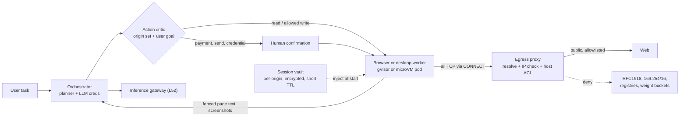

# Lesson 55 — Agent runtime infra: browser & computer-use agent infrastructure — headless browser fleets (Browser Use, Agent Browser, Firecrawl), CUA desktops and VMs, session and credential vaulting, egress proxies, anti-SSRF and indirect prompt injection from the web

*2026-11-03*

## What interviewers are really probing

[Lesson 54](/lessons/54-sandboxed-agent-execution-scale) gave agents a box to run code in. This lesson gives them a **browser or a whole desktop**, and that's harder in one specific way: a code sandbox runs code the agent wrote, but a browser runs code *the whole internet* wrote, renders text *the whole internet* wrote straight into the model's context, and usually holds a logged-in session worth stealing. A browser agent is a confused deputy with a cookie jar.

The interview version: *"Product wants 5,000 concurrent browser agents that log into customer SaaS portals, plus a few hundred full-desktop computer-use agents for legacy apps. Design the fleet, the credential story, and the network."* Or the incident version: *"A browser agent summarizing a support ticket read a hidden instruction on a vendor page, opened `http://169.254.169.254/latest/meta-data/iam/security-credentials/`, and pasted the result into a form. Egress was supposedly forced through a proxy. How did it get out, and what do you change?"* (Answers below: Chromium's implicit proxy bypass sends link-local and loopback hosts **direct**, the node allowed IMDS from pods, and nothing gated a cross-origin write.) They want to hear that you:

- **Split the brain from the hands.** The agent loop (planner, LLM calls, tools, memory) runs in the orchestrator. The browser or desktop is a disposable, low-privilege worker that only receives actions and returns observations. The browser pod never holds model credentials, cloud identity, or a path to the inference cell.
- **Know the browser's own isolation model.** A Playwright `BrowserContext` isolates cookies and storage; it is **not** a security boundary against a renderer or browser exploit. Tenant isolation is a separate browser process in a separate sandboxed pod (gVisor or microVM, [L54](/lessons/54-sandboxed-agent-execution-scale)).
- **Know where the network actually leaks.** Proxy flags vs implicit bypass rules, WebRTC/UDP, DNS rebinding between check and connect, and the cloud metadata endpoint.
- **Treat sessions as credentials.** A `storageState` JSON or a Chromium profile directory *is* the user's login. Vault it, encrypt it with a key that isn't on the same disk, scope it to one origin set, and expire it.
- **Assume indirect prompt injection will sometimes succeed.** Model robustness has improved a lot, but the controls that matter are architectural: origin sets, an action critic that never sees raw page content, confirmation gates on writes, and egress that can't reach anything valuable anyway.

Cross-links: [L5](/lessons/05-cloud-networking-vpc-tgw) (VPC, endpoints), [L8](/lessons/08-cni-cilium-ebpf) (Cilium FQDN policy), [L9](/lessons/09-networkpolicy-multi-nic-sflow) (NetworkPolicy), [L11](/lessons/11-cluster-security-pss-admission-rbac) (admission/RBAC), [L12](/lessons/12-node-container-hardening-supply-chain) (node hardening, images), [L13](/lessons/13-ml-weights-checkpoint-hardening) (weights), [L14](/lessons/14-ml-inference-training-deploy-hardening) (inference hardening), [L34](/lessons/34-agent-tool-sandboxing-egress-policy) (tool sandboxing, egress), [L48](/lessons/48-workload-identity-secrets-pki-fleet-scale) (workload identity, secrets), [L52](/lessons/52-mcp-a2a-gateways-fleet-scale) (MCP/A2A gateways), [L53](/lessons/53-agent-memory-context-infrastructure) (memory poisoning), [L54](/lessons/54-sandboxed-agent-execution-scale) (sandboxes, warm pools). Fuel: [wafer-ai/gpu-perf-engineering-resources](https://github.com/wafer-ai/gpu-perf-engineering-resources).

**Interview sentence:** "Browsers are hands, not brains. The orchestrator holds the plan and the model credentials; each task gets a fresh Chromium in its own gVisor or microVM pod from a warm pool, running non-root with Chromium's sandbox on, no service-account token, and no cloud identity. All egress goes through an identity-aware CONNECT proxy that resolves DNS itself and refuses private, link-local and metadata ranges, with `--proxy-bypass-list=<-loopback>` so Chromium can't go direct, UDP blocked so WebRTC and QUIC can't skip it, and IMDS blocked at the node. Logins come from a vault as short-lived, per-origin session state, injected at task start and never shown to the model. Page content is fenced as untrusted, a separate critic that never sees raw page text approves every write action against the user's goal and the task's origin set, and payments, messages and credential entry need a human. And even if all of that fails, the browser's network can't reach a weight bucket, a registry, or an internal service."

## Core diagram

![Browser and computer-use agent infrastructure: the orchestrator (brain) holds the plan, model credentials and the action critic, and sends actions to disposable browser or desktop workers (hands) claimed from warm pools; workers run Chromium or an Xvfb/VNC desktop in gVisor or microVM pods with no SA token or cloud identity; all egress goes through an identity-aware CONNECT proxy that resolves DNS itself and blocks private, link-local and metadata ranges; sessions come from an encrypted, per-origin vault; page content is fenced as untrusted and write actions pass an origin-set check and confirmation gates; leak paths and the six-point security floor are listed](/browser-computer-use-agent-infra.png)



## Idiosyncrasies / operator depth

### 1. Three shapes of "browser for an agent"

| Shape | Examples | What the model sees | Operator notes |
|---|---|---|---|
| **DOM/accessibility driver** | [Browser Use](https://github.com/browser-use/browser-use) (Python, CDP), [Agent Browser](https://agent-browser.dev/) (Rust CLI over CDP), Playwright MCP | Compact accessibility tree with element refs, optional screenshots | Cheapest per step. Agent Browser's `snapshot -i` returns only interactive elements with `@eN` refs; refs are invalidated on navigation or node replacement, and an ambiguous fallback fails *without acting* rather than clicking the wrong thing |
| **Scrape/crawl service** | [Firecrawl](https://github.com/firecrawl/firecrawl) (API + workers + Playwright service), Browserless | Markdown / extracted JSON | Read-mostly, no user session. Highest fan-out. The SSRF surface is the API: anyone who can submit a URL can make your cluster fetch it |
| **Computer use (CUA)** | Anthropic computer-use reference container, [Cua](https://cua.ai/docs/cua-sdk) sandboxes (Linux containers, QEMU VMs, macOS via Lume on Apple Silicon) | Screenshots of a full desktop; actions are mouse/keyboard | Most expensive per step (an image every turn), works on non-web apps, and has the widest blast radius: a whole OS, file manager, terminal |

### 2. Chromium in containers: the five things that bite

1. **`/dev/shm` is 64 MB by default in Docker.** Chromium uses shared memory heavily and crashes or hangs when it runs out. Playwright's Docker docs recommend `--ipc=host`; Browserless' compose example sets `shm_size: "2g"`. In Kubernetes, mount an `emptyDir` with `medium: Memory` at `/dev/shm` (it counts against the pod's memory limit), or pass `--disable-dev-shm-usage` to fall back to `/tmp`.
2. **Root disables the Chromium sandbox.** Playwright's image runs as root by default, which turns Chromium's sandbox off, and Playwright itself says the image is for testing and *not recommended for untrusted websites*. For crawling, run as a non-root user with a seccomp profile that additionally allows `clone`, `setns` and `unshare` (what Chromium's namespace sandbox needs). Never "fix" a launch error with `--no-sandbox` on a fleet that visits the open web.
3. **PID 1 zombies.** Chromium spawns many child processes. Without an init (`docker run --init`, `tini`, or `shareProcessNamespace`), killed renderers become zombies and the pod slowly suffocates.
4. **Contexts are cheap, isolation is not.** Playwright `BrowserContext`s are "incognito-like" and fast to create, so it's tempting to run 20 tenants as 20 contexts in one browser. That isolates cookies and storage only. A renderer exploit plus a sandbox escape owns every context in the process. Rule: **one browser process per tenant (better, per task), one pod per browser** for untrusted browsing.
5. **CDP is root on the browser.** Anything that reaches the DevTools endpoint can read every cookie, run script in any page and navigate anywhere. Since Chrome 111, WebSocket handshakes with an Origin header not listed in `--remote-allow-origins` get a 403. Since Chrome 136, `--remote-debugging-port` is ignored on the default user-data directory, so automation must use a dedicated `--user-data-dir` (which is the right thing anyway). Keep CDP on loopback inside the pod and expose it only through an authenticated gateway.

### 3. Pooling and capacity

- **Little's law sizes the fleet.** Concurrent sessions ≈ task arrival rate × mean session duration. 50 tasks/s × 90 s average = 4,500 live browsers. Agent sessions are long (tens of steps, each waiting on an LLM call), so they hold a browser far longer than a scrape does. Size by *session-seconds*, not requests.
- **Browserless-style knobs:** `CONCURRENT` (running sessions, default 10), `QUEUED` (waiting, default 10; beyond `CONCURRENT + QUEUED` you get HTTP 429), `TIMEOUT` (ms, default 30000; `-1` disables it and leaks sessions if clients don't close). `MAX_RECONNECT_TIME` defaults to `Infinity`. Route on `/pressure` so the balancer skips busy workers, set `EXTERNAL` or reconnect/live URLs point at `localhost:3000`, and keep the LB read timeout above `TIMEOUT` or sessions drop with no error code. If `TOKEN` is unset, **every endpoint is unauthenticated, including `/function`**.
- **Firecrawl self-host knobs:** the shipped compose gives `playwright-service` 2 CPUs and 4 GB with `MAX_CONCURRENT_PAGES` mapped from `CRAWL_CONCURRENT_REQUESTS` (default 10), which implies a budget of roughly 400 MB per concurrent page. Maintainers note `NUQ_WORKER_COUNT` is what actually sets worker processes; `NUM_WORKERS_PER_QUEUE`, `MAX_CONCURRENT_JOBS` and `BROWSER_POOL_SIZE` appear in compose but current code doesn't appear to consume them. Workers reject jobs above `MAX_CPU`/`MAX_RAM` (default 0.8).
- **Warm pools from L54 apply directly.** A browser pod with Chromium launched and a blank context is a warm member. Claim it, inject the session, navigate. Never return a used browser to the pool: destroy on task end.
- **Playwright protocol vs raw CDP.** `browserType.connect()` (Playwright server) is full fidelity and version-locked (client and server versions must match). `connectOverCDP()` works with any Chromium but Playwright documents it as "significantly lower fidelity". Pick one per fleet and pin versions in the image.

### 4. Computer-use desktops

- The reference stack is Xvfb (virtual X display) + a light window manager + apps + an agent loop; the Anthropic demo container exposes VNC 5900, noVNC 6080, Streamlit 8501 and a combined UI on 8080, and its `x11vnc` runs with `-nopw -shared`. Fine on a laptop, **unacceptable in a cluster**: put VNC behind authenticated, per-session access or don't expose it.
- **Resolution is a cost and accuracy knob.** Anthropic recommends XGA 1024×768 for general desktop work and 1280×800 or 1366×768 for web apps, nothing above 1920×1080, and scaling in your own tool rather than relying on the API (screenshots over the model's limit are rejected). Coordinates come back in screenshot pixels, so if you downscale you must scale clicks back up. A mismatch here looks like "the agent keeps clicking 20 px to the left".
- **Each step ships an image to the inference cell.** On newer Claude models a screenshot costs `⌈w/28⌉ × ⌈h/28⌉` visual tokens, so 1280×800 is 46 × 29 = 1,334 tokens per step before any text. Hundreds of CUA agents at a step every few seconds is a real prefill load on the inference side ([L21](/lessons/21-inference-serving-slos-ttft-tpot-kvcache)); rate-limit and cap screenshot size at the orchestrator.
- **Desktop isolation tiers.** A Linux desktop in a container shares the host kernel, so run it on gVisor or Kata exactly like L54 sandboxes (Cua uses gVisor for Linux containers when available). Windows needs a real VM (KubeVirt, cloud VMs). macOS only runs on Apple hardware (Cua's Lume), which makes it a separately capacity-planned pool.

### 5. The network: where browser egress actually leaks

- **Chromium's implicit proxy bypass.** With a manually configured `--proxy-server`, Chromium still sends `localhost`, `*.localhost`, `127.0.0.1/8`, `[::1]`, **`169.254/16`** and `[FE80::]/10` **direct**, not through the proxy. The cloud metadata endpoint is link-local. So "all egress goes through the proxy" is false unless you add `--proxy-bypass-list="<-loopback>"` *and* back it with NetworkPolicy. PAC scripts can't remove the implicit rules at all.
- **Proxy decisions are by hostname.** Chromium decides "proxy or not" from the URL host; the proxy must do the IP check. A good egress proxy (Stripe's [Smokescreen](https://github.com/stripe/smokescreen)) resolves the name itself, refuses non-public IPs by default, checks each DNS answer, and connects to the address it validated. That closes the DNS-rebinding window that app-level checks have when the app resolves once to validate and the browser resolves again to connect.
- **Hostname ACLs vs IP rules.** Smokescreen's ACL (`version: v1`, per-service `action: open | report | enforce`, `allowed_domains`) applies to hostnames *as written in the request*; IP blocks belong in the main config (`deny_ranges`, `allow_ranges`). Its `global_deny_list` blocks names, not destinations, so an `open` role can still reach the IP directly. Allowlist, don't denylist. Overlapping IP rules default to allow-wins; set `most_specific_ip_rules: true` to get longest-prefix-wins with deny on ties.
- **UDP walks around HTTP proxies.** WebRTC (STUN/TURN) and QUIC are UDP. Agent Browser disables WebRTC peer connections when its allowlist is on and launches local Chrome with `disable_non_proxied_udp`; you should also block UDP egress except DNS to the cluster resolver.
- **Chrome Local Network Access (Chrome 142+)** prompts before public pages reach private or loopback addresses. Headless fleets hit the prompt and hang; the common "fix" is `--disable-features=LocalNetworkAccessChecks` or granting `local-network-access` to every context. That removes a free layer of anti-SSRF defense. Leave it on and grant only for internal-app tasks that need it.
- **Library allowlists are not firewalls.** Browser Use's `allowed_domains` and Agent Browser's `--allowed-domains` are useful policy, and Agent Browser's blocks sub-resources, WebSockets, EventSource and `sendBeacon` too. But both run *inside* the thing you don't trust. Agent Browser's own docs say its allowlist "is not an operating-system firewall". Treat them as layer 2, the proxy as layer 1.

### 6. Sessions and credentials

- **Session state is a bearer credential.** Playwright's docs: the state file "may contain sensitive cookies and headers that could be used to impersonate you". `storageState` covers cookies, localStorage and (optionally) IndexedDB, which is *off by default*, so Firebase-style logins silently don't restore. sessionStorage isn't persisted at all.
- **What the tools give you.** Agent Browser's auth vault stores profiles under `~/.agent-browser/auth/`, always AES-256-GCM, but if `AGENT_BROWSER_ENCRYPTION_KEY` isn't set it auto-generates the key at `~/.agent-browser/.encryption-key`, on the same disk. In a pod, inject the key from your secret manager or the encryption is decorative. Browserbase Contexts persist a Chromium user-data directory encrypted at rest (AES-256-CBC per its docs), with bring-your-own-storage for S3 and customer KMS. Browser Use's `sensitive_data` shows the model placeholders and fills real values at action time; TOTP secrets go in keys ending `bu_2fa_code`.
- **Screenshots leak what placeholders hide.** Filled password fields are masked, but account numbers, PII and one-time codes on the page are not. Browser Use recommends `use_vision=False` on sensitive pages. Anything in a screenshot lands in the model provider's logs and your traces (Lesson 56 territory).
- **Credentials belong to a vault, sessions to a task.** The pattern: human logs in once in a supervised session (or an OAuth/SSO flow), the resulting session state is encrypted per user and per origin, a task claims it read-only with a TTL, and the worker never writes it back unless the task is "refresh session". Prefer delegated OAuth tokens via the tool gateway ([L52](/lessons/52-mcp-a2a-gateways-fleet-scale)) over browser logins whenever an API exists.

### 7. Indirect prompt injection: what actually works

- **The threat is real and measured.** Anthropic's Nov 2025 numbers had Opus 4.5 at about 1% attack success against an adaptive best-of-N attacker; on its newer professional red-team set, attacks that reached the model succeeded 17.6% of the time against Opus 4.5 and 3.8% against Opus 5 before safeguards, and none succeeded against Sonnet 5 or Opus 5 with probes plus the action classifier. "Better models" is a layer, not a plan: your fleet will run more than one model, including cheaper ones.
- **Chrome's architecture is the reference design.** A **User Alignment Critic** (separate model) vets each proposed action and sees only *action metadata*, never raw page content, so the page can't poison it directly. **Agent Origin Sets** split read-only origins from read-writable ones per task, decided by a gating function also isolated from page content; iframes outside the set aren't shown to the model; model-generated URLs are checked deterministically against known public URLs. Sensitive sites, password-manager sign-in and payments or messages require user confirmation. A prompt-injection classifier runs in parallel with planning.
- **Make it infrastructure.** You can build the same shape in your orchestrator: fence page content as untrusted (Agent Browser's `--content-boundaries` wraps output in nonce-tagged markers), cap output size (`--max-output`) so a page can't flood the context, enforce an action policy (deny `eval`, `download`, `upload` by default), and send any write to an origin outside the task's write set through confirmation. Map it to OWASP's agentic list (ASI01 goal hijack) and keep the injection corpus in CI.
- **Assume success and cap the damage.** If the agent is hijacked, what can it reach? With the network and identity controls above: public allowlisted sites, one task's session, nothing internal. That's the actual control.

## Concrete commands & config

### Browser worker pod (warm-poolable, untrusted web)

```yaml
apiVersion: v1
kind: Pod
metadata:
  name: browser-worker
  namespace: agents-browser
  labels: {app: browser-worker, egress: via-proxy}
spec:
  runtimeClassName: gvisor-untrusted          # or kata; never runc for the open web
  automountServiceAccountToken: false
  hostUsers: false                            # user namespaces (on by default 1.33, GA 1.36)
  enableServiceLinks: false
  nodeSelector: {sandbox.corp/pool: browser}
  tolerations:
  - {key: sandbox.corp/tier, value: untrusted, effect: NoSchedule}
  securityContext:
    runAsNonRoot: true
    runAsUser: 10001
    seccompProfile:
      type: Localhost
      localhostProfile: profiles/chromium.json   # RuntimeDefault + clone/setns/unshare
  containers:
  - name: chromium
    image: registry.corp/agents/chromium-worker@sha256:9b2e...   # digest, signed
    args:
    - --headless=new
    - --user-data-dir=/profile                       # never the default dir (Chrome 136+)
    - --remote-debugging-address=127.0.0.1
    - --remote-debugging-port=9222
    - --remote-allow-origins=http://127.0.0.1:9223   # only the in-pod sidecar
    - --proxy-server=http://egress-proxy.egress.svc:4750
    - --proxy-bypass-list=<-loopback>                # kill implicit DIRECT for 169.254/16, 127/8
    - --force-webrtc-ip-handling-policy=disable_non_proxied_udp
    - --disable-quic
    resources:
      requests: {cpu: 500m, memory: 1Gi}
      limits:   {cpu: "2", memory: 3Gi, ephemeral-storage: 2Gi}
    securityContext:
      allowPrivilegeEscalation: false
      readOnlyRootFilesystem: true
      capabilities: {drop: ["ALL"]}
    volumeMounts:
    - {name: shm, mountPath: /dev/shm}
    - {name: profile, mountPath: /profile}
    - {name: tmp, mountPath: /tmp}
  - name: cdp-gateway                                # authn, per-session token, audit log
    image: registry.corp/agents/cdp-gateway@sha256:1c7a...
    ports: [{containerPort: 9223}]
  volumes:
  - {name: shm, emptyDir: {medium: Memory, sizeLimit: 1Gi}}   # counts against memory limit
  - {name: profile, emptyDir: {sizeLimit: 512Mi}}             # destroyed with the pod
  - {name: tmp, emptyDir: {sizeLimit: 1Gi}}
```

### NetworkPolicy: the browser can only talk to the proxy and DNS

```yaml
apiVersion: networking.k8s.io/v1
kind: NetworkPolicy
metadata: {name: browser-egress-proxy-only, namespace: agents-browser}
spec:
  podSelector: {matchLabels: {egress: via-proxy}}
  policyTypes: [Ingress, Egress]
  ingress:
  - from:
    - namespaceSelector: {matchLabels: {kubernetes.io/metadata.name: agents-orchestrator}}
    ports: [{port: 9223, protocol: TCP}]
  egress:
  - to:
    - namespaceSelector: {matchLabels: {kubernetes.io/metadata.name: egress}}
      podSelector: {matchLabels: {app: smokescreen}}
    ports: [{port: 4750, protocol: TCP}]
  - to:
    - namespaceSelector: {matchLabels: {kubernetes.io/metadata.name: kube-system}}
      podSelector: {matchLabels: {k8s-app: kube-dns}}
    ports: [{port: 53, protocol: UDP}, {port: 53, protocol: TCP}]
  # nothing else: no 169.254.169.254, no RFC1918, no UDP 443 (QUIC), no inference cell
```

With Cilium, add a `CiliumNetworkPolicy` with `toFQDNs` on the **proxy's** egress (not the browser's) for per-role allowlists ([L8](/lessons/08-cni-cilium-ebpf)).

### Egress proxy (Smokescreen) — IP rules in config, host ACL per role

```yaml
# smokescreen.yaml (main config)
ip: "0.0.0.0"
port: 4750
connect_timeout: 10s
most_specific_ip_rules: true
deny_ranges:            # explicit, on top of the default non-public block
  - 169.254.0.0/16      # IMDS / link-local
  - 100.64.0.0/10       # CGNAT, often internal in clouds
  - 10.0.0.0/8
  - 172.16.0.0/12
  - 192.168.0.0/16
  - fd00::/8
acl_file: /config/acl.yaml
```

```yaml
# acl.yaml (roles = client identity from mTLS cert; hostnames as requested)
version: v1
services:
  - name: browser-task-portal        # logged-in SaaS tasks: tight allowlist
    project: agents
    action: enforce
    allowed_domains:
      - portal.vendor-a.com
      - "*.vendor-a-cdn.net"
  - name: browser-research           # open-web reading: report first, enforce later
    project: agents
    action: report
default:
  project: other
  action: enforce
  allowed_domains: []
```

```bash
smokescreen --config-file /config/smokescreen.yaml \
  --tls-server-bundle-file /tls/bundle.pem --tls-client-ca-file /tls/ca.pem \
  --max-concurrent-connect-tunnels 20000 --dns-timeout 3s \
  --expose-prometheus-metrics --prometheus-metrics-format v2 --prometheus-listen-ip 127.0.0.1
```

### Node and cloud metadata

```bash
# AWS: IMDSv2 required, hop limit 1 so non-hostNetwork pods can't get node creds
aws ec2 modify-instance-metadata-options --instance-id i-0abc... \
  --http-tokens required --http-put-response-hop-limit 1 --http-endpoint enabled

# Prove it from inside a browser pod (should fail on every line)
kubectl -n agents-browser exec browser-worker -c chromium -- sh -c '
  curl -sS -m 3 http://169.254.169.254/ ; echo rc=$?
  curl -sS -m 3 -x http://egress-proxy.egress.svc:4750 http://169.254.169.254/ ; echo rc=$?
  curl -sS -m 3 -x http://egress-proxy.egress.svc:4750 http://localtest.me/ ; echo rc=$?'
```

### Agent Browser, production-style

```bash
export AGENT_BROWSER_ENCRYPTION_KEY="$(vault kv get -field=key secret/agents/ab-key)"  # not the auto key
export AGENT_BROWSER_CONTENT_BOUNDARIES=1
export AGENT_BROWSER_MAX_OUTPUT=50000
cat > /etc/agent-browser/policy.json <<'JSON'
{ "default": "deny", "allow": ["navigate","snapshot","click","fill","scroll","wait","get"] }
JSON
agent-browser --allowed-domains "portal.vendor-a.com,*.vendor-a-cdn.net" \
  --action-policy /etc/agent-browser/policy.json \
  --confirm-actions download,upload,eval \
  open https://portal.vendor-a.com
agent-browser snapshot -i          # @eN refs; re-snapshot after every navigation
```

### Browser Use, production-style

```python
profile = BrowserProfile(
    cdp_url="ws://127.0.0.1:9223/session/<token>",   # in-pod gateway, not raw 9222
    allowed_domains=["portal.vendor-a.com", "*.vendor-a-cdn.net"],  # keep < 100 entries
    block_ip_addresses=True,             # no IP-literal navigation
    enable_default_extensions=False,     # default True loads uBlock/cookie/ClearURLs extensions
)
agent = Agent(task=task, llm=llm, browser_profile=profile,
              sensitive_data={"vendor_user": u, "vendor_pass": p}, use_vision=False)
```

### Browserless worker env

```bash
TOKEN=<from secret>          # unset = unauthenticated, including /function
CONCURRENT=10  QUEUED=15  TIMEOUT=300000  MAX_RECONNECT_TIME=60000
EXTERNAL=https://browsers.agents.corp  HEALTH=true  MAX_MEMORY_PERCENT=90  MAX_CPU_PERCENT=90
ENABLE_CORS=false  ALLOW_GET=false  ALLOW_FILE_PROTOCOL=false
```

### SLIs

```promql
# Metric names below are your own orchestrator/proxy-exporter counters (illustrative), not vendor names.
# Proxy denials by role and reason: a spike in one role = injection attempt or broken allowlist
sum by (role, reason) (rate(egress_proxy_decisions_total{decision="deny"}[5m]))
# Any attempt to reach metadata, registries or weight buckets from a browser role pages someone
sum by (role) (increase(egress_proxy_decisions_total{decision="deny", dest_class=~"metadata|registry|weights"}[5m])) > 0
# Browser pool saturation: queued vs running sessions (scrape Browserless /pressure into these)
sum(browser_sessions_queued) / sum(browser_sessions_capacity)
# Actions blocked by the critic or a confirmation gate, per 1k actions, by model version
1000 * sum by (model) (rate(agent_actions_blocked_total[15m])) / sum by (model) (rate(agent_actions_total[15m]))
```

## Failures & fixes

| Symptom | Root cause | Fix |
|---|---|---|
| Random `Target closed` / page crashes under load | `/dev/shm` at 64 MB | `emptyDir: {medium: Memory}` at `/dev/shm` sized in the memory limit, or `--disable-dev-shm-usage` |
| Pods slowly fill with defunct `chrome` processes | No init process reaping children | `--init` / `tini` / `shareProcessNamespace: true` |
| "No usable sandbox" at launch, someone adds `--no-sandbox` | Running as root, or seccomp blocks `clone`/`unshare` | Non-root user, Chromium seccomp profile, user namespaces; ban `--no-sandbox` at admission |
| Agent reached `169.254.169.254` despite `--proxy-server` | Chromium implicit bypass for link-local and loopback | `--proxy-bypass-list=<-loopback>`, NetworkPolicy proxy-only egress, IMDSv2 hop limit 1 |
| App-level URL check passed, request still hit an internal IP | DNS rebinding: validated one answer, browser resolved another | Enforce at a proxy that resolves and connects to the IP it checked; short-circuit at NetworkPolicy |
| Data left via a page despite domain allowlist | WebRTC/QUIC over UDP, or `eval` restored patched constructors | Block UDP egress, `disable_non_proxied_udp`, deny `eval` in action policy |
| Browser Use allowlist suddenly lets wrong subdomains fail or pass | `allowed_domains` list hit 100 entries, auto-converted to a set: **wildcards stop matching** | Keep lists under 100 or use exact hosts only; enforce at proxy anyway |
| Agent Browser rejects `--allowed-domains` | Combined with `--cdp`, `--profile`, `--state` or restore, which it can't contain | Fresh controllable context for allowlisted tasks; inject session after launch via vault flow |
| HTTP 429 from the browser service | `CONCURRENT + QUEUED` exceeded | Scale out, route on `/pressure`, size by session-seconds |
| Sessions drop silently after a few minutes | LB/ingress idle timeout below session `TIMEOUT` | Raise proxy read timeout above `TIMEOUT`; WebSocket keepalives |
| Reconnect / live-view links point to `localhost:3000` | `EXTERNAL` unset | Set `EXTERNAL` to the ingress URL |
| `connect` fails with 403 on the DevTools WebSocket | Chrome 111+ Origin check | `--remote-allow-origins=<exact gateway origin>`, never `*` on a reachable port |
| CDP port "ignored" after a Chrome upgrade | Chrome 136+ ignores remote debugging on the default profile dir | Dedicated `--user-data-dir` per task |
| Restored session lands on the login page | IndexedDB not in `storageState` by default (or sessionStorage auth) | `storageState({indexedDB: true})`; prefer OAuth tokens via the tool gateway |
| Headless tasks hang on internal apps after Chrome 142 | Local Network Access permission prompt | Grant `local-network-access` only on internal-app task contexts; don't disable LNA fleet-wide |
| CUA clicks consistently offset | Screenshot downscaled but coordinates not scaled back | Scale in your tool (XGA/WXGA targets) and map coordinates back |
| Firecrawl returns `Blocked insecure target URL` for an internal wiki | Playwright service SSRF guard working as designed | Separate internal-crawl deployment; don't set `ALLOW_LOCAL_WEBHOOKS=true` on the internet-facing one |
| Firecrawl memory unchanged after lowering worker env vars | Those vars aren't consumed; `NUQ_WORKER_COUNT` is | Set `NUQ_WORKER_COUNT` and `CRAWL_CONCURRENT_REQUESTS` |
| Bot walls and CAPTCHAs on every task | Headless fingerprint, datacenter IPs | Prefer site APIs or partner access; identify agents with Web Bot Auth signatures; don't turn stealth plugins on by default (they are a ToS and legal decision, not an infra default) |

## Security & hardening

This is the section that matters most here. A browser agent combines the three things you normally keep apart: **untrusted code execution** (every page's JavaScript), **untrusted instructions** (every page's text, read by the model), and **credentials** (the session). Every control below breaks one of those links.

### Images and supply chain

- Browser and desktop images are built in-house from a pinned Chromium (or pinned Playwright image tag), referenced by **digest**, **signed** (cosign/Sigstore) with **SLSA provenance**, and verified at admission ([L12](/lessons/12-node-container-hardening-supply-chain)). Chromium ships security fixes constantly: rebuild on every stable release and roll pools with `Recreate`, not `OnReplenish` ([L54](/lessons/54-sandboxed-agent-execution-scale)). Agent Browser even warns when the driven Chrome is behind stable with known CVEs; alert on that warning.
- No extensions you didn't vet. Browser Use's `enable_default_extensions` defaults to `True` and loads third-party extensions; turn it off or vendor and pin them in the image.
- Desktop images (Xvfb, window manager, LibreOffice, etc.) get the same treatment, and no VNC server without auth.

### Runtime isolation: seccomp, user namespaces, gVisor

- Two boundaries, both on: Chromium's own sandbox (namespaces + seccomp-bpf, which needs non-root and a seccomp profile allowing `clone`/`setns`/`unshare`) **inside** a gVisor or Kata pod. Admission denies `--no-sandbox` and `--disable-web-security` in args, `privileged`, `SYS_ADMIN`, `hostNetwork`, `hostPath`, and any `runtimeClassName` outside the allowed set ([L11](/lessons/11-cluster-security-pss-admission-rbac)).
- `hostUsers: false` so root-in-container isn't root-on-node, `readOnlyRootFilesystem`, all capabilities dropped, ephemeral profile volume destroyed with the pod.
- One task, one browser, one pod. Never reuse a browser across tenants; contexts are not a boundary.

### Network isolation and egress

- Default-deny NetworkPolicy: browser pods talk only to the egress proxy and cluster DNS. No path to the orchestrator except inbound CDP from it, no path to the inference cell, no east-west.
- The proxy authenticates the caller (mTLS identity = role), resolves DNS itself, blocks private, link-local, CGNAT and IPv6 ULA ranges, enforces per-role host allowlists, and logs every CONNECT with task ID. Chromium runs with `--proxy-bypass-list=<-loopback>` so nothing goes direct; UDP is blocked so WebRTC and QUIC can't bypass.
- Separate proxy roles (and ideally separate egress IPs) for "logged-in portal tasks" vs "open-web research" so a research agent can't reach a customer portal and vice versa.

### Metadata endpoint and SSRF

- Node: IMDSv2 required with hop limit 1 (AWS notes AL2023 EKS managed node groups default to 1); on GKE, Workload Identity Federation so the metadata server pods see never hands out node credentials; NetworkPolicy blocks `169.254.0.0/16` regardless.
- Proxy: `deny_ranges` on top of the default non-public block; `most_specific_ip_rules: true`; no `--unsafe-allow-private-ranges`, no `unsafe_ip_filter_bypassed_domains` on browser roles.
- Scrape APIs (Firecrawl and friends) are SSRF-as-a-service: keep the Playwright service's private-range guard on (`ALLOW_LOCAL_WEBHOOKS` unset), keep `SELF_HOSTED_WEBHOOK_URL` unset unless needed, authenticate the API (`USE_DB_AUTHENTICATION`), and never put the queue admin UI on a reachable network without a strong `BULL_AUTH_KEY`.
- Run the "prove it fails" probe from inside a browser pod in CI and after every node-image change.

### Secrets, credential vaulting and session cookies

- Passwords and TOTP seeds live in the vault, are filled by the driver at action time (placeholders to the model), and are never in screenshots sent to the model: disable vision on credential pages.
- Session state is encrypted per user and per origin with a KMS-wrapped key held **outside** the worker (not Agent Browser's auto-generated key file next to the data), loaded read-only into the task's ephemeral profile, TTL'd, and scoped to the task's write origins. The pod's profile volume dies with the pod.
- Audit every session checkout (who, which origin, which task) and alert on a session used from an unexpected proxy role or a second concurrent task.
- Prefer OAuth delegated tokens through the tool gateway with token exchange and audience binding ([L52](/lessons/52-mcp-a2a-gateways-fleet-scale), [L48](/lessons/48-workload-identity-secrets-pki-fleet-scale)) over long-lived browser cookies whenever a site has an API.

### Admission, RBAC and the CDP door

- Tenants and agents never create browser pods. They request a worker claim through the orchestrator; only the platform's controller service account can create pods in `agents-browser` ([L54](/lessons/54-sandboxed-agent-execution-scale) "templates are the only door").
- CDP is never exposed raw: loopback only, `--remote-allow-origins` set to the exact sidecar origin, an authenticating gateway that binds a per-session token to one pod and one task, and an audit log of CDP methods that read secrets (`Network.getAllCookies`, `Storage.getCookies`).
- Browserless-style services always set `TOKEN`, disable `ALLOW_GET`, `ALLOW_FILE_PROTOCOL` and CORS.

### Prompt injection controls

- Page content is fenced as untrusted (content boundaries with a nonce), size-capped, and never concatenated into the system prompt. Memory writes derived from web content are quarantined ([L53](/lessons/53-agent-memory-context-infrastructure) memory poisoning).
- An action critic that never sees raw page content approves each action against the user goal and the task's read/write origin sets; payments, sending messages, credential entry and new write origins go to a human. Action policy denies `eval`, `download` and `upload` by default.
- Red-team the fleet continuously with a hostile-site corpus (hidden text, image text, iframes, ads, UGC) and track attack success rate per model version as a release gate ([L31](/lessons/31-evaluation-release-gating-canary-weights)).

### Model weights, checkpoints, registries and the inference side

- **Browser pods have no cloud identity.** No KSA-to-cloud binding, no IRSA/Pod Identity, no SA token. They cannot authenticate to any bucket or registry even if they can reach it.
- **Weight and checkpoint buckets deny by identity and by network.** Bucket IAM grants read only to the per-model inference service accounts ([L13](/lessons/13-ml-weights-checkpoint-hardening)); add a network condition (S3 bucket policy on `aws:SourceVpce`, GCP VPC Service Controls perimeter) so even a stolen credential used from the browser proxy's egress IPs fails. Add storage and registry hostnames to the browser proxy roles' deny path and alert on any attempt; that's a hijacked agent hunting for weights.
- **Registries:** browser nodes pull only from the in-cell mirror with pull-only credentials held by the kubelet, not the pod; no push credentials exist anywhere in the browser pool.
- **Inference side:** browsers never call models. The orchestrator calls the inference gateway with a per-agent, audience-bound token ([L52](/lessons/52-mcp-a2a-gateways-fleet-scale)); the gateway enforces per-tenant rate and screenshot size limits (CUA images are a prefill DoS vector); inference pods have no internet egress and accept traffic only from the gateway ([L14](/lessons/14-ml-inference-training-deploy-hardening)). Browser and desktop pools never share nodes with inference pods that cache weights on local NVMe.

## Interview soundbites

- "A browser agent is a confused deputy with a cookie jar. I give it the least network, the least identity, and the shortest-lived session that can finish the task."
- "Browsers are hands, not brains. The model credentials and the plan live in the orchestrator; the browser pod has no cloud identity at all."
- "A Playwright context isolates cookies, not exploits. One task, one browser process, one gVisor pod."
- "`--proxy-server` isn't egress control: Chromium still goes direct to link-local and loopback. I add `<-loopback>` to the bypass list and back it with NetworkPolicy and IMDSv2 hop limit 1."
- "The proxy has to resolve DNS and connect to the IP it checked, or DNS rebinding walks straight past an app-level URL check."
- "Session state is a password. It's encrypted with a key that isn't on the same disk, scoped per origin, and dies with the pod."
- "The critic that approves actions never reads the page. That's the whole trick: the attacker can't talk to the judge."
- "Size browser fleets by session-seconds, not requests: concurrent browsers equal arrival rate times session length."

## How this maps to the JD

- **Kubernetes at scale:** runtime classes, user namespaces, seccomp profiles, shm and PID handling, warm pools and session-seconds capacity planning across cells.
- **Networking:** egress proxies, FQDN policy, implicit proxy bypass, UDP leak paths, DNS rebinding, IMDS hop limits.
- **Security:** SSRF, credential and session vaulting, CDP exposure, indirect prompt injection architecture, supply chain for browser images.
- **AI/ML platform:** CUA screenshot cost on the inference cell, separation of browser pools from weights, registries and inference nodes.

## Watch (talks & demos)

**Johann Rehberger: Agentic ProbLLMs, Exploiting AI Computer-Use and Coding Agents (39C3).** The most concrete catalogue of what indirect prompt injection does to computer-use and coding agents in practice: data exfiltration, agents that download and run malware and join a C2 ("ZombAIs"), hidden Unicode payloads. Watch it to calibrate why the controls above are architectural, not prompt tweaks.

<iframe width="100%" height="360" src="https://www.youtube.com/embed/8pbz5y7_WkM" title="39C3 - Agentic ProbLLMs: Exploiting AI Computer-Use and Coding Agents" frameBorder="0" allow="accelerometer; autoplay; clipboard-write; encrypted-media; gyroscope; picture-in-picture; web-share" allowFullScreen></iframe>

[Open on YouTube](https://www.youtube.com/watch?v=8pbz5y7_WkM)

**Latent Space: Browserbase, Browser Infrastructure For Your AI Agents.** The operator view from a team that runs headless Chromium fleets for agents as a product: what it takes to host browsers at scale and why teams buy rather than build. Good grounding for the "would you run this yourself?" follow-up.

<iframe width="100%" height="360" src="https://www.youtube.com/embed/YUGItptS5hI" title="Browserbase: Browser Infrastructure For Your AI Agents" frameBorder="0" allow="accelerometer; autoplay; clipboard-write; encrypted-media; gyroscope; picture-in-picture; web-share" allowFullScreen></iframe>

[Open on YouTube](https://www.youtube.com/watch?v=YUGItptS5hI)

**Jay Sahnan & Arik Bird: How to Build Financial Agents That Work Across the Web (AI Engineer).** Browser agents aimed at financial workflows on real websites, the high-stakes, logged-in case. Watch it with the session-vault and confirmation-gate sections in mind: ask where each credential lives and which steps should need a human.

<iframe width="100%" height="360" src="https://www.youtube.com/embed/DZ24Xbm9Joc" title="How to Build Financial Agents That Work Across the Web - Jay Sahnan & Arik Bird, Browserbase" frameBorder="0" allow="accelerometer; autoplay; clipboard-write; encrypted-media; gyroscope; picture-in-picture; web-share" allowFullScreen></iframe>

[Open on YouTube](https://www.youtube.com/watch?v=DZ24Xbm9Joc)

## References

- [Browser Use](https://github.com/browser-use/browser-use) · [browser parameters](https://docs.browser-use.com/open-source/customize/browser/all-parameters) · [secure setup](https://docs.browser-use.com/open-source/examples/templates/secure)
- [Agent Browser](https://github.com/vercel-labs/agent-browser) · [security (vault, allowlist, action policy, content boundaries)](https://agent-browser.dev/security) · [snapshots and refs](https://agent-browser.dev/snapshots) · [CDP mode](https://agent-browser.dev/cdp-mode)
- [Firecrawl self-hosting](https://raw.githubusercontent.com/firecrawl/firecrawl/main/SELF_HOST.md) · [docker-compose.yaml](https://github.com/firecrawl/firecrawl/blob/main/docker-compose.yaml) · [Playwright-service SSRF hardening commit](https://github.com/firecrawl/firecrawl/commit/e141a64c9266cde03659e216b08c9d6151525b1e) · [webhook SSRF advisory](https://github.com/firecrawl/firecrawl/security/advisories/GHSA-p2wg-prhf-jx79) · [worker-count discussion](https://github.com/firecrawl/firecrawl/discussions/4336)
- [Browserless Docker config](https://docs.browserless.io/enterprise/docker/config) · [open-source deployment](https://docs.browserless.io/enterprise/open-source)
- [Playwright Docker](https://playwright.dev/docs/docker) · [authentication / storageState](https://playwright.dev/docs/auth) · [isolation](https://playwright.dev/docs/browser-contexts) · [connectOverCDP](https://playwright.dev/docs/api/class-browsertype#browser-type-connect-over-cdp)
- [Chromium proxy docs: implicit bypass rules](https://chromium.googlesource.com/chromium/src/+/main/net/docs/proxy.md) · [Chrome 136 remote debugging change](https://developer.chrome.com/blog/remote-debugging-port) · [Local Network Access](https://developer.chrome.com/blog/local-network-access)
- [Architecting Security for Agentic Capabilities in Chrome](https://blog.google/security/architecting-security-for-agentic/)
- [Anthropic: Mitigating prompt injections in browser use](https://www.anthropic.com/research/prompt-injection-defenses) · [Claude in Chrome GA (current evals)](https://claude.com/blog/claude-in-chrome-generally-available)
- [Anthropic computer use tool](https://docs.anthropic.com/en/docs/agents-and-tools/tool-use/computer-use-tool) · [reference container](https://github.com/anthropics/claude-quickstarts/tree/main/computer-use-demo)
- [Cua SDK](https://cua.ai/docs/cua-sdk) · [Lume](https://cua.ai/docs/lume)
- [Stripe Smokescreen](https://github.com/stripe/smokescreen)
- [AWS IMDS options](https://docs.aws.amazon.com/AWSEC2/latest/UserGuide/configuring-instance-metadata-options.html) · [EKS multi-tenant: block IMDS](https://docs.aws.amazon.com/whitepapers/latest/security-practices-multi-tenant-saas-applications-eks/restrict-the-use-of-host-networking-and-block-access-to-instance-metadata-service.html)
- [Browserbase Contexts](https://docs.browserbase.com/platform/browser/core-features/contexts)
- [Cloudflare Web Bot Auth](https://developers.cloudflare.com/bots/reference/bot-verification/web-bot-auth/)

## Quick self-check

Out loud, in under two minutes each:

1. Walk the IMDS incident from the intro: every layer that should have stopped it, and the one flag that would have changed the outcome on its own.
2. Why is a Playwright `BrowserContext` not a tenant boundary, and what is?
3. 40 tasks/s arrive, average session is 120 s, each browser pod handles one session. How many pods, and what does a 30% session-length regression do to the warm pool?
4. Explain DNS rebinding against a URL-validation check in your app, and why a resolving CONNECT proxy fixes it.
5. Design the session vault: where the key lives, how a task gets a session, what the model sees, and what gets audited.
6. Sketch the action critic. What inputs does it get, what must it never see, and which actions always go to a human?
7. A hijacked browser agent tries to read a model checkpoint bucket. List every control that stops it, from network to IAM.
8. Computer-use agents need Windows and macOS desktops. How do the isolation and capacity plans differ from Linux browsers?

## Next

**Lesson 56 — Agent runtime infra: agent observability & evaluation — OpenTelemetry GenAI semantic conventions, trace pipelines (Langfuse, Arize Phoenix, Opik), trace sampling and cost per agent task, promptfoo red teaming in CI, and keeping prompts and PII out of the wrong stores**
