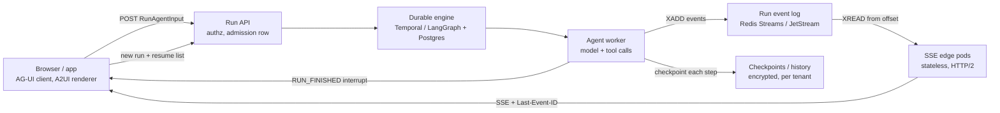
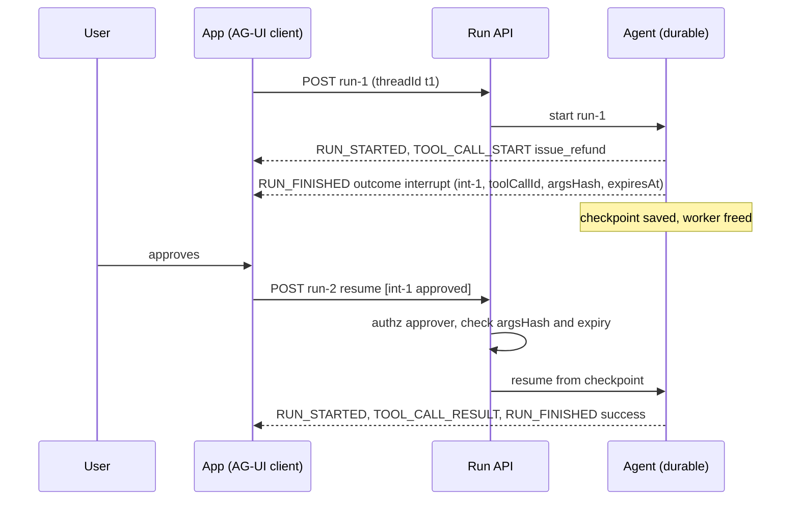

# Lesson 57 — Agent runtime infra: agent UI protocols & durable agent execution — AG-UI event streams and A2UI declarative UI, SSE/WebSocket fan-out at scale, human-in-the-loop interrupts, durable runs with checkpointed state and resume after node loss

*2026-11-05*

## What interviewers are really probing

Lessons [52](/lessons/52-mcp-a2a-gateways-fleet-scale)–[56](/lessons/56-agent-observability-evaluation) covered what an agent talks **to** (tools, memory, sandboxes, browsers) and how you watch it. This lesson is the two ends nobody draws on the architecture slide: the **wire to the human** (streaming tokens, tool progress, shared state and generated UI into a browser) and the **spine that keeps a 40-minute run alive** when the pod it started on gets evicted, the user closes the laptop, or the run stops for two days waiting on a manager's approval.

The interview version: *"Users complain the agent 'freezes' and then dumps a whole answer at once, and when they refresh they lose the run. Last week a node drain killed 300 in-flight agent runs, and two of them sent the same refund twice on retry. Fix it."* (Answers below: compression or proxy buffering on the SSE path, the agent bound to the HTTP handler, no event log to replay from, `exit`-mode or no checkpointing, and a side effect that wasn't idempotent and sat before an interrupt.) They want to hear that you:

- **Separate the run from the connection.** The agent writes events to a durable, ordered log keyed by run ID. Stateless edge pods stream that log to clients over SSE or WebSocket and resume from `Last-Event-ID`. A disconnect is not a cancel.
- **Separate the run from the pod.** State lives in a checkpointer (LangGraph) or an event history (Temporal), so any worker can pick up after a crash, and side effects carry idempotency keys so retries are safe.
- **Model human-in-the-loop as a stopped run, not a blocked thread.** In AG-UI 1.0 an interrupt **ends** the run; the answer arrives as a **new** run with a `resume` list. In Temporal it's a Signal or Update that a workflow waits on with a timeout. Either way, a run waiting two days costs a database row, not a pod.
- **Know the protocols.** AG-UI (agent ↔ app event stream, 1.0 stable), A2UI (declarative, catalog-bound UI that an agent describes and the client renders; v0.9.1 current), and how they relate to MCP and A2A from [L52](/lessons/52-mcp-a2a-gateways-fleet-scale): MCP is agent ↔ tools, A2A is agent ↔ agent, AG-UI is agent ↔ user-facing app, A2UI is the UI payload that can ride on either A2A or AG-UI.
- **Treat approvals as security controls.** An approval is bound to the exact tool call and arguments, authorized on the server when the run resumes, and expires.

Cross-links: [L10](/lessons/10-service-mesh-istio-linkerd-mtls) (mTLS), [L11](/lessons/11-cluster-security-pss-admission-rbac) (admission/RBAC), [L12](/lessons/12-node-container-hardening-supply-chain) (images), [L13](/lessons/13-ml-weights-checkpoint-hardening) (weights), [L14](/lessons/14-ml-inference-training-deploy-hardening) (deploy hardening), [L16](/lessons/16-temporal-argo-workflows) (Temporal/Argo), [L34](/lessons/34-agent-tool-sandboxing-egress-policy) (side-effect controls), [L48](/lessons/48-workload-identity-secrets-pki-fleet-scale) (secrets), [L49](/lessons/49-fleet-observability-pipelines-scale) (pipelines), [L52](/lessons/52-mcp-a2a-gateways-fleet-scale) (gateways), [L54](/lessons/54-sandboxed-agent-execution-scale) (sandboxes, suspend/resume), [L55](/lessons/55-browser-computer-use-agent-infra) (prompt injection), [L56](/lessons/56-agent-observability-evaluation) (tracing, `hitl_interrupt` flags). Fuel: [wafer-ai/gpu-perf-engineering-resources](https://github.com/wafer-ai/gpu-perf-engineering-resources).

**Interview sentence:** "The browser POSTs a run to the API, which writes an admission row and enqueues it. A worker runs the agent as a durable execution, a Temporal workflow or a LangGraph graph with a Postgres checkpointer in `sync` mode, and publishes AG-UI events to a per-run Redis stream with bounded length. Stateless SSE pods behind HTTP/2 read that stream from the client's `Last-Event-ID`, send heartbeats under every idle timeout on the path, and authorize every subscribe against the run's tenant. If the client drops, the run continues; if it reconnects, it replays from its offset or gets a snapshot. If the worker dies, a lease expires and another worker resumes from the last checkpoint, and every side effect carries an idempotency key of run, step and tool call. Approvals end the run with an interrupt bound to the tool call and a hash of its arguments; the resume is checked server-side and expires. Checkpoints and histories hold prompts and tool outputs, so they're encrypted, per-tenant and short-lived."

## Core diagram






## Idiosyncrasies / operator depth

**AG-UI 1.0 in one table.** One request in (`RunAgentInput`: `threadId`, `runId`, messages, state, tools, context, optional `resume`), one ordered stream of typed events out. The usual transport is HTTP POST answered with SSE; there's also a binary encoding.

| Family | Events | Operator note |
|---|---|---|
| Lifecycle | `RUN_STARTED`, `RUN_FINISHED`, `RUN_ERROR`, `STEP_STARTED`/`STEP_FINISHED` | `RUN_FINISHED` carries an `outcome`: success, interrupt or cancelled. `parentRunId` gives git-like branching within a thread. |
| Text | `TEXT_MESSAGE_START` / `_CONTENT` / `_END` | `delta` may be an empty string (keep-alives, tool decisions). Don't reject or count those as tokens. |
| Tools | `TOOL_CALL_START` / `_ARGS` / `_END` / `_RESULT` | Args stream as JSON fragments; don't parse until `_END`. Frontend tools end the run as success with `pendingToolCallIds`. |
| State | `STATE_SNAPSHOT`, `STATE_DELTA` (RFC 6902 JSON Patch), `MESSAGES_SNAPSHOT` | A well-formed patch can still point at a path that doesn't exist. On any apply failure, request a snapshot rather than guessing. |
| Other | reasoning, activity, `CUSTOM`, `RAW` | `rawEvent` carries the provider-native payload verbatim, so it can carry content you meant to strip ([L56](/lessons/56-agent-observability-evaluation)). |

What trips people up:

- **Interrupts are not a mid-run channel.** The spec has no way for the client to talk into a running run. A run that needs approval **ends** with `RUN_FINISHED` and an interrupt outcome holding one or more `Interrupt` objects (`id`, `reason`, `message`, `toolCallId`, `responseSchema`, `expiresAt`). The continuation is a new run whose `resume` list must cover **every** interrupt, each answered or explicitly abandoned. Omission is not abandonment, and a producer must never perform the interrupted action on the strength of a missing entry. Teams that model approval as "hold the SSE open and wait" end up with thousands of idle connections and lose every pending approval on deploy.
- **The protocol lets the producer be stateless; your platform shouldn't be.** A conformant producer doesn't have to remember the interrupts it raised. That's fine for the spec and dangerous for your refund tool: if you don't keep the interrupt server-side, a client can resume with whatever it likes. Keep the interrupt record (id, tool call, args hash, approver policy, expiry) in your store and check it.
- **Token usage resets across the gap.** The resuming run's `usage` covers only its own model calls. Cost per task ([L56](/lessons/56-agent-observability-evaluation)) must sum across runs on a thread, not read the last run.
- **A2UI is UI as data.** The agent emits JSON (JSONL stream) describing components from a **catalog** the client declared; the client renders native widgets and binds them to a per-surface data model. v0.9.1 messages: `createSurface`, `updateComponents`, `updateDataModel` (JSON Pointer `path`, `value`, omit value to delete), `deleteSurface`; every message carries a `version`. v0.8 (legacy) used `surfaceUpdate`, `dataModelUpdate` with a typed adjacency list, `beginRendering`. v1.0 (candidate) adds `actionResponse` for client-to-server RPC. Version skew between agent and renderer is a real failure mode: an agent prompted with v0.8 examples emitting into a v0.9 renderer renders nothing.
- **Why catalog-bound matters.** The agent never ships code or HTML to the client. That's the security property: a prompt-injected agent can at worst arrange approved components with bad data, not run script. Keep it that way: no "HTML" or "WebView" component in the catalog.

**Fan-out at scale.** The production shape is *agent → event log → edge → client*, never *agent → client*:

- **Event log per run.** Redis Streams (`XADD run:{id} MAXLEN ~ 20000`), NATS JetStream, or Kafka for very high volume. The stream entry ID is the SSE `id:`, so `Last-Event-ID` on reconnect maps straight to `XREAD ... STREAMS run:{id} <last-id>`. Set a TTL after `RUN_FINISHED` so replay works for minutes, not forever. On Redis Cluster, a `{runId}` hash tag keeps a run's keys on one shard.
- **Edge pods are stateless.** Any pod can serve any run. That removes sticky sessions and lets you drain pods on deploy: send a `retry:` hint, close, and the client reconnects (with jitter) to another pod and replays.
- **Tokens are not durable, and that's fine.** Don't write every token into Temporal history or a checkpoint. Stream deltas through the event log (a side channel from the model-call activity), and checkpoint only the completed message. If a worker dies mid-generation, the model call is retried and the UI gets a `MESSAGES_SNAPSHOT` that replaces the half-message.
- **Browsers cap HTTP/1.1 at 6 connections per origin.** Users with 7 agent tabs open hang on the 7th. Serve SSE over HTTP/2 (multiplexed) end to end, or the client side looks "randomly frozen".
- **Every hop has an idle timeout.** NGINX `proxy_read_timeout` defaults to 60s, AWS ALB idle timeout defaults to 60s, CDNs have their own. Envoy's per-route timeout defaults to **15s** for the whole response, which kills any SSE stream at 15 seconds unless you set it to 0 (Envoy Gateway / Gateway API `timeouts.request`). A model that thinks for 90 seconds before the first token needs heartbeats: an SSE comment line (`: ping`) every 15s is enough.
- **Buffering is the "freeze then dump" bug.** NGINX `proxy_buffering on` (default), gzip/compression middleware, and some service-mesh filters hold chunks until a buffer fills. Send `X-Accel-Buffering: no`, disable compression for `text/event-stream`, and test through the full ingress path, not against the pod.
- **WebSocket vs SSE.** SSE is plain HTTP: works with HTTP/2, proxies, auth middleware and replay semantics. WebSocket is bidirectional but needs connection-level stickiness, its own auth on upgrade, and you build replay yourself. AG-UI over HTTP POST + SSE matches the "one request in, events out" model; use WebSocket for voice or collaborative canvases that really are bidirectional.
- **Connection math.** 10K concurrent agents with 3 viewers each is 30K long-lived streams. An edge pod handles tens of thousands of idle SSE connections if it's async (Go, Node, uvicorn), but file descriptors, conntrack and LB connection limits come first ([L46](/lessons/46-gpu-cluster-networking-fleet-scale)). Each `XREAD BLOCK` is a Redis connection per stream unless you multiplex: one reader per edge pod that fans out in-process scales far better than one Redis connection per browser.

**Durable execution: two dominant shapes.**

| | LangGraph + checkpointer | Temporal (OpenAI Agents SDK integration, Pydantic AI, custom) |
|---|---|---|
| Unit of state | Checkpoint per superstep, keyed by `thread_id` | Event history per workflow execution |
| Durability knob | `durability="sync"` / `"async"` (default) / `"exit"` per call | Every activity result recorded before the workflow proceeds |
| Crash recovery | Re-invoke with `invoke(None, config)` on the same `thread_id`; completed sibling tasks' pending writes aren't rerun | Workflow replays deterministically on any worker; completed activities aren't re-executed |
| HITL | `interrupt(value)` inside a node; resume with `Command(resume=...)` | Signal or Update plus `workflow.wait_condition(..., timeout=...)` |
| Side effects | Node code; the interrupted node **reruns from the top** on resume | Activities (model calls are activities automatically in the integration; I/O tools via `activity_as_tool`) |
| Scale limits | Checkpoint table growth; prune or use shallow savers | History ~51,200 events / 50 MB hard limits (warnings well before); payloads ~2 MB; use continue-as-new |
| Deploy mid-run | New graph code against old checkpoints: renamed nodes or state keys break resume | Non-determinism errors unless you use `workflow.patched()` or Worker Versioning |

The details that separate operators from tutorial readers:

- **`exit` durability is not durability.** With `exit`, nothing is written until the run ends, so a crash leaves a thread that looks like it never existed. With `async` (the default), the first node can run before any checkpoint commits. LangGraph's own docs say: if you need to tell "never accepted" from "accepted but lost", commit an **outbox/admission row** in your store before calling `invoke`. That row is also what your reaper scans.
- **`interrupt()` reruns the node.** Everything above the `interrupt()` call in that node executes again on resume. Put side effects after the interrupt, in a separate node, or behind an idempotency key. Multiple `interrupt()` calls in one node match resume values by order, so reordering them in a deploy scrambles answers. And never wrap `interrupt()` in a bare `except Exception`: it raises a control-flow exception that you'll swallow.
- **Leases, not hope.** For LangGraph-style workers, keep a `runs` table with `status`, `owner`, `lease_expires_at`. Workers renew every 10s; a reaper resumes runs whose lease lapsed on another worker. Temporal does this for you: an activity's `heartbeat_timeout` detects a dead worker in seconds, while relying on `start_to_close_timeout` alone can leave a dead tool call "running" for its whole timeout.
- **Idempotency keys for every side effect.** Derive them from stable identifiers: `run_id + step + tool_call_id` (or Temporal's workflow ID + activity ID). Pass them to the downstream API (`Idempotency-Key` header for payments, dedupe tables for email). "Exactly once" is retries plus idempotency, nothing else.
- **Long agents blow history limits.** A 400-step agent with large tool results in history hits Temporal's size limits. Store big tool outputs in object storage and put a reference in history, and continue-as-new every N turns carrying the conversation summary and pointers.
- **Waiting is free if you model it right.** A Temporal workflow waiting on a Signal or a LangGraph thread parked at an interrupt has no pod, no sandbox and no GPU attached. Pair this with sandbox suspend/resume ([L54](/lessons/54-sandboxed-agent-execution-scale)) so a run waiting on approval releases its sandbox too.
- **Model calls from a workflow are not deterministic.** That's why the Temporal integration (GA for Python on 2026-03-23) routes every model call through an activity. A `@function_tool` that does I/O runs inside the workflow and breaks determinism. Wrap it with `activity_as_tool()` and register the activity on the worker too; the helper doesn't register it. Activity-backed tools get a **copy** of the agent context and can't mutate it.

## Concrete commands & config

**1. Edge: NGINX/Ingress for SSE.**

```nginx
location /v1/runs/ {
  proxy_pass http://sse-edge;
  proxy_http_version 1.1;
  proxy_set_header Connection "";
  proxy_buffering off;              # or have the app send X-Accel-Buffering: no
  proxy_cache off;
  gzip off;                         # compression buffers event-stream
  proxy_read_timeout 3600s;         # plus app heartbeats every 15s
  proxy_send_timeout 3600s;
}
```

ingress-nginx annotations: `nginx.ingress.kubernetes.io/proxy-buffering: "off"`, `nginx.ingress.kubernetes.io/proxy-read-timeout: "3600"`. Raise the ALB idle timeout (`alb.ingress.kubernetes.io/load-balancer-attributes: idle_timeout.timeout_seconds=3600`) or keep heartbeats under 60s.

**2. Gateway API / Envoy: turn off the 15s route timeout for streams only.**

```yaml
apiVersion: gateway.networking.k8s.io/v1
kind: HTTPRoute
metadata: { name: agent-sse, namespace: agents }
spec:
  parentRefs: [{ name: public-gw, namespace: gateway }]
  rules:
    - matches: [{ path: { type: PathPrefix, value: /v1/runs/ } }]
      timeouts:
        request: "0s"           # 0 = no overall timeout (streaming)
      backendRefs: [{ name: sse-edge, port: 8080 }]
```

Keep a normal timeout on every other route, and enforce a max stream lifetime in the edge app (for example 1 hour, then `retry:` and close), so connections rebalance across pods.

**3. SSE edge: replay from the run log.**

```python
# FastAPI-style edge pod (sketch)
async def stream_run(run_id: str, request: Request, user=Depends(authn)):
    run = await runs.get(run_id)
    if run is None or run.tenant_id != user.tenant_id:     # authz on EVERY subscribe
        raise HTTPException(404)
    last_id = request.headers.get("Last-Event-ID", "0-0")
    async def gen():
        yield "retry: 3000\n\n"
        cursor = last_id
        while True:
            resp = await redis.xread({f"run:{{{run_id}}}": cursor}, block=15000, count=200)
            if not resp:
                yield ": ping\n\n"                          # heartbeat under every idle timeout
                continue
            for entry_id, fields in resp[0][1]:
                cursor = entry_id
                yield f"id: {entry_id}\nevent: agui\ndata: {fields[b'e'].decode()}\n\n"
                if fields.get(b"terminal") == b"1":
                    return
    return StreamingResponse(gen(), media_type="text/event-stream",
                             headers={"Cache-Control": "no-cache", "X-Accel-Buffering": "no"})
```

Worker side: `XADD run:{<id>} MAXLEN ~ 20000 * e <event-json>`, then `EXPIRE run:{<id>} 900` after `RUN_FINISHED`. If the requested `Last-Event-ID` was already trimmed, send `STATE_SNAPSHOT` + `MESSAGES_SNAPSHOT` instead of a partial replay.

Quick checks from a laptop:

```bash
curl -N -H "Authorization: Bearer $TOK" -H "Accept: text/event-stream" \
  https://agents.example.com/v1/runs/$RUN/events          # -N disables curl buffering
curl -N -H "Last-Event-ID: 1730815200000-3" ...           # replay from offset
redis-cli XINFO STREAM "run:{$RUN}"                        # length, first/last id
redis-cli XLEN "run:{$RUN}"
```

**4. LangGraph: Postgres checkpointer, sync durability, encrypted state, interrupt and resume.**

```python
from langgraph.checkpoint.postgres import PostgresSaver
from langgraph.checkpoint.serde.encrypted import EncryptedSerializer
from langgraph.types import interrupt, Command
from psycopg_pool import ConnectionPool

pool = ConnectionPool(DB_URI, max_size=20, kwargs={"autocommit": True, "prepare_threshold": 0})
saver = PostgresSaver(pool, serde=EncryptedSerializer.from_pycryptodome_aes())  # key from LANGGRAPH_AES_KEY
saver.setup()   # once, via a migration Job, not on every pod start

def approve_refund(state):
    call = state["pending_call"]
    decision = interrupt({"tool": "issue_refund", "args": call["args"],
                          "args_sha256": sha256(canonical_json(call["args"]))})
    return {"approved": decision["approved"], "approver": decision["approver"]}

def do_refund(state):            # separate node: runs once, after approval
    payments.refund(**state["pending_call"]["args"],
                    idempotency_key=f'{state["run_id"]}:{state["pending_call"]["id"]}')

graph = builder.compile(checkpointer=saver)
cfg = {"configurable": {"thread_id": thread_id}}
graph.invoke(inputs, cfg, durability="sync")
# ...later, after the server verified approver, args hash and expiry:
graph.invoke(Command(resume={"approved": True, "approver": user.id}), cfg, durability="sync")
# crash recovery by the reaper (no new input):
graph.invoke(None, cfg, durability="sync")
```

Tables created by `setup()`: `checkpoints`, `checkpoint_blobs`, `checkpoint_writes`, `checkpoint_migrations`. Watch their growth and prune old checkpoints per thread on a schedule; keep `langgraph-checkpoint` at 3.0 or later.

**5. Temporal: agent workflow with a human approval and a timeout.**

```python
@workflow.defn
class RefundAgent:
    def __init__(self) -> None:
        self.decision: dict | None = None

    @workflow.update
    async def decide(self, d: dict) -> str:
        self.decision = d
        return "ok"

    @decide.validator
    def validate_decide(self, d: dict) -> None:   # rejected updates never hit history
        if d.get("args_sha256") != self.pending_hash:
            raise ValueError("approval does not match pending call")

    @workflow.run
    async def run(self, task: Task) -> str:
        agent = Agent(name="refunds", instructions=INSTR,
                      tools=[activity_as_tool(lookup_order, start_to_close_timeout=timedelta(seconds=30),
                                              heartbeat_timeout=timedelta(seconds=10))])
        plan = await Runner.run(agent, task.prompt)            # model calls run as activities
        self.pending_hash = sha256_of(plan.final_output.refund_args)
        try:
            await workflow.wait_condition(lambda: self.decision is not None,
                                          timeout=timedelta(hours=48))
        except asyncio.TimeoutError:
            return "expired"                                    # abandoned, never executed
        if not self.decision["approved"]:
            return "rejected"
        return await workflow.execute_activity(issue_refund, plan.final_output.refund_args,
                    start_to_close_timeout=timedelta(seconds=30),
                    retry_policy=RetryPolicy(maximum_attempts=5))   # activity uses idempotency key
```

Ops commands you'll actually run:

```bash
temporal workflow describe -w refund-$RUN            # pending activities, attempts, last failure
temporal workflow show -w refund-$RUN --output json | jq '.events | length'   # history size
temporal workflow update execute -w refund-$RUN --name decide --input '{"approved":true,...}'
temporal workflow reset -w refund-$RUN --type LastWorkflowTask --reason "bad deploy"
temporal workflow list --query 'ExecutionStatus="Running" AND StartTime < "2026-11-01T00:00:00Z"'
```

Check the exact flags against your pinned Temporal CLI version.

**6. Alert on the things that page.**

```promql
# runs whose lease lapsed and nobody resumed them
max(agent_runs_orphaned{state="lease_expired"}) > 0
# SSE edge: reconnect storms after deploys
sum(rate(sse_connections_opened_total[1m])) / sum(rate(sse_connections_opened_total[30m] offset 1h)) > 5
# approvals piling up past half their TTL
sum by (agent) (agent_interrupts_pending{age_bucket=">24h"}) > 50
```

Plus Temporal's own: `temporal_request_failure_total`, schedule-to-start latency per task queue (workers starved), and workflow task failures (non-determinism after a deploy).

## Failures & fixes

| Symptom | Root cause | Fix |
|---|---|---|
| UI "freezes" then dumps the whole answer | Proxy buffering or gzip on `text/event-stream` | `proxy_buffering off`, `X-Accel-Buffering: no`, no compression for SSE; test through the real ingress |
| Every stream dies at exactly 15s | Envoy default route timeout | `timeouts.request: 0s` on the SSE route only |
| Streams die at 60s while the model is "thinking" | ALB/NGINX idle timeout, no heartbeats | `: ping` every 15s; raise idle timeouts |
| 7th agent tab never loads | HTTP/1.1 limit of 6 connections per origin | HTTP/2 end to end; multiplex runs over one stream per tab |
| Refresh loses the run | Agent bound to the HTTP handler; disconnect cancels it | Run in a worker; events to a run log; replay from `Last-Event-ID` |
| Node drain killed 300 runs | No checkpointing (or `exit` mode); no reaper | `sync` durability or Temporal; leases + reaper; PDBs and graceful drain |
| Refund sent twice after resume | Side effect above `interrupt()` reran; no idempotency key | Side effects in their own node after approval; idempotency key per tool call |
| "Thread not found" after a crash | `exit`/`async` mode; crash before first checkpoint | Admission/outbox row before `invoke`; reaper decides retry vs fail |
| Approval answered the wrong question | Two `interrupt()` calls reordered in a deploy | One interrupt per node; version graphs; drain old runs before reordering |
| Temporal workflows stuck with non-determinism errors after deploy | Changed workflow code without patching | `workflow.patched()` or Worker Versioning; replay tests in CI against recorded histories |
| Workflow terminated at history limit | Large tool outputs in history; 400+ steps | Store blobs out of band; continue-as-new every N turns |
| Dead tool call "running" for 10 minutes | No `heartbeat_timeout`; worker died | Heartbeating activities with short heartbeat timeout |
| Reconnect storm takes Redis down after edge deploy | All clients reconnect at once and replay from 0 | Jittered `retry:`, rolling drain, replay from `Last-Event-ID`, snapshot when trimmed |
| UI state diverges from agent state | `STATE_DELTA` patch applied against a stale base | On patch failure request `STATE_SNAPSHOT`; snapshot on every reconnect |
| A2UI surface renders blank | Agent emits v0.8 messages to a v0.9 renderer | Pin protocol version; catalog and version negotiated at session start; contract tests |

## Security & hardening

The UI channel and the durable store are where an agent's decisions become **actions with a human's name on them**, and where every prompt, tool output and approval is written down for weeks. Both need first-class controls.

**1. Approvals are security decisions, so bind them.**
- The interrupt record lives server-side: interrupt id, `toolCallId`, SHA-256 of the canonicalized tool arguments, required approver role, `expiresAt`. A resume is accepted only if the approver is authorized for that tenant and action, the args hash matches, and it hasn't expired. A client can't edit the amount between "approve" and "execute".
- Risky actions (money, deletes, deploys, external email) require step-up auth (fresh WebAuthn) on approval, and the approver is recorded in the checkpoint/history and the trace (`agent.flag=hitl_interrupt`, [L56](/lessons/56-agent-observability-evaluation)).
- Expired or abandoned interrupts are explicit outcomes that never execute. No "auto-approve after timeout".
- The agent must not be able to approve its own interrupts: the approve endpoint requires a human session, not a service token the agent's tools could reach.

**2. Streams are authorized per subscribe.**
- Unguessable run IDs are not authorization. Every SSE subscribe and every replay checks the caller against the run's tenant and thread ACL (the IDOR on `/runs/{id}/events` is the classic bug).
- Browser `EventSource` can't set headers, which tempts teams into `?token=` in the URL, where it lands in access logs, CDN logs and browser history. Use `fetch`-based SSE with an `Authorization` header, or an `HttpOnly`, `SameSite=Strict` cookie scoped to the stream path, plus strict CORS.
- Rate-limit and cap concurrent streams per user and tenant so one script can't open 50K connections.

**3. Everything from the client is untrusted input.**
- AG-UI `RunAgentInput` carries client-supplied `state`, `messages`, `tools` and `context`. Validate it against a schema, never let client-declared tools reach server-side execution, and don't trust client-supplied tool results for server tools.
- A2UI: the client renders only components from an allowlisted catalog. No raw HTML, script or WebView components; URLs in components go through an allowlist or link proxy; images through an image proxy (no tracking pixels, no internal URLs). Treat A2UI actions coming back from the client as untrusted input to the agent, just like tool output ([L55](/lessons/55-browser-computer-use-agent-infra)).
- `rawEvent` and `CUSTOM` events can carry provider-native payloads. Strip them at the edge for external clients.

**4. Checkpoints and histories are content stores.**
- LangGraph checkpoints and Temporal histories contain full prompts, tool arguments, tool outputs and approver identities. Encrypt them: LangGraph `EncryptedSerializer` (AES key from the secret store, [L48](/lessons/48-workload-identity-secrets-pki-fleet-scale)); Temporal **payload codec** encryption with a codec server that's itself behind SSO and audited, since it's the decryption endpoint for the UI.
- Per-tenant isolation: Temporal namespace per tenant tier with an authorizer and claim mapper; Postgres row-level security or schema per tenant for checkpoints. Retention: Temporal namespace retention of days, not the maximum; checkpoint pruning with a TTL, and the deletion path for a customer request covers both.
- **Deserialization is code execution.** CVE-2025-64439: `langgraph-checkpoint` before 3.0 could run attacker-chosen Python while loading a crafted checkpoint (the "json" fallback mode of `JsonPlusSerializer`). Pin `langgraph-checkpoint` 3.0 or later (`langgraph-api` 0.5 or later), and never let a principal who can write to the checkpoint store be less trusted than the worker that reads it.
- Event logs (Redis Streams) hold the same content in flight: TLS and AUTH/ACL on Redis, short TTLs, no shared Redis between tenants of different classification.

**5. Model weights, checkpoints and deployments.**
- Agents increasingly drive fine-tune, eval and deploy workflows. Those workflows reference weights by **digest** and registry path, never by presigned URL: workflow history is retained, replayed and shown in a UI, so a presigned URL in an activity input is a leaked model ([L13](/lessons/13-ml-weights-checkpoint-hardening)).
- Activities that read weights use their own workload identity scoped to that bucket prefix ([L48](/lessons/48-workload-identity-secrets-pki-fleet-scale)); the workflow, the agent and the UI never hold weight credentials.
- Promotion of a model to serving is a bound human approval (args hash = model digest + target ring), followed by admission that verifies the signature and digest ([L14](/lessons/14-ml-inference-training-deploy-hardening), [L51](/lessons/51-gitops-progressive-delivery-fleet-scale)). The agent proposes; a human with the right role approves the exact digest.
- Don't confuse the two meanings of "checkpoint": LangGraph/agent state checkpoints and model training checkpoints. Both are sensitive, with different stores, IAM and retention.

**6. The platform itself.**
- Edge, workers, Temporal and checkpointer images signed, digest-pinned and admitted by policy ([L11](/lessons/11-cluster-security-pss-admission-rbac), [L12](/lessons/12-node-container-hardening-supply-chain)); mTLS from workers to Temporal frontend and Postgres ([L10](/lessons/10-service-mesh-istio-linkerd-mtls)).
- Workers' egress limited to the model gateway, tool gateway and stores ([L34](/lessons/34-agent-tool-sandboxing-egress-policy), [L52](/lessons/52-mcp-a2a-gateways-fleet-scale)); tools with real side effects run in sandboxes ([L54](/lessons/54-sandboxed-agent-execution-scale)).
- A fleet-wide kill switch: cancel or pause all runs for an agent, tenant or tool from one control (Temporal batch cancel/terminate by visibility query; a flag the LangGraph worker checks between steps). Lesson 58 goes deeper.

## Interview soundbites

- "The run outlives the connection and the pod. Events go to a log; clients replay from an offset; state lives in checkpoints."
- "A disconnect is not a cancel. Cancel is an explicit API call with its own authorization."
- "In AG-UI 1.0 an interrupt ends the run, and the answer starts a new one. Waiting for a human costs a row, not a pod."
- "The protocol allows a stateless producer. My refund tool doesn't: approvals are bound to the call ID and an args hash, checked server-side, and they expire."
- "`interrupt()` reruns the node. Side effects go after it, behind an idempotency key."
- "`exit` durability means a crash erases the thread. Write the admission row first."
- "Every hop has an idle timeout, and Envoy's default route timeout is 15 seconds. Heartbeat every 15 and turn the route timeout off for streams only."
- "Freeze-then-dump is buffering, almost always gzip or `proxy_buffering`."
- "Temporal history isn't a blob store: big tool outputs go to S3, history gets a pointer, and long agents continue-as-new."
- "A2UI is UI as data from an allowlisted catalog. The agent never ships code to the browser, and we keep it that way."
- "Checkpoints are a content store and a deserialization surface: encrypt, isolate per tenant, and patch CVE-2025-64439."

## How this maps to the JD

- **100+ clusters / 10K+ nodes:** stateless edge tiers per cell; event logs and Temporal namespaces cell-local; node drains and upgrades ([L45](/lessons/45-fleet-kubernetes-upgrades-gpu-clusters)) no longer kill agent runs.
- **Kubernetes internals:** PDBs and graceful drain for edge pods, connection rebalancing, conntrack and FD limits for long-lived streams.
- **Cloud and cluster networking:** ALB/NGINX/Envoy idle and route timeouts, HTTP/2, buffering, Gateway API per-route timeouts.
- **Temporal/Argo:** agents as Temporal workflows, activities for model and tool calls, Signals/Updates for approvals, versioning and continue-as-new ([L16](/lessons/16-temporal-argo-workflows)).
- **Security:** bound approvals with step-up, per-subscribe authz, encrypted checkpoints and histories, deserialization CVEs, weight references by digest.
- **Design tradeoffs:** SSE vs WebSocket; LangGraph checkpointer vs Temporal; `sync` vs `async` durability (latency per step vs loss window); token streaming via side channel vs durable history.

## Watch (talks & demos)

**Durable Agents: How to Build AI Systems That Survive a Crash (Samuel Colvin, Pydantic).** Why watch: the crash-and-resume story from the framework side, with concrete reasoning about what goes in the workflow vs activities and why model calls must not be replayed.

<iframe width="100%" height="360" src="https://www.youtube.com/embed/qM9wQxSM1ow" title="Durable Agents: How to Build AI Systems That Survive a Crash" frameBorder="0" allow="accelerometer; autoplay; clipboard-write; encrypted-media; gyroscope; picture-in-picture; web-share" allowFullScreen></iframe>

[Open on YouTube](https://www.youtube.com/watch?v=qM9wQxSM1ow)

**Fullstack Agents & Generative UI with AG-UI (Atai Barkai, AI Dev 26 SF).** Why watch: from the CopilotKit team behind AG-UI; the event model, shared state and generative UI in practice, which is the vocabulary interviewers will use.

<iframe width="100%" height="360" src="https://www.youtube.com/embed/EeyLHsND5i0" title="Fullstack Agents & Generative UI with AG UI" frameBorder="0" allow="accelerometer; autoplay; clipboard-write; encrypted-media; gyroscope; picture-in-picture; web-share" allowFullScreen></iframe>

[Open on YouTube](https://www.youtube.com/watch?v=EeyLHsND5i0)

**Your Agents Should Be Durable (Melissa Herrera, AI Dev 26 SF).** Why watch: a short, practical case for durable execution in agent loops, good for rehearsing the "why not just retry the HTTP request?" answer.

<iframe width="100%" height="360" src="https://www.youtube.com/embed/T-E5YF432Qw" title="Your Agents Should Be Durable" frameBorder="0" allow="accelerometer; autoplay; clipboard-write; encrypted-media; gyroscope; picture-in-picture; web-share" allowFullScreen></iframe>

[Open on YouTube](https://www.youtube.com/watch?v=T-E5YF432Qw)

## References

- [AG-UI 1.0 specification](https://docs.ag-ui.com/spec/1.0) · [Events](https://docs.ag-ui.com/concepts/events) · [Interrupts and resume](https://docs.ag-ui.com/spec/1.0/basic/patterns/interrupt-resume) · [Schema reference](https://docs.ag-ui.com/spec/1.0/schema) · [AG-UI 1.0 announcement](https://www.copilotkit.ai/blog/ag-ui-1.0)
- [A2UI overview](https://a2ui.org/concepts/overview/) · [A2UI v0.9.1 spec](https://a2ui.org/specification/v0.9.1-a2ui/) · [Message reference](https://a2ui.org/reference/messages/) · [google/A2UI](https://github.com/google/A2UI)
- [LangGraph checkpointers and durability modes](https://docs.langchain.com/oss/python/langgraph/checkpointers) · [`interrupt` and `Durability` in types.py](https://github.com/langchain-ai/langgraph/blob/main/libs/langgraph/langgraph/types.py)
- [CVE-2025-64439 advisory (langgraph-checkpoint)](https://github.com/advisories/GHSA-WWQV-P2PP-99H5)
- [Temporal OpenAI Agents SDK integration (Python)](https://docs.temporal.io/develop/python/integrations/openai-agents) · [GA announcement](https://temporal.io/blog/announcing-openai-agents-sdk-integration) · [Durable agent cookbook](https://docs.temporal.io/ai/cookbook/openai-agents-sdk-python)
- [MDN: Using server-sent events](https://developer.mozilla.org/en-US/docs/Web/API/Server-sent_events/Using_server-sent_events) · [Redis Streams](https://redis.io/docs/latest/develop/data-types/streams/) · [Gateway API HTTPRoute timeouts](https://gateway-api.sigs.k8s.io/api-types/httproute/#timeouts-optional)
- [wafer-ai/gpu-perf-engineering-resources](https://github.com/wafer-ai/gpu-perf-engineering-resources)

## Quick self-check

Out loud, in under two minutes each:

1. Walk the "freeze then dump" and "refresh loses the run" complaints to root causes and fixes.
2. Draw agent → event log → edge → client. What's the SSE `id:`, how does `Last-Event-ID` map to the log, and what happens when the offset was already trimmed?
3. In AG-UI 1.0, how does a run ask for approval, and what must the resuming input contain? What must a producer never do with a missing resume entry?
4. Your refund was sent twice after an approval. Explain using `interrupt()` semantics and fix it two ways.
5. Compare `sync`, `async` and `exit` durability. Which loses the thread on a crash, and how does an admission row help?
6. A Temporal agent workflow hits the history limit at step 380. What do you change?
7. Design approval binding for a model-promotion workflow: what's hashed, who can approve, where is it checked, and how do weights stay out of history?
8. List every timeout on the path browser → CDN → ALB → Envoy → edge pod → Redis, and the heartbeat interval you'd pick.

## Next

**Lesson 58 — Agent runtime infra: agent identity & delegated authorization — per-agent workload identity, OAuth on-behalf-of and token exchange, short-lived scoped tool credentials, step-up approvals for risky actions, and fleet-wide agent kill switches**
