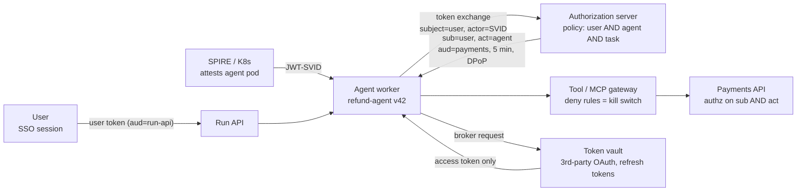
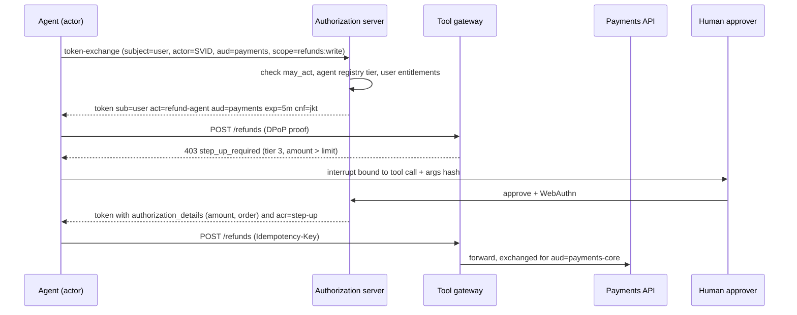

# Lesson 58 — Agent runtime infra: agent identity & delegated authorization — per-agent workload identity, OAuth on-behalf-of and token exchange, short-lived scoped tool credentials, step-up approvals for risky actions, and fleet-wide agent kill switches

*2026-11-07*

## What interviewers are really probing

Lessons [52](/lessons/52-mcp-a2a-gateways-fleet-scale)–[57](/lessons/57-agent-ui-protocols-durable-execution) built the agent runtime: gateways, memory, sandboxes, browsers, tracing and durable runs. This lesson is the question every security reviewer asks first: **when the agent calls the payments API, who is calling?** The user who asked? The agent? The platform's service account? And when something goes wrong at 2 a.m., how fast can you make every instance of one agent stop?

The interview version: *"Our support agent uses one shared API key per SaaS tool. Audit can't tell which user a refund was for, a prompt-injected agent read another customer's tickets, and when we found a bad agent version it took 40 minutes to stop it because we had to rotate six keys. Redesign it."* They want to hear that you:

- **Give every agent a real workload identity**, attested by the platform (SPIFFE/SPIRE, Kubernetes service account tokens, cloud workload identity federation), not a secret in an env var. Agents are workloads; they don't get a pass because they're smart.
- **Carry both identities on every call.** The user stays the subject (`sub`) and the agent is the actor (`act`), via OAuth 2.0 Token Exchange (RFC 8693) or a vendor on-behalf-of flow. The resource server authorizes on both, and the audit log shows the full chain.
- **Mint narrow, short-lived, audience-bound credentials per tool**, as the *intersection* of what the user may do, what the agent is registered to do, and what this task needs. Sender-constrain them (DPoP or mTLS) so a token pulled out of a prompt-injected context is useless elsewhere.
- **Gate risky actions with step-up**: a bound human approval ([L57](/lessons/57-agent-ui-protocols-durable-execution)) plus fresh authentication for money, deletes, deploys and outbound messages.
- **Build a kill switch with layers and an SLO**: gateway deny rule in seconds, identity disable in a minute, grant revocation and run cancellation behind it, and you drill it.

Cross-links: [L10](/lessons/10-service-mesh-istio-linkerd-mtls) (mTLS), [L11](/lessons/11-cluster-security-pss-admission-rbac) (admission/RBAC), [L13](/lessons/13-ml-weights-checkpoint-hardening) (weights), [L14](/lessons/14-ml-inference-training-deploy-hardening) (deploy hardening), [L34](/lessons/34-agent-tool-sandboxing-egress-policy) (side-effect controls), [L48](/lessons/48-workload-identity-secrets-pki-fleet-scale) (workload identity, secrets, PKI), [L52](/lessons/52-mcp-a2a-gateways-fleet-scale) (MCP auth, no token passthrough), [L55](/lessons/55-browser-computer-use-agent-infra) (session vaults, prompt injection), [L56](/lessons/56-agent-observability-evaluation) (audit traces), [L57](/lessons/57-agent-ui-protocols-durable-execution) (bound approvals, run cancellation). Fuel: [wafer-ai/gpu-perf-engineering-resources](https://github.com/wafer-ai/gpu-perf-engineering-resources).

**Interview sentence:** "Each agent type is a registered workload with a SPIFFE ID, an owner, a risk tier and a declared tool list. Its pods get a short-lived JWT-SVID from SPIRE, never a static key. When a user starts a run, the run API exchanges the user's token and the agent's SVID at our authorization server for a token with `sub` set to the user, `act` set to the agent, one audience and the intersected scopes. Every tool hop repeats the exchange for its own audience, so tools see the whole chain and never receive the user's original token. Third-party OAuth tokens sit in a broker; the agent asks for a five-minute, DPoP-bound token for one tool and never sees a refresh token. Tier-3 actions end the run with a bound approval and a WebAuthn step-up. The kill switch is a gateway deny rule that takes effect in seconds, backed by disabling the agent's identity and cancelling its runs, and we measure time-to-stop."

## Core diagram






## Idiosyncrasies / operator depth

**Three identities, not one.** Every agent call involves a *user* (or a schedule, for background agents), an *agent* (the code plus its config and version), and a *platform* (the pod, node and cluster it runs on). Most incidents come from collapsing two of them:

| Collapse | What it looks like | Why it bites |
|---|---|---|
| Agent = user | Agent forwards the user's token to every tool (token passthrough) | Confused deputy; tools can't tell the user from a prompt-injected agent; one stolen token works everywhere. The MCP spec forbids it ([L52](/lessons/52-mcp-a2a-gateways-fleet-scale)). |
| Agent = platform | One service account or API key per tool, shared by all agents and users | No per-user authorization; audit shows "svc-agents did it"; revoking one agent revokes all. |
| User = platform | Background agent runs as the admin who set it up | Agent keeps the admin's power after the admin leaves or changes roles. |

**Agent workload identity.**

- **SPIFFE/SPIRE.** A SPIFFE ID like `spiffe://corp.example/ns/agents/sa/refund-agent` issued after SPIRE attests the pod (kubelet attestor: namespace, service account, image digest, labels). X.509-SVIDs for mTLS, JWT-SVIDs for token exchange. Identity per **agent type**; put the instance and run IDs in claims or token-exchange context, not in the SPIFFE ID, or SPIRE ends up with an entry per pod.
- **Kubernetes projected service account tokens** are the cheap version: `audience` set to your authorization server, `expirationSeconds` at least 600, rotated by the kubelet. The default service account token (`aud` = the API server) must never be accepted by anything else.
- **Cloud identity:** workload identity federation (GKE Workload Identity, EKS Pod Identity or IRSA, Azure workload identity) for cloud APIs. The agent pod never holds a cloud key ([L48](/lessons/48-workload-identity-secrets-pki-fleet-scale)).
- **Vendor agent identity products.** Microsoft Entra Agent ID models an *agent identity blueprint* (the template, holding credentials and inheritable permissions) and child *agent identities*. Agents can't run interactive `/authorize` flows; they receive a user token and do on-behalf-of. Permissions are preauthorized on the blueprint as inheritable permissions (up to 50 resource apps per blueprint); interactive consent on a child fails with `AADSTS82014`. Amazon Bedrock AgentCore Identity gives each agent a workload identity; Runtime hands the agent a *workload access token* that binds agent and user (from the inbound JWT's `iss` + `sub`), and that token is what unlocks the user's stored third-party tokens in the token vault.
- **An agent registry is part of identity.** Owner, team, version, model, declared tools and scopes, risk tier, data classes it may touch, expiry date. Authorization servers and gateways read it. Without it you'll find tens of thousands of orphaned service principals in a year, created by experiments nobody deleted.

**Delegation: RFC 8693 token exchange is the core primitive.**

- Request: `grant_type=urn:ietf:params:oauth:grant-type:token-exchange`, `subject_token` (the user's token), `actor_token` (the agent's JWT-SVID), `audience` or `resource` (one target), `scope`. Response: a new token where `sub` is the user and `act` is `{"sub": "spiffe://.../refund-agent"}`.
- **Delegation vs impersonation.** Without an `actor_token`, the new token is impersonation: the tool sees only the user. That's how "the logs say the user did it" happens. Require the actor for every agent exchange.
- **Chains nest.** When agent A calls agent B (A2A), B exchanges again and the result carries `act: {sub: B, act: {sub: A}}`. Only the outermost `act` is the current actor; inner ones are history for audit. Policy usually caps depth (for example 3) and rejects unknown actors anywhere in the chain.
- **`may_act`** in the subject token says who may act for this subject. An authorization server that checks it stops an arbitrary workload that steals a user token from exchanging it.
- **Exchange at every hop, for that hop's audience.** Each token is valid for exactly one audience, so a tool that receives a token can't replay it against a different tool. Gateways can do this transparently: IBM Research's Kagenti work at KubeCon EU 2026 ran Envoy sidecars that validate inbound JWTs and exchange outbound tokens with no OAuth code in the agent container.
- **Vendor flows are the same idea.** Entra OBO for agents is two exchanges: the blueprint gets an exchange token `T1` (`client_credentials` with `fmi_path` set to the agent identity, ideally with a managed-identity federated credential), then the agent identity presents `T1` as `client_assertion` plus the user's token as `assertion` with `requested_token_use=on_behalf_of`. Keycloak supports standard token exchange; Okta and others ship their own.
- **MCP in the enterprise.** The MCP Enterprise-Managed Authorization extension (Okta calls the IdP side Cross App Access, XAA) is built on the **Identity Assertion JWT Authorization Grant (ID-JAG)**: the client exchanges the user's SSO ID token at the enterprise IdP (RFC 8693) for a short-lived ID-JAG addressed to the MCP server's authorization server, then redeems it with the JWT bearer grant (RFC 7523) for an access token. The IdP applies admin policy in the middle, so revoking access at the IdP stops all clients. The ID-JAG draft is at `-04` (May 2026) and not yet an RFC; the server must check `iss`, `aud`, `resource` and `exp`, not just the signature.
- **Inside your own call graph,** OAuth Transaction Tokens (`draft-ietf-oauth-transaction-tokens`, WG consensus, aimed at the IESG in December 2026) carry an immutable user and context through internal microservices, so a downstream service can't be talked into acting for a different user. An individual draft adds an `agentic_ctx` claim for multi-agent chains. Treat both as direction, not something to bet a 2026 design on without a fallback.

**Tool credentials: narrow, short, bound.**

- **Scope intersection.** Effective permission = user's entitlements ∩ agent's registered scopes ∩ the task's needs. A support agent acting for an admin user still can't call `users:delete` because the agent isn't registered for it. Union is the classic bug: the agent inherits everything the user can do.
- **Rich Authorization Requests (RFC 9396)** let a token say *what*, not just *which API*: `authorization_details` with type `payment`, amount, currency, order ID. A step-up approval can then mint a token that only works for that refund.
- **Sender-constraining.** Bearer tokens in agent context leak through prompt injection, traces and checkpoints. DPoP (RFC 9449) binds the token to a key the agent process holds (`cnf.jkt`) and requires a signed proof per request; mTLS-bound tokens (RFC 8705) bind to the SVID certificate. A stolen token without the key is useless.
- **TTLs measured in minutes.** JWT access tokens can't be recalled; they can only expire. 5–15 minutes for agent tokens means revocation is real without introspection on every call. For high-risk APIs, use opaque tokens plus introspection (RFC 7662) so revocation is instant.
- **Third-party SaaS (Google, Slack, GitHub, Salesforce).** The user consents once; a broker (AgentCore token vault, Vault, an in-house service) stores refresh tokens, keyed by (user, agent, provider). The agent asks the broker for an access token and never sees the refresh token. AgentCore's docs warn that a vaulted token may already be revoked at the provider; handle 401 by forcing re-authentication (`forceAuthentication: true`) rather than retrying.
- **Bind the consent callback to the session.** If the agent sends a user an authorization URL, check at the callback that the user who consented is the user who started the run. AgentCore makes this explicit (`CompleteResourceTokenAuth` from your callback after checking the session); without it, an attacker can get a victim to consent into the attacker's agent session.
- **GitHub:** GitHub App installation tokens, scoped to listed repositories and permissions, expire in one hour. Mint per task with `repositories` and `permissions` narrowed; never a personal access token in an agent. Lesson 59 builds on this for coding agents.
- **Cloud data:** STS `AssumeRole` with an inline session policy and session tags (`user`, `agent`, `run`), or GCS Credential Access Boundaries, to downscope to one bucket prefix for this run.

**Step-up for risky actions.**

- Classify every tool action into risk tiers in the registry: tier 0 read-own-data, tier 1 read-shared, tier 2 reversible writes, tier 3 money, deletes, deploys, permission changes, outbound messages to external parties.
- Tier 3 requires a bound approval ([L57](/lessons/57-agent-ui-protocols-durable-execution): tool call ID, args hash, expiry) **and** fresh authentication at approval time: WebAuthn in the app, or OpenID CIBA (Client-Initiated Backchannel Authentication) to push the approval to the user's phone when the run is in the background. The resulting token carries `acr` or `amr` showing step-up and `auth_time`; the resource server checks them.
- Approvals have budgets: one approval covers one call, or a bounded batch ("up to 20 refunds under $50 today"), expressed as RAR details, never "approve everything for this session".

**Kill switches: layered, scoped, drilled.**

| Layer | Mechanism | Time to effect | Scope |
|---|---|---|---|
| Gateway deny | Policy rule on tool/MCP/model gateway keyed on `act`, agent version, tenant, tool | Seconds (config push) | Agent, version, tenant, tool, model |
| Run control | Cancel or pause runs (Temporal batch cancel by visibility query; flag the worker checks between steps) | Seconds to a minute | In-flight runs |
| Identity | Disable agent registration; delete SPIRE entry; disable the Entra agent identity | Minutes (bounded by token TTL) | All new tokens |
| Grants | Revoke vaulted refresh tokens and SaaS app grants for the agent | Minutes; provider-dependent | Third-party access |
| Signals | Shared Signals Framework (CAEP session-revoked, RISC credential-compromised) to tell receivers | Near real time if receivers listen | Cross-vendor |

What separates operators: the gateway layer is the only one that's both fast and fine-grained, so build it first. Identity-level kills are bounded by token TTL, which is why TTLs are short. And a kill switch that only blocks new runs misses the 300 runs already mid-flight; the run-control layer is the one teams forget.

## Concrete commands & config

**1. SPIRE: register an agent type and fetch an SVID.**

```bash
spire-server entry create \
  -parentID spiffe://corp.example/k8s-node \
  -spiffeID spiffe://corp.example/ns/agents/sa/refund-agent \
  -selector k8s:ns:agents -selector k8s:sa:refund-agent \
  -selector k8s:pod-image:registry.corp/agents/refund@sha256:9f1c... \
  -x509SVIDTTL 3600 -jwtSVIDTTL 300

# inside the pod (via the Workload API socket)
spire-agent api fetch jwt -audience https://auth.corp.example \
  -socketPath /run/spire/sockets/agent.sock
```

Selecting on the image digest means a modified agent image doesn't get the identity. Check selector and TTL flag names against your SPIRE version.

**2. Kubernetes: projected token for the authorization server (no SPIRE).**

```yaml
spec:
  serviceAccountName: refund-agent
  automountServiceAccountToken: false        # no API-server token in the agent
  volumes:
    - name: authz-token
      projected:
        sources:
          - serviceAccountToken:
              audience: https://auth.corp.example
              expirationSeconds: 600
              path: token
```

**3. Token exchange: user + agent → tool token.**

```bash
curl -s https://auth.corp.example/oauth2/token \
  -d grant_type=urn:ietf:params:oauth:grant-type:token-exchange \
  -d subject_token="$USER_TOKEN" \
  -d subject_token_type=urn:ietf:params:oauth:token-type:access_token \
  -d actor_token="$(cat /var/run/secrets/authz-token/token)" \
  -d actor_token_type=urn:ietf:params:oauth:token-type:jwt \
  -d resource=https://payments.corp.example \
  -d scope="refunds:read refunds:write" \
  -H "DPoP: $DPOP_PROOF" | jq -r .access_token | cut -d. -f2 | base64 -d 2>/dev/null | jq
```

Expected claims:

```json
{
  "iss": "https://auth.corp.example",
  "sub": "user:8812",
  "aud": "https://payments.corp.example",
  "act": { "sub": "spiffe://corp.example/ns/agents/sa/refund-agent" },
  "scope": "refunds:read",
  "agent_version": "42",
  "run_id": "run_01JC...",
  "cnf": { "jkt": "0ZcOCORZNYy-DWpqq30jZyJGHTN0d2HglBV3uiguA4I" },
  "exp": 1794070200
}
```

Note `scope` came back narrower than requested: the user has `refunds:write`, but the agent's registry entry caps it at read until step-up.

**4. Authorization policy on the resource server (OPA/Rego sketch).**

```rego
package payments.authz
import rego.v1

default allow := false

allow if {
  input.token.aud == "https://payments.corp.example"
  actor := input.token.act.sub
  agent := data.registry.agents[actor]
  agent.enabled                                   # kill switch at identity layer
  not data.killswitch.versions[actor][input.token.agent_version]
  input.action in agent.allowed_actions           # agent capability
  input.action in data.entitlements[input.token.sub]   # user entitlement
  tier_ok(agent, input)
  count(chain(input.token.act)) <= 3              # bounded delegation depth
}

tier_ok(agent, input) if data.tiers[input.action] < 3
tier_ok(agent, input) if {
  data.tiers[input.action] == 3
  "webauthn" in input.token.amr
  time.now_ns() / 1000000000 - input.token.auth_time < 300
  some d in input.token.authorization_details
  d.type == "refund"; d.order_id == input.body.order_id; d.amount >= input.body.amount
}
```

`chain` is a helper that walks nested `act` objects. Return `403` with `WWW-Authenticate: Bearer error="insufficient_user_authentication"` (RFC 9470 step-up) so the agent knows to raise an interrupt rather than retry.

**5. Third-party token via a broker (AgentCore example).**

```python
resp = agentcore.get_resource_oauth2_token(
    workloadIdentityToken=workload_access_token,   # delivered by Runtime, binds user + agent
    resourceCredentialProviderName="google-drive",
    scopes=["https://www.googleapis.com/auth/drive.readonly"],
    oauth2Flow="USER_FEDERATION",
    resourceOauth2ReturnUrl="https://app.corp.example/oauth/agent-callback",
)
if resp.get("authorizationUrl"):
    raise NeedsConsent(resp["authorizationUrl"])   # surface to the user as an interrupt
token = resp["accessToken"]                        # short-lived; never the refresh token
```

**6. GitHub: per-task installation token, narrowed.**

```bash
curl -s -X POST -H "Authorization: Bearer $APP_JWT" \
  https://api.github.com/app/installations/$INST/access_tokens \
  -d '{"repositories":["payments-svc"],"permissions":{"contents":"read","pull_requests":"write"}}' | jq '.expires_at, .permissions'
```

**7. Cloud: downscoped weights access for an eval agent.**

```bash
aws sts assume-role --role-arn arn:aws:iam::111122223333:role/agent-eval \
  --role-session-name "eval-agent-run_01JC" \
  --tags Key=agent,Value=eval-agent Key=run,Value=run_01JC \
  --policy '{"Version":"2012-10-17","Statement":[{"Effect":"Allow","Action":["s3:GetObject"],
    "Resource":"arn:aws:s3:::model-weights/llama-ft/sha256-4be1/*"}]}' \
  --duration-seconds 900
```

The session policy can only narrow the role, so the role's own policy is the ceiling and the run gets one prefix, read-only, for 15 minutes. CloudTrail records the session name and tags.

**8. Kill switch: gateway rule plus run cancellation.**

```yaml
# tool/MCP gateway policy (shape varies by gateway: agentgateway, Envoy ext_authz, Kong)
killswitch:
  - match: { actor: "spiffe://corp.example/ns/agents/sa/refund-agent", agent_version: "42" }
    action: deny
    reason: "INC-4471 bad prompt release"
    expires: "2026-11-08T12:00:00Z"
```

```bash
temporal workflow cancel --query 'WorkflowType="RefundAgent" AND AgentVersion="42" AND ExecutionStatus="Running"' --reason "INC-4471"
spire-server entry delete -entryID <id>          # if the identity itself is compromised
```

Alert on what matters:

```promql
# exchanges without an actor (impersonation) should be zero
sum(rate(authz_token_exchange_total{actor="none"}[5m])) > 0
# tier-3 calls without step-up that reached a resource server
sum(rate(authz_decisions_total{tier="3",step_up="false",decision="allow"}[5m])) > 0
# kill switch drill: seconds from rule push to last allowed call
max(killswitch_time_to_stop_seconds) > 60
```

## Failures & fixes

| Symptom | Root cause | Fix |
|---|---|---|
| Audit shows "svc-agents" for every refund | Shared API key or service account per tool | Token exchange with `sub`=user, `act`=agent; per-agent identity |
| Logs say the user did something the agent did | Exchange without `actor_token` (impersonation) | Require actor for agent exchanges; alert on actorless exchanges |
| Prompt-injected agent read another customer's tickets | Agent token had the platform's scope, not the user's | Delegated token per user; resource server authorizes `sub` |
| Agent could delete users because the requester was an admin | Scope union instead of intersection | Cap by agent registry scopes; deny-by-default per action |
| User token replayed against a different tool | Token passthrough; broad audience | Exchange per hop with one audience; reject tokens not minted for you |
| Stolen token from a trace worked from a laptop | Plain bearer tokens | DPoP or mTLS binding; scrub tokens from traces and checkpoints ([L56](/lessons/56-agent-observability-evaluation)) |
| Kill switch took 40 minutes | Revocation by rotating shared keys; 12-hour tokens | Gateway deny rule first; TTLs of minutes; drilled runbook |
| Kill switch "worked" but runs kept sending emails | Only new runs blocked | Cancel in-flight runs; worker checks a kill flag between steps |
| `AADSTS82014` on agent consent | Interactive consent attempted on child agent identity | Preauthorize inheritable permissions on the blueprint, admin-consented |
| Agent suddenly 401s on Google Drive | Vaulted token revoked at the provider | Force re-auth, surface as an interrupt; don't retry blindly |
| Attacker's agent got the victim's Drive token | Consent callback not bound to session | Check the consenting user matches the run's user before completing |
| Thousands of orphaned agent principals | Identity per instance, no owner or expiry | Identity per agent type; registry with owner and expiry; quarterly reaping |
| ID-JAG accepted for the wrong MCP server | Only signature checked | Validate `iss`, `aud`, `resource`, `exp` (and `client_id`) |
| Step-up loops forever | Resource server returns generic 403 | RFC 9470 `insufficient_user_authentication`; agent raises interrupt |

## Security & hardening

Identity is the security layer for agents: almost every control in Lessons 52–57 depends on knowing which agent, acting for which user, is making the call. OWASP's Top 10 for Agentic Applications names this directly as ASI03, identity and privilege abuse.

**1. No static secrets in agents.**
- Agent pods get platform-attested identity (SPIRE selectors on namespace, service account and image digest; projected tokens; cloud workload identity). `automountServiceAccountToken: false` unless the agent truly needs the Kubernetes API.
- Admission ([L11](/lessons/11-cluster-security-pss-admission-rbac)) rejects agent pods with env vars or mounted secrets matching API-key patterns, and requires the identity annotations the registry expects.
- Agent images are signed and digest-pinned ([L12](/lessons/12-node-container-hardening-supply-chain)); identity is bound to the digest, so an unsigned or modified image doesn't get credentials.

**2. Every token is narrow, short and bound.**
- One audience per token; TTL in minutes; DPoP or mTLS binding; `act` required for agent tokens; delegation depth capped.
- Refresh tokens never enter agent memory, prompts, checkpoints or traces. The broker holds them, encrypted, keyed by user, agent and provider, with per-tenant keys ([L48](/lessons/48-workload-identity-secrets-pki-fleet-scale)).
- Redaction at the trace collector and checkpoint serializer for `Authorization`, `DPoP` and token-shaped strings ([L56](/lessons/56-agent-observability-evaluation), [L57](/lessons/57-agent-ui-protocols-durable-execution)).

**3. Authorization on both principals, deny by default.**
- Resource servers and gateways check user entitlement **and** agent capability **and** risk tier. Tool gateways ([L52](/lessons/52-mcp-a2a-gateways-fleet-scale)) enforce the agent's declared tool list; anything not declared is denied, which also blunts tool-definition rug pulls.
- The agent can't change its own registry entry, mint its own grants, or approve its own interrupts. Registry changes go through GitOps review ([L51](/lessons/51-gitops-progressive-delivery-fleet-scale)) with a human owner.

**4. Step-up for risky actions.**
- Tier-3 actions need a bound approval plus fresh WebAuthn or CIBA; resource servers check `amr`/`acr`, `auth_time` and RAR `authorization_details`. No "approve all for this session".
- Approvers are authorized per tenant and action, and recorded in the token chain and the trace.

**5. Model weights, checkpoints and deployments.**
- Agents that run evals, fine-tunes or deploys get **read-only, prefix-scoped, short-lived** credentials for weight buckets (STS session policy, GCS Credential Access Boundary), minted per run. No agent identity has `s3:PutObject` on the production weights prefix or `s3:*` on the bucket ([L13](/lessons/13-ml-weights-checkpoint-hardening)).
- Weights and checkpoints are referenced by digest, and presigned URLs never appear in prompts, tool arguments or workflow history; the tool fetches with its own identity.
- Writing weights to the registry, pushing images and promoting a model to serving are tier-3 actions: bound human approval on the exact digest and target ring, step-up, then admission verifies signature and provenance ([L14](/lessons/14-ml-inference-training-deploy-hardening)). The agent identity can propose a promotion PR but can't merge it or push to the serving registry.
- Inference endpoints that agents call authenticate the agent too: per-agent rate limits and quotas at the model gateway, keyed on `act`, so one runaway agent can't burn a GPU pool.

**6. Kill switches and audit.**
- Gateway deny rules by agent, version, tenant, tool and model, effective in seconds; identity disable; grant revocation; run cancellation. Each layer has a runbook, and you drill it monthly with a time-to-stop SLO (for example, no allowed tier-2+ calls 60 seconds after the rule is pushed).
- Subscribe gateways to Shared Signals (CAEP session revoked, RISC credential compromise) from the IdP so offboarding a user stops their agents.
- Audit logs keep the full `act` chain, the agent version and model, the approval ID and the token `jti`, retained per policy and queryable by user ("what did agents do for me?") and by agent ("everything v42 touched").

## Interview soundbites

- "Agents are workloads. They get platform-attested identity, not API keys in env vars."
- "User is `sub`, agent is `act`. If a token doesn't have both, the audit log is lying to you."
- "Token exchange at every hop, one audience per token. The user's original token never leaves the first service."
- "Scopes are the intersection of the user, the agent and the task. Union is how an admin's agent deletes users."
- "Bearer tokens leak through prompts and traces. DPoP makes a leaked token useless."
- "You can't recall a JWT, you can only wait for it to expire, so agent tokens live minutes, and the fast kill switch lives in the gateway."
- "A kill switch that only stops new runs isn't a kill switch. Cancel the in-flight ones too, and measure time-to-stop."
- "The refresh token stays in the vault. The agent gets a five-minute access token and nothing else."
- "Promoting weights is a tier-3 action: bound approval on the digest, step-up, signed artifact, admission. The agent proposes; it doesn't merge."
- "Enterprise MCP is ID-JAG: SSO token exchanged at the IdP, redeemed at the server's authorization server. Revoke at the IdP and every client stops."

## How this maps to the JD

- **100+ clusters / 10K+ nodes:** one SPIFFE trust domain (or federated domains per region), SPIRE servers per cluster, agent registry as fleet-wide source of truth; identity per agent type keeps entry counts sane.
- **Kubernetes internals:** projected service account tokens and audiences, `automountServiceAccountToken`, admission for identity annotations, SPIRE kubelet attestation.
- **Cloud and cluster networking:** mTLS-bound tokens, gateway-level deny rules, egress through gateways that see `act`.
- **Security:** RFC 8693, DPoP, RAR, step-up (RFC 9470), CIBA, Shared Signals, downscoped cloud credentials, OWASP ASI03.
- **Terraform/Atlantis and GitOps:** agent registry entries, IdP app registrations, IAM roles and gateway policies as code with review.
- **Temporal/Argo:** run cancellation by visibility query as a kill-switch layer; approvals as Updates ([L16](/lessons/16-temporal-argo-workflows), [L57](/lessons/57-agent-ui-protocols-durable-execution)).
- **Design tradeoffs:** JWT plus short TTL vs opaque plus introspection; per-type vs per-instance identity; vendor agent identity (Entra, AgentCore) vs SPIFFE plus your own authorization server; gateway-side exchange vs agent-side.

## Watch (talks & demos)

**When an Agent Acts on Your Behalf, Who Holds the Keys? (Mariusz Sabath & Maia Iyer, IBM Research, KubeCon EU 2026).** Why watch: SPIFFE/SPIRE plus token exchange done in Envoy sidecars, so agents carry no OAuth code; the Q&A covers CIBA-style step-up and MCP gateways holding per-user, per-tool permissions.

<iframe width="100%" height="360" src="https://www.youtube.com/embed/kc2NuTUt5Os" title="When an Agent Acts on Your Behalf, Who Holds the Keys?" frameBorder="0" allow="accelerometer; autoplay; clipboard-write; encrypted-media; gyroscope; picture-in-picture; web-share" allowFullScreen></iframe>

[Open on YouTube](https://www.youtube.com/watch?v=kc2NuTUt5Os)

**Securing AI Agents with Unique Identities (Ayesha Dissanayaka, WSO2).** Why watch: a demo of agents as first-class identities in an IdP, with agent-friendly credentials, acting alone vs on behalf of a user, and how each shows up in audit.

<iframe width="100%" height="360" src="https://www.youtube.com/embed/beEqa8_fNUQ" title="Securing AI Agents with Unique Identities" frameBorder="0" allow="accelerometer; autoplay; clipboard-write; encrypted-media; gyroscope; picture-in-picture; web-share" allowFullScreen></iframe>

[Open on YouTube](https://www.youtube.com/watch?v=beEqa8_fNUQ)

**Why industry alignment on open standards will be key to a secure AI future (Aaron Parecki).** Why watch: the OAuth 2.1 and MCP authorization co-author on why agent auth should stay on open standards, which is the context for ID-JAG and Cross App Access.

<iframe width="100%" height="360" src="https://www.youtube.com/embed/Z8-kiKlPOsk" title="Why industry alignment on open standards will be key to unlocking a secure AI future" frameBorder="0" allow="accelerometer; autoplay; clipboard-write; encrypted-media; gyroscope; picture-in-picture; web-share" allowFullScreen></iframe>

[Open on YouTube](https://www.youtube.com/watch?v=Z8-kiKlPOsk)

## References

- [RFC 8693 OAuth 2.0 Token Exchange](https://www.rfc-editor.org/rfc/rfc8693) · [RFC 9449 DPoP](https://www.rfc-editor.org/rfc/rfc9449) · [RFC 8705 mTLS-bound tokens](https://www.rfc-editor.org/rfc/rfc8705) · [RFC 9396 Rich Authorization Requests](https://www.rfc-editor.org/rfc/rfc9396) · [RFC 9470 Step-up authentication challenge](https://www.rfc-editor.org/rfc/rfc9470) · [RFC 7523 JWT bearer grant](https://www.rfc-editor.org/rfc/rfc7523)
- [MCP Enterprise-Managed Authorization](https://modelcontextprotocol.io/extensions/auth/enterprise-managed-authorization) · [EMA spec text](https://github.com/modelcontextprotocol/ext-auth/blob/main/specification/stable/enterprise-managed-authorization.mdx) · [WorkOS on ID-JAG](https://workos.com/blog/one-token-two-jobs-id-jag-in-enterprise-access-and-agent-registration)
- [Transaction Tokens draft](https://datatracker.ietf.org/doc/draft-ietf-oauth-transaction-tokens/) · [Transaction Tokens for Agents draft](https://datatracker.ietf.org/doc/html/draft-araut-oauth-transaction-tokens-for-agents) · [OAuth specs index](https://oauth.net/specs/)
- [Microsoft Entra Agent ID: on-behalf-of flow](https://learn.microsoft.com/en-us/entra/agent-id/agent-on-behalf-of-oauth-flow) · [Inheritable permissions](https://learn.microsoft.com/en-us/entra/agent-id/concept-inheritable-permissions)
- [AgentCore: workload access tokens](https://docs.aws.amazon.com/bedrock-agentcore/latest/devguide/get-workload-access-token.html) · [Obtain OAuth 2.0 tokens](https://docs.aws.amazon.com/bedrock-agentcore/latest/devguide/identity-authentication.html) · [Authorization URL session binding](https://docs.aws.amazon.com/bedrock-agentcore/latest/devguide/oauth2-authorization-url-session-binding.html)
- [Ping Identity: token exchange with SPIFFE workload identity](https://developer.pingidentity.com/blog/securing-agentic-workflows-with-token-exchange-and-workload-identity/) · [SPIFFE concepts](https://spiffe.io/docs/latest/spiffe-about/spiffe-concepts/)
- [wafer-ai/gpu-perf-engineering-resources](https://github.com/wafer-ai/gpu-perf-engineering-resources)

## Quick self-check

Out loud, in under two minutes each:

1. Walk the "shared API key per tool" design to its three failures (audit, isolation, revocation) and redesign it.
2. Write the token-exchange request for user plus agent to a payments API. What's in `sub` and `act`, and what changes when agent A calls agent B?
3. Delegation vs impersonation: what's the one parameter that decides it, and how do you alert when it's missing?
4. Why intersection of scopes, not union? Give the admin-user example.
5. A token leaks into a trace. With bearer tokens vs DPoP, what can an attacker do with it?
6. Design a tier-3 refund flow end to end: approval binding, step-up, RAR details, and what the resource server checks.
7. Design the kill switch for "agent v42 is misbehaving across 300 tenants." Which layer acts in seconds, which in minutes, and how do you stop in-flight runs?
8. An eval agent needs to read one fine-tuned checkpoint. What credential does it get, scoped how, for how long, and what can it never do?
9. Explain enterprise MCP with ID-JAG in four steps, and which claims the MCP authorization server must validate.

## Next

**Lesson 59 — Agent runtime infra: hosting coding agents for an org — Claude Code, Codex, OpenHands, Goose and Gemini CLI fleets, harnesses and Agent Skills distribution, per-repo credential scoping, model-gateway budgets and auditing agent-authored changes**
