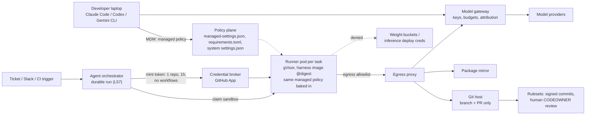
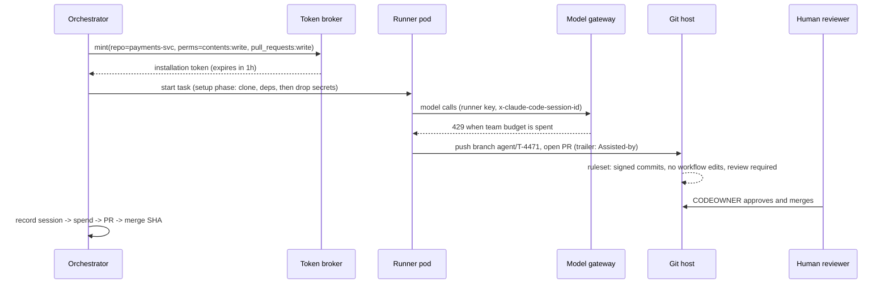

# Lesson 59 — Agent runtime infra: hosting coding agents for an org — Claude Code, Codex, OpenHands, Goose and Gemini CLI fleets, harnesses and Agent Skills distribution, per-repo credential scoping, model-gateway budgets and auditing agent-authored changes

*2026-11-08*

## What interviewers are really probing

Lessons [52](/lessons/52-mcp-a2a-gateways-fleet-scale)–[58](/lessons/58-agent-identity-delegated-authorization) built a general agent runtime. Coding agents are the case every company has right now: engineers already run Claude Code, Codex, Gemini CLI or Goose on their laptops, someone wants background agents that pick up tickets and open PRs, and security has noticed that each of these is a program that reads untrusted text (the repo, issues, web pages) and then runs shell commands with a developer's credentials.

The interview version: *"We have 3,000 engineers. Half use some coding agent with personal API keys, a team runs OpenHands on a VM, and last month an agent-authored PR changed a CI workflow and nobody noticed for a week. Finance wants one bill and per-team budgets. Design the platform."* They want to hear that you:

- **Treat the harness as managed software with a policy plane**, not a dev tool people install. Every harness has a system-level policy file the user can't override (or doesn't, and you compensate). You ship it through MDM, the runner image and CI the same way.
- **Treat repo-controlled config as untrusted input.** Three published CVEs (Claude Code and Codex) came from a cloned repo's own settings files running commands or redirecting API traffic before the user agreed to anything.
- **Run background agents in disposable sandboxes** ([L54](/lessons/54-sandboxed-agent-execution-scale)) with a **per-task, per-repo GitHub App token**, egress through a proxy, and no cloud credentials. The agent can open a PR; it can't merge, approve, or edit CI.
- **Put every model call through one gateway** with per-developer and per-runner keys, team budgets, and attribution headers. That's where you get one bill, enforced budgets and a fast kill switch.
- **Make agent-authored changes visible and verifiable**: trailers set by managed policy, verified commits, human review, and a join from agent session to spend to PR to commit to deploy.

Cross-links: [L11](/lessons/11-cluster-security-pss-admission-rbac) (admission/RBAC), [L12](/lessons/12-node-container-hardening-supply-chain) (image supply chain), [L13](/lessons/13-ml-weights-checkpoint-hardening) (weights), [L14](/lessons/14-ml-inference-training-deploy-hardening) (deploy hardening), [L34](/lessons/34-agent-tool-sandboxing-egress-policy) (egress policy), [L48](/lessons/48-workload-identity-secrets-pki-fleet-scale) (secrets), [L51](/lessons/51-gitops-progressive-delivery-fleet-scale) (GitOps), [L52](/lessons/52-mcp-a2a-gateways-fleet-scale) (MCP gateways), [L54](/lessons/54-sandboxed-agent-execution-scale) (sandboxes, warm pools), [L56](/lessons/56-agent-observability-evaluation) (OTel, cost per task), [L57](/lessons/57-agent-ui-protocols-durable-execution) (approvals, durable runs), [L58](/lessons/58-agent-identity-delegated-authorization) (agent identity, GitHub App tokens, kill switches). Fuel: [wafer-ai/gpu-perf-engineering-resources](https://github.com/wafer-ai/gpu-perf-engineering-resources).

**Interview sentence:** "We support a small set of harnesses and manage each one through its own system policy: managed-settings.json for Claude Code, requirements.toml for Codex, the system settings file plus a wrapper for Gemini CLI, and a pinned container image for Goose and OpenHands. The same policy ships to laptops through MDM and is baked into the runner image. Policy turns off bypass modes, allows only managed hooks, MCP servers and plugin marketplaces, and pins the model provider to our gateway. Background agents run one pod per task in gVisor, get a one-hour GitHub App token for one repo with no workflows permission, reach only the git host, the package mirror and the gateway, and have no route to cloud credentials or weight buckets. The gateway issues a key per developer and per runner, enforces team budgets, and tags spend with the session ID. Every agent commit carries a trailer set by managed policy, lands as a verified commit on a branch, and needs a human CODEOWNER to approve, so we can answer 'what did agents change, for whom, and what did it cost' from one query."

## Core diagram






## Idiosyncrasies / operator depth

**Every harness has a different policy plane, and some barely have one.**

| Harness | System policy users can't override | Delivery | What's surprising |
|---|---|---|---|
| Claude Code | `managed-settings.json` in `/etc/claude-code/` (Linux), `/Library/Application Support/ClaudeCode/` (macOS), `C:\Program Files\ClaudeCode\` (Windows); plus `managed-settings.d/*.json` drop-ins | File, MDM (plist / HKLM), or server-managed from the admin console (polled hourly) | Managed sources don't merge by default (`managedSourcesBehavior: "first-wins"`), so a server-managed policy silently shadows your MDM file. A present-but-invalid managed JSON file makes Claude Code **refuse to start**. |
| Codex | `requirements.toml` (`/etc/codex/requirements.toml` on Unix), cloud requirements from the admin console, legacy `managed_config.toml`, macOS MDM `requirements_toml_base64` | File, cloud bundle, MDM | Requirements constrain; defaults are a separate file. Authentication requirements (`allowed_login_methods`, `allowed_chatgpt_workspaces`) are ignored if delivered from the cloud; they must be local or MDM. `approval_policy = "untrusted"` is retired. |
| Gemini CLI | System overrides `/etc/gemini-cli/settings.json` (Linux), `C:\ProgramData\gemini-cli\settings.json`, `/Library/Application Support/GeminiCli/settings.json` | File | The path is overridable with `GEMINI_CLI_SYSTEM_SETTINGS_PATH`, so Google's own guide recommends a wrapper script that forces it. The docs say plainly that this isn't a security boundary against a local admin. |
| Goose | None enforced. `~/.config/goose/config.yaml` and env vars like `GOOSE_ALLOWLIST` | User config / env | Default `GOOSE_MODE` is `auto` (no approvals). If `GOOSE_ALLOWLIST` isn't set, any extension installs. Control it by owning the image or the env, not with a file. |
| OpenHands | Your deployment: agent-server config | Container / Helm | The Agent Server starts **without API authentication** unless you set `OH_SESSION_API_KEYS_0`. `OH_SECRET_KEY` encrypts stored LLM keys and secrets; rotate it carelessly and they're unrecoverable. |

**What to lock in Claude Code, and the quirks.**

- `permissions.disableBypassPermissionsMode: "disable"` blocks `--dangerously-skip-permissions`. `allowManagedPermissionRulesOnly: true` makes managed rules the only allow/ask/deny source, ignores `--allowedTools`, hides "always allow", and, from v2.1.282, ignores the `allowed-tools` frontmatter in repo and user skills.
- `allowManagedHooksOnly` blocks user, project and plugin hooks. Since v2.1.101, hooks from plugins **force-enabled by managed settings** still run, so a managed plugin is part of your trusted computing base.
- `allowManagedMcpServersOnly` + `allowedMcpServers`, `strictKnownMarketplaces` (an empty array blocks every marketplace, including Anthropic's), `strictPluginOnlyCustomization` (block skills, agents, hooks and MCP from user and project sources), `disableSideloadFlags` (rejects `--plugin-dir`, `--mcp-config` and friends).
- Pin the provider: `allowedProviders: ["customEndpoint"]` plus `ANTHROPIC_BASE_URL` in the managed `env` block (v2.1.285+). Claude Code then refuses any other endpoint, including a developer's own proxy.
- `requiredMinimumVersion` blocks an old binary from **starting**; it doesn't end a session left open for weeks. Plan rollouts around long-lived sessions.
- Validation is fail-closed for restrictive keys: an unreadable `allowedMcpServers` becomes an empty allowlist, an unreadable `availableModels` leaves only the default model, an unreadable `strictKnownMarketplaces` blocks all marketplaces. `requiredMinimumVersion` fails open.
- Check enforcement with `/status` (look for `Enterprise managed settings (file)`, or `(remote)`, `(plist)`) and `claude doctor` (lists dropped entries).

**What to lock in Codex.**

- `allowed_approval_policies` and `allowed_sandbox_modes` (legacy) or, on Codex 0.138.0+, `allowed_permission_profiles` plus `default_permissions`. Clients at 0.137.0 or older **ignore** the profile keys, so upgrade the fleet first.
- `[permissions.filesystem] deny_read` (for example `~/.ssh`, `/**/*.env`); when present, Codex refuses full-access permissions.
- `[rules] prefix_rules` with `decision = "prompt"` or `"forbidden"` (never `"allow"` from requirements); the most restrictive decision wins.
- `[mcp_servers.*] identity` allowlist; an empty `mcp_servers` table disables all MCP. `[marketplaces] restrict_to_allowed_sources = true`. `[otel]` in requirements (0.166.0) with `log_user_prompt = false`.
- `[[remote_sandbox_config]] hostname_patterns` gives runners a looser sandbox than laptops. The docs warn that hostname matching is for policy selection, **not device proof**.
- Inside `workspace-write`, `.git`, `.agents`, `.codex` and `.aws` under a writable root stay read-only, and network is off by default (`[sandbox_workspace_write] network_access`).
- Project-local `.codex/config.toml` loads only for trusted projects and can't set `model_provider`, `model_providers`, `openai_base_url`, `notify`, `profile` or `otel`. This is the class of bug behind the CVEs below, closed in config.

**Repo config is attacker-controlled input.** All three of these needed only "clone a repo and start the agent":

| CVE | Harness | What the repo did | Fixed in |
|---|---|---|---|
| CVE-2025-59536 | Claude Code | `.claude/settings.json` hooks (and project MCP servers) ran commands before the trust dialog was accepted | 1.0.111 |
| CVE-2026-21852 | Claude Code | Project settings set `ANTHROPIC_BASE_URL` to an attacker endpoint; API requests with the key went out before the trust prompt | 2.0.65 |
| CVE-2025-61260 | Codex CLI | A repo `.env` set `CODEX_HOME=./.codex`, so `./.codex/config.toml` MCP `command`s ran at startup with no prompt | 0.23.0 (dotenv can no longer set `CODEX_`-prefixed vars) |

Lesson for the platform: version floors in managed policy, and in background runners there's no human at the trust prompt at all, so the managed locks (managed-only hooks, MCP, marketplaces, provider pin) have to do the job.

**Background agents: the runner is the boundary.**

- One pod per task from a warm pool ([L54](/lessons/54-sandboxed-agent-execution-scale)), `runtimeClassName` gVisor or Kata, ephemeral workspace, no service account token, egress only to the proxy.
- The harness's own sandbox often can't start inside a pod. Claude Code's Linux sandbox needs bubblewrap and socat; in an unprivileged container bubblewrap can't mount a fresh `/proc`, and **without `sandbox.failIfUnavailable: true` Claude Code runs commands unsandboxed**. `enableWeakerNestedSandbox` exists but weakens isolation. Codex's guidance is the same: if bwrap, namespaces or seccomp are blocked in the container, let the container provide isolation and run with `--sandbox danger-full-access` inside it. Decide explicitly which layer is the boundary and test it.
- **Two-phase tasks.** Codex Cloud runs setup (network on, secrets available) and then the agent phase (offline by default, secrets removed). Copy that pattern: clone and install with credentials, then drop them before the model gets a shell.
- **Codex passes secrets through by default.** `shell_environment_policy.ignore_default_excludes` defaults to `true`, meaning variables with `KEY`, `SECRET` or `TOKEN` in the name are kept for spawned commands. Set it to `false` and use `inherit = "core"`. The Codex docs also say not to set `OPENAI_API_KEY` or `CODEX_API_KEY` at job level in workflows that run repo code, because build scripts and dependency hooks can read them.

**Credentials per repo, per task.**

- GitHub App installation tokens expire after one hour and can be narrowed to listed `repositories` and `permissions` at mint time ([L58](/lessons/58-agent-identity-delegated-authorization)). Typical agent grant: `contents: write`, `pull_requests: write`, `issues: read`, `metadata: read`. **Never `workflows`**: without it the token can't change `.github/workflows/*`, which is how an agent PR turns into secret exfiltration from CI.
- Branch rulesets do the rest: the agent pushes only `agent/*` branches, PRs need a human CODEOWNER approval, and the bot can't approve its own PR. Laptop agents use the developer's own credentials, so their blast radius is the developer's. That's why the managed deny rules on `Read(~/.ssh/**)`, `.env` and similar matter.

**Agent Skills distribution.**

- The open format: a directory with `SKILL.md` (YAML frontmatter `name`, max 64 chars, lowercase plus hyphens, matching the directory, and `description`, max 1024 chars; optional `license`, `compatibility`, `metadata`, experimental `allowed-tools`) plus optional `scripts/`, `references/`, `assets/`.
- Discovery paths differ: Claude Code `.claude/skills/` and `~/.claude/skills/`; Codex `.agents/skills/` from cwd up to repo root and `~/.agents/skills/`; Gemini CLI `.gemini/skills/` or the `.agents/skills/` alias (the alias wins within a tier), and it asks the user for consent on `activate_skill`. Ship skills once under `.agents/skills/` where you can, and use each tool's plugin or marketplace mechanism for org-wide skills.
- Skills are code. `scripts/` runs with the agent's permissions, and the description is injected into every session's prompt. Distribute through an allowlisted marketplace at a pinned ref, review like any dependency, and don't let `allowed-tools` frontmatter pre-approve tools (Claude Code ignores it for repo and user skills under `allowManagedPermissionRulesOnly`).

**Model gateway: budgets that actually hold.**

- One gateway for all harnesses. Claude Code speaks Anthropic Messages to `ANTHROPIC_BASE_URL`; Codex uses a `model_providers` entry (`wire_api = "responses"` is the only supported value); Gemini CLI, Goose and OpenHands take provider base URLs and keys.
- Claude Code gateway rules: forward `anthropic-version` and `anthropic-beta` **verbatim** (don't allowlist beta values; they change with releases, and stripping the OAuth capability gives `401`). Use `x-claude-code-session-id` and `x-claude-code-agent-id` for attribution. Setting `ANTHROPIC_BASE_URL` without a gateway credential keeps the developer's subscription login as the credential.
- `apiKeyHelper` runs a command to mint the gateway credential (cached 5 minutes by default, `CLAUDE_CODE_API_KEY_HELPER_TTL_MS`, re-run on 401/403). From project settings it doesn't run until the trust prompt is accepted.
- LiteLLM semantics that bite: if a key has a `team_id`, **only team and team-member budgets apply; the user's personal budget is ignored** (v1.94.0 briefly enforced both; v1.95.0 removed that). Use `max_budget_in_team` for per-person caps inside a team, and `budget_limits` for stacked windows (a 24h guardrail under a 30d ceiling). Budgets need the Postgres database.
- Client-side caps are estimates. `claude -p --max-budget-usd` checks a client cost estimate and spend can overshoot; Goose's `GOOSE_MAX_TURNS` defaults to 1000. The gateway is the only authoritative meter.
- The gateway is now a credential-holding tier-0 service. LiteLLM 1.82.7 and 1.82.8 on PyPI were compromised on March 24, 2026, in the TeamPCP campaign, with credential-stealing payloads. Pin by digest and mirror.

**Auditing agent-authored changes.**

- **Trailers.** Claude Code adds a `Co-Authored-By` trailer by default; the `attribution` setting (which replaced `includeCoAuthoredBy` in v2.0.62) changes it. A repo's CLAUDE.md can override attribution text **unless the line is set in managed settings**, so set it there. The Linux kernel's 7.1 docs require `Assisted-by: AGENT_NAME:MODEL_VERSION [TOOLS]` and say AI agents **must not** add `Signed-off-by`; only a human can certify the DCO. (On October 14, 2026 the docs maintainer applied a patch to docs-next that removes the `Assisted-by` sections and the checkpatch handling, so check which tree you're quoting; the no-`Signed-off-by` rule is separate.)
- **Verification.** Commits a GitHub App creates through the API are marked verified only if the request carries no custom author, committer or signature. Rebase-and-merge rewrites commits without signatures, so a "require signed commits" rule then blocks it; use squash or merge commits.
- **Pusher identity.** GitHub's push attribution (limited public preview for Enterprise, October 12, 2026) records the authenticated pusher per commit and adds a `Committer must match pusher` ruleset condition, closing the "author field is just a string" gap.
- **Telemetry.** Claude Code exports OTel metrics and events (`CLAUDE_CODE_ENABLE_TELEMETRY=1`); tool parameters only with `OTEL_LOG_TOOL_DETAILS=1`, prompts only with `OTEL_LOG_USER_PROMPTS`. Codex `[otel]` in requirements can force `log_user_prompt = false`. Gemini CLI `telemetry.logPrompts: false`. Feed these into the [L56](/lessons/56-agent-observability-evaluation) pipeline with the same content-stripping rules.

## Concrete commands & config

**1. Claude Code: managed policy for laptops and runner images.**

```json
{
  "permissions": {
    "disableBypassPermissionsMode": "disable",
    "deny": [
      "Read(./.env)", "Read(./.env.*)", "Read(~/.ssh/**)", "Read(~/.aws/**)",
      "Bash(curl *)", "Bash(git push --force*)", "Bash(gh pr merge*)"
    ],
    "ask": ["Bash(git push *)"]
  },
  "allowManagedPermissionRulesOnly": true,
  "allowManagedHooksOnly": true,
  "allowManagedMcpServersOnly": true,
  "allowedMcpServers": [{ "serverName": "corp-tools" }],
  "strictKnownMarketplaces": [
    { "source": "github", "repo": "acme-corp/agent-plugins", "ref": "v3.2.0" }
  ],
  "disableSideloadFlags": true,
  "allowedProviders": ["customEndpoint"],
  "env": {
    "ANTHROPIC_BASE_URL": "https://llm-gw.corp.example",
    "CLAUDE_CODE_ENABLE_TELEMETRY": "1",
    "OTEL_EXPORTER_OTLP_ENDPOINT": "https://otel.corp.example:4317"
  },
  "apiKeyHelper": "/usr/local/bin/corp-llm-key",
  "sandbox": {
    "enabled": true,
    "failIfUnavailable": true,
    "allowUnsandboxedCommands": false,
    "network": {
      "allowManagedDomainsOnly": true,
      "allowedDomains": ["github.com", "*.githubusercontent.com", "pypi-mirror.corp.example"]
    }
  },
  "attribution": {
    "commit": "Assisted-by: Claude Code (corp runner)\n\nCo-Authored-By: Claude <noreply@anthropic.com>",
    "pr": "Opened by a coding agent. Human review required."
  }
}
```

Check each key's shape against the settings reference for your pinned version (for example the `allowedMcpServers` entry format). Then:

```bash
sudo install -m 0644 managed-settings.json /etc/claude-code/managed-settings.json
jq -e . /etc/claude-code/managed-settings.json >/dev/null   # an invalid file stops every session from starting
claude doctor                                               # dropped/invalid entries, organization policy line
# inside a session: /status -> "Setting sources: Enterprise managed settings (file)"
```

**2. Codex: requirements (enforced) plus defaults.**

```toml
# /etc/codex/requirements.toml
allowed_approval_policies = ["on-request"]
allowed_sandbox_modes     = ["read-only", "workspace-write"]   # blocks --yolo / danger-full-access
allowed_web_search_modes  = ["cached"]

[[remote_sandbox_config]]                    # runners: outer gVisor pod is the boundary
hostname_patterns     = ["agent-runner-*.ci.corp.example"]
allowed_sandbox_modes = ["read-only", "workspace-write", "danger-full-access"]

[permissions.filesystem]
deny_read = ["/**/*.env", "~/.ssh", "~/.aws"]

[rules]
prefix_rules = [
  { pattern = [{ token = "git" }, { token = "push" }], decision = "prompt", justification = "Agents push via the broker flow" },
  { pattern = [{ token = "gh" }, { token = "pr" }, { token = "merge" }], decision = "forbidden", justification = "Humans merge" },
]

[mcp_servers.corp-tools]
identity = { url = "https://mcp-gw.corp.example/mcp" }

[marketplaces]
restrict_to_allowed_sources = true
[marketplaces.allowed_sources.corp]
source = "git"
url = "https://github.com/acme-corp/agent-plugins.git"
ref = "v3.2.0"

[otel]
environment = "prod"
exporter = { otlp-http = { endpoint = "https://otel.corp.example/v1/logs", protocol = "binary" } }
log_user_prompt = false
```

```toml
# ~/.codex/config.toml in the runner image (provider keys aren't honored from project config)
model_provider = "corp"
[model_providers.corp]
name     = "Corp gateway"
base_url = "https://llm-gw.corp.example/v1"
env_key  = "CORP_LLM_KEY"
wire_api = "responses"

[shell_environment_policy]
inherit = "core"
ignore_default_excludes = false     # default true keeps *KEY*/*SECRET*/*TOKEN* vars
```

```bash
codex exec --sandbox workspace-write --ephemeral --json \
  -o /out/final.md "Fix flaky test in payments-svc; open no PR" | tee /out/events.jsonl
codex sandbox linux -- cat ~/.ssh/id_ed25519     # prove the sandbox denies it on this host
```

**3. Gemini CLI: system overrides plus a wrapper.**

```json
{
  "security": { "disableYoloMode": true, "auth": { "enforcedType": "vertex-ai" } },
  "tools": { "sandbox": "runsc", "core": ["ReadFileTool", "GlobTool", "ShellTool(git)", "ShellTool(npm test)"] },
  "mcp": { "allowed": ["corp-tools"] },
  "mcpServers": { "corp-tools": { "httpUrl": "https://mcp-gw.corp.example/mcp" } },
  "telemetry": { "enabled": true, "otlpEndpoint": "https://otel.corp.example:4317", "logPrompts": false },
  "privacy": { "usageStatisticsEnabled": false }
}
```

```bash
# /usr/local/bin/gemini (ahead of the real binary in PATH)
export GEMINI_CLI_SYSTEM_SETTINGS_PATH=/etc/gemini-cli/settings.json
exec /opt/gemini-cli/bin/gemini "$@"
```

`mcp.allowed` is what blocks user-added servers; defining `mcpServers` alone doesn't. Check `auth.enforcedType` values and `mcpServers` field names against your pinned version.

**4. Goose: own the environment.**

```dockerfile
FROM registry.corp.example/agents/base@sha256:3b1f...
ENV GOOSE_MODE=smart_approve \
    GOOSE_MAX_TURNS=60 \
    GOOSE_ALLOWLIST=https://agents.corp.example/goose-allowlist.yaml \
    GOOSE_DISABLE_KEYRING=1
COPY goose-config.yaml /home/agent/.config/goose/config.yaml
```

```yaml
# goose-allowlist.yaml: exact command match, served over HTTPS, refetched on restart
extensions:
  - id: github
    command: /opt/mcp/bin/mcp-github
  - id: corp-docs
    command: /opt/mcp/bin/corp-docs-mcp
```

**5. Runner pod (background agents).**

```yaml
apiVersion: v1
kind: Pod
metadata:
  name: agent-task-t4471
  labels: { app: coding-agent, harness: claude-code, task: t4471 }
spec:
  runtimeClassName: gvisor
  automountServiceAccountToken: false
  serviceAccountName: coding-agent-runner     # no cloud workload identity bound
  restartPolicy: Never
  activeDeadlineSeconds: 3600                  # matches the GitHub token lifetime
  securityContext: { runAsNonRoot: true, runAsUser: 10001, seccompProfile: { type: RuntimeDefault } }
  initContainers:
    - name: setup                              # phase 1: has the token, clones, installs deps
      image: registry.corp.example/agents/setup@sha256:9a0c...
      env: [{ name: GH_TOKEN_FILE, value: /secrets/gh/token }]
      volumeMounts: [{ name: ws, mountPath: /workspace }, { name: gh, mountPath: /secrets/gh, readOnly: true }]
  containers:
    - name: agent                              # phase 2: no git token in env
      image: registry.corp.example/agents/claude-code@sha256:41de...
      env:
        - { name: HTTPS_PROXY, value: "http://egress-proxy.agents.svc:3128" }
        - { name: NO_PROXY, value: "" }
      resources: { limits: { cpu: "4", memory: 8Gi, ephemeral-storage: 20Gi } }
      securityContext: { allowPrivilegeEscalation: false, capabilities: { drop: ["ALL"] }, readOnlyRootFilesystem: true }
      volumeMounts: [{ name: ws, mountPath: /workspace }, { name: tmp, mountPath: /tmp }]
  volumes:
    - { name: ws, emptyDir: {} }
    - { name: tmp, emptyDir: {} }
    - { name: gh, csi: { driver: secrets-store.csi.k8s.io, readOnly: true, volumeAttributes: { secretProviderClass: gh-task-token } } }
```

Pushes happen at the end through a broker call (or a short-lived second token mounted to a push sidecar), so the model never holds a write token while it's reading untrusted issue text. A NetworkPolicy allows the pod to reach only the egress proxy and DNS; the proxy allows the git host, the package mirror and the gateway, and blocks link-local `169.254.169.254` ([L34](/lessons/34-agent-tool-sandboxing-egress-policy), [L55](/lessons/55-browser-computer-use-agent-infra)).

**6. Per-task GitHub token and repo rules.**

```bash
curl -s -X POST -H "Authorization: Bearer $APP_JWT" \
  https://api.github.com/app/installations/$INST/access_tokens \
  -d '{"repositories":["payments-svc"],
       "permissions":{"contents":"write","pull_requests":"write","issues":"read","metadata":"read"}}' \
  | jq '.expires_at, .permissions'          # no "workflows" key in the result

gh api -X POST repos/acme-corp/payments-svc/rulesets --input - <<'JSON'
{ "name": "agent-guardrails", "target": "branch", "enforcement": "active",
  "conditions": { "ref_name": { "include": ["~DEFAULT_BRANCH"], "exclude": [] } },
  "rules": [
    { "type": "required_signatures" },
    { "type": "non_fast_forward" },
    { "type": "pull_request", "parameters": {
        "required_approving_review_count": 1, "require_code_owner_review": true,
        "dismiss_stale_reviews_on_push": true, "require_last_push_approval": true,
        "required_review_thread_resolution": false } }
  ] }
JSON
```

`require_last_push_approval` stops the pattern where the agent pushes again after a human approves. Add CODEOWNERS for `.github/`, `infra/` and deploy manifests that names a human team.

**7. Gateway: teams, people, runners (LiteLLM).**

```bash
# team with a monthly ceiling and allowed models
curl -s -X POST $GW/team/new -H "Authorization: Bearer $LITELLM_MASTER_KEY" -H 'Content-Type: application/json' \
  -d '{"team_alias":"payments","max_budget":4000,"budget_duration":"30d","models":["claude-sonnet","gpt-codex"]}'

# per-person cap inside the team (personal budgets don't apply to team keys)
curl -s -X POST $GW/team/member_add -H "Authorization: Bearer $LITELLM_MASTER_KEY" -H 'Content-Type: application/json' \
  -d '{"team_id":"'$TEAM'","max_budget_in_team":300,"member":{"role":"user","user_id":"rgudi"}}'

# runner key: daily guardrail under a monthly ceiling, tagged for attribution
curl -s -X POST $GW/key/generate -H "Authorization: Bearer $LITELLM_MASTER_KEY" -H 'Content-Type: application/json' \
  -d '{"team_id":"'$TEAM'","key_alias":"runner-payments","rpm_limit":120,
       "budget_limits":[{"budget_duration":"24h","max_budget":150},{"budget_duration":"30d","max_budget":2500}],
       "metadata":{"kind":"background-agent","owner":"platform-agents"}}'
```

Claude Code in print mode as a second, client-side fuse:

```bash
claude -p "Fix T-4471 and open a PR" --output-format stream-json \
  --max-turns 80 --max-budget-usd 15 --permission-mode dontAsk > /out/run.jsonl
```

**8. Skills: one skill, linted in CI.**

```markdown
---
name: payments-migration
description: Migrates payments-svc handlers from the v1 ledger client to v2. Use when a task mentions ledger v2, LedgerClientV1, or payments migrations.
license: Proprietary
compatibility: Requires go 1.24 and access to the corp Go module proxy
metadata:
  owner: payments-platform
  version: "1.4.0"
---
1. Run scripts/find_v1_calls.sh to list call sites.
2. Change one package at a time; run `go test ./...` after each.
3. Never edit files under .github/ or deploy/.
```

```bash
# CI: name matches directory, description length, no allowed-tools, scripts reviewed by CODEOWNERS
for f in .agents/skills/*/SKILL.md; do
  d=$(basename "$(dirname "$f")")
  n=$(yq --front-matter=extract '.name' "$f"); desc=$(yq --front-matter=extract '.description' "$f")
  [ "$n" = "$d" ] || { echo "$f: name != dir"; exit 1; }
  [ ${#desc} -le 1024 ] || { echo "$f: description too long"; exit 1; }
  yq --front-matter=extract -e 'has("allowed-tools") | not' "$f" >/dev/null || { echo "$f: allowed-tools not permitted"; exit 1; }
done
```

**9. Audit: find agent-authored changes and join them to cost.**

```bash
# commits with an agent trailer, with GitHub's verification status
git log --since=30.days --format='%H%x09%an%x09%(trailers:key=Assisted-by,valueonly,separator=%x2C)' \
  | awk -F'\t' '$3!=""' | while IFS=$'\t' read -r sha author agent; do
    v=$(gh api repos/acme-corp/payments-svc/commits/$sha --jq '.commit.verification.verified')
    echo "$sha $author [$agent] verified=$v"
  done
```

```sql
-- gateway spend per merged PR (session id captured by the orchestrator at PR open)
SELECT pr.number, pr.merged_by, sum(g.spend_usd) AS usd, count(*) AS calls
FROM gateway_requests g
JOIN agent_runs r ON r.session_id = g.session_id
JOIN pull_requests pr ON pr.number = r.pr_number
WHERE pr.merged_at > now() - interval '30 days'
GROUP BY 1, 2 ORDER BY usd DESC LIMIT 20;
```

```promql
# runs with an unsandboxed command (should be zero on runners)
sum(rate(agent_runner_unsandboxed_commands_total[15m])) > 0
# team at 80% of its monthly gateway budget
max by (team) (litellm_team_spend_usd / litellm_team_max_budget_usd) > 0.8
```

Metric names here are your exporter's, not built-ins; map them to what your gateway and runner actually emit.

## Failures & fixes

| Symptom | Root cause | Fix |
|---|---|---|
| Every Claude Code session on the fleet refuses to start | Malformed `managed-settings.json` or drop-in pushed by MDM | `jq -e .` in the policy repo's CI; canary ring; `claude doctor` in the rollout check |
| Policy "isn't applying" on some laptops | Higher-ranked source (server-managed or MDM) shadowed the file under `first-wins` | Read `Setting sources` / `Skipped sources` in `/status`; choose one source or set `managedSourcesBehavior: "merge"` |
| Agent ran commands with no sandbox inside a runner pod | bubblewrap couldn't start in the container; `failIfUnavailable` not set | `failIfUnavailable: true`; make gVisor/Kata the boundary; alert on unsandboxed commands |
| `--yolo` still works for some Codex users | Requirements delivered only by cloud and user signed in with an API key, or old client | Local `/etc/codex/requirements.toml` too; restrict `allowed_login_methods` locally; version floor |
| Managed permission profiles ignored | Clients on Codex 0.137.0 or older | Upgrade the fleet before deploying `allowed_permission_profiles` |
| Codex config rejected after policy update | `approval_policy = "untrusted"` is retired | Migrate to `on-request` or `trust_level = "untrusted"` per project |
| Gemini CLI ignores corporate settings | User exported `GEMINI_CLI_SYSTEM_SETTINGS_PATH` | Wrapper script; on runners, set it in the image |
| Users added their own MCP server to Gemini CLI | `mcpServers` defined but no `mcp.allowed` | Add `mcp.allowed` with the canonical server names |
| Goose installed an arbitrary extension | `GOOSE_ALLOWLIST` unset in that shell | Set in image/env; on laptops through managed shell profile; prefer the runner path |
| Repo PR turned into CI secret exfiltration | Agent token could edit `.github/workflows` | No `workflows` permission; CODEOWNERS on `.github/`; `require_last_push_approval` |
| Tests in the sandbox read the runner's API key | Codex `ignore_default_excludes = true` default; key at job level | `ignore_default_excludes = false`, `inherit = "core"`; key only for the harness process |
| Claude Code features fail with `401` behind the gateway | Gateway stripped or allowlisted `anthropic-beta` | Forward `anthropic-beta` and `anthropic-version` verbatim |
| One engineer burned the team budget | Team keys ignore personal budgets in LiteLLM | `max_budget_in_team` per member; `budget_limits` daily guardrail |
| Background run spent $400 overnight | Loop with no turn cap; client cap is an estimate | Gateway per-key daily budget and rpm; `--max-turns`; `GOOSE_MAX_TURNS`; run deadline |
| "Require signed commits" blocks agent PR merges | Rebase-and-merge drops verification, or API commits set a custom author | Squash or merge commits; create commits via the API as the App without custom author |
| Audit can't tell which commits were agent-written | Trailer set in user settings; repo CLAUDE.md overrode it | Set `attribution` in managed settings; CI check for the trailer on agent branches |
| OpenHands workspaces reachable from the office network | Agent Server started without auth, bound to `0.0.0.0` | `OH_SESSION_API_KEYS_0`, TLS, private network; keep `OH_SECRET_KEY` stable |
| Old sessions still running last month's policy | `requiredMinimumVersion` checks only at start | Max session age; force restart windows; server-managed policy is polled hourly |

## Security & hardening

Coding agents combine the two things security reviews dislike most: untrusted input (repos, issues, docs, web pages) and code execution with real credentials. OWASP's agentic Top 10 covers both (ASI03 identity and privilege abuse; goal hijack through injected content). Controls, in priority order:

**1. Harness supply chain and runner images.**
- Harness binaries come from your mirror at pinned versions with a version floor in policy (`requiredMinimumVersion` for Claude Code; package pin for Codex, Gemini CLI, Goose). Auto-update off on runners, on (or MDM-managed) on laptops, so CVE fixes like the three above land fast.
- Runner images are built in CI, signed (cosign) with SLSA provenance, referenced by digest, and admission ([L11](/lessons/11-cluster-security-pss-admission-rbac), [L12](/lessons/12-node-container-hardening-supply-chain)) rejects unsigned images or tags in the `agents` namespace. Same for the gateway image; the LiteLLM compromise is the reason.
- Plugins, skills and MCP servers come only from allowlisted, ref-pinned marketplaces (`strictKnownMarketplaces`, Codex `[marketplaces]`, Gemini `mcp.allowed`, `GOOSE_ALLOWLIST`). Skill `scripts/` and plugin hooks get CODEOWNERS review like code.

**2. Repo config treated as untrusted.**
- Managed locks for hooks, MCP, permission rules, marketplaces and provider, so a cloned repo can't add any of them. Runners never run `--dangerously-skip-permissions` or `--yolo` outside an isolation boundary you chose.
- Scanners in CI flag PRs that add or change `.claude/`, `.codex/`, `.gemini/`, `.agents/`, `AGENTS.md`, `CLAUDE.md`, `.env` or `.mcp.json`, and route them to a security CODEOWNER.

**3. Credentials and secrets.**
- Laptops: managed deny rules for `~/.ssh`, `~/.aws`, `.env`; Claude Code `sandbox.credentials` / Codex `deny_read`; gateway keys minted by `apiKeyHelper` from SSO, not pasted.
- Runners: per-task GitHub App token (one repo, one hour, no `workflows`, no `administration`), mounted only for the setup and push phases; no cloud workload identity; secrets removed before the agent phase; `shell_environment_policy` filtering. Gateway key per runner pool, rotated, and revocable as the kill switch ([L58](/lessons/58-agent-identity-delegated-authorization)).

**4. Network egress.**
- Runner pods: NetworkPolicy to the proxy only; the proxy allowlists the git host, package mirror, model gateway and MCP gateway ([L52](/lessons/52-mcp-a2a-gateways-fleet-scale)), denies link-local and RFC 1918 ranges, and logs per task. Harness-level allowlists (`sandbox.network.allowManagedDomainsOnly`, Codex `[experimental_network]`) are a second layer, not the only one. Codex's docs note an approved full sandbox escalation can bypass its command proxy, which is why the pod-level policy exists.

**5. Admission and RBAC.**
- The `agents` namespace enforces Pod Security `restricted`, a required `runtimeClassName`, `automountServiceAccountToken: false`, no hostPath, and digest-pinned signed images. The runner service account has no RBAC bindings. Only the orchestrator can create runner pods, and humans can't `exec` into them without a break-glass role that's audited.

**6. Model weights, checkpoints and deployments.**
- Runner identities have **no IAM path and no network route** to weight and checkpoint buckets, the model registry, or inference deploy credentials ([L13](/lessons/13-ml-weights-checkpoint-hardening), [L14](/lessons/14-ml-inference-training-deploy-hardening)). The egress proxy denies the object-store endpoints; bucket policies require the training/serving principals and deny everything else (`aws:PrincipalArn` / VPC endpoint conditions), so even a leaked runner credential can't read weights.
- Agents can edit serving manifests and training configs in a PR. Promotion stays in the GitOps pipeline ([L51](/lessons/51-gitops-progressive-delivery-fleet-scale)) after a human merge: signed images and weight digests verified at admission, deploy credentials held by the pipeline, never by the agent.
- ML repos get CODEOWNERS on `deploy/`, model cards, and anything that references a weight URI or digest, and a CI check that rejects PRs changing a weight digest without a linked eval run ([L31](/lessons/31-evaluation-release-gating-canary-weights)).
- Inference endpoints used by agents (self-hosted coding models) sit behind the same gateway with per-key quotas, so a runaway agent can't drain a GPU pool.

**7. Provenance and audit of agent-authored changes.**
- Trailers set by managed policy; commits created via the GitHub API as the App (verified), or signed with a per-runner key you control; push attribution and `Committer must match pusher` where available; rulesets with required signatures, human code-owner review and `require_last_push_approval`. Agents never approve, merge, or add `Signed-off-by`.
- One audit join: session ID, run ID, gateway spend, PR number, merge SHA, deploy ID. Retain harness OTel with prompts off by default and content stripping at the collector ([L56](/lessons/56-agent-observability-evaluation)).

## Interview soundbites

- "A coding agent is a program that reads untrusted text and then runs a shell with your credentials. We manage it like that, not like an editor plugin."
- "Every harness gets a system policy users can't override. Where the harness doesn't have one, we own the container."
- "The cloned repo is attacker input. Three CVEs in 2025–26 were just 'open the repo and start the agent'."
- "If the inner sandbox can't start in a pod, Claude Code runs unsandboxed unless you set failIfUnavailable. Decide which layer is the boundary and test it."
- "Background agents get a one-hour token for one repo and no workflows permission. They can open a PR; they can't merge it or touch CI."
- "The gateway is the only real meter. Client caps are estimates, and with LiteLLM team keys the personal budget doesn't apply."
- "Set the commit trailer in managed policy, or the repo's CLAUDE.md can change it."
- "Agents don't sign off. A human certifies the DCO and a human code owner approves."
- "Runners have no route and no IAM path to weight buckets or deploy credentials. They change manifests; the pipeline deploys."
- "Join session, spend, PR and merge SHA, and you can answer what agents changed, for whom, and what it cost."

## How this maps to the JD

- **100+ clusters / 10K+ nodes:** runner pools per region on the sandbox layer from [L54](/lessons/54-sandboxed-agent-execution-scale); one gateway tier with regional replicas; policy shipped as code to every cluster and laptop.
- **Kubernetes internals:** RuntimeClass, Pod Security `restricted`, projected volumes and CSI secrets for per-task tokens, `activeDeadlineSeconds`, NetworkPolicy to an egress proxy, admission on image signatures.
- **Cloud and cluster networking:** egress proxy allowlists, IMDS blocking, VPC endpoint policies that keep runners out of weight buckets.
- **Security:** managed harness policy, three repo-config CVEs, GitHub App token scoping, rulesets, signed and verified commits, push attribution, skill supply chain.
- **Terraform/Atlantis:** GitHub App installs, rulesets, gateway teams and keys, and runner namespaces managed as code with review ([L15](/lessons/15-terraform-atlantis-fleet-scale)).
- **Temporal/Argo:** the orchestrator is a durable workflow: claim sandbox, mint token, run, push, open PR, wait for review ([L16](/lessons/16-temporal-argo-workflows), [L57](/lessons/57-agent-ui-protocols-durable-execution)).
- **Design tradeoffs:** one blessed harness vs several; harness sandbox vs pod sandbox; laptop agents with user credentials vs background agents with App tokens; gateway-enforced budgets vs client caps; API-created verified commits vs per-runner signing keys.

## Watch (talks & demos)

**Uber: Leading engineering through an agentic shift (Ty Smith & Anshu Chada, Uber Dev Platform, The Pragmatic Summit 2026).** Why watch: an internal platform team's view of running coding agents at company scale, including the Minion background agent platform, agent logs and observability, and an AI code review pipeline. Jump to 20:32 for Minion.

<iframe width="100%" height="360" src="https://www.youtube.com/embed/i1tZN41VKcE" title="Uber: Leading engineering through an agentic shift - The Pragmatic Summit" frameBorder="0" allow="accelerometer; autoplay; clipboard-write; encrypted-media; gyroscope; picture-in-picture; web-share" allowFullScreen></iframe>

[Open on YouTube](https://www.youtube.com/watch?v=i1tZN41VKcE)

**Michael Bolin on Codex, harness engineering and the future of coding agents (Turing Post).** Why watch: the open-source Codex lead on what a harness is, why they keep it small, how Codex sandboxes across operating systems, and why safety and security aren't the same thing for agents. It's the background for the requirements and sandbox settings above.

<iframe width="100%" height="360" src="https://www.youtube.com/embed/6BAqgT3qe98" title="OpenAI's Michael Bolin on Codex, Harness Engineering, and the Real Future of Coding Agents" frameBorder="0" allow="accelerometer; autoplay; clipboard-write; encrypted-media; gyroscope; picture-in-picture; web-share" allowFullScreen></iframe>

[Open on YouTube](https://www.youtube.com/watch?v=6BAqgT3qe98)

**Automating Large Scale Refactors with Parallel Agents (Robert Brennan, OpenHands, AI Engineer).** Why watch: patterns for running swarms of OpenHands agents on one large change with a human in the loop, worked through a real codebase migration. Useful for sizing runner pools and review load.

<iframe width="100%" height="360" src="https://www.youtube.com/embed/rcsliSIy_YU" title="Automating Large Scale Refactors with Parallel Agents - Robert Brennan, OpenHands" frameBorder="0" allow="accelerometer; autoplay; clipboard-write; encrypted-media; gyroscope; picture-in-picture; web-share" allowFullScreen></iframe>

[Open on YouTube](https://www.youtube.com/watch?v=rcsliSIy_YU)

## References

- Claude Code: [Deploy managed settings](https://code.claude.com/docs/en/managed-settings) · [All settings](https://code.claude.com/docs/en/settings-reference) · [LLM gateway](https://code.claude.com/docs/en/llm-gateway) · [Gateway compatibility](https://code.claude.com/docs/en/llm-gateway-protocol) · [Hooks](https://code.claude.com/docs/en/hooks) · [Monitoring](https://code.claude.com/docs/en/monitoring-usage) · [CLI reference](https://code.claude.com/docs/en/cli-reference)
- Codex: [Managed configuration](https://learn.chatgpt.com/docs/enterprise/managed-configuration) · [Configuration reference](https://learn.chatgpt.com/docs/config-file/config-reference) · [Approvals & security](https://learn.chatgpt.com/docs/agent-approvals-security) · [Non-interactive mode](https://learn.chatgpt.com/docs/non-interactive-mode)
- Gemini CLI: [Enterprise](https://geminicli.com/docs/cli/enterprise/) · [Sandboxing](https://geminicli.com/docs/cli/sandbox/) · [Agent Skills in Gemini CLI](https://github.com/google-gemini/gemini-cli/blob/main/docs/cli/skills.md)
- Goose: [Config files](https://github.com/aaif-goose/goose/blob/main/documentation/docs/guides/config-files.md) · [Extension allowlist](https://github.com/aaif-goose/goose/blob/main/documentation/docs/guides/allowlist.md) · OpenHands: [Agent Server package](https://docs.openhands.dev/sdk/arch/agent-server) · [Deferred init (warm pool)](https://docs.openhands.dev/sdk/guides/agent-server/deferred-init)
- [Agent Skills specification](https://agentskills.io/specification)
- CVEs: [Check Point on CVE-2025-59536 / CVE-2026-21852](https://research.checkpoint.com/2026/rce-and-api-token-exfiltration-through-claude-code-project-files-cve-2025-59536/) · [GHSA-jh7p-qr78-84p7](https://github.com/advisories/GHSA-jh7p-qr78-84p7) · [GHSA-4fgq-fpq9-mr3g](https://github.com/advisories/GHSA-4FGQ-FPQ9-MR3G) · [Check Point on CVE-2025-61260](https://research.checkpoint.com/2025/openai-codex-cli-command-injection-vulnerability/) · [GHSA-xrxf-jgv3-qmrm](https://github.com/advisories/GHSA-xrxf-jgv3-qmrm)
- LiteLLM: [Budgets & rate limits](https://docs.litellm.ai/docs/proxy/users) · [Virtual keys](https://docs.litellm.ai/docs/proxy/virtual_keys) · [March 2026 supply chain incident](https://docs.litellm.ai/blog/security-update-march-2026)
- GitHub: [Commit signature verification (incl. bots)](https://docs.github.com/en/authentication/managing-commit-signature-verification/about-commit-signature-verification) · [Push attribution preview](https://github.blog/changelog/2026-10-12-push-attribution-public-preview/)
- [Linux kernel: AI Coding Assistants (7.1)](https://docs.kernel.org/7.1/process/coding-assistants.html)
- [wafer-ai/gpu-perf-engineering-resources](https://github.com/wafer-ai/gpu-perf-engineering-resources)

## Quick self-check

Out loud, in under two minutes each:

1. For Claude Code, Codex, Gemini CLI, Goose and OpenHands, where does the org policy live, and which one can a user bypass most easily? How do you compensate?
2. Walk through CVE-2026-21852 and CVE-2025-61260. What did the repo contain, and which managed settings stop the whole class in a headless runner?
3. A runner pod can't start bubblewrap. What does Claude Code do by default, what does Codex recommend, and which layer do you make the boundary?
4. Write the GitHub App token request for a background agent. Which permission do you leave out and why? Which ruleset options stop "push after approval"?
5. A team's spend doubled. Using LiteLLM, explain why the engineer's personal budget didn't stop it and how you cap per person and per day.
6. How do you distribute an org skill to three different harnesses, and what do you review before it ships?
7. A CISO asks for every agent-written change in the last 30 days, verified, with cost. Which trailers, verification fields and joins answer it?
8. An agent is asked to "update the serving config to the new fine-tune". What can it change, what can it never reach, and who promotes the weights?
9. Laptop agents vs background agents: whose credentials does each use, what's the blast radius, and which controls differ?

## Next

**Lesson 60 — Agent runtime infra: multi-agent orchestration & workflow builders as platform services — multi-tenant Dify, n8n, Langflow and Flowise, Mastra/Deer Flow-style orchestration, plugin and node supply-chain risk, secrets in workflows, and blast-radius limits for agent swarms**
