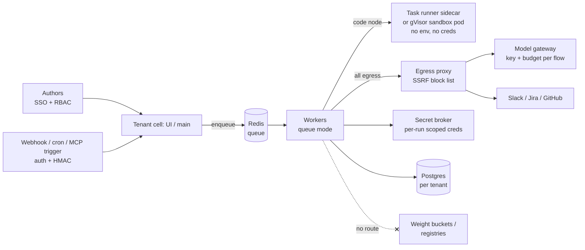
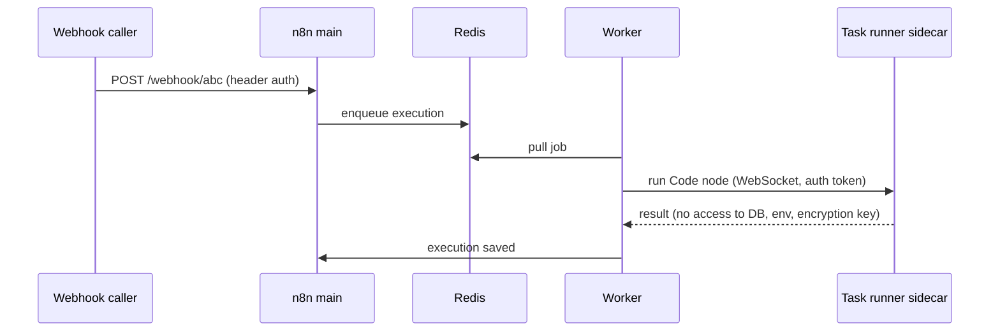

# Lesson 60 — Agent runtime infra: multi-agent orchestration & workflow builders as platform services — multi-tenant Dify, n8n, Langflow and Flowise, code-node and plugin supply-chain risk, secrets in workflows and blast-radius limits for agent swarms

*2026-11-09*

## What interviewers are really probing

Lessons [52](/lessons/52-mcp-a2a-gateways-fleet-scale)–[59](/lessons/59-hosting-coding-agents-org) built the runtime pieces: gateways, memory, sandboxes, browsers, observability, durable runs, identity, coding agents. Now the business asks for the thing on top: *"Let every team build their own agents and automations with a drag-and-drop tool."* Dify, n8n, Langflow and Flowise are exactly that, and each one is, by design, a service that lets authors run code, call arbitrary URLs, store credentials and start subprocesses (MCP stdio servers).

The interview version: *"Product teams want n8n and Langflow for internal agents. 200 authors, shared secrets for Slack, Jira and the model gateway. Make it a platform service without it becoming our biggest RCE surface."* They want to hear you:

- **Name the real threat model: author equals code execution.** A workflow author can run JavaScript or Python, add an MCP server with a `command`, and call any HTTP URL. Every 2025–2026 CVE in this category is a variation: a code validator treated as a boundary, a node that runs outside the sandbox, or an endpoint that forgot authentication.
- **Pick isolation by tenant trust, not by product.** Shared instance for trusted authors in one team; cell per team or tenant (namespace, database, Redis, secrets) for everyone else; never a shared multi-tenant "workspace" feature as the security boundary.
- **Move code execution out of the main process** (n8n external task runners, a sandbox pod per code run from [L54](/lessons/54-sandboxed-agent-execution-scale)) and **remove dangerous node types** instead of hoping nobody uses them.
- **Treat swarms as a resource and trust problem**: depth, fan-out, step and token caps, loop detection, per-tenant concurrency, and one kill switch ([L58](/lessons/58-agent-identity-delegated-authorization)).
- **Know that some of these projects die.** Flowise is archived with a critical bug unfixed; your platform needs an exit plan per engine.

Cross-links: [L11](/lessons/11-cluster-security-pss-admission-rbac) (PSS/admission), [L12](/lessons/12-node-container-hardening-supply-chain) (image supply chain), [L13](/lessons/13-ml-weights-checkpoint-hardening) (weights), [L14](/lessons/14-ml-inference-training-deploy-hardening) (deploy hardening), [L34](/lessons/34-agent-tool-sandboxing-egress-policy) (egress), [L48](/lessons/48-workload-identity-secrets-pki-fleet-scale) (secrets), [L52](/lessons/52-mcp-a2a-gateways-fleet-scale) (MCP gateways), [L54](/lessons/54-sandboxed-agent-execution-scale) (sandboxes), [L56](/lessons/56-agent-observability-evaluation) (cost per task), [L57](/lessons/57-agent-ui-protocols-durable-execution) (durable runs), [L58](/lessons/58-agent-identity-delegated-authorization) (kill switches). Fuel: [wafer-ai/gpu-perf-engineering-resources](https://github.com/wafer-ai/gpu-perf-engineering-resources).

**Interview sentence:** "I run workflow builders as a cell per team: its own namespace, Postgres, Redis and secrets, default-deny NetworkPolicy and a quota. User code never runs in the main process: n8n uses external task runners as sidecars, and anything heavier goes to a gVisor sandbox pod. Dangerous nodes like Execute Command and the deprecated Function and LangChain Code nodes are excluded, MCP stdio servers are blocked or allowlisted by image digest, and all egress goes through a proxy that blocks link-local, RFC1918 and metadata addresses. Credentials come from a broker per run, not from environment variables or flow JSON, and model calls go through the gateway with a key and budget per flow. Agent swarms get hard caps on depth, fan-out, steps, tokens and wall-clock time, and one kill switch per tenant. And I keep an exit plan per engine, because Flowise is archived with an unfixed critical bug."

## Core diagram






## Idiosyncrasies / operator depth

**The four engines are not equivalent.**

| Engine | Scale shape | Code isolation story | State of the project (Nov 2026) |
|---|---|---|---|
| n8n | main + workers + Redis + Postgres (queue mode) | External task runners (sidecar `n8nio/runners`) for Code node | Active; fixes shipped in 2.42.6, 2.43.3, 3.0.1 |
| Langflow | FastAPI app; flows stored in DB | Custom components are Python executed in the server process | Active; 1.13.0 fixes two 9.8 issues |
| Flowise | Node.js server | vm2 plus allowlists; Pyodide with regex blocklist in one node | Archived 2026-08-10; latest 3.1.4, no fix for CVE-2026-119978 |
| Dify | Many services (api, worker, web, sandbox, plugin daemon, ssrf_proxy) | DifySandbox plus an SSRF proxy; the sandbox's `preload` step runs as root before seccomp arms (closed as working-as-designed per Endor Labs) | Active; check advisories yourself, since GitHub's database lists no reviewed ones |

**n8n queue mode details.** `EXECUTIONS_MODE=queue` on main and every worker; Redis 7+ and Postgres (SQLite with queue mode is not recommended; MySQL/MariaDB was removed in 2.0). Each worker needs its own task-runner sidecar, and so does main if `OFFLOAD_MANUAL_EXECUTIONS_TO_WORKERS=false` (not recommended in production). The n8n docs say task runners are the only isolation layer between user code and n8n: without external mode, anyone who can edit a workflow can potentially read the database, the encryption key, stored credentials and environment variables.

**The hidden-node trap (CVE-2026-119408).** The deprecated Function, Function Item and LangChain Code nodes ran outside task-runner isolation, in the main process. They were hidden from the editor palette but could still be resolved on workflow save or import. After upgrading, they are blocked on save but existing workflows keep running, so you must search stored workflows for `n8n-nodes-base.function`, `n8n-nodes-base.functionItem` and `@n8n/n8n-nodes-langchain.code`. Leave `N8N_DEPRECATED_NODES_BLOCK` at its default (setting it false re-enables the bug).

**"Trigger permission equals the author's code."** A user who may create a webhook or schedule has effectively got the permissions of whatever the workflow can reach. RBAC on the editor is not enough; the runtime identity of the flow is what matters.

**Validators are not boundaries.** Endor Labs found a Flowise 38-pattern regex blocklist bypassed six ways (word-boundary bug with `\bimport\b` not matching `importlib`) and a Langflow `_validate_lambda` that was `startswith("lambda") and ":" in text` followed by `eval`. A syntax check promoted to a security control is the recurring bug class.

**MCP stdio is a command field.** Langflow CVE-2026-105740 (9.9, fixed in 1.9.0): any authenticated user could add an MCP server with stdio transport, and the `command` went to `bash -c "exec {command}"` with an `env` field allowing `LD_PRELOAD` and `PATH` injection. Flowise CVE-2025-59528 (CustomMCP, `mcpServerConfig` passed to `Function()`, fixed in 3.0.6) is the same idea. Rule: an MCP server in a flow is code, so register it through the gateway ([L52](/lessons/52-mcp-a2a-gateways-fleet-scale)) and forbid stdio in the builder.

**First account is admin and defaults live in your `.env`.** n8n owner setup, Dify `/install` and Open WebUI's first sign-up go to whoever arrives first; Langflow's pip install defaults `LANGFLOW_AUTO_LOGIN=True` (official Docker images set it false). Dify installs older than 1.15.0 may carry the published example `SECRET_KEY`, because upgrades keep the old `.env`.

**Swarm cost shapes.** A supervisor-worker graph multiplies calls: depth `d` and fan-out `f` give up to `f^d` leaf calls per request. Without a cap, one bad prompt or a loop between two agents burns a team's monthly budget in minutes. Orchestrators like Mastra, LangGraph and Deer Flow-style planners differ in syntax, but the platform controls are the same: bound the graph, bound the tokens, bound the wall-clock.

## Concrete commands & config

n8n cell, hardened env (verify names against your version's docs):

```yaml
# n8n main and workers
EXECUTIONS_MODE: queue
QUEUE_BULL_REDIS_HOST: redis.tenant-a.svc
DB_TYPE: postgresdb
N8N_RUNNERS_MODE: external
N8N_BLOCK_ENV_ACCESS_IN_NODE: "true"
N8N_SSRF_PROTECTION_ENABLED: "true"   # 2.12.0+, off by default
NODES_EXCLUDE: '["n8n-nodes-base.executeCommand","n8n-nodes-base.localFileTrigger","n8n-nodes-base.function","n8n-nodes-base.functionItem","@n8n/n8n-nodes-langchain.code"]'
# N8N_DEPRECATED_NODES_BLOCK: leave unset (default blocks)
```

Find leftover risky nodes in stored workflows:

```bash
n8n export:workflow --all --output=/tmp/wf.json
jq -r '.[] | select(.nodes[].type | test("function|functionItem|langchain.code|executeCommand")) | .name' /tmp/wf.json
n8n audit
```

Default-deny cell networking, then open only what's needed:

```yaml
apiVersion: networking.k8s.io/v1
kind: NetworkPolicy
metadata: {name: default-deny, namespace: tenant-a}
spec:
  podSelector: {}
  policyTypes: [Ingress, Egress]
  egress:
  - to: [{podSelector: {matchLabels: {app: egress-proxy}}}]
    ports: [{port: 3128}]
  - to: [{namespaceSelector: {matchLabels: {kubernetes.io/metadata.name: kube-system}}}]
    ports: [{port: 53, protocol: UDP}]
```

Langflow and Flowise knobs:

```bash
# Langflow: never auto-login on a shared host
LANGFLOW_AUTO_LOGIN=false
LANGFLOW_SUPERUSER=admin  LANGFLOW_SUPERUSER_PASSWORD=<from secret broker>
# Flowise: remove the stated precondition for CVE-2026-119978
env | grep ALLOW_BUILTIN_DEP    # must be unset or false in every environment
```

Swarm limits as platform config (enforce in the orchestrator or gateway, not in the prompt):

```yaml
agentLimits:
  maxDepth: 3
  maxFanOut: 5
  maxSteps: 40
  maxTokensPerRun: 200000
  wallClockSeconds: 900
  tenantConcurrentRuns: 20
  loopDetector: {repeatedToolCallWindow: 6, action: halt}
```

## Failures & fixes

- **Symptom: workflow editor users can read other credentials or the database.** Cause: internal task-runner mode or an old hidden node running in the main process. Fix: external runners, exclude node types, upgrade, scan stored workflows.
- **Symptom: patched n8n, still vulnerable.** Cause: existing workflows with deprecated nodes keep running after upgrade. Fix: export and `jq` search, rewrite to the Code node.
- **Symptom: unknown outbound processes on the Langflow pod.** Cause: stdio MCP server added by a user, or the CVE-2025-3248 `/api/v1/validate/code` bug (unauthenticated, in CISA's KEV catalog, fixed in 1.3.0; used to deliver the Flodrix botnet). Fix: upgrade to 1.13.0, block stdio MCP, never expose Langflow publicly, rotate credentials.
- **Symptom: Flowise instance with a critical, unpatched RCE.** Cause: project archived. Fix: unset `ALLOW_BUILTIN_DEP`, read-only filesystem, non-root, VPN or authenticating proxy, then migrate flows; plan this before it happens for each engine.
- **Symptom: monthly model bill triples overnight.** Cause: a loop between two agents or unbounded fan-out. Fix: gateway budgets per flow key, loop detector, `maxSteps`, alert on tokens per run ([L56](/lessons/56-agent-observability-evaluation)).
- **Symptom: webhook flow triggered by strangers.** Cause: Webhook node without auth. Fix: header, basic or JWT auth on the node, HMAC verification, and an ingress allowlist. (`N8N_BASIC_AUTH_*` was removed in n8n 1.0 and does nothing.)
- **Symptom: a flow reaches cloud metadata or internal admin UIs.** Cause: HTTP Request node SSRF. Fix: `N8N_SSRF_PROTECTION_ENABLED`, egress proxy block lists, IMDSv2 with hop limit 1, no node-level cloud credentials.

## Security & hardening

**This is the main topic of the lesson; treat each item as a control you can name in an interview.**

1. **Tenancy boundary is a cell.** One namespace per team or tenant with its own Postgres, Redis, encryption key and secrets, Pod Security `restricted`, quotas and default-deny NetworkPolicy ([L11](/lessons/11-cluster-security-pss-admission-rbac)). Do not rely on a builder's "workspace" or "project" feature as the isolation boundary.
2. **Code isolation.** External task runners with their own hardened sidecar (non-root, read-only root filesystem, no secrets, no route to the database), or a gVisor or microVM sandbox pod per code execution ([L54](/lessons/54-sandboxed-agent-execution-scale)). A regex or AST validator is never the boundary.
3. **Container images and supply chain.** Pin builder images, runner images and plugin daemon images by digest; verify cosign signatures in admission ([L12](/lessons/12-node-container-hardening-supply-chain)); mirror them in your registry; scan and keep an SBOM. Dify plugins and n8n community nodes are third-party code with your credentials, so allowlist by publisher and version, review before enabling, and disable the marketplace in production cells.
4. **Node and tool allowlist.** Exclude `executeCommand`, local file nodes and deprecated code nodes; block MCP stdio in the builder; expose MCP only as gateway-registered remote servers with per-tool scopes ([L52](/lessons/52-mcp-a2a-gateways-fleet-scale)).
5. **Secrets.** No credentials in env vars, flow JSON or exported workflows. Use a secret broker with per-run, least-privilege, short-lived credentials ([L48](/lessons/48-workload-identity-secrets-pki-fleet-scale), [L58](/lessons/58-agent-identity-delegated-authorization)); set `N8N_BLOCK_ENV_ACCESS_IN_NODE=true`; rotate everything after any RCE advisory, since flows hold your SaaS tokens. Check `SECRET_KEY` and encryption keys for published defaults.
6. **Network isolation and SSRF.** All egress through a proxy with allowlists; block link-local (169.254.0.0/16), RFC1918 and metadata endpoints; turn on the engine's own SSRF protection; bind admin and plugin-debug ports to localhost (Dify's compose publishes nginx and port 5003 on all interfaces by default).
7. **Auth at the edge.** SSO, no open sign-up, finish first-admin setup before exposing the service (`INIT_PASSWORD` for Dify), `LANGFLOW_AUTO_LOGIN=false`, CORS set to your own origin, authenticated webhooks. Never put these tools on the public internet; the Langflow botnet exploitation shows scanners find them.
8. **Model weights, checkpoints and deployments.** Flow runners must have no network route and no IAM to weight or checkpoint buckets, model registries or inference deployment APIs ([L13](/lessons/13-ml-weights-checkpoint-hardening), [L14](/lessons/14-ml-inference-training-deploy-hardening)). A flow that needs a model calls the gateway; it never mounts a bucket. Self-hosted model endpoints used by flows get their own service identity, signed model artifacts and read-only weight mounts by digest. Bucket policy denies the flow runner's role explicitly, and an admission policy blocks flow namespaces from mounting model PVCs or weight-hydration secrets. Promotion of a new fine-tune to serving is a separate pipeline with human approval, never a workflow step.
9. **Blast-radius limits for swarms.** Caps on depth, fan-out, steps, tokens, wall-clock and concurrency; loop detection; per-flow gateway keys and budgets; a per-tenant kill switch that revokes keys, drains the queue and suspends the cell ([L58](/lessons/58-agent-identity-delegated-authorization)); human approval gates for irreversible actions ([L57](/lessons/57-agent-ui-protocols-durable-execution)).
10. **Detection and lifecycle.** Ship audit logs and execution logs to the central pipeline; alert on new stdio MCP registrations, deprecated nodes, outbound to unusual hosts and token spikes. Subscribe to each engine's advisories (GitHub's database may not cover Dify), set patch SLOs, and keep an exit plan per engine in case the project is archived like Flowise.

## Interview soundbites

- "For a workflow builder, the author is a code executor; I design for that, not against it."
- "A validator is a speed bump, not a sandbox. The boundary is a process, a pod or a microVM."
- "Hidden in the UI isn't disabled: I exclude node types and scan the stored workflows."
- "An MCP server with a command field is a remote-code feature; it goes through the gateway or it doesn't run."
- "Cell per tenant: namespace, database, Redis, keys. The product's workspace feature isn't the boundary."
- "Swarms need circuit breakers: depth, fan-out, steps, tokens, time, and a kill switch."
- "Every engine gets an exit plan. Flowise showed that 'upgrade' isn't always available."

## Watch (talks & demos)

I did not find a talk I could verify this run that covers hardened multi-tenant workflow builders, so there is no embed rather than an unchecked one. The best primary sources to read or watch in the meantime are the n8n docs on [queue mode](https://docs.n8n.io/deploy/host-n8n/configure-n8n/scaling/enable-queue-mode) and [task runners](https://docs.n8n.io/deploy/host-n8n/configure-n8n/set-up-task-runners), and the [n8n-hosting](https://github.com/n8n-io/n8n-hosting) deployment templates.

## References

- n8n: [Queue mode](https://docs.n8n.io/deploy/host-n8n/configure-n8n/scaling/enable-queue-mode) · [Task runners](https://docs.n8n.io/deploy/host-n8n/configure-n8n/set-up-task-runners) · [n8n-hosting](https://github.com/n8n-io/n8n-hosting) · [15 best practices for agents in production](https://blog.n8n.io/best-practices-for-deploying-ai-agents-in-production/)
- CVEs and analysis: [Flowise CVE-2026-119978 and n8n CVE-2026-119408](https://threatfrontier.com/articles/flowise-cve-2026-119978-n8n-cve-2026-119408-code-node-sandbox-escape) · [CSO Online on Langflow 1.13.0 fixes](https://www.csoonline.com/article/4244226/critical-langflow-flaws-enable-authentication-bypass-and-rce.html) · [The Hacker News on Langflow CVE-2026-105740](https://thehackernews.com/2026/10/langflows-critical-authenticated-rce.html) · [Endor Labs on workflow-builder sandboxes](https://www.endorlabs.com/learn/hacking-your-life-with-ai-can-get-you-hacked) · [Trend Micro on Langflow CVE-2025-3248](https://www.trendmicro.com/en_us/research/25/f/langflow-vulnerability-flodric-botnet.html) · [Flowise CVE-2025-59528](https://github.com/advisories/GHSA-3GCM-F6QX-FF7P) · [CISA KEV addition](https://www.cisa.gov/news-events/alerts/2025/05/05/cisa-adds-one-known-exploited-vulnerability-catalog)
- [Self-hosted AI security checklist](https://github.com/munimtechnologies/self-hosted-ai-security-checklist)
- [wafer-ai/gpu-perf-engineering-resources](https://github.com/wafer-ai/gpu-perf-engineering-resources)

## Quick self-check

Out loud, in under two minutes each:

1. Why is "author equals code execution" the right threat model for Dify, n8n, Langflow and Flowise? Name three CVE patterns.
2. What isolates user code in n8n, what happens without it, and why does every worker need its own sidecar?
3. You patched n8n for CVE-2026-119408. Why can you still be exposed, and how do you find it?
4. Why is an MCP `command` field remote code execution, and where should MCP servers be registered instead?
5. Design a cell for one team: what's in the namespace, what's denied, and how do secrets reach a run?
6. A swarm with depth 4 and fan-out 6 gets a vague prompt. What's the worst-case call count and which five caps stop it?
7. Flowise is archived and unpatched. What do you do this week and this quarter?
8. A flow author wants to "load the new fine-tune and point serving at it". What can the flow do, what is denied, and who promotes weights?

## Next

**Lesson 61 — Agent runtime infra capstone: designing an agent platform for 10K concurrent agents — gateway, memory, sandbox, browser and observability layers on Kubernetes/GPU cells, capacity math, SLOs, cost per agent task and the security review.**
