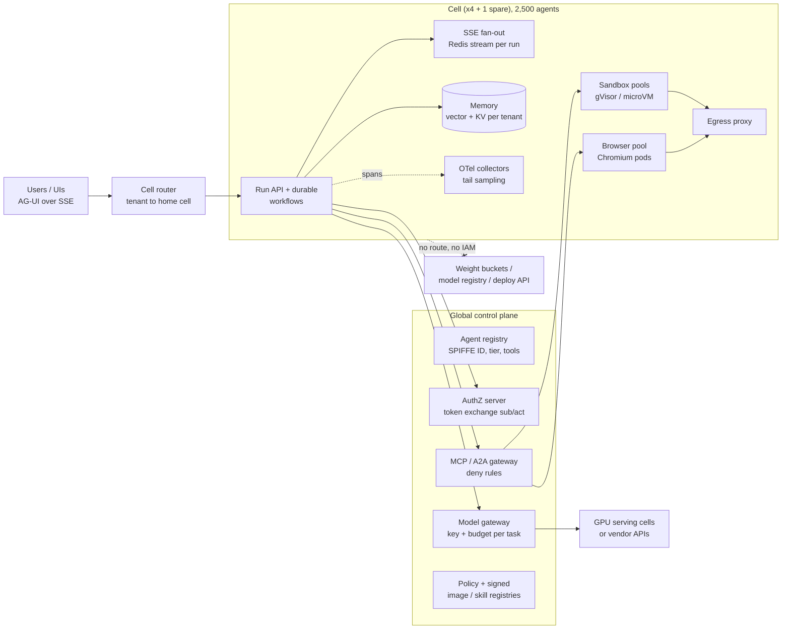
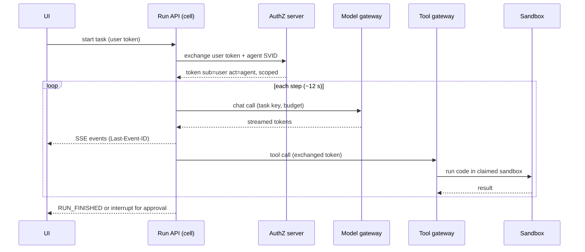

# Lesson 61 — Agent runtime infra capstone: designing an agent platform for 10K concurrent agents — gateway, memory, sandbox, browser and observability layers on Kubernetes/GPU cells, capacity math, SLOs, cost per agent task and the security review

*2026-11-10*

## What interviewers are really probing

This is the system-design round that pulls Lessons [52](/lessons/52-mcp-a2a-gateways-fleet-scale)–[60](/lessons/60-workflow-builders-multi-agent-orchestration) together. The prompt usually sounds like this: *"Design the platform that runs 10,000 concurrent agents for 300 internal teams. Agents call models, tools, code sandboxes and browsers, stream to a UI, and sometimes need a human to approve. Give me the architecture, the capacity math, the SLOs, cost per task, and walk me through the security review."*

The follow-up is an incident: *"Tuesday at 14:00, task success dropped from 91% to 74%, sandbox claim p95 went from 300 ms to 40 s, the model bill doubled, and one tenant's trace showed another tenant's document. One cause or four?"* (The answer is at the end of Failures & fixes.)

They want to hear you:

- **Start from units and numbers**, not boxes: concurrent agents, task length, steps per task, step interval, and the fraction of tasks that need a sandbox or browser. Little's law turns those into every other number.
- **Pick a cell architecture** with a stated blast radius, and say what stays global (identity, policy, registries, gateway control plane) versus what is per cell (runs, sandboxes, browsers, memory, telemetry).
- **Know which layer dominates cost** (model tokens, by a wide margin) and which dominates latency and failure (gateway hot path, sandbox cold starts, long-lived streams).
- **Define SLOs that measure the agent's job**, not just pod health: eval-scored task success, first streamed token, claim-to-ready, time-to-stop for the kill switch.
- **Run the security review as a threat model per layer**, ending with the weights and deployment boundary, because an agent platform is the most hostile tenant your GPU fleet will ever host.

Cross-links: [L17](/lessons/17-systems-design-tradeoffs) (design tradeoffs), [L21](/lessons/21-inference-serving-slos-ttft-tpot-kvcache) (TTFT/TPOT, KV cache), [L24](/lessons/24-multi-cluster-inference-routing-capacity) (multi-cluster routing), [L26](/lessons/26-gpu-cost-attribution-reclaim-spot) (cost attribution), [L13](/lessons/13-ml-weights-checkpoint-hardening) and [L14](/lessons/14-ml-inference-training-deploy-hardening) (weights and deploy hardening), [L36](/lessons/36-multi-region-dr-failover-inference) (DR), [L44](/lessons/44-gpu-cluster-control-plane-scaling) (control-plane scaling), [L50](/lessons/50-slo-error-budget-alerting-fleet-scale) (SLOs), and every agent lesson: [L52](/lessons/52-mcp-a2a-gateways-fleet-scale) gateways, [L53](/lessons/53-agent-memory-context-infrastructure) memory, [L54](/lessons/54-sandboxed-agent-execution-scale) sandboxes, [L55](/lessons/55-browser-computer-use-agent-infra) browsers, [L56](/lessons/56-agent-observability-evaluation) observability, [L57](/lessons/57-agent-ui-protocols-durable-execution) streaming and durable runs, [L58](/lessons/58-agent-identity-delegated-authorization) identity, [L59](/lessons/59-hosting-coding-agents-org) coding agents, [L60](/lessons/60-workflow-builders-multi-agent-orchestration) workflow builders. Fuel: [wafer-ai/gpu-perf-engineering-resources](https://github.com/wafer-ai/gpu-perf-engineering-resources).

**Interview sentence:** "I size it from Little's law: 10,000 agents with six-minute tasks is about 28 new tasks a second, and a step every 12 seconds is about 830 model calls a second, so model tokens are over 95% of cost per task and the gateway is the hot path. I run four cells of 2,500 agents plus a spare, each with its own run service, durable workflow engine, sandbox and browser pools, memory shards, egress proxy and telemetry, behind one global control plane for agent identity, token exchange, the model and tool gateways, policy and signed registries. SLOs are eval-scored task success per agent version, first streamed token under two seconds, sandbox claim-to-ready under a second with a warm-hit ratio above 95%, and kill-switch time-to-stop under a minute. The security review goes layer by layer, and the hard line is that agent cells have no network route and no IAM to weight buckets, registries or serving deploy APIs."

## Core diagram






## Idiosyncrasies / operator depth

### Capacity math (worked example; state your assumptions out loud)

Assumptions for this example: 10,000 concurrent agents, mean task length 360 s, a model step every 12 s (30 steps per task), 8K input tokens and 500 output tokens per step, 70% of input served from prefix cache, 60% of tasks hold a sandbox, 15% hold a browser, peak is twice the mean arrival rate.

| Quantity | Formula | Result |
|---|---|---|
| Task arrival rate | concurrency / task length (Little's law) | 10,000 / 360 ≈ **28 tasks/s**, peak 56 |
| Model calls | concurrency / step interval | 10,000 / 12 ≈ **833 calls/s** |
| Output tokens | calls × output per step | ≈ **417K tok/s** |
| Input tokens | calls × input per step | ≈ 6.7M tok/s, of which ~2M uncached prefill |
| Live sandboxes | 0.6 × 10,000 | **6,000**; new claims 17/s, peak 33/s |
| Warm pool | peak claims/s × p95 refill time (30 s) | **~1,000** members, sharded (L54 rule: no pool past ~500) |
| Live browsers | 0.15 × 10,000 | **1,500** pods |
| Streams | one SSE connection per watched run | up to **10,000** long-lived connections |

Per cell (one quarter): ~210 model calls/s, 1,500 sandboxes with a 250-member warm pool (one pool, under the shard limit), about 375 browsers, 2,500 streams, roughly 8 sandbox claims/s at peak. That's comfortably below the agent-sandbox controller's measured ceilings from [L54](/lessons/54-sandboxed-agent-execution-scale) (about 300 burst claims/s per cluster, roughly 70–85/s refill per pool), which is part of why 2,500 is a sane cell size.

**GPU serving.** If you self-host, size from your own benchmark at the latency SLO, not from a datasheet ([L21](/lessons/21-inference-serving-slos-ttft-tpot-kvcache), [L23](/lessons/23-gpu-observability-dcgm-nccl-roofline)): `replicas = peak output tok/s ÷ measured tok/s per replica at SLO`, then add N+1 per serving cell and a separate prefill budget for the ~2M uncached input tok/s. Agent traffic has long shared prefixes (system prompt, tool schemas), so prefix-aware routing ([L24](/lessons/24-multi-cluster-inference-routing-capacity)) and prefill/decode disaggregation ([L22](/lessons/22-prefill-decode-disagg-moe-serving)) pay off more here than for chat.

### Cost per agent task (worked example with assumed prices)

Assumed rates, only for the arithmetic: $1.00 per million uncached input tokens, $0.10 per million cached, $4.00 per million output, $0.04 per vCPU-hour.

| Component | Math | Cost |
|---|---|---|
| Cached input | 168K tokens × $0.10/M | $0.017 |
| Uncached input | 72K × $1.00/M | $0.072 |
| Output | 15K × $4.00/M | $0.060 |
| Sandbox | 0.6 × 0.5 vCPU × 0.1 h × $0.04 | ≈ $0.001 |
| Browser | 0.15 × 1 vCPU × 0.1 h × $0.04 | ≈ $0.0006 |
| Warm-pool idle, amortized | 1,000 × 0.5 vCPU × $0.04/h ÷ ~100K tasks/h | ≈ $0.0002 |
| **Total** | | **≈ $0.15 per task, about 98% tokens** |

At full load that's about 2.4M tasks a day, or roughly $360K a day under these assumptions. So the cost levers are, in order: steps per task (loops and retries), uncached input (put stable content first so the prefix cache hits), model routing (small models for easy steps), and output length. Compute tuning is a rounding error until tokens are fixed. Attribute cost per task, team and agent version from the gateway, joined to traces by task ID ([L56](/lessons/56-agent-observability-evaluation), [L26](/lessons/26-gpu-cost-attribution-reclaim-spot)).

### Cells, and what stays global

- **Cell contents:** run API, the durable workflow engine (Temporal or LangGraph checkpoints, [L57](/lessons/57-agent-ui-protocols-durable-execution)), Redis for stream fan-out, sandbox and browser pools, memory shards, egress proxy, and the agent-tier and gateway-tier OTel collectors. A tenant has a home cell; the router pins runs there so memory and checkpoints stay local.
- **Global:** agent registry and identity, the authorization server, model and tool gateway *control planes* (config, keys, budgets, deny rules), policy, signed image and skill registries, the eval service. Gateway *data planes* run in each cell so one gateway incident doesn't take every cell down.
- **Spare cell:** five cells for four cells' load gives 25% headroom and survives losing one cell. Failover is per tenant: in-flight runs resume from their durable checkpoint in the spare, which only works if checkpoints are replicated or the cell's datastore is regional, not zonal ([L36](/lessons/36-multi-region-dr-failover-inference)).
- **Anything shared across cells undoes the blast radius.** A shared Redis, vector database or collector tier is a single failure domain wearing a cell costume.

### Where 10K agents actually hurts

- **The gateway is the hot path.** Every step touches the model gateway and most touch the tool gateway. Validate JWTs locally with cached JWKS; introspection per call makes your p99 track the IdP ([L52](/lessons/52-mcp-a2a-gateways-fleet-scale)).
- **Long-lived things break defaults.** SSE streams hit proxy route timeouts (Envoy's default route timeout is 15 s) unless you disable it for the stream route and send heartbeats; tail sampling with a 30 s `decision_wait` fragments six-minute tasks into rootless traces unless you trace per turn or use the decision cache ([L56](/lessons/56-agent-observability-evaluation), [L57](/lessons/57-agent-ui-protocols-durable-execution)).
- **Warm pools fail silently.** One SDK that sets `spec.env` on a claim makes every claim cold-start; the warm-hit ratio is the first SLI you watch ([L54](/lessons/54-sandboxed-agent-execution-scale)).
- **The control plane counts objects.** 6,000 sandboxes, 1,500 browsers, claims, PVCs and their events across four cells is fine; on one cluster with unpaced refill and events on, it's an etcd and watch-cache problem ([L44](/lessons/44-gpu-cluster-control-plane-scaling)).
- **Memory is a tenant boundary.** Per-tenant namespaces or collections in the vector store, with filters enforced server-side, not by the agent's query ([L53](/lessons/53-agent-memory-context-infrastructure)).

## Concrete commands & config

### Cell budget as code (tenant quota per cell)

```yaml
apiVersion: v1
kind: ResourceQuota
metadata: {name: agent-tenant-acme, namespace: agents-acme}
spec:
  hard:
    count/sandboxclaims.extensions.agents.x-k8s.io: "300"   # concurrent sandbox tasks
    count/pods: "500"
    requests.cpu: "250"
    requests.memory: 500Gi
---
apiVersion: v1
kind: LimitRange
metadata: {name: agent-defaults, namespace: agents-acme}
spec:
  limits:
  - type: Container
    defaultRequest: {cpu: 500m, memory: 1Gi}   # small requests keep the pool cheap
    default: {cpu: "2", memory: 4Gi}
```

### Task-level limits at the gateway and run API

```yaml
# Run API policy per agent type (enforced server-side, not in the agent)
agentType: research-agent-v7
limits:
  maxSteps: 60
  maxWallClock: 30m
  maxToolCallsPerMinute: 30
  maxSubAgentDepth: 2
  maxFanOut: 4
  tokenBudgetPerTask: 600000
  loopDetector: {repeatedToolCallWindow: 6, action: halt}
approvals:
  requireHumanFor: [payments, external_email, prod_write, merge]
```

### Capacity check from live metrics (PromQL)

```promql
# Little's law check: concurrency ≈ arrival rate × mean task duration
sum(rate(agent_task_started_total[10m]))
  * (sum(rate(agent_task_duration_seconds_sum[1h])) / sum(rate(agent_task_duration_seconds_count[1h])))

# Warm-hit ratio per template (L54) — page if < 0.95 on interactive templates
sum by (sandbox_template) (rate(agent_sandbox_claim_creation_total{launch_type="warm"}[10m]))
/ sum by (sandbox_template) (rate(agent_sandbox_claim_creation_total[10m]))

# Cost per task by team and agent version, from gateway spend joined on task id
sum by (team, agent_version) (rate(gateway_spend_usd_total[1h]))
/ sum by (team, agent_version) (rate(agent_task_finished_total[1h]))

# Step inflation: steps per task by agent version (cost regressions show up here first)
sum by (agent_version) (rate(agent_steps_total[1h])) / sum by (agent_version) (rate(agent_task_finished_total[1h]))
```

### SLO definitions (Sloth-style)

```yaml
service: agent-platform
slos:
- name: task-success
  objective: 90
  sli: {events: {error_query: 'sum(rate(agent_task_finished_total{eval_verdict="fail"}[{{.window}}]))',
                 total_query: 'sum(rate(agent_task_finished_total[{{.window}}]))'}}
- name: first-token-latency
  objective: 99
  description: first streamed event under 2s
  sli: {events: {error_query: 'sum(rate(agent_first_event_seconds_count[{{.window}}])) - sum(rate(agent_first_event_seconds_bucket{le="2"}[{{.window}}]))',
                 total_query: 'sum(rate(agent_first_event_seconds_count[{{.window}}]))'}}
- name: sandbox-claim-ready
  objective: 99
  description: claim to ready under 1s
  sli: {events: {error_query: 'sum(rate(agent_sandbox_claim_ready_seconds_count[{{.window}}])) - sum(rate(agent_sandbox_claim_ready_seconds_bucket{le="1"}[{{.window}}]))',
                 total_query: 'sum(rate(agent_sandbox_claim_ready_seconds_count[{{.window}}]))'}}
```

### Kill-switch drill

```bash
# 1. Gateway deny rule for one agent version (seconds)
kubectl -n gateway-system patch configmap agent-deny-rules --type merge \
  -p '{"data":{"deny.rego":"package killswitch\nversions := {\"research-agent\": {\"v7\"}}"}}'
# 2. Disable the agent identity (bounded by token TTL)
spire-server entry delete -entryID <id>   # new SVIDs stop; existing ones die at TTL
# 3. Cancel in-flight runs (the step teams forget)
temporal workflow terminate --query 'AgentVersion="research-agent-v7" AND ExecutionStatus="Running"' --reason "kill switch drill"
# Measure: time from step 1 to zero model calls for v7 at the gateway
```

## Failures & fixes

| Symptom | Cause | Fix |
|---|---|---|
| Model bill doubles overnight, task count flat | Steps per task jumped after a prompt or model change; a loop between tools | Steps-per-task alert by agent version, loop detector, per-task token budget at the gateway, eval gate on cost in release ([L31](/lessons/31-evaluation-release-gating-canary-weights)) |
| Sandbox claim p95 goes from 300 ms to 40 s | A client started passing env on claims, or a template rollout drained the pool | Disallow env injection, pass task data after adoption, alert on warm-hit ratio, roll templates per pool |
| UI shows runs "stuck" after 15 s | Proxy route timeout on SSE | Disable the route timeout for the stream route, send heartbeats, resume with `Last-Event-ID` |
| Traces show hundreds of one-span traces per task | `decision_wait` shorter than the task | Trace per turn with span links, or decision cache; scale the sampler tier on a schedule |
| One tenant's trace contains another tenant's document | Shared vector collection with client-side filtering, or prompt content captured in telemetry | Per-tenant collections with server-side filters; content capture off, stripped at the collector ([L53](/lessons/53-agent-memory-context-infrastructure), [L56](/lessons/56-agent-observability-evaluation)) |
| Losing one cell stalls 2,500 tasks for an hour | Checkpoints stored zonally in the cell; spare cell can't resume | Regional or replicated checkpoint store; drill per-tenant failover ([L37](/lessons/37-chaos-engineering-dr-game-days-gpu-inference)) |
| Gateway p99 tracks the IdP | JWKS fetch or introspection on the hot path | Cache JWKS with background refresh, local validation, IdP outage budget |
| Kill switch "worked" but runs kept acting for 10 minutes | Only new runs blocked; tokens still valid | Layered switch with run cancellation; short token TTLs; measure time-to-stop |

**The Tuesday incident.** One cause can produce all four symptoms: a new agent SDK release that (a) passed env on every sandbox claim, so everything cold-started, (b) retried on timeouts, so steps and tokens rose, (c) lowered task success because tools timed out, and (d) turned on prompt capture with a shared trace project, which exposed the other tenant's document. The tell is that all four moved at 14:00. Roll back the SDK, then fix each guard so the next SDK can't do it again: claim admission policy, per-task budgets, a collector that strips content, and per-tenant trace projects.

## Security & hardening

**The capstone security review. Go layer by layer, name the threat, then the control.**

1. **Identity and delegation.** Threat: a confused deputy, where an agent uses its own broad rights for a user who shouldn't have them. Control: every agent type is a registered workload (SPIFFE ID, owner, risk tier, declared tools); runs get an RFC 8693 exchanged token with `sub` = user, `act` = agent, one audience and intersected scopes; third-party OAuth tokens stay in a broker and agents get short-lived, sender-constrained tokens per tool ([L58](/lessons/58-agent-identity-delegated-authorization)). No static keys anywhere in a cell.
2. **Gateways.** Threat: tool poisoning, unregistered MCP servers, and token passthrough. Control: only gateway-registered remote MCP servers with per-tool scopes; no stdio MCP from users; deny rules double as the fastest kill switch; the gateway never forwards the user's original token ([L52](/lessons/52-mcp-a2a-gateways-fleet-scale), [L60](/lessons/60-workflow-builders-multi-agent-orchestration)).
3. **Execution isolation.** Threat: hostile code and hostile web pages. Control: sandboxes and browsers run in gVisor or microVM pods on tainted pools, Pod Security `restricted`, no service-account token, no cloud identity, read-only root filesystem, default-deny NetworkPolicy, and all egress through a proxy that resolves DNS itself and blocks RFC1918, link-local and metadata ranges; IMDS blocked at the node ([L34](/lessons/34-agent-tool-sandboxing-egress-policy), [L54](/lessons/54-sandboxed-agent-execution-scale), [L55](/lessons/55-browser-computer-use-agent-infra)). Snapshot buckets for warm pools are treated as secret stores, and entropy is reseeded on restore.
4. **Container images, registries and supply chain.** Threat: a poisoned harness, MCP server, skill, plugin or base image. Control: everything is signed and pinned by digest, verified by admission ([L11](/lessons/11-cluster-security-pss-admission-rbac), [L12](/lessons/12-node-container-hardening-supply-chain)); mirror into your own registry; SBOMs and patch SLOs; skills and plugins only from allowlisted, ref-pinned sources ([L59](/lessons/59-hosting-coding-agents-org)). The gateway image itself is pinned, since gateways hold every key.
5. **Data: memory, checkpoints and telemetry.** Threat: cross-tenant leaks and memory poisoning. Control: per-tenant namespaces or collections enforced server-side; provenance on memory writes; encrypted durable checkpoints with per-tenant keys; prompt and completion capture off by default, stripped at the collector, trace projects per tenant ([L53](/lessons/53-agent-memory-context-infrastructure), [L56](/lessons/56-agent-observability-evaluation), [L57](/lessons/57-agent-ui-protocols-durable-execution)).
6. **Secrets.** Threat: credentials in env vars, flow JSON or the model's context. Control: a secret broker issues per-run, least-privilege, short-lived credentials outside the model's view; nothing secret in the agent phase environment ([L48](/lessons/48-workload-identity-secrets-pki-fleet-scale)).
7. **Model weights, checkpoints and serving deployments.** Threat: an agent, through a tool or a prompt injection, reads or replaces weights, or repoints serving. Control: agent cells have **no network route and no IAM** to weight and checkpoint buckets, model registries or inference deployment APIs; bucket policies explicitly deny the cell roles; admission blocks agent namespaces from mounting model PVCs or weight-hydration secrets; serving pods mount weights read-only by digest from signed artifacts; promotion of a model to serving is a separate signed pipeline with human approval, never an agent tool ([L13](/lessons/13-ml-weights-checkpoint-hardening), [L14](/lessons/14-ml-inference-training-deploy-hardening), [L27](/lessons/27-gpu-supply-chain-weight-registry-hydrate)). Self-hosted model endpoints are reached only through the model gateway with a per-task key.
8. **Human approval and irreversible actions.** Threat: an injected instruction that pays, emails, merges or deletes. Control: risk-tiered tools, bound approvals that end the run and resume after a WebAuthn step-up, and an action critic that doesn't see raw untrusted content ([L55](/lessons/55-browser-computer-use-agent-infra), [L57](/lessons/57-agent-ui-protocols-durable-execution), [L58](/lessons/58-agent-identity-delegated-authorization)).
9. **Blast radius and abuse.** Threat: runaway swarms and denial of wallet. Control: per-task budgets, step, depth and fan-out caps, per-tenant quotas per cell, and a layered kill switch (gateway deny, identity disable, run cancellation) with a measured time-to-stop SLO that you drill.
10. **Detection and audit.** Join keys from user to run to model spend to tool calls to commits or deploys; alert on new tool registrations, unusual egress, token spikes and approval bypass attempts; red-team agents in CI before release ([L56](/lessons/56-agent-observability-evaluation)).

## Interview soundbites

- "Little's law first: concurrency over task length gives arrivals, concurrency over step interval gives model calls. Everything else falls out."
- "Tokens are about 98% of cost per task. I fix steps per task and prefix caching before I touch compute."
- "A cell is a blast radius. If two cells share a Redis, they're one cell."
- "My first SLI is task success scored by evals, by agent version. Pod health doesn't tell me the agent did its job."
- "Warm-hit ratio is the sandbox SLI that catches the silent cold-start regression."
- "The kill switch has three layers and an SLO, and the layer people forget is cancelling runs already in flight."
- "Agent cells can't reach weights, registries or deploy APIs. Promotion is a human-gated pipeline, not a tool call."

## Watch (talks & demos)

Both talks were checked for earlier lessons in this track and map onto two layers of this design.

<iframe width="100%" height="360" src="https://www.youtube.com/embed/SomP92JWPmE" title="Introducing Agent Gateway: AI-Native Connectivity & Security | Christian Posta" frameBorder="0" allow="accelerometer; autoplay; clipboard-write; encrypted-media; gyroscope; picture-in-picture; web-share" allowFullScreen></iframe>

[Open on YouTube](https://www.youtube.com/watch?v=SomP92JWPmE). Why watch: the gateway layer as a data plane for MCP and A2A, with auth and policy at the hop, which is the hot path in this design.

<iframe width="100%" height="360" src="https://www.youtube.com/embed/ZJH1kYFKjK8" title="Taming Agentic AI: Run Rogue Code Safely on Kubernetes with Agent Sandbox, by Abdel Sghiouar" frameBorder="0" allow="accelerometer; autoplay; clipboard-write; encrypted-media; gyroscope; picture-in-picture; web-share" allowFullScreen></iframe>

[Open on YouTube](https://www.youtube.com/watch?v=ZJH1kYFKjK8). Why watch: the Kubernetes agent-sandbox model (templates, claims, warm pools) that the sandbox layer and its capacity math are built on.

## References

- This track: [L52](/lessons/52-mcp-a2a-gateways-fleet-scale) · [L53](/lessons/53-agent-memory-context-infrastructure) · [L54](/lessons/54-sandboxed-agent-execution-scale) · [L55](/lessons/55-browser-computer-use-agent-infra) · [L56](/lessons/56-agent-observability-evaluation) · [L57](/lessons/57-agent-ui-protocols-durable-execution) · [L58](/lessons/58-agent-identity-delegated-authorization) · [L59](/lessons/59-hosting-coding-agents-org) · [L60](/lessons/60-workflow-builders-multi-agent-orchestration)
- [kubernetes-sigs/agent-sandbox](https://github.com/kubernetes-sigs/agent-sandbox) · [AgentGateway MCP auth](https://agentgateway.dev/docs/kubernetes/latest/mcp/auth/setup/) · [AG-UI 1.0 spec](https://docs.ag-ui.com/spec/1.0) · [Temporal OpenAI Agents SDK integration](https://docs.temporal.io/develop/python/integrations/openai-agents) · [SPIFFE concepts](https://spiffe.io/docs/latest/spiffe-about/spiffe-concepts/) · [RFC 8693 token exchange](https://www.rfc-editor.org/rfc/rfc8693) · [OTel GenAI semantic conventions](https://opentelemetry.io/docs/specs/semconv/gen-ai/) · [LiteLLM virtual keys and budgets](https://docs.litellm.ai/docs/proxy/virtual_keys)
- [wafer-ai/gpu-perf-engineering-resources](https://github.com/wafer-ai/gpu-perf-engineering-resources)

## Quick self-check

Out loud, in under three minutes each:

1. Concurrency 10,000, task length 8 minutes, step every 10 s. What are the arrival rate and model call rate, and how many warm sandbox members do you need if 50% of tasks need one and refill p95 is 40 s at a 2× peak?
2. Redo cost per task when prefix cache hit drops from 70% to 20%. Which line changes, by how much, and what usually causes the drop?
3. Why 2,500 agents per cell? Name two numbers that push it smaller and one that pushes it larger.
4. What stays global, what's per cell, and what happens to in-flight runs when a cell dies?
5. Write the four SLOs you'd page on, and the one metric you'd watch for a cost regression.
6. Walk the security review for a browser agent that can send email. Where are the identity, isolation, approval and kill-switch controls?
7. An agent asks for a tool that "loads the latest fine-tune into serving". What does the platform allow, what does it deny, and where does that request go instead?
8. Explain the Tuesday incident from one root cause, and the four guards that stop the next SDK from repeating it.

## Next

This closes the **agent runtime infrastructure** track (Lessons 52–61). **Lesson 62 — Full mock system-design interview: a hyperscale GPU and agent platform end to end (100+ clusters, 10K+ nodes), timed, with a scoring rubric.**
