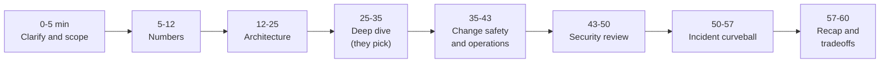
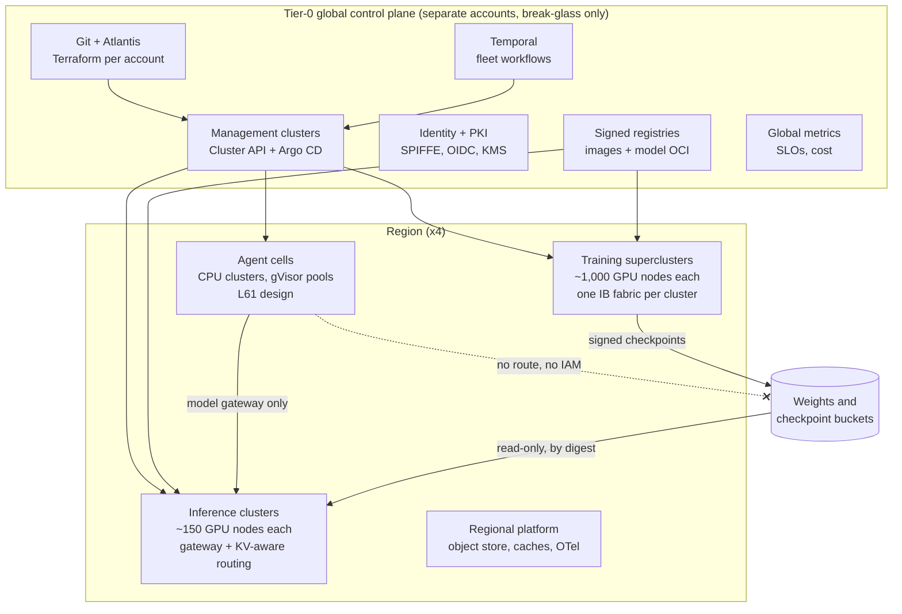

# Lesson 62 — Full mock system-design interview: a hyperscale GPU and agent platform end to end (100+ clusters, 10K+ nodes), timed, with a scoring rubric

*2026-11-11*

This one is a rehearsal, not new material. Set a 60-minute timer, read the prompt, and answer out loud (or on a whiteboard) before you read the model answer for each phase. Then score yourself with the rubric at the end. Every phase points back to the lesson that goes deeper.

## What interviewers are really probing

**The prompt (read it once, start the timer):**

> *"You're the founding platform engineer. Design the compute platform for an AI company that trains frontier models, serves them to customers, and runs 10,000 concurrent internal agents. Budget is about 48,000 GPUs across four regions, so think 100+ Kubernetes clusters and 10K+ nodes. Walk me through requirements, the numbers, the architecture, how you change it safely, how it fails, and the security review. I'll interrupt."*

What the interviewer is scoring is rarely the boxes. It's whether you:

- **Scope before you draw.** Three workloads with different shapes: training (gang-scheduled, fabric-bound, hours to weeks), inference (latency SLOs, bursty, multi-region), agents (CPU-heavy, hostile code, token-bound). Say which one dominates which decision.
- **Do arithmetic out loud** and state assumptions: GPU count, nodes, power, failure rate, checkpoint interval, cluster count, upgrade duration.
- **Draw blast radius on purpose.** Cells, clusters, regions, and what's global. Say why a cluster stops at its size.
- **Treat change as the main risk.** The fleet breaks more often from your own rollouts than from hardware, and the interviewer wants waves, bake time, and automatic halts.
- **Run the security review unprompted**, ending at the model weights and the serving deploy path.
- **Survive the curveball.** One incident with several symptoms, to see if you look for the shared cause.

Cross-links (the whole site, really): [L1](/lessons/01-hyperscale-mental-model) mental model, [L2](/lessons/02-k8s-control-plane) control plane, [L3](/lessons/03-cluster-provisioning-lifecycle) cluster lifecycle, [L15](/lessons/15-terraform-atlantis-fleet-scale) Terraform/Atlantis, [L16](/lessons/16-temporal-argo-workflows) Temporal/Argo, [L17](/lessons/17-systems-design-tradeoffs) tradeoffs, [L18](/lessons/18-gpu-node-pools-mig-timeslicing)–[L20](/lessons/20-training-inference-scheduling-kueue-volcano) GPU pools, topology, scheduling, [L21](/lessons/21-inference-serving-slos-ttft-tpot-kvcache)/[L24](/lessons/24-multi-cluster-inference-routing-capacity) inference, [L29](/lessons/29-training-reliability-checkpoint-elastic) checkpoints, [L38](/lessons/38-gpu-fleet-capacity-planning-procurement)–[L41](/lessons/41-power-cooling-facility-constraints-gpu-fleets) capacity, lifecycle, fabric, power, [L44](/lessons/44-gpu-cluster-control-plane-scaling)/[L45](/lessons/45-fleet-kubernetes-upgrades-gpu-clusters) control-plane scaling and upgrades, [L50](/lessons/50-slo-error-budget-alerting-fleet-scale)/[L51](/lessons/51-gitops-progressive-delivery-fleet-scale) SLOs and GitOps, [L13](/lessons/13-ml-weights-checkpoint-hardening)/[L14](/lessons/14-ml-inference-training-deploy-hardening)/[L27](/lessons/27-gpu-supply-chain-weight-registry-hydrate) weights, [L61](/lessons/61-agent-platform-capstone-10k) agent capstone. Fuel: [wafer-ai/gpu-perf-engineering-resources](https://github.com/wafer-ai/gpu-perf-engineering-resources).

**Opening sentence to practice:** "Before I draw anything, I'll split this into three workloads with different shapes, size each one, and then build a fleet of regional cells where each cluster's size is set by its blast radius and its fabric, with one tier-0 control plane that owns identity, policy, registries and change."

## Core diagram


**The 60-minute clock.** Interviewers keep time even when they don't say so. Running out of time before security or operations is the most common way a strong candidate scores "lean no hire".



**The reference architecture you should be able to draw in eight minutes:**



## Idiosyncrasies / operator depth

This section is the model answer, phase by phase. Numbers are worked examples with stated assumptions; say the assumptions out loud in the room.

### Phase 1 (0–5 min): clarify and scope

Ask four or five questions, then commit. Good ones: split of GPUs between training, inference and agents; cloud, colo or both; largest single training job; latency SLO for customers; regulatory or data-residency limits. If they say "you decide", pick and say it:

- **Assume** 48,000 H100-class GPUs, 8 per node, so **6,000 GPU nodes**. Split: 60% training (28,800 GPUs), 30% inference (14,400), 10% eval, batch and agent-model serving (4,800).
- Largest training job: **16,384 GPUs** (2,048 nodes). That sets the size of the biggest fabric.
- Plus about **6,000 CPU nodes** for agent cells, platform services, CI and data pipelines. Total **~12,000 nodes**.
- Agents: **10,000 concurrent**, sized in [L61](/lessons/61-agent-platform-capstone-10k).

### Phase 2 (5–12 min): numbers

| Quantity | Working | Result |
|---|---|---|
| Power | about 10 kW per 8-GPU node (DGX H100 max is 10.2 kW) × 6,000 | ~60 MW IT for GPUs, ~80 MW at PUE 1.3 ([L41](/lessons/41-power-cooling-facility-constraints-gpu-fleets)) |
| Interruptions | Meta's Llama 3 run saw 419 unexpected interruptions in 54 days on 16,384 GPUs, about 7.8 a day | About **23 a day** across 48K GPUs if the rate scales; a job on 16K GPUs fails about every **3.1 h** |
| Checkpoint interval | Young/Daly: √(2 × C × MTBF) with C = 60 s blocking save, MTBF = 11,100 s | √(1,332,000) ≈ **1,150 s, about 19 min** ([L29](/lessons/29-training-reliability-checkpoint-elastic)) |
| Training clusters | One cluster per fabric. 2,048-node job needs one 2K-node fabric; smaller fabrics of ~1,000 nodes for the rest | **About 4 large + 6 medium training clusters** (~3,600 GPU nodes) |
| Inference clusters | 14,400 GPUs ≈ 1,800 nodes, ~150 nodes per cluster, plus N+1 per region | **About 14 clusters**, 3–4 per region |
| Eval/batch GPU | 600 nodes in ~150-node clusters | **About 4 clusters** |
| Agent cells | 4 cells + 1 spare per region where agents run, ~2,500 agents per cell ([L61](/lessons/61-agent-platform-capstone-10k)) | **About 10 CPU clusters** |
| Platform, CI, data | Per-region platform clusters, CI fleets, data pipelines, dev/staging copies of every cluster type | **About 80+ clusters** |
| Upgrades | 120 clusters in waves 1, 2, 5, 10, 25, rest, with 24 h bake per wave | **6–7 working days per Kubernetes minor**, three minors a year ([L45](/lessons/45-fleet-kubernetes-upgrades-gpu-clusters)) |

Why clusters stop where they do: a training cluster is as big as its fabric because a job can't span two schedulers well, and 2,000 nodes is still well under the Kubernetes tested limit of 5,000 nodes (GKE has shown 15,000+ with etcd and API changes, [L44](/lessons/44-gpu-cluster-control-plane-scaling)). An inference cluster is small because its failure takes out serving capacity, and the router can shift traffic across many small clusters. Say: "Training clusters are sized by the fabric, inference clusters by blast radius."

### Phase 3 (12–25 min): architecture

- **Tier-0 control plane** in its own accounts: Git with Atlantis applying Terraform per account and per region ([L15](/lessons/15-terraform-atlantis-fleet-scale)); management clusters running Cluster API (or managed cluster APIs) and Argo CD with ApplicationSets ([L3](/lessons/03-cluster-provisioning-lifecycle), [L51](/lessons/51-gitops-progressive-delivery-fleet-scale)); Temporal for long fleet workflows like upgrades, drains and RMA ([L16](/lessons/16-temporal-argo-workflows)); identity, PKI and KMS ([L48](/lessons/48-workload-identity-secrets-pki-fleet-scale)); signed registries for images and model artifacts ([L27](/lessons/27-gpu-supply-chain-weight-registry-hydrate)); global metrics, SLOs and cost ([L49](/lessons/49-fleet-observability-pipelines-scale), [L26](/lessons/26-gpu-cost-attribution-reclaim-spot)). Rule: tier-0 can be down for an hour and nothing serving or training stops. It only stops change.
- **Training superclusters**: one InfiniBand or RoCE fabric per cluster ([L40](/lessons/40-infiniband-roce-fabric-operations)), topology-aware gang scheduling with Kueue and topology labels ([L19](/lessons/19-gpu-topology-nvlink-rdma-nccl), [L20](/lessons/20-training-inference-scheduling-kueue-volcano)), node health checks with automatic drain and hot spares (about 2–3% spare nodes so a failure costs a restart, not a wait), async checkpoints to local NVMe then the regional object store.
- **Inference**: small clusters, model servers with KV-cache-aware routing, prefill/decode split for the big models ([L21](/lessons/21-inference-serving-slos-ttft-tpot-kvcache), [L22](/lessons/22-prefill-decode-disagg-moe-serving)), a global router that shifts by capacity and health ([L24](/lessons/24-multi-cluster-inference-routing-capacity)), autoscaling on queue depth not GPU utilization ([L28](/lessons/28-inference-autoscaling-scale-to-zero)), N+1 region for DR ([L36](/lessons/36-multi-region-dr-failover-inference)).
- **Agent cells**: the [L61](/lessons/61-agent-platform-capstone-10k) design. They call inference only through the model gateway.
- **Quota and sharing**: Kueue cohorts so idle training quota lends to eval and batch with preemption back ([L25](/lessons/25-multi-tenant-gpu-isolation-quota)); MultiKueue to dispatch batch jobs across clusters.

### Phase 4 (25–35 min): the deep dive they pick

Have a five-minute version ready for each. The interviewer usually picks where your diagram was vaguest.

| If they pick | Lead with | Show depth with |
|---|---|---|
| Training reliability | MTBF math, checkpoint interval, hot spares | NCCL timeouts as the symptom of one bad link, straggler detection from step time, DCGM diagnostics before a node rejoins ([L23](/lessons/23-gpu-observability-dcgm-nccl-roofline), [L39](/lessons/39-gpu-fleet-lifecycle-acceptance-burn-in-rma)) |
| Control-plane scaling | One cluster per fabric, under 5K nodes | API Priority and Fairness, watch cache, etcd size and defrag, DaemonSet pod churn on 2K nodes ([L2](/lessons/02-k8s-control-plane), [L44](/lessons/44-gpu-cluster-control-plane-scaling)) |
| Inference latency | TTFT/TPOT SLOs, KV cache hit rate | Prefill/decode split, prefix-aware routing, weight hydration time as the real autoscaling limit ([L27](/lessons/27-gpu-supply-chain-weight-registry-hydrate), [L28](/lessons/28-inference-autoscaling-scale-to-zero)) |
| Networking | Per-cluster CIDR plan, IB/RoCE separate from frontend | IP exhaustion with 8 NICs per node, multi-NIC with DRA, DNS at node level ([L46](/lessons/46-gpu-cluster-networking-fleet-scale), [L47](/lessons/47-dns-service-discovery-east-west-lb)) |
| Capacity and cost | Allocation vs utilization, reclaim | Reservations vs on-demand vs spot, cost per token and per training step ([L26](/lessons/26-gpu-cost-attribution-reclaim-spot), [L38](/lessons/38-gpu-fleet-capacity-planning-procurement)) |

### Phase 5 (35–43 min): change safety and operations

- **Everything is a wave.** Kubernetes minors, node images and kernels ([L42](/lessons/42-node-os-kernel-management-gpu-fleets)), GPU drivers, operators, NCCL, switch firmware and facility work go through the same change calendar and the same waves: canary cluster, early, 10%, 25%, rest.
- **Automatic halt** on SLO burn or on a health signal (node NotReady rate, GPU Xid rate, step-time regression, TTFT p99), not on a human noticing.
- **Training is special.** Never upgrade a cluster under a running large job; drain at a checkpoint boundary, or roll nodes into the hot-spare pool one at a time.
- **On-call**: per-layer runbooks, a fleet-wide incident commander, and the rule "roll back first, debug second" ([L35](/lessons/35-fleet-incident-response-gpu-inference-agent-runbooks)). Game days for region loss and fabric loss ([L37](/lessons/37-chaos-engineering-dr-game-days-gpu-inference)).

### Phase 6 and 7: security review and curveball

See **Security & hardening** and the end of **Failures & fixes**. Budget seven minutes each.

### Phase 8 (57–60 min): recap

Restate three decisions and their costs: "Cluster per fabric costs us more clusters to run, which is why change is automated. Small inference clusters cost some packing efficiency for blast radius. Agent cells can't reach weights, which costs a second promotion pipeline but keeps the worst tenant away from the crown jewels."

## Concrete commands & config

Interviewers often ask "what would that look like?" Have these shapes ready.

### Progressive rollout across 120 clusters (Argo CD ApplicationSet, RollingSync)

```yaml
# argocd-cmd-params-cm must set applicationsetcontroller.enable.progressive.syncs: "true"
apiVersion: argoproj.io/v1alpha1
kind: ApplicationSet
metadata:
  name: gpu-operator
  namespace: argocd
spec:
  goTemplate: true
  generators:
  - clusters:
      selector:
        matchLabels:
          fleet.example.com/gpu: "true"
  strategy:
    type: RollingSync
    rollingSync:
      steps:
      - matchExpressions:
        - {key: wave, operator: In, values: ["canary"]}
      - matchExpressions:
        - {key: wave, operator: In, values: ["early"]}
        maxUpdate: 10%
      - matchExpressions:
        - {key: wave, operator: In, values: ["main"]}
        maxUpdate: 25%
  template:
    metadata:
      name: 'gpu-operator-{{.name}}'
      labels:
        wave: '{{index .metadata.labels "fleet.example.com/wave"}}'
    spec:
      project: platform
      source:
        repoURL: https://git.example.com/fleet/gpu-operator.git
        targetRevision: v25.3.1
        path: overlays/{{index .metadata.labels "fleet.example.com/kind"}}
      destination:
        server: '{{.server}}'
        namespace: gpu-operator
```

Gotcha to mention: RollingSync matches on labels of the generated **Applications**, so the cluster label has to be copied into the template, and progressive sync takes over sync from the controller, so per-app auto-sync is not what moves the waves.

### Fleet health across clusters

```bash
# NotReady nodes per cluster, all contexts
for ctx in $(kubectl config get-contexts -o name); do
  printf "%s " "$ctx"
  kubectl --context "$ctx" get nodes --no-headers | awk '$2!="Ready"{n++} END{print n+0}'
done

# Cluster API: what's mid-rollout and why
clusterctl describe cluster train-use1-a -n fleet --show-conditions all
kubectl get machinedeployments -A -o custom-columns=NS:.metadata.namespace,NAME:.metadata.name,READY:.status.readyReplicas,UPDATED:.status.updatedReplicas

# Control-plane pressure on a 2K-node cluster
kubectl get --raw /metrics | grep -E 'apiserver_flowcontrol_rejected_requests_total|apiserver_storage_objects\{resource="pods"\}'
etcdctl endpoint status --cluster -w table
```

### Quota that lends idle training GPUs (Kueue cohort)

```yaml
apiVersion: kueue.x-k8s.io/v1beta1
kind: ClusterQueue
metadata:
  name: training
spec:
  cohort: gpu-use1
  namespaceSelector: {}
  preemption:
    reclaimWithinCohort: Any
    withinClusterQueue: LowerPriority
  resourceGroups:
  - coveredResources: ["nvidia.com/gpu"]
    flavors:
    - name: h100-ib
      resources:
      - name: nvidia.com/gpu
        nominalQuota: 16384
        lendingLimit: 4096   # eval/batch can borrow up to 4K idle GPUs; training reclaims by preemption
```

### The numbers, as a script you can rerun

```python
import math
gpus, per_node = 48_000, 8
nodes = gpus // per_node                          # 6,000
it_mw = nodes * 10 / 1000                         # ~60 MW at ~10 kW/node
rate_per_gpu_day = 419 / 54 / 16_384              # Llama 3 report, unexpected interruptions
fleet_per_day = rate_per_gpu_day * gpus           # ~23
job_mtbf_s = 86_400 / (rate_per_gpu_day * 16_384) # ~11,100 s
ckpt_s = math.sqrt(2 * 60 * job_mtbf_s)           # ~1,150 s
print(nodes, round(it_mw), round(fleet_per_day, 1), round(job_mtbf_s), round(ckpt_s))
```

### Self-score sheet

```python
weights = {"scoping": 10, "numbers": 15, "architecture": 20, "change_ops": 15,
           "reliability": 15, "security": 15, "communication": 10}
scores = {k: 3 for k in weights}   # 1 no hire, 2 lean no, 3 hire, 4 strong hire
total = sum(weights[k] * scores[k] / 4 for k in weights)
gate = min(scores.values()) >= 2 and scores["security"] >= 3
print(f"{total:.0f}/100", "PASS" if total >= 70 and gate else "NOT YET")
```

### Scoring rubric

| Dimension (weight) | 1: no hire | 2: lean no | 3: hire | 4: strong hire |
|---|---|---|---|---|
| Scoping (10) | Draws before asking | Asks, but never commits | Splits training, inference, agents and commits to assumptions | Names which workload drives each later decision |
| Numbers (15) | No arithmetic | Numbers with no units or sources | GPUs, nodes, power, clusters, checkpoint interval | Uses a real failure rate, derives cluster sizes and upgrade time from it |
| Architecture (20) | One giant cluster or boxes without boundaries | Clusters, but no reason for their size | Tier-0, regions, cluster types sized by fabric and blast radius | Says what keeps working when tier-0 is down |
| Change & ops (15) | "We use GitOps" | Waves without halts | Waves, bake, automatic halt on SLO burn | Includes drivers, firmware and facility work in the same change system; protects running jobs |
| Reliability (15) | Ignores hardware failure | Mentions retries | Checkpoints, hot spares, DR region | Young/Daly interval, straggler detection, drills with measured recovery |
| Security (15) | Not mentioned | Generic "use RBAC" | Identity, admission, network, secrets, weights | Threat per layer, bucket policy details, separate promotion pipeline, agent isolation from weights |
| Communication (10) | Interviewer drags it out | Loses the clock | Checks in, keeps time, recaps | Drives the session, states tradeoffs with costs |

**Pass bar:** 70 or more, no dimension at 1, and security at 3 or higher. Most real loops treat a missing security story as disqualifying for a platform role.

## Failures & fixes

These are failures of the **candidate**, as the interviewer sees them.

| What the interviewer sees | Why it happens | Fix |
|---|---|---|
| 20 minutes of clarifying questions | Fear of committing | Ask five questions max, then say "I'll assume X; correct me" |
| One 12,000-node cluster | Treating Kubernetes like a VM pool | Cluster per fabric for training, small clusters for inference; quote the 5,000-node tested limit |
| Numbers without units, or no numbers | Skipping the math to get to boxes | Fill the numbers table first; every box gets a count |
| Tool soup ("Istio, Cilium, Karpenter, Ray...") | Naming products instead of jobs | Name the job each layer does, then one product and why |
| Upgrades described as "we use GitOps" | No wave model | Waves, bake time, automatic halts, and what happens to a running training job |
| Security squeezed into the last 60 seconds | Poor timekeeping | Glance at the clock at 25 and 43 minutes; security starts by minute 45 |
| Answers the curveball symptom by symptom | Not looking for the shared cause | First question: "What changed, and where do the affected things share a dependency?" |
| Defends every choice | Thinks tradeoffs look weak | Name the cost of each choice yourself before they do |

**The curveball (minute 50).** *"Monday 09:40. The 16K-GPU training job's step time is up 30%. Inference TTFT p99 in us-east-1 doubled. 40 nodes in cluster `inf-use1-c` went NotReady. One cause or three?"*

**Model answer.** Ask what changed and what the affected things share. All three sit in the same data-hall: a scheduled **spine-switch firmware upgrade** started at 09:30 under the network team's own change process, outside the fleet's change calendar. Packet loss on the RoCE fabric slows NCCL all-reduce (step time up, the slowest link sets the pace). The same spine carries the inference cluster's KV transfer between prefill and decode pods (TTFT up). The frontend network shares those spines, so kubelet lease renewals time out and nodes go NotReady. Actions: halt the firmware rollout and roll back that switch pair; don't let the NotReady nodes trigger mass eviction (node lifecycle controller already slows down when a zone is mostly unhealthy, but check your autoscaler and remediation jobs don't start replacing nodes); shift inference traffic to other clusters via the global router; let training resume from the last checkpoint if NCCL times out. Long-term fix: network and facility changes go through the same change calendar, waves and automatic halts as Kubernetes, with step time and TTFT as halt signals ([L40](/lessons/40-infiniband-roce-fabric-operations), [L41](/lessons/41-power-cooling-facility-constraints-gpu-fleets)).

## Security & hardening

**Run this review unprompted, layer by layer: threat, then control. It's 15% of the score and a hard gate.**

1. **Tier-0 control plane.** Threat: whoever owns Argo CD, Cluster API or Atlantis owns all 120 clusters. Control: separate accounts and clusters, private API endpoints, no standing human cluster-admin (break-glass with alerting), Atlantis applies only after approval with per-account OIDC roles and no long-lived cloud keys, Git branch rules with required reviews on fleet repos ([L15](/lessons/15-terraform-atlantis-fleet-scale), [L51](/lessons/51-gitops-progressive-delivery-fleet-scale)).
2. **Cluster admission and RBAC.** Pod Security `restricted` by default with named exceptions (GPU operator, CNI), image signature and digest verification at admission, namespace-scoped RBAC from groups, audit logs shipped off-cluster ([L11](/lessons/11-cluster-security-pss-admission-rbac)).
3. **Container images and supply chain.** Mirror everything into your own registries, sign with Sigstore and verify at admission, SBOMs, patch SLOs. GPU drivers, operators and NCCL builds are supply chain too, and they run privileged on every GPU node ([L12](/lessons/12-node-container-hardening-supply-chain)).
4. **Workload identity and secrets.** SPIFFE or cloud workload identity per service, short-lived credentials, External Secrets or Vault, no static keys in pods; IMDS blocked for pods that don't need cloud access ([L48](/lessons/48-workload-identity-secrets-pki-fleet-scale)).
5. **Network isolation.** Default-deny NetworkPolicy, training fabric not routable from frontend networks, egress through proxies, agent cells in their own VPCs ([L9](/lessons/09-networkpolicy-multi-nic-sflow), [L34](/lessons/34-agent-tool-sandboxing-egress-policy)).
6. **Model weights and checkpoints (say this explicitly).** Weights are the company's most valuable asset. Separate buckets for checkpoints and released weights, each with its own KMS key; versioning and object lock on released weights; access only from the training checkpoint roles and the serving hydrate roles, only through VPC endpoints. Weights are packaged as signed OCI artifacts or signed with OpenSSF model signing, and serving verifies the signature and pulls **by digest, read-only** ([L13](/lessons/13-ml-weights-checkpoint-hardening), [L27](/lessons/27-gpu-supply-chain-weight-registry-hydrate)). Bucket policy gotcha: conditions inside one Deny statement are ANDed, so "deny unless VPC endpoint AND allowed role" written as one statement denies only when **both** fail. Write two Deny statements:

```json
{
  "Version": "2012-10-17",
  "Statement": [
    {"Sid": "DenyOutsideVpce", "Effect": "Deny", "Principal": "*", "Action": "s3:*",
     "Resource": ["arn:aws:s3:::weights-prod", "arn:aws:s3:::weights-prod/*"],
     "Condition": {"StringNotEquals": {"aws:SourceVpce": "vpce-0a1b2c3d4e5f67890"}}},
    {"Sid": "DenyOtherPrincipals", "Effect": "Deny", "Principal": "*", "Action": "s3:*",
     "Resource": ["arn:aws:s3:::weights-prod", "arn:aws:s3:::weights-prod/*"],
     "Condition": {"ArnNotLike": {"aws:PrincipalArn": [
       "arn:aws:iam::111122223333:role/serving-hydrate-*",
       "arn:aws:iam::111122223333:role/weights-promote"]}}}
  ]
}
```

   (In practice add a break-glass role to the second list, or you can lock yourself out.)
7. **Training and inference deployments.** Promotion from checkpoint to serving is a separate pipeline: eval gates, signed release, human approval, canary by weight digest ([L14](/lessons/14-ml-inference-training-deploy-hardening), [L31](/lessons/31-evaluation-release-gating-canary-weights)). Serving pods can't write to weight buckets; training jobs can't deploy.
8. **Agent cells.** The most hostile tenant on the fleet: gVisor or microVM sandboxes, delegated tokens, gateways, budgets and kill switches, and **no network route and no IAM** to weight buckets, model registries or deploy APIs ([L61](/lessons/61-agent-platform-capstone-10k)).
9. **Multi-tenancy on GPUs.** Shared GPUs (MIG or time-slicing) only within one trust boundary; reset GPU memory between tenants; confidential computing where customers require it ([L18](/lessons/18-gpu-node-pools-mig-timeslicing), [L25](/lessons/25-multi-tenant-gpu-isolation-quota)).
10. **Detection.** Alert on access to weight buckets from new principals, large egress from training networks, new tier-0 admins, and admission policy bypasses.

## Interview soundbites

- "Three workloads, three shapes: training is fabric-bound, inference is latency-bound, agents are token-bound and hostile."
- "Training clusters are sized by the fabric, inference clusters by blast radius."
- "At 48K GPUs, hardware failure is a daily event, about two dozen interruptions a day if Meta's Llama 3 rate holds. Checkpoints every 19 minutes by Young/Daly."
- "If tier-0 is down, nothing stops serving or training. Only change stops."
- "Switch firmware is a deploy. It goes through the same waves and halts as Kubernetes."
- "Agent cells can't reach weights. Promotion to serving is a signed, human-approved pipeline."
- "One Deny statement with two conditions is an AND. Write two statements."

## Watch (talks & demos)

<iframe width="100%" height="360" src="https://www.youtube.com/embed/-0gJNQogilQ" title="Don't Start With 500 Clusters: Patterns in Scaling Multi-Cluster Kubernetes — KubeCon" frameBorder="0" allow="accelerometer; autoplay; clipboard-write; encrypted-media; gyroscope; picture-in-picture; web-share" allowFullScreen></iframe>

[Open on YouTube](https://www.youtube.com/watch?v=-0gJNQogilQ). Why watch: how a fleet grows from a few clusters to hundreds, which is the "why this many clusters" part of Phase 2.

<iframe width="100%" height="360" src="https://www.youtube.com/embed/1SNbxd-3L1E" title="Keynote: Kubernetes and etcd Features That Unlocked 15k Node Clusters - Wojciech Tyczyński" frameBorder="0" allow="accelerometer; autoplay; clipboard-write; encrypted-media; gyroscope; picture-in-picture; web-share" allowFullScreen></iframe>

[Open on YouTube](https://www.youtube.com/watch?v=1SNbxd-3L1E). Why watch: the control-plane deep dive answer, with the actual API server and etcd changes that limit cluster size.

<iframe width="100%" height="360" src="https://www.youtube.com/embed/pOo0oKNM9I8" title="Complexities of Capacity Management for Distributed Services — Google TechTalks" frameBorder="0" allow="accelerometer; autoplay; clipboard-write; encrypted-media; gyroscope; picture-in-picture; web-share" allowFullScreen></iframe>

[Open on YouTube](https://www.youtube.com/watch?v=pOo0oKNM9I8). Why watch: capacity planning as an operator discipline, the vocabulary for the numbers phase.

## References

- [The Llama 3 Herd of Models (Meta, 2024)](https://arxiv.org/abs/2407.21783), section on training reliability (419 unexpected interruptions in 54 days on 16,384 GPUs)
- [Kubernetes: considerations for large clusters](https://kubernetes.io/docs/setup/best-practices/cluster-large/) · [Argo CD Progressive Syncs](https://argo-cd.readthedocs.io/en/stable/operator-manual/applicationset/Progressive-Syncs/) · [Kueue ClusterQueue](https://kueue.sigs.k8s.io/docs/concepts/cluster_queue/) · [Cluster API book](https://cluster-api.sigs.k8s.io/)
- [AWS IAM policy evaluation logic](https://docs.aws.amazon.com/IAM/latest/UserGuide/reference_policies_evaluation-logic.html) · [AWS condition operators (multiple keys are ANDed)](https://docs.aws.amazon.com/IAM/latest/UserGuide/reference_policies_condition-logic-multiple-context-keys-or-values.html) · [OpenSSF model signing](https://github.com/sigstore/model-transparency)
- [NVIDIA DGX H100 user guide (system power)](https://docs.nvidia.com/dgx/dgxh100-user-guide/introduction-to-dgxh100.html)
- [wafer-ai/gpu-perf-engineering-resources](https://github.com/wafer-ai/gpu-perf-engineering-resources)

## Quick self-check

Do the full 60 minutes once, recorded. Then, in under three minutes each:

1. Redo the numbers for 100,000 GPUs with a largest job of 32,768. How many training clusters, what checkpoint interval, and what changes in power?
2. Why not one cluster per region? Give two reasons from the control plane and one from blast radius.
3. Tier-0 is down for two hours. What still works, what doesn't, and what's your break-glass path?
4. Walk a GPU driver upgrade across the fleet: waves, halt signals, and what you do about a cluster running a two-week training job.
5. Write the bucket policy for released weights from memory, and explain the AND trap.
6. The curveball, but the cause is a bad node-image rollout instead of a switch. Which symptoms would differ, and how would you tell in five minutes?
7. Score your recording with the rubric. Which dimension was lowest, and which lesson do you reread?

## Next

**Lesson 63 — Mock troubleshooting interview: a live multi-symptom incident on a GPU and agent fleet, timed, with a scoring rubric.**
