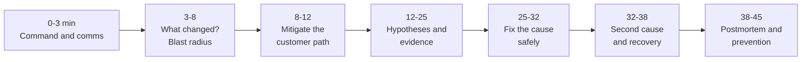
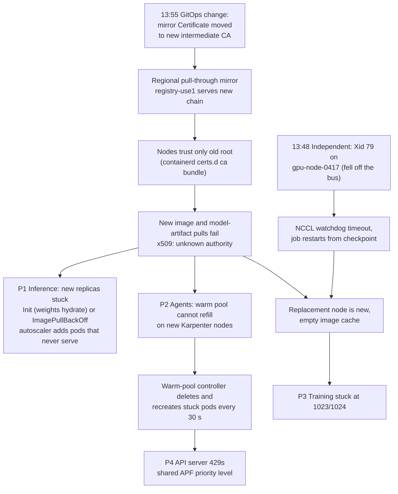

# Lesson 63 — Mock troubleshooting interview: a live multi-symptom incident on a GPU and agent fleet, timed, with a scoring rubric

*2026-11-12*

Yesterday you designed the fleet. Today it breaks while you're on call. This is a rehearsal: set a **45-minute timer**, read the page, and answer each "interviewer says" block out loud before you open the model answer. The incident has **two independent causes that interact**, and one tempting fix that is a security failure. Score yourself at the end.

## What interviewers are really probing

**The prompt (read once, start the timer):**

> *"You're the platform on-call. It's Tuesday 14:10 in us-east-1. Four pages fired within 15 minutes. I'll play the fleet: ask me for any command or dashboard and I'll tell you what it shows. Mitigate first, find the cause, and tell me what you'd write in the postmortem."*

**The four pages:**

| # | Time | Page | Owner team |
|---|---|---|---|
| P1 | 14:02 | `llama-70b-chat` TTFT p99 3.1 s (SLO 1.0 s), burn rate 14x on the 1h window | Inference |
| P2 | 14:05 | Agent sandbox start p95 41 s (normally 2 s), warm pool at 0 of 1,000 | Agent platform |
| P3 | 14:07 | `train-use1-a` 8K-GPU pretraining job restarted, now stuck at 1,023 of 1,024 pods Running | Training |
| P4 | 14:09 | kube-apiserver 429 rate above 5% on `inf-use1-b` and `agent-use1-c` | Platform |

What the interviewer actually scores:

- **Order of operations.** Stabilize and communicate before you debug. Name an incident commander (you, until handed off), open the channel, set the update cadence.
- **"What changed?" in the first two minutes.** Deploy log, GitOps sync history, cert and secret rotations, infra changes outside Kubernetes.
- **Shared-dependency thinking without forcing one story.** Three pages share a cause; one has its own cause that the shared cause makes worse. A strong candidate says "I don't think P3 started the same way" when the evidence says so.
- **Asking for evidence, not guessing.** Each hypothesis comes with the one command that would kill it.
- **Safe mitigation.** Rolling back the change beats patching forward, and patching forward must never mean turning off TLS verification or signature checks.
- **A postmortem that changes the system,** not "be more careful".

Cross-links: [L35](/lessons/35-fleet-incident-response-gpu-inference-agent-runbooks) incident response and runbooks (read first), [L12](/lessons/12-node-container-hardening-supply-chain) supply chain, [L27](/lessons/27-gpu-supply-chain-weight-registry-hydrate) weight registries and hydrate, [L28](/lessons/28-inference-autoscaling-scale-to-zero) autoscaling, [L29](/lessons/29-training-reliability-checkpoint-elastic) training reliability, [L39](/lessons/39-gpu-fleet-lifecycle-acceptance-burn-in-rma) node lifecycle and RMA, [L44](/lessons/44-gpu-cluster-control-plane-scaling) API Priority and Fairness, [L48](/lessons/48-workload-identity-secrets-pki-fleet-scale) PKI and cert rotation, [L50](/lessons/50-slo-error-budget-alerting-fleet-scale) burn-rate alerts, [L51](/lessons/51-gitops-progressive-delivery-fleet-scale) waves, [L54](/lessons/54-sandboxed-agent-execution-scale) sandbox warm pools, [L62](/lessons/62-mock-system-design-gpu-agent-platform) the fleet you're debugging. Fuel: [wafer-ai/gpu-perf-engineering-resources](https://github.com/wafer-ai/gpu-perf-engineering-resources).

**Opening sentence to practice:** "I'm taking incident command. First I'll check what changed in the last hour and whether these four pages share a dependency, and in parallel I'll protect the customer path by shifting inference traffic, because that's reversible and buys us time."

## Core diagram


**The 45-minute clock.**



**The dependency graph you should end up drawing (the answer key):**



The insight interviewers want: **existing pods keep working** because their images and weights are already on local disk. Only things that need a **new pull** break. That is why the incident looks like a capacity problem (autoscaling can't add, warm pool can't refill, training can't replace a node) and not like an outage.

## Idiosyncrasies / operator depth

**Phase 1 (0–3 min): command and comms.** Say it out loud: "I'm IC. I'll post in #inc-use1 every 15 minutes. I want one person from inference and one from training on the bridge." The interviewer gives points for this even though it takes 20 seconds. Severity: customer-facing SLO burning at 14x is SEV-2 at least; if TTFT hits the hard timeout and requests fail, SEV-1.

**Phase 2 (3–8 min): what changed, and what do the pages share?** Ask for, in this order:

1. GitOps sync history for us-east-1 platform apps in the last 2 hours. *Interviewer: "One sync at 13:55: `platform/registry-mirror`, PR #4812, 'rotate mirror cert to 2026 intermediate'."*
2. Deploys to the affected services. *"None for llama-70b since yesterday. Agent warm-pool controller unchanged since last week."*
3. Non-Kubernetes changes: network, firmware, cloud provider health. *"Nothing scheduled. AWS health dashboard is clean."*
4. Node events in the training cluster. *"gpu-node-0417 went NotReady at 13:49 after a kernel Xid."*

Now group: P1, P2, P4 started after 13:55 in clusters that **scale**. P3 started at 13:48, **before** the change. Say: "P3 began before the cert change, so it has its own trigger. The cert change might still explain why it hasn't recovered."

**Phase 3 (8–12 min): mitigate the customer path first.** P1 is the only customer-facing page. Existing inference replicas are healthy but saturated, because traffic grew and new replicas can't start. Shift 30–50% of `llama-70b-chat` traffic to us-east-2 and us-west-2 through the global router ([L24](/lessons/24-multi-cluster-inference-routing-capacity), [L36](/lessons/36-multi-region-dr-failover-inference)); check those regions have headroom first, or you move the outage. Optionally shed lowest-priority traffic (free tier, batch) at the gateway. Do **not** restart the healthy replicas: they'd need a fresh pull too, and a restart turns a slowdown into an outage.

**Phase 4 (12–25 min): hypotheses with a kill test each.**

| Hypothesis | Evidence that kills it | What the interviewer shows |
|---|---|---|
| H1 Mirror cert change breaks new pulls | Pod events on a stuck pod; `crictl pull` on a node | `x509: certificate signed by unknown authority` from `registry-use1.internal` |
| H2 GPU capacity exhausted (Karpenter can't get instances) | Karpenter NodeClaims and events | New nodes **did** launch and are Ready; pods on them are stuck pulling |
| H3 Bad model weights release | Weight digest on stuck vs healthy pods | Same digest; no release today |
| H4 API server overloaded by a client | APF metrics by flow schema and user | `agent-warmpool-controller` service account: ~60 creates/deletes per second |
| H5 Training fabric problem | NCCL flight recorder dump, `ibstat` on peers, Xid logs | One node, Xid 79; fabric counters clean on the other 1,023 |

**Why the warm-pool controller hot-loops.** Many warm-pool controllers treat "not Ready within N seconds" as a broken pod: delete and recreate. With pulls failing, every replacement fails the same way, and you get a create/delete loop. Each cycle costs several API writes plus watch events fanned out to every watcher of pods. If the controller's FlowSchema maps to the same priority level as the kubelets or the inference autoscaler, its retries crowd them out and they get 429s too ([L44](/lessons/44-gpu-cluster-control-plane-scaling)). That's the second-order effect that makes the incident look bigger than it is.

**Why training is stuck at 1,023 of 1,024.** The Xid 79 node was cordoned and drained by the health agent, the elastic or JobSet controller requested a replacement, and Karpenter (or the spare pool) provided a **fresh** node. A fresh node has no images cached. Every other rank kept its cached image and is waiting at the rendezvous. One missing pod holds 8,184 GPUs idle: at the L62 fleet's numbers, that's roughly 8K GPU-hours lost per hour.

**Gotchas that score points:**

- **"It works on my node" is the clue, not noise.** `crictl pull` succeeds on an old node because the image is cached (it resolves locally). Test with a digest that is **not** cached on that node, or go straight to `openssl s_client` with the node's CA file.
- **imagePullPolicy matters.** Pods with `IfNotPresent` and a digest reference keep starting on nodes that have the image. Pods with `:latest` and `Always` (the default for `:latest`) fail even on old nodes. Mixed policies across services explain "some things restart fine, some don't".
- **Model artifacts ride the same path.** If weights are OCI artifacts pulled by an init container or a CSI driver through the same mirror ([L27](/lessons/27-gpu-supply-chain-weight-registry-hydrate)), the failure shows up as `Init:0/1` or a hydrate timeout, not `ImagePullBackOff`. Candidates who only grep for ImagePullBackOff miss half the inference pods.
- **The mirror's own health check passes.** Its readiness probe hits `/v2/` over plain HTTP from the kubelet, or from inside the pod with the new CA trusted. Monitoring said green the whole time. Your synthetic check should pull a known blob **from a node, with the node's trust store**.
- **Kubelet backoff hides the start time.** ImagePullBackOff backs off exponentially to a 5-minute cap, so the event timestamps you see are the latest retry, not the first failure. Use `kubectl get events --sort-by=.firstTimestamp` or the event `count` field (or `deprecatedFirstTimestamp`/`series` in events.k8s.io/v1).

## Concrete commands & config

**What changed (GitOps and cluster):**

```bash
# Argo CD: sync history for the mirror app
argocd app history platform-registry-mirror-use1
argocd app diff platform-registry-mirror-use1 --revision <prev-sha>

# cert-manager: what was issued, by whom, when
kubectl -n registry get certificate,certificaterequest -o wide
kubectl -n registry describe certificate registry-use1-tls | sed -n '/Status/,$p'
```

**Stuck pods and the real error:**

```bash
# All pods not Ready, grouped by reason, across the cluster
# Count waiting reasons (init and main containers) across all pods
kubectl get pods -A -o json \
 | jq -r '.items[] | ((.status.initContainerStatuses // []) + (.status.containerStatuses // []))[]
          | .state.waiting.reason // empty' \
 | sort | uniq -c | sort -rn
#  412 ImagePullBackOff
#  188 PodInitializing   <- weights hydrate init containers stuck
#   97 ErrImagePull

kubectl -n serving describe pod llama-70b-chat-7c9f-xk2lp | sed -n '/Events/,$p'
# Failed to pull image "registry-use1.internal/serving/vllm@sha256:...":
#   ... tls: failed to verify certificate: x509: certificate signed by unknown authority

kubectl get events -A --field-selector reason=Failed --sort-by=.firstTimestamp | tail -20
```

**Prove it from the node, with the node's trust store:**

```bash
# kubectl debug node/... needs to pull its debug image too, through the same broken mirror.
# Use an image already cached on the node, or go in via SSM / bastion:
sudo crictl pull registry-use1.internal/serving/vllm@sha256:<uncached-digest>
sudo ls /etc/containerd/certs.d/registry-use1.internal/
sudo cat /etc/containerd/certs.d/registry-use1.internal/hosts.toml

# What chain does the mirror serve now?
openssl s_client -connect registry-use1.internal:443 -servername registry-use1.internal -showcerts </dev/null \
  | openssl x509 -noout -issuer -subject -enddate
# Does the node's CA file verify it?
openssl s_client -connect registry-use1.internal:443 -servername registry-use1.internal \
  -CAfile /etc/containerd/certs.d/registry-use1.internal/ca.crt </dev/null 2>&1 | grep 'Verify return code'
# Verify return code: 20 (unable to get local issuer certificate)
```

The node's containerd mirror config, with the **correct** fix (ship the new CA bundle, keep verification):

```toml
# /etc/containerd/certs.d/registry-use1.internal/hosts.toml
server = "https://registry-use1.internal"

[host."https://registry-use1.internal"]
  capabilities = ["pull", "resolve"]
  ca = "/etc/containerd/certs.d/registry-use1.internal/ca-bundle.crt"  # old root + new root/intermediate
  # skip_verify = true   <- the tempting fix. Never. See Security.
```

**Mitigation: roll back the change, don't patch forward under pressure.**

```bash
# Revert the PR in Git (the GitOps way), let Argo sync, then force cert-manager to reissue
git revert <sha-of-#4812> && git push   # through the normal fast-path review for incidents
argocd app sync platform-registry-mirror-use1
cmctl renew -n registry registry-use1-tls
# Confirm the old chain is back
openssl s_client -connect registry-use1.internal:443 -showcerts </dev/null | openssl x509 -noout -issuer
```

**Stop the hot loop and protect the API server:**

```bash
# Pause the warm-pool controller (scale to 0) until pulls work
kubectl -n agent-system scale deploy agent-warmpool-controller --replicas=0

# Who is getting throttled, and by which flow schema?
kubectl get --raw /metrics | grep -E 'apiserver_flowcontrol_(rejected_requests_total|current_inqueue_requests)' | sort -t' ' -k2 -rn | head
kubectl get --raw /debug/api_priority_and_fairness/dump_priority_levels
kubectl get flowschemas -o custom-columns=NAME:.metadata.name,PL:.spec.priorityLevelConfiguration.name,PREC:.spec.matchingPrecedence
```

Long-term: give noisy controllers their own priority level so their retries can only hurt themselves.

```yaml
apiVersion: flowcontrol.apiserver.k8s.io/v1
kind: PriorityLevelConfiguration
metadata: { name: agent-controllers }
spec:
  type: Limited
  limited:
    nominalConcurrencyShares: 10
    lendablePercent: 0
    limitResponse:
      type: Queue
      queuing: { queues: 16, handSize: 4, queueLengthLimit: 50 }
---
apiVersion: flowcontrol.apiserver.k8s.io/v1
kind: FlowSchema
metadata: { name: agent-warmpool-controller }
spec:
  priorityLevelConfiguration: { name: agent-controllers }
  matchingPrecedence: 500
  distinguisherMethod: { type: ByUser }
  rules:
  - subjects:
    - kind: ServiceAccount
      serviceAccount: { name: agent-warmpool-controller, namespace: agent-system }
    resourceRules:
    - verbs: ["*"]
      apiGroups: ["*"]
      resources: ["*"]
      namespaces: ["*"]
      clusterScope: true
```

**The training side: confirm the second cause and recover.**

```bash
# On the failed node (or from the node-problem-detector event)
sudo journalctl -k --since "13:40" | grep -i 'NVRM: Xid'
# NVRM: Xid (PCI:0000:9b:00): 79, pid=..., GPU has fallen off the bus.
nvidia-smi -q -d PAGE_RETIREMENT,ECC | head -40   # may hang or fail on an Xid 79 GPU

# What the job saw (PyTorch NCCL watchdog, default timeout 10 min)
kubectl -n train logs train-use1-a-worker-511 | grep -m3 -E 'Watchdog caught|WorkNCCL'
# Flight recorder dumps if the job set TORCH_NCCL_TRACE_BUFFER_SIZE and TORCH_NCCL_DUMP_ON_TIMEOUT=1

# Which pod is missing, and why
kubectl -n train get pods -l jobset.sigs.k8s.io/jobset-name=train-use1-a --field-selector=status.phase!=Running -o wide
kubectl -n train describe pod <pending-pod> | sed -n '/Events/,$p'
```

Recovery once the mirror is fixed: the replacement pod pulls and the job resumes from the last checkpoint. Until then, an option that scores well: **pre-warm spare nodes** by pulling the training image onto them (a pre-pull DaemonSet scoped to the spare pool, or bake it into the node image), so the next replacement doesn't depend on the registry at all. Send gpu-node-0417 to the RMA workflow with a `dcgmi diag -r 3` attempt if the GPU comes back after a reset ([L39](/lessons/39-gpu-fleet-lifecycle-acceptance-burn-in-rma)).

## Failures & fixes

Failures of the **candidate**, as the interviewer sees them:

| What the interviewer sees | Why it happens | Fix |
|---|---|---|
| Starts with `kubectl logs` on one pod | Debugging before commanding | 20 seconds of IC and comms, then "what changed?" |
| Restarts the inference deployment "to clear it" | Restart as a reflex | Healthy pods hold cached images; a restart makes them need a pull too |
| Forces all four pages into one root cause | Pattern completion | Check start times: P3 began 7 minutes before the change |
| Treats P3 as a separate incident and drops it | Tunnel vision | It has its own cause but the shared cause blocks its recovery; one IC, two workstreams |
| Proposes `skip_verify = true` or disabling the admission signature check | Speed over safety | Roll back the cert change; ship the CA bundle; keep verification on |
| Scales the API server up to fix 429s | Treating the symptom | Find the client with APF metrics; stop it; give it its own priority level |
| Says "add more monitoring" in the postmortem | Vague action items | A node-side synthetic pull of an uncached blob, alerting on failure rate |
| No customer mitigation for 20 minutes | Waiting for root cause | Shift traffic in the first 10 minutes; it's reversible |

**Curveball (minute 30).** *"The revert merged, Argo synced, `openssl` shows the old chain. Ten minutes later the agent warm pool is still at 0 and new inference pods still fail."*

**Model answer.** Three things lag a fix: (1) **kubelet image pull backoff** caps at 5 minutes per image per pod, so stuck pods don't retry immediately; delete the stuck pods (not the healthy ones) so they retry now. (2) **The warm-pool controller is still scaled to 0**, because you paused it; scale it back gradually and watch APF metrics. (3) **Mirror connection reuse**: containerd and the mirror may hold TLS sessions; that's rarely the cause, but a cached negative result in a hydrate sidecar with its own retry timer (say 15 minutes) is common. Check the hydrate container's logs before declaring the fix failed.

## Security & hardening

**This incident is a supply-chain and PKI incident wearing a capacity costume. Handle it like one.**

1. **Never turn off verification to restore service.** `skip_verify = true` in containerd's hosts.toml, `--insecure-registry`, disabling the Sigstore or Kyverno `verifyImages` admission policy, or switching pods to tag references "temporarily" all open a window where any MITM or poisoned mirror can push code onto GPU nodes that hold weights. "Temporary" bypasses outlive incidents. If you truly need a bypass, it's a break-glass change with an expiry, a second approver, and an alert until it's reverted ([L12](/lessons/12-node-container-hardening-supply-chain)).
2. **Signature verification is separate from TLS, and that's the point.** Even if transport trust broke, admission still verifies the image and model-artifact signatures by digest. Say this: "TLS protects the pipe; signatures protect the artifact. We fixed the pipe without weakening the artifact check."
3. **Model weights path.** Weights pulled as OCI artifacts through the mirror must be verified (OpenSSF model signing or cosign on the artifact digest) **after** download and before the server loads them; hydrate failures must fail closed. Never "fix" hydrate by pointing pods at the raw weights bucket with a broader IAM role: that widens who can read the most valuable asset in the company ([L13](/lessons/13-ml-weights-checkpoint-hardening), [L27](/lessons/27-gpu-supply-chain-weight-registry-hydrate)).
4. **CA rotation is a fleet change.** Trust bundles go out **before** the new leaf: ship old+new roots to every node (node image or a config DaemonSet), verify with a node-side check, then switch issuers in waves, region by region, with a halt on pull failure rate ([L48](/lessons/48-workload-identity-secrets-pki-fleet-scale), [L51](/lessons/51-gitops-progressive-delivery-fleet-scale)). This PR synced to one region at once with no bake; that's the process gap.
5. **Debug access is a risk.** `kubectl debug node/<name> --profile=sysadmin` gives a root shell on a GPU node that has weights in local cache and GPU memory. Use break-glass roles with session recording, scope to the nodes in question, expire access when the incident closes. Never copy weights, checkpoints or core dumps off the node to "look at them locally"; GPU core dumps and NCCL flight recorder dumps can contain tensors.
6. **Logs and dumps.** NCCL debug logs and pod descriptions can include env vars and paths; make sure no tokens are in env (workload identity, not static keys), and keep incident artifacts in an access-controlled bucket with retention.
7. **Rollback goes through Git.** A `kubectl edit` on the Certificate during an incident gets reverted by Argo on the next sync, and it bypasses review. Use the incident fast path: one approver, still recorded.
8. **Agent cells stay isolated even when broken.** Don't "help" the warm pool by pointing agent sandboxes at the training or serving registry project, or by lending them a broader pull secret. Agent pull credentials stay scoped to the agent image project; agents still have no route or IAM to weights ([L54](/lessons/54-sandboxed-agent-execution-scale), [L61](/lessons/61-agent-platform-capstone-10k)).
9. **Detection you add after.** Alert on admission policy changes, on `skip_verify` appearing in node config (config drift scan), on new CA files in `/etc/containerd/certs.d`, and on weight-bucket reads from principals outside the hydrate roles during incidents.

## Postmortem (minutes 38–45)

Blameless, with action items that change the system:

| Category | Action item | Owner |
|---|---|---|
| Detect | Node-side synthetic pull of an uncached blob every minute per cluster; page on 3 consecutive failures | Platform |
| Detect | Alert on image pull failure rate by registry host, not only per-pod ImagePullBackOff | Platform |
| Prevent | Cert and CA changes are fleet changes: trust bundle first, issuer switch in waves with bake and a pull-failure halt | PKI |
| Prevent | Pre-pull training and serving images onto spare and warm nodes; replacement must not depend on the registry | Training / Inference |
| Contain | Warm-pool controller: exponential backoff and a circuit breaker when > 50% of new pods fail the same way | Agent platform |
| Contain | Dedicated APF priority levels for noisy controllers | Platform |
| Recover | Runbook: "pulls failing fleet-wide" with the openssl and crictl checks above | On-call |

## Scoring rubric

Score 1 (no hire) to 4 (strong hire) per dimension; weights sum to 100.

| Dimension | Weight | 4 looks like |
|---|---|---|
| Command & communication | 15 | IC named, cadence set, updates have impact, actions, next update time |
| Change correlation | 15 | Asks for the change log in the first 3 minutes, notices P3 predates it |
| Mitigation | 15 | Traffic shift by minute 10; no restarts of healthy pods |
| Diagnosis method | 20 | Hypotheses each with a kill test; proves from the node with the node's trust store |
| Safe fix | 15 | Revert through Git; refuses skip_verify; keeps signature checks |
| Second cause & recovery | 10 | Xid 79 found, replacement-node cache explained, pre-pull proposed |
| Postmortem | 10 | Detect/prevent/contain items with owners; CA rotation in waves |

Pass: 70 or more, no dimension at 1, **Safe fix at 3 or more** (a candidate who disables verification fails regardless of total).

## Interview soundbites

- "Existing pods work, new pulls don't. That's a dependency on the pull path, not a capacity problem."
- "P3 started seven minutes before the change. Different trigger, same blocker."
- "TLS protects the pipe, signatures protect the artifact. I'll fix the pipe and leave the artifact check alone."
- "I'm not restarting healthy replicas. Their cache is the only thing still serving."
- "A CA rotation is a fleet rollout: trust first, then issuer, in waves."
- "One missing pod is holding 8,000 GPUs. Spare nodes should never need the registry to join a job."
- "429s are a who, not a how-much. Find the client in APF before you scale the API server."

## Watch (talks & demos)

<iframe width="100%" height="360" src="https://www.youtube.com/embed/-YCnOYTtVO8" title="Navigating Failures in Pods with Devices: Challenges and Solutions - Sergey Kanzhelev & Mrunal Patel" frameBorder="0" allow="accelerometer; autoplay; clipboard-write; encrypted-media; gyroscope; picture-in-picture; web-share" allowFullScreen></iframe>

[Open on YouTube](https://www.youtube.com/watch?v=-YCnOYTtVO8). Why watch: how kubelet, device plugins and pods behave when a GPU fails, which is the P3 half of this incident.

<iframe width="100%" height="360" src="https://www.youtube.com/embed/iam7A5peA5U" title="Building Resilience for Large-Scale AI Training: GPU Management, Failure Detection, and Beyond - G. Ashokavardhanan, A. Eldeib" frameBorder="0" allow="accelerometer; autoplay; clipboard-write; encrypted-media; gyroscope; picture-in-picture; web-share" allowFullScreen></iframe>

[Open on YouTube](https://www.youtube.com/watch?v=iam7A5peA5U). Why watch: failure detection and node replacement for training jobs, the vocabulary for "why is the job stuck at 1,023".

<iframe width="100%" height="360" src="https://www.youtube.com/embed/iLnHtKwmu2I" title="All-Your-GPUs-Are-Belong-to-Us: An Inside Look at NVIDIA's Self-Healing GeForce NOW Infrastructure" frameBorder="0" allow="accelerometer; autoplay; clipboard-write; encrypted-media; gyroscope; picture-in-picture; web-share" allowFullScreen></iframe>

[Open on YouTube](https://www.youtube.com/watch?v=iLnHtKwmu2I). Why watch: self-healing GPU fleet automation, useful for the postmortem "contain" items.

## References

- [containerd registry host configuration (hosts.toml, ca, skip_verify)](https://github.com/containerd/containerd/blob/main/docs/hosts.md)
- [Kubernetes images: pull policy and ImagePullBackOff](https://kubernetes.io/docs/concepts/containers/images/) · [Debugging a node with kubectl debug](https://kubernetes.io/docs/tasks/debug/debug-cluster/kubectl-node-debug/)
- [API Priority and Fairness](https://kubernetes.io/docs/concepts/cluster-administration/flow-control/) · [cert-manager cmctl renew](https://cert-manager.io/docs/reference/cmctl/)
- [NVIDIA Xid errors](https://docs.nvidia.com/deploy/xid-errors/index.html) · [PyTorch flight recorder for NCCL timeouts](https://pytorch.org/tutorials/prototype/flight_recorder_tutorial.html)
- [Google SRE book: Managing Incidents](https://sre.google/sre-book/managing-incidents/) · [Postmortem culture](https://sre.google/sre-book/postmortem-culture/)
- [OpenSSF model signing](https://github.com/sigstore/model-transparency) · [wafer-ai/gpu-perf-engineering-resources](https://github.com/wafer-ai/gpu-perf-engineering-resources)

## Quick self-check

Run the full 45 minutes once, recorded, with a friend playing the fleet. Then, in under three minutes each:

1. Why do existing inference pods keep serving while new ones fail? Name two pod settings that change which pods are affected.
2. Write the kill test for "the mirror cert is the cause" that would still work on a node with the image cached.
3. The interviewer says "just set skip_verify for an hour, the VP is asking." What do you say, and what do you offer instead?
4. Explain how a warm-pool controller can cause 429s for the inference autoscaler, and the two fixes (immediate and permanent).
5. The training job is stuck at 1,023/1,024. Give the cause chain and two ways to make replacement nodes independent of the registry.
6. Same four pages, but the cause is a bad node-image rollout instead of a cert change. Which evidence would differ in the first five minutes?
7. Write the CA rotation plan that would have prevented this, with halt signals.
8. Score your recording with the rubric. Did you pass the Safe fix gate?

## Next

**Lesson 64 — Mock security deep-dive interview: threat-model a model-weights, training and serving platform, timed, with a scoring rubric.**
