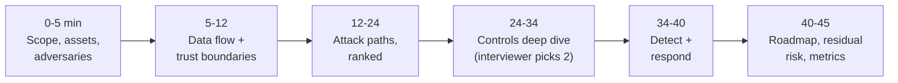
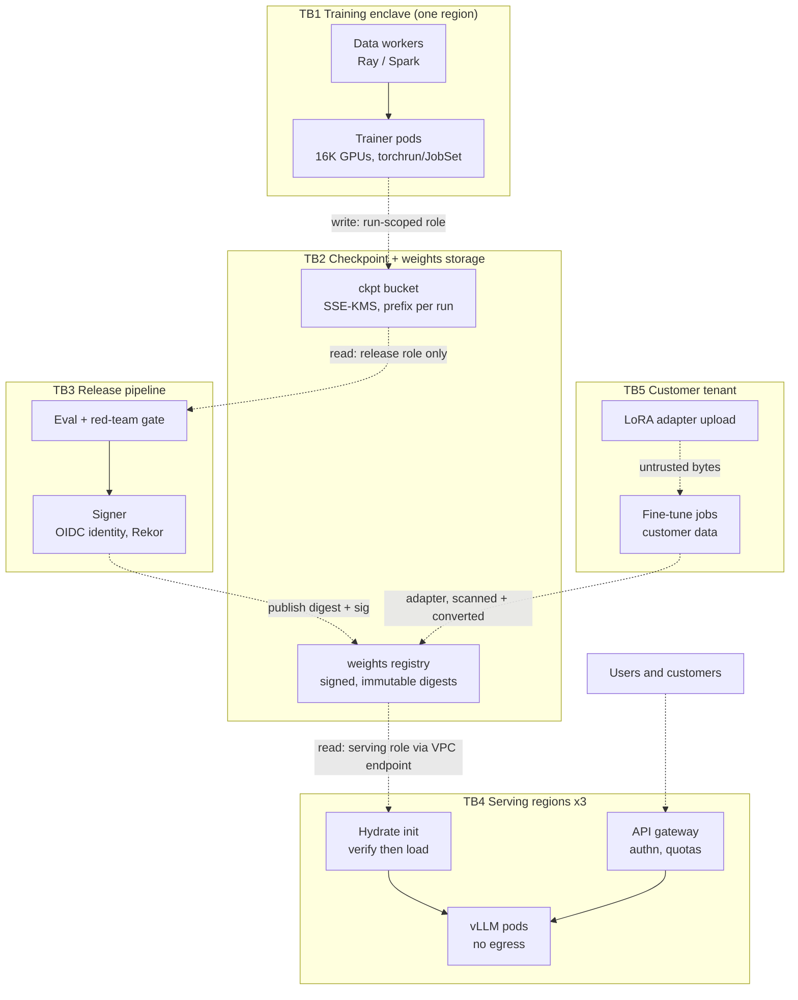
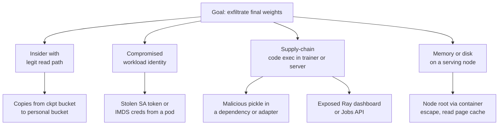

# Lesson 64 — Mock security deep-dive interview: threat-model a model-weights, training and serving platform, timed, with a scoring rubric

*2026-11-13*

Day one of the mock loop was design (L62), day two was an incident (L63). Today the security interviewer walks in, draws three boxes on the board and says "threat-model it." Set a **45-minute timer**, answer each "interviewer says" block out loud before you read the model answer, and score yourself at the end. One question in the middle is a trap. If you fall for it, you fail the round no matter how good the rest was.

## What interviewers are really probing

**The prompt (read once, start the timer):**

> *"We train and serve our own frontier-class models. Pretraining runs on ~16K H100s in one region, checkpoints go to object storage, a release pipeline promotes weights to three serving regions running vLLM on Kubernetes, and enterprise customers can fine-tune with their own data and upload LoRA adapters. Our crown jewel is the weights. Threat-model the platform, tell me what you'd build first, and how you'd know it's working."*

What the interviewer actually scores:

- **Assets before attacks.** Name what you protect, in order of value: final weights, intermediate checkpoints, training data and data mixture, customer fine-tune data and adapters, the serving path (integrity of answers), and the GPU fleet itself (compute theft, crypto-mining).
- **Adversaries with capability levels, not "hackers".** Opportunistic scanners, ransomware crews, a malicious or coerced insider, a compromised dependency, a well-funded state actor. RAND's *Securing AI Model Weights* frames this as five security levels (SL1–SL5) by attacker capability; quoting the idea, not the page number, is enough.
- **Trust boundaries drawn on the diagram.** Where identity changes, where data crosses a network, where untrusted bytes get parsed. Most real findings sit on one of those lines.
- **Ranking.** Likelihood × impact, and an explicit "I'm not spending time on X because…". Ten equal-weight findings is a junior answer.
- **Controls that an operator can run.** Bucket policies, KMS key policies, admission rules, signing and verification, egress policy, break-glass, with the failure mode of each.
- **Detection and response,** not only prevention. How you would *know* a checkpoint was read by the wrong principal, and what you do in the first hour.
- **Security that ships.** Researchers still need to train. A control that makes them copy weights to a laptop to get work done is a negative control.

Cross-links: [L12](/lessons/12-node-container-hardening-supply-chain) node and supply-chain hardening, [L25](/lessons/25-multi-tenant-gpu-isolation-quota) multi-tenant GPU isolation, [L27](/lessons/27-gpu-supply-chain-weight-registry-hydrate) weight registry and hydrate (read first), [L29](/lessons/29-training-reliability-checkpoint-elastic) checkpoint security, [L31](/lessons/31-evaluation-release-gating-canary-weights) release gating, [L34](/lessons/34-agent-tool-sandboxing-egress-policy) egress policy, [L48](/lessons/48-workload-identity-secrets-pki-fleet-scale) workload identity and PKI, [L58](/lessons/58-agent-identity-delegated-authorization) delegated authorization, [L62](/lessons/62-mock-system-design-gpu-agent-platform) the bucket-policy AND trap, [L63](/lessons/63-mock-troubleshooting-gpu-agent-fleet) safe-fix gate.

## Core diagram


**The 45-minute shape:**



**The data-flow diagram you draw at minute 6** (boxes are components, dashed edges cross a trust boundary):



**The attack tree the interviewer wants to hear for the crown jewel:**



## Idiosyncrasies / operator depth

**Minutes 0–5: scope out loud.** Say what you are *not* covering (corporate IT, physical datacenter security beyond the cage, the model's own alignment) and say you'll come back to them if time allows. Then the asset table:

| Asset | Why it matters | Who legitimately touches it |
|---|---|---|
| Final release weights | Years of compute and data; theft is permanent | Release pipeline, serving hydrate, ~a handful of humans via break-glass |
| Intermediate checkpoints | Nearly as valuable as final; far more copies, far less control | Trainer pods, eval jobs, restart logic |
| Data mixture and curated data | Competitive secret; also the poisoning surface | Data pipeline, researchers |
| Customer fine-tune data and adapters | Contractual and legal exposure; cross-tenant leak is a headline | That tenant's jobs only |
| Serving integrity | A swapped or backdoored model answers millions of requests | Deploy pipeline |
| GPU fleet | Compute theft, pivot point, and the place weights live in memory | Schedulers, node agents |

**The insider math is the soundbite that changes the conversation.** If each of 50 people with read access is 98% trustworthy, the chance none of them leaks is 0.98^50 ≈ 36%. The fix is not better people, it is fewer standing readers: workloads read weights, humans don't, and humans who must get time-boxed, two-person, logged access.

**Checkpoints are the soft underbelly.** Teams lock down `release/` and leave `ckpt/` readable by every researcher "for debugging." A checkpoint one step before release *is* the release. Treat every checkpoint prefix with the same policy as final weights, and expire old ones with lifecycle rules so there are fewer copies to steal.

**Parsing untrusted bytes is code execution unless proven otherwise.** Pickle-based formats (`.pt`, `.bin`, `.pkl`, joblib, older PyTorch DCP `.metadata`) run code on load. `torch.load` defaults to `weights_only=True` since PyTorch 2.6, but CVE-2025-32434 showed `weights_only=True` itself could be bypassed for RCE in 2.5.1 and earlier, so the flag is a mitigation, not a boundary. The boundary is: untrusted artifacts are converted to safetensors inside a throwaway sandbox with no credentials and no network, and only the converted output is signed.

**Inference servers have their own "load a pickle from the network" history.** vLLM shipped pickle deserialization over ZeroMQ in multi-node paths (CVE-2025-30165 in the V0 engine, CVE-2025-32444 in the Mooncake integration). Ray's Jobs API has no authentication by default, which is what the ShadowRay campaign (CVE-2023-48022, disputed by the vendor as "by design") exploited to steal credentials and run miners on GPU clusters. Lesson: the internal ports between your own GPU workers are an attack surface. Bind to pod IPs, put NetworkPolicy around them, never expose dashboards through a load balancer.

**The GPU container stack has had real escapes.** NVIDIA Container Toolkit CVE-2024-0132 (TOCTOU, a crafted image could get host filesystem access) and CVE-2025-23266 (an `LD_PRELOAD` in the image affected the toolkit's OCI hook, which runs privileged on the host). On a multi-tenant fine-tune cluster, a customer-controlled image plus an unpatched toolkit means node root, and node root means reading another tenant's adapter from page cache. Patch cadence for the GPU stack is a security control, not a hygiene item.

**Signing proves "this is the artifact we released," not "this artifact is safe."** If you sign whatever training produced, a poisoned dataset gives you a beautifully signed backdoor. Pair signatures with provenance (which run, which data manifest digest, which code commit, which eval report) and gate signing on the eval and red-team result (L31).

**The Sigstore model-validation operator has an opt-in gap.** It injects a verifying init container only when the pod carries `validation.rhtas.redhat.com/ml: "true"` at creation time, and it was still described as alpha in its v1.0.1 announcement. An unlabeled pod skips verification. Close it with an admission rule that *requires* the label in serving namespaces, and mount the model volume read-only in the main container so nothing can change between verify and load.

**Confidential computing changes the memory threat, not the others.** H100 confidential-computing mode with attestation protects weights in GPU memory from a compromised host or hypervisor. It does nothing for a stolen IAM role reading the bucket, and it costs some performance and operational complexity. Put it in the roadmap for the highest security level, not as the first answer.

## Concrete commands & config

**1. Weights bucket: deny everything except the named roles, and only through your VPC endpoint.** Remember the AND trap from L62: conditions inside one statement are ANDed, so write separate Deny statements.

```json
{
  "Version": "2012-10-17",
  "Statement": [
    {
      "Sid": "DenyNonAllowlistedPrincipals",
      "Effect": "Deny",
      "Principal": "*",
      "Action": "s3:*",
      "Resource": ["arn:aws:s3:::acme-weights", "arn:aws:s3:::acme-weights/*"],
      "Condition": {
        "ArnNotLike": {
          "aws:PrincipalArn": [
            "arn:aws:iam::111122223333:role/weights-release-pipeline",
            "arn:aws:iam::111122223333:role/serving-hydrate-*",
            "arn:aws:iam::111122223333:role/weights-breakglass"
          ]
        }
      }
    },
    {
      "Sid": "DenyOutsideVpce",
      "Effect": "Deny",
      "Principal": "*",
      "Action": "s3:GetObject",
      "Resource": "arn:aws:s3:::acme-weights/*",
      "Condition": { "StringNotEquals": { "aws:SourceVpce": ["vpce-0a1b2c3d", "vpce-4e5f6a7b", "vpce-8c9d0e1f"] } }
    },
    {
      "Sid": "DenyServingWrites",
      "Effect": "Deny",
      "Principal": "*",
      "Action": ["s3:PutObject", "s3:DeleteObject", "s3:PutObjectAcl"],
      "Resource": "arn:aws:s3:::acme-weights/*",
      "Condition": { "ArnLike": { "aws:PrincipalArn": "arn:aws:iam::111122223333:role/serving-hydrate-*" } }
    }
  ]
}
```

Gotchas: an explicit Deny on `s3:*` for non-allowlisted principals also locks out your own admins, so keep the break-glass role in the list and test it in a game day. The VPC-endpoint condition will break a human `aws s3 cp` from a laptop, which is the point.

**2. KMS key policy as the second lock.** Even if the bucket policy drifts, objects encrypted with a dedicated key are unreadable without `kms:Decrypt` on that key.

```json
{
  "Sid": "DecryptOnlyViaS3ForServing",
  "Effect": "Allow",
  "Principal": { "AWS": "arn:aws:iam::111122223333:role/serving-hydrate-use1" },
  "Action": "kms:Decrypt",
  "Resource": "*",
  "Condition": {
    "StringEquals": {
      "kms:ViaService": "s3.us-east-1.amazonaws.com",
      "kms:EncryptionContext:aws:s3:arn": "arn:aws:s3:::acme-weights/release/llama-70b-chat/*"
    }
  }
}
```

If your SSE-KMS objects use S3 Bucket Keys, the encryption context is the bucket ARN rather than the object ARN; match on what is actually sent or every decrypt fails.

**3. Immutability and deletion protection for released weights.**

```bash
aws s3api put-object-lock-configuration --bucket acme-weights \
  --object-lock-configuration '{"ObjectLockEnabled":"Enabled","Rule":{"DefaultRetention":{"Mode":"COMPLIANCE","Days":365}}}'
aws s3api put-bucket-versioning --bucket acme-weights --versioning-configuration Status=Enabled
```

COMPLIANCE mode can't be shortened even by root, which protects against ransomware deletes but means a mistaken upload lives for a year. Use GOVERNANCE on `ckpt/` and COMPLIANCE on `release/`.

**4. Sign and verify the model directory (OpenSSF model-signing v1.x).**

```bash
pip install model-signing
# In the release pipeline (GitHub Actions OIDC identity, keyless):
model_signing sign release/llama-70b-chat-v7 --signature release/llama-70b-chat-v7/model.sig
# In hydrate, before anything reads the weights:
model_signing verify release/llama-70b-chat-v7 \
  --signature release/llama-70b-chat-v7/model.sig \
  --identity "https://github.com/acme/release/.github/workflows/promote.yml@refs/heads/main" \
  --identity-provider "https://token.actions.githubusercontent.com"
# Air-gapped or private Sigstore: add --trust-config client_trust_config.json
```

Verification re-hashes every file against the signed manifest, so a swapped shard fails. Pin the *workflow identity*, not "anyone in our GitHub org."

**5. Admission: serving pods must verify, must not egress, and must run digest-pinned signed images.**

```yaml
apiVersion: admissionregistration.k8s.io/v1
kind: ValidatingAdmissionPolicy
metadata:
  name: serving-must-validate-model
spec:
  failurePolicy: Fail
  matchConstraints:
    resourceRules:
    - apiGroups: [""]
      apiVersions: ["v1"]
      operations: ["CREATE"]
      resources: ["pods"]
  validations:
  - expression: "has(object.metadata.labels) && 'validation.rhtas.redhat.com/ml' in object.metadata.labels && object.metadata.labels['validation.rhtas.redhat.com/ml'] == 'true'"
    message: "serving pods must opt in to model signature validation"
  - expression: "object.spec.containers.all(c, c.image.contains('@sha256:'))"
    message: "images must be pinned by digest"
  - expression: "!has(object.spec.hostNetwork) || object.spec.hostNetwork == false"
    message: "no hostNetwork on serving pods"
---
apiVersion: admissionregistration.k8s.io/v1
kind: ValidatingAdmissionPolicyBinding
metadata:
  name: serving-must-validate-model
spec:
  policyName: serving-must-validate-model
  validationActions: ["Deny"]
  matchResources:
    namespaceSelector:
      matchLabels: { tier: serving }
```

```yaml
apiVersion: networking.k8s.io/v1
kind: NetworkPolicy
metadata: { name: vllm-no-egress, namespace: serving-llama }
spec:
  podSelector: { matchLabels: { app: vllm } }
  policyTypes: ["Egress"]
  egress:
  - to:
    - namespaceSelector: { matchLabels: { kubernetes.io/metadata.name: kube-system } }
      podSelector: { matchLabels: { k8s-app: kube-dns } }
    ports: [{ protocol: UDP, port: 53 }]
```

Hydrate runs as an init container with the serving role and the VPC endpoint route; the vLLM container gets no cloud credentials at all (separate service account token not mounted, IMDS blocked at hop limit 1 or by NetworkPolicy to `169.254.169.254`).

**6. Untrusted adapter intake (customer LoRA uploads).**

```bash
# Runs in a gVisor/Kata sandbox: no network, no credentials, CPU only, 10 min timeout
modelscan -p /intake/upload/        # flags pickle opcodes that import os/subprocess/etc.
python convert_to_safetensors.py /intake/upload /intake/out   # refuses non-allowlisted tensor names/shapes
sha256sum /intake/out/*.safetensors > /intake/out/MANIFEST
# Only /intake/out is copied to the tenant's prefix, then signed by the intake service identity
```

The scanner is a tripwire, not the boundary; the boundary is "we never deserialize the upload outside the sandbox, and we only ever load the safetensors we produced."

**7. Detection: who read the weights?**

```bash
# Turn on S3 data events for the weights bucket (management events don't show GetObject)
aws cloudtrail put-event-selectors --trail-name org-trail --advanced-event-selectors '[
 {"Name":"weights-data","FieldSelectors":[
   {"Field":"eventCategory","Equals":["Data"]},
   {"Field":"resources.type","Equals":["AWS::S3::Object"]},
   {"Field":"resources.ARN","StartsWith":["arn:aws:s3:::acme-weights/"]}]}]'
```

```sql
-- Athena over CloudTrail: any principal reading release weights that isn't hydrate or release
SELECT useridentity.arn, sourceipaddress, count(*) AS reads, sum(cast(json_extract_scalar(additionaleventdata,'$.bytesTransferredOut') AS bigint)) AS bytes
FROM cloudtrail_logs
WHERE eventname = 'GetObject' AND requestparameters LIKE '%acme-weights%release/%'
  AND useridentity.arn NOT LIKE '%serving-hydrate-%' AND useridentity.arn NOT LIKE '%weights-release-pipeline%'
GROUP BY 1,2 ORDER BY bytes DESC;
```

Plus: alert on any use of the break-glass role (page, not ticket), on hydrate reads from an unexpected source VPC endpoint, and on byte volume per principal far above one model's size.

**8. Prove least privilege instead of asserting it.**

```bash
kubectl auth can-i --list --as=system:serviceaccount:serving-llama:vllm
kubectl get rolebindings,clusterrolebindings -A -o json | jq -r '.items[] | select(.subjects[]?.name=="vllm") | .metadata.name'
aws iam simulate-principal-policy --policy-source-arn arn:aws:iam::111122223333:role/researcher \
  --action-names s3:GetObject --resource-arns arn:aws:s3:::acme-weights/release/llama-70b-chat-v7/model-00001-of-00030.safetensors
aws accessanalyzer list-findings --analyzer-arn "$ANALYZER" --filter '{"resourceType":{"eq":["AWS::S3::Bucket"]}}'
```

## The interview, phase by phase

**Interviewer says (min 12): "Give me your top five attack paths, ranked."** Model answer:

| Rank | Path | Likelihood | Impact | First control |
|---|---|---|---|---|
| 1 | Insider or compromised human creds copy a checkpoint | High | Critical | No standing human read; break-glass with two-person approval; data events + alert |
| 2 | Malicious pickle (customer adapter, HF dependency, internal tool) gets code exec in a pod with cloud creds | High | Critical | Safetensors-only load path; sandboxed conversion; pods without creds |
| 3 | Exposed internal control surface (Ray dashboard/Jobs API, vLLM multi-node ports, Jupyter) | Medium-high | High | NetworkPolicy default-deny; no LB for internal UIs; authn on every control API |
| 4 | Container escape on a shared GPU node (toolkit CVEs) reads another tenant's adapter or the base weights | Medium | High | Dedicated nodes per tier; GPU stack patch SLO; gVisor/Kata for customer code |
| 5 | Release pipeline compromise signs a tampered or backdoored model | Low-medium | Critical | Signing identity pinned to one protected workflow; provenance tied to eval report; two-person release |

Then say what you're deprioritizing: "Model extraction through the public API (distillation) is real, but it's a rate-limit and abuse problem, not a weights-theft problem; I'll cover it in the serving section if we have time."

**Interviewer says (min 20) — THE TRAP: "Our research team says safetensors conversion slows them down. They want to load community checkpoints directly with `torch.load(weights_only=True)` on the training cluster. That's safe now, right?"**

Fail answer: "Yes, `weights_only=True` is the default since 2.6, so it's fine."

Pass answer: "`weights_only=True` shrinks the risk, but it has been bypassed before (CVE-2025-32434), and the training cluster is the most valuable place in the company to get code execution: it holds checkpoint write credentials and sits next to 16K GPUs. So no untrusted pickle on that cluster, period. What I'll give the researchers instead is a self-service intake that converts to safetensors in a sandbox in minutes and caches the result by digest, so the second person to pull the same checkpoint pays nothing." The rubric treats this as a gate, like `skip_verify` in L63.

**Interviewer says (min 24): "Pick the weights storage boundary. Walk me through it."** Hit, in order: dedicated bucket per security level, Deny-based policy with principal allowlist plus VPC-endpoint condition (separate statements), dedicated KMS key with `kms:ViaService` and encryption-context scoping, Object Lock, lifecycle expiry on old checkpoints, data events to an account the platform team can't delete, and a quarterly access review produced by Access Analyzer, not by asking people.

**Interviewer says (min 29): "Now the customer fine-tune tenant. How do you stop tenant A reading tenant B?"** Separate namespace and node pool per tenant tier, customer images only from your own base images (no arbitrary images) or run in Kata/gVisor, per-tenant prefix and per-tenant KMS key (so a policy bug still fails on decrypt), adapters loaded by the serving layer from a tenant-scoped path keyed by the authenticated tenant ID, never by a client-supplied path. Mention multi-LoRA serving: one vLLM process holds many tenants' adapters in memory, so the request-to-adapter mapping is a security boundary. Test it with a cross-tenant canary request in CI.

**Interviewer says (min 34): "At 03:00, the alert fires: a researcher's role read 140 GB from `ckpt/run-8812/` through a public endpoint. Go."** Contain first: revoke the role's sessions (attach a Deny-all inline policy with `aws:TokenIssueTime` condition, or the console's "revoke active sessions"), disable the human's SSO, keep the logs. Scope: which objects, how many bytes vs one full checkpoint, destination IPs. Preserve: snapshot CloudTrail and VPC flow logs to the security account. Communicate: legal and the security lead, not a public channel. Then the question that matters: why could that role read `ckpt/` at all, and why was a non-VPC-endpoint read possible? That's the fix.

**Interviewer says (min 40): "You have one quarter and three engineers. What ships?"**

1. Weeks 1–3: inventory every copy of weights and checkpoints; data events on; remove standing human read; break-glass role with approval.
2. Weeks 3–6: bucket and KMS policy rewrite (Deny-based, VPC endpoint), Object Lock on release, lifecycle on checkpoints.
3. Weeks 6–9: safetensors-only load path, sandboxed intake, signing in the release pipeline, verify in hydrate, admission requiring it.
4. Weeks 9–12: NetworkPolicy default-deny on training and serving, internal UIs behind authn, GPU stack patch SLO, first red-team exercise against the result.

Metrics: number of principals with read on release weights (target: single digits, all workloads), % of serving pods with verified models (100%, enforced), time to revoke a role fleet-wide (minutes), mean age of the GPU container toolkit vs latest fix.

## Failures & fixes

| Symptom | Cause | Fix |
|---|---|---|
| Every hydrate fails with `AccessDenied` after the policy rollout | VPC-endpoint condition and principal condition put in one Deny statement, or a region's endpoint ID missing | Separate Deny statements; list every regional `vpce-` ID; canary one region first |
| `kms:Decrypt` denied though bucket read allowed | Encryption-context condition written for object ARN while Bucket Keys send bucket ARN | Match the context S3 actually sends; check the CloudTrail `Decrypt` event's `encryptionContext` |
| Pods start without verification | Model-validation label missing; operator only acts on labeled pods at creation | VAP requiring the label in `tier: serving` namespaces |
| Verification passes but a different model serves | Main container mounts the model volume read-write, or loads from a second path | Read-only mount; single path; hydrate writes, server only reads |
| Signed model turns out to be backdoored | Signing gated only on "training finished" | Gate signing on eval and red-team reports; record data-manifest digest in provenance |
| Security review finds 40 researchers with checkpoint read | "Temporary" debugging grant never expired | Time-boxed access through an approval tool; Access Analyzer unused-access findings |
| Research velocity drops, weights start appearing on laptops | Controls without a paved road | Self-service intake, cached conversions, eval sandboxes that bring compute to the data |
| Cross-tenant adapter served | Adapter path taken from request body | Resolve adapter from authenticated tenant ID; CI canary for cross-tenant requests |

## Security & hardening

This whole lesson is the security section, so here it is as the **control stack per boundary**, the checklist to say out loud at minute 40:

- **TB1 Training enclave:** dedicated accounts and VPC, no inbound internet; NetworkPolicy default-deny with explicit rendezvous and NCCL ports; Ray/Jupyter/TensorBoard never on a load balancer, always behind authn; IB partition keys per job tier (L29); trainers get a *run-scoped* write role on `ckpt/run-ID/` only, no read on other runs or `release/`.
- **TB2 Weights and checkpoint storage:** Deny-based bucket policy with principal allowlist and VPC-endpoint condition; dedicated KMS key per security level with `kms:ViaService`; Object Lock (COMPLIANCE on release); versioning; lifecycle expiry on checkpoints; data events logged to a separate security account; no standing human read.
- **TB3 Release pipeline:** signing with a keyless identity pinned to one protected workflow on a protected branch; two-person approval for promotion; provenance that binds weights digest to training run, data manifest digest, code commit, and eval report; release blocked unless eval and red-team gates pass (L31).
- **TB4 Serving:** hydrate verifies the signature then writes to a read-only volume; admission requires the validation label, digest-pinned signed images (cosign/Kyverno, L12), no hostNetwork, no privileged; vLLM pods have no cloud credentials and no egress; multi-node inference ports bound to pod network with NetworkPolicy; GPU container toolkit patched on an SLO.
- **TB5 Customer tenant:** untrusted uploads converted to safetensors in a credential-less, network-less sandbox; per-tenant prefix and KMS key; customer code in Kata/gVisor on dedicated node pools; adapter resolution from authenticated tenant ID only.
- **Humans:** break-glass role with approval, short session, page on use; hardware security keys for everyone with any path to weights; quarterly access review generated by tooling.
- **Higher security levels (roadmap):** confidential-computing GPUs with attestation before the weights key is released to a node; HSM-backed signing keys; insider-threat program; external red team.
- **Never:** untrusted pickle anywhere with credentials; "temporarily" public buckets; turning off verification to unblock a release.

## Scoring rubric

| Dimension | Weight | 1 (no hire) | 4 (strong hire) |
|---|---|---|---|
| Scope, assets, adversaries | 15 | Starts listing tools | Ranked assets incl. checkpoints and tenant data; adversary levels |
| Data flow + trust boundaries | 15 | No diagram | Clean DFD, boundaries marked, identity at each crossing |
| Attack-path ranking | 15 | Flat list | Top 5 with likelihood × impact and explicit deprioritization |
| Control depth | 20 | "Encrypt it, use IAM" | Real policy shapes, KMS context, admission, signing identity pinning, their failure modes |
| **Untrusted-artifact gate (must score ≥ 3)** | 10 | Accepts `torch.load` of community pickles | Holds the line and offers a paved road |
| Detection + response | 15 | None | Data events, alerts, a first-hour plan, root-cause question |
| Roadmap + metrics | 10 | Boil the ocean | One quarter, sequenced, measurable |

Pass: ≥ 70/100 and no 1s. Scoring below 3 on the untrusted-artifact gate fails the round.

## Interview soundbites

- "Fifty trusted people at 98% each is about a one-in-three chance nobody leaks. The fix is fewer readers, not better people: workloads read weights, humans get break-glass."
- "A checkpoint one step before release is the release. Same policy, plus lifecycle expiry."
- "Parsing untrusted bytes is code execution until proven otherwise. We convert to safetensors in a sandbox, and we only load what we produced."
- "Signatures prove it's the artifact we released, not that it's safe. That's why signing is gated on eval and provenance names the data."
- "Two locks on the weights: a bucket policy and a key policy. When one drifts, the other still fails closed."
- "Our internal GPU ports are an attack surface. ShadowRay was somebody's dashboard."
- "If my control makes a researcher copy weights to a laptop, I've made things worse. Every control ships with a paved road."

## Watch (talks & demos)

<iframe width="100%" height="360" src="https://www.youtube.com/embed/R63okH77k2E" title="Who's trying to steal AI models? And what could they do with them? | Sella Nevo" frameBorder="0" allow="accelerometer; autoplay; clipboard-write; encrypted-media; gyroscope; picture-in-picture; web-share" allowFullScreen></iframe>

[Open on YouTube](https://www.youtube.com/watch?v=R63okH77k2E). Why watch: the RAND author on adversary levels, real breaches and the insider math. It's long (about 2 hours); the attack-vector and "what labs should do now" sections are the interview material.

<iframe width="100%" height="360" src="https://www.youtube.com/embed/P1AE23uZQ50" title="Inside the OpenSSF Model Signing Project: Securing the ML Supply Chain" frameBorder="0" allow="accelerometer; autoplay; clipboard-write; encrypted-media; gyroscope; picture-in-picture; web-share" allowFullScreen></iframe>

[Open on YouTube](https://www.youtube.com/watch?v=P1AE23uZQ50). Why watch: Mihai Maruseac (OpenSSF AI/ML WG) on model signing, why per-file manifests beat signing a container, and where hubs and SLSA-for-models are heading.

<iframe width="100%" height="360" src="https://www.youtube.com/embed/IGQ-CcYN2jU" title="OpenSSF Tech Talk: Securing the AI Lifecycle: Trust, Transparency and Tooling in Open Source" frameBorder="0" allow="accelerometer; autoplay; clipboard-write; encrypted-media; gyroscope; picture-in-picture; web-share" allowFullScreen></iframe>

[Open on YouTube](https://www.youtube.com/watch?v=IGQ-CcYN2jU). Why watch: MLSecOps end to end (signing, reproducibility, SLSA and Sigstore applied to pipelines), useful vocabulary for the roadmap answer.

## References

- [RAND: Securing AI Model Weights (RR-A2849-1)](https://www.rand.org/pubs/research_reports/RRA2849-1.html) · [Q&A with Sella Nevo](https://www.rand.org/pubs/commentary/2024/05/securing-ai-model-weights-qa-with-sella-nevo.html)
- [sigstore/model-transparency (model_signing CLI)](https://github.com/sigstore/model-transparency) · [Sigstore model-validation operator](https://blog.sigstore.dev/model-validation-operator-v1.0.1/) · [Google: practical model signing](https://blog.google/security/taming-wild-west-of-ml-practical-mode/)
- [PyTorch `torch.load` and `weights_only`](https://pytorch.org/docs/stable/generated/torch.load.html) · [CVE-2025-32434](https://nvd.nist.gov/vuln/detail/CVE-2025-32434) · [safetensors](https://github.com/huggingface/safetensors) · [modelscan](https://github.com/protectai/modelscan)
- [CVE-2023-48022 (Ray, ShadowRay)](https://nvd.nist.gov/vuln/detail/CVE-2023-48022) · [CVE-2025-30165 (vLLM)](https://nvd.nist.gov/vuln/detail/CVE-2025-30165) · [CVE-2025-32444 (vLLM Mooncake)](https://nvd.nist.gov/vuln/detail/CVE-2025-32444)
- [CVE-2024-0132](https://nvd.nist.gov/vuln/detail/CVE-2024-0132) · [CVE-2025-23266](https://nvd.nist.gov/vuln/detail/CVE-2025-23266) (NVIDIA Container Toolkit)
- [S3 bucket policy condition keys](https://docs.aws.amazon.com/AmazonS3/latest/userguide/amazon-s3-policy-keys.html) · [KMS encryption context with S3](https://docs.aws.amazon.com/AmazonS3/latest/userguide/UsingKMSEncryption.html) · [S3 Object Lock](https://docs.aws.amazon.com/AmazonS3/latest/userguide/object-lock.html) · [CloudTrail data events](https://docs.aws.amazon.com/awscloudtrail/latest/userguide/logging-data-events-with-cloudtrail.html)
- [Kubernetes ValidatingAdmissionPolicy](https://kubernetes.io/docs/reference/access-authn-authz/validating-admission-policy/) · [NVIDIA confidential computing on H100](https://developer.nvidia.com/blog/confidential-computing-on-h100-gpus-for-secure-and-trustworthy-ai/)
- [wafer-ai/gpu-perf-engineering-resources](https://github.com/wafer-ai/gpu-perf-engineering-resources)

## Quick self-check

Run the 45 minutes once, recorded, with a friend playing the interviewer. Then, in under three minutes each:

1. Name six assets in priority order and say why intermediate checkpoints rank next to final weights.
2. Draw the DFD from memory with five trust boundaries and the identity used at each dashed edge.
3. Write the weights bucket policy shape. Why are the principal and VPC-endpoint conditions separate statements?
4. Why is a dedicated KMS key a second lock, and what breaks when Bucket Keys change the encryption context?
5. The researcher asks for `torch.load(weights_only=True)` on community checkpoints. Give the no, and the paved road.
6. What does a model signature prove, and what doesn't it? What do you bind into provenance to cover the gap?
7. Tenant A's adapter is served to tenant B. Name the three places that could have gone wrong.
8. Walk the 03:00 "140 GB read from `ckpt/`" alert: contain, scope, preserve, communicate, root cause.
9. Score your recording. Did you pass the untrusted-artifact gate?

## Next

**Lesson 65 — Mock behavioral and leadership interview for a staff platform role: incidents you led, migrations you drove, disagreements and tradeoffs, with STAR stories and a scoring rubric.**
