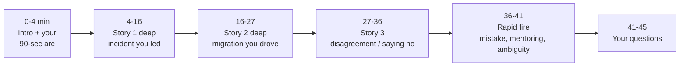
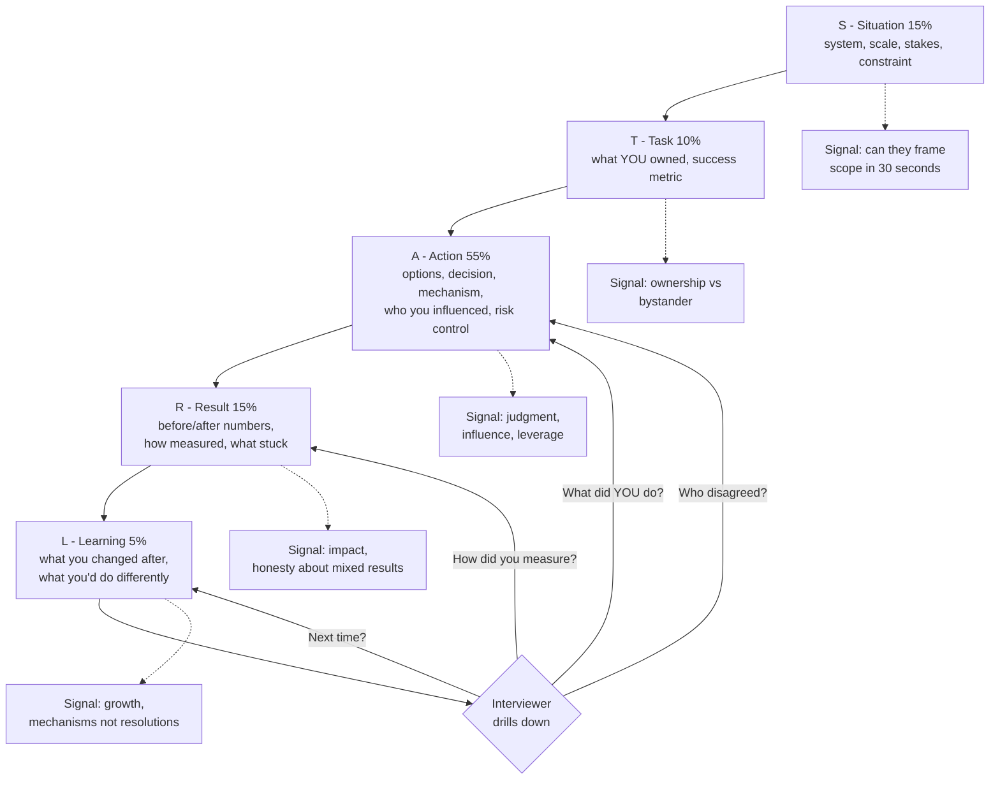
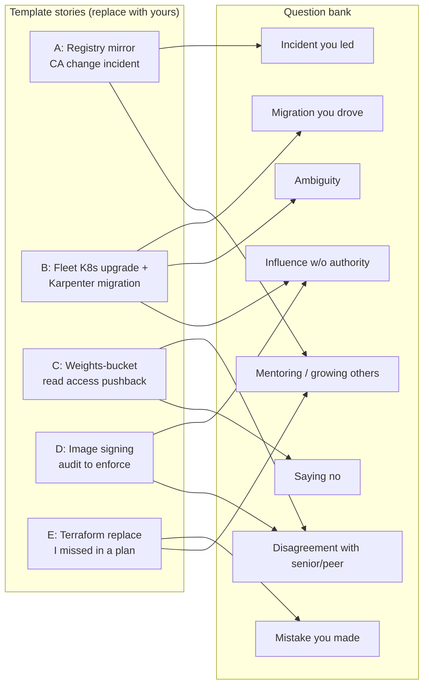

# Lesson 65 — Mock behavioral and leadership interview for a staff platform role: incidents you led, migrations you drove, disagreements and tradeoffs, with STAR stories and a scoring rubric

*2026-11-14*

The last three lessons were the technical half of the loop: design (L62), an incident (L63), a threat model (L64). This one is the round that decides the **level**. Staff platform candidates who pass every technical round still get down-leveled or rejected here, because the behavioral interviewer is the person checking whether the scope you claimed in the other rounds is real. Set a **45-minute timer**, have someone read the "interviewer says" blocks, and answer out loud from your own story bank before you read the model answers.

> **Read this first: every example story in this lesson is a template.** They are built on the fictional scenarios from L45, L63 and L64 so you can see the shape and the level of detail. They are not Rohit's history, and none of the numbers, teams or companies in them are real. Before any interview, replace every `[bracketed]` field and every number with facts you can defend under five follow-up questions. An invented story falls apart at the second "why", and the interviewer will notice.

## What interviewers are really probing

**The prompt (read once, start the timer):**

> *"I'm the hiring manager for the infrastructure platform org. We run ~120 Kubernetes clusters, a GPU fleet, and the agent platform you designed with my colleague. For the next 45 minutes I want to hear about things you actually did. Please use specific examples, and tell me what **you** did, not what the team did."*

What a staff-level behavioral interviewer actually scores, whatever their company calls the competencies:

- **Scope and leverage.** Was the problem bigger than your own team? Did your work change how *other* teams operate (a paved road, a policy, a migration toolkit), or only what you shipped yourself? Senior engineers solve hard problems. Staff engineers solve problems that span teams and make the next ten problems cheaper.
- **Ownership with boundaries.** "I" for your decisions and actions, "we" for shared outcomes, and a clear line between what you owned, what you influenced, and what you didn't control. Ownership also means owning the follow-through: the action items, the long tail of the migration, the last 5% of clusters.
- **Judgment under ambiguity and tradeoffs.** Options you considered (including "do nothing"), why you rejected them, what was reversible, what you decided *not* to do. A story with only one option has no judgment in it.
- **Influence without authority.** RFCs, design reviews, data, pilots, office hours, a paved road that makes the right thing the easy thing, and knowing when to escalate. "I convinced them" is not a mechanism. "I ran the policy in audit mode for two weeks and sent every team its own violation list" is.
- **Handling disagreement and saying no.** Disagree with evidence, commit once decided, keep the relationship. Amazon calls this "Have Backbone; Disagree and Commit"; most loops test it under some name.
- **Incident leadership.** Command, communication, safe mitigation, and a blameless postmortem whose action items changed the system ([L35](/lessons/35-fleet-incident-response-gpu-inference-agent-runbooks), [L63](/lessons/63-mock-troubleshooting-gpu-agent-fleet)).
- **Self-awareness.** A real mistake, your part in it, what you changed. "I care too much" or "the other team broke it" are both fails.
- **Numbers.** Before and after, how you measured, over what window. No numbers reads as either no impact or no attention to impact.
- **Integrity and security judgment.** For a DevSecOps or platform role this is not optional: did you hold the line on signing, verification and access to model weights when it was inconvenient, and can you talk about past work *without* leaking your previous employer's confidential details?

Cross-links: [L35](/lessons/35-fleet-incident-response-gpu-inference-agent-runbooks) incident command and runbooks, [L45](/lessons/45-fleet-kubernetes-upgrades-gpu-clusters) fleet Kubernetes upgrades (migration story material), [L51](/lessons/51-gitops-progressive-delivery-fleet-scale) waves and progressive delivery, [L12](/lessons/12-node-container-hardening-supply-chain) supply chain and signing, [L13](/lessons/13-ml-weights-checkpoint-hardening) weights and checkpoint hardening, [L15](/lessons/15-terraform-atlantis-fleet-scale) Terraform and Atlantis, [L17](/lessons/17-systems-design-tradeoffs) tradeoff vocabulary, [L50](/lessons/50-slo-error-budget-alerting-fleet-scale) SLOs as story numbers, [L62](/lessons/62-mock-system-design-gpu-agent-platform) the design round, [L63](/lessons/63-mock-troubleshooting-gpu-agent-fleet) the registry-mirror CA incident, [L64](/lessons/64-mock-security-deep-dive-weights-platform) the weights-bucket threat model.

## Core diagram


**The 45-minute shape** (most interviewers go deep on three or four stories, not shallow on eight):



**STAR-L: what to say in each phase, how long, and what the interviewer is writing down:**



**The story bank: five stories should cover the whole question bank.** Each edge is a question type that story can answer:



## Idiosyncrasies / operator depth

**The same story scores at different levels depending on what you emphasize.** This is the most important idea in the lesson. Take the CA-rotation incident:

| Told at… | What the answer focuses on |
|---|---|
| Mid-level | "I found the bad cert with `openssl s_client` and we rolled it back." |
| Senior | "I led the debugging, found the mirror moved to a new intermediate CA, rolled back via Git, and wrote the postmortem." |
| Staff | "I took command across three teams, split the shared-cause pages from the independent Xid page, chose rollback over patch-forward and refused the `skip_verify` shortcut. Afterwards I turned 'CA changes are fleet changes' into a wave-based rollout with a pull-failure halt that every PKI change now goes through. Two later CA rotations went out with zero pull failures." |

The staff version has the same facts. It adds **cross-team scope, the rejected option, and the mechanism that outlived the incident.**

**Interviewers are trained to pull you off the script.** Expect at least one interruption per story. Common structured-interview practice is to score each competency from the evidence you give, so a rehearsed four-minute monologue that never reaches your decisions scores worse than a messy two minutes plus good drill-down answers. Aim for **2 minutes of story, then let them steer.**

**"Tell me about yourself" is a scoping question, not small talk.** Ninety seconds: the kind of systems you run (scale, not employer secrets), the two or three problems you're known for, and why this role. End on a hook they can pull ("…which is why the fleet upgrade story is the one I'm proudest of").

**Pick the story for the question, not the question for the story.** A migration story can answer "ambiguity" if the ambiguity is what you tell, but if you use the same story for four questions the interviewer writes "narrow experience". Five to eight stories, each told from two or three angles, is the right bank size.

**Recency and level.** Interviewers discount stories older than about three years and stories from before you were operating at the target level. If your best story is old, say why it still represents how you work, and have a recent one ready.

**Disagreement stories need a real opponent and a real cost.** "We disagreed about naming" is not a disagreement story. The good ones have a senior person, a deadline, a production or security consequence, and an outcome where you didn't simply win. "I was partly wrong and we ended up with a third option" scores higher than "I was right."

**Saying no is really about the alternative you offered.** A bare "no" is gatekeeping. Staff answers carry a paved road: "No to standing human read on the checkpoint bucket, yes to a time-boxed break-glass role with approval that grants within minutes."

**Mistake stories: the mistake must be yours and must have had a cost.** Then the system fix (a policy check, an alert, a review rule), not "I'm more careful now." "Be more careful" is the behavioral version of a postmortem action item that says "train the engineer."

**Mentoring at staff level is multiplying others, not answering questions.** Who did you grow, into what, and how do you know (they ran the next incident as IC, they own the migration tooling now)?

**Numbers you can defend.** Round them and give the measurement: "about 40% fewer pages per week, measured from PagerDuty over the quarter before and after." Never quote a number you can't explain. The follow-up is always "how did you measure that?"

**Your questions at the end are scored too.** Ask about how the org makes cross-team decisions, the last migration that stalled and why, how on-call load is shared, how they decide when security can block a release. Not compensation, not "what's the culture like."

## Concrete commands & config

Behavioral answers are only as good as the facts behind them. **Pull these while you still have legitimate access, and record only aggregate, non-confidential numbers in your personal notes** (see Security & hardening for what not to keep).

**1. Story-bank worksheet** (`story-bank.yaml`, kept private, one entry per story):

```yaml
# story-bank.yaml — TEMPLATE. Every value below is a placeholder. Replace with your own facts.
- id: A-registry-ca-incident
  title: "[Registry mirror moved to new intermediate CA; new pulls failed fleet-wide]"
  when: "[YYYY-MM]"            # within ~3 years; say so if older
  my_role: "[incident commander for N teams]"
  scope: "[N clusters / N nodes / which SLOs]"   # sanitized, rounded
  situation: "[one sentence: what broke, who was hurt, why it mattered]"
  task: "[what I owned + success metric]"
  options_considered:
    - "[rollback via Git]  -> chosen: reversible, known-good"
    - "[patch forward: add new CA to nodes]  -> later, as a fleet change"
    - "[skip_verify on mirror]  -> rejected: security gate"
  actions_i_took:              # "I" verbs only
    - "[named IC, set 15-min update cadence]"
    - "[split shared-cause pages from the independent one]"
  people:
    disagreed: "[role, not name: e.g. training lead wanted skip_verify]"
    influenced: "[PKI team lead -> wave-based CA rollouts]"
  result_numbers:
    before: "[e.g. p99 TTFT 3.1 s, 0/1000 warm pool]"
    after: "[e.g. restored in N min; next 2 CA rotations 0 pull failures]"
    how_measured: "[SLO dashboard / PagerDuty export / Argo history]"
  learning: "[mechanism I added, what I'd do differently]"
  answers_questions: [incident, mentoring, security-pushback]
  confidentiality_check: "[no customer names, no internal hostnames, no unreleased details]"
  evidence_i_can_cite_publicly: "[public talk, blog, OSS PR, or none]"
```

**2. Pull your own contribution numbers from Git and GitHub** (your own work, your own access):

```bash
# PRs you authored and merged in a window (gh search uses GitHub search syntax)
gh search prs --author=@me --merged --merged-at=2025-01-01..2025-12-31 \
  --json repository,title,closedAt --limit 200 | jq 'length'

# Group them by repo to see where your scope actually was
gh search prs --author=@me --merged --merged-at=2025-01-01..2025-12-31 \
  --json repository --limit 500 | jq -r '.[].repository.nameWithOwner' | sort | uniq -c | sort -rn

# Reviews you did for other teams (influence evidence: reviews outside your home repo)
gh search prs --reviewed-by=@me --merged-at=2025-01-01..2025-12-31 \
  --json repository --limit 500 | jq -r '.[].repository.nameWithOwner' | sort | uniq -c | sort -rn

# Commits in a migration repo, by month (shows the long tail you owned)
git log --author="$(git config user.email)" --since=2025-03-01 --until=2025-09-30 \
  --date=format:%Y-%m --format=%ad | sort | uniq -c

# Atlantis-driven Terraform applies you authored (PRs that went through plan/apply)
gh pr list --repo [org]/[infra-repo] --author @me --state merged --search "atlantis apply" --limit 200 --json number | jq length
```

**3. Reconstruct an incident timeline before you tell it** (minute accuracy is what makes an incident story credible):

```bash
# What changed: Git history of the config repo around the incident window
git log --since="2025-06-10 13:30" --until="2025-06-10 15:30" --format='%h %ad %an %s' --date=iso

# What Argo CD synced, and when (per app)
argocd app history [registry-mirror-certs] | tail -5

# Cluster events, sorted (events expire after ~1h by default, so this only works live or from an events exporter)
kubectl get events -A --sort-by=.lastTimestamp --field-selector reason=Failed | tail -50

# Cloud control-plane changes in the window (AWS example)
aws cloudtrail lookup-events --start-time 2025-06-10T13:30:00Z --end-time 2025-06-10T15:30:00Z \
  --lookup-attributes AttributeKey=EventSource,AttributeValue=acm-pca.amazonaws.com \
  --query 'Events[].[EventTime,EventName,Username]' --output table

# Your own pages from PagerDuty for the quarter (on-call load numbers for the "before/after")
curl -s -H "Authorization: Token token=$PD_TOKEN" \
  "https://api.pagerduty.com/incidents?since=2025-04-01&until=2025-06-30&user_ids[]=[YOUR_ID]&limit=100" \
  | jq '.incidents | length'
```

**4. Before/after numbers for SLO and toil stories** (Prometheus):

```bash
# Monthly availability for an SLO before and after your change (30d windows, evaluated at two instants)
promtool query instant http://prometheus:9090 \
  'sum(rate(http_requests_total{job="vllm",code!~"5.."}[30d])) / sum(rate(http_requests_total{job="vllm"}[30d]))' \
  --time=2025-05-31T23:59:00Z
promtool query instant http://prometheus:9090 \
  'sum(rate(http_requests_total{job="vllm",code!~"5.."}[30d])) / sum(rate(http_requests_total{job="vllm"}[30d]))' \
  --time=2025-08-31T23:59:00Z

# Image pull failure rate by registry host (the CA-incident detection metric you added)
promtool query range http://prometheus:9090 \
  'sum by (registry) (rate(kubelet_image_pull_failures_total[5m]))' --start=... --end=... --step=5m
```

`kubelet_image_pull_failures_total` above is illustrative; use whatever pull-failure metric your fleet really exports (kubelet events through an exporter, containerd metrics). Say "a pull-failure metric by registry host" in the interview, not a metric name you can't vouch for.

**5. Fleet-migration progress numbers** (for the "migration you drove" story):

```bash
# Kubernetes version spread across a fleet of kubeconfig contexts
for ctx in $(kubectl config get-contexts -o name); do
  printf '%s ' "$ctx"; kubectl --context "$ctx" version -o json 2>/dev/null | jq -r .serverVersion.gitVersion
done | awk '{print $2}' | sort | uniq -c

# Node kubelet versions in one cluster (version skew during a rolling upgrade)
kubectl get nodes -o json | jq -r '.items[].status.nodeInfo.kubeletVersion' | sort | uniq -c

# Karpenter-managed vs other nodes (the "Cluster Autoscaler to Karpenter" progress number)
kubectl get nodes -L karpenter.sh/nodepool --no-headers | awk '{print ($6==""?"non-karpenter":"karpenter")}' | sort | uniq -c

# Deprecated API usage left before an upgrade (the long tail you chased across teams)
kubent --target-version 1.34.0 -o json | jq 'group_by(.Namespace) | map({ns: .[0].Namespace, n: length})'
```

**6. Postmortem template you can cite** (blameless, with owners: the artifact interviewers ask "what did the postmortem say?" about):

```markdown
# Postmortem: [title]           Status: [draft/reviewed]   IC: [role]   Severity: [SEV-n]
## Impact        [who, how long, which SLOs, error budget burned]
## Timeline      [UTC, minute-level, from detection to all-clear; link the change]
## Root cause    [the condition that made the trigger possible, not only the trigger]
## What went well / what was hard / where we got lucky
## Action items  | Category (detect/prevent/contain/recover) | Item | Owner | Due | Ticket |
## Not doing     [things considered and explicitly rejected, with reason]
```

**7. A "brag doc" running log** (Julia Evans' pattern). One line per week of what changed because of you, with a metric or link. Six months of these turn a behavioral prep session from archaeology into selection.

## The interview, phase by phase

**Interviewer says (min 1): "Tell me about yourself."** Model shape (90 seconds, fill in your own facts):

> "I'm a platform and DevSecOps engineer. For the last [N] years I've run [Kubernetes infrastructure at the scale of N clusters / N nodes, including GPU pools] with [Terraform/Atlantis, Argo CD, Temporal]. The work I'm known for is [fleet upgrades that don't page anyone], [supply-chain controls teams actually adopt], and [leading incidents across team boundaries]. I'm looking at this role because [AI/ML platform at hyperscale, the weights and agent security problems you have]. The story I'd most like to tell you about is [the fleet migration]."

**Interviewer says (min 4): "Tell me about a significant incident you led."**

**Template story A — registry mirror CA change (EXAMPLE, built on L63; replace with your own).**

- **S (20 s):** "[On a weekday afternoon], four pages fired in fifteen minutes across inference, agent sandboxes, a training job and API-server throttling in [one region]. Inference TTFT p99 was [3x] the SLO and the burn rate was [14x]."
- **T (10 s):** "I was the platform on-call, so I took incident command across [three] teams. Success meant restoring the customer inference path first, then the rest, without weakening any security control."
- **A (90 s):** "I named roles: an ops lead per team, a comms lead with fifteen-minute updates, and a scribe. I asked 'what changed in the last hour' and found a merged PR that moved the regional mirror's serving cert to a new intermediate CA. Only *new* pulls failed, which explained why running pods were fine and why scale-ups and the warm pool weren't. The training job's stuck pod was a separate Xid 79 GPU failure, and its replacement node couldn't pull either, so I kept that as a second thread with its own owner. A training lead proposed `skip_verify` on the mirror to get pulls going. I said no and explained why: it opens every GPU node to a MITM image, and those nodes hold weights. I chose to roll back the cert change through Git, which was reversible and known-good, and I shifted inference traffic to [another region] while it propagated."
- **R (30 s):** "Pulls recovered [N] minutes after the revert synced. The SLO burn stopped at [N]% of the monthly budget. In the postmortem I owned the main action item: CA and cert changes became fleet changes, trust bundle first, then issuer switch in waves with a pull-failure halt. The next [two] rotations caused zero pull failures."
- **L (15 s):** "I'd have split the Xid thread out five minutes sooner. I spent that time trying to make one root cause explain all four pages. I now say 'what doesn't fit?' out loud at the fifteen-minute mark."

**Drill-downs the interviewer will use, and what they test:**

| Probe | Tests | Strong answer has |
|---|---|---|
| "What would have happened if you hadn't been there?" | Ownership vs bystander | A specific decision that wouldn't have been made, or made later |
| "Walk me through the minute you decided to roll back." | Judgment under pressure | The evidence, the alternatives, why reversibility won |
| "Who pushed back on you during the incident?" | Conflict in real time | The skip_verify request, how you said no, what you offered instead |
| "How did you know it was fixed?" | Verification rigor | The metric and the synthetic check, not "the pages cleared" |
| "Which action items actually got done?" | Follow-through | Honest count, the one that slipped and why |
| "What did leadership hear and when?" | Communication | Cadence, the format (impact, actions, next update time) |

**Interviewer says (min 16): "Tell me about a large migration you drove."**

**Template story B — fleet Kubernetes upgrade plus Cluster Autoscaler to Karpenter (EXAMPLE, built on L45; replace with your own).**

- **S:** "[~120] clusters were spread across [three] minor versions, [~20] were within [60] days of end of support, and GPU pools used Cluster Autoscaler with node groups that took [~25] minutes to scale. Previous upgrades had been run by hand, per team, and two had caused training-job restarts."
- **T:** "I owned the upgrade program end to end: getting every cluster to [1.34] and moving GPU and agent pools to Karpenter within [two quarters], with zero unplanned training restarts."
- **A:** "I wrote the RFC with three options: keep per-team upgrades, a central team doing every cluster by hand, or a wave-based pipeline that teams opt their clusters into. I chose the pipeline because it scaled and kept owners in the loop, and I said explicitly we would *not* move bare-metal training clusters in the first wave. I built the pre-flight gate (`kubent` and `pluto` for deprecated APIs, etcd snapshot, PDB sanity) and sent each team its own deprecated-API list two months ahead. That list did more than any meeting. For GPU pools I added `karpenter.sh/do-not-disrupt` on running training pods and NodePool disruption budgets so drift replacement only ran in [the weekend window]. Waves went canary cluster, then [10%], then the rest, with a halt on SLO burn or node NotReady."
- **R:** "[118 of 120] clusters upgraded in [two] quarters. The last two belonged to a team with a vendor dependency, and I agreed a dated exception with their director rather than forcing it. Zero unplanned training restarts. GPU scale-up dropped from [~25] to [~6] minutes. The pipeline now runs every minor upgrade, and [another team] ran the next one without me."
- **L:** "I underestimated the long tail. The last 10% of clusters took 40% of the time. Now I budget the tail explicitly and name an owner for each straggler on day one."

**Drill-downs:** "Who didn't want to migrate, and what did you do?" · "What did you cut from scope?" · "What broke during the migration?" (have one real failure ready) · "How did you get time from other teams?" · "Would you do waves the same way again?"

**Interviewer says (min 27): "Tell me about a time you disagreed with someone more senior."**

**Template story C — weights-bucket access pushback (EXAMPLE, built on L64; replace with your own).**

- **S:** "Before a major training run, a principal research lead asked for standing read on the checkpoint bucket for their whole team of [~40], plus permission to `torch.load` community checkpoints on the training cluster. The deadline was [two weeks] out."
- **T:** "I owned the storage and IAM policy for weights. I needed to unblock the research without widening who can read the company's most valuable asset."
- **A:** "I first asked what they actually needed. It turned out to be inspecting intermediate checkpoints during evals and loading some public models for comparison. I showed the math: forty people with standing read is forty credential-theft paths to a checkpoint that is effectively the release. I proposed two paved roads: a time-boxed break-glass read role with approval in under ten minutes and an eval sandbox that brings compute to the data, and a sandboxed intake that converts community checkpoints to safetensors, cached by digest. They disagreed on the approval latency, and they were right that ten minutes was too slow during a debugging session. We compromised on pre-approved four-hour sessions per run for named on-call researchers. I wrote it up as a one-page decision record with their director and my manager on it."
- **R:** "Standing human read on checkpoints went from [~40] principals to [0]. Break-glass was used [~N] times in the run with a median grant time of [N] minutes. The intake handled [N] community models, and the research lead later asked for it to be the default for their other team."
- **L:** "I'd bring the paved road to the first meeting instead of the second. My first 'no' cost a week of trust."

**Interviewer says (min 36): rapid fire.** One minute each. Have these ready:

- **"Tell me about a mistake you made."** *Template story E (EXAMPLE, replace):* "I approved and applied an Atlantis plan that showed `-/+` (destroy then create) on a [NAT gateway / route table] because a forced-new attribute changed. I read the summary line, not the resource diff. It caused [N] minutes of egress loss for [one cluster's] nodes. I owned it in the incident channel right away, restored from the previous state, and then added a conftest policy on plan JSON that blocks replace actions on resources tagged `critical=true` unless the PR carries an explicit label. That policy has since caught [N] replaces, including one of mine."
- **"Tell me about someone you mentored."** "[Engineer] was [two years] into on-call and avoided IC. I shadowed them as scribe for two incidents, then reversed roles, then let them run one with me silent in the channel. They're now [an IC rotation lead]. The signal I watched for: they started writing the action items before I suggested them."
- **"Tell me about a time you had to work with ambiguity."** "I was asked to '[make GPU cost visible]'. I spent the first week defining the decision it should drive (reclaim idle reservations), picked one metric (allocated vs used GPU-hours per team), shipped a weekly report before building any dashboard, and let the questions it raised decide the next step ([L26](/lessons/26-gpu-cost-attribution-reclaim-spot))."
- **"Tell me about influencing without authority."** *Template story D (EXAMPLE, replace):* "I wanted image signature verification enforced on every serving cluster. I didn't own those clusters. I shipped the Kyverno `verifyImages` policy in audit mode, sent each team its weekly unsigned-image list, added signing to the shared CI template so compliance cost one line, and set an enforce date with the platform leads. Unsigned images on serving clusters went from [~30%] to [0] in [eight] weeks, and enforcement caused [zero] outages because every team had seen its own violations for a month first."

**Interviewer says (min 41): "What questions do you have for me?"** Pick two: "What's the last cross-team migration that stalled, and why?" · "When security and a release deadline disagree, who decides and how?" · "What would make someone in this role clearly successful at twelve months?"

## Failures & fixes

| Answer failure mode | Symptom the interviewer sees | Fix |
|---|---|---|
| "We" all the way through | Can't tell what you did; scored as bystander | Rewrite every action line with "I + verb"; keep "we" for outcomes |
| Monologue | Four minutes in and still on Situation; interviewer interrupts | 20-second S+T; jump to the decision; let them pull detail |
| No numbers | "It went much better" | Before/after, unit, window, source. Round honestly. If none exist, give a defensible proxy |
| Unverifiable numbers | Can't answer "how did you measure that?" | Only quote numbers you derived; keep the query in your story bank |
| Blameful | "The other team pushed a bad change" | Describe the system condition that allowed it; own your part |
| Hero story | You alone fixed everything at 3 a.m. | Show how you organized others and what mechanism you left behind |
| Fake mistake | "I worked too hard" / "I trusted a teammate" | A real error with a cost, your part, and the system fix |
| Disagreement you simply won | No tension, no learning | Show where they were right; the compromise; the relationship after |
| Senior-level story at a staff loop | Hard technical problem, single team, no lasting change | Add the cross-team scope, the rejected options, the mechanism that outlived you |
| Same story for everything | Interviewer notes "narrow experience" | Five to eight stories; map them to the question bank before the loop |
| Over-rehearsed | Word-perfect, falls apart on the first drill-down | Practice from bullet points, not scripts; have a friend interrupt you |
| Oversharing confidential detail | Names customers, internal hostnames, unreleased models | Sanitize before the loop (see next section); decline politely if pushed |
| No learning or "nothing I'd change" | Reads as low self-awareness | One specific change in how you work now |
| Running out of time on story 1 | Interviewer can't cover other competencies, scores "insufficient data" | Watch the clock; offer "I can go deeper on X or move on" at ~8 minutes |

## Security & hardening

**For a DevSecOps or platform role on an AI/ML fleet, the behavioral loop checks your security judgment as hard as the security round does. They want to know whether you hold the line when it costs you something, and whether you can be trusted with their secrets. Both show up in how you tell stories.**

**1. Security-flavored stories you should have in the bank** (each a template; replace with your facts):

| Story type | Material from this curriculum | What it proves |
|---|---|---|
| Refusing `skip_verify` / disabling signing during an incident or release crunch | L63 registry CA incident; L12 cosign/Kyverno | You fix the pipe without weakening the artifact check |
| Narrowing human access to **model weights / checkpoints** | L13, L64 bucket policy + KMS double lock | You reduce readers, offer break-glass, keep researchers productive |
| **Image registry** hardening: mirror trust, digest pinning, pull-secret scoping | L12, L27, L63 | You treat registries as part of the trust chain |
| **Signing and provenance** rollout, audit to enforce | L12, L31 release gating, L64 model_signing | Influence without authority with zero-outage enforcement |
| **Bucket IAM** finding: over-broad policy or public exposure | L13, L64 | Contain, scope, disclose, fix the class of bug |
| **Deployment hardening**: PSS restricted, no hostNetwork, no creds in inference pods | L11, L14 | You make the safe config the default config |
| Exposed credential (token in a repo, log or CI output) | L48 | Revoke first, then rotate, scope, disclose |

**2. The exposed-credential and exposed-bucket story shape** (what a strong answer contains, in order):

- **Contain first:** revoke the key or session, or apply a Deny statement and Block Public Access, *before* investigating. "I deleted the commit" is not containment. The secret is in forks, caches and clones, so rotate.
- **Scope:** what could that principal or object reach, and was it used? CloudTrail data events, bucket access logs, the registry's pull logs. Give bytes read vs object sizes for weights and checkpoints.
- **Preserve:** keep logs and the exact policy version before you fix anything else.
- **Disclose:** tell security and your manager immediately, follow the incident process, and let the legal and security leads decide on customer notification. Don't decide that alone, and don't sit on it.
- **Fix the class:** secret scanning with push protection, Access Analyzer or a policy linter in CI on every bucket policy, an SCP that denies public bucket policies on weights accounts.
- **Blameless but accountable:** if it was your key or your policy, say so first. "I committed it; here is what I changed so nobody can make that mistake again" is the strongest version of this story.

**3. Pushing back on disabling signing: the exact framing.** "TLS protects the pipe; signatures protect the artifact. I was willing to roll back the cert change in five minutes. I wasn't willing to let unsigned images onto GPU nodes that hold weights. If we truly needed a bypass, it would be break-glass with an expiry, a second approver, and an alert until reverted. We never needed it." Then give the number: time to restore *without* the bypass.

**4. What NOT to disclose in an interview (confidentiality / NDA).** You signed agreements with past employers. The interviewer is also checking whether you'd leak *their* secrets next year. Interviewers at serious companies are trained to notice oversharing, and it is a negative signal.

- **Don't name:** customers, unreleased models or products, internal codenames, internal hostnames, account IDs, bucket names, vendor contract terms, unannounced incidents.
- **Don't give exploitable detail:** unpatched vulnerabilities, specific gaps in a past employer's security architecture, how their weights are protected (key hierarchy, which roles can read), detection blind spots.
- **Don't bring artifacts:** no screenshots of internal dashboards, no copied postmortems, runbooks or Terraform, no exported metrics files. Also don't pull the numbers in the Commands section from systems you no longer have legitimate access to.
- **Do sanitize:** round and relativize ("about a hundred clusters", "roughly a 4x reduction"), genericize ("a large inference fleet", "a tier-1 cloud provider"), and describe *your* reasoning and mechanisms, which are yours to share.
- **If pushed:** "I'm not able to go into the specifics of their key setup, but I can walk you through how I'd design it here." Saying that once is a positive signal.
- **Public incidents are fine** within what was published (a public postmortem or status page), plus your own role if that's not confidential.

**5. Weights, registries, signing, bucket IAM and deployment hardening as story material: how to keep stories safe and specific.** Talk about the *shape* of controls, not a past employer's specifics. "A Deny-based bucket policy with a principal allowlist and a VPC-endpoint condition, plus a dedicated KMS key" is public best practice ([L64](/lessons/64-mock-security-deep-dive-weights-platform)). "Their prod weights bucket is X and only role Y can read it" is a leak. Same for registries (digest pinning, mirror trust bundles), signing (keyless identity pinned to one workflow), and deployment hardening (no cloud creds in inference pods, read-only model volumes, admission requiring verification).

**6. Story-bank hygiene.** Keep `story-bank.yaml` in a private personal location, not an employer repo or laptop, with only sanitized content. Never paste confidential details into third-party AI interview-prep tools.

## Scoring rubric

Score each dimension 1 to 4. Weights sum to 100.

| Dimension | Weight | 1 (no hire) | 2 (lean no) | 3 (hire) | 4 (strong hire, staff) |
|---|---|---|---|---|---|
| Ownership & scope | 20 | Bystander, "we" throughout | Owned a task inside someone else's project | Owned a team-level outcome end to end | Owned a cross-team outcome and its long tail; clear line between owned and influenced |
| Judgment & tradeoffs | 15 | One option, no reasoning | Options named, weak rationale | Options, reversibility, explicit non-goals | Plus revisited the decision with data; knew when to stop |
| Influence & collaboration | 15 | "I told them" or escalated first | Persuaded with opinions | Mechanisms: RFC, data, pilot | Paved roads that changed other teams' defaults; relationships intact after disagreement |
| Execution & measurable results | 15 | No outcome | Outcome, no numbers | Before/after with measurement | Numbers plus what stuck after they left the project |
| Incident & operational leadership | 10 | Debugged alone | Fixed it, weak communication | Command, cadence, safe mitigation, postmortem | Plus systemic action items that measurably prevented recurrence |
| Self-awareness & growth | 10 | No mistake, or blames others | Mistake with no system fix | Real mistake, own part, a mechanism | Plus how they now coach others on it |
| **Integrity & security judgment (gate, must be at least 3)** | 15 | Disabled a control under pressure as the "win", or leaks confidential detail | Unclear stance, overshares | Holds the line, offers a paved road, discreet about past employers | Plus turned the pushback into a lasting control with zero-outage rollout |

Pass: ≥ 70/100 and no 1s. **Below 3 on integrity and security judgment fails the round.** Calibration check: if every dimension is a 3, you're a strong senior. Staff needs 4s on ownership, influence and judgment.

## Interview soundbites

- "I'll tell you what I did, and I'll be clear where the team did the work."
- "The senior version of this story is that I fixed it. The version I'm proud of is that the fix became the default for every team."
- "I said no to standing read on the checkpoint bucket and yes to break-glass in minutes. The no was easy. The yes took the work."
- "TLS protects the pipe; signatures protect the artifact. We restored service without touching the artifact check."
- "The last 10% of clusters took 40% of the time, so now I name an owner for every straggler on day one."
- "My mistake was reading the plan summary instead of the diff. The fix wasn't 'be careful', it was a policy that blocks replace on critical resources."
- "I can't go into my last employer's specifics, but here's how I'd design it for you."
- "They were right about the approval latency. We ended up with a better design than either of us walked in with."

## Watch (talks & demos)

<iframe width="100%" height="360" src="https://www.youtube.com/embed/KClAPipnKqw" title="Technical leadership and glue work - Tanya Reilly | #LeadDevNewYork" frameBorder="0" allow="accelerometer; autoplay; clipboard-write; encrypted-media; gyroscope; picture-in-picture; web-share" allowFullScreen></iframe>

[Open on YouTube](https://www.youtube.com/watch?v=KClAPipnKqw). Why watch: Tanya Reilly (ex-Google SRE) on glue work, meaning the cross-team coordination behind most staff "influence without authority" stories, and how to frame it as technical leadership instead of invisible work.

<iframe width="100%" height="360" src="https://www.youtube.com/embed/xtevUgopIms" title="SREcon16 - nrrd 911 ic me: The Incident Commander Role" frameBorder="0" allow="accelerometer; autoplay; clipboard-write; encrypted-media; gyroscope; picture-in-picture; web-share" allowFullScreen></iframe>

[Open on YouTube](https://www.youtube.com/watch?v=xtevUgopIms). Why watch: Alice Goldfuss on the incident commander role (delegation, communication, trust between teams). This is the vocabulary for the "incident you led" story.

<iframe width="100%" height="360" src="https://www.youtube.com/embed/n-dAVgIpJHo" title="SREcon19 Americas - Learning from Learnings: Anatomy of Three Incidents" frameBorder="0" allow="accelerometer; autoplay; clipboard-write; encrypted-media; gyroscope; picture-in-picture; web-share" allowFullScreen></iframe>

[Open on YouTube](https://www.youtube.com/watch?v=n-dAVgIpJHo). Why watch: dissecting real incidents for what the organization learned. Useful for the Result and Learning phases and for blameless-but-accountable framing.

## References

- [Google SRE book: Managing Incidents](https://sre.google/sre-book/managing-incidents/) · [Postmortem Culture](https://sre.google/sre-book/postmortem-culture/) · [SRE Workbook: Postmortem Culture](https://sre.google/workbook/postmortem-culture/)
- [PagerDuty Incident Response docs](https://response.pagerduty.com/) · [SREcon16: The Incident Commander Role (Goldfuss)](https://www.usenix.org/conference/srecon16/program/presentation/goldfuss)
- [Amazon Leadership Principles](https://www.amazon.jobs/content/en/our-workplace/leadership-principles) (Ownership, Dive Deep, Have Backbone; Disagree and Commit, Earn Trust: a widely copied competency list)
- [StaffEng: Staff archetypes](https://staffeng.com/guides/staff-archetypes/) · [Will Larson: Staff engineer archetypes](https://lethain.com/staff-engineer-archetypes/) · [Tanya Reilly: Being Glue](https://noidea.dog/glue)
- [Julia Evans: Get your work recognized, write a brag document](https://jvns.ca/blog/brag-documents/)
- [GitHub CLI `gh search prs`](https://cli.github.com/manual/gh_search_prs) · [Karpenter disruption (do-not-disrupt, budgets)](https://karpenter.sh/docs/concepts/disruption/)
- Prior lessons used as story material: [L35](/lessons/35-fleet-incident-response-gpu-inference-agent-runbooks), [L45](/lessons/45-fleet-kubernetes-upgrades-gpu-clusters), [L62](/lessons/62-mock-system-design-gpu-agent-platform), [L63](/lessons/63-mock-troubleshooting-gpu-agent-fleet), [L64](/lessons/64-mock-security-deep-dive-weights-platform)
- [wafer-ai/gpu-perf-engineering-resources](https://github.com/wafer-ai/gpu-perf-engineering-resources)

## Quick self-check

Fill in `story-bank.yaml` with your own five to eight stories first. Then run the 45 minutes once, recorded, with a friend who interrupts. In under three minutes each:

1. Give your 90-second intro. Does it end on a hook to your best story?
2. Map your stories to the eight question types. Which question has only one story, and which story answers more than three?
3. Tell your incident story in two minutes. Count the "we"s. Then answer: "What would have happened if you weren't there?"
4. For your migration story: what did you cut from scope, who resisted, and how many stragglers were left at the end?
5. Tell a disagreement where the other person was partly right. What was the third option?
6. Give a real mistake with a cost, and the system fix that isn't "be more careful".
7. Every number in your bank: say how you measured it. Delete any you can't explain.
8. Pick one security story (signing, weights access, exposed credential) and tell it without naming a customer, hostname, bucket or internal detail.
9. Score your recording with the rubric. Did you pass the integrity gate? Which dimension would a staff bar want at 4?

## Next

**Lesson 66 — Full-loop dress rehearsal: four back-to-back mock rounds (system design, troubleshooting, security deep-dive, behavioral) under real timing, with a debrief, a cross-round consistency check, and a final flashcard deck of the numbers, commands and soundbites from Lessons 1–65.**
