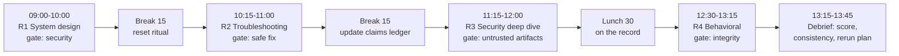
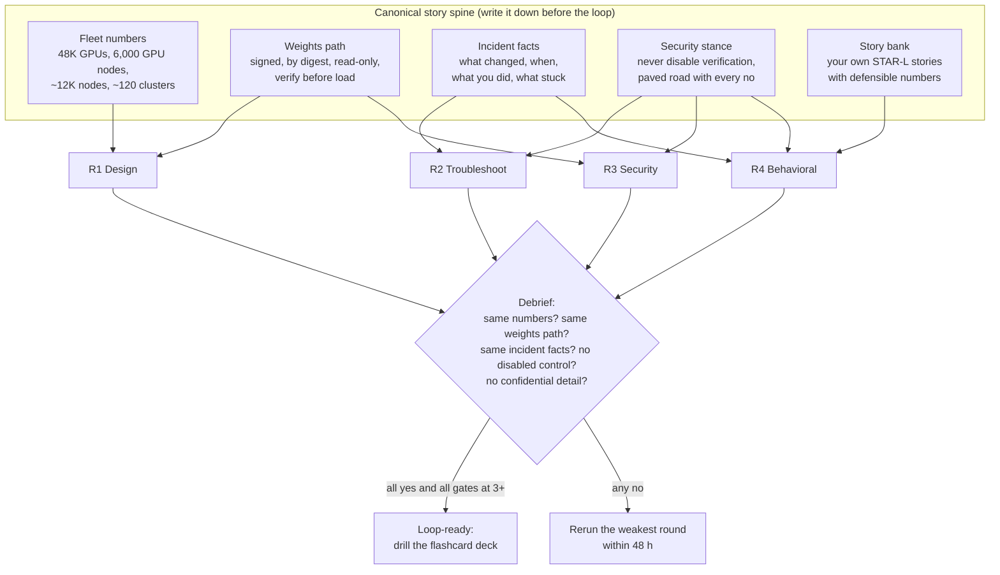

# Lesson 66 — Full-loop dress rehearsal: four back-to-back mock rounds under real timing, a debrief, a cross-round consistency check, and the final flashcard deck from Lessons 1–65

*2026-11-15*

Lessons 62–65 each rehearsed one round alone, fresh, with the model answer a scroll away. A real onsite (or a virtual "super day") is different: **3 hours 15 minutes of interviewing** in a row, four people who never heard your earlier answers, and a debrief where their notes get read **side by side**. This lesson runs the whole loop once under that pressure. Block a morning, get a partner (or two) to read the interviewer parts, start `loop.sh` below, and don't open the L62–L65 model answers until the debrief. The flashcard deck at the end is the last thing to drill before the real loop: 58 cards, every figure taken from the lesson it cites.

> **The template rule from L65 still applies.** The R4 stories are yours, not the L65 examples. Every number you say about your own past work must be one you can defend for five follow-ups. The fleet numbers (48K GPUs, ~12K nodes) are the *mock's* assumptions from L62, not facts about any employer.

## What interviewers are really probing

A loop doesn't test four skills. It tests **one candidate four times**, and the hiring decision is made where the four packets disagree.

- **Consistency of scope.** The R1 interviewer heard you say "I'd shard warm pools by cell." The R4 interviewer hears "I led the sandbox migration." In the debrief, someone asks: is this the same person? Scope claimed in a technical round has to survive the behavioral round ([L65](/lessons/65-mock-behavioral-leadership-staff-platform) exists to check it).
- **Consistency of security posture.** The surest way to fail a platform loop is to be strict in the security deep-dive and then, two hours later in troubleshooting, "temporarily" set `skip_verify` to get pulls working. Each mock had a gate for exactly this: security ≥ 3 in [L62](/lessons/62-mock-system-design-gpu-agent-platform), safe fix ≥ 3 in [L63](/lessons/63-mock-troubleshooting-gpu-agent-fleet), untrusted-artifact gate ≥ 3 in [L64](/lessons/64-mock-security-deep-dive-weights-platform), integrity ≥ 3 in L65. A loop is four gates on the **same** value.
- **Stamina and recovery.** Round 3 starts 2 h 15 min after you began talking. Interviewers see the same candidate at hour one and hour three. They score how fast you reset after a weak answer, not whether you had one.
- **Independent evidence.** In most loops each interviewer writes feedback before seeing anyone else's (that's the point of a hiring committee or an Amazon-style Bar Raiser debrief). A strong signal in one round doesn't carry into the next. Each round has to stand on its own: restate context, don't refer to "what I said earlier" as if they heard it.
- **Calibration to level.** The L65 rubric note holds across the loop: all 3s reads as strong senior. Staff needs 4s somewhere that matters: architecture and change safety (R1), diagnosis method (R2), control depth (R3), ownership and influence (R4).

**The loop you'll run:**

| Slot | Round | Length | Source lesson | Gate (must be ≥ 3) |
|---|---|---|---|---|
| 09:00 | R1 System design: GPU + agent platform | 60 min | [L62](/lessons/62-mock-system-design-gpu-agent-platform) | Security |
| 10:00 | Break | 15 min | | |
| 10:15 | R2 Troubleshooting: four pages, us-east-1 | 45 min | [L63](/lessons/63-mock-troubleshooting-gpu-agent-fleet) | Safe fix |
| 11:00 | Break | 15 min | | |
| 11:15 | R3 Security deep dive: weights platform | 45 min | [L64](/lessons/64-mock-security-deep-dive-weights-platform) | Untrusted-artifact gate |
| 12:00 | Lunch (assume it's on the record) | 30 min | | |
| 12:30 | R4 Behavioral and leadership | 45 min | [L65](/lessons/65-mock-behavioral-leadership-staff-platform) | Integrity & security judgment |
| 13:15 | Debrief, scoring, consistency check | 30 min | this lesson | All four gates + consistency |

**Variant prompts, so you're not reciting.** You've read L62–L65, so ask your partner to change one thing per round without telling you which: in R1 the interviewer picks the deep dive (control-plane scaling [L44](/lessons/44-gpu-cluster-control-plane-scaling) or multi-cluster inference routing [L24](/lessons/24-multi-cluster-inference-routing-capacity)) and swaps the curveball; in R2 they drop P3 (Xid 79) or the warm-pool loop; in R3 they make the crown jewel the agent platform ([L58](/lessons/58-agent-identity-delegated-authorization), [L61](/lessons/61-agent-platform-capstone-10k)) instead of the weights; in R4 they open with "tell me about a technical decision you got wrong." The structure transfers. Memorized wording doesn't.

## Core diagram


**The day, as the clock sees it.** `loop.sh` (below) fires a bell at every phase checkpoint from the L62–L65 timelines.



**The consistency spine.** Every round draws from the same five canonical facts. The debrief checks that no round contradicted another.



## Idiosyncrasies / operator depth

**The claims ledger is your consistency tool.** During each break, write down every number and every commitment you made in the round that just ended: "inference clusters ~150 nodes", "checkpoint every ~19 min", "agent cells have no route to weights", "I owned the CA-rotation postmortem". Re-read it before the next round. Two hours in, you'll want to say "about 200 nodes" because it's a round number. Don't: "about 150" from R1 is now on record. It takes about three minutes and catches most of the contradictions debriefs find.

**Their scenario, your principles.** The L64 prompt is "~16K H100s in one region"; the L62 prompt was 48K GPUs across four regions. Real loops do this too: every interviewer brings their own scenario. Consistency means your **principles and your past-experience claims** stay fixed, while you restate *their* numbers. Importing R1's "48K GPUs" into R3's 16K-GPU scenario reads as not listening. Re-deriving Young/Daly for their job size instead of quoting "19 minutes" reads as fluency.

**Every interviewer starts cold.** The R4 prompt in L65 says "the agent platform you designed with my colleague", but the R4 interviewer usually hasn't read your R1 answer. Re-establish context in 20 seconds ("this morning I sketched cells of 2,500 agents with sandboxes isolated from weights; the story I want to tell is the real-world version of that"). Never say "as I told your colleague."

**Handoff notes cut both ways.** Recruiters and hiring managers often give each interviewer a focus area ("probe security depth", "check scope"), and sometimes pass along a concern from an earlier round. If R3 drills unusually hard on something you hedged in R1, that's probably why. Answer it fully, and don't get defensive.

**Fatigue shows up in specific places.** Late in the day the arithmetic goes first (slower Little's-law and burn-rate math), then structure (you skip "what changed?" and start guessing), then the security sweep (you forget to end at the weights). Counter each one: have the numbers on flashcards, open every round with its opening sentence from L62–L65, and use a fixed last-five-minutes checklist: "security covered? tradeoffs said out loud? recap?"

**Recovering from a bad round.** Rounds are scored independently, so a weak R2 doesn't sink R3 unless you bring it in with you. Use the break: write the one thing you'd change, then close the notebook. Never open R3 with "sorry, the last one went badly." If you stated a **fact** that was wrong (a version-skew rule, a CVE number), correct it in the same round if you notice ("I said two minors earlier; since 1.28 it's three"). That correction scores as a positive. If you only notice after the loop and the error was material, one short factual note to the recruiter is fine. Don't re-argue a design.

**Lunch and the in-between minutes are on the record.** The lunch host or the person walking you between rooms may be asked for an impression. Speak about past employers the same way you do in R4: discreet, specific about your role, no complaining.

**Virtual-loop mechanics matter more than people expect.** Have a whiteboard tool already open with a blank canvas (not a pre-drawn diagram, which reads as rehearsed and some loops forbid it), a second screen for the prompt, and a timer you can see. Practice drawing the L62 reference architecture in eight minutes in the actual tool you'll use.

**Debrief like an SRE, not like a fan.** Score from the recording, not from memory: memory flatters the rounds you felt good about. Then run the consistency check, then choose **one** round to redo within 48 hours, the one with the lowest score on its gate dimension, not the one that felt worst.

## Concrete commands & config

### The loop clock

```bash
#!/usr/bin/env bash
# loop.sh: run the four-round dress rehearsal on a real clock.
# SPEED=60 ./loop.sh compresses 1 minute to 1 second for a dry run.
set -euo pipefail
SPEED=${SPEED:-1}
LOG=${LOG:-loop-$(date +%F).log}
say() {  # terminal bell + desktop notification if available + log line
  printf '\a%s  %s\n' "$(date +%H:%M:%S)" "$*" | tee -a "$LOG"
  command -v notify-send >/dev/null && notify-send "Loop" "$*" || true
}
wait_min() { sleep "$(( $1 * 60 / SPEED ))"; }
# round | total minutes | "minute:label;minute:label" checkpoints (from the L62-L65 timelines)
ROUNDS=(
 "R1 system design (L62)|60|5:numbers;12:architecture;25:deep dive (they pick);35:change safety + ops;43:SECURITY REVIEW;50:incident curveball;57:recap"
 "BREAK|15|"
 "R2 troubleshooting (L63)|45|3:what changed? blast radius;8:mitigate customer path;12:hypotheses + kill tests;25:fix the cause safely;32:second cause + recovery;38:postmortem"
 "BREAK|15|"
 "R3 security deep dive (L64)|45|5:DFD + trust boundaries;12:top-5 attack paths, ranked;24:controls deep dive;34:detect + respond;40:roadmap + residual risk"
 "LUNCH (still on the record)|30|"
 "R4 behavioral (L65)|45|4:story 1 incident you led;16:story 2 migration;27:story 3 disagreement / no;36:rapid fire;41:your questions"
 "DEBRIEF (score before you read model answers)|30|"
)
for r in "${ROUNDS[@]}"; do
  IFS='|' read -r name total cps <<<"$r"
  say "START $name ($total min)"
  prev=0
  IFS=';' read -r -a cpa <<<"$cps"
  for cp in "${cpa[@]}"; do
    m=${cp%%:*}; label=${cp#*:}
    wait_min $(( m - prev )); prev=$m
    say "  ${name%% (*} @${m}m -> $label"
  done
  wait_min $(( total - prev ))
  say "END $name"
done
```

The log doubles as your timing evidence: if the "SECURITY REVIEW" bell at R1 minute 43 rang while you were still drawing boxes, that's your Communication score.

### Record every round, then transcribe

```bash
# Audio only (enough for scoring). Linux/PulseAudio:
ffmpeg -f pulse -i default -ac 1 r1.m4a
# Screen + audio on Linux (X11), to review the whiteboard too:
ffmpeg -f x11grab -framerate 15 -i :0.0 -f pulse -i default -c:v libx264 -preset veryfast -c:a aac r1.mkv
# macOS: list devices, then capture screen "1" with mic "0"
ffmpeg -f avfoundation -list_devices true -i ""
ffmpeg -f avfoundation -framerate 15 -i "1:0" r1.mkv

# Local transcription with timestamps (openai-whisper)
pip install -U openai-whisper
whisper r1.m4a --model small --language en --output_format srt
whisper r1.m4a --model small --language en --output_format txt
```

**Transcript checks that map to rubric lines:**

```bash
# R4 ownership: "I" vs "we" (L65: count the "we"s)
grep -o -w -i -E 'i|we' r4.txt | tr 'A-Z' 'a-z' | sort | uniq -c
# Filler density per round
for f in r?.txt; do printf '%s ' "$f"; grep -o -w -i -E 'um|uh|basically|kind of' "$f" | wc -l; done
# R1: when did security start? (gate dimension; should be near minute 43, not 58)
grep -n -i -m1 -B2 -E 'weights|signed|signature|digest|bucket policy' r1.srt
# Cross-round number consistency: every quantity you said, per round, side by side
grep -o -i -E '[0-9][0-9,.]*[0-9]? ?(k |gpus|nodes|clusters|minutes|min|%|agents)' r?.txt | sort | uniq -c | sort -k2
# Did the forbidden fix get mentioned as something you'd do?
grep -n -i -E 'skip_verify|insecure|disable (tls|verification|admission)|--insecure' r?.txt
```

### Score the loop with the four rubrics

```python
#!/usr/bin/env python3
"""score_loop.py: score all four rounds with the L62-L65 rubrics, apply each gate,
then the cross-round checks. Usage: python3 score_loop.py scores.toml"""
import sys, tomllib
RUBRICS = {  # weights and gates copied from L62, L63, L64, L65
  "design":   ({"scoping":10,"numbers":15,"architecture":20,"change_ops":15,
                "reliability":15,"security":15,"communication":10}, "security"),
  "trouble":  ({"command_comms":15,"change_correlation":15,"mitigation":15,"diagnosis":20,
                "safe_fix":15,"second_cause":10,"postmortem":10}, "safe_fix"),
  "security": ({"scope_assets":15,"dfd_boundaries":15,"ranking":15,"control_depth":20,
                "untrusted_artifact_gate":10,"detect_respond":15,"roadmap":10}, "untrusted_artifact_gate"),
  "behavioral": ({"ownership":20,"judgment":15,"influence":15,"execution":15,
                  "incident_leadership":10,"self_awareness":10,"integrity_security":15}, "integrity_security"),
}
s = tomllib.load(open(sys.argv[1], "rb"))
ok_all = True
for rnd, (w, gate) in RUBRICS.items():
    sc = s[rnd]
    missing = set(w) - set(sc)
    if missing: sys.exit(f"{rnd}: missing {sorted(missing)}")
    total = sum(w[k] * sc[k] / 4 for k in w)
    ok = total >= 70 and min(sc.values()) >= 2 and sc[gate] >= 3
    ok_all &= ok
    low = min(w, key=lambda k: sc[k])
    print(f"{rnd:<11}{total:5.0f}/100  gate[{gate}]={sc[gate]}  weakest={low}  {'PASS' if ok else 'NOT YET'}")
c = s["consistency"]  # booleans you fill in after re-watching all four recordings
fails = [k for k, v in c.items() if not v]
print("consistency:", "all consistent" if not fails else "CONTRADICTIONS -> " + ", ".join(fails))
print("LOOP:", "HIRE signal" if ok_all and not fails else "fix the weakest dimension and rerun that round")
```

```toml
# scores.toml: 1 no hire, 2 lean no, 3 hire, 4 strong hire. Score from the recording.
[design]
scoping = 3
numbers = 4
architecture = 3
change_ops = 3
reliability = 4
security = 3
communication = 2
[trouble]
command_comms = 3
change_correlation = 4
mitigation = 3
diagnosis = 3
safe_fix = 4
second_cause = 2
postmortem = 3
[security]
scope_assets = 3
dfd_boundaries = 3
ranking = 3
control_depth = 3
untrusted_artifact_gate = 4
detect_respond = 2
roadmap = 3
[behavioral]
ownership = 3
judgment = 3
influence = 3
execution = 3
incident_leadership = 3
self_awareness = 3
integrity_security = 3
[consistency]
same_fleet_numbers = true        # your stated numbers match your claims ledger in every round
same_weights_path = true         # read-only by digest, verify before load, no agent route
same_incident_facts = false      # the R2-style incident vs your R4 retelling of a real one
no_control_disabled_story = true # nothing in any round "turned off verification to fix it"
no_confidential_detail = true    # no customer, hostname, bucket or employer internals
```

Output for the example sheet (Python 3.11+ for `tomllib`):

```text
design        80/100  gate[security]=3  weakest=communication  PASS
trouble       80/100  gate[safe_fix]=4  weakest=second_cause  PASS
security      74/100  gate[untrusted_artifact_gate]=4  weakest=detect_respond  PASS
behavioral    75/100  gate[integrity_security]=3  weakest=ownership  PASS
consistency: CONTRADICTIONS -> same_incident_facts
LOOP: fix the weakest dimension and rerun that round
```

Four passing rounds and still "not yet". That's the point of the lesson: the debrief reads the packets together.

### Flashcard deck, part 1: commands to type from memory

Say each one out loud, then type it without autocomplete. The full deck (all 58 cards) is an Anki-importable file: [hyperscale-prep-flashcards.tsv](https://caretak3r.github.io/hyperscale-prep/hyperscale-prep-flashcards.tsv) (tab-separated, `#separator:tab` header, tags in column 3; Anki → Import File).

27. **Prove a registry pull path without trusting the cache** → `sudo crictl pull registry/repo@sha256:<uncached-digest>` ([L63](/lessons/63-mock-troubleshooting-gpu-agent-fleet))
28. **See the chain a TLS endpoint actually serves** → `openssl s_client -connect host:443 -servername host -showcerts </dev/null | openssl x509 -noout -issuer` ([L63](/lessons/63-mock-troubleshooting-gpu-agent-fleet))
29. **Count waiting reasons across all pods** → `kubectl get pods -A -o json | jq -r '.items[] | ((.status.initContainerStatuses // []) + (.status.containerStatuses // []))[] | .state.waiting.reason // empty' | sort | uniq -c | sort -rn` ([L63](/lessons/63-mock-troubleshooting-gpu-agent-fleet))
30. **Who is APF throttling?** → `sum by (priority_level, flow_schema) (rate(apiserver_flowcontrol_rejected_requests_total[5m]))` ([L44](/lessons/44-gpu-cluster-control-plane-scaling), [L63](/lessons/63-mock-troubleshooting-gpu-agent-fleet))
31. **Dump APF priority levels live** → `kubectl get --raw /debug/api_priority_and_fairness/dump_priority_levels` ([L63](/lessons/63-mock-troubleshooting-gpu-agent-fleet))
32. **Find removed APIs before an upgrade** → `the apiserver_requested_deprecated_apis metric plus audit annotations, not grepping Git` ([L45](/lessons/45-fleet-kubernetes-upgrades-gpu-clusters))
33. **etcd health across members** → `etcdctl endpoint status --cluster -w table` ([L62](/lessons/62-mock-system-design-gpu-agent-platform))
34. **Cluster API rollout state** → `clusterctl describe cluster <name> -n fleet --show-conditions all` ([L62](/lessons/62-mock-system-design-gpu-agent-platform))
35. **GPU memory health at end of burn-in** → `nvidia-smi -q -d ECC,ROW_REMAPPER (must be clean); dcgmi diag -r 3 (long), -r 4 (extended)` ([L39](/lessons/39-gpu-fleet-lifecycle-acceptance-burn-in-rma))
36. **NCCL bandwidth smoke test on one node** → `./build/all_reduce_perf -b 8 -e 2G -f 2 -g 8` ([L19](/lessons/19-gpu-topology-nvlink-rdma-nccl))
37. **Verify a model artifact by digest** → `cosign verify --key kms://... registry.internal/models/<model>@${DIGEST}` ([L27](/lessons/27-gpu-supply-chain-weight-registry-hydrate))
38. **Verify weights with OpenSSF model signing, pinned to the release workflow** → `model_signing verify <dir> --signature <dir>/model.sig --identity <workflow-ref> --identity-provider https://token.actions.githubusercontent.com` ([L64](/lessons/64-mock-security-deep-dive-weights-platform))
39. **Revert a bad change the GitOps way during an incident** → `git revert <sha> && git push; argocd app sync <app>; cmctl renew -n <ns> <cert>` ([L63](/lessons/63-mock-troubleshooting-gpu-agent-fleet))
40. **Stop a controller hot loop** → `kubectl -n agent-system scale deploy agent-warmpool-controller --replicas=0` ([L63](/lessons/63-mock-troubleshooting-gpu-agent-fleet))
41. **Turn on S3 data events for the weights bucket** → `aws cloudtrail put-event-selectors --advanced-event-selectors with eventCategory=Data, resources.type=AWS::S3::Object, ARN prefix of the weights bucket` ([L64](/lessons/64-mock-security-deep-dive-weights-platform))
42. **Enable Argo CD progressive syncs** → `argocd-cmd-params-cm: applicationsetcontroller.enable.progressive.syncs: "true" (then RollingSync steps)` ([L51](/lessons/51-gitops-progressive-delivery-fleet-scale), [L62](/lessons/62-mock-system-design-gpu-agent-platform))

**Drill the deck in a terminal** (ten random cards; press Enter to reveal):

```bash
curl -sO https://caretak3r.github.io/hyperscale-prep/hyperscale-prep-flashcards.tsv
grep -v '^#' hyperscale-prep-flashcards.tsv | shuf -n 10 | while IFS=$'\t' read -r front back tags; do
  read -r -p "Q: $front " _ </dev/tty; printf '   A: %s\n\n' "$back"
done
```

## Failures & fixes

| Symptom on loop day | Likely root cause | Fix |
|---|---|---|
| R1 runs out of time before security | Spent 20 min on architecture boxes; no clock | `loop.sh` bell at minute 43; say "I'm keeping seven minutes for the security review" at minute 12 so you've committed out loud |
| R2: you guess a root cause in minute 4 | Fatigue skips the "what changed?" step | Open every troubleshooting round with the L63 sentence: incident command, what changed in the last hour, protect the customer path |
| R3 numbers contradict R1 | Imported R1's scenario into R3's prompt | Restate their numbers first; re-derive (Young/Daly, insider math) for their scale |
| R4 interviewer asks "what was *your* part?" twice | Story told in "we" | Re-tell with the L65 split: "I decided / I wrote / the team built"; count the "we"s in the transcript |
| R4 story contradicts R2 behavior | You said "we had to bypass admission briefly" as a win | Never tell a story where disabling a control is the hero move; tell the version where you held the line and offered a paved road (L65 integrity gate) |
| Same story told in two rounds | Thin story bank | Map stories to rounds before the loop: incident story for R4 only; R2 gets the mock scenario; keep two spares |
| Freeze on a number | Recall under fatigue | Say the formula and the assumption, then compute: "Little's law: 10,000 over 360 seconds is about 28 a second" |
| Blank on a command | Never typed it, only read it | Commands deck above, typed from memory daily for the week before |
| You realize a factual error mid-round | Wrong version detail or CVE | Correct it immediately and briefly; it scores as calibration, not weakness |
| R3 drills hard on something you hedged earlier | Handoff note from a previous interviewer | Answer fully; don't mention earlier rounds; this is your chance to fix the signal |
| Long silence after a hard curveball | Trying to find the full answer before speaking | Think out loud: "Three things share this data hall. What changed there?" (L62 curveball pattern) |
| Over-sharing an ex-employer's internals | Trying to prove depth | "I can't go into specifics, but here's how I'd design it for you" (L65); depth comes from mechanisms, not names |
| Debrief says all PASS, you still feel bad | Memory over evidence | Score from transcripts; trust the rubric; rerun only the weakest gate dimension |
| Low energy in R4 | No food, no reset | Eat at lunch, water every break, two-minute walk; R4 decides the level |

## Security & hardening

**This is the section to rehearse hardest.** Security is the one topic that shows up in all four rounds, and the debrief compares what you said each time. A candidate whose R1 says "serving pulls by digest, read-only" and whose R2 says "I'd temporarily allow the tag so pulls work" has given two answers to the same question, and the stricter interviewer's notes win.

### Cross-round security consistency matrix

Fill this from your recordings. Each row should read as **one policy, four views of it**.

| Control | R1 design: where it lives | R2 troubleshooting: what you refuse to turn off | R3 security: the policy shape | R4 behavioral: the story where you held it |
|---|---|---|---|---|
| **Model weights & checkpoints** | Separate checkpoint and release buckets, each with its own KMS key; object lock on released weights; serving reads by digest, read-only ([L13](/lessons/13-ml-weights-checkpoint-hardening), [L62](/lessons/62-mock-system-design-gpu-agent-platform)) | Don't widen read access to unblock a hydrate; fix the path, not the policy | No standing human read; break-glass with two-person approval; data events and an alert on new principals ([L64](/lessons/64-mock-security-deep-dive-weights-platform)) | "I said no to standing read on the checkpoint bucket and yes to break-glass in minutes" (L65 template story C) |
| **Image registries** | Private, signed registries in tier-0, regional mirrors, pull by `@sha256` ([L12](/lessons/12-node-container-hardening-supply-chain), [L27](/lessons/27-gpu-supply-chain-weight-registry-hydrate)) | Mirror CA broke: revert the change through Git and reissue; never `skip_verify` or an insecure registry entry ([L63](/lessons/63-mock-troubleshooting-gpu-agent-fleet)) | Mirror is a trust boundary: identity on pull, signatures mirrored with layers | The CA-rotation incident: restored service without touching the artifact check |
| **Signing & provenance** | Signed images and signed weights (cosign / OCI or OpenSSF model signing); signing gated on eval ([L31](/lessons/31-evaluation-release-gating-canary-weights)) | "TLS protects the pipe, signatures protect the artifact" | `model_signing verify` pinned to the release *workflow identity*, not "anyone in our org" | Signing rollout from audit to enforce with per-team violation lists (L65 template story D) |
| **Bucket IAM** | Two Deny statements, not one with two conditions (the AND trap) ([L62](/lessons/62-mock-system-design-gpu-agent-platform)) | Don't add a wildcard principal during an incident | Bucket policy plus KMS key policy (ViaService, encryption context): two locks ([L64](/lessons/64-mock-security-deep-dive-weights-platform)) | A pushback story where the "no" came with a faster paved road |
| **Secrets** | Workload identity, short-lived credentials, no static keys in pods ([L48](/lessons/48-workload-identity-secrets-pki-fleet-scale)) | Never paste a token into a debug pod or a chat channel | Credentials in the proxy, not the sandbox ([L34](/lessons/34-agent-tool-sandboxing-egress-policy)); agent tokens live minutes ([L58](/lessons/58-agent-identity-delegated-authorization)) | An exposed-credential story told without naming a system or a customer |
| **Network isolation** | Default-deny NetworkPolicy; training fabric not routable from frontend; agent cells with **no route and no IAM** to weights ([L9](/lessons/09-networkpolicy-multi-nic-sflow), [L61](/lessons/61-agent-platform-capstone-10k)) | Don't open egress to "see if it's the network"; read the drop reason first | Internal GPU ports are attack surface (ShadowRay, vLLM ZMQ) | — |
| **Admission & RBAC** | Admission verifies signatures and digests; training can't create pods in serving ([L11](/lessons/11-cluster-security-pss-admission-rbac), [L14](/lessons/14-ml-inference-training-deploy-hardening)) | Webhook failing closed blocks deploys: fix or scale the webhook, use the documented break-glass, never delete the policy | Admission label gap closed by ValidatingAdmissionPolicy (L64) | — |
| **Training & inference deployments** | Promotion is a separate signed, human-approved pipeline; canary by weight digest ([L31](/lessons/31-evaluation-release-gating-canary-weights)) | Roll back the smallest, fastest thing first; don't restart healthy replicas holding cache | No untrusted pickle on the training cluster; convert in a sandbox, load only what you produced | "The agent proposes; it doesn't merge" ([L58](/lessons/58-agent-identity-delegated-authorization), [L59](/lessons/59-hosting-coding-agents-org)) |

### Contradiction traps the debrief will find

1. **"Temporarily" anything.** "Temporarily disable verification", "temporarily allow `latest`", "temporarily give the team read". In R2 it fails the safe-fix gate; in R4 it fails the integrity gate. Use the same replacement every time: *revert the change, or use the pre-approved break-glass path with an expiry and an audit trail.*
2. **Agent cells and weights.** R1 says agents can't reach weights. If in R3 you let an "eval agent" read checkpoints to save time, you've reversed your own architecture. Agents call models through the gateway, full stop.
3. **Who signs.** In R1 you said CI signs on promotion after eval. In R3, don't let "the training job signs its own checkpoint" slip in. The signer is the release workflow identity.
4. **Pickle.** R3 is where the trap is explicit, but R1's deep dive ("how do customers bring fine-tunes?") and R2 ("a hydrate init container is crash-looping on a `.bin`") can raise it too. Same answer: safetensors conversion in a sandbox, nothing untrusted on the training cluster.
5. **Break-glass.** Make it the same mechanism in every round: two-person approval, minutes not days, auto-expiry, alert on use.

### Confidentiality in behavioral answers (and everywhere else)

- **No proper nouns from past employers' internals:** no customer names, internal hostnames, bucket names, incident ticket IDs, unreleased product names, vendor pricing or security-finding details that aren't public.
- **Abstract the asset, keep the mechanism:** "a model-weights bucket for a production serving fleet" plus the exact policy shape you used is more impressive than a name.
- **Vulnerabilities:** talk about a vulnerability class and how you closed it, never an unpatched issue or how to exploit a former employer.
- **Numbers:** round and relativize ("cut image-pull failures from double digits per day to near zero") unless the figure is public.
- **The line to have ready:** "I can't go into my last employer's specifics, but here's how I'd design it for you." Then actually design it.
- **The whiteboard counts:** don't draw a former employer's real network layout. Draw the generic L62 shape.

## SRE focus: SLIs, SLOs & SLAs

In the dress rehearsal, SLOs are a **cross-round consistency test**. The same SLO numbers, SLIs and alert windows should come up in the design, troubleshooting, security and behavioral rounds, and the debrief should catch any drift. See the [SRE playbook](/sre-slis-slos-slas).

**SLO checks to run in the debrief:**
- **One value per claim:** add your SLO examples to the claims ledger. Inference availability, TTFT target and bucket, burn-rate windows (14.4×/6× page on 1h/5m and 6h/30m), SLA against SLO gap. Any two different values across rounds is a contradiction trap.
- **Metric names said aloud:** were they real and current? `vllm:inter_token_latency_seconds` (not "TPOT gauge"), `DCGM_FI_DEV_XID_ERRORS` (renamed `DCGM_FI_DEV_XID_ERROR` in dcgm-exporter 4.9.0), `kueue_admission_wait_time_seconds`.
- **Examples marked as examples:** did you say "starting point, validated against baselines", or present targets as universal truths?
- **Vantage point and good event:** did every SLO you named come with where it's measured and what counts as good?

**Flashcards to add (example):**
- "Fast-burn page for 99.9%?" → 14.4× over 1h AND 5m (2% of the 30-day budget in 1 h).
- "Why is the SLA looser than the SLO?" → credits are money, measurement differs, and you need a buffer to react.
- "TTFT bucket for a 1 s target in vLLM?" → `le="1.0"`, which exists in the histogram buckets.

**Red flags in the recording:** SLO numbers that change between rounds, invented metric names, and no mention of error-budget policy in the operations phase.

## Interview soundbites

For the loop itself:

- "Before I go deeper: I'm keeping seven minutes for the security review, because that's where the weights live."
- "Your scenario is 16K GPUs in one region, so let me redo the checkpoint math for that rather than quote a number."
- "I'll fix the pipe and leave the artifact check alone. That's true at 2 a.m. and it's true in this room."
- "I said 150-node inference clusters earlier; that's because the router can shift load across many small blast radii."
- "I want to correct something I said a few minutes ago: kubelet can be three minors behind since 1.28, not two."
- "The 'no' on that request was easy. The work was building the paved road that made it unnecessary."

### Flashcard deck, part 2: numbers

Every figure here is copied from the lesson in the Source column; if you can't say where a number came from in the interview, you can't use it.

| # | Front | Back | Source |
|---|---|---|---|
| 1 | Error budget of 99.9% over 30 days? And 99.5%? | 43.2 minutes of full outage (0.1% of requests); 99.5% is 3.6 hours | [L50](/lessons/50-slo-error-budget-alerting-fleet-scale) |
| 2 | The two paging burn-rate alerts | 14.4x over 1h AND 5m (spends 2% of a 30-day budget in an hour); 6x over 6h AND 30m. The other two windows open tickets | [L50](/lessons/50-slo-error-budget-alerting-fleet-scale) |
| 3 | etcd quota-backend-bytes default and the usual max; what happens past it | 2 GiB default, 8 GiB commonly recommended max; NOSPACE alarm and the cluster goes read-only for writes | [L2](/lessons/02-k8s-control-plane), [L44](/lessons/44-gpu-cluster-control-plane-scaling) |
| 4 | Upstream Kubernetes scalability envelope | 5,000 nodes / 150K pods (SIG Scalability); managed providers go further | [L44](/lessons/44-gpu-cluster-control-plane-scaling), [L62](/lessons/62-mock-system-design-gpu-agent-platform) |
| 5 | kubelet version skew vs the apiserver | Never newer; up to three minors older since 1.28 (was two). Control plane moves one minor at a time | [L45](/lessons/45-fleet-kubernetes-upgrades-gpu-clusters) |
| 6 | Fleet upgrade waves for 120 clusters and the duration | 1, 2, 5, 10, 25, rest with 24 h bake per wave: 6-7 working days per Kubernetes minor | [L45](/lessons/45-fleet-kubernetes-upgrades-gpu-clusters), [L62](/lessons/62-mock-system-design-gpu-agent-platform) |
| 7 | Llama 3 interruption rate and what it means at 48K GPUs | 419 unexpected interruptions in 54 days on 16,384 GPUs (~7.8/day); ~23/day at 48K GPUs; a 16K-GPU job fails about every 3.1 h | [L62](/lessons/62-mock-system-design-gpu-agent-platform) |
| 8 | Young/Daly checkpoint interval with C = 60 s, MTBF = 11,100 s | sqrt(2 x C x MTBF) = sqrt(1,332,000) = ~1,150 s, about 19 min | [L29](/lessons/29-training-reliability-checkpoint-elastic), [L62](/lessons/62-mock-system-design-gpu-agent-platform) |
| 9 | Power for 6,000 eight-GPU nodes | ~10 kW per node (DGX H100 max 10.2 kW): ~60 MW IT, ~80 MW at PUE 1.3 | [L41](/lessons/41-power-cooling-facility-constraints-gpu-fleets), [L62](/lessons/62-mock-system-design-gpu-agent-platform) |
| 10 | Fleet shape from 48K GPUs | 8 per node = 6,000 GPU nodes, plus ~6,000 CPU nodes = ~12,000 nodes, ~120 clusters; largest job 16,384 GPUs = 2,048 nodes | [L62](/lessons/62-mock-system-design-gpu-agent-platform) |
| 11 | Cluster sizes: training vs inference | Training = one fabric (~1,000 GPU nodes; 2K for the biggest job). Inference ~150 nodes, sized by blast radius. Hot spares 2-3% | [L62](/lessons/62-mock-system-design-gpu-agent-platform) |
| 12 | GPU remediation volume at 10K nodes | ~19 remediations per 1,000 nodes per day (NVIDIA GeForce NOW) = ~190/day. Tickets for automation, not pages | [L35](/lessons/35-fleet-incident-response-gpu-inference-agent-runbooks) |
| 13 | SPIRE default X509-SVID TTL and the server outage budget | 1 hour, rotated at about half, so ~30 min (SVID_TTL / 2) before workloads start losing certs | [L48](/lessons/48-workload-identity-secrets-pki-fleet-scale) |
| 14 | Default pod resolv.conf ndots and why it hurts | ndots:5: a 3-dot name like s3.us-east-1.amazonaws.com walks every search domain first (A and AAAA) | [L47](/lessons/47-dns-service-discovery-east-west-lb) |
| 15 | MTU on the backend fabric | 4096 on IB, 9000 on RoCE, end to end; jumbo only on the RDMA plane | [L9](/lessons/09-networkpolicy-multi-nic-sflow), [L46](/lessons/46-gpu-cluster-networking-fleet-scale) |
| 16 | Agent platform from Little's law (10,000 agents, 360 s tasks, a step every 12 s) | ~28 tasks/s (peak 56), ~833 model calls/s, 6,000 sandboxes, ~1,000 warm-pool members, cells of 2,500 | [L61](/lessons/61-agent-platform-capstone-10k) |
| 17 | Share of cost per agent task that is tokens | About 98%: fix steps per task and prefix caching before compute | [L61](/lessons/61-agent-platform-capstone-10k) |
| 18 | agent-sandbox controller ceilings | ~300 warm claims/s per cluster at p90 200 ms or better; ~70-85/s refill per pool; shard pools above ~500-1,000 replicas or ~30 claims/s sustained | [L54](/lessons/54-sandboxed-agent-execution-scale), [L61](/lessons/61-agent-platform-capstone-10k) |
| 19 | Insider math for 50 trusted readers at 98% each | 0.98^50 = ~36% chance nobody leaks. Fix: fewer standing readers, not better people | [L64](/lessons/64-mock-security-deep-dive-weights-platform) |
| 20 | torch.load default and why it's not enough | weights_only=True by default since PyTorch 2.6; CVE-2025-32434 bypassed it. No untrusted pickle on the training cluster | [L64](/lessons/64-mock-security-deep-dive-weights-platform) |
| 21 | 100 nodes x 140 GB of weights from one origin | A 19-minute outage; P2P turns it into a 45-second load. Preheat on promotion, not on scale-up | [L27](/lessons/27-gpu-supply-chain-weight-registry-hydrate) |
| 22 | PyTorch NCCL watchdog default timeout | 10 minutes; set TORCH_NCCL_TRACE_BUFFER_SIZE and TORCH_NCCL_DUMP_ON_TIMEOUT=1 for flight-recorder dumps | [L63](/lessons/63-mock-troubleshooting-gpu-agent-fleet) |
| 23 | Xid 79 vs Xid 13 | 79: GPU fell off the bus, usually hardware. 13: usually the user's code. Classify before you remediate | [L39](/lessons/39-gpu-fleet-lifecycle-acceptance-burn-in-rma), [L63](/lessons/63-mock-troubleshooting-gpu-agent-fleet) |
| 24 | GPU repair ladder | Reset, reboot, reimage, reseat, RMA; a second failure on the same serial within 30 days goes straight to RMA | [L39](/lessons/39-gpu-fleet-lifecycle-acceptance-burn-in-rma) |
| 25 | APF API version and GA release | flowcontrol.apiserver.k8s.io/v1, GA in Kubernetes 1.29 | [L44](/lessons/44-gpu-cluster-control-plane-scaling) |
| 26 | Pass bar shared by the four mock rubrics | 70/100 or more, no 1s, and the gate dimension at 3+: security (R1), safe fix (R2), untrusted-artifact gate (R3), integrity (R4) | [L62](/lessons/62-mock-system-design-gpu-agent-platform), [L63](/lessons/63-mock-troubleshooting-gpu-agent-fleet), [L64](/lessons/64-mock-security-deep-dive-weights-platform), [L65](/lessons/65-mock-behavioral-leadership-staff-platform) |

### Flashcard deck, part 3: soundbites

| # | Front | Back | Source |
|---|---|---|---|
| 43 | Why many clusters, in one line | "Cluster = blast-radius boundary." | [L1](/lessons/01-hyperscale-mental-model) |
| 44 | Tags vs digests | "Tags move; digests don't. I deploy @sha256 and admit-time verifyDigest." | [L12](/lessons/12-node-container-hardening-supply-chain) |
| 45 | Signed image, unsigned weights | "Signed image + unsigned weight = still broken. Verify both planes." | [L13](/lessons/13-ml-weights-checkpoint-hardening) |
| 46 | Train vs serve separation | "Train and serve are different namespaces, different SAs, different GPU pools. Sharing any one of those is how exfil happens." | [L14](/lessons/14-ml-inference-training-deploy-hardening) |
| 47 | Model output and the sandbox | "Model output is untrusted input. The prompt is not a security boundary; the gateway, the sandbox and the egress proxy are." | [L34](/lessons/34-agent-tool-sandboxing-egress-policy) |
| 48 | First incident question | "Mitigate first, root-cause second, and the first question is always what changed." | [L35](/lessons/35-fleet-incident-response-gpu-inference-agent-runbooks) |
| 49 | Three workloads | "Training is fabric-bound, inference is latency-bound, agents are token-bound and hostile." | [L62](/lessons/62-mock-system-design-gpu-agent-platform) |
| 50 | Tier-0 down | "If tier-0 is down, nothing stops serving or training. Only change stops." | [L62](/lessons/62-mock-system-design-gpu-agent-platform) |
| 51 | Bucket policy AND trap | "One Deny statement with two conditions is an AND. Write two statements." | [L62](/lessons/62-mock-system-design-gpu-agent-platform) |
| 52 | New pulls fail, old pods fine | "Existing pods work, new pulls don't. That's a dependency on the pull path, not a capacity problem." | [L63](/lessons/63-mock-troubleshooting-gpu-agent-fleet) |
| 53 | The safe-fix line (say it in R2, R3 and R4) | "TLS protects the pipe, signatures protect the artifact." | [L63](/lessons/63-mock-troubleshooting-gpu-agent-fleet), [L65](/lessons/65-mock-behavioral-leadership-staff-platform) |
| 54 | APF 429s | "429s are a who, not a how-much. Find the client in APF before you scale the API server." | [L63](/lessons/63-mock-troubleshooting-gpu-agent-fleet) |
| 55 | Untrusted bytes | "Parsing untrusted bytes is code execution until proven otherwise." | [L64](/lessons/64-mock-security-deep-dive-weights-platform) |
| 56 | Two locks | "Two locks on the weights: a bucket policy and a key policy. When one drifts, the other still fails closed." | [L64](/lessons/64-mock-security-deep-dive-weights-platform) |
| 57 | Agents and weights | "Agent cells can't reach weights, registries or deploy APIs. Promotion is a human-gated pipeline, not a tool call." | [L61](/lessons/61-agent-platform-capstone-10k) |
| 58 | Confidentiality | "I can't go into my last employer's specifics, but here's how I'd design it for you." | [L65](/lessons/65-mock-behavioral-leadership-staff-platform) |

## Watch (talks & demos)

<iframe width="100%" height="360" src="https://www.youtube.com/embed/l0CCeHBc-L0" title="Tech Learning Series | Non-Abstract Large Systems Design, Part 1" frameBorder="0" allow="accelerometer; autoplay; clipboard-write; encrypted-media; gyroscope; picture-in-picture; web-share" allowFullScreen></iframe>

[Open on YouTube](https://www.youtube.com/watch?v=l0CCeHBc-L0). Why watch: Google SREs on non-abstract large system design (NALSD), the "design it, then put real numbers and machines on it" habit that R1 scores under Numbers and Architecture. Watch it the week before the loop, then redo the L62 numbers card from a blank page.

<iframe width="100%" height="360" src="https://www.youtube.com/embed/ZzvXXEePhqI" title="Tech Learning Series | Non-Abstract Large System Design Introduction, Part 2" frameBorder="0" allow="accelerometer; autoplay; clipboard-write; encrypted-media; gyroscope; picture-in-picture; web-share" allowFullScreen></iframe>

[Open on YouTube](https://www.youtube.com/watch?v=ZzvXXEePhqI). Why watch: part 2 works an example through iterations (a basic design, then scaling, then reliability), which is the pacing you want across R1's 60 minutes. Both are linked from Google's [SRE video gallery](https://sre.google/resources/videos/) and the [SRE Classroom](https://sre.google/classroom/imageserver/) workshop.

For the behavioral and incident-command side, re-watch the two talks in [L65](/lessons/65-mock-behavioral-leadership-staff-platform) (Tanya Reilly on glue work, Alice Goldfuss on the incident commander role) the evening before R4-heavy loops.

## References

- The four rounds: [L62](/lessons/62-mock-system-design-gpu-agent-platform), [L63](/lessons/63-mock-troubleshooting-gpu-agent-fleet), [L64](/lessons/64-mock-security-deep-dive-weights-platform), [L65](/lessons/65-mock-behavioral-leadership-staff-platform); the capstone they build on: [L61](/lessons/61-agent-platform-capstone-10k); incident response: [L35](/lessons/35-fleet-incident-response-gpu-inference-agent-runbooks); hardening stack: [L11](/lessons/11-cluster-security-pss-admission-rbac)–[L14](/lessons/14-ml-inference-training-deploy-hardening), [L27](/lessons/27-gpu-supply-chain-weight-registry-hydrate)
- Google SRE, [SRE Classroom: Distributed ImageServer (NALSD workshop)](https://sre.google/classroom/imageserver/)
- Google SRE Workbook, [Alerting on SLOs](https://sre.google/workbook/alerting-on-slos/) (the 14.4x / 6x burn-rate windows on the cards)
- Kubernetes, [Version Skew Policy](https://kubernetes.io/releases/version-skew-policy/)
- Meta, [The Llama 3 Herd of Models](https://arxiv.org/abs/2407.21783) (419 interruptions in 54 days)
- Sigstore, [model-transparency / model_signing](https://github.com/sigstore/model-transparency)
- Anki manual, [Importing text files](https://docs.ankiweb.net/importing/text-files.html) (file headers used by the deck)
- OpenAI, [Whisper](https://github.com/openai/whisper) (local transcription); FFmpeg wiki, [Capturing your desktop](https://trac.ffmpeg.org/wiki/Capture/Desktop)
- Fuel for the whole site: [wafer-ai/gpu-perf-engineering-resources](https://github.com/wafer-ai/gpu-perf-engineering-resources)

## Quick self-check

Run the loop first. Then, in under two minutes each:

1. Read your claims ledger. Which number did you state in two rounds with two different values?
2. Did every round reach its gate phase on time (R1 security by minute 43, R2 safe fix by minute 25, R3 controls by minute 24, R4 story 3 by minute 27)? Check the `loop.sh` log against the transcript.
3. Fill in the security matrix from the recordings. Is any cell empty or contradictory?
4. Grep all four transcripts for `skip_verify`, "temporarily" and "insecure". Was any of them something *you* proposed?
5. Name the confidential detail you were most tempted to share, and the abstraction you used instead.
6. Which round had the lowest gate score? Book its rerun within 48 hours.
7. From the deck, without looking: Young/Daly for C = 60 s and MTBF = 11,100 s; the two paging burn rates; kubelet skew; 0.98^50; Little's law for 10,000 agents.
8. Type from memory: the `openssl s_client` chain check, the APF rejected-requests query, and `model_signing verify` with a pinned identity.
9. Say your one-sentence security stance. Is it the same sentence you'd say in all four rounds?

## Next

**Lesson 67 — Post-loop maintenance: spaced-repetition review of the deck, re-running the weakest round from today's debrief, and a quarterly refresh of the fast-moving facts (Kubernetes versions, CVEs, GPU generations) so the numbers on the cards stay current.**
