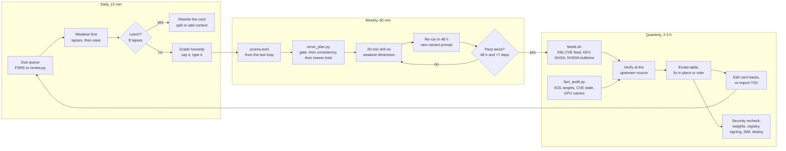
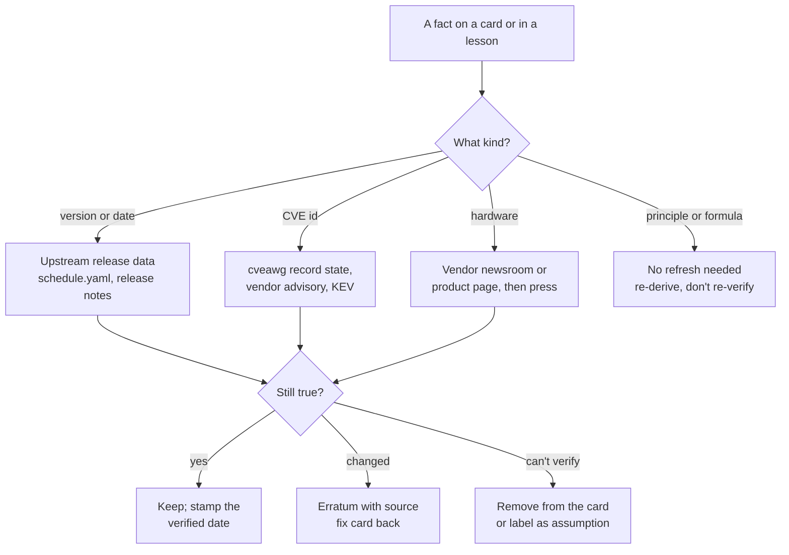

# Lesson 67 — Post-loop maintenance: spaced-repetition review of the deck, re-running the weakest round, and a quarterly refresh of fast-moving facts

*2026-11-16*

[Lesson 66](/lessons/66-full-loop-dress-rehearsal) ran the whole loop once and ended with a 58-card deck. That was a snapshot. From here, three things decay at different speeds. **Your recall** decays over days, so the deck needs a review schedule. **Your weakest round** stays weak unless you re-run it on purpose, so the rubric scores need a re-run protocol. **The facts themselves** expire over months: Kubernetes ships three minors a year, new CVEs land every week, and GPU generations turn over yearly. A card that says "supported: 1.32–1.34" was true in spring and is wrong today. This lesson sets up all three loops. It also runs the first quarterly audit on this site, so the errata table below comes from real output, not an example.

> **Verification rule for this lesson.** Every version, date, CVE id and GPU fact below was checked on 2026-11-16 against the upstream source linked next to it (Kubernetes release data, the MITRE CVE record, CISA KEV, vendor advisories). Where only press coverage exists, the text says so. Anything not verified is labeled as an assumption.

## What interviewers are really probing

Nobody asks "how do you study?" But staying current shows up in every round, and interviewers notice when it's missing.

- **Currency is a credibility signal.** "We'd keep the fleet within N-2" means nothing if you can't say what N is. Saying "1.37 is current, 1.34 went EOL on October 27, so N-2 is 1.35" in a November loop tells them you run this, not that you read about it. Getting the current version wrong costs more than leaving it out.
- **Calibration about what you know.** The best answer to "is that CVE fixed in 1.19.1?" is either the right version or "I'd check the NVIDIA bulletin; I remember it was the June toolkit TOCTOU." A confident wrong version number fails the [L65](/lessons/65-mock-behavioral-leadership-staff-platform) integrity dimension and the [L64](/lessons/64-mock-security-deep-dive-weights-platform) control-depth dimension in the same sentence.
- **Process over trivia.** Staff-level interviewers care less about whether you memorized CVE-2026-2270 and more about whether you have a *system* that would have surfaced it: an official CVE feed subscription, KEV triage with due dates, a patch SLO per tier. "How does your team find out about a runc escape?" is a real question ([L12](/lessons/12-node-container-hardening-supply-chain), [L42](/lessons/42-node-os-kernel-management-gpu-fleets)).
- **Recovery from a weak round.** Loops often come in pairs (phone screen, onsite) or repeat across companies. Hiring managers sometimes ask "what did you work on since last time?" The answer they want is a specific weak dimension you drilled and a measured improvement, the same postmortem habit as [L35](/lessons/35-fleet-incident-response-gpu-inference-agent-runbooks).
- **Stable principles, current facts.** The L66 consistency spine (weights path, security stance, story bank) must not change between loops. The numbers that *support* it (versions, CVEs, GPU names) must change when the world does. Interviewers notice both: a principle that shifts, and a fact that's out of date.

**The three loops:**

| Loop | Cadence | Time | Tool | Exit gate |
|---|---|---|---|---|
| Spaced repetition | Daily | 15 min | Anki (FSRS) or `review.py` below | Due queue at zero; no new leeches |
| Weakest-round re-run | Weekly until the loop | 60–90 min | `rerun_plan.py` + L66 `score_loop.py` | Re-run round at 70 or above and gate at 3 or above, twice (48 h and +7 days) |
| Fact freshness | Quarterly, and the week before any loop | 2–3 h | `feeds.sh` + `fact_audit.py` | Audit exits 0; errata committed with sources; refresh cards imported |

## Core diagram


**The three loops and how they feed each other.** A passed re-run is what earns the right to spend time on the refresh; the refresh feeds new card backs into tomorrow's review.



**How to verify any one fact.** Principles and formulas (Little's law, Young/Daly, 0.98^50) don't expire; re-derive them, don't re-verify them. Versions, CVEs and hardware do.



## Idiosyncrasies / operator depth

### Spaced repetition: what actually matters for a 72-card deck

- **72 cards is small, and that changes the advice.** Most Anki guidance is written for 10,000-card medical decks, where workload is the constraint. Here the constraint is *retrieval under stress*. Do fewer cards with more effort: say the answer out loud before revealing, and type every command card into a terminal. Grading "good" on a command you only recognized is the most common way to fool yourself.
- **FSRS vs SM-2.** Anki has shipped FSRS alongside the legacy SM-2-derived scheduler since 23.10 (the manual lists Anki 23.10 and AnkiMobile 23.10 as the first FSRS-capable clients). SM-2 keeps two numbers per card (repetition count and an ease factor) and multiplies the interval by the ease. FSRS models stability and difficulty per card and schedules for a target probability of recall. In practice: FSRS with **desired retention at the default 90%** is the right choice in Anki; `review.py` below is a 60-line SM-2 for when you're at a terminal without Anki.
- **Desired retention is the one knob.** The Anki manual calls it "the most important setting in FSRS": higher retention means shorter intervals and more reviews, and workload rises steeply as it approaches 100%. For the two weeks before a loop, an assumption worth testing is raising it to 0.95 for the `numbers` and `commands` tags only (a separate preset). Drop it back afterward.
- **Optimize monthly, not daily.** The FSRS optimizer fits parameters to your review history. The manual says once a month is enough, and it needs a real review history to work. With 72 cards and a few weeks of reviews, the defaults may be what you get, and that's fine.
- **Leeches are a card-quality signal.** Anki tags a note as a leech and suspends it when its lapse counter reaches **8** (adjustable), and warns again every 4 lapses after that. On this deck a leech almost always means the card asks two things at once ("Llama 3 rate *and* what it means at 48K GPUs"). Split it, don't grind it.
- **Anki keys imported notes on the first field.** On re-import, if the first field matches an existing note of the same type, Anki updates the other fields in place (the default), keeping your review history. So **edit the back, never the front.** If the refresh changes a front, you get a duplicate note with no history and the stale one keeps coming due. That's why this quarter's new facts go in a separate refresh file with new fronts, and corrections to old cards change only the back.
- **Cap intervals at the refresh period.** A card on a 200-day interval won't be seen before its facts change. `review.py` caps intervals at 60 days. In Anki, set **Maximum interval** in the preset (an assumption: 90 days, one refresh cycle) for the `refresh` and `numbers` tags.

### Re-running the weakest round

- **Re-run one round, not four.** A full loop costs a morning and a partner's time, and most of it re-measures what already passed. The L66 debrief tells you which round is weakest. Re-run only that one, under the same timing, with a *different* variant prompt.
- **"Weakest" has a precedence order.** A failed gate (any gate below 3, or any 1) beats a failed consistency check, which beats the lowest total. A 74/100 round that passed its gate is less urgent than an 80/100 round whose story contradicted another round. `rerun_plan.py` encodes that order and maps each consistency check to the round that owns it (for example, `same_incident_facts` points at R4 first, then R2).
- **Drill before you re-run.** Re-running cold mostly re-measures the same weakness. Spend 20 minutes on the weakest *dimension* (for L66's example sheet that's R4 ownership: retell story 1 with "I decided / I wrote / the team built"), then re-run within 48 hours.
- **Two passes, a week apart.** One good re-run can be luck or a familiar prompt. Require a pass at 48 hours *and* at +7 days with different variants before you mark it closed. The second pass is where recall, not short-term priming, shows up.
- **Score from the recording, with the same rubric weights.** `rerun_plan.py` reuses the L66 weights so a re-run's total is comparable to the loop's. Compare the dimension, not only the total: +5 overall with the weak dimension unchanged means you got better at something else.

### The fact refresh: where staleness hides

- **"Supported" is a moving window.** The Kubernetes project maintains the most recent three minors. On 2026-11-16 that's **1.37, 1.36 and 1.35** (latest patches **1.37.2, 1.36.6, 1.35.10**, all tagged 2026-10-28 UTC). **1.34 reached EOL on 2026-10-27**; its final patch, 1.34.13, shipped the next day. **v1.38.0 is planned for 2026-12-16**, so by the next refresh the window will be 1.36–1.38.
- **"About 14 months" vs "approximately 1 year."** The releases page says minors get "approximately 1 year of patch support". The release data shows the full picture: each branch has about 12 months of support, then **maintenance mode** for about 2 months (1.37: released 2026-08-26, maintenance mode from 2027-08-28, EOL 2027-10-28). KEP-1498 defines it as "12 months of support and 2 months of upgrade period". L45's "roughly 14 months" is correct; quote the precise version.
- **Skew rules are stable; their examples aren't.** The policy text is unchanged: kubelet and kube-proxy never newer than the apiserver and up to three minors older; controllers at most one older; kubectl within one either way. With the apiserver at 1.37, kubelets from 1.34 to 1.37 are supported. One line to remember: **in-place minor-version kubelet upgrades are not supported**, which is the policy's way of saying drain and replace.
- **Feature stages are the stealthiest drift.** A lesson that says "beta in 1.35" is a fact with an expiry date. This audit found one that was wrong when written: the HPA configurable tolerance gate (KEP-4951, `HPAConfigurableTolerance`) was **beta but off by default in 1.35–1.36** and went **GA (locked on) in 1.37**. [L28](/lessons/28-inference-autoscaling-scale-to-zero) said "on by default in 1.35". Also moved: **ImageVolume GA in 1.36** ([L27](/lessons/27-gpu-supply-chain-weight-registry-hydrate)) and **MutatingAdmissionPolicy GA in 1.36** (an in-process, CEL-based alternative to a mutating webhook for the defaults old PSPs used to set; see [L11](/lessons/11-cluster-security-pss-admission-rbac)). The kubernetes/website `feature-gates/*.md` files list every stage with from/to versions, which makes them the easiest source to check.
- **Projects get retired, not just patched.** Upstream **ingress-nginx maintenance ended in March 2026**. The Kubernetes CVE record for **CVE-2026-116472** (mirror-target self-DoS, low severity) says outright that no fix will be issued. Any lesson that tells you to set `nginx.ingress.kubernetes.io/*` annotations is now describing a legacy system ([L57](/lessons/57-agent-ui-protocols-durable-execution) got a freshness note). Flowise is similar: the repo was archived in August 2026 and 3.1.4 is the last release, as [L60](/lessons/60-workflow-builders-multi-agent-orchestration) already says.
- **CVE ids are now six digits, and that's not a typo.** 2026 ids such as CVE-2026-119101 and CVE-2026-116472 look made up but are real. The opposite failure also happens: an id can appear in a vendor's release notes before the MITRE record is published. On 2026-11-16, **CVE-2026-119101** (runc) is in the runc 1.5.3 release notes and GitHub advisory GHSA-g2c3-j8g3-7gpw but has no published cveawg record yet. Cite the advisory until it does. `fact_audit.py` flags any cited id that isn't PUBLISHED.
- **GPU naming drift.** The rack announced in March 2025 as "Vera Rubin NVL144" is sold in 2026 as **Vera Rubin NVL72**. Press coverage explains the rename as counting GPU packages (two dies each) instead of dies; NVIDIA's own materials, as far as this audit found, just use NVL72. Production shipments began in August 2026 per NVIDIA's CFO on the earnings call (press-reported), and NVIDIA and Oracle announced **general availability of Vera Rubin NVL72 on OCI on 2026-10-27**. The power numbers in [L41](/lessons/41-power-cooling-facility-constraints-gpu-fleets) and [L62](/lessons/62-mock-system-design-gpu-agent-platform) are H100/GB200-based and still valid as the mock's assumptions. Just don't call Blackwell "the latest."
- **Protocols version by date, not semver.** MCP published spec release `2026-07-28` (covered in [L52](/lessons/52-mcp-a2a-gateways-fleet-scale)). A2A went to **v1.0.0 on 2026-03-12** with breaking changes (for example, OAuth implicit and password flows removed, `tasks/list` added); the latest is v1.0.1 (2026-05-28). L52 cites v0.3.0 release notes, which are still accurate for what they describe but no longer the current version.
## Concrete commands & config

### Anki: import the deck and the refresh cards, then set up two presets

Download both files: the L66 deck [hyperscale-prep-flashcards.tsv](https://caretak3r.github.io/hyperscale-prep/hyperscale-prep-flashcards.tsv) (58 cards) and this quarter's [hyperscale-prep-flashcards-refresh-2026q4.tsv](https://caretak3r.github.io/hyperscale-prep/hyperscale-prep-flashcards-refresh-2026q4.tsv) (14 new cards, all with new fronts, tagged `refresh-2026q4`). Both use Anki's file headers (`#separator:tab`, `#html:false`, `#tags column:3`), supported since Anki 2.1.54.

```bash
curl -sO https://caretak3r.github.io/hyperscale-prep/hyperscale-prep-flashcards.tsv
curl -sO https://caretak3r.github.io/hyperscale-prep/hyperscale-prep-flashcards-refresh-2026q4.tsv
# Sanity check before importing: 3 tab-separated columns on every non-header line
awk -F'\t' '!/^#/ && NF != 3 {print FILENAME": line "NR" has "NF" fields"}' hyperscale-prep-flashcards*.tsv
# Anki: File > Import, pick each file, note type Basic, "Existing notes: Update" (the default),
# match scope "Note type and deck". Same deck for both files.
```

Deck options (Anki 23.10 or later; values are recommendations unless marked as Anki defaults):

| Setting | Preset "hyperscale" (soundbites) | Preset "hyperscale-hard" (numbers, commands, refresh) | Why |
|---|---|---|---|
| FSRS | On | On | Schedules to a target recall probability |
| Desired retention | 0.90 (Anki default) | 0.90; 0.95 for the two weeks before a loop | The one knob; workload rises steeply toward 1.0 |
| Learning and relearning steps | `10m 30m` | `10m 30m` | The manual: with FSRS, keep steps shorter than 1d so they finish the same day; FSRS owns everything after |
| New cards/day | 10 | 10 | All 72 introduced in about a week |
| Maximum interval | 180 days | 90 days | Nothing in `hard` goes unseen past one refresh cycle |
| Leech threshold | 8 lapses (Anki default), action: Tag only | 8 lapses, Tag only | Tag, then rewrite; suspending hides the problem |
| FSRS parameters | Optimize monthly | Optimize monthly | The manual says monthly is enough |

Use a filtered deck for the night before a loop: search `deck:hyperscale* (tag:numbers OR tag:commands) prop:r<0.9` (cards whose predicted recall has fallen below 90%) and review them all. `prop:r` is the FSRS retrievability search; it only works with FSRS on.

### `review.py`: SM-2 from a terminal, weakest-first, interval cap

```python
#!/usr/bin/env python3
"""review.py: SM-2 review of the hyperscale-prep deck from the terminal (no Anki needed).
State lives next to the deck in review-state.json, keyed by a hash of the card front.
  python3 review.py deck.tsv [deck2.tsv ...]          # review what's due today (max 20 new)
  python3 review.py deck.tsv --weak                   # list the 10 weakest cards, no review
Grades: 0 blank, 3 hard, 4 good, 5 easy. <3 is a lapse: interval resets to 1 day."""
import sys, json, hashlib, datetime, pathlib
decks = [a for a in sys.argv[1:] if not a.startswith("--")]
STATE = pathlib.Path(decks[0]).with_name("review-state.json")
today = datetime.date.today()
cards = []
for d in decks:
    for line in open(d, encoding="utf-8"):
        if line.startswith("#") or not line.strip(): continue
        front, back, tags = (line.rstrip("\n").split("\t") + ["", ""])[:3]
        cards.append((hashlib.sha1(front.encode()).hexdigest()[:12], front, back, tags))
st = json.loads(STATE.read_text()) if STATE.exists() else {}

def weakness(s):  # lapses dominate, then low ease
    return s.get("lapses", 0) * 10 + (2.5 - s.get("ease", 2.5)) * 10

if "--weak" in sys.argv:
    seen = [(weakness(st[k]), f, st[k]) for k, f, _, _ in cards if k in st]
    for w, f, s in sorted(seen, key=lambda x: -x[0])[:10]:
        print(f"{w:5.1f}  lapses={s['lapses']} ease={s['ease']:.2f} next={s['due']}  {f}")
    sys.exit()

due = [c for c in cards if c[0] in st and st[c[0]]["due"] <= today.isoformat()]
new = [c for c in cards if c[0] not in st][:20]
due.sort(key=lambda c: -weakness(st[c[0]]))       # weakest first while you're fresh
print(f"{len(due)} due, {len(new)} new, {len(cards)} total")
for k, front, back, tags in due + new:
    input(f"\nQ [{tags.split()[-1] if tags else ''}]: {front}\n  (say it out loud, then Enter) ")
    print(f"A: {back}")
    g = int(input("grade 0/3/4/5: ") or 0)
    s = st.get(k, {"reps": 0, "ease": 2.5, "ivl": 0, "lapses": 0})
    if g < 3:
        s.update(reps=0, ivl=1, lapses=s["lapses"] + 1)
    else:
        s["reps"] += 1
        s["ivl"] = 1 if s["reps"] == 1 else 6 if s["reps"] == 2 else round(s["ivl"] * s["ease"])
    s["ease"] = max(1.3, s["ease"] + 0.1 - (5 - g) * (0.08 + (5 - g) * 0.02))   # SM-2 EF update
    s["ivl"] = min(s["ivl"], 60)        # cap: nothing goes unseen past the next quarterly refresh
    s["due"] = (today + datetime.timedelta(days=s["ivl"])).isoformat()
    st[k] = s
    STATE.write_text(json.dumps(st, indent=1))
print("\nsaved", STATE)
```

```bash
python3 review.py hyperscale-prep-flashcards.tsv hyperscale-prep-flashcards-refresh-2026q4.tsv
python3 review.py hyperscale-prep-flashcards.tsv --weak     # the 10 weakest, for the night before
```

Sample `--weak` output after one session where five cards were graded 0:

```text
 18.0  lapses=1 ease=1.70 next=2026-11-17  Error budget of 99.9% over 30 days? And 99.5%?
 18.0  lapses=1 ease=1.70 next=2026-11-17  Fleet upgrade waves for 120 clusters and the duration
 18.0  lapses=1 ease=1.70 next=2026-11-17  Cluster sizes: training vs inference
 18.0  lapses=1 ease=1.70 next=2026-11-17  Agent platform from Little's law (10,000 agents, 360 s tasks, a step every 12 s)
  1.4  lapses=0 ease=2.36 next=2026-11-17  Upstream Kubernetes scalability envelope
```

State is keyed by a hash of the front, so the same rule as Anki applies: change a front and its history resets.

### `rerun_plan.py`: choose the one round to re-run

```python
#!/usr/bin/env python3
"""rerun_plan.py: pick the ONE round to re-run from an L66 scores.toml, and the drill for it.
Order: failed gate > failed consistency check > lowest weighted total; tie-break on the
lowest-scoring dimension. Usage: python3 rerun_plan.py scores.toml [previous_scores.toml]"""
import sys, tomllib
W = {  # same weights and gates as score_loop.py (L66)
  "design":     ({"scoping":10,"numbers":15,"architecture":20,"change_ops":15,"reliability":15,"security":15,"communication":10}, "security"),
  "trouble":    ({"command_comms":15,"change_correlation":15,"mitigation":15,"diagnosis":20,"safe_fix":15,"second_cause":10,"postmortem":10}, "safe_fix"),
  "security":   ({"scope_assets":15,"dfd_boundaries":15,"ranking":15,"control_depth":20,"untrusted_artifact_gate":10,"detect_respond":15,"roadmap":10}, "untrusted_artifact_gate"),
  "behavioral": ({"ownership":20,"judgment":15,"influence":15,"execution":15,"incident_leadership":10,"self_awareness":10,"integrity_security":15}, "integrity_security"),
}
CONSISTENCY_OWNER = {  # which round to re-run when a cross-round check fails
  "same_fleet_numbers": ["design"], "same_weights_path": ["security", "design"],
  "same_incident_facts": ["behavioral", "trouble"], "no_control_disabled_story": ["trouble", "behavioral"],
  "no_confidential_detail": ["behavioral"]}
DRILL = {  # weakest dimension -> 20-minute drill before the re-run (lesson + section)
  "communication": "L62 phase 1-2 out loud, 2-min summary every 10 min",
  "numbers": "L62 numbers card from a blank page, then deck 'numbers' tag only",
  "second_cause": "L63 P3 (Xid 79) alone: 'what else is true that my first cause doesn't explain?'",
  "detect_respond": "L64 03:00 exfil alert: first 5 commands, who you page, what you revoke",
  "ownership": "L65 story bank: retell story 1 with 'I decided / I wrote / the team built'",
  "safe_fix": "L63 safe-fix gate: revert via Git, never skip_verify; say the line 3 times",
  "security": "L62 security phase at minute 43: two buckets, two keys, digest-pinned serving",
  "untrusted_artifact_gate": "L64 pickle trap: weights_only is not a boundary; convert in a sandbox",
  "integrity_security": "L65 integrity stories: the 'no' plus the paved road",
}
ROUND_DRILL = {"design": "L62 deep-dive menu: pick one box, go three levels down in 8 minutes",
  "trouble": "L63 first 10 minutes: command, what changed, protect the customer path",
  "security": "L64 DFD + top-5 ranked attack paths from a blank page",
  "behavioral": "L65 story bank: retell the two weakest stories with numbers you can defend"}
def totals(s):
    return {r: sum(w[k] * s[r][k] / 4 for k in w) for r, (w, _) in W.items()}
s = tomllib.load(open(sys.argv[1], "rb")); t = totals(s)
failed_gate = [r for r, (w, g) in W.items() if s[r][g] < 3 or min(s[r].values()) < 2]
failed_cons = [k for k, v in s.get("consistency", {}).items() if not v]
if failed_gate:   pick, why = min(failed_gate, key=t.get), "gate below 3 or a 1"
elif failed_cons: pick, why = min({r for k in failed_cons for r in CONSISTENCY_OWNER[k]}, key=t.get), "consistency: " + ", ".join(failed_cons)
else:             pick, why = min(t, key=t.get), "lowest total"
dim = min(W[pick][0], key=lambda k: (s[pick][k], -W[pick][0][k]))   # lowest score, heaviest weight
print(f"re-run: {pick} ({t[pick]:.0f}/100) because {why}")
print(f"weakest dimension: {dim}={s[pick][dim]}  drill: {DRILL.get(dim, ROUND_DRILL[pick])}")
print("protocol: drill today, re-run within 48 h with a NEW variant prompt, score from the recording,")
print("          then the same round again in 7 days; keep the loop result only if both re-runs pass.")
if len(sys.argv) > 2:
    p = tomllib.load(open(sys.argv[2], "rb")); tp = totals(p)
    print(f"delta vs previous: {t[pick] - tp[pick]:+.0f} points; {dim}: {p[pick][dim]} -> {s[pick][dim]}")
```

On the L66 example sheet, and on a re-run sheet where ownership went 3 → 4 and detect_respond 2 → 3:

```text
$ python3 rerun_plan.py scores.toml
re-run: behavioral (75/100) because consistency: same_incident_facts
weakest dimension: ownership=3  drill: L65 story bank: retell story 1 with 'I decided / I wrote / the team built'
protocol: drill today, re-run within 48 h with a NEW variant prompt, score from the recording,
          then the same round again in 7 days; keep the loop result only if both re-runs pass.

$ python3 rerun_plan.py scores-rerun.toml scores.toml
re-run: behavioral (80/100) because consistency: same_incident_facts
weakest dimension: judgment=3  drill: L65 story bank: retell the two weakest stories with numbers you can defend
...
delta vs previous: +5 points; judgment: 3 -> 3
```

The second run is the useful lesson: the total went up, but `same_incident_facts` is still false, so the round isn't closed. Fix the claims ledger (L66) before the next re-run, not the delivery.

**Re-run protocol, written down:**

| Step | When | What | Evidence |
|---|---|---|---|
| 1 | Day 0 | `rerun_plan.py` on the loop's `scores.toml`; book a partner | Plan output saved next to the recording |
| 2 | Day 0 | 20-min drill on the weakest dimension (table in the script) | A 2-min recording of the drill |
| 3 | Within 48 h | Re-run the round with a new variant (L66 "Variant prompts"), full timing with `loop.sh` (one round) | Recording + transcript + `scores.toml` |
| 4 | +7 days | Same round, a different variant | Second `scores.toml` |
| 5 | After both | `score_loop.py` on each; passes only if both clear 70, no 1s, gate at 3+ and the failed consistency key is now true | Diff of the two sheets |
| 6 | Then | Next-weakest round, or stop if all four passed in the loop and both re-runs passed | — |

### `feeds.sh`: what changed in the last 90 days

```bash
#!/usr/bin/env bash
# feeds.sh: one-screen "what changed this quarter" for the stack the lessons cover.
# Needs curl, jq, gh (authenticated, read-only). SINCE defaults to 90 days ago.
set -euo pipefail
SINCE=${SINCE:-$(date -d '90 days ago' +%F)}
echo "== Kubernetes official CVE feed since $SINCE"
curl -s https://kubernetes.io/docs/reference/issues-security/official-cve-feed/index.json |
  jq -r --arg s "$SINCE" '.items[] | select(.date_published >= $s) | "\(.date_published[:10])  \(.id)  \(.summary)"' | sort -r
echo "== CISA KEV additions since $SINCE (AI/ML + container stack)"
curl -s https://www.cisa.gov/sites/default/files/feeds/known_exploited_vulnerabilities.json |
  jq -r --arg s "$SINCE" '.vulnerabilities[] | select(.dateAdded >= $s) |
    select((.vendorProject + " " + .product) | test("kubernetes|runc|containerd|nvidia|ray|vllm|langflow|n8n|flowise|mlflow|pytorch|argo|gitlab|jenkins"; "i")) |
    "\(.dateAdded)  \(.cveID)  \(.vendorProject) \(.product)  due \(.dueDate)"'
echo "== GitHub advisories (high/critical) since $SINCE"
for r in vllm-project/vllm ray-project/ray opencontainers/runc containerd/containerd NVIDIA/nvidia-container-toolkit kubernetes-sigs/agent-sandbox; do
  gh api "repos/$r/security-advisories?per_page=50" --jq ".[] | select(.published_at >= \"$SINCE\") |
    select(.severity == \"high\" or .severity == \"critical\") | \"\(.published_at[:10])  $r  \(.cve_id // .ghsa_id)  \(.summary)\"" 2>/dev/null || true
done
echo "== NVIDIA product security bulletins since $SINCE (GPU stack)"
curl -s https://raw.githubusercontent.com/NVIDIA/product-security/main/$(date +%Y)/README.md |
  awk -F'|' -v s="$SINCE" '$4 ~ /20[0-9][0-9]-/ && $4 >= " "s && $3 ~ /Container Toolkit|GPU Operator|GPU Display Driver|Triton|Dynamo|DCGM|TensorRT-LLM|NeMo|Megatron/ {gsub(/^ +| +$/,"",$3); gsub(/^ +| +$/,"",$4); print $4"  "$3}'
echo "== Latest releases of pinned components"
for r in kubernetes/kubernetes opencontainers/runc containerd/containerd NVIDIA/nvidia-container-toolkit NVIDIA/gpu-operator vllm-project/vllm kubernetes-sigs/kueue kubernetes-sigs/agent-sandbox a2aproject/A2A modelcontextprotocol/modelcontextprotocol; do
  printf '%-42s %s\n' "$r" "$(gh api "repos/$r/releases/latest" --jq '"\(.tag_name) \(.published_at[:10])"' 2>/dev/null || echo n/a)"
done
```

Output on 2026-11-16 (trimmed to the lines this lesson uses; each one was then opened at the source):

```text
== Kubernetes official CVE feed since 2026-08-18
2026-11-05  CVE-2026-116472  ingress-nginx mirror-target self-DOS
2026-09-14  CVE-2026-76654  Subpath symlinking on Windows nodes permits NTLM coercion
2026-09-14  CVE-2026-2270  StatefulSet and ControllerRevision write permissions allow cross-namespace pod creation
== CISA KEV additions since 2026-08-18 (AI/ML + container stack)
2026-08-19  CVE-2026-64849  MLflow MLflow  due 2026-09-02
== GitHub advisories (high/critical) since 2026-08-18
2026-10-20  vllm-project/vllm  CVE-2026-115912  Public multimodal SHM handle forgery reaches worker-side `pickle.loads()` ...
2026-10-06  vllm-project/vllm  GHSA-h3rc-6mm3-gc2m  Request-controlled mm_processor_kwargs.code_revision allows remote code execution
2026-11-12  opencontainers/runc  CVE-2026-119101  malicious image can bind-mount an arbitrary host directory into a container across checkpoint/restore
2026-09-01  containerd/containerd  CVE-2026-95837  containerd CRI plugin: Checkpoint restore bypasses destination security context
== Latest releases of pinned components
kubernetes/kubernetes                      v1.37.2 2026-10-28
opencontainers/runc                        v1.5.3 2026-11-12
containerd/containerd                      v2.4.2 2026-10-13
NVIDIA/nvidia-container-toolkit            v1.20.1 2026-09-19
NVIDIA/gpu-operator                        v26.7.2 2026-10-14
kubernetes-sigs/kueue                      v0.20.6 2026-11-12
kubernetes-sigs/agent-sandbox              v1.0.11 2026-11-12
a2aproject/A2A                             v1.0.1 2026-05-28
modelcontextprotocol/modelcontextprotocol  2026-07-28 2026-07-28
```

(The vLLM "latest" row printed `v0.33.0rc3`; the latest final release is v0.32.0 from 2026-10-18. `releases/latest` returns whatever the project marks as latest, so check for `rc` before you pin.)

### `fact_audit.py`: grep the lessons for facts that expire

```python
#!/usr/bin/env python3
"""fact_audit.py: flag fast-moving facts in the lesson pages that may have gone stale.
Usage: python3 fact_audit.py pages/lessons [--offline] [--allow=45:k8s-target-eol,65:k8s-target-eol]
Checks (stdlib only, Python 3.11+):
  1. Kubernetes minors that look like *targets* (kubeadm/eks/gcloud/pluto/kubent/version: v1.NN)
     against the upstream schedule.yaml + eol.yaml (kubernetes/website data files).
  2. Every CVE id: does it exist and is it PUBLISHED (cveawg.mitre.org), and is it in CISA KEV?
  3. GPU and accelerator names: inventory so a human can check generation claims.
  4. Freshness words near versions ("latest", "newest", "current", "today") for a manual look.
Exit 1 if anything is flagged, so it can gate a scheduled CI job."""
import json, re, sys, pathlib, datetime, urllib.request

ROOT = pathlib.Path(sys.argv[1] if len(sys.argv) > 1 else "pages/lessons")
OFFLINE = "--offline" in sys.argv
ALLOW = {a.split("=",1)[1] for a in sys.argv if a.startswith("--allow=")}  # e.g. --allow=45:k8s-target-eol
ALLOW = {x for a in ALLOW for x in a.split(",")}
TODAY = datetime.date.today()
UA = {"User-Agent": "hyperscale-prep-fact-audit"}
WEB = "https://raw.githubusercontent.com/kubernetes/website/main/data/releases/"

def get(url):
    with urllib.request.urlopen(urllib.request.Request(url, headers=UA), timeout=20) as r:
        return r.read().decode()

def k8s_branches():
    """minor -> EOL date, parsed from the two YAML data files without a YAML library."""
    out = {}
    for f in ("schedule.yaml", "eol.yaml"):
        rel = eol = None
        for line in get(WEB + f).splitlines():
            if m := re.match(r'\s*-?\s*endOfLifeDate: "(\d{4}-\d\d-\d\d)"', line): eol = m[1]
            if m := re.match(r'\s*-?\s*release: "(1\.\d+)"', line): rel = m[1]
            if rel and eol: out[rel] = datetime.date.fromisoformat(eol); rel = eol = None
    return out

TARGET = re.compile(r"(?:kubeadm upgrade apply|--kubernetes-version|--cluster-version|k8s=|"
                    r"--target-versions?|version:)\s*v?(1\.\d{2})")
CVE = re.compile(r"CVE-\d{4}-\d{4,7}")
GPU = re.compile(r"\b(?:[GH]B?\d{3}|B\d{3}|A100|L40S?|MI\d{3}X?|Vera Rubin(?: Ultra)?|Rubin(?: CPX| Ultra)?|"
                 r"Blackwell(?: Ultra)?|Hopper|NVL\d{2,4})\b")
FRESH = re.compile(r"(?<![/\w-])(latest|newest|current(?:ly)?|today|as of)\b[^.\n]{0,60}\b(v?\d+\.\d+|CVE-|NVL|B\d00|H\d00)", re.I)

flags, gpus, cves = [], {}, {}
branches = {} if OFFLINE else k8s_branches()
supported = sorted((m for m, e in branches.items() if e >= TODAY), key=lambda v: int(v.split(".")[1]))

for p in sorted(ROOT.glob("*.mdx")):
    lesson = p.name.split("-")[0]
    for n, line in enumerate(p.read_text().splitlines(), 1):
        for m in TARGET.finditer(line):
            minor = m[1]
            if branches and branches.get(minor, TODAY) < TODAY:
                flags.append((lesson, n, "k8s-target-eol", f"{minor} EOL {branches[minor]}; supported: {', '.join(supported)}"))
        for c in CVE.findall(line): cves.setdefault(c, []).append(f"L{lesson}:{n}")
        for g in GPU.findall(line): gpus[g] = gpus.get(g, 0) + 1
        if FRESH.search(line): flags.append((lesson, n, "freshness-word", FRESH.search(line)[0][:70]))

if not OFFLINE:
    kev = {v["cveID"]: v["dateAdded"] for v in json.loads(get(
        "https://www.cisa.gov/sites/default/files/feeds/known_exploited_vulnerabilities.json"))["vulnerabilities"]}
    for c, where in sorted(cves.items()):
        try:
            state = json.loads(get(f"https://cveawg.mitre.org/api/cve/{c}"))["cveMetadata"]["state"]
        except Exception:
            state = "NOT FOUND (reserved or typo)"
        if state != "PUBLISHED":
            flags.append((where[0].split(":")[0][1:], int(where[0].split(":")[1]), "cve-state", f"{c}: {state}"))
        if c in kev:
            print(f"KEV  {c} added {kev[c]}  cited at {', '.join(where)}")

print(f"\nKubernetes supported minors today ({TODAY}): {', '.join(supported) or 'offline'}")
print("GPU/accelerator mentions:", ", ".join(f"{g}x{k}" for g, k in sorted(gpus.items(), key=lambda x: -x[1])))
print(f"CVE ids cited: {len(cves)}\n")
print("| Lesson | Line | Check | Detail |\n|---|---|---|---|")
flags = [f for f in flags if f"{int(f[0])}:{f[2]}" not in ALLOW]  # allowlisted = reviewed and intentionally historical
for l, n, kind, d in flags: print(f"| L{l} | {n} | {kind} | {d} |")
sys.exit(1 if flags else 0)
```

The first run, before any fixes (this is the raw evidence behind the errata table):

```text
$ python3 fact_audit.py pages/lessons
KEV  CVE-2025-3248 added 2025-05-05  cited at L60:147, L60:185

Kubernetes supported minors today (2026-11-16): 1.35, 1.36, 1.37
GPU/accelerator mentions: H100x35, L40x17, A100x10, NVL72x6, GB200x4, H200x2, Blackwellx1, Hopperx1
CVE ids cited: 18

| Lesson | Line | Check | Detail |
|---|---|---|---|
| L03 | 108 | k8s-target-eol | 1.29 EOL 2025-02-28; supported: 1.35, 1.36, 1.37 |
| L45 | 193 | k8s-target-eol | 1.34 EOL 2026-10-27; supported: 1.35, 1.36, 1.37 |
| ... | ... | (six more L45 lines, same finding) | |
| L60 | 63 | freshness-word | latest 3.1 |
| L65 | 244 | k8s-target-eol | 1.34 EOL 2026-10-27; supported: 1.35, 1.36, 1.37 |
```

After the fixes, with the reviewed historical examples allowlisted (L45's worked example, L65's bracketed placeholder, and L60's "latest 3.1", which was verified against the archived Flowise repo):

```bash
python3 fact_audit.py pages/lessons --allow=45:k8s-target-eol,65:k8s-target-eol,60:freshness-word
echo $?   # 0
```

Note what the script **can't** catch: the L28 feature-gate error and the GPU naming drift were found by reading, not by grep. The script finds candidates; a human verifies at the source.

### Make the refresh a scheduled job

Run the audit quarterly in CI so a stale fact opens an issue rather than waiting for you to notice. A minimal workflow (an example; not added to this repo's Pages workflow):

```yaml
# .github/workflows/fact-audit.yml
name: fact-audit
on:
  schedule: [{ cron: "0 13 1 2,5,8,11 *" }]   # 1st of Feb/May/Aug/Nov, after each K8s release lands
  workflow_dispatch: {}
permissions: { contents: read, issues: write }
jobs:
  audit:
    runs-on: ubuntu-latest
    steps:
      - uses: actions/checkout@v4            # pin to a full commit SHA in real use
      - uses: actions/setup-python@v5        # pin to a full commit SHA in real use
        with: { python-version: "3.12" }
      - run: python3 scripts/fact_audit.py pages/lessons --allow=45:k8s-target-eol,65:k8s-target-eol > audit.md
      - if: failure()
        env: { GH_TOKEN: "${{ github.token }}" }
        run: gh issue create --title "Quarterly fact audit: stale facts" --body-file audit.md
```

## Failures & fixes

| Symptom | Likely root cause | Fix |
|---|---|---|
| Review queue balloons to 70+ after a week off | All new cards introduced on day one, then a gap | Cap new cards at 10/day; after a gap, do due cards only until the queue clears; FSRS handles overdue cards better than SM-2 |
| Re-imported the deck, now cards appear twice | A front changed, so Anki created a new note | Search for the old front, delete the stale note (its history is lost either way); next time edit backs only |
| You "know" every card but blank in the mock | Recognition, not recall; grading on reveal | Say or type the answer before revealing; grade 0 if you only recognized it |
| Same three cards keep lapsing | Card asks two things, or you never understood the source | Split it; re-read the cited lesson section; leech tag is a to-do, not a failure |
| Re-run scores go up but the round still fails | Total improved; the gate or consistency key didn't | Read the gate and the failed key first; `rerun_plan.py` prints both |
| Re-run feels easy and scores high | Same variant prompt as the loop; you're reciting | New variant every time (L66 list); the partner picks without telling you |
| You keep re-running all four rounds | Avoiding the weak one | One round per week, the one the script picks |
| `fact_audit.py` flags 40 lines | Every worked example uses an old version | Triage: fix trivial ones, add a dated freshness note to the rest, allowlist only after review |
| Audit is green, but a lesson is still wrong | Grep can't read meaning (beta vs GA, renamed products) | Read every "beta", "GA", "latest", "new in" line in lessons touched by the quarter's releases; check feature-gate files |
| A CVE id you cite "doesn't exist" | Typo, or the record is reserved but not yet published | Check the vendor advisory (GHSA, bulletin); cite the advisory until cveawg shows PUBLISHED |
| `feeds.sh` prints nothing for GitHub advisories | `gh` not authenticated, or rate-limited | `gh auth status`; the script swallows errors per repo, so check one repo by hand |
| You quote an EOL version as current in an interview | Card older than the last release | Stamp each version card with a "verified" date; anything older than a quarter gets re-verified the week before a loop |
| You state a vendor's roadmap date as fact | Press article read as a commitment | Say "NVIDIA's roadmap targets..." and name the source; shipping dates are facts only once something ships |

## Security & hardening

**This section is the reason the refresh exists.** Most stale facts cost a bit of credibility. Stale *security* facts cost the gate: quoting a fixed-in version that isn't the fix, recommending a retired controller, or missing a new escape path in the stack you just designed. Treat the quarterly refresh as a security control for your own answers.

### 1. Keep security facts current: the feeds, and what each one is for

| Source | What it tells you | How to consume it | Cadence |
|---|---|---|---|
| [Kubernetes official CVE feed](https://kubernetes.io/docs/reference/issues-security/official-cve-feed/) (JSON and RSS) | Every CVE the Kubernetes Security Response Committee announces, with affected and fixed versions | `feeds.sh`, or subscribe to the RSS feed; also the kubernetes-security-announce list | Weekly skim, quarterly audit |
| [CISA KEV catalog](https://www.cisa.gov/known-exploited-vulnerabilities-catalog) (JSON feed) | Exploited in the wild, with a remediation due date for US federal agencies | Filter by vendor/product; treat a KEV hit on your stack as a page, not a ticket | Weekly |
| GitHub Security Advisories (`gh api repos/<r>/security-advisories`) | Project-published advisories, often before the CVE record is published | Per repo you run: vLLM, Ray, runc, containerd, NVIDIA toolkit, agent-sandbox | Weekly |
| [NVIDIA product security](https://www.nvidia.com/en-us/security/) and the [NVIDIA/product-security](https://github.com/NVIDIA/product-security) repo | Bulletins for drivers, Container Toolkit, GPU Operator, Triton, Dynamo, DCGM exporter, TensorRT-LLM | Parse the yearly README table (as `feeds.sh` does) | Monthly |
| Release notes of pinned components | Security fixes that ship with a version bump (runc 1.5.3 shipped CVE-2026-119101 this way) | `gh api repos/<r>/releases/latest` | With every bump |

**What this quarter's feeds actually surfaced, verified at source:**

| Item | Fact | Why it matters to these lessons |
|---|---|---|
| **CVE-2026-2270** (Kubernetes) | StatefulSet controller confused deputy: a user with namespace-scoped write on StatefulSet and ControllerRevision can create a pod in another namespace (Medium, 5.9). Fixed in kube-controller-manager 1.34.12, 1.35.9, 1.36.5, 1.37.1 | Namespace = tenant boundary in [L25](/lessons/25-multi-tenant-gpu-isolation-quota) and [L61](/lessons/61-agent-platform-capstone-10k). Patch the control plane; don't give agents or tenants ControllerRevision write |
| **ingress-nginx retired** | Upstream maintenance ended March 2026; CVE-2026-116472 (Low, 2.7) won't be fixed upstream; CVE-2026-4342 (config injection, 8.8) was fixed in 1.13.9 / 1.14.5 / 1.15.1 before that | A retired controller that can read every Secret by default is a standing risk. Migrate to a maintained Gateway API implementation |
| **Checkpoint/restore cluster** | runc CVE-2026-119101 (restore of an untrusted image can bind-mount a host directory read-write; fixed 1.5.3 / 1.4.4; advisory GHSA-g2c3-j8g3-7gpw), crun CVE-2026-115520, CRIU CVE-2026-119614, containerd CRI CVE-2026-95837 (critical: a restored process keeps the checkpoint's credentials, capabilities and seccomp state instead of the requested ones; patched in 2.2.7 and 2.3.4) | The kubelet `ContainerCheckpoint` gate has been beta and **on by default since 1.30**. If you use container checkpointing for preemption or migration of GPU jobs, restoring untrusted checkpoints is now a known escape path. This is a different thing from the application checkpoints in [L29](/lessons/29-training-reliability-checkpoint-elastic) |
| **NVIDIA Container Toolkit CVE-2026-24260** | TOCTOU race, CVSS 8.5 (June 2026 bulletin): Toolkit up to 1.19.0 fixed in 1.19.1; GPU Operator up to 26.3.1 fixed in 26.3.2 | The third toolkit escape after CVE-2024-0132 and CVE-2025-23266 ([L64](/lessons/64-mock-security-deep-dive-weights-platform)). The GPU Operator ships the toolkit, so patch the operator, not just the host package |
| **vLLM CVE-2026-115912** | A forged multimodal shared-memory handle reaches worker-side `pickle.loads()` in scale-out deployments with the SHM multimodal cache; fixed in 0.32.0 | Same lesson as CVE-2025-30165 in L64: internal inference paths that unpickle are code execution. Also GHSA-h3rc-6mm3-gc2m (request-controlled `code_revision`, RCE, fixed 0.31.0) |
| **KEV additions on the AI stack in 2026** | n8n CVE-2025-68613 (added 2026-03-11), Langflow CVE-2026-33017 (2026-03-25) and CVE-2026-0770 (2026-07-21), Ray CVE-2025-62593 (2026-08-17; DNS-rebinding RCE against Ray used as a dev tool, fixed in 2.52.0), MLflow CVE-2026-64849 (SSRF, 2026-08-19) | Workflow builders and ML tooling are being exploited in practice ([L60](/lessons/60-workflow-builders-multi-agent-orchestration)). These belong in an isolated tenant cell with egress control, not next to the weights |

### 2. Re-check the weights-platform controls during every refresh

The L66 security matrix is the policy. The refresh checks that the *facts behind it* still hold. Run through this list once a quarter and update the card backs:

| Control | What to re-verify | Source to check |
|---|---|---|
| **Model weights & checkpoints** | Bucket + KMS double lock still described correctly (ViaService, encryption context); Object Lock modes; `torch.load` defaults and any new bypass after CVE-2025-32434; safetensors still the conversion target | AWS S3/KMS docs, PyTorch release notes and security advisories ([L13](/lessons/13-ml-weights-checkpoint-hardening), [L64](/lessons/64-mock-security-deep-dive-weights-platform)) |
| **Image registries** | Pull-by-digest admission still enforced; mirror trust (CA, signatures mirrored with layers); ImageVolume now GA (1.36), so weights-as-OCI-artifacts is a supported path, and the pull path is now a weights path too | Kubernetes feature-gate files, registry release notes ([L12](/lessons/12-node-container-hardening-supply-chain), [L27](/lessons/27-gpu-supply-chain-weight-registry-hydrate)) |
| **Signing & provenance** | `model_signing` CLI flags (identity, identity provider) unchanged; cosign major version and its verify flags; the signer is still the release workflow identity | sigstore/model-transparency and sigstore/cosign releases |
| **Bucket IAM** | The "two Deny statements, not one with two conditions" rule is a property of IAM evaluation and doesn't expire; re-verify any condition keys you quote by name | AWS IAM condition-key reference ([L62](/lessons/62-mock-system-design-gpu-agent-platform)) |
| **Deployment hardening** | Admission stack: ValidatingAdmissionPolicy (GA 1.30) and now MutatingAdmissionPolicy (GA 1.36); patch levels for kube-controller-manager (CVE-2026-2270), runc, containerd, the NVIDIA toolkit and GPU Operator, vLLM | The CVE table above; [L11](/lessons/11-cluster-security-pss-admission-rbac), [L14](/lessons/14-ml-inference-training-deploy-hardening) |

### 3. Supply chain of the study tooling itself

Your prep setup runs code on the laptop that also holds your resume, your email and maybe a VPN profile. Treat it like any other supply chain.

- **Anki add-ons are code.** The Anki manual notes that add-ons "use and modify arbitrary parts of Anki's codebase"; they run with your user's privileges. Install few, prefer ones with public source, read what an add-on does before installing, and don't install add-ons for this deck at all. FSRS is built in.
- **Read scripts before you run them.** Everything in this lesson is stdlib Python or bash with `curl`, `jq` and `gh`. `fact_audit.py` only reads files and makes GET requests to kubernetes/website raw files, `cveawg.mitre.org` and the CISA feed. If a "helpful" version of a script wants a token, a `pip install`, or write access, find out why first.
- **Least privilege for `gh`.** `feeds.sh` only needs public read access. Use a fine-grained token with no repository permissions, or an unauthenticated call with a lower rate limit. Never use your work account's token for a personal study job.
- **Pin what you run on a schedule.** In the CI example, pin actions to full commit SHAs (the same rule as [L51](/lessons/51-gitops-progressive-delivery-fleet-scale)) and grant only `contents: read` and `issues: write`.
- **Downloaded decks are untrusted input.** The TSV is imported with `#html:false`, so Anki treats fields as plain text and HTML or script in a shared deck won't render. Keep it that way for anything you didn't write.

### 4. Don't leak employer-confidential details into cards, recordings or transcripts

- **Cards are a publishing channel.** This deck is public on GitHub Pages. Anything you add to a card (hostnames, bucket names, customer names, internal incident ids, real fleet sizes from a current or past employer) is published. Use the mock's numbers (48K GPUs, ~12K nodes) or bracketed placeholders, as in [L65](/lessons/65-mock-behavioral-leadership-staff-platform).
- **Keep a private deck for your own stories, offline.** If you drill STAR-L stories, keep them in a separate local deck that never syncs to a shared profile, and apply the L66 abstraction rule ("a 2,000-node training cluster" instead of a cluster name).
- **Recordings and transcripts.** Re-run recordings contain your partner's voice and possibly your past-employer detail. Store them locally (an encrypted volume), don't upload them to transcription services that train on your data (L66 used local Whisper for this reason), and delete them once the round is scored and the notes are written.
- **Grep before you publish.** Before committing new cards or lesson text: `grep -inE "corp|internal|prod-|\.local|@<employer>|s3://|arn:aws" *.tsv` (adjust for your employer's naming). The same check belongs in the claims ledger from L66.

### 5. Don't let the refresh introduce a wrong fact

- **Primary source or label it.** Every row in the tables above links to, or names, the upstream record. Press coverage (the Vera Rubin rename, Rubin CPX status) is labeled as such.
- **Verify the id, the affected range and the fixed version separately.** They come from different places: the CVE record for the id and description, the vendor advisory for the versions. This audit found one id (CVE-2026-119101) that exists in the advisory but not yet in a published CVE record.
- **Version facts carry a verified date.** Every refresh card says "(Nov 2026)" or gives an exact date, so a future you knows when it was true.

## Errata from this audit

Run on 2026-11-16 against all 66 lessons. "Fixed" means the earlier lesson was edited in this commit.

| Lesson | Said | Now verified | Action |
|---|---|---|---|
| [L28](/lessons/28-inference-autoscaling-scale-to-zero) | KEP-4951 HPA tolerance "beta, on by default in 1.35" | Alpha 1.33; **beta but off by default** in 1.35–1.36; **GA (locked on) in 1.37** (`HPAConfigurableTolerance` feature-gate file; KEP-4951 kep.yaml) | **Fixed** in prose and the YAML comment |
| [L27](/lessons/27-gpu-supply-chain-weight-registry-hydrate) | ImageVolume "beta 1.33, on by default 1.35" | Correct, and now **GA in 1.36** | **Fixed** (added GA 1.36 in three places) |
| [L03](/lessons/03-cluster-provisioning-lifecycle) | Cluster API example `version: v1.29.4` | 1.29 EOL 2025-02-28 | **Fixed** to `v1.37.2` with a comment |
| [L45](/lessons/45-fleet-kubernetes-upgrades-gpu-clusters) | Worked example targets 1.34 (`kubeadm upgrade apply v1.34.2`, EKS/GKE 1.34) | 1.34 EOL 2026-10-27, final 1.34.13; supported 1.35–1.37; 1.38.0 planned 2026-12-16 | **Freshness note added** at the top; method unchanged; skew rules and "~14 months" verified correct |
| [L57](/lessons/57-agent-ui-protocols-durable-execution) | Streaming advice uses ingress-nginx annotations | Upstream ingress-nginx maintenance ended March 2026; CVE-2026-116472 won't be fixed upstream | **Freshness note added** |
| [L52](/lessons/52-mcp-a2a-gateways-fleet-scale) | Cites A2A v0.3.0 release notes | A2A **v1.0.0** released 2026-03-12 (breaking changes; OAuth implicit/password flows removed, `tasks/list` added); latest v1.0.1 | Listed here; L52's v0.3 statements remain accurate as history |
| [L64](/lessons/64-mock-security-deep-dive-weights-platform) | GPU-stack escapes: CVE-2024-0132, CVE-2025-23266; vLLM CVE-2025-30165 / -32444 | Still correct. New since: Toolkit **CVE-2026-24260** (fixed 1.19.1 / GPU Operator 26.3.2), vLLM **CVE-2026-115912** (fixed 0.32.0), runc **CVE-2026-119101**, containerd **CVE-2026-95837** | Listed here (security table above) |
| [L60](/lessons/60-workflow-builders-multi-agent-orchestration) | CVE-2025-3248 (Langflow) in KEV; n8n, Langflow, Flowise CVEs | All ids verified PUBLISHED; Flowise archived 2026-08 with 3.1.4 last, as stated. KEV has since added n8n CVE-2025-68613 and Langflow CVE-2026-33017 / CVE-2026-0770 | Listed here |
| [L41](/lessons/41-power-cooling-facility-constraints-gpu-fleets), [L62](/lessons/62-mock-system-design-gpu-agent-platform) | GPU generations up to GB200 NVL72 | Still valid as mock assumptions. Current: Blackwell Ultra (B300/GB300); **Vera Rubin NVL72** shipping since Aug 2026, GA on OCI 2026-10-27 | Listed here; refresh card added |
| [L11](/lessons/11-cluster-security-pss-admission-rbac) | "PSA is not mutating" | Still true. New option: **MutatingAdmissionPolicy GA in 1.36** | Listed here; refresh card added |
| L66 deck (58 cards) | Kubelet skew, APF GA 1.29, torch.load default, NCCL watchdog, etc. | Every version-bearing card re-checked; none wrong | No change; 14 refresh cards added in a separate file |

**Verified unchanged, so you can keep saying them:** all 19 CVE ids cited across the lessons have PUBLISHED records (checked against cveawg.mitre.org); the kubelet three-minor skew (since 1.28; KEP-1498's (12 / 3) - 1 = 3); APF `flowcontrol.apiserver.k8s.io/v1` GA in 1.29; ValidatingAdmissionPolicy GA in 1.30; DRA `resource.k8s.io/v1` GA in 1.34; PyTorch `weights_only=True` default since 2.6.

## Interview soundbites

- "I run a quarterly fact audit. Every version, CVE and GPU name in my notes gets checked against the upstream record, and anything I can't verify comes off the card."
- "1.37 is current, 1.34 went end of life on October 27th, and 1.38 lands in December. So 'N-2' for us means 1.35 today and 1.36 once 1.38 ships."
- "Kubelets can be three minors behind the API server, never ahead, and you don't upgrade a kubelet minor in place; you drain and replace."
- "Patch levels are a control. I keep one table: kube-controller-manager, runc, containerd, the NVIDIA toolkit through the GPU Operator, and vLLM, each with its last advisory and our version."
- "KEV is a page, not a ticket. If an exploited-in-the-wild CVE matches something we run, that's an incident with a deadline."
- "Checkpoint restore is an execution path. Restoring an untrusted checkpoint is like running an untrusted image with its own idea of your security context."
- "Facts expire; principles don't. The weights path is the same in every loop. The fixed-in version is whatever the advisory says this quarter."
- "When I'm not sure of the version, I say which advisory I'd check. A confident wrong number is worse than 'I'd verify that.'"
- "I re-run my weakest round, not all four, and it only counts if it passes twice, a week apart."

## Watch (talks & demos)

<iframe width="100%" height="360" src="https://www.youtube.com/embed/lQFUarM_GXo" title="Navigating the Inevitable: Kubernetes Breaking Changes Behind the Scenes - Marko Mudrinić" frameBorder="0" allow="accelerometer; autoplay; clipboard-write; encrypted-media; gyroscope; picture-in-picture; web-share" allowFullScreen></iframe>

[Open on YouTube](https://www.youtube.com/watch?v=lQFUarM_GXo). Why watch: a KubeCon + CloudNativeCon Europe 2025 talk (CNCF channel) on how Kubernetes breaking changes are made: the release cadence, deprecation periods by stability level, API removals, the version skew policy, and why you should mirror upstream artifacts. Its model of "where to look before each release" (removals blog posts, urgent upgrade notes in the changelog) is the manual version of `fact_audit.py`'s Kubernetes check.

<iframe width="100%" height="360" src="https://www.youtube.com/embed/v2asudkSFek" title="FSRS vs SM2: How Spaced Repetition Algorithms Work" frameBorder="0" allow="accelerometer; autoplay; clipboard-write; encrypted-media; gyroscope; picture-in-picture; web-share" allowFullScreen></iframe>

[Open on YouTube](https://www.youtube.com/watch?v=v2asudkSFek). Why watch: walks through the SM-2 update (repetition count and ease factor) that `review.py` implements, then why FSRS models memory differently and needs an optimizer. Watch it once so the Anki settings above make sense, then stop tuning and review.

## References

- Prior lessons this one maintains: [L66](/lessons/66-full-loop-dress-rehearsal) (deck, `score_loop.py`, claims ledger), [L62](/lessons/62-mock-system-design-gpu-agent-platform)–[L65](/lessons/65-mock-behavioral-leadership-staff-platform) (rubrics); fixed or annotated: [L03](/lessons/03-cluster-provisioning-lifecycle), [L27](/lessons/27-gpu-supply-chain-weight-registry-hydrate), [L28](/lessons/28-inference-autoscaling-scale-to-zero), [L45](/lessons/45-fleet-kubernetes-upgrades-gpu-clusters), [L57](/lessons/57-agent-ui-protocols-durable-execution)
- Kubernetes: [Releases](https://kubernetes.io/releases/) · [Version Skew Policy](https://kubernetes.io/releases/version-skew-policy/) · release data [schedule.yaml](https://github.com/kubernetes/website/blob/main/data/releases/schedule.yaml) and [eol.yaml](https://github.com/kubernetes/website/blob/main/data/releases/eol.yaml) · [v1.38 release schedule](https://github.com/kubernetes/sig-release/tree/master/releases/release-1.38) · [KEP-1498 yearly support period](https://github.com/kubernetes/enhancements/blob/master/keps/sig-release/1498-kubernetes-yearly-support-period/README.md) · [Feature gates](https://kubernetes.io/docs/reference/command-line-tools-reference/feature-gates/) · [Official CVE feed](https://kubernetes.io/docs/reference/issues-security/official-cve-feed/)
- Kubernetes CVEs: [CVE-2026-2270](https://github.com/kubernetes/kubernetes/issues/142097) · [CVE-2026-116472](https://github.com/kubernetes/kubernetes/issues/143852) · [CVE-2026-4342](https://github.com/kubernetes/kubernetes/issues/137893)
- Runtimes: [runc v1.5.3 release notes](https://github.com/opencontainers/runc/releases/tag/v1.5.3) · [GHSA-g2c3-j8g3-7gpw (runc CVE-2026-119101)](https://github.com/opencontainers/runc/security/advisories/GHSA-g2c3-j8g3-7gpw) · [containerd GHSA-p7v4-vr35-mj6f (CVE-2026-95837)](https://github.com/containerd/containerd/security/advisories/GHSA-p7v4-vr35-mj6f)
- NVIDIA: [Container Toolkit bulletin, June 2026 (CVE-2026-24260)](https://nvidia.custhelp.com/app/answers/detail/a_id/5850) · [NVIDIA/product-security 2026 index](https://github.com/NVIDIA/product-security/blob/main/2026/README.md) · [NVIDIA and Oracle: Vera Rubin NVL72 GA on OCI (2026-10-27)](https://nvidianews.nvidia.com/news/nvidia-and-oracle-expand-nvidia-vera-rubin-to-multi-gigawatt-scale-and-bring-nvidia-vera-cpu-to-oracle-cloud-infrastructure) · press coverage of the NVL144 → NVL72 naming and Rubin CPX status: [gpuwerk](https://gpuwerk.com/blog/nvidia-vera-rubin-for-buyers/), [Inside Deep Tech](https://www.insidedeeptech.com/nvidia-vera-rubin-nvl72-full-guide/)
- vLLM: [CVE-2026-115912 / GHSA-6757-hggm-hp2w](https://github.com/vllm-project/vllm/security/advisories/GHSA-6757-hggm-hp2w) · [vLLM security advisories](https://github.com/vllm-project/vllm/security/advisories)
- CISA: [Known Exploited Vulnerabilities catalog](https://www.cisa.gov/known-exploited-vulnerabilities-catalog) (JSON feed used by the scripts)
- MITRE: [CVE Services API](https://cveawg.mitre.org/api/cve/CVE-2026-2270) (record state lookups)
- Agent protocols: [A2A v1.0.0 release](https://github.com/a2aproject/A2A/releases/tag/v1.0.0) · [MCP specification releases](https://github.com/modelcontextprotocol/modelcontextprotocol/releases) · [kubernetes-sigs/agent-sandbox releases](https://github.com/kubernetes-sigs/agent-sandbox/releases)
- Anki manual: [Deck options (FSRS, desired retention, optimize)](https://docs.ankiweb.net/deck-options.html) · [Leeches](https://docs.ankiweb.net/leeches.html) · [Importing text files (headers, duplicates and updating)](https://docs.ankiweb.net/importing/text-files.html) · [Searching (`prop:r`)](https://docs.ankiweb.net/searching.html) · [Add-ons](https://docs.ankiweb.net/addons.html)
- Fuel for the whole site: [wafer-ai/gpu-perf-engineering-resources](https://github.com/wafer-ai/gpu-perf-engineering-resources)

## Quick self-check

Do these without looking, then check against the tables above:

1. Which Kubernetes minors are supported today, which one went EOL most recently and on what date, and when is 1.38.0 planned?
2. With the apiserver at 1.37, what's the oldest supported kubelet? Can you upgrade that kubelet's minor in place?
3. What was wrong in L28 about KEP-4951, and what's its status in 1.37?
4. Name the fixed versions for CVE-2026-24260 in both the NVIDIA Container Toolkit and the GPU Operator. Why patch the operator and not just the host?
5. Why are the runc and containerd checkpoint/restore CVEs relevant to a GPU platform, and how do they differ from the training checkpoints in L29?
6. Your deck's card front has an outdated version in it. What happens if you edit the front and re-import, and what should you do instead?
7. Run `rerun_plan.py` on your own L66 `scores.toml`. Which round did it pick and why: gate, consistency or total?
8. What does `fact_audit.py` catch, and which two kinds of drift from this quarter would it have missed?
9. Name three places a confidential detail could leak from your prep setup, and the control for each.
10. Say your "how I stay current" soundbite in under 20 seconds.

## Next

**Lesson 68 — Kubernetes 1.36–1.38 for GPU and AI platforms: what the audit flagged.** ImageVolume and MutatingAdmissionPolicy at GA, HPA configurable tolerance at GA, the DRA follow-ups, container checkpoint/restore as both a feature and an attack surface, and migrating off retired ingress-nginx to Gateway API with inference routing. Each with upgrade gates for a 120-cluster fleet.
