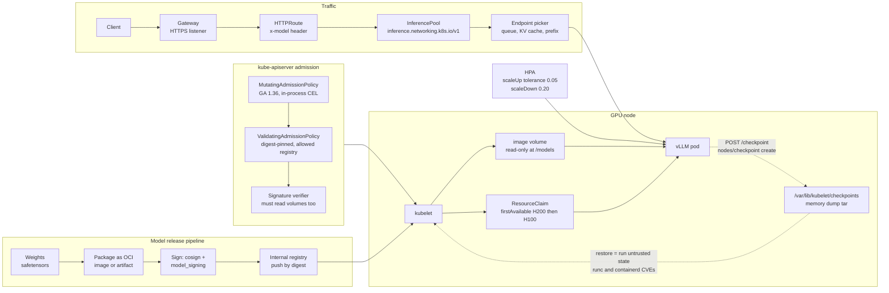
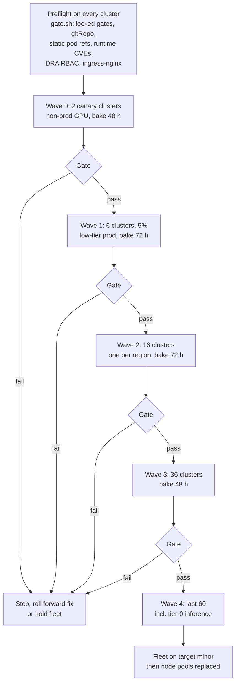

# Lesson 68 — Kubernetes 1.36–1.38 for GPU and AI platforms: what the audit flagged, and how to roll it across 120 clusters

*2026-11-17*

The [Lesson 67](/lessons/67-post-loop-maintenance-review-refresh) audit flagged a set of features that changed stage under us: **ImageVolume** and **MutatingAdmissionPolicy** went GA in 1.36, **HPA configurable tolerance** went GA (locked) in 1.37, DRA picked up a dozen follow-ups, container **checkpoint/restore** became both a feature and the subject of two runtime CVEs, and upstream **ingress-nginx was retired**. Each changes how you build a GPU and inference platform, and each has to land on a 120-cluster fleet without an outage. This lesson covers all of it at the level of fields, flags, error strings and upgrade gates.

> **Verification rule for this lesson.** Every stage, version and date below was checked on 2026-11-17 against the kubernetes/website feature-gate files (`content/en/docs/reference/command-line-tools-reference/feature-gates/*.md`), the v1.36 and v1.37 release blogs, `data/releases/schedule.yaml`, the sig-release v1.38 schedule, GitHub releases, and the GitHub security advisories linked in the references. The YAML in "Concrete commands & config" was applied to a real **kube-apiserver v1.37.2** (with the Gateway API v1.7.0 and Inference Extension CRDs installed): the MutatingAdmissionPolicy mutated a pod, the ValidatingAdmissionPolicy denied the two bad pods, and the error strings quoted are the ones it printed. Nothing ran on a kubelet or GPU, so runtime behavior (pulls, checkpoints, routing) is from the docs and advisories, not from a test.

> **Kubernetes 1.38 is not released.** On 2026-11-17 the latest prerelease is **v1.38.0-beta.0** (published 2026-11-06 UTC). Code freeze starts today, 2026-11-17 12:00 UTC (07:00 EST), and the sig-release schedule plans **v1.38.0 for Wednesday 2026-12-16**. This lesson makes **no claims about what 1.38 contains**. Anything 1.38 is "upcoming, unverified" until the release blog and feature-gate files say otherwise. Re-check it in the February 2027 refresh.

## What interviewers are really probing

- **Do you know the stage, not just the feature?** "We'd use ImageVolume for weights" is a 101 answer. "ImageVolume is GA since 1.36, it's read-only, re-resolved only when the pod is recreated, `subPath` works only from 1.33, and our admission policy has to check `spec.volumes[*].image.reference`, not just container images" is the operator answer. Saying a feature is GA a release early, or beta a release late, is what L67's errata caught on this site.
- **Locked gates are an upgrade risk, not trivia.** When a feature goes GA *and locked*, any component still started with `--feature-gates=X=false` refuses to start. On a 120-cluster fleet, one forgotten flag in a kubeadm patch or a managed-cluster add-on config turns a minor upgrade into a control-plane outage. Interviewers who've run upgrades ([L45](/lessons/45-fleet-kubernetes-upgrades-gpu-clusters)) ask "what breaks on the way to 1.37?" and expect a list, not "deprecated APIs."
- **Admission is a security boundary.** MutatingAdmissionPolicy moves mutation in-process. That removes a webhook (latency, TLS, availability, a pod that can be compromised). It also means whoever can write `admissionregistration.k8s.io` objects can rewrite every pod. They want you to say both halves ([L11](/lessons/11-cluster-security-pss-admission-rbac)).
- **GPU-specific autoscaling judgment.** The default 10% HPA tolerance on an 8-replica H100 pool means you withhold a whole replica while queues build. Configurable tolerance lets you be asymmetric: tight on scale-up, wide on scale-down, because a GPU replica takes minutes to come back ([L28](/lessons/28-inference-autoscaling-scale-to-zero)).
- **Checkpoint/restore cuts both ways.** It's a fast-start and forensics tool, and a checkpoint archive is a full memory dump (tokens, keys, KV cache with user prompts). Restoring one is running untrusted state. Two 2026 advisories (runc CVE-2026-119101, containerd CVE-2026-95837) are exactly that. An interviewer checking your security depth ([L64](/lessons/64-mock-security-deep-dive-weights-platform)) wants the RBAC subresource, the file location and the patched versions.
- **Retirement handling.** Ingress-nginx was retired on 2026-03-24: no fixes of any kind, including security. "We're still on it" is a finding. "We inventoried it, ran ingress2gateway, re-tested the five behaviors that don't translate, and moved inference traffic to an InferencePool behind Gateway API" is the answer.
- **Fleet math.** 120 clusters, three supported minors, one release every ~4 months, 1.35 going EOL on 2027-02-28. Can you lay out waves, bake times and stop conditions that fit inside the support window?

## Core diagram

![Kubernetes 1.36-1.38 for GPU and AI platforms: feature stages verified on 2026-11-17 (ImageVolume and MutatingAdmissionPolicy GA in 1.36, HPA tolerance GA and locked in 1.37, DRA follow-ups in 1.36 and 1.37, pod-level checkpoint alpha in 1.37, 1.38 unreleased), the inference request path through Gateway, HTTPRoute, InferencePool and endpoint picker to vLLM pods with weights mounted as signed OCI image volumes and GPUs from DRA claims, checkpoint/restore attack surface with runc and containerd fixed versions, and the five-wave upgrade plan for 120 clusters with gates](/k8s-136-138-gpu-ai-platforms.png)

**One inference pod, every 1.36–1.37 feature on its path.** Admission (MAP mutates, VAP validates), weights as a digest-pinned image volume, the GPU from a DRA claim with a ranked fallback, autoscaling with asymmetric tolerance, traffic from a Gateway through an InferencePool and its endpoint picker. The dotted edges are the checkpoint/restore surface.



**How 120 clusters move.** One minor at a time for control planes, node pools replaced (never in-place minor kubelet upgrades), with gates that stop the wave.



## Idiosyncrasies / operator depth

### What actually changed, by release (verified 2026-11-17)

| Feature (gate) | Stages | What it means on a GPU platform |
|---|---|---|
| ImageVolume (`ImageVolume`, KEP-4639) | alpha 1.31–1.32; beta off 1.33–1.34; beta on 1.35; **GA 1.36** | Weights as OCI objects mounted read-only; same registry, digests, signing and pull secrets as images |
| `ImageVolumeWithDigest` | **alpha 1.35** (off by default) | Reports the resolved image-volume digest in pod status; you want this for provenance, but it's alpha |
| MutatingAdmissionPolicy (`MutatingAdmissionPolicy`, KEP-3962) | alpha 1.30–1.33; beta off 1.34–1.35; **GA 1.36** (`admissionregistration.k8s.io/v1`) | CEL mutations in the apiserver; replaces simple defaulting webhooks |
| Manifest-based admission config (`ManifestBasedAdmissionControlConfig`, KEP-5793) | alpha 1.36; **beta 1.37** | Policies loaded from files on the control-plane host, enforced from startup, survive etcd outages, can protect the API-based admission objects |
| HPA configurable tolerance (`HPAConfigurableTolerance`, KEP-4951) | alpha 1.33–1.34; beta **off** 1.35–1.36; **GA, locked on, 1.37** | Per-HPA `behavior.scaleUp.tolerance` / `scaleDown.tolerance` |
| HPA scale to zero (`HPAScaleToZero`, KEP-2021) | alpha 1.16–1.36; **beta on 1.37** | `minReplicas: 0` with object or external metrics; `ScaledToZero` condition |
| DRA core (`DynamicResourceAllocation`) | GA 1.34; **locked 1.35** | `resource.k8s.io/v1`; setting the gate false now fails startup |
| DRA prioritized list (`DRAPrioritizedList`) | **GA 1.36** | `firstAvailable`: ranked device alternatives in one request |
| DRA admin access (`DRAAdminAccess`) | **GA 1.36** | Monitoring/debug claims on in-use devices, only in namespaces labeled `resource.kubernetes.io/admin-access: "true"` |
| PodResources API reports DRA (`KubeletPodResourcesDynamicResources`) | **GA 1.36** | DCGM exporter and cost attribution can see DRA-allocated GPUs |
| Partitionable devices, consumable capacity, binding conditions | **beta on 1.36** | MIG-style partitions and shared capacity through DRA |
| Granular ResourceClaim status authz (`DRAResourceClaimGranularStatusAuthorization`) | **beta on 1.36** | Drivers need RBAC on synthetic `resourceclaims/driver` with `associated-node:` verbs |
| ResourceClaim device status (`DRAResourceClaimDeviceStatus`) | **GA 1.37** | Drivers publish per-device data (for example a NIC's IP) in `.status.devices` |
| Extended resources via DRA (`DRAExtendedResource`) | beta 1.36; **GA 1.37** | `nvidia.com/gpu: 1` in a pod spec can be served by a DRA driver through `DeviceClass.spec.extendedResourceName` |
| Device taints (`DRADeviceTaints`, `DRADeviceTaintRules`) | **GA 1.37** | Quarantine one GPU (or a whole driver) with a `DeviceTaintRule` |
| Standard `resource.kubernetes.io/numaNode` attribute | **GA 1.37** (no gate) | Cross-driver GPU/NIC/CPU NUMA alignment |
| DRA ResourceClaims for workloads (`DRAWorkloadResourceClaims`) | alpha 1.36; **beta but off by default 1.37** | Claims shared across a PodGroup; easy to misquote as "on" |
| Container checkpoint (`ContainerCheckpoint`, KEP-2008) | alpha 1.25–1.29; **beta on since 1.30** | kubelet `POST /checkpoint/{ns}/{pod}/{container}`; still beta |
| Pod-level checkpoint/restore (KEP-5823) | **alpha 1.37** | New CRI `CheckpointPod` / `RestorePod`; runtime must implement them |
| Fine-grained kubelet authz (`KubeletFineGrainedAuthz`) | **GA 1.36** | Stop granting `nodes/proxy` to monitoring agents |
| Kubelet image pull credential verification (`KubeletEnsureSecretPulledImages`) | **beta on since 1.35** | Closes the "image already on the node" credential bypass; default policy `NeverVerifyPreloadedImages` |
| `gitRepo` volume | **permanently disabled 1.36** | Upgrade blocker if anything still uses it |
| Service `.spec.externalIPs` | **deprecated 1.36**, removal planned 1.43 | Warnings now; CVE-2020-8554 MITM history |
| Static pods referencing Secrets/ConfigMaps | **prohibited 1.37** (opt-out gate removed) | Upgrade blocker for some node agents |
| kube-proxy `ipvs` mode | **deprecated 1.37** | Plan nftables |

The feature-gate data file lists `DRADeviceTaints` as "beta 1.36–1.37" *and* "stable from 1.37". The v1.37 release blog lists it under graduations to Stable, so treat it as GA in 1.37.

### ImageVolume for weights: the parts that bite

- **Re-resolved only on pod recreation.** The kubelet resolves `image.reference` at pod start. Pushing a new tag doesn't update running pods, and a restart of the container doesn't re-pull. Pin by digest anyway, so "what's running" is a property of the pod spec, not of the registry at some moment.
- **It's still an image pull.** Weights compete with container images for pull concurrency. The kubelet default `serializeImagePulls: true` means a 140 GB weight pull can block the vLLM image pull on the same node. Set `serializeImagePulls: false` and a `maxParallelImagePulls` sized to the NIC and disk.
- **It lands on the image filesystem.** Weights live in the runtime's content store (for example `/var/lib/containerd`), not an emptyDir. They count toward image GC thresholds. A node with three model versions cached can cross `imageGCHighThresholdPercent`, and GC then evicts the weights you need next ([L27](/lessons/27-gpu-supply-chain-weight-registry-hydrate) covers preheat and P2P).
- **Read-only, and `fsGroupChangePolicy` does nothing.** File modes come from the layers. If the artifact was built with `0600` files owned by root and vLLM runs as UID 1000, the server fails to open the safetensors. Build artifacts with `0644` files.
- **`subPath` only from 1.33**, and the runtime decides what OCI object types it can mount: at minimum anything valid as a container image. Packaging weights as a plain image (`FROM scratch` + `COPY`) is the most portable choice. Pure OCI artifacts with custom media types depend on runtime support (CRI-O, containerd 2.1+ per L27).
- **`pullPolicy` semantics are the container ones.** `Always` fails the pod if the registry is down. `IfNotPresent` reuses what's on disk. `Never` fails if any layer or the manifest is missing. Pull failures block *all* containers in the pod, with normal volume backoff.
- **Admission blind spot.** Policy engines and signature verifiers were written for `spec.containers[*].image`, `initContainers` and `ephemeralContainers`. An image volume is in `spec.volumes[*].image.reference`. Check that your verifier actually walks volumes (test it with an unsigned weights artifact). If it doesn't, the VAP below at least enforces digest pinning and registry origin.

### MutatingAdmissionPolicy: in-process, with sharp edges

- **Two objects or nothing.** A policy without a `MutatingAdmissionPolicyBinding` does nothing. The binding's `policyName` must match exactly.
- **ApplyConfiguration can't touch atomic lists or maps.** Merging into `spec.containers[*].env` with an apply configuration works because containers merge by name. Replacing an atomic struct doesn't. For "append to this list" you use `JSONPatch` with CEL, and JSON-pointer escaping (`jsonpatch.escapeKey`) for keys containing `/`.
- **Only some metadata is visible.** From the object root, the CEL environment exposes `apiVersion`, `kind`, `metadata.name`, `metadata.generateName` and `metadata.labels`. Annotations are not available there. Don't design a policy that reads `metadata.annotations`.
- **`matchConditions` can't use `namespaceObject` or `variables`.** To select by namespace label, put a `namespaceSelector` in the binding. Inside the mutation expression, `namespaceObject` *is* available (the example below copies a namespace label onto pods).
- **Ordering and reinvocation.** Mutations can interact with webhooks that still exist. `reinvocationPolicy: IfNeeded` re-runs the policy if a later mutation changes the object. Without it, a webhook that adds a container after your policy ran won't get your defaults.
- **`failurePolicy: Fail` on a CEL error blocks pods in matched namespaces.** It's in-process, so there's no network failure mode, but a typo still fails closed. Roll out with a narrow binding first.
- **Names ending in `.static.k8s.io` are reserved** for manifest-based admission (beta 1.37).

### HPA tolerance on GPU pools

The HPA formula is `desired = ceil(current × metric / target)`, and nothing happens while `|metric/target − 1| ≤ tolerance`. With the cluster default of 0.1:

- 8 replicas, ratio 1.09 → no action, although `ceil(8 × 1.09) = 9`. One whole GPU replica is withheld while the queue grows.
- With `scaleUp.tolerance: 0.05`, the HPA acts above 1.05. That's 8 → 9 at a 6% overshoot.
- On the way down, a wide band (`scaleDown.tolerance: 0.20`) plus a long stabilization window stops flapping. A removed replica costs minutes of image volume pull, weight load and warm-up to come back.

**Gotchas:** tolerance is a `resource.Quantity`, so the apiserver stores `0.05` as `"50m"` and `0.20` as `"200m"` (observed on 1.37.2). Argo CD or Flux comparing raw YAML shows permanent drift unless you write `50m` in Git or normalize. The cluster-wide default still comes from kube-controller-manager's `--horizontal-pod-autoscaler-tolerance` and can't be set through the API. On 1.35–1.36 the field is beta but **off by default**, so a 1.36 cluster silently ignores it unless the gate is on.

### DRA follow-ups that change GPU operations

- **`firstAvailable` (GA 1.36)** replaces "one ResourceClaimTemplate per GPU SKU." The scheduler tries the ranked subrequests in order and scores nodes higher when they can satisfy a higher-ranked option.
- **Extended resource mapping (GA 1.37)** is how you migrate off the device plugin without rewriting every pod: a DeviceClass with `extendedResourceName: nvidia.com/gpu` makes `nvidia.com/gpu: 1` requests allocate through DRA. **Gotcha:** the NVIDIA DRA driver's Helm chart (`kubernetes-sigs/dra-driver-nvidia-gpu`) sets `extendedResourceName: nvidia.com/gpu` on its `gpu.nvidia.com` DeviceClass when the API is `resource.k8s.io/v1`, and its MIG demo warns that only one DeviceClass can effectively map to a given extended resource name. Run the device plugin and the DRA driver on *disjoint* node pools during migration, or the same name means two different things.
- **Device taints (GA 1.37).** A `DeviceTaintRule` takes one GPU out of service (Xid 79, ECC storm, fell off the bus) without cordoning the node and stranding its other 7 GPUs. `NoSchedule` stops new allocations; `NoExecute` also evicts pods using it. The apiserver stamps `timeAdded`, which is when toleration periods start.
- **Granular status authz (beta on in 1.36)** means third-party DRA drivers that patched `resourceclaims/status` now also need `resourceclaims/driver` with `associated-node:patch` / `associated-node:update` (node-local plugins) or `arbitrary-node:*` (multi-node controllers). A driver chart written for 1.35 can start failing status updates with 403 after the upgrade.
- **Admin access (GA 1.36)** lets a monitoring claim attach to a GPU already allocated to someone else. It only works in namespaces labeled `resource.kubernetes.io/admin-access: "true"`, so that label is now a privileged label. Restrict who can set it.
- **PodResources reports DRA (GA 1.36).** DCGM exporter's pod attribution reads the kubelet PodResources API. Before this, DRA-allocated GPUs showed up unattributed in cost dashboards ([L26](/lessons/26-gpu-cost-attribution-reclaim-spot)).

### Checkpoint/restore: what it is on Kubernetes today

- **Container-level** checkpoint is beta (on) since 1.30. It's an *on-node kubelet API*, not a kubectl verb: `POST /checkpoint/{namespace}/{pod}/{container}` on port 10250, with an optional `timeout` in seconds. The archive is written as `checkpoint-<podFullName>-<container>-<timestamp>.tar` under `/var/lib/kubelet/checkpoints` by default. Nothing cleans it up.
- The CRI runtime must implement it (CRI-O with CRIU support enabled, or containerd 2.x). A 404 means the feature gate is off; a 500 means the runtime doesn't implement it or CRIU failed.
- **Restore is the risky half.** The kubelet API only checkpoints. Restore happens when a runtime starts a container from a checkpoint archive or an OCI image built from one (`checkpointctl build` adds `org.criu.checkpoint.*` annotations). containerd's restore-via-`CreateContainer` path is exactly what CVE-2026-95837 abused: CRIU restored credentials, capabilities, `no_new_privs` and seccomp from the checkpoint data, ignoring the pod's security context, while CRI status reported the requested (safe) config. containerd disabled that path by default in 2.2.7 / 2.3.4 and **removed it in 2.4.0**, pointing to KEP-5823's `RestorePod` instead.
- **Pod-level checkpoint/restore** (KEP-5823) is **alpha in 1.37** and needs a runtime that implements `CheckpointPod` / `RestorePod`.
- **GPUs.** A CUDA process holds device state that plain CRIU can't serialize. CRIU's CUDA plugin, built on NVIDIA's `cuda-checkpoint`, is the path being worked on, and the Checkpoint/Restore WG lists LLM inference fast start and training fault tolerance as use cases. Treat GPU container checkpointing as experimental on your exact driver and runtime; training checkpoints at the framework level ([L29](/lessons/29-training-reliability-checkpoint-elastic)) are still the production mechanism.

### Ingress-nginx is retired; Gateway API is where inference routing lives

- **Retired 2026-03-24.** No releases, bug fixes or security fixes since then; the GitHub repo is archived (last controller release v1.15.1, 2026-03-19 UTC). Existing installs keep running, which is the danger. The Kubernetes CVE CVE-2026-116472 is already "won't fix" for it (L67).
- **"Ingress-NGINX" ≠ "NGINX Ingress".** The F5 NGINX Ingress Controller is a separate, still-maintained product. Say which one you mean.
- **ingress2gateway v1.0+ is a starting point, not a migration.** It reads Ingresses and annotations and prints Gateway API YAML, warning about untranslated fields. The SIG Network "before you migrate" post lists five ingress-nginx behaviors that a correct-looking translation silently drops: regex matches are prefix-based and case-insensitive; `use-regex` applies to *all paths of a host across all Ingresses*; `rewrite-target` implies regex; missing trailing slashes are redirected; URLs are normalized. Each needs a deliberate decision and a test.
- **Gateway API v1.7.0** (2026-10-29 UTC) promoted HTTPRoute retries to Standard. `ReferenceGrant` is served as `gateway.networking.k8s.io/v1` (observed with the v1.7.0 standard CRDs).
- **Gateway API Inference Extension.** `InferencePool` is GA (`inference.networking.k8s.io/v1`) since GIE v1.0; the latest release is **v1.6.2** (2026-09-17 UTC). An HTTPRoute backendRef points at an InferencePool instead of a Service. The gateway asks the pool's endpoint picker (EPP) which pod to use, based on scraped model-server metrics (queue depth, KV-cache utilization, prefix-cache match, active LoRA adapters). `endpointPickerRef` became optional after v1.5.0 for implementations that bring their own picker. `failureMode` defaults to `FailClose`; `FailOpen` keeps serving with load-blind routing if the EPP is down. One EPP serves exactly one pool.

## Concrete commands & config

### 0. Where you are: versions, stages and what's served

```bash
# Supported minors and planned 1.38 date come from release data, not memory
curl -s https://raw.githubusercontent.com/kubernetes/website/main/data/releases/schedule.yaml \
  | yq '.schedules[] | [.release, .releaseDate, .maintenanceModeStartDate, .endOfLifeDate] | @tsv'
# 1.37  2026-08-26  2027-08-28  2027-10-28
# 1.36  2026-04-22  2027-04-28  2027-06-28
# 1.35  ...         2026-12-28  2027-02-28

# Stage of any gate, straight from the source of truth
curl -s https://raw.githubusercontent.com/kubernetes/website/main/content/en/docs/reference/command-line-tools-reference/feature-gates/HPAConfigurableTolerance.md \
  | sed -n '/^stages/,/^---/p'

# Per cluster: version, runtimes, and whether the GA APIs are actually served
kubectl version -o json | jq -r '.serverVersion.gitVersion'
kubectl get nodes -o json | jq -r '.items[].status.nodeInfo | "\(.kubeletVersion) \(.containerRuntimeVersion)"' | sort | uniq -c
kubectl api-resources --api-group=admissionregistration.k8s.io   # mutatingadmissionpolicies should be listed on 1.36+
kubectl api-resources --api-group=resource.k8s.io                # deviceclasses, resourceclaims, devicetaintrules, ...
kubectl get --raw /metrics | grep '^apiserver_requested_deprecated_apis'   # only since the last apiserver restart
```

### 1. Weights as a digest-pinned image volume, GPU from a DRA claim

Build and sign the weights artifact once in the release pipeline ([L13](/lessons/13-ml-weights-checkpoint-hardening), [L64](/lessons/64-mock-security-deep-dive-weights-platform)):

```bash
# Portable packaging: a plain image, files world-readable (image volumes ignore fsGroupChangePolicy)
cat > Containerfile <<'CF'
FROM scratch
COPY --chmod=0644 llama-3.1-8b-instruct/ /llama-3.1-8b-instruct/
CF
model_signing sign llama-3.1-8b-instruct --signature llama-3.1-8b-instruct/model.sig   # OpenSSF model-signing, keyless
buildah build -t registry.internal.example.com/models/llama-3.1-8b-instruct:2026-11-17 .
buildah push --digestfile weights.digest registry.internal.example.com/models/llama-3.1-8b-instruct:2026-11-17
REF="registry.internal.example.com/models/llama-3.1-8b-instruct@$(cat weights.digest)"
cosign sign --yes "$REF"                                    # keyless, identity = this pipeline's workflow
cosign verify "$REF" \
  --certificate-identity-regexp '^https://ci\.example\.com/model-release/.+$' \
  --certificate-oidc-issuer https://ci.example.com
```

The pod. The weights reference is a digest, not a tag; the GPU comes from a claim template:

```yaml
apiVersion: v1
kind: Pod
metadata:
  name: vllm-llama-8b
  namespace: llm-serving
  labels:
    app: vllm-llama-8b
spec:
  containers:
  - name: vllm
    image: registry.internal.example.com/serving/vllm-openai@sha256:<digest>
    args: ["--model", "/models/llama-3.1-8b-instruct", "--served-model-name", "llama-3.1-8b-instruct", "--port", "8000"]
    ports:
    - containerPort: 8000
    volumeMounts:
    - name: weights
      mountPath: /models
      readOnly: true             # image volumes are always read-only; say so anyway
    resources:
      claims:
      - name: gpu
  resourceClaims:
  - name: gpu
    resourceClaimTemplateName: one-big-gpu
  volumes:
  - name: weights
    image:                        # ImageVolume, GA in 1.36
      reference: registry.internal.example.com/models/llama-3.1-8b-instruct@sha256:<digest>
      pullPolicy: IfNotPresent
```

```yaml
apiVersion: resource.k8s.io/v1
kind: ResourceClaimTemplate
metadata:
  name: one-big-gpu
  namespace: llm-serving
spec:
  spec:
    devices:
      requests:
      - name: gpu
        firstAvailable:            # DRAPrioritizedList, GA in 1.36: ranked fallbacks
        - name: h200
          deviceClassName: gpu.nvidia.com
          selectors:
          - cel:
              expression: device.attributes['gpu.nvidia.com'].productName.lowerAscii().matches('^.*h200.*$')
        - name: h100-80g
          deviceClassName: gpu.nvidia.com
          selectors:
          - cel:
              expression: >
                device.attributes['gpu.nvidia.com'].productName.lowerAscii().matches('^.*h100.*$') &&
                device.capacity['gpu.nvidia.com'].memory.compareTo(quantity('80Gi')) >= 0
---
apiVersion: resource.k8s.io/v1
kind: DeviceTaintRule              # GA in 1.37: take one bad GPU out of service, not the node
metadata:
  name: quarantine-gpu-xid79-node-a17
spec:
  deviceSelector:
    driver: gpu.nvidia.com
    pool: gpu-node-a17             # the ResourceSlice pool; for node-local drivers usually the node name
    device: gpu-3
  taint:
    key: platform.example.com/xid
    value: "79"
    effect: NoSchedule             # NoExecute would also evict the pod using it
```

Node-side checks for the weights path:

```bash
kubectl get pod vllm-llama-8b -n llm-serving -o jsonpath='{.status.conditions}' | jq
kubectl describe pod vllm-llama-8b -n llm-serving | sed -n '/Events/,$p'   # pull errors show here, with backoff
kubectl get resourceclaims -n llm-serving -o wide                          # allocated? which device?
kubectl get resourceclaim -n llm-serving <claim> -o jsonpath='{.status.allocation.devices.results}' | jq
kubectl get resourceslices -o json | jq -r '.items[] | select(.spec.driver=="gpu.nvidia.com") | .spec.pool.name' | sort | uniq -c
# On the node
crictl images | grep models/                        # weights live in the image store
df -h /var/lib/containerd                           # and count toward image GC thresholds
grep -E 'serializeImagePulls|maxParallelImagePulls|imageGC' /var/lib/kubelet/config.yaml
```

### 2. MutatingAdmissionPolicy: defaults for inference namespaces, no webhook

Applied to kube-apiserver v1.37.2: a pod created in `llm-serving` came back with `platform.example.com/cost-center: search-ranking` (copied from the namespace label) and `automountServiceAccountToken: false`.

```yaml
apiVersion: admissionregistration.k8s.io/v1
kind: MutatingAdmissionPolicy
metadata:
  name: gpu-inference-defaults.platform.example.com
spec:
  matchConstraints:
    resourceRules:
    - apiGroups: [""]
      apiVersions: ["v1"]
      operations: ["CREATE"]
      resources: ["pods"]
  matchConditions:
  - name: not-opted-out
    expression: >
      !has(object.metadata.labels) ||
      !('platform.example.com/skip-defaults' in object.metadata.labels)
  failurePolicy: Fail            # a broken expression blocks pod creation in matched namespaces
  reinvocationPolicy: IfNeeded   # re-run if a later mutation (for example a webhook) changes the pod
  mutations:
  - patchType: ApplyConfiguration
    applyConfiguration:
      expression: >
        Object{
          metadata: Object.metadata{
            labels: {
              "platform.example.com/cost-center":
                has(namespaceObject.metadata.labels) &&
                'cost-center' in namespaceObject.metadata.labels
                  ? namespaceObject.metadata.labels['cost-center'] : 'unassigned'
            }
          },
          spec: Object.spec{
            automountServiceAccountToken: false
          }
        }
---
apiVersion: admissionregistration.k8s.io/v1
kind: MutatingAdmissionPolicyBinding
metadata:
  name: gpu-inference-defaults-binding.platform.example.com
spec:
  policyName: gpu-inference-defaults.platform.example.com
  matchResources:
    namespaceSelector:           # matchConditions can't read namespace labels; the binding can
      matchLabels:
        platform.example.com/tier: inference
```

```bash
kubectl apply --dry-run=server -f map.yaml          # compiles the CEL; type errors surface here
kubectl get mutatingadmissionpolicies,mutatingadmissionpolicybindings
kubectl run t --image=registry.internal.example.com/busybox@sha256:<digest> -n llm-serving --dry-run=server -o yaml \
  | yq '.metadata.labels, .spec.automountServiceAccountToken'
# Which webhooks could this replace? Count calls and latency per webhook before you delete one
kubectl get --raw /metrics | grep -E '^apiserver_admission_webhook_admission_duration_seconds_count' | sort -t' ' -k2 -nr | head
```

### 3. ValidatingAdmissionPolicy: image volumes must be pinned and internal

Applied to v1.37.2, a pod with `...:latest` as its image volume was denied with `image volumes must be pinned by digest (repo@sha256:...)`, and one from `ghcr.io/...` with `image volumes may only come from the internal model registry`.

```yaml
apiVersion: admissionregistration.k8s.io/v1
kind: ValidatingAdmissionPolicy
metadata:
  name: image-volumes-pinned.platform.example.com
spec:
  failurePolicy: Fail
  matchConstraints:
    resourceRules:
    - apiGroups: [""]
      apiVersions: ["v1"]
      operations: ["CREATE", "UPDATE"]
      resources: ["pods"]
  variables:
  - name: imageVolumes
    expression: "object.spec.?volumes.orValue([]).filter(v, has(v.image))"
  validations:
  - expression: "variables.imageVolumes.all(v, has(v.image.reference) && v.image.reference.contains('@sha256:'))"
    message: "image volumes must be pinned by digest (repo@sha256:...)"
  - expression: >
      variables.imageVolumes.all(v, has(v.image.reference) &&
        v.image.reference.startsWith('registry.internal.example.com/models/'))
    message: "image volumes may only come from the internal model registry"
---
apiVersion: admissionregistration.k8s.io/v1
kind: ValidatingAdmissionPolicyBinding
metadata:
  name: image-volumes-pinned-binding.platform.example.com
spec:
  policyName: image-volumes-pinned.platform.example.com
  validationActions: ["Deny"]
  matchResources:
    namespaceSelector:
      matchLabels:
        platform.example.com/tier: inference
```

This proves *origin and immutability*, not *signature*. Signature verification still belongs in your verifier (Sigstore policy-controller, Kyverno, Connaisseur, or the registry's own policy), and you have to confirm it inspects `spec.volumes[*].image.reference`. Pods are usually created by Deployments, so also match `deployments`, `statefulsets` and `leaderworkersets` or the error shows up as a ReplicaSet event nobody reads.

### 4. HPA with asymmetric tolerance (GA in 1.37)

```yaml
apiVersion: autoscaling/v2
kind: HorizontalPodAutoscaler
metadata:
  name: vllm-llama-8b
  namespace: llm-serving
spec:
  scaleTargetRef:
    apiVersion: apps/v1
    kind: Deployment
    name: vllm-llama-8b
  minReplicas: 2
  maxReplicas: 40
  metrics:
  - type: Pods
    pods:
      metric:
        name: vllm_num_requests_waiting     # from vllm:num_requests_waiting via prometheus-adapter
      target:
        type: AverageValue
        averageValue: "4"
  behavior:
    scaleUp:
      tolerance: 50m                        # 0.05; written as the apiserver stores it, so GitOps doesn't drift
      stabilizationWindowSeconds: 0
      policies:
      - type: Pods
        value: 4
        periodSeconds: 60
    scaleDown:
      tolerance: 200m                       # 0.20: a GPU replica costs minutes to come back
      stabilizationWindowSeconds: 900
      policies:
      - type: Pods
        value: 1
        periodSeconds: 120
```

```bash
kubectl get hpa vllm-llama-8b -n llm-serving -o jsonpath='{.spec.behavior.scaleUp.tolerance} {.spec.behavior.scaleDown.tolerance}{"\n"}'
# 50m 200m      <- what 1.37.2 stored for 0.05 / 0.20
kubectl describe hpa vllm-llama-8b -n llm-serving | sed -n '/Conditions/,/Events/p'
# On 1.35/1.36 the field is beta and OFF by default: check the controller-manager gate before relying on it
kubectl -n kube-system get pod -l component=kube-controller-manager -o jsonpath='{..command}' | tr ',' '\n' | grep -i -E 'feature-gates|tolerance'
```

### 5. Checkpoint for forensics, with least privilege

```yaml
# Grants ONLY the kubelet checkpoint endpoint (POST -> verb create, subresource checkpoint).
# Never hand out nodes/proxy for this: it covers every kubelet API, including exec.
apiVersion: rbac.authorization.k8s.io/v1
kind: ClusterRole
metadata:
  name: forensic-checkpointer
rules:
- apiGroups: [""]
  resources: ["nodes/checkpoint"]
  verbs: ["create"]
```

```bash
# Who can already checkpoint (or do anything on kubelets)?
kubectl get clusterroles -o json | jq -r '.items[] | select(any(.rules[]?; (.resources // []) | any(. == "nodes/checkpoint" or . == "nodes/proxy" or . == "nodes/*" or . == "*"))) | .metadata.name'
kubectl auth can-i create nodes/checkpoint --as=system:serviceaccount:monitoring:node-exporter

# Take a checkpoint (from a break-glass host with a client cert bound to forensic-checkpointer)
curl -sS -X POST --cacert kubelet-ca.crt --cert forensic.crt --key forensic.key \
  "https://10.20.3.17:10250/checkpoint/llm-serving/vllm-llama-8b/vllm?timeout=600"
# 404 = ContainerCheckpoint gate off; 500 = runtime lacks checkpoint support or CRIU failed (see kubelet log)

# On the node: archives are root-only and never cleaned up automatically
ls -la /var/lib/kubelet/checkpoints/
checkpointctl show /var/lib/kubelet/checkpoints/checkpoint-vllm-llama-8b_llm-serving-vllm-*.tar
checkpointctl inspect --ps-tree /var/lib/kubelet/checkpoints/checkpoint-vllm-llama-8b_llm-serving-vllm-*.tar
sudo checkpointctl memparse --pid 1 /var/lib/kubelet/checkpoints/checkpoint-vllm-llama-8b_llm-serving-vllm-*.tar \
  | grep -c -E 'hf_[A-Za-z0-9]{20,}|AKIA[0-9A-Z]{16}'   # if this is non-zero, so is the blast radius

# Runtime patch levels for the 2026 checkpoint/restore CVEs
kubectl get nodes -o json | jq -r '.items[].status.nodeInfo.containerRuntimeVersion' | sort | uniq -c
# runc isn't in node status: collect it from host inventory or a node agent
runc --version | head -1

# Registry gate: refuse images built from checkpoints outside the forensics project
crane manifest "$IMG" | jq -e '(.annotations // {}) | keys | any(startswith("org.criu.checkpoint."))' \
  && echo "BLOCK: checkpoint image"
```

### 6. Off ingress-nginx, onto Gateway API with an InferencePool

```bash
# Inventory (from the SIG Network / SRC statement)
kubectl get pods -A --selector app.kubernetes.io/name=ingress-nginx
kubectl get ingress -A -o json | jq -r '.items[] | [.metadata.namespace, .metadata.name, (.spec.ingressClassName // "<annotation>")] | @tsv'
# Which nginx annotations do you actually depend on? These are your translation work items
kubectl get ingress -A -o json | jq -r '.items[].metadata.annotations // {} | keys[] | select(startswith("nginx.ingress.kubernetes.io/"))' | sort | uniq -c | sort -rn
# The five behaviors that don't translate: find them first
kubectl get ingress -A -o json | jq -r '.items[] | select(.metadata.annotations["nginx.ingress.kubernetes.io/use-regex"]=="true" or .metadata.annotations["nginx.ingress.kubernetes.io/rewrite-target"]!=null) | "\(.metadata.namespace)/\(.metadata.name)"'

# Translate, review, then diff behavior with replayed traffic before cutover
ingress2gateway print --providers=ingress-nginx -A > gateway-draft.yaml   # read every warning it prints
kubectl apply --dry-run=server -f gateway-draft.yaml
```

The inference path (applied to v1.37.2 with Gateway API v1.7.0 and GIE CRDs):

```yaml
apiVersion: gateway.networking.k8s.io/v1
kind: Gateway
metadata:
  name: inference-gw
  namespace: gateway-infra
spec:
  gatewayClassName: example-inference-gw     # your implementation's class
  listeners:
  - name: https
    protocol: HTTPS
    port: 443
    hostname: "llm.internal.example.com"
    tls:
      mode: Terminate
      certificateRefs:
      - name: llm-internal-tls
    allowedRoutes:
      namespaces:
        from: Selector                       # not All: only inference namespaces may attach
        selector:
          matchLabels:
            platform.example.com/tier: inference
---
apiVersion: inference.networking.k8s.io/v1
kind: InferencePool
metadata:
  name: vllm-llama-8b
  namespace: llm-serving
spec:
  selector:
    matchLabels:
      app: vllm-llama-8b
  targetPorts:
  - number: 8000
  endpointPickerRef:
    name: vllm-llama-8b-epp
    port:
      number: 9002
    failureMode: FailClose                   # the default; FailOpen = keep serving, load-blind
---
apiVersion: gateway.networking.k8s.io/v1
kind: HTTPRoute
metadata:
  name: llama-8b
  namespace: llm-serving
spec:
  parentRefs:
  - name: inference-gw
    namespace: gateway-infra
    sectionName: https
  hostnames: ["llm.internal.example.com"]
  rules:
  - matches:
    - path:
        type: PathPrefix
        value: /v1/
      headers:
      - name: x-model
        value: llama-3.1-8b-instruct
    backendRefs:
    - group: inference.networking.k8s.io
      kind: InferencePool
      name: vllm-llama-8b
    timeouts:
      request: 300s                          # long generations; replaces proxy-read-timeout
---
# Only when a route in one namespace targets a pool in another. Lives in the TARGET namespace.
apiVersion: gateway.networking.k8s.io/v1
kind: ReferenceGrant
metadata:
  name: allow-tenant-a-routes-to-shared-pool
  namespace: llm-shared
spec:
  from:
  - group: gateway.networking.k8s.io
    kind: HTTPRoute
    namespace: tenant-a
  to:
  - group: inference.networking.k8s.io
    kind: InferencePool
    name: vllm-llama-70b                     # name it; omitting name grants every pool in llm-shared
```

```bash
kubectl get gateway inference-gw -n gateway-infra -o jsonpath='{.status.conditions}' | jq
kubectl get httproute llama-8b -n llm-serving -o jsonpath='{.status.parents[*].conditions}' | jq   # Accepted + ResolvedRefs
kubectl get inferencepool vllm-llama-8b -n llm-serving -o yaml | yq '.status'
kubectl logs -n llm-serving deploy/vllm-llama-8b-epp --tail=50                                   # picker decisions and scrape errors
```

### 7. Upgrade gates for a 120-cluster fleet

The preflight runs on every cluster before it enters a wave and again before each minor. Red is a blocker; yellow needs a named owner.

```bash
#!/usr/bin/env bash
# gate.sh TARGET_MINOR CONTEXT...   e.g.  ./gate.sh 1.37 $(cat wave2.txt)
# Prints one TSV row per check; exits 1 if any check is RED.
set -uo pipefail
TARGET="$1"; shift
rc=0
row(){ printf '%s\t%s\t%s\t%s\n' "$ctx" "$1" "$2" "$3"; [[ "$2" == RED ]] && rc=1; }
ver_ge(){ [[ "$(printf '%s\n%s\n' "$2" "$1" | sort -V | head -1)" == "$2" ]]; }

for ctx in "$@"; do
  k(){ kubectl --context "$ctx" "$@"; }
  cur=$(k version -o json 2>/dev/null | jq -r '.serverVersion.minor' | tr -dc '0-9')
  want=${TARGET#1.}
  if   [[ -z "$cur" ]]; then row version RED "apiserver unreachable"
  elif (( want - cur > 1 )); then row version RED "1.$cur -> $TARGET skips a minor; control planes go one minor at a time"
  else row version OK "1.$cur -> $TARGET"; fi

  # Kubelets may lag the apiserver by up to 3 minors, never lead; and no in-place minor kubelet upgrades
  old=$(k get nodes -o json | jq -r '.items[].status.nodeInfo.kubeletVersion' | sed -E 's/v1\.([0-9]+).*/\1/' | sort -n | head -1)
  (( want - old > 3 )) && row kubelet-skew RED "oldest kubelet 1.$old; replace node pools first" || row kubelet-skew OK "oldest kubelet 1.$old"

  # Locked-true gates set to false make components refuse to start:
  #   "cannot set feature gate X to false, feature is locked to true"
  flags=$(k -n kube-system get pods -l tier=control-plane -o jsonpath='{..command}' 2>/dev/null | tr ',' '\n')
  for g in DynamicResourceAllocation HPAConfigurableTolerance KubeletFineGrainedAuthz; do
    grep -q "$g=false" <<<"$flags" && row "gate:$g" RED "explicitly disabled; locked in target" || true
  done
  [[ -z "$flags" ]] && row gates YELLOW "managed control plane: check provider add-on/feature-gate config by hand"

  # gitRepo volumes are permanently disabled from 1.36
  n=$(k get pods -A -o json | jq '[.items[] | select(any(.spec.volumes[]?; has("gitRepo")))] | length')
  (( n > 0 )) && row gitRepo RED "$n pods use gitRepo volumes" || row gitRepo OK 0

  # Static pods may not reference Secrets/ConfigMaps from 1.37
  n=$(k get pods -A -o json | jq '[.items[] | select(.metadata.annotations["kubernetes.io/config.mirror"]) |
        select(any(.spec.containers[]; any(.envFrom[]?; .secretRef or .configMapRef) or any(.env[]?; .valueFrom.secretKeyRef or .valueFrom.configMapKeyRef)))] | length')
  (( n > 0 )) && row static-pod-refs RED "$n static pods reference Secrets/ConfigMaps" || row static-pod-refs OK 0

  # Retired ingress-nginx still running
  n=$(k get pods -A -l app.kubernetes.io/name=ingress-nginx --no-headers 2>/dev/null | wc -l)
  (( n > 0 )) && row ingress-nginx YELLOW "$n pods; retired 2026-03-24, no security fixes" || row ingress-nginx OK 0

  # containerd: CVE-2026-95837 fixed in 2.2.7 / 2.3.4; restore-via-CreateContainer removed in 2.4.0
  while read -r cnt v; do
    v=${v#containerd://}
    case "$v" in
      2.4.*|2.5.*) row "containerd $v" OK "$cnt nodes" ;;
      2.3.*) ver_ge "$v" 2.3.4 && row "containerd $v" OK "$cnt nodes" || row "containerd $v" RED "$cnt nodes < 2.3.4" ;;
      2.2.*) ver_ge "$v" 2.2.7 && row "containerd $v" OK "$cnt nodes" || row "containerd $v" RED "$cnt nodes < 2.2.7" ;;
      *) row "runtime $v" YELLOW "$cnt nodes; check its advisory" ;;
    esac
  done < <(k get nodes -o json | jq -r '.items[].status.nodeInfo.containerRuntimeVersion' | sort | uniq -c)

  # DRA: third-party drivers need the synthetic subresource from 1.36
  for sa in $(k get clusterrolebindings -o json | jq -r '.items[] | select(.roleRef.name|test("dra|nvidia";"i")) | .subjects[]? | select(.kind=="ServiceAccount") | "system:serviceaccount:\(.namespace):\(.name)"' | sort -u); do
    k auth can-i associated-node:patch resourceclaims --subresource=driver --as="$sa" -A >/dev/null 2>&1 \
      && row "dra-rbac $sa" OK "" || row "dra-rbac $sa" YELLOW "no associated-node:patch on resourceclaims/driver"
  done

  # DRA extended-resource mapping vs device plugin on the same nodes
  ern=$(k get deviceclasses -o json 2>/dev/null | jq -r '[.items[] | select(.spec.extendedResourceName) | .spec.extendedResourceName] | join(",")')
  dp=$(k get ds -A -o json | jq '[.items[] | select(.metadata.name|test("nvidia-device-plugin"))] | length')
  [[ "$ern" == *nvidia.com/gpu* && "$dp" -gt 0 ]] && row dra-vs-device-plugin YELLOW "both serve nvidia.com/gpu; keep node pools disjoint" || true
done
exit $rc
```

Wave runner, with the post-wave gate expressed as SLO queries rather than "looks fine":

```bash
# waves.tsv: wave  cluster  bake_hours   (2 + 6 + 16 + 36 + 60 = 120)
for w in 0 1 2 3 4; do
  mapfile -t C < <(awk -v w=$w '$1==w{print $2}' waves.tsv)
  ./gate.sh 1.37 "${C[@]}" > "gate-w$w.tsv" || { echo "wave $w preflight RED"; column -t "gate-w$w.tsv" | grep RED; exit 1; }
  for c in "${C[@]}"; do ./upgrade-control-plane.sh "$c" 1.37.2; done      # provider API, kubeadm, or Cluster API bump
  bake=$(awk -v w=$w '$1==w{print $3; exit}' waves.tsv); sleep $(( bake * 3600 ))
  # Post-wave gate: any of these fails the wave
  ./slo-check.sh "${C[@]}" \
    --max 'sum(rate(apiserver_request_total{code=~"5.."}[1h])) / sum(rate(apiserver_request_total[1h]))' 0.001 \
    --max 'histogram_quantile(0.99, sum by (le) (rate(apiserver_admission_controller_admission_duration_seconds_bucket[1h])))' 0.25 \
    --max 'sum(kube_pod_status_phase{phase="Pending",namespace=~"llm-.*"})' 0 \
    --max 'sum(increase(kube_pod_container_status_restarts_total{namespace=~"llm-.*"}[1h]))' 5 \
    --min 'avg(DCGM_FI_DEV_GPU_UTIL) / avg(DCGM_FI_DEV_GPU_UTIL offset 1d)' 0.9 \
    || { echo "wave $w post-gate failed: stop the fleet"; exit 1; }
done
```

**Calendar math for this fleet (dates from release data):** 1.35 enters maintenance mode 2026-12-28 and reaches EOL 2027-02-28. A fleet still on 1.35 needs two control-plane minors (1.36, 1.37) in about 14 weeks. With bakes of 48/72/72/48 h plus the final wave, one minor across 120 clusters takes roughly 2–3 weeks if nothing fails. So: 1.35 → 1.36 starts now, 1.36 → 1.37 starts in January, and **1.38 stays out of production until it's released and has a couple of patch releases** (planned 1.38.0: 2026-12-16; nothing about its contents is assumed here). Node pools get replaced on the new kubelet version after each control-plane wave, not upgraded in place.

## Failures & fixes

| Symptom | Likely root cause | Fix |
|---|---|---|
| kube-apiserver or kube-controller-manager crash-loops right after the minor upgrade; log says `cannot set feature gate X to false, feature is locked to true` | An old `--feature-gates=X=false` for a gate that's now GA and locked (DRA in 1.35, HPA tolerance in 1.37) | Remove the flag (kubeadm `ClusterConfiguration`, static pod manifest, or provider config). Preflight greps for it; the apiserver error above is what v1.37.2 prints |
| HPA ignores `behavior.scaleUp.tolerance` on some clusters | Those clusters are on 1.35/1.36, where the gate is beta and **off** by default | Enable `HPAConfigurableTolerance` on kube-controller-manager there, or accept the 10% default until 1.37 |
| Argo CD shows the HPA permanently OutOfSync | Git says `0.05`, the apiserver stores the Quantity as `50m` | Write `50m` in Git, or add an ignoreDifferences/normalization rule |
| Pod stuck in ContainerCreating; events show image volume pull backoff | Registry auth (pull secret not on the SA), tag deleted, or `pullPolicy: Never` with a missing layer | `kubectl describe pod`; pull the same reference with `crictl pull` on the node; fix the secret or the reference. All containers wait for the volume |
| vLLM starts but `Permission denied` on `/models/...` | Files in the artifact are `0600 root`; image volumes ignore `fsGroupChangePolicy` | Rebuild the artifact with `0644`; don't try to fix it with fsGroup |
| New model version "deployed" but pods serve the old weights | Tag moved; image volumes are only re-resolved when the pod is recreated | Pin digests in the pod template so a change is a rollout; never rely on tag movement |
| Node goes DiskPressure an hour after a model rollout; next pods re-pull 100+ GB | Three model versions on the image filesystem crossed image GC thresholds | Size the image filesystem for N model versions, tune `imageGCHighThresholdPercent`, preheat only the versions in the rollout ([L27](/lessons/27-gpu-supply-chain-weight-registry-hydrate)) |
| vLLM image pull waits behind a weight pull on the same node | `serializeImagePulls: true` (kubelet default) | `serializeImagePulls: false` with a bounded `maxParallelImagePulls` |
| Unsigned weights made it to production although the signature policy is "Enforce" | The verifier only checks container images, not `spec.volumes[*].image.reference` | Test the verifier with an unsigned image volume; add the VAP for digest and origin; verify signatures in the release pipeline too |
| After 1.36, DRA claims stay allocated but `.status.devices` never fills; driver logs 403 | Granular status authz (beta on in 1.36): driver lacks `resourceclaims/driver` with `associated-node:` verbs | Add the RBAC from the DRA hardening guide; upgrade the driver chart before the control plane |
| Pods asking for `nvidia.com/gpu: 1` land on DRA nodes and behave differently from device-plugin nodes | DeviceClass `extendedResourceName: nvidia.com/gpu` and the device plugin both serve the name | Keep the two on disjoint node pools during migration; move one pool at a time |
| A pod with `firstAvailable` always lands on the fallback SKU | First option's selector never matches (product name case, wrong attribute) | `kubectl get resourceslices -o yaml` and read the real attribute values; use `lowerAscii()` |
| One GPU throws Xid 79 and the whole 8-GPU node gets cordoned | Old runbook predates device taints | `DeviceTaintRule` on that device (`NoSchedule`, or `NoExecute` to evict); cordon only when the node is bad |
| MAP applied, nothing changes | No binding, or `policyName` mismatch, or `matchConditions` excluded it | `kubectl get mutatingadmissionpolicybindings`; `--dry-run=server -o yaml` a test pod; check names character by character |
| All pod creates in inference namespaces fail after a policy change | CEL runtime error with `failurePolicy: Fail` (for example reading a label map that doesn't exist) | Guard with `has()`; roll out with a binding on one namespace first; keep a break-glass to delete the binding |
| `POST /checkpoint/...` returns 404 | `ContainerCheckpoint` gate off, or wrong namespace/pod/container | Check the kubelet gate and the path |
| `POST /checkpoint/...` returns 500 | Runtime doesn't implement checkpoint, CRIU missing, or a GPU process CRIU can't dump | Read the kubelet and runtime logs; for GPU processes, assume it won't work until tested on that driver |
| `/var/lib/kubelet` fills on a forensic node | Checkpoint archives (full memory) are never cleaned up | Copy off to an encrypted, access-logged bucket and delete; alert on directory size |
| After the Gateway cutover, some paths 404 that worked on ingress-nginx | Regex was prefix and case-insensitive on ingress-nginx; Gateway matches are exact by type | Re-test every `use-regex` and `rewrite-target` Ingress; add explicit matches |
| HTTPRoute `ResolvedRefs=False`, reason `RefNotPermitted` | Cross-namespace backendRef to an InferencePool without a ReferenceGrant in the pool's namespace | Pool owner creates the ReferenceGrant naming the route's namespace and the pool |
| Inference traffic 503s when the EPP restarts | `failureMode: FailClose` (the default) | Run the EPP with 2+ replicas and a PDB; choose `FailOpen` only if load-blind routing is acceptable for that pool |
| Gateway routes to pods but p99 TTFT is worse than before | Gateway implementation doesn't support InferencePool, so routing falls back to plain load balancing (or the route isn't accepted) | Check the implementation's GIE conformance; read route and pool status; check EPP scrape errors |

## Security & hardening

**This is the section that decides whether the upgrade is safe.** Each feature in this lesson moves a trust boundary: weights become registry objects, mutation moves into the apiserver, GPUs get admin-access claims, a kubelet endpoint can dump process memory, and the edge proxy changes vendor. The controls below go with the feature; ship them in the same wave.

### 1. Model weights as OCI image volumes

- **Sign twice, verify at both ends.** `model_signing` signs the file manifest (catches a swapped shard inside the artifact); `cosign` signs the OCI digest (catches a swapped artifact). Pin the signer to the release workflow identity, not the org ([L64](/lessons/64-mock-security-deep-dive-weights-platform)). Verify in the pipeline before promotion *and* at admission.
- **Digest pinning is mandatory.** Image volumes aren't re-resolved on restart, so a tag is both a supply-chain risk and an inventory lie. The VAP above enforces `@sha256:` and the internal registry prefix. Turn on `ImageVolumeWithDigest` in non-prod (alpha since 1.35) if you want the resolved digest in pod status for audits.
- **Admission must read volumes.** Prove your verifier checks `spec.volumes[*].image.reference` with a negative test (unsigned artifact must be denied) in every cluster's conformance suite. A green signature policy that only walks containers is a false sense of safety.
- **Registry auth.** Pull secrets are assembled exactly as for container images (node credentials, ServiceAccount pull secrets, pod pull secrets). Scope model-registry credentials per tenant namespace. `KubeletEnsureSecretPulledImages` (beta on since 1.35, default policy `NeverVerifyPreloadedImages`) makes the kubelet re-check credentials for images already on the node. Test that it covers image volumes on your runtime and version before you rely on it for multi-tenant nodes. `AlwaysPullImages` admission applies to image volumes too.
- **Registry is the new bucket.** The weights registry needs the same controls L13 gave the bucket: immutable tags, no human push to `models/`, replication-only writes into regional mirrors, retention, and audit logs on pulls. If weights also exist in object storage, keep the bucket policy's explicit Deny statements and KMS encryption-context conditions ([L64](/lessons/64-mock-security-deep-dive-weights-platform)); the registry doesn't replace them.

### 2. Checkpoint/restore attack surface

- **A checkpoint is a memory dump.** The Kubernetes docs say it plainly: all memory pages, including private data and possibly encryption keys, written to disk; readable by whoever holds the archive. For an inference pod that means API tokens, cloud credentials in env, TLS keys, and KV cache with user prompts. Classify archives as the most sensitive data class you have.
- **RBAC: `nodes/checkpoint` create, nothing broader.** The kubelet maps `/checkpoint/*` to resource `nodes`, subresource `checkpoint`, and POST to `create`. Grant it only to a break-glass forensic role. Audit for `nodes/proxy`: it maps to every other kubelet API, including exec, and `KubeletFineGrainedAuthz` (GA in 1.36) exists so monitoring agents don't need it anymore.
- **Restore = running untrusted state.** CVE-2026-95837 (containerd, critical): restoring from an untrusted checkpoint via CRI `CreateContainer` ignored the pod's security context and ran with root, full capabilities and no seccomp, while status reported the safe config. Fixed by disabling that path in **2.2.7 / 2.3.4**, removed in **2.4.0**. Don't turn `enable_experimental_restore_via_create` back on; the advisory says the bug stays if you do. Containers restored from untrusted checkpoints should be deleted and recreated.
- **CVE-2026-119101 (runc, high):** a malicious image can make `runc restore`, running as host root, bind-mount an arbitrary host directory read-write into the restored container (symlink `]:` key confusion in CRIU external mounts). Fixed in **runc 1.3.7, 1.4.4, 1.5.3** and **1.6.0-rc.2** (GHSA-g2c3-j8g3-7gpw). It needs an operator to checkpoint and restore that container, which is exactly what a forensics workflow or a "fast start" experiment does. The same issue in crun is CVE-2026-115520. On 2026-11-17 neither CVE id has a published MITRE record yet (L67's rule: cite the advisory until it does).
- **Block checkpoint images at the registry and at admission** unless they come from the forensics project: reject manifests with `org.criu.checkpoint.*` annotations (crane check above). Restore forensic checkpoints only in an isolated sandbox cluster, never on the production node they came from.
- **Archive handling.** Root-only on the node, copied to an encrypted bucket with object lock and access logging, deleted from the node, retention matched to the incident. Alert on any file appearing in `/var/lib/kubelet/checkpoints` outside an incident ticket.

### 3. MutatingAdmissionPolicy vs webhooks

| | Mutating webhook | MutatingAdmissionPolicy |
|---|---|---|
| Runs | Separate pod, over TLS | In the apiserver, CEL |
| Compromise path | Webhook pod/image/SA compromised → rewrites every matched object | Anyone who can write MAP or binding objects rewrites every matched object |
| Availability | `failurePolicy: Fail` + webhook down = cluster-wide create outage | No network dependency; CEL errors still fail closed |
| Secrets exposure | Webhook sees full request objects (Secrets too if matched) | No external process sees objects |
| Audit | Webhook logs are yours to build | Policy objects are versioned API objects |

- **Treat write access to `mutatingadmissionpolicies` and `mutatingadmissionpolicybindings` as cluster-admin.** A MAP can inject an init container into every pod. Only the GitOps controller's identity should hold it. Alert on any create/update in the audit log.
- **Protect the protectors.** With manifest-based admission config (beta in 1.37), a policy loaded from disk can deny changes to the API-based admission objects themselves, and it's enforced from apiserver startup even if etcd is unavailable.
- **Keep validation separate from mutation.** A MAP sets defaults; a VAP or PSA enforces the rule. If the MAP is deleted, the VAP still blocks the unsafe pod.

### 4. DRA privileges

- `resource.kubernetes.io/admin-access: "true"` on a namespace lets claims there attach to GPUs already in use by other tenants. Only the GPU-monitoring namespace gets it, and setting that label is restricted by a VAP.
- Driver RBAC follows the 1.36 hardening guide: node-local plugins get `associated-node:*` verbs on `resourceclaims/driver`, not `arbitrary-node:*`.
- Writing `DeviceTaintRule` with `NoExecute` evicts workloads. Treat it like node drain permission.

### 5. Gateway API: RBAC, ReferenceGrant, network isolation

- **Role split.** Platform owns `GatewayClass` and `Gateway` (in `gateway-infra`); app teams own `HTTPRoute` and `InferencePool` in their namespaces. `allowedRoutes.namespaces.from: Selector` (not `All`) controls who may attach to the shared listener.
- **ReferenceGrant is written by the target's owner.** It lives in the pool's namespace and names the source namespace and, ideally, the specific pool. An unnamed `to` grants every pool in the namespace.
- **EPP is part of the data path.** It scrapes model-server metrics and decides routing. Run it under its own ServiceAccount with only what its chart needs, restrict the metrics port with NetworkPolicy to the EPP, and restrict the EPP's gRPC port to the gateway's data plane.
- **Model servers aren't public.** NetworkPolicy so vLLM's port 8000 accepts traffic only from the gateway data plane and the EPP; never expose engine-internal ports (L64's vLLM ZMQ/pickle CVEs).
- **Retired ingress-nginx is a standing finding.** Until it's gone, keep it off the internet-facing path, restrict who can create Ingresses with snippet annotations, and track it as a risk with a date.

### 6. Secrets and identity on the new paths

- `automountServiceAccountToken: false` by default on inference pods (the MAP above), with projected, audience-bound tokens only where needed ([L48](/lessons/48-workload-identity-secrets-pki-fleet-scale)).
- Hugging Face or registry tokens never go in env on serving pods: the checkpoint section shows why. Use mounted, short-lived credentials and keep the model fetch in the pipeline, not in the pod.
- Bucket IAM for weights and checkpoints stays as in [L13](/lessons/13-ml-weights-checkpoint-hardening) / [L64](/lessons/64-mock-security-deep-dive-weights-platform): the serving identity reads one prefix through a VPC endpoint, with two Deny statements, never `*`.

## SRE focus: SLIs, SLOs & SLAs

Each Kubernetes minor release adds features that **create new SLIs or move existing ones**. Image volumes for weights shift cold start, MutatingAdmissionPolicy adds an in-process admission path, and DRA device taints start evicting pods. Roll each one across the fleet with a metric that proves it's healthy. See the [SRE playbook](/sre-slis-slos-slas).

**SLIs an SRE owns here:**
- **Weights as image volumes:** `kubelet_image_volume_mounted_errors_total` ÷ `kubelet_image_volume_requested_total` (beta). Cold start shifts from a model download to an image pull, so track pull time (`kubelet_image_pull_duration_seconds`, alpha) per model image.
- **MutatingAdmissionPolicy health:** `apiserver_mutating_admission_policy_check_total` by `policy` and `error_type`, and `apiserver_mutating_admission_policy_check_duration_seconds` (both alpha). There's no webhook network hop, but a bad CEL expression still fails every matching create.
- **HPA on GPU pools:** `horizontal_pod_autoscaler_controller_metric_computation_total{error!="none"}` and `horizontal_pod_autoscaler_controller_desired_replicas`. A metric-source outage freezes scaling, which shows up later as a TTFT SLO burn.
- **DRA device taints:** `device_taint_eviction_controller_pod_deletions_total` (alpha). Unexpected spikes mean a DeviceTaintRule matched too broadly, and each deletion costs a training restart or an inference replica.

```promql
# Image-volume mount failure ratio per node (weights didn't arrive)
sum by (node) (rate(kubelet_image_volume_mounted_errors_total[15m]))
/ sum by (node) (rate(kubelet_image_volume_requested_total[15m]))
```

**Example SLOs (examples, not recommendations):** ≥ 99.9% of image-volume mounts succeed; MutatingAdmissionPolicy errors ≤ 0.01% of matched requests; zero unplanned device-taint evictions on training pools.

**SLA angle:** a feature rollout is a planned change that consumes budget. Gate each ring on these SLIs plus the workload SLOs, and keep a feature-gate rollback path.

**Alerting:** page on admission-policy error bursts (they block deploys fleet-wide). Ticket on image-volume and HPA computation errors. Alert on any device-taint eviction surge.

**Failure signals:** alpha metrics renamed between minors, registry throttling on multi-hundred-GB weight images, CEL cost limits, and HPA tolerance changes reacting differently on bursty inference traffic.

## Interview soundbites

- "ImageVolume went GA in 1.36. We mount weights as a digest-pinned, signed OCI object, read-only, and our admission policy checks `spec.volumes`, because most image verifiers only look at containers."
- "MutatingAdmissionPolicy is GA in 1.36. I'd replace simple defaulting webhooks with it, and then treat write access to admission policies as cluster-admin, because that's what it is."
- "HPA tolerance went GA and locked in 1.37. On GPU pools I run it asymmetric: 5% to scale up, 20% plus a 15-minute window to scale down, because a replica takes minutes to come back."
- "Locked gates are an upgrade risk. If any component still has `X=false` for a locked gate, it won't start. That's a preflight check, not a postmortem."
- "From 1.37, `nvidia.com/gpu: 1` can be served by DRA through a DeviceClass mapping. During migration, device plugin and DRA driver run on different node pools."
- "A bad GPU gets a DeviceTaintRule, not a node cordon. Seven healthy GPUs keep working."
- "A container checkpoint is a memory dump. Creating one is `nodes/checkpoint` create; restoring one is running untrusted state. This year's containerd and runc advisories are both about restore."
- "Ingress-nginx was retired in March 2026. We inventory it, run ingress2gateway, re-test the five behaviors that don't translate, and put inference behind an InferencePool with an endpoint picker."
- "1.38 isn't out until mid-December. I won't quote what's in it, and it doesn't go to production until it's had a few patch releases."
- "120 clusters move in five waves, 2, 6, 16, 36, 60, with a preflight per cluster and SLO gates per wave. Control planes go one minor at a time; node pools get replaced, never upgraded in place."
  *Consistency note (2026-11-18):* the L62/L66 deck uses waves of 1, 2, 5, 10, 25, rest. Both plans are valid. Pick one per loop ([L69](/lessons/69-interview-week-playbook-hyperscale-loop) claims ledger).

## Watch (talks & demos)

<iframe width="100%" height="360" src="https://www.youtube.com/embed/MAwL8A1WCjw" title="The Latest in GPU, TPU, NIC and Other Device Support - WG Device Management - John Belamaric & Patrick Ohly" frameBorder="0" allow="accelerometer; autoplay; clipboard-write; encrypted-media; gyroscope; picture-in-picture; web-share" allowFullScreen></iframe>

[Open on YouTube](https://www.youtube.com/watch?v=MAwL8A1WCjw). Why watch: KubeCon + CloudNativeCon Europe 2026 (CNCF channel). The WG Device Management co-chairs walk through DRA heading into 1.36: ResourceSlice and ResourceClaim, the partitionable-devices redesign that reached beta, the NVIDIA GPU and compute-domain driver donation, and what was planned for 1.37. Watch it to hear the reasoning behind the DRA rows in the table above, then check the stages against the table, not the talk.

<iframe width="100%" height="360" src="https://www.youtube.com/embed/DxWAsFl9EAA" title="Route, Serve, Adapt, Repeat: Adaptive Routing for AI Inference Workloads - Nir Rozenbaum & Kellen Swain" frameBorder="0" allow="accelerometer; autoplay; clipboard-write; encrypted-media; gyroscope; picture-in-picture; web-share" allowFullScreen></iframe>

[Open on YouTube](https://www.youtube.com/watch?v=DxWAsFl9EAA). Why watch: KubeCon + CloudNativeCon Europe 2026 (CNCF channel). How the endpoint picker decides: filters, scorers (queue depth, KV-cache utilization, prefix match), pickers (max score, weighted random, epsilon-greedy), and scheduling profiles for prefill/decode. This is the behavior behind `backendRefs: kind: InferencePool`.

<iframe width="100%" height="360" src="https://www.youtube.com/embed/UJy8n8uX8G4" title="AI Inference Without Boundaries: Dynamic Routing With Multi-Cluster Inference - Rob Scott & Daneyon Hansen" frameBorder="0" allow="accelerometer; autoplay; clipboard-write; encrypted-media; gyroscope; picture-in-picture; web-share" allowFullScreen></iframe>

[Open on YouTube](https://www.youtube.com/watch?v=UJy8n8uX8G4). Why watch: KubeCon + CloudNativeCon North America 2025 (CNCF channel). InferencePool and EPP basics, then why there's one EPP per cluster and how a gateway picks between clusters with aggregated EPP metrics (InferencePoolImport). It's the multi-cluster step after this lesson, and it ties back to [L24](/lessons/24-multi-cluster-inference-routing-capacity).

## References

- Prior lessons: [L11](/lessons/11-cluster-security-pss-admission-rbac) admission and RBAC · [L13](/lessons/13-ml-weights-checkpoint-hardening) weights hardening · [L24](/lessons/24-multi-cluster-inference-routing-capacity) multi-cluster routing · [L26](/lessons/26-gpu-cost-attribution-reclaim-spot) GPU cost attribution · [L27](/lessons/27-gpu-supply-chain-weight-registry-hydrate) ImageVolume and weight registries · [L28](/lessons/28-inference-autoscaling-scale-to-zero) HPA tolerance · [L29](/lessons/29-training-reliability-checkpoint-elastic) training checkpoints · [L45](/lessons/45-fleet-kubernetes-upgrades-gpu-clusters) fleet upgrades · [L48](/lessons/48-workload-identity-secrets-pki-fleet-scale) workload identity · [L57](/lessons/57-agent-ui-protocols-durable-execution) ingress-nginx freshness note · [L64](/lessons/64-mock-security-deep-dive-weights-platform) weights threat model · [L67](/lessons/67-post-loop-maintenance-review-refresh) the audit that flagged all of this
- Release data: [Kubernetes v1.36 release blog](https://kubernetes.io/blog/2026/04/22/kubernetes-v1-36-release/) · [Kubernetes v1.37 release blog](https://kubernetes.io/blog/2026/08/26/kubernetes-v1-37-release/) · [schedule.yaml](https://github.com/kubernetes/website/blob/main/data/releases/schedule.yaml) · [v1.38 release schedule](https://github.com/kubernetes/sig-release/tree/master/releases/release-1.38) · [kubernetes/kubernetes releases](https://github.com/kubernetes/kubernetes/releases) · [Feature gates](https://kubernetes.io/docs/reference/command-line-tools-reference/feature-gates/) ([source files](https://github.com/kubernetes/website/tree/main/content/en/docs/reference/command-line-tools-reference/feature-gates))
- ImageVolume: [image volume type](https://kubernetes.io/docs/reference/storage/volume-types/#image) · [KEP-4639](https://www.kubernetes.dev/resources/keps/4639/) · [Image pull credential verification](https://kubernetes.io/docs/concepts/containers/images/#ensureimagepullcredentialverification)
- Admission: [MutatingAdmissionPolicy](https://kubernetes.io/docs/reference/access-authn-authz/mutating-admission-policy/) · [KEP-3962](https://www.kubernetes.dev/resources/keps/3962/) · [ValidatingAdmissionPolicy](https://kubernetes.io/docs/reference/access-authn-authz/validating-admission-policy/) · [Manifest-based admission control](https://kubernetes.io/docs/reference/access-authn-authz/manifest-admission-control/)
- HPA: [Horizontal Pod Autoscaling, tolerance](https://kubernetes.io/docs/concepts/workloads/autoscaling/horizontal-pod-autoscale/) · [KEP-4951](https://www.kubernetes.dev/resources/keps/4951/) · [v1.37 HPA scale to zero beta](https://kubernetes.io/blog/2026/09/02/kubernetes-v1-37-hpa-scale-to-zero-beta/)
- DRA: [DRA API](https://kubernetes.io/docs/concepts/resource-management/dynamic-resource-allocation/dra-api/) · [DRA features](https://kubernetes.io/docs/concepts/resource-management/dynamic-resource-allocation/dra-features/) · [Device taints](https://kubernetes.io/docs/concepts/resource-management/dynamic-resource-allocation/device-taints/) · [DRA hardening guide](https://kubernetes.io/docs/concepts/security/hardening-guide/dynamic-resource-allocation/) · [kubernetes-sigs/dra-driver-nvidia-gpu](https://github.com/kubernetes-sigs/dra-driver-nvidia-gpu)
- Checkpoint/restore: [Kubelet checkpoint API](https://kubernetes.io/docs/reference/node/kubelet-checkpoint-api/) · [Kubelet authn/authz (nodes/checkpoint)](https://kubernetes.io/docs/reference/access-authn-authz/kubelet-authn-authz/) · [KEP-2008](https://www.kubernetes.dev/resources/keps/2008/) · [KEP-5823](https://www.kubernetes.dev/resources/keps/5823/) · [Checkpoint/Restore WG](https://kubernetes.io/blog/2026/01/21/introducing-checkpoint-restore-wg/) · [checkpointctl](https://github.com/checkpoint-restore/checkpointctl) · [CRIU image security](https://checkpoint-restore.github.io/criu/security/image-security.html) · [Adrian Reber: Kubernetes and Checkpoint Restore (KubeCon NA 2021)](https://www.youtube.com/watch?v=0RUDoTi-Lw4)
- Runtime advisories: [runc GHSA-g2c3-j8g3-7gpw (CVE-2026-119101)](https://github.com/opencontainers/runc/security/advisories/GHSA-g2c3-j8g3-7gpw) · [runc v1.5.3](https://github.com/opencontainers/runc/releases/tag/v1.5.3) · [crun GHSA-2mxx-58qc-p466 (CVE-2026-115520)](https://github.com/containers/crun/security/advisories/GHSA-2mxx-58qc-p466) · [containerd GHSA-p7v4-vr35-mj6f (CVE-2026-95837)](https://github.com/containerd/containerd/security/advisories/GHSA-p7v4-vr35-mj6f) · [containerd RELEASES.md deprecations](https://github.com/containerd/containerd/blob/main/RELEASES.md)
- Kubelet authz: [Fine-grained kubelet API authorization GA](https://kubernetes.io/blog/2026/04/24/kubernetes-v1-36-fine-grained-kubelet-authorization-ga/)
- Ingress-nginx and Gateway API: [Ingress NGINX retirement announcement](https://kubernetes.io/blog/2025/11/11/ingress-nginx-retirement/) · [Steering and SRC statement](https://kubernetes.io/blog/2026/01/29/ingress-nginx-statement/) · [Before you migrate: five surprising behaviors](https://kubernetes.io/blog/2026/02/27/ingress-nginx-before-you-migrate/) · [ingress2gateway](https://github.com/kubernetes-sigs/ingress2gateway) · [Gateway API v1.7.0](https://github.com/kubernetes-sigs/gateway-api/releases/tag/v1.7.0) · [ReferenceGrant](https://gateway-api.sigs.k8s.io/reference/api-types/referencegrant/) · [Gateway API Inference Extension](https://gateway-api-inference-extension.sigs.k8s.io/) ([InferencePool](https://gateway-api-inference-extension.sigs.k8s.io/api-types/inferencepool/), [v1.6.2](https://github.com/kubernetes-sigs/gateway-api-inference-extension/releases/tag/v1.6.2)) · [AI Gateway WG](https://kubernetes.io/blog/2026/03/09/announcing-ai-gateway-wg/)
- Signing: [sigstore/model-transparency (model_signing)](https://github.com/sigstore/model-transparency) · [cosign](https://github.com/sigstore/cosign)
- Engine background (why the EPP scores KV cache and prefixes): [PagedAttention and vLLM](https://arxiv.org/html/2309.06180), [SGLang](https://arxiv.org/html/2312.07104), via [wafer-ai/gpu-perf-engineering-resources](https://github.com/wafer-ai/gpu-perf-engineering-resources)

## Quick self-check

Do these without looking, then check against the tables above:

1. Give the GA release for ImageVolume, MutatingAdmissionPolicy and HPA configurable tolerance. Which of the three is locked, and what happens if a component still disables it?
2. On a 1.36 cluster, does `behavior.scaleUp.tolerance` do anything by default? Why does Argo CD show your HPA OutOfSync on 1.37?
3. Name four ways an image volume of weights behaves differently from a container image you'd expect it to match. Which one breaks your signature policy?
4. Write the CEL for "every image volume is pinned by digest." Why is that not enough on its own?
5. What two objects does a MutatingAdmissionPolicy need, where does namespace selection go, and why is write access to them equivalent to cluster-admin?
6. A single GPU on an 8-GPU node throws Xid 79. What object do you create, with which effect, and why not cordon?
7. What does `extendedResourceName: nvidia.com/gpu` on a DeviceClass change, and what's the migration trap?
8. What RBAC does the kubelet checkpoint endpoint need, where does the archive land, and what's in it?
9. Name the fixed versions for runc CVE-2026-119101 and containerd CVE-2026-95837. What does each require of an attacker or operator?
10. List three ingress-nginx behaviors that a correct-looking Gateway API translation silently drops.
11. Write the HTTPRoute backendRef for an InferencePool. When do you need a ReferenceGrant, who writes it, and what does `failureMode` default to?
12. Lay out the five waves for 120 clusters, three preflight REDs, and two post-wave SLO gates. When does 1.38 enter production?

## Next

**Lesson 69 — Interview-week playbook for the hyperscale loop: final 7-day plan.** A day-by-day schedule for the week before an onsite: which L66 deck cards and L68 refresh facts to review each day, one timed re-run of the weakest round, the numbers card and claims ledger re-verified on the day before, a logistics and environment check for virtual loops, and the day-of routine (warm-up problem, soundbite pass, questions to ask each interviewer), with a short post-loop debrief template that feeds the February 2027 refresh.
