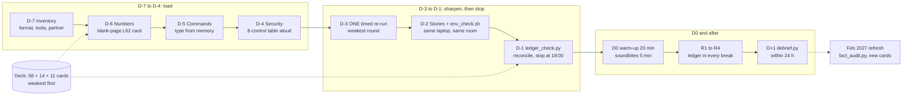

# Lesson 69 — Interview-week playbook for the hyperscale loop: the final 7 days, day-of routine and post-loop debrief

*2026-11-18*

Lessons 62–66 built the four rounds and rehearsed them as one loop. [Lesson 67](/lessons/67-post-loop-maintenance-review-refresh) set up the review and the quarterly refresh, and [Lesson 68](/lessons/68-k8s-136-138-gpu-ai-platforms) added the newest Kubernetes facts. This lesson covers the last week before a real onsite. It's a day-by-day plan with the scripts that drive it: a card scheduler, a claims-ledger checker that found two real conflicts in this site, an environment check for virtual loops, and a debrief parser that feeds the February 2027 refresh.

> **What's verified here.** All three scripts below ran on 2026-11-18 against this repo. `week.py` scheduled all 72 cards from the two existing decks. `ledger_check.py` reported the conflicts quoted below from the real lesson files. `env_check.sh` ran on a headless Linux box: it had no camera, so it flagged that, and it flagged an exported `GITHUB_TOKEN`. I didn't test the macOS branch (`networkQuality`, `avfoundation`, `pmset`) for this lesson. Run it on your own laptop on D-2. The schedule and timings are a plan, not measured data: they come from the L66 loop clock and the L67 review rate of about 0.8 cards per minute.

## What interviewers are really probing

The week before doesn't change what the loop tests ([L66](/lessons/66-full-loop-dress-rehearsal) has the full list). It changes how reliably you show it.

- **The same person in four packets.** Each interviewer writes feedback on their own, and the debrief compares the packets. If you say "waves of 1, 2, 5, 10, 25" in R1 and "2, 6, 16, 36, 60" in R3, you look less sure of yourself, even though both plans add up to 120. The week's main job is to bring every claim down to one version.
- **Recall under load, not recognition.** By D-7 you've read everything. If you re-read it now, you'll recognize it, and that feels like knowing it. The loop needs recall at hour three, so the week uses retrieval: cards weakest first, the numbers card from a blank page, commands typed from memory.
- **Calm recovery.** Interviewers score how fast you recover after a weak answer. A rested candidate who says "let me correct that: kubelet can be three minors behind, not two" scores better than a tired one who knows more.
- **Judgment about your own preparation.** Staff candidates are sometimes asked "how did you prepare?" or "what would you do differently in your first 90 days?" A plan that's deliberate and measured is a small signal of the same judgment you'd use on a fleet.
- **Security integrity outside the room.** A take-home repo, an "install our interview tool" link, a screen share with a kubeconfig on it. How you handle these is visible, and the first one is a known attack pattern (see Security & hardening).

## Core diagram


**Load early, sharpen late, protect the day.** The heaviest day is D-3 (one timed re-run). From then on the work is reconciliation and environment checks. On D-1 you learn nothing new.



### The plan

| Day | Theme | Cards (min) | The one task | Done when |
|---|---|---|---|---|
| D-7 | Inventory | numbers (25) | Confirm the loop format with the recruiter: round types, length, tools (CoderPad? Excalidraw? their own doc?), whether it's virtual. Book a partner for D-3 | You can name every round and its tool |
| D-6 | Numbers | numbers + refresh + L68 (30) | Redo the [L62](/lessons/62-mock-system-design-gpu-agent-platform) numbers card on a blank page in 10 minutes, then diff it | Every figure matches its source lesson |
| D-5 | Commands | commands + L68 (30) | Type 10 commands from memory into a scratch shell: `kubectl get --raw /metrics`, `cosign verify`, a VAP CEL rule, an HPA `behavior` block, a `DeviceTaintRule` | The YAML parses (`kubectl apply --dry-run=server` on a kind cluster) |
| D-4 | Security | soundbites + L68 (30) | Recite the 8-control consistency table from [L66](/lessons/66-full-loop-dress-rehearsal) out loud. Then walk a weights file from training to serving in 5 minutes ([L13](/lessons/13-ml-weights-checkpoint-hardening), [L64](/lessons/64-mock-security-deep-dive-weights-platform)) | Same controls, same order, both times |
| D-3 | Weakest round | numbers (20) | **One** timed re-run of the round that `rerun_plan.py` ([L67](/lessons/67-post-loop-maintenance-review-refresh)) picked, with a partner and variant prompts. Score it before you read model answers | Gate dimension at 3 or higher |
| D-2 | Stories + env | soundbites (20) | STAR-L pass on stories A–E ([L65](/lessons/65-mock-behavioral-leadership-staff-platform)). Run `env_check.sh` on the exact laptop, network and room, at the loop's time of day | `RED findings: 0` |
| D-1 | Ledger + rest | numbers + refresh + L68 (15) | Run `ledger_check.py`, reconcile every CONFLICT, and write the final ledger on one page. Stop by 18:00 | One value per claim, on paper |
| D0 | Loop | none | Warm-up (20 min), soundbite pass (5 min), no new material | See day-of timeline |
| D+1 | Debrief | none | `debrief.py` within 24 hours | Backlog rows exist |

## Idiosyncrasies / operator depth

### Why the load curve peaks on D-3, not D-1

- **One re-run, not two.** A full-intensity mock leaves you tired the next day, and it puts the mock's wrong numbers into your head. On D-3 you still have two days to fix what the re-run exposed and a night of sleep before the reconciliation. A second mock on D-1 gives you fatigue and new doubts, and you have no time left to fix anything.
- **Re-run the weakest round, not your favorite.** People pick the round they enjoy. `rerun_plan.py` from L67 chooses by gate margin and score. Trust it. If it picks R4 behavioral, re-run R4, even though R1 is more fun.
- **Cards don't stop until D-1.** Short daily retrieval keeps the deck warm. The D-1 session is 15 minutes of numbers only. It's there to confirm values, not to learn new ones.

### The claims ledger: conflicts that are real, and conflicts that aren't

`ledger_check.py` found this on 2026-11-18, from the lesson files themselves:

| Claim | Values found | Verdict | What to say |
|---|---|---|---|
| Upgrade waves for 120 clusters | L62/L66 deck: **1, 2, 5, 10, 25, rest** with 24 h bake. L68: **2, 6, 16, 36, 60** | **Real conflict.** Both add up to 120 and both are defensible, but they're two different answers to the same question | Pick one for the whole loop. The deck version comes with a duration (6–7 working days per minor), so it's easier to defend. If R3 asks about locked feature gates, say "same waves, and the preflight gate goes RED on any `X=false`." Don't switch plans |
| Checkpoint interval | 30 min (L27 storage math, L42) vs ~19 min (L66, Young/Daly with C = 60 s, MTBF = 11,100 s) | **Not a conflict.** These are different scenarios: an example cadence for sizing storage vs an interval computed from failure rates | Say where the number comes from: "about 19 minutes at that failure rate. I'd recompute it as the cluster grows." |
| kubelet skew | three minors (L66, L67) | ok | "never newer, up to three older since 1.28" |

The lesson: a script finds mismatches. Only you can say whether they're mistakes. Making every match disappear can cause errors, like changing the Young/Daly result to 30 so it "agrees."

### Things that go wrong only in virtual loops

- **Screen share shows more than you expect.** Notification banners, the tab bar, a terminal with `kubectl config get-contexts` listing a former employer's clusters, a shell history with tokens in it. `env_check.sh` checks what a script can check. For the rest, use a separate browser profile and a separate OS user if you can.
- **The tool decides how you think.** A shared doc with no diagrams pushes you to speak structure out loud. Excalidraw rewards drawing the [L62](/lessons/62-mock-system-design-gpu-agent-platform) shape quickly. Practice the D-3 re-run in the same tool the loop uses.
- **Time of day.** Network jitter, family noise and your own energy all change between 09:00 and 15:00. Run `env_check.sh` and the D-3 re-run at the loop's start time.
- **Lunch is on the record.** It may be called informal, but the lunch interviewer still writes notes. Have two short questions ready and avoid talking about other loops or offers.

### Questions to ask, per interviewer

Write three questions per round on one card. Each should show the round's signal.

| Round | Strong question |
|---|---|
| R1 system design | "What's the largest single blast radius you run today: a cluster, a region, a fabric? Is it a decision you made or one you inherited?" |
| R2 troubleshooting | "What was the last incident where the first hypothesis was wrong, and what made you see it?" |
| R3 security | "Who can read production weights today, and how many of those are standing grants? How do you test that the bucket policy and KMS key policy agree?" |
| R4 behavioral | "What does a staff engineer on this team own that nobody else would notice if it slipped?" |
| Hiring manager | "What would make the first 90 days a clear success, and what's the most common reason someone in this role struggles?" |

## Concrete commands & config

### Get the decks, including the new L68 cards

```bash
git clone https://github.com/caretak3r/hyperscale-prep && cd hyperscale-prep
ls public/*.tsv
# hyperscale-prep-flashcards.tsv               58 cards (L66: numbers, commands, soundbites)
# hyperscale-prep-flashcards-refresh-2026q4.tsv 14 cards (L67 refresh)
# hyperscale-prep-flashcards-l68.tsv            11 cards (new: L68 stages, gates, waves reconciliation)
# Anki: File > Import, one file at a time; the "#tags column:3" header keeps the tags (l68, numbers, ...)
```

The new file [`public/hyperscale-prep-flashcards-l68.tsv`](https://github.com/caretak3r/hyperscale-prep/blob/main/public/hyperscale-prep-flashcards-l68.tsv) has 11 cards copied from L68 and one card that settles the waves conflict. Every back cites its source lesson.

### `week.py`: the 7-day schedule, weakest cards first

```python
#!/usr/bin/env python3
"""week.py: print the 7-day interview-week plan with the cards to review each day.
usage: week.py LOOP_DATE [--deck a.tsv b.tsv ...] [--state review-state.json]
Weakest-first: cards with the lowest ease in review-state.json (from L67 review.py) come first."""
import argparse, csv, datetime as dt, json, pathlib, sys
PLAN = {  # offset: (theme, card tags to draw, minutes of cards, the one non-card task)
 -7: ("Inventory",        ["numbers"],             25, "Confirm loop format, interviewers, tools; book the D-3 re-run partner"),
 -6: ("Numbers",          ["numbers", "refresh-2026q4", "l68"], 30, "Redo the L62 numbers card on a blank page, timed 10 min"),
 -5: ("Commands",         ["commands", "l68"],     30, "Type 10 commands from memory into a scratch shell; diff against the deck"),
 -4: ("Security",         ["soundbites", "l68"],   30, "Recite the 8-control consistency table (L66) out loud, 5 min"),
 -3: ("Weakest round",    ["numbers"],             20, "ONE timed re-run of the round rerun_plan.py picked (L67); score before reading answers"),
 -2: ("Stories + env",    ["soundbites"],          20, "STAR-L pass on stories A-E; run env_check.sh on the exact laptop and room"),
 -1: ("Ledger + rest",    ["numbers", "refresh-2026q4", "l68"], 15, "ledger_check.py; reconcile conflicts; stop studying by 18:00"),
  0: ("Loop day",         [],                       0, "Warm-up 20 min, soundbite pass 5 min, no new material"),
  1: ("Debrief",          [],                       0, "debrief.py within 24 h; feed refresh backlog"),
}
def load(paths):
    cards = []
    for p in paths:
        for row in csv.reader(open(p, encoding="utf-8"), delimiter="\t"):
            if not row or row[0].startswith("#") or len(row) < 3: continue
            cards.append({"front": row[0], "back": row[1], "tags": row[2].split(), "src": pathlib.Path(p).name})
    return cards
def main():
    ap = argparse.ArgumentParser(); ap.add_argument("loop_date")
    ap.add_argument("--deck", nargs="+", required=True); ap.add_argument("--state")
    ap.add_argument("--per-min", type=float, default=0.8, help="cards per minute (L67 measured ~0.8)")
    a = ap.parse_args()
    loop = dt.date.fromisoformat(a.loop_date); cards = load(a.deck)
    ease = json.load(open(a.state)) if a.state else {}
    cards.sort(key=lambda c: ease.get(c["front"], {}).get("ease", 2.5))  # weakest first
    seen = set()
    for off in sorted(PLAN):
        theme, tags, mins, task = PLAN[off]; day = loop + dt.timedelta(days=off)
        n = int(mins * a.per_min)
        pick = [c for c in cards if set(tags) & set(c["tags"]) and c["front"] not in seen][:n]
        if len(pick) < n:  # second pass: allow repeats of the weakest
            pick += [c for c in cards if set(tags) & set(c["tags"]) and c not in pick][: n - len(pick)]
        seen.update(c["front"] for c in pick)
        print(f"\n## D{off:+d}  {day:%a %Y-%m-%d}  {theme}  ({mins} min cards)\n- TASK: {task}")
        for c in pick: print(f"  - [{c['src']}] {c['front']}")
    left = [c["front"] for c in cards if c["front"] not in seen]
    print(f"\n{len(cards)} cards loaded; {len(cards)-len(left)} scheduled at least once; {len(left)} not scheduled", file=sys.stderr)
    for f in left: print(f"  unscheduled: {f}", file=sys.stderr)
if __name__ == "__main__": main()
```

```bash
python3 week.py 2026-12-07 \
  --deck public/hyperscale-prep-flashcards.tsv public/hyperscale-prep-flashcards-refresh-2026q4.tsv public/hyperscale-prep-flashcards-l68.tsv \
  --state review-state.json        # optional: L67 review.py state, so low-ease cards come first
# stderr on 2026-11-18 with the two existing decks:
# 72 cards loaded; 72 scheduled at least once; 0 not scheduled
```

If the stderr line lists `unscheduled:` cards, a tag doesn't match any day. Fix the tag. Don't add study time.

### `ledger_check.py`: one value per claim

```python
#!/usr/bin/env python3
"""ledger_check.py: find numbers you have stated two different ways.
Scans the lesson MDX (and your claims ledger) for each claim pattern and prints every distinct value.
usage: ledger_check.py pages/lessons/*.mdx [ledger.md]"""
import re, sys, collections, pathlib
CLAIMS = {  # claim: regex whose group(1) is the value you'd say out loud
 "upgrade waves (120 clusters)": r"waves?,? (\d+, \d+, \d+, \d+, (?:\d+|rest))",
 "inference cluster size":       r"[Ii]nference (?:clusters? )?~?(\d{2,3})(?:-node| nodes)",
 "checkpoint interval":          r"checkpoints? every ~?(\d+) ?min",
 "kubelet skew (minors older)":  r"up to (two|three) (?:minors )?older",
 "error budget 99.9%/30d":       r"(\d+\.\d) minutes of full outage",
 "SVID TTL":                     r"SVID TTL[^.]{0,40}?(\d+ hours?)",
 "hot spares":                   r"[Hh]ot spares? (\d+(?:-\d+)?%)",
 "Llama 3 interruptions":        r"(\d{3}) unexpected interruptions",
}
hits = collections.defaultdict(lambda: collections.defaultdict(list))
for p in sys.argv[1:]:
    for i, line in enumerate(pathlib.Path(p).read_text(encoding="utf-8").splitlines(), 1):
        for k, rx in CLAIMS.items():
            for m in re.finditer(rx, line):
                hits[k][m.group(1)].append(f"{pathlib.Path(p).stem[:2]}:{i}")
rc = 0
for k in CLAIMS:
    vals = hits.get(k, {})
    flag = "CONFLICT" if len(vals) > 1 else ("ok" if vals else "not found")
    rc |= len(vals) > 1
    print(f"{flag:9} {k}")
    for v, where in vals.items(): print(f"          {v!r:28} {len(where):2}x  {', '.join(where[:6])}")
sys.exit(rc)
```

```bash
python3 ledger_check.py pages/lessons/*.mdx my-ledger.md; echo rc=$?
# 2026-11-18, lesson files only (excerpt):
# CONFLICT  upgrade waves (120 clusters)
#           '1, 2, 5, 10, 25'              1x  62:99
#           '2, 6, 16, 36, 60'             1x  68:791
# CONFLICT  checkpoint interval
#           '30'                           2x  27:128, 42:9
#           '19'                           1x  66:81
# ok        kubelet skew (minors older)
#           'three'                        2x  66:370, 67:101
# rc=1
```

Add your own ledger file as the last argument. The claims that matter most are the ones you said in the D-3 re-run. Add a `CLAIMS` regex for any number you used twice.

### `env_check.sh`: the exact laptop, room and network

```bash
#!/usr/bin/env bash
# env_check.sh: run on the exact laptop, network and room you'll use, at the loop's time of day (D-2 and D0 -60 min).
# Exit code = number of RED findings. Linux (PipeWire/ALSA + v4l2) and macOS (avfoundation) paths.
set -uo pipefail
RED=0; red(){ echo "RED   $*"; RED=$((RED+1)); }; ok(){ echo "ok    $*"; }; warn(){ echo "warn  $*"; }
OS=$(uname -s)
# 1. Network: throughput and jitter to something near the interviewer's video SFU (use the meeting tool's own test page too)
if command -v networkQuality >/dev/null; then networkQuality -s | sed 's/^/      /'      # macOS 12+
else
  s=$(curl -s -o /dev/null -w '%{speed_download}' --max-time 15 https://speed.cloudflare.com/__down?bytes=25000000 || echo 0)
  mbps=$(awk -v b="$s" 'BEGIN{printf "%.0f", b*8/1e6}'); [ "$mbps" -ge 20 ] && ok "download ${mbps} Mbit/s" || red "download ${mbps} Mbit/s (<20)"
fi
j=$(ping -c 20 -i 0.2 1.1.1.1 2>/dev/null | awk -F/ '/^(rtt|round-trip)/{print $7+0}')
[ -n "$j" ] && { awk -v j="$j" 'BEGIN{exit !(j<30)}' && ok "ping mdev ${j} ms" || red "ping mdev ${j} ms (>=30: wired or move closer to AP)"; } || warn "ICMP blocked; use the meeting tool's network test instead"
# 2. Camera + mic: record 5 s and listen back. Silence or a black frame is RED.
out=/tmp/envcheck.mkv
if [ "$OS" = Darwin ]; then ffmpeg -loglevel error -y -f avfoundation -framerate 30 -i "0:0" -t 5 "$out"
else ffmpeg -loglevel error -y -f v4l2 -i /dev/video0 -f pulse -i default -t 5 "$out"; fi \
  && vol=$(ffmpeg -i "$out" -af volumedetect -f null - 2>&1 | awk '/mean_volume/{print $5}') \
  && { awk -v v="$vol" 'BEGIN{exit !(v>-50)}' && ok "mic mean ${vol} dB" || red "mic mean ${vol} dB (silent?)"; } \
  || red "ffmpeg capture failed (permissions? device busy?)"
# 3. Power, disk, updates: nothing reboots or throttles mid-round
if [ "$OS" = Darwin ]; then pmset -g batt | grep -q 'AC Power' && ok "on AC" || red "on battery"
else [ "$(cat /sys/class/power_supply/AC*/online 2>/dev/null | head -1)" = 1 ] && ok "on AC" || warn "AC state unknown/battery"; fi
df -Pk "$HOME" | awk 'NR==2{exit !($4>10*1024*1024)}' && ok "disk >10 GiB free" || red "disk <10 GiB (screen recorder will die)"
# 4. Screen-share hygiene: what an interviewer could see if you share the wrong window
for v in $(env | cut -d= -f1 | grep -E -i '(TOKEN|SECRET|_KEY|PASSWORD|CREDENTIALS)$'); do red "secret-looking env var exported: $v (unset it in the interview shell)"; done
if command -v kubectl >/dev/null; then
  ctx=$(kubectl config current-context 2>/dev/null || true)
  n=$(kubectl config get-contexts -o name 2>/dev/null | wc -l)
  [ "$n" -le 1 ] && ok "kube contexts: ${n} (${ctx:-none})" || red "${n} kube contexts; use KUBECONFIG=~/interview/kind.yaml in the interview shell"
fi
[ -s "${HISTFILE:-$HOME/.bash_history}" ] && warn "shell history non-empty: start the interview shell with HISTFILE=/dev/null"
[ "$OS" = Linux ] && command -v gsettings >/dev/null && \
  { [ "$(gsettings get org.gnome.desktop.notifications show-banners)" = false ] && ok "notification banners off" || red "notification banners on: gsettings set org.gnome.desktop.notifications show-banners false"; }
[ "$OS" = Darwin ] && warn "turn on a Focus mode manually (no stable CLI); quit Slack/Mail/Messages"
echo "RED findings: $RED"; exit "$RED"
```

Output on a headless Linux box, 2026-11-18. Every RED here is correct:

```text
ok    download 301 Mbit/s
warn  ICMP blocked; use the meeting tool's network test instead
RED   ffmpeg capture failed (permissions? device busy?)
warn  AC state unknown/battery
ok    disk >10 GiB free
RED   secret-looking env var exported: GITHUB_TOKEN (unset it in the interview shell)
ok    kube contexts: 0 (none)
RED findings: 2
```

The interview shell itself:

```bash
# a clean shell for live coding: no history, no tokens, a throwaway cluster only
env -i HOME="$HOME/interview" PATH=/usr/local/bin:/usr/bin:/bin TERM="$TERM" \
  HISTFILE=/dev/null KUBECONFIG="$HOME/interview/kind.yaml" bash --noprofile --norc
kind create cluster --name interview --kubeconfig "$HOME/interview/kind.yaml"   # for --dry-run=server checks
```

### Day-of (D0) routine, 09:00 start

| Time | Do | Why |
|---|---|---|
| 06:45 | Wake, no email or Slack | Keep your attention for the loop |
| 07:30 | Eat; water and a printed ledger on the desk | Round 3 starts about 2 h 15 min in (L66) |
| 07:50 | `./env_check.sh`, must end `RED findings: 0` | Fix problems before you join, not during R1 |
| 08:00 | Warm-up: one 20-minute numbers card from blank ([L62](/lessons/62-mock-system-design-gpu-agent-platform)) | Gets you thinking at the right level of detail; doesn't tire you |
| 08:20 | Soundbite pass, out loud, 5 min | Your first sentence comes easily |
| 08:30 | Question card: three per interviewer | Avoids an empty "any questions?" |
| 08:45 | Join 10 minutes early; notifications off; phone in another room | |
| Each break | 3 min: write the numbers and commitments you just said into the ledger. Then water, then stand | It catches most cross-round contradictions (L66) |
| After R4 | Write nothing about the outcome. Write the debrief notes below | Notes are still accurate; judgment is still biased |

### Post-loop debrief → refresh backlog

```markdown
# debrief.md: written within 24 h. No interviewer names, no question text verbatim.
- ASKED: how would you roll a CNI change across 120 clusters while training jobs run
- STUMBLE: forgot the APF flowschema field for exempting the node-health controller
- FACT: said Gateway API latest was v1.7.0; re-check
- CONTRADICTION: said waves 1,2,5,10,25,rest in R1 and 2,6,16,36,60 in R3
- TOOL: second monitor went to sleep during R2
```

```python
#!/usr/bin/env python3
"""debrief.py: turn a post-loop debrief into refresh-backlog rows for the February 2027 refresh (L67).
usage: debrief.py debrief.md >> refresh-backlog.tsv
debrief.md lines that start with one of these tags become rows:  FACT: STUMBLE: CONTRADICTION: ASKED: TOOL:"""
import sys, re, datetime as dt
TAGS = {"FACT": "verify in fact_audit.py", "STUMBLE": "new flashcard", "CONTRADICTION": "add to ledger_check.py CLAIMS",
        "ASKED": "candidate lesson topic", "TOOL": "add to env_check.sh"}
today = dt.date.today().isoformat(); n = 0
for line in open(sys.argv[1], encoding="utf-8"):
    m = re.match(r"\s*[-*]?\s*(FACT|STUMBLE|CONTRADICTION|ASKED|TOOL):\s*(.+)", line)
    if not m: continue
    tag, text = m.groups()
    if re.search(r"\b(interviewer|name|@|\bQ\d)\b", text, re.I): print(f"skip (may identify a person): {text}", file=sys.stderr); continue
    print(f"{today}\t{tag}\t{TAGS[tag]}\t{text.strip()}"); n += 1
print(f"{n} rows", file=sys.stderr)
```

```bash
python3 debrief.py debrief.md >> refresh-backlog.tsv
# skip (may identify a person): the interviewer named Sam asked about MIG
# 5 rows
# 2026-11-18  CONTRADICTION  add to ledger_check.py CLAIMS  said waves 1,2,5,10,25,rest in R1 and 2,6,16,36,60 in R3
```

The February 2027 refresh ([L67](/lessons/67-post-loop-maintenance-review-refresh)) reads `refresh-backlog.tsv` along with `fact_audit.py`. Each `STUMBLE` becomes a card, each `FACT` becomes an audit pattern, and each `ASKED` that no lesson covers becomes a candidate lesson.

## Failures & fixes

| Symptom | Cause | Fix |
|---|---|---|
| You know a fact on D-6 and blank on it on D0 | You reviewed by recognition (re-reading), not recall | Cards weakest-first, blank-page numbers, typed commands. Re-reading lessons isn't on the plan |
| Two numbers for one claim in the debrief | No ledger, or you wrote it but didn't re-read it in breaks | `ledger_check.py` on D-1; 3-minute ledger update in every break |
| D-1 panic, you learn L68 in full at 22:00 | Plan slipped; you're trying to make up for it with volume | Cap D-1 at 15 minutes of cards. What isn't solid by D-2 gets "I'd verify the exact version" in the room |
| A great D-3 re-run on the wrong round | You picked your favorite | `rerun_plan.py` picks by gate margin; follow it |
| R1 starts with a frozen camera or a mic permission prompt | Environment not tested on the actual setup | `env_check.sh` on D-2 and at 07:50 on D0, same laptop, same room |
| Screen share shows a token or employer cluster names | Live coding in your everyday shell | Clean `env -i` shell, `HISTFILE=/dev/null`, kind-only kubeconfig, separate browser profile |
| A take-home or "assessment tool" wants you to `npm install` and run it on your laptop | Possible Contagious Interview-style lure, or just a sloppy take-home | Run it in a throwaway VM or devcontainer with no credentials. Verify the recruiter through the company's own careers site (see Security) |
| The debrief turns into "I think it went badly" | Writing outcome judgments, not observations | Tag lines FACT, STUMBLE, CONTRADICTION, ASKED, TOOL only |
| `ledger_check.py` says CONFLICT and you "fix" a correct number | You treated a match as proof of an error | Triage: same scenario? If not, keep both and say the scenario |

## Security & hardening

**Interview week has its own attack surface.** The same rules you'd state in [L64](/lessons/64-mock-security-deep-dive-weights-platform) apply to your own laptop, take-homes and screen shares. Interviewers notice when what you say and what you do match.

### 1. Interview code and artifacts are untrusted input

- **The lure is documented.** Palo Alto Networks Unit 42 tracks a DPRK-attributed campaign it calls **Contagious Interview** (CL-STA-0240). Fake recruiters invite developers to an online interview, then ask them to install an npm package from GitHub. That package (**BeaverTail**) steals browser and wallet data and loads a Python backdoor (**InvisibleFerret**) with keylogging, file exfiltration and remote control. Later variants posed as video-call apps (MiroTalk, FreeConference). Unit 42 reported the campaign still active as of December 2025. AI and infrastructure job seekers fit the target profile.
- **Control:** run every take-home, "assessment tool" and shared repo in a **throwaway VM or devcontainer** with no SSH agent, no cloud credentials, no browser profile and logged egress. That's the [L34](/lessons/34-agent-tool-sandboxing-egress-policy) sandbox applied to yourself. Verify the recruiter through the company's careers site or a known employee, not the link they sent. Join meetings in the browser or with the vendor's own app from the vendor's site, never from a file someone emailed you.
- **A model file in a take-home is the L64 pickle gate.** A `.pt`, `.bin` or `.pkl` checkpoint can execute code on load. `torch.load(weights_only=True)` is the default since PyTorch 2.6, and CVE-2025-32434 bypassed it, so the flag alone isn't enough. Convert to safetensors in the sandbox, or ask for safetensors. Saying this out loud in a live round is a strong signal.

### 2. Weights, registries and deployments: say the same controls every time

On D-4, recite this chain from memory in the same order. It's the [L13](/lessons/13-ml-weights-checkpoint-hardening)/[L27](/lessons/27-gpu-supply-chain-weight-registry-hydrate)/[L64](/lessons/64-mock-security-deep-dive-weights-platform)/[L68](/lessons/68-k8s-136-138-gpu-ai-platforms) path:

1. **Checkpoints** land in a bucket with a Deny-based policy, a VPC-endpoint condition and a KMS key policy using `kms:ViaService` plus encryption context. Both locks have to agree, because access needs both.
2. **Promotion** is a separate signed, human-approved pipeline. The release workflow identity signs (`model_signing` plus cosign), not the training job.
3. **Registry**: internal only, push and pull **by digest**, Object Lock or immutability on release tags.
4. **Admission**: VAP or a policy engine requires digests and allowed registries for containers **and** `spec.volumes[*].image.reference` (ImageVolume, GA 1.36). Write access to admission policies counts as cluster-admin.
5. **Serving**: read-only mounts, no egress from model pods, workload identity scoped per model ([L48](/lessons/48-workload-identity-secrets-pki-fleet-scale)), and agents reach models only through the gateway, never the bucket.
6. **Break-glass**: the same mechanism in every round. Two-person approval, minutes not days, auto-expiry, alert on use.

### 3. Screen share and live-coding hygiene

- A clean shell (`env -i`, `HISTFILE=/dev/null`), a kind-only `KUBECONFIG`, no exported tokens. `env_check.sh` checks this, and it caught a real `GITHUB_TOKEN` on the test box.
- A separate browser profile with no saved sessions, no bookmarks bar and no extensions. Share a **window**, not the screen.
- No AI assistant running unless the company's interview rules allow it. If it's allowed, say so when you use it. That's the [L65](/lessons/65-mock-behavioral-leadership-staff-platform) integrity gate applied to tools.

### 4. Confidentiality: cards, notes, recordings and debriefs

- Cards, the ledger and `debrief.md` hold **no employer internals**: no hostnames, bucket names, customer names or unreleased products ([L66](/lessons/66-full-loop-dress-rehearsal) rules). They also hold **no interviewer names and no verbatim question text**. `debrief.py` skips lines that look like they identify a person.
- Don't record a real interview without consent from everyone on the call. Many companies forbid it, and some US states require all-party consent. The mocks were recorded. The real loop isn't.
- Keep the refresh backlog private. Publish only generic topics to the site, such as "CNI change across a fleet during training," never "Company X asked..."

## SRE focus: SLIs, SLOs & SLAs

In interview week, SLO material is **high-yield and easy to fumble**. Rehearse a short SLO answer you can give in any round, and the five follow-ups that come with it. See the [SRE playbook](/sre-slis-slos-slas).

**A 60-second SLO answer to rehearse (examples, labeled as such):**
"For tier-1 inference I'd start with availability at the router, around 99.9% non-5xx over 30 days. Latency would be the share of requests with TTFT ≤ 1 s, around 99%, read from `vllm:time_to_first_token_seconds` with `le="1.0"`, plus inter-token latency (`vllm:inter_token_latency_seconds`, token-weighted). Alerts are multi-window burn rate: 14.4× on 1h and 5m pages, 1× on 3d and 6h tickets. The SLA is looser, say 99.5%, with credits and exclusions. Those numbers are starting points I'd validate against real baselines."

**Follow-ups to expect, and the one-line answer:**
- **"Why not GPU utilization?"** It's a cost and capacity signal. Users feel TTFT and errors.
- **"Low-traffic models?"** Minimum-request guard, synthetic probes, and longer windows.
- **"Per tenant?"** The router has the tenant label (`fairness_id` in llm-d); engine metrics don't.
- **"Training SLOs?"** Goodput (productive time ÷ wall time) and checkpoint success and age. These are custom metrics: say so.
- **"How do SLOs change behaviour?"** An error-budget policy agreed in advance freezes risky changes when the budget is spent.

**Day-before check:** re-verify any metric names you plan to say aloud (for example, the dcgm-exporter 4.9.0 renames) and keep them in the claims ledger with one value each.

## Interview soundbites

- "I keep a claims ledger. Every number I say in a round goes on it, and I re-read it at every break, so the debrief sees one version of me."
- "I'll pick one rollout plan and stick with it: 120 clusters in waves of 1, 2, 5, 10, 25, then the rest, with a 24-hour bake. That's six to seven working days per minor."
- "That number depends on the scenario. At C = 60 seconds and an 11,100-second MTBF, Young/Daly gives about 19 minutes. I'd recompute it as the cluster grows."
- "I don't know the exact patch version off the top of my head, and I'd verify it before I put it in a change. Here's how I'd find it." (Use this for anything you didn't confirm by D-2.)
- "Code from outside my organization runs in a throwaway sandbox with no credentials. That includes a take-home, and it's the same rule I'd set for agents."
- "A model file is code until it's converted. I'd convert pickle to safetensors in a sandbox. `weights_only` alone was bypassed in CVE-2025-32434."
- "Break-glass is the same in every system I design: two people, minutes, auto-expiry, an alert on use."
- "I can't go into my last employer's specifics, but here's how I'd design it for you."

## Watch (talks & demos)

<iframe width="100%" height="360" src="https://www.youtube.com/embed/l0CCeHBc-L0" title="Tech Learning Series | Non-Abstract Large Systems Design, Part 1" frameBorder="0" allow="accelerometer; autoplay; clipboard-write; encrypted-media; gyroscope; picture-in-picture; web-share" allowFullScreen></iframe>

[Open on YouTube](https://www.youtube.com/watch?v=l0CCeHBc-L0). Why watch: Google SREs on non-abstract large system design (Life at Google channel). Watch it on **D-6** right before you redo the numbers card from a blank page. It shows the habit that drill trains: put real machines and numbers on the design before you argue about architecture.

<iframe width="100%" height="360" src="https://www.youtube.com/embed/xtevUgopIms" title="SREcon16 - nrrd 911 ic me: The Incident Commander Role" frameBorder="0" allow="accelerometer; autoplay; clipboard-write; encrypted-media; gyroscope; picture-in-picture; web-share" allowFullScreen></iframe>

[Open on YouTube](https://www.youtube.com/watch?v=xtevUgopIms). Why watch: the incident commander role (SREcon16, USENIX channel). Watch it on **D-3** before re-running R2. The troubleshooting round scores the same things an IC does: say what you know, delegate, timebox, mitigate first. Calm structure scores higher than speed.

<iframe width="100%" height="360" src="https://www.youtube.com/embed/KClAPipnKqw" title="Technical leadership and glue work - Tanya Reilly | #LeadDevNewYork" frameBorder="0" allow="accelerometer; autoplay; clipboard-write; encrypted-media; gyroscope; picture-in-picture; web-share" allowFullScreen></iframe>

[Open on YouTube](https://www.youtube.com/watch?v=KClAPipnKqw). Why watch: Tanya Reilly on glue work and how technical leadership gets recognized (LeadDev). Watch it on **D-2** with your STAR-L stories. It helps you describe the cross-team work in stories A–E as staff-level scope, without inflating it.

## References

- Prior lessons: [L13](/lessons/13-ml-weights-checkpoint-hardening) weights hardening · [L27](/lessons/27-gpu-supply-chain-weight-registry-hydrate) weight registries · [L29](/lessons/29-training-reliability-checkpoint-elastic) checkpoint interval · [L34](/lessons/34-agent-tool-sandboxing-egress-policy) sandbox and egress · [L45](/lessons/45-fleet-kubernetes-upgrades-gpu-clusters) upgrade waves · [L48](/lessons/48-workload-identity-secrets-pki-fleet-scale) workload identity · [L62](/lessons/62-mock-system-design-gpu-agent-platform) R1 and numbers card · [L63](/lessons/63-mock-troubleshooting-gpu-agent-fleet) R2 · [L64](/lessons/64-mock-security-deep-dive-weights-platform) R3 and the pickle gate · [L65](/lessons/65-mock-behavioral-leadership-staff-platform) R4 and stories · [L66](/lessons/66-full-loop-dress-rehearsal) loop clock, ledger, deck · [L67](/lessons/67-post-loop-maintenance-review-refresh) review.py, rerun_plan.py, fact_audit.py · [L68](/lessons/68-k8s-136-138-gpu-ai-platforms) newest facts
- Decks: [hyperscale-prep-flashcards.tsv](https://github.com/caretak3r/hyperscale-prep/blob/main/public/hyperscale-prep-flashcards.tsv) · [refresh-2026q4](https://github.com/caretak3r/hyperscale-prep/blob/main/public/hyperscale-prep-flashcards-refresh-2026q4.tsv) · [l68 (new)](https://github.com/caretak3r/hyperscale-prep/blob/main/public/hyperscale-prep-flashcards-l68.tsv) · [Anki manual: importing text files](https://docs.ankiweb.net/importing/text-files.html)
- Interview-themed malware: [Unit 42: Contagious Interview (2023)](https://unit42.paloaltonetworks.com/two-campaigns-by-north-korea-bad-actors-target-job-hunters/) · [Unit 42: new BeaverTail and InvisibleFerret variants](https://unit42.paloaltonetworks.com/north-korean-threat-actors-lure-tech-job-seekers-as-fake-recruiters/) · [Unit 42 IOCs for December 2025 activity](https://github.com/PaloAltoNetworks/Unit42-timely-threat-intel/blob/main/2026-02-04-IOCs-for-December-2025-Contagious-Interview-activity.txt)
- Pickle: [PyTorch `torch.load` docs](https://pytorch.org/docs/stable/generated/torch.load.html) · [GHSA for CVE-2025-32434](https://github.com/pytorch/pytorch/security/advisories/GHSA-53q9-r3pm-6pq6) · [safetensors](https://github.com/huggingface/safetensors)
- Tools: [kind](https://kind.sigs.k8s.io/) · [FFmpeg devices (v4l2, pulse, avfoundation)](https://ffmpeg.org/ffmpeg-devices.html) · [Google SRE book: Managing Incidents](https://sre.google/sre-book/managing-incidents/)
- AI/ML fuel: [wafer-ai/gpu-perf-engineering-resources](https://github.com/wafer-ai/gpu-perf-engineering-resources). On D-6, re-skim its serving papers (PagedAttention, SGLang) so the "why does the endpoint picker score KV cache?" answer from L68 is fresh

## Quick self-check

1. Why is D-3, not D-1, the one full-intensity day? What goes wrong with a second mock on D-1?
2. `ledger_check.py` reports two checkpoint intervals. How do you decide whether it's an error?
3. State the upgrade-wave plan you'll use for the whole loop, with bake time and total duration.
4. Name five things `env_check.sh` checks. Name two things it can't, and how you cover them.
5. What does the Contagious Interview lure ask the victim to do, and what control stops it on your laptop?
6. A take-home includes `model.pt`. What do you do, and what CVE explains why the default isn't enough?
7. Recite the six-step weights chain from checkpoint bucket to serving pod. Where does ImageVolume change the admission policy?
8. What may and may not go into `debrief.md`? What does `debrief.py` do with each tag?
9. Write three questions for the R3 security interviewer.

## Next

**Lesson 70 — Rack-scale GPU systems in operation (GB200/GB300 NVL72-class).** The NVLink domain as a new failure domain between node and cluster. ComputeDomains and IMEX through the NVIDIA DRA driver, partial-rack failures and how the scheduler handles them, liquid-cooling and power telemetry as paging signals, rack-level burn-in and RMA, and the security boundary when 72 GPUs share one NVLink fabric. Builds on [L19](/lessons/19-gpu-topology-nvlink-rdma-nccl) topology, [L39](/lessons/39-gpu-fleet-lifecycle-acceptance-burn-in-rma), [L40](/lessons/40-infiniband-roce-fabric-operations), [L41](/lessons/41-power-cooling-facility-constraints-gpu-fleets) and [L68](/lessons/68-k8s-136-138-gpu-ai-platforms). The February 2027 fact refresh stays on the calendar after Kubernetes 1.38 ships.
