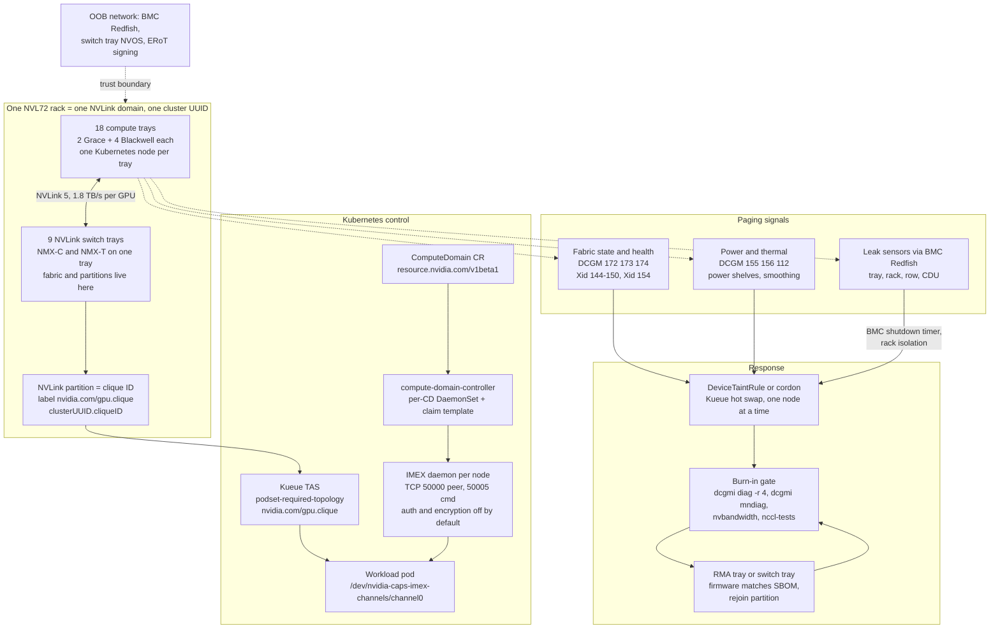
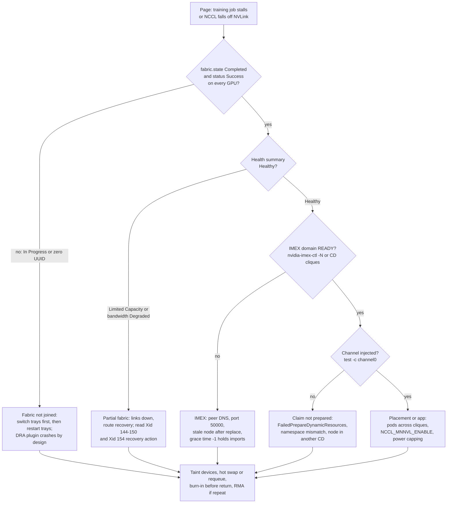

# Lesson 70 — Rack-scale GPU systems in operation (GB200/GB300 NVL72): the NVLink domain as a failure domain, ComputeDomains and IMEX, partial racks, cooling and power paging, burn-in and RMA, and the shared-fabric security boundary

*2026-11-19*

Until Hopper, the biggest NVLink domain you operated was one 8-GPU node. On a GB200 or GB300 NVL72 it's a whole rack: 18 compute trays and 9 NVLink switch trays sharing one fabric. That adds a failure domain between "node" and "cluster", and Kubernetes doesn't know it exists unless you tell it. This lesson covers running that rack day to day: how the fabric shows up in `nvidia-smi` and DCGM, how ComputeDomains and IMEX work through the NVIDIA DRA driver, what the scheduler does when one tray dies, which cooling and power signals should page someone, how to burn in and RMA at rack level, and where the trust boundaries are on a fabric that several tenants share.

> **What's verified here (2026-11-19).** Hardware numbers come from NVIDIA's GB200 NVL72 page, the DGX GB rack user guide and the GB200 multi-node tuning guide. Driver behavior comes from the source and docs of `kubernetes-sigs/dra-driver-nvidia-gpu` at tag **v0.5.1**: CRD schemas, the rendered IMEX config template, error strings and the kubelet plugin's checks. IMEX settings come from the NVIDIA IMEX guide. DCGM field IDs come from `dcgm_fields.h` on `NVIDIA/DCGM` master. Xid codes come from the NVIDIA Xid catalog, and Kueue behavior from the TAS docs and the v0.20.7 CRDs. Tests run on this box: the ComputeDomain, Kueue Topology/ResourceFlavor/ClusterQueue, Job, both ValidatingAdmissionPolicies, the RBAC, the NetworkPolicy and the DeviceTaintRule below were all applied to a real **kube-apiserver v1.37.2** with the v0.5.1 and v0.20.7 CRDs installed. The denials quoted are the ones it returned. The Helm values were rendered with `helm template` against the published v0.5.1 chart. `rack_fabric_summary.py` ran on synthetic input. **Nothing here ran on GB200 hardware**, so fabric, IMEX and DCGM output is quoted from docs and issues, not from a test.

## What interviewers are really probing

- **Do you see the new failure domain?** On NVL72 a tray isn't independent. Its GPUs talk to 68 others over a shared switch fabric, a lost switch tray degrades every GPU in the rack, and a training job sized to the full rack has no spare. "Node, rack, cluster" is the answer. "Node, cluster" is a 2023 answer.
- **Do you know cluster UUID from clique ID?** Cluster UUID is the NVLink domain (on NVL72, the whole rack). Clique ID is the NVLink partition inside it. Only GPUs in the same clique can use NVLink with each other. The scheduler key is `nvidia.com/gpu.clique` = `<clusterUUID>.<cliqueID>`, not "rack".
- **Do you know what IMEX is and why Kubernetes needs ComputeDomains?** Cross-tray GPU memory sharing goes through the `nvidia-imex` daemon and per-user channel devices. Without ComputeDomains you pre-build static IMEX domains, and every job on the rack shares them. With ComputeDomains, each workload gets its own short-lived IMEX domain that follows the pods.
- **Partial-rack judgment.** One tray of 18 is down. What does Kueue do with a 16-tray job, an 18-tray job, a 4-tray inference replica? (Hot swap if a spare exists in the same clique. Evict and requeue if not. Answers below.)
- **Facilities literacy.** Liquid-cooled racks at well over 100 kW have leak sensors at tray, rack and row level, power shelves, power smoothing and power brakes. Which of these page the platform on-call, and which go to facilities? Interviewers from hyperscalers ([L41](/lessons/41-power-cooling-facility-constraints-gpu-fleets)) check whether you can tell a tray-local signal from one that's correlated across the rack.
- **Security of a shared fabric.** IMEX's peer channel ships with authentication and encryption **off**. Host-managed IMEX gives **no isolation** between ComputeDomains. `allocationMode: All` hands a pod every channel. BMC examples in vendor docs use default credentials and `curl -k`. They want to hear that you know each of these, and what you'd do about it ([L64](/lessons/64-mock-security-deep-dive-weights-platform)).

## Core diagram

![Rack-scale GPU operations: one NVL72 rack is one NVLink domain (18 compute trays, 9 NVLink switch trays with NMX-C/NMX-T, partitions exposed as the nvidia.com/gpu.clique label); Kubernetes control via Kueue topology-aware scheduling and ComputeDomains (controller, per-domain IMEX daemons on TCP 50000/50005 with auth off by default, channel0 injected into pods); paging signals from DCGM fabric fields 172/173/174, Xid 144-150 and 154, power and thermal fields 155/156/112 and BMC Redfish leak sensors; response loop of DeviceTaintRule or cordon, Kueue hot swap, burn-in with dcgmi diag and mndiag, and RMA; OOB network with BMC, NVOS and ERoT as a separate trust boundary](/rack-scale-gpu-nvl72-operations.png)

**How to read it, top to bottom.** The out-of-band network (BMC, switch-tray NVOS, ERoT) is its own trust boundary above the rack. Inside the rack, NVLink partitions come out as a node label. Kubernetes uses that label twice: Kueue places pods within one partition, and the ComputeDomain controller builds an IMEX domain around wherever they land. Three sets of signals (fabric, power and thermal, leak) feed one response loop: taint, hot swap or requeue, burn-in, RMA, burn-in again.



**Triage order for a rack-scale page.** Work from the fabric up to the application. Each layer has one command that rules it in or out.




## Idiosyncrasies / operator depth

### The rack, in numbers you should be able to say

| Item | GB200 NVL72 | Source |
|---|---|---|
| GPUs / CPUs | 72 Blackwell GPUs, 36 Grace CPUs, one 72-GPU NVLink domain | NVIDIA GB200 NVL72 page |
| Compute trays | 18 × 1RU, each 2 Grace + 4 Blackwell = **one OS, one Kubernetes node, 4 GPUs** | DGX GB rack user guide |
| NVLink switch trays | 9 × 1RU, each with 2 NVSwitches of 72 NVLink ports, NVOS, a BMC, FM and SM control planes, CPU ERoT | DGX GB rack user guide |
| NVLink bandwidth | 1.8 TB/s GPU-to-GPU (NVLink 5); 130 TB/s rack aggregate | NVIDIA GB200 NVL72 page |
| Scale-out NICs per tray | GB200: 4 × ConnectX-7 400G. GB300: 4 × ConnectX-8 800G. Plus 2 × BlueField-3 for storage/in-band | DGX GB rack user guide |
| Management | NMX-C (controller) and NMX-T (telemetry) run on one switch tray, reached over a separate "nvlink-net" from the switch trays' 1G ports | GB200 multi-node tuning guide |
| Power | BCM's GB200 reference rack: 8 power shelves × 6 PSUs, each PSU up to 5.5 kW (shelf rated up to 33 kW) | Base Command Manager power-shelf docs |

**Switch-tray arithmetic** (derived from the table, not from an NVIDIA statement): 9 trays × 2 switches × 72 ports = 1,296 ports, or 18 per GPU across 72 GPUs, so each GPU has 2 ports on each switch tray. Losing one switch tray costs **every** GPU in the rack about 1/9 of its NVLink bandwidth; no single GPU is lost. Expect `nvidia-smi -q` to show `Bandwidth: Degraded` and a `Limited Capacity` summary on all 72 GPUs, not an Xid on one. Confirm the wiring on your SKU with `nvidia-smi nvlink -s` (which links went `Inactive`).

### Cluster UUID vs clique ID, and who owns the label

- `fabric.clusterUuid` is the NVLink domain. Every GPU in an NVL72 rack reports the same one. `fabric.cliqueId` is the NVLink partition. When the rack is carved into partitions, the UUID stays the same and the clique IDs differ ([NVIDIA rack-scale scheduling blog](https://developer.nvidia.com/blog/running-ai-workloads-on-rack-scale-supercomputers-from-hardware-to-topology-aware-scheduling/)). A GPU that hasn't joined shows `00000000-0000-0000-0000-000000000000` and clique `0`.
- The node label `nvidia.com/gpu.clique` has the value `<clusterUUID>.<cliqueID>`. The DRA driver's kubelet plugin builds exactly that string, and refuses if the tray's 4 GPUs disagree (`unexpected number of unique ClusterUUIDs found on devices`). The label can be owned by **GFD ≥ v0.18.0** or by the plugin (`gpuCliqueLabelEnabled: true`). Pick one. Two writers flapping the label will break placement.
- Partitions are configured on the switch side (NMX, the switch trays' Fabric Manager). They're an operator decision, not a Kubernetes object. Kubernetes only sees the result through the label. The DRA driver's `FabricManagerPartitioning` gate (alpha) is for HGX and single-node NVL systems, **not** NVL72 racks.

### ComputeDomains: what the driver actually does (v0.5.1)

- The project moved from `NVIDIA/k8s-dra-driver-gpu` to **`kubernetes-sigs/dra-driver-nvidia-gpu`** in v0.4.0 (2026-05-15). Versioning restarted at 0.x (the previous release was v25.12.0), the chart became `dra-driver-nvidia-gpu` at `oci://registry.k8s.io/dra-driver-nvidia/charts/dra-driver-nvidia-gpu`, and **v25.12.0 → v0.4.0 is forward-only**. Old installs keep `nameOverride=nvidia-dra-driver-gpu` and their old namespace. The latest release is **v0.5.1 (2026-10-12)**.
- It has two independent kubelet plugins. `compute-domain.nvidia.com` is officially supported. `gpu.nvidia.com` (DRA GPU allocation) was still "not yet officially supported" and disabled by default in the v0.5.1 README. So production NVL72 today is usually **device plugin for GPUs plus the DRA driver for ComputeDomains**. NVIDIA's own example pairs `nvidia.com/gpu: 4` with a ComputeDomain claim.
- In the default **driverManaged** mode, creating a ComputeDomain makes the controller create a per-CD DaemonSet (`compute-domain-daemon`, which runs `nvidia-imex`) and a ResourceClaimTemplate. Daemons report membership through `ComputeDomainClique` objects in the driver namespace. The CD kubelet plugin injects `/dev/nvidia-caps-imex-channels/channelN` into the pod. You must `systemctl disable --now nvidia-imex.service && systemctl mask nvidia-imex.service` on the hosts, or two IMEX daemons fight.
- **A node belongs to one ComputeDomain at a time.** The plugin labels the node `resource.nvidia.com/computeDomain=<CD UID>` and fails with `label already exists for a different ComputeDomain` if another CD holds it. Two small jobs can't share a tray through two CDs.
- **The claim must be in the CD's namespace.** The plugin rejects `the ResourceClaim's namespace is different than the ComputeDomain's namespace`. This check is part of the tenant boundary (see Security).
- **`spec` is immutable** (`A computeDomain.spec is immutable`, verified on the test apiserver). To change `allocationMode`, delete and recreate the CD.
- **`numNodes` is deprecated.** Set it to 0. With `IMEXDaemonsWithDNSNames` (beta, on by default; needs driver ≥ 570.158.01) daemons start immediately, and a pod is released as soon as its *local* IMEX daemon is ready. **Pod `Running` does not mean all workers have joined.** The workload must check its own peer count before it shares memory. A non-zero `numNodes` only affects the CD's `Ready` status.
- **IMEX daemon pods run on the pod network**, using `POD_IP` and DNS names, not `hostNetwork`. Since v0.5.1 they also run at `system-node-critical` priority by default. Pod-network reachability between trays is therefore a hard dependency, and a NetworkPolicy lever.
- The controller's `max-nodes-per-imex-domain` defaults to **18**, one NVL72 rack.

### IMEX itself: the defaults that matter

The driver renders this IMEX config template for every CD daemon (from `templates/compute-domain-daemon-config.tmpl.cfg`):

| Setting | Rendered value | Why you care |
|---|---|---|
| `SERVER_PORT` | `50000` | Peer gRPC between daemons |
| `IMEX_CMD_ENABLED` / `IMEX_CMD_PORT` | `1` / `50005` | TCP command service that `nvidia-imex-ctl` talks to |
| `IMEX_ENABLE_AUTH_ENCRYPTION` | `0` | **No authentication or encryption between peers** |
| `IMEX_NODE_DISCONNECTED_GRACE_TIME` | `-1` | Wait **indefinitely** before cleaning up a lost peer's imports and exports. A restarted peer (new instance) triggers cleanup immediately |
| `IMEX_WAIT_FOR_QUORUM` | `RECOVERY` | After an unsafe exit, wait for importers to reconnect so they can clean up |

`IMEX_CMD_ALLOW_SENSITIVE_INFO` defaults to `1` in the IMEX guide, so the command service also returns GPU UUIDs, cluster UUID, clique and partition IDs, and the node's auth settings. v0.5.1 added the Helm value `resources.computeDomains.imex.config` so you can override these settings without forking the template.

**Channels.** A channel is a character device. The driver uses the lowest channel the user can access. A world-readable `channel0` next to per-user `channel1`/`channel2` defeats isolation, because both users fall back to `channel0`. Channels don't survive a reboot (except `channel0` with the `NVreg_CreateImexChannel0=1` module parameter). Mismatched channel allocations across nodes give `ILLEGAL STATE` errors on import. In the driver's model, every pod in a CD shares one channel, and isolation comes from **one IMEX domain per CD**, not from channels. The `isolation: channel` mode isn't implemented (setting it is a startup validation error).

**Host-managed mode** (`HostManagedIMEXDaemon`, alpha in v0.5.1) is for sites already running `nvidia-imex` from systemd. Know its two catches. **All ComputeDomains on the same host IMEX domain share channel 0 with no isolation between them.** And a CD reporting `Ready` says nothing about the host daemon's health; that's checked only at claim prepare (`nvidia-imex-ctl -q` must return `READY`).

### Partial racks and the scheduler

- **Kueue TAS** (beta since v0.14, on by default; latest stable v0.20.7 published 2026-11-19, v0.21.0-rc.0 the same day) takes a `Topology` with ordered node-label levels. Use `nvidia.com/gpu.clique` as the partition level and `kubernetes.io/hostname` as the lowest. Kueue only respects node taints when hostname is the lowest level. Jobs set `kueue.x-k8s.io/podset-required-topology: nvidia.com/gpu.clique`.
- **Node hot swap** (`TASFailedNodeReplacement`, beta, on) replaces **one failed node at a time**. With more than one failure, the workload is evicted. With `TASFailedNodeReplacementFailFast` (on by default), Kueue tries a replacement **once**. The Kueue docs give the exact NVL72 case: *a workload that requires the whole rack loses a node, no replacement can exist, and it's evicted and requeued immediately*. `TASReplaceNodeOnNodeTaints` (beta since v0.17) also treats an untolerated `NoSchedule`/`NoExecute` taint as a failure, so a cordon/taint on a bad tray triggers the swap quickly.
- **Design consequence (my reasoning, not a vendor rule):** size big training jobs at **16 trays / 64 GPUs per partition** and leave 2 trays per rack as hot spares, so one tray failure becomes a hot swap instead of a requeue. Sell the 8 idle GPUs as preemptible or short inference work in the same clique. The cost is 11% of rack capacity. The alternative is a requeue (plus a restore from checkpoint, [L29](/lessons/29-training-reliability-checkpoint-elastic)) on every tray failure.
- Kueue's GPU quota counts `nvidia.com/gpu`. The ComputeDomain channel claim isn't a quota'd resource in this setup. I haven't verified how Kueue's own DRA support accounts for ComputeDomain claims; test it on your version before relying on it.
- Plain Kubernetes alternative: `podAffinity` with `topologyKey: nvidia.com/gpu.clique`, as in the driver's nvbandwidth example. It works for gang-free jobs but gives you no quota, no all-or-nothing admission and no hot swap.

### Cooling and power: what pages whom

- **Leak detection has three levels** (Mission Control BMS integration doc). Tray level: cold-plate and inner-manifold sensors, read by the tray BMC. Rack level: sensing ropes and spot sensors, read by the customer's BMS. Row and datacenter level: CDUs and piping. For a **compute-tray leak, the BMC starts a shutdown timer itself** and notifies Mission Control. For a rack-level leak, Mission Control shuts off the power shelves' DC output, and the BMS opens breakers and closes valves. **The platform finds out when nodes go `NotReady`.** Your alert should tie leak events to node loss, so on-call doesn't spend 20 minutes debugging "Xid 79" on a tray that was deliberately powered off.
- **Correlation is the signal.** Rising GPU and memory temperature (DCGM 150/140) or thermal clock-event bits on **one tray** points to a cold plate, flow or a tray problem: ticket it, drain it. The same rise on **every tray in a rack at once** is the CDU, facility water or power. Page facilities and stop scheduling into that rack. Rule of thumb: page on rack-correlated signals and leak events, ticket single-GPU drift.
- **Power.** Synchronized training steps cause rack- and facility-level power swings. That's why power smoothing and workload power profiles exist (`nvidia-smi power-smoothing`, `nvidia-smi power-profiles`, `-d POWER_SMOOTHING,POWER_PROFILES`). Watch DCGM 112 (clock event reasons) for `SW_POWER_CAP` 0x4, `HW_SLOWDOWN` 0x8, `SW_THERMAL` 0x20, `HW_THERMAL` 0x40 and `HW_POWER_BRAKE` 0x80. A power brake on many GPUs at once is a shelf or upstream event, not a GPU fault. The DGX GB200 NVL72 2.0.0 release notes fix a case where a BMC DPC (power) limit changed GPU power while the power brake was engaged. Firmware level is part of power triage.

### Telemetry idiosyncrasies

- **NVLink 5 error counters can't be reset.** `nvidia-smi nvlink -re` says "NvLink 5 NOT SUPPORTED". Per-lane `-ec` CRC counters are deprecated from NVLink 5, and `-sBwMode` is deprecated for Blackwell+. Alert on **rates and deltas**, never on absolute values.
- NVLink 5 errors have their own Xids: **144–150** (SAW, RLW, TLW, TREX, NVLPW_CTRL, NETIR, MSE; driver R565+), all mapped to `WORKFLOW_NVLINK5_ERR` in the catalog. **Xid 154** summarizes the required recovery action: `None`, `Drain P2P`, `Drain and Reset`, `GPU Reset Required` or `Node Reboot Required`. **Xid 155** includes link-down events flagged as intentional (including SLEEP), so don't page on it alone. The DRA driver's NVML health code also handles a `RECOVER_IMEX_DOMAIN` recovery action, so a recovery can be IMEX-domain-scoped, not GPU-scoped.
- **DCGM field IDs** (from `dcgm_fields.h`; master renamed many fields but keeps the old names as aliases to the same IDs): 170 fabric manager status, 171 FM error, **172 cluster UUID, 173 clique ID, 174 fabric health mask**, 1200–1219 NVLink 5 counters (for example 1211/1212/1213 link recovery successful/failed/total, 1214 symbol errors, 1216 symbol BER, 1218 effective BER), 1508 NVLink link status, 155 board power, 156 total energy, 164 enforced power limit, 230 Xid. Check which of these your `dcgm-exporter` build knows before writing alerts.
- **DCGM version matters for diagnosis.** DCGM 4.7.0 *removed NVLink bit-error-rate thresholds that caused false health and diagnostic failures on healthy GB200 systems*. Don't RMA a tray on an older DCGM's BER failure. `dcgmi mndiag` (multi-node diag) exists from **4.3.0** for GB200 NVL (SKU 0x2941) and GB300 NVL (0x31c2). 4.7.0 added `nvloom` and `mnnvbandwidth`, and batched fanout up to 576 hosts. The current release is 4.8.0.

## Concrete commands & config

### 1. Fabric state on every tray, rolled up per rack

```bash
# Per tray (or via a privileged debug pod / your node agent)
nvidia-smi --query-gpu=index,fabric.clusterUuid,fabric.cliqueId,fabric.state,fabric.status --format=csv,noheader
nvidia-smi -q | sed -n '/^    Fabric/,/^    Processes/p'     # State, Status, Clique ID, Cluster UUID, Health block
nvidia-smi nvlink -s                                           # per-link Active/Inactive/Sleep and speed
nvidia-smi nvlink -e                                           # NVLink 5 counters: recovery events, symbol/effective BER
dcgmi dmon -e 172,173,174,1213,1216,155,112 -c 5               # domain, clique, health mask, recoveries, BER, power, clock events

# Which nodes are in which partition, from Kubernetes' point of view
kubectl get nodes -L nvidia.com/gpu.clique,resource.nvidia.com/computeDomain
```

`rack_fabric_summary.py` rolls per-GPU output up to racks and partitions. Exit code = number of RED findings, so it can be a pre-admission gate:

```python
#!/usr/bin/env python3
"""rack_fabric_summary.py - roll per-GPU fabric state up to racks (NVLink domains) and partitions.

Input: lines "<node>,<index>,<clusterUuid>,<cliqueId>,<state>,<status>" from every tray, e.g.
  nvidia-smi --query-gpu=index,fabric.clusterUuid,fabric.cliqueId,fabric.state,fabric.status \
             --format=csv,noheader | sed "s/^/$(hostname),/"
Exit code = number of RED findings.
"""
import sys, collections

ZERO = "00000000-0000-0000-0000-000000000000"
EXPECT_GPUS_PER_TRAY = 4
EXPECT_TRAYS_PER_RACK = 18

rows = [ [c.strip() for c in l.split(",")] for l in sys.stdin if l.strip() and not l.startswith("#") ]
red = []
by_node = collections.defaultdict(list)
for node, idx, uuid, clique, state, status in rows:
    by_node[node].append((idx, uuid, clique, state, status))

racks = collections.defaultdict(set)          # clusterUuid -> trays
parts = collections.defaultdict(set)          # (uuid, clique) -> trays
for node, gpus in sorted(by_node.items()):
    if len(gpus) != EXPECT_GPUS_PER_TRAY:
        red.append(f"{node}: {len(gpus)} GPUs visible, expected {EXPECT_GPUS_PER_TRAY} (fallen off bus? see Xid 79)")
    uuids = {g[1] for g in gpus}; cliques = {(g[1], g[2]) for g in gpus}
    for idx, uuid, clique, state, status in gpus:
        if state != "Completed" or status != "Success":
            red.append(f"{node} gpu{idx}: fabric {state}/{status} - not usable for MNNVL")
        if uuid == ZERO:
            red.append(f"{node} gpu{idx}: zero cluster UUID - never joined the NVLink domain")
    if len(uuids) > 1 or len(cliques) > 1:
        red.append(f"{node}: GPUs disagree on domain/partition {sorted(cliques)} - tray straddles partitions")
    for u in uuids - {ZERO}:
        racks[u].add(node)
    for c in cliques:
        if c[0] != ZERO:
            parts[c].add(node)

print("rack(clusterUuid)                      trays  partitions")
for u, trays in sorted(racks.items()):
    np = sorted(c for (uu, c) in parts if uu == u)
    flag = "" if len(trays) == EXPECT_TRAYS_PER_RACK else f"   <- {EXPECT_TRAYS_PER_RACK - len(trays)} tray(s) missing"
    print(f"{u}  {len(trays):5d}  {','.join(np)}{flag}")
for (u, c), trays in sorted(parts.items()):
    print(f"  partition {u[:8]}.{c}: {len(trays)} trays, {len(trays)*EXPECT_GPUS_PER_TRAY} GPUs -> label nvidia.com/gpu.clique={u}.{c}")
for r in red:
    print("RED", r)
sys.exit(len(red))
```

Output on a synthetic rack with tray 18 out for RMA and two GPUs on tray 12 that never joined:

```text
rack(clusterUuid)                      trays  partitions
1e2f0a6c-5b4d-4c3e-9a1f-7d8e6f5a4b3c     17  32766   <- 1 tray(s) missing
  partition 1e2f0a6c.32766: 17 trays, 68 GPUs -> label nvidia.com/gpu.clique=1e2f0a6c-5b4d-4c3e-9a1f-7d8e6f5a4b3c.32766
RED b07-tray-12 gpu2: fabric In Progress/N/A - not usable for MNNVL
RED b07-tray-12 gpu2: zero cluster UUID - never joined the NVLink domain
RED b07-tray-12 gpu3: fabric In Progress/N/A - not usable for MNNVL
RED b07-tray-12 gpu3: zero cluster UUID - never joined the NVLink domain
RED b07-tray-12: GPUs disagree on domain/partition [('00000000-0000-0000-0000-000000000000', '0'), ('1e2f0a6c-5b4d-4c3e-9a1f-7d8e6f5a4b3c', '32766')] - tray straddles partitions
```

On that tray, the CD kubelet plugin (with `CrashOnNVLinkFabricErrors`, beta, default on) refuses to start with `NVLink fabric not attached (device N/GPU-…): state=N, refusing to start`. That's intended: the node fails loudly instead of quietly falling back to non-fabric mode.

### 2. Install the DRA driver for ComputeDomains (v0.5.1)

```yaml
# values-nvl72.yaml — rendered OK with `helm template ... --version 0.5.1 --kube-version 1.37.2 --api-versions resource.k8s.io/v1`
# dra-driver-nvidia-gpu v0.5.1 values for GB200/GB300 NVL72 nodes
nvidiaDriverRoot: /run/nvidia/driver        # GPU Operator-managed driver; "/" for a host-installed driver
resources:
  gpus:
    enabled: false                          # GPUs still come from the device plugin on these nodes
  computeDomains:
    enabled: true
    imex:
      mode: driverManaged                   # one nvidia-imex DaemonSet per ComputeDomain
      isolation: domain                     # "channel" is not implemented: startup validation error
      config:
        IMEX_NODE_DISCONNECTED_GRACE_TIME: "120"   # default -1 = keep a dead peer's imports forever
kubeletPlugin:
  containers:
    computeDomains:
      gpuCliqueLabelEnabled: true           # plugin owns nvidia.com/gpu.clique (or let GFD >= v0.18.0 own it, not both)
featureGates:
  CrashOnNVLinkFabricErrors: true           # beta, default true: refuse to start on a half-joined tray
logVerbosity: 4
```

```bash
# On every GB200/GB300 tray first (driverManaged mode)
systemctl disable --now nvidia-imex.service && systemctl mask nvidia-imex.service

helm upgrade -i dra-driver-nvidia-gpu oci://registry.k8s.io/dra-driver-nvidia/charts/dra-driver-nvidia-gpu \
  --version 0.5.1 --namespace dra-driver-nvidia-gpu --create-namespace -f values-nvl72.yaml
# The chart refuses to render unless kubeVersion >= 1.32 and resource.k8s.io v1, v1beta1 or v1beta2 is served.
# Rendered controller env: IMEX_CONFIG_OVERRIDES="IMEX_NODE_DISCONNECTED_GRACE_TIME=120,"
# Rendered plugin env:     FEATURE_GATES="CrashOnNVLinkFabricErrors=true,", GPU_CLIQUE_LABEL_ENABLED="true"
```

A grace time of 120 s is my choice, not a vendor default. It needs to be longer than a BMC-driven tray reboot you expect to ride through, and shorter than the time you're willing to let a dead tray's imports pin memory on the survivors.

### 3. Topology, queues and a 16-tray job with its ComputeDomain

```yaml
# Kueue TAS for NVL72 racks. Levels go coarse -> fine; hostname must be the lowest level
# (Kueue only respects node taints when kubernetes.io/hostname is the lowest level).
apiVersion: kueue.x-k8s.io/v1beta2
kind: Topology
metadata:
  name: nvl72
spec:
  levels:
  - nodeLabel: "example.com/ib-block"        # your own label: racks sharing a leaf/spine block on the IB/RoCE fabric
  - nodeLabel: "nvidia.com/gpu.clique"       # <clusterUUID>.<cliqueID> = one NVLink partition (whole rack if unpartitioned)
  - nodeLabel: "kubernetes.io/hostname"
---
apiVersion: kueue.x-k8s.io/v1beta2
kind: ResourceFlavor
metadata:
  name: gb200-nvl72
spec:
  nodeLabels:
    example.com/gpu-pool: gb200-nvl72
  topologyName: nvl72
  tolerations:
  - key: nvidia.com/gpu
    operator: Exists
    effect: NoSchedule
---
apiVersion: kueue.x-k8s.io/v1beta2
kind: ClusterQueue
metadata:
  name: nvl72-training
spec:
  namespaceSelector:
    matchLabels:
      example.com/tenant-tier: training
  resourceGroups:
  - coveredResources: ["cpu", "memory", "nvidia.com/gpu"]
    flavors:
    - name: gb200-nvl72
      resources:
      - name: cpu
        nominalQuota: 9216
      - name: memory
        nominalQuota: 120Ti
      - name: nvidia.com/gpu
        nominalQuota: 512          # 8 racks x 64 schedulable GPUs: 2 trays/rack held back as spares
---
apiVersion: kueue.x-k8s.io/v1beta2
kind: LocalQueue
metadata:
  namespace: team-a
  name: nvl72
spec:
  clusterQueue: nvl72-training
---
# One ComputeDomain per job. Same namespace as the workload: the kubelet plugin rejects
# a claim whose namespace differs from the ComputeDomain's.
apiVersion: resource.nvidia.com/v1beta1
kind: ComputeDomain
metadata:
  name: llm-pretrain-0142
  namespace: team-a
spec:
  numNodes: 0                    # deprecated; 0 is recommended with IMEXDaemonsWithDNSNames (default on)
  channel:
    allocationMode: Single       # default; "All" injects every channel in the IMEX domain
    resourceClaimTemplate:
      name: llm-pretrain-0142-imex
---
apiVersion: batch/v1
kind: Job
metadata:
  name: llm-pretrain-0142
  namespace: team-a
  labels:
    kueue.x-k8s.io/queue-name: nvl72
spec:
  completionMode: Indexed
  completions: 16                # 16 trays x 4 GPUs = 64 GPUs inside one NVLink partition
  parallelism: 16
  backoffLimit: 0
  template:
    metadata:
      annotations:
        kueue.x-k8s.io/podset-required-topology: "nvidia.com/gpu.clique"
    spec:
      restartPolicy: Never
      containers:
      - name: trainer
        image: registry.internal.example.com/train/llm@sha256:0000000000000000000000000000000000000000000000000000000000000000
        resources:
          limits:
            nvidia.com/gpu: 4    # GPUs from the device plugin; the IMEX channel comes from DRA
          claims:
          - name: imex-channel
        securityContext:
          allowPrivilegeEscalation: false
          runAsNonRoot: true
          capabilities:
            drop: ["ALL"]
      resourceClaims:
      - name: imex-channel
        resourceClaimTemplateName: llm-pretrain-0142-imex
```

What the v1.37.2 test apiserver said when I tried to break it:

```text
$ kubectl patch computedomain llm-pretrain-0142 -n team-a --type=merge -p '{"spec":{"channel":{"allocationMode":"All"}}}'
The ComputeDomain "llm-pretrain-0142" is invalid: spec: Invalid value: A computeDomain.spec is immutable
$ kubectl apply -f bad-cd.yaml        # numNodes: -1, allocationMode: Many
* spec.channel.allocationMode: Unsupported value: "Many": supported values: "All", "Single"
* spec.numNodes: Invalid value: -1: spec.numNodes in body should be greater than or equal to 0
```

### 4. Is the IMEX domain actually up?

```bash
CD=llm-pretrain-0142; NS=team-a
kubectl get computedomain $CD -n $NS -o jsonpath='{.status.status}{"\n"}'          # Ready / NotReady (driverManaged)
kubectl get computedomainclique -n dra-driver-nvidia-gpu                          # per-clique daemon membership
CD_UID=$(kubectl get computedomain $CD -n $NS -o jsonpath='{.metadata.uid}')
kubectl get pods -n dra-driver-nvidia-gpu -l resource.nvidia.com/computeDomain=$CD_UID -o wide
kubectl get events -n $NS --field-selector reason=FailedPrepareDynamicResources --sort-by=.lastTimestamp
kubectl exec -n $NS <worker-pod> -- test -c /dev/nvidia-caps-imex-channels/channel0 && echo channel-ok

# Inside a daemon pod, or on a host-managed node
nvidia-imex-ctl -N -H -c /etc/nvidia-imex/config.cfg      # whole-domain status + connectivity matrix (default op)
nvidia-imex-ctl -q -u /etc/nvidia-imex/imex_ctrl.sock     # local daemon: must print READY
nvidia-imex-ctl --get_error_counters                      # IET_PERMISSION_ERROR, CET_AUTHENTICATION_ERROR, CET_NODES_MISMATCH...
nvidia-imex-ctl -sanity                                   # PARTIAL PASS if a node withholds sensitive info

# Driver logs, with prefixes and timestamps (from the driver's troubleshooting guide)
kubectl logs -n dra-driver-nvidia-gpu -l dra-driver-nvidia-gpu-component=kubelet-plugin \
  --prefix --all-containers --timestamps --tail=-1 > dra-plugins-$(date -u +%FT%H%MZ).log
kubectl set env deployment dra-driver-nvidia-gpu-controller -n dra-driver-nvidia-gpu LOG_VERBOSITY_CD_DAEMON=6   # future daemons only
```

### 5. Take a tray out without lying to the scheduler

```yaml
# Taint all GPUs in one tray's pool (resource.k8s.io/v1 on 1.37). NoSchedule keeps new claims off;
# NoExecute evicts. The driver itself only ever sets None/NoSchedule (gpu.nvidia.com/xid, gpu-lost).
apiVersion: resource.k8s.io/v1
kind: DeviceTaintRule
metadata:
  name: rack-b07-tray-12-rma
spec:
  deviceSelector:
    driver: gpu.nvidia.com
    pool: b07-tray-12            # one pool per node; confirm the name in `kubectl get resourceslices -o yaml`
  taint:
    key: example.com/rack-maintenance
    value: rma-ticket-48213
    effect: NoSchedule
```

A DeviceTaintRule only covers DRA-allocated GPUs. With the device plugin providing GPUs (the common NVL72 setup today), cordon and taint the **node** too: `kubectl taint node b07-tray-12 example.com/rack-maintenance=rma-48213:NoSchedule`. With `TASReplaceNodeOnNodeTaints`, that taint is also what tells Kueue to hot-swap the tray out of running workloads.

### 6. Rack burn-in and RMA re-entry

```bash
# 0. Bring-up order (Mission Control rack bring-up guide): NVLink switch trays first, so the domain exists
#    when compute trays power on; otherwise restart all compute trays. Firmware must match the SBOM.
curl -s --cacert bmc-ca.pem -u "$BMC_USER:$BMC_PASS" \
  "https://$BMC/redfish/v1/UpdateService/FirmwareInventory?expand=.(\$levels=1)" | jq -r '.Members[] | [.Id,.Version] | @tsv'

# 1. Fabric: all 72 GPUs Completed/Success, one cluster UUID, expected cliques (rack_fabric_summary.py exit 0)
# 2. Per tray: long single-node diag
dcgmi diag -r 4 -j > diag-$(hostname).json
# 3. Whole rack, together (DCGM >= 4.3.0; nv-hostengine on every tray, same driver, OpenMPI, IMEX channels set up)
dcgmi mndiag --hostList "b07-tray-01;b07-tray-02;...;b07-tray-18" -j   # check `dcgmi mndiag --help` for per-test params
#    DCGM >= 4.7.0 also has nvloom and mnnvbandwidth tests: check `dcgmi mndiag --help` on your version.
# 4. Through Kubernetes, the way workloads will use it: the driver's nvbandwidth MPIJob
#    (multinode_device_to_device_memcpy_read_ce; compare against your own healthy-rack baseline) and
#    nccl-tests all_reduce_perf built with MPI=1, across all 72 GPUs in one ComputeDomain.
# 5. Under full load: no HW_THERMAL/HW_POWER_BRAKE bits in DCGM 112, leak sensors OK, power within shelf budget.
```

**RMA re-entry rule.** A replaced compute tray or switch tray changes the shared fabric, so re-run steps 1, 3 and 4 **for the whole rack**, not just the new tray. A tray that passes `dcgmi diag -r 4` alone can still fail the rack's NVLink test. Record rack serial, tray serials, firmware inventory and test JSON together, so a repeat failure on the same slot (backplane or cable cartridge) is visible across RMAs ([L39](/lessons/39-gpu-fleet-lifecycle-acceptance-burn-in-rma)).

### 7. Alerts that route correctly

```yaml
# Prometheus rules (dcgm-exporter + kube-state-metrics). To join GPUs to racks, kube-state-metrics must
# export the clique label: --metric-labels-allowlist=nodes=[nvidia.com/gpu.clique]
# -> kube_node_labels{label_nvidia_com_gpu_clique="..."}. Template only: not run against a live Prometheus.
groups:
- name: nvl72
  rules:
  - alert: NVLinkRecoveryFailures            # NVLink 5 counters never reset: use increase(), not values
    expr: increase(DCGM_FI_DEV_NVLINK_COUNT_LINK_RECOVERY_FAILED_EVENTS[10m]) > 0
    labels: {severity: ticket, route: platform}
  - record: gpu:thermal_or_power_event:bool  # 0x4|0x8|0x20|0x40|0x80 = 236; idle (0x1) must not count
    expr: (floor(DCGM_FI_DEV_CLOCKS_EVENT_REASONS / 4) % 2 + floor(DCGM_FI_DEV_CLOCKS_EVENT_REASONS / 8) % 2 + floor(DCGM_FI_DEV_CLOCKS_EVENT_REASONS / 32) % 2 + floor(DCGM_FI_DEV_CLOCKS_EVENT_REASONS / 64) % 2 + floor(DCGM_FI_DEV_CLOCKS_EVENT_REASONS / 128) % 2) > bool 0
  - alert: RackWideThermalOrPowerEvent       # many trays in one rack at once = facility/CDU/shelf: page
    expr: |
      count by (label_nvidia_com_gpu_clique) (
        (gpu:thermal_or_power_event:bool == 1)
        * on (Hostname) group_left(label_nvidia_com_gpu_clique)
          label_replace(kube_node_labels, "Hostname", "$1", "node", "(.*)")
      ) > 8
    for: 5m
    labels: {severity: page, route: facilities-and-platform}
```

PromQL has no bitwise AND, so the recording rule tests each bit with `floor(x / 2^n) % 2`. The join assumes dcgm-exporter's `Hostname` label equals the Kubernetes node name, which depends on how you deploy the exporter. Check it before shipping. I checked the bit values against `dcgm_fields.h` and the label-allowlist flag against kube-state-metrics docs, but **didn't run these rules**.

## Failures & fixes

| Symptom | Likely cause | Check | Fix |
|---|---|---|---|
| Kubelet plugin on one tray crash-loops: `NVLink fabric not attached ... refusing to start` | GPU never finished fabric registration (FM/NMX on the switch trays, switch trays brought up after compute trays, firmware mismatch) | `nvidia-smi -q` Fabric `State`/`Status`; NMX-C partition view | Bring switch trays up first, then reboot the tray; fix the firmware mismatch. Don't turn off `CrashOnNVLinkFabricErrors` to make the pod go green |
| `unexpected number of unique ClusterUUIDs found on devices` | The tray's 4 GPUs disagree: one stuck at the zero UUID or in a different partition | `--query-gpu=fabric.clusterUuid,fabric.cliqueId` per GPU | Treat as a tray fault: drain and reset the tray; re-check the partition config in NMX |
| Pods stuck `ContainerCreating`, event `label already exists for a different ComputeDomain` | Two ComputeDomains want the same tray; a node belongs to one CD at a time | `kubectl get nodes -L resource.nvidia.com/computeDomain` | Schedule in whole trays (4 GPUs per pod or per tray), stop co-locating CD jobs; clean up leftover CDs from finished jobs |
| `the ResourceClaim's namespace is different than the ComputeDomain's namespace` | Job and CD in different namespaces | `kubectl get computedomain -A` | Create the CD in the job's namespace. This is intended, don't work around it |
| All pods `Running`, NCCL hangs or `cuMem` import fails at init | Worker started before peers' IMEX daemons joined (`numNodes: 0` means no global barrier) | `nvidia-imex-ctl -N` in a daemon pod; `kubectl get computedomainclique -n dra-driver-nvidia-gpu` | Add a workload-side peer barrier (MPI launcher, torchrun rendezvous) before allocating shared memory; don't go back to `numNodes` |
| CD daemons flap; DNS errors; cluster DNS load spikes when CDs start | Pod-network or DNS issue between daemons; search-domain flood fixed in v0.5.1 (#1466) | Daemon logs at `LOG_VERBOSITY_CD_DAEMON=6`; CoreDNS QPS | Upgrade to v0.5.1+; check NetworkPolicy allows 50000/50005 between daemons of the same CD |
| Job loses one tray and is requeued, not hot-swapped | Job uses all 18 trays: no possible replacement; or second failure in the same workload | Kueue workload events, `Evicted` reason | Size partitions at 16 trays and keep spares; checkpoint often enough for requeues ([L29](/lessons/29-training-reliability-checkpoint-elastic)) |
| Every GPU in a rack shows `Bandwidth: Degraded`, step time up ~10%, no single bad GPU | One NVLink switch tray down or degraded (each GPU loses its ports on that tray) | `nvidia-smi nvlink -s` on several trays: same link indices `Inactive`; switch-tray BMC/NVOS | Rack-level ticket: replace or re-seat the switch tray, then rack-wide burn-in again; don't drain compute trays one by one |
| Xid 144–150 storm then Xid 154 with `Drain and Reset` | NVLink 5 link-level errors with a recommended recovery | Xid 154 recovery action text; DCGM 1213/1216/1218 trends | Follow the recovery action exactly: drain P2P/drain-and-reset the GPU, or reboot the node. Escalate to the rack if several trays show it on the same link indices |
| GB200 tray fails NVLink BER in DCGM diag but runs fine | Old DCGM thresholds; 4.7.0 removed false BER failures on healthy GB200 | `dcgmi --version` | Upgrade DCGM before RMA; re-run `mndiag` |
| A whole rack throttles at once (`HW_POWER_BRAKE` / `HW_THERMAL` bits) | Power shelf, CDU or facility water, not GPUs | DCGM 112 bits across trays; BMS/CDU dashboards; leak events | Page facilities; stop admitting into the rack (node taints); resume only after the cause is cleared |
| Tray powers off with no kernel log, BMC shows a leak event | Tray-level leak: tray BMC's own shutdown timer | BMC SEL / Redfish logs; Mission Control leak alert | Treat as facilities + hardware: leave it powered off, RMA the tray, rack burn-in after repair |

## Security & hardening

A GB200 NVL72 rack is one **memory fabric** shared by 18 OS instances. IMEX lets a process on one tray import GPU memory exported from another. So the boundary isn't "node" anymore: it's **NVLink partition + IMEX domain + channel**. Design tenancy around that.

### 1. The NVLink/IMEX trust boundary

- **One tenant per IMEX domain, one IMEX domain per ComputeDomain.** In `driverManaged` mode each ComputeDomain gets its own daemons, its own IMEX domain and its own channel device. A node can only belong to one CD at a time, so a tray is never shared by two IMEX domains. That's the isolation unit.
- **Rack-level tenancy is the safe default.** For hard multi-tenancy (different customers), give each tenant **whole NVLink partitions** configured in NMX, not just separate CDs inside one partition. Separate CDs within one partition rely on IMEX for isolation. Separate partitions rely on the switch fabric. Keep `allocationMode: All` (every channel in the domain) for namespaces that own the whole rack, enforced below.
- **Host-managed mode is single-tenant by design:** every CD on the host IMEX domain shares channel 0. Don't run host-managed mode where two tenants share a rack.
- **The IMEX peer channel is unauthenticated and unencrypted** in the rendered default (`IMEX_ENABLE_AUTH_ENCRYPTION=0`). IMEX supports TLS, SPIFFE and GSSAPI options, but I haven't verified they work with driver-managed per-CD daemons. Until you've tested that, the **network** is the control: daemons of a CD reach only each other on 50000/50005.
- `IMEX_CMD_ALLOW_SENSITIVE_INFO=1` exposes UUIDs and partition IDs to anyone who can reach port 50005. Same fix: NetworkPolicy, plus `0` where you don't need it.

### 2. IMEX channel permissions

- Channels are device files under `/dev/nvidia-caps-imex-channels/`, and the **lowest accessible channel wins**. On hosts, never leave `channel0` world-accessible next to per-user channels. Don't set `NVreg_CreateImexChannel0=1` on shared hosts unless the host is single-tenant.
- In Kubernetes, the **only** legitimate way to get a channel is the ResourceClaimTemplate generated for a ComputeDomain. A tenant who writes their own claim for `compute-domain-default-channel.nvidia.com` could get a channel device in a pod outside the CD's daemons. Block it in admission (policy below).
- Don't allow `privileged: true` or `hostPath: /dev` in GPU namespaces (Pod Security `restricted` or a VAP): a privileged pod can open any channel device on the tray.

### 3. DRA driver RBAC and admission (tested on kube-apiserver v1.37.2)

What the driver ships: the chart includes a `resourceslices-policy` ValidatingAdmissionPolicy that ties the kubelet plugin's ServiceAccount to its own node's ResourceSlices (needs `ServiceAccountTokenPodNodeInfo`). The chart's **NetworkPolicies (`controller.networkPolicy.enabled`, `kubeletPlugin.networkPolicy.enabled`) and validating webhook (`webhook.enabled`) are all off by default** in v0.5.1 values. Turn them on deliberately.

What I add on top:

```yaml
# (a) Only the DRA driver's controller may write ResourceClaimTemplates/ResourceClaims that ask for
# compute-domain-* device classes directly. Workload claims are generated from the controller's
# templates by kube-controller-manager, so kube-system service accounts stay allowed.
apiVersion: admissionregistration.k8s.io/v1
kind: ValidatingAdmissionPolicy
metadata:
  name: imex-claims-only-from-computedomains
spec:
  failurePolicy: Fail
  matchConstraints:
    resourceRules:
    - apiGroups: ["resource.k8s.io"]
      apiVersions: ["v1"]
      operations: ["CREATE", "UPDATE"]
      resources: ["resourceclaimtemplates", "resourceclaims"]
  variables:
  - name: devspec
    expression: >-
      request.resource.resource == 'resourceclaimtemplates' ? object.spec.spec.devices : object.spec.devices
  - name: wantsIMEX
    expression: >-
      has(variables.devspec.requests) && variables.devspec.requests.exists(r,
        (has(r.exactly) && r.exactly.deviceClassName.startsWith('compute-domain-')) ||
        (has(r.firstAvailable) && r.firstAvailable.exists(s, s.deviceClassName.startsWith('compute-domain-'))))
  - name: trusted
    expression: >-
      request.userInfo.username.startsWith('system:serviceaccount:dra-driver-nvidia-gpu:') ||
      request.userInfo.username.startsWith('system:serviceaccount:kube-system:') ||
      request.userInfo.username == 'system:kube-controller-manager'
  validations:
  - expression: "!variables.wantsIMEX || variables.trusted"
    messageExpression: >-
      "IMEX channel claims must come from a ComputeDomain's ResourceClaimTemplate; '" + request.userInfo.username + "' may not request compute-domain-* device classes directly"
---
apiVersion: admissionregistration.k8s.io/v1
kind: ValidatingAdmissionPolicyBinding
metadata:
  name: imex-claims-only-from-computedomains
spec:
  policyName: imex-claims-only-from-computedomains
  validationActions: ["Deny", "Audit"]
---
# (b) allocationMode: All hands a pod every channel in the IMEX domain. Only namespaces that are
# explicitly single-tenant per rack get it.
apiVersion: admissionregistration.k8s.io/v1
kind: ValidatingAdmissionPolicy
metadata:
  name: computedomain-guardrails
spec:
  failurePolicy: Fail
  matchConstraints:
    resourceRules:
    - apiGroups: ["resource.nvidia.com"]
      apiVersions: ["v1beta1"]
      operations: ["CREATE"]
      resources: ["computedomains"]
  validations:
  - expression: >-
      !has(object.spec.channel.allocationMode) || object.spec.channel.allocationMode == 'Single' ||
      (has(namespaceObject.metadata.labels) &&
       namespaceObject.metadata.labels[?'example.com/nvl-rack-exclusive'].orValue('') == 'true')
    message: "allocationMode: All is only allowed in namespaces labeled example.com/nvl-rack-exclusive=true"
  - expression: "!has(object.spec.numNodes) || object.spec.numNodes == 0"
    message: "numNodes is deprecated; set 0 and gate worker readiness in the workload (IMEXDaemonsWithDNSNames is on by default)"
---
apiVersion: admissionregistration.k8s.io/v1
kind: ValidatingAdmissionPolicyBinding
metadata:
  name: computedomain-guardrails
spec:
  policyName: computedomain-guardrails
  validationActions: ["Deny"]
---
# (c) Tenants may create/delete ComputeDomains in their namespace and read them. Nothing on
# ComputeDomainCliques (driver namespace), nodes, DeviceClasses or DeviceTaintRules.
apiVersion: rbac.authorization.k8s.io/v1
kind: Role
metadata:
  name: computedomain-user
  namespace: team-a
rules:
- apiGroups: ["resource.nvidia.com"]
  resources: ["computedomains"]
  verbs: ["get", "list", "watch", "create", "delete"]
- apiGroups: ["resource.k8s.io"]
  resources: ["resourceclaims", "resourceclaimtemplates"]
  verbs: ["get", "list", "watch"]
---
# (d) IMEX daemons run on the pod network (POD_IP) and listen on TCP 50000 (peer gRPC) and
# 50005 (nvidia-imex-ctl command service). The rendered config has IMEX_ENABLE_AUTH_ENCRYPTION=0,
# so the network is the control: only daemons of the SAME ComputeDomain may reach each other.
# One policy per ComputeDomain, generated from its UID (the daemon pods' label value).
apiVersion: networking.k8s.io/v1
kind: NetworkPolicy
metadata:
  name: imex-cd-6f1d2c9e
  namespace: dra-driver-nvidia-gpu
spec:
  podSelector:
    matchLabels:
      resource.nvidia.com/computeDomain: 6f1d2c9e-0000-0000-0000-000000000000   # ComputeDomain UID
  policyTypes: ["Ingress"]
  ingress:
  - from:
    - podSelector:
        matchLabels:
          resource.nvidia.com/computeDomain: 6f1d2c9e-0000-0000-0000-000000000000
    ports:
    - protocol: TCP
      port: 50000
    - protocol: TCP
      port: 50005
```

```text
$ kubectl apply -f steal-imex.yaml       # tenant writes its own ResourceClaimTemplate for an IMEX channel
The resourceclaimtemplates "steal-imex" is invalid: : ValidatingAdmissionPolicy 'imex-claims-only-from-computedomains'
with binding 'imex-claims-only-from-computedomains' denied request: IMEX channel claims must come from a ComputeDomain's
ResourceClaimTemplate; 'admin' may not request compute-domain-* device classes directly
$ kubectl apply -f wants-all.yaml        # allocationMode: All in a shared namespace
The computedomains "wants-all" is invalid: : ValidatingAdmissionPolicy 'computedomain-guardrails' with binding
'computedomain-guardrails' denied request: allocationMode: All is only allowed in namespaces labeled example.com/nvl-rack-exclusive=true
```

Notes on these policies:

- The `trusted` list assumes the CD controller's ServiceAccount lives in `dra-driver-nvidia-gpu` and that claims from templates are created by kube-controller-manager. Check `request.userInfo.username` in your audit log before switching to `Deny`. Bind with `Audit` first.
- The NetworkPolicy has to be **one per ComputeDomain** (selector = CD UID label on the daemon pods). Generate it from a small controller or a Kyverno generate rule when a CD is created. It's ingress-only. It doesn't block the daemons' egress to the apiserver and DNS, but it does block anything else (including another CD's daemons and tenant pods) from reaching 50000/50005. Test the driver's own readiness checks with it in place.
- Tenants never get write access to `nodes`, `deviceclasses`, `devicetaintrules`, `resourceslices` or anything in the driver namespace. A tenant who can label nodes can move the clique label and steer someone else's job onto their rack.

### 4. BMC, Redfish, out-of-band and firmware signing

- Every compute tray and switch tray has a BMC, and switch trays also run NVOS. That's 27 management endpoints per rack, plus power shelves and the CDU. Put them on an isolated OOB network reachable only from Mission Control/BCM and a jump host. NVIDIA's own Redfish examples use `root:openBmc` and `curl -k`: **rotate default credentials at bring-up and pin the BMC CA** instead of `-k`.
- Firmware is signed and checked by the ERoT. Audit it through Redfish (`/redfish/v1/UpdateService/FirmwareInventory`, ERoT `SigningType`, `HardwareWriteProtectEnable` in the vendor docs) and diff it against the expected bundle on every RMA return. A replaced tray has whatever firmware the depot gave it.
- Patch the management plane like a product. The **DGX GB200 NVL72 2.0.0** release notes include a fix for a PLDM firmware-update authentication bypass, disable SSH public-key auth (CVE-2025-23337) and remove `slp-lite` (CVE-2024-41660). NVIDIA's **UFM bulletin 5809** (Aug 2026) covers CVE-2026-24166 to CVE-2026-24170 for the InfiniBand fabric manager. There was also a partner-only June 2026 Blackwell security bulletin whose CVE list I couldn't read. Track bulletins for BMC, NVOS, NMX, UFM and GPU firmware separately from the GPU driver.
- Leak and power actions (Mission Control powering off shelves, BMS opening breakers) are **destructive control paths**. Who can call `power off -m compute rack01` or publish to the BMS MQTT topics deserves the same review as cluster-admin.

### 5. The usual AI-platform controls, at rack scale

- **Weights and checkpoints:** a 72-GPU job writes large checkpoints from 18 trays at once. Per-job write prefixes, a Deny-based bucket policy (VPC-endpoint + KMS encryption context), Object Lock for release checkpoints ([L64](/lessons/64-mock-security-deep-dive-weights-platform)). Load with `torch.load(weights_only=True)` and verify signatures before serving.
- **Registries and signing:** pin images by digest, verify signatures in admission, mirror the driver/IMEX/DCGM images into your own registry. The DRA driver now comes from `registry.k8s.io`; update your allowlist when you migrate from the NVIDIA chart.
- **Secrets:** BMC and Redfish credentials in a vault with rotation, never in BCM scripts or Ansible vars in Git. NCCL/MPI jobs don't need cloud credentials on every rank: use per-job workload identity.
- **Network isolation:** NVLink is the fastest path between tenants, so keep tenants out of each other's partitions. Separate scale-out (CX-7/CX-8) traffic by tenant with partition keys/VRFs ([L40](/lessons/40-infiniband-roce-fabric-operations)). OOB is its own network.
- **Admission/RBAC:** the VAPs above, Pod Security `restricted` in tenant namespaces, no `hostNetwork`/`hostPath`, ComputeDomain create/delete only in your own namespace.

## SRE focus: SLIs, SLOs & SLAs

On NVL72, **the rack is the failure domain**. One bad tray or NVLink switch tray can take down a whole ComputeDomain. SLIs have to roll up per rack and partition, not per GPU. See the [SRE playbook](/sre-slis-slos-slas).

**SLIs an SRE owns here:**
- **Rack capacity:** schedulable healthy trays per rack and per partition, computed from `kube_node_spec_unschedulable`, node taints and GPU allocatable (`kube_node_status_allocatable{resource="nvidia_com_gpu"}`) grouped by the rack or clique label. Partial racks reduce the largest job you can place.
- **Fabric health:** `DCGM_FI_DEV_FABRIC_HEALTH_SUMMARY` and Blackwell NVLink recovery counters `DCGM_FI_DEV_NVLINK_RECOVERY_FAILED_TOTAL` / `DCGM_FI_DEV_NVLINK_RECOVERY_EVENT_TOTAL`. Both are opt-in fields in the dcgm-exporter 4.8.4 CSV. Watch rates, not raw counts.
- **ComputeDomain readiness:** ComputeDomains with `.status.status == Ready` ÷ requested, plus time from creation to Ready (**custom**, via kube-state-metrics CustomResourceState or a small exporter). A job can't start until its CD and IMEX are up.
- **Cooling and power:** leak, inlet and outlet temperatures, and power-shelf state from the rack BMC or Redfish (**vendor-specific**, custom names), plus `DCGM_FI_DEV_GPU_TEMP` and `DCGM_FI_DEV_MEMORY_TEMP` per GPU.

```promql
# Nodes with failed NVLink recoveries in the last hour. Roll up to rack by joining on your node label
# (via kube_node_labels{label_<rack-label>}; the label must be in ksm's --metric-labels-allowlist)
sum by (Hostname) (increase(DCGM_FI_DEV_NVLINK_RECOVERY_FAILED_TOTAL[1h])) > 0
```

**Example SLOs (examples, not recommendations):** ≥ 16 of 18 trays healthy in 99% of racks; ComputeDomain ready ≤ 2 min p95; burn-in passed before 100% of trays return to service.

**SLA angle:** capacity SLAs for rack-scale customers are per partition or rack ("an NVL72 domain with N healthy trays"), not per GPU. Define partial-rack credits explicitly.

**Alerting:** page facilities on leak or coolant alarms immediately (safety, not budget). Page on fabric failures that break running domains. Ticket on tray RMA backlog.

**Failure signals:** an NVLink switch tray failure isolating a partition, IMEX daemons failing to form a domain after node reboots, cooling derates throttling a whole rack, and clique labels that disagree with the physical topology.

## Interview soundbites

1. "On NVL72 the failure domain isn't the node, it's the NVLink domain. A tray failure costs 4 GPUs; a switch-tray failure costs every GPU a ninth of its bandwidth."
2. "Cluster UUID is the rack, clique ID is the partition. Kubernetes sees both as one label, `nvidia.com/gpu.clique`, and that label is the topology level I schedule on."
3. "ComputeDomains are about IMEX, not GPUs. GPUs still come from the device plugin; the DRA driver gives the pod an IMEX channel and runs a per-job IMEX domain."
4. "One CD per node, CD and claim in the same namespace, spec immutable: those three rules shape how I lay out jobs."
5. "`numNodes` is gone, so `Running` doesn't mean the domain is complete. The workload must barrier on its peers."
6. "I size big jobs at 16 trays and keep 2 spares, so a tray failure is a Kueue hot swap, not a requeue. It costs 11%; a requeue from checkpoint usually costs more."
7. "NVLink 5 counters can't be reset, so every alert is a rate. And I don't RMA GB200 trays on BER failures from DCGM older than 4.7."
8. "Page on rack-correlated thermal and power signals and on leak events. One hot GPU is a ticket; eighteen hot trays is facilities."
9. "IMEX peers talk unauthenticated by default, so I put a per-CD NetworkPolicy on 50000/50005 and give separate customers separate partitions."
10. "27 BMCs per rack is a fleet in itself: OOB network, rotated credentials, firmware inventory checked against the expected bundle on every RMA."

## Watch

<iframe width="100%" height="360" src="https://www.youtube.com/embed/Nlgp4T4kvdE" title="A Deep Dive on How To Leverage the NVIDIA GB200 for Ultra-Fast Training and Inference on Kubernetes" frameBorder="0" allow="accelerometer; autoplay; clipboard-write; encrypted-media; gyroscope; picture-in-picture; web-share" allowFullScreen></iframe>

[Open on YouTube](https://www.youtube.com/watch?v=Nlgp4T4kvdE). Why watch: Kevin Klues and Jan-Philip Gehrcke (the DRA driver's authors) explain why ComputeDomains exist and how IMEX, cliques and DRA fit together on GB200 (CNCF channel). The APIs have moved since (v1beta1, `numNodes` deprecated, kubernetes-sigs repo), so check details against this lesson.

<iframe width="100%" height="360" src="https://www.youtube.com/embed/1Gqb58sCOow" title="120kW Liquid Cooled Rack LITEON OCP Summit 2024" frameBorder="0" allow="accelerometer; autoplay; clipboard-write; encrypted-media; gyroscope; picture-in-picture; web-share" allowFullScreen></iframe>

[Open on YouTube](https://www.youtube.com/watch?v=1Gqb58sCOow). Why watch: STH walks through a 120 kW liquid-cooled rack (vendor demo at OCP Summit 2024): power shelves, manifolds, cooling hardware. It makes the "facilities is part of your failure domain" point concrete. The 120 kW is that vendor's rack, not an NVIDIA NVL72 spec.

## References

- NVIDIA GB200 NVL72 product page: https://www.nvidia.com/en-us/data-center/gb200-nvl72/
- NVIDIA blog, rack-scale scheduling (cluster UUID, clique, ComputeDomains, Kueue TAS): https://developer.nvidia.com/blog/running-ai-workloads-on-rack-scale-supercomputers-from-hardware-to-topology-aware-scheduling/
- DRA driver (v0.5.1 tag, docs, chart, CRDs): https://github.com/kubernetes-sigs/dra-driver-nvidia-gpu and https://github.com/kubernetes-sigs/dra-driver-nvidia-gpu/releases
- IMEX guide (config, channels, `nvidia-imex-ctl`): https://docs.nvidia.com/multi-node-nvlink-systems/imex-guide/
- GB200 NVL multi-node tuning guide (NMX, NCCL MNNVL): https://docs.nvidia.com/multi-node-nvlink-systems/multi-node-tuning-guide/
- DGX GB200/GB300 rack user guides and DGX GB200 NVL72 release notes: https://docs.nvidia.com/dgx/
- Mission Control / BCM docs (bring-up, power shelves, leak detection, BMS integration): https://docs.nvidia.com/mission-control/
- Xid catalog: https://docs.nvidia.com/deploy/xid-errors/
- DCGM release notes and `dcgm_fields.h`: https://docs.nvidia.com/datacenter/dcgm/latest/ and https://github.com/NVIDIA/DCGM
- Kueue TAS and node hot swap: https://kueue.sigs.k8s.io/docs/concepts/topology_aware_scheduling/
- Kubernetes DRA device taints: https://kubernetes.io/docs/concepts/scheduling-eviction/dynamic-resource-allocation/
- NVIDIA product security bulletins: https://www.nvidia.com/en-us/security/
- GPU perf engineering resources (background reading): https://github.com/wafer-ai/gpu-perf-engineering-resources
- Related lessons: [L19 GPU topology/NVLink/NCCL](/lessons/19-gpu-topology-nvlink-rdma-nccl), [L41 power & cooling](/lessons/41-power-cooling-facility-constraints-gpu-fleets), [L29 training reliability](/lessons/29-training-reliability-checkpoint-elastic), [L40 InfiniBand/RoCE fabric ops](/lessons/40-infiniband-roce-fabric-operations), [L39 GPU fleet lifecycle](/lessons/39-gpu-fleet-lifecycle-acceptance-burn-in-rma), [L64 security deep-dive](/lessons/64-mock-security-deep-dive-weights-platform), [L68 Kubernetes 1.36–1.38 for GPU platforms](/lessons/68-k8s-136-138-gpu-ai-platforms)

> **Not verified (treat as open questions):** total NVL72 rack power (the 120 kW in the video is one vendor's demo); GB300-specific numbers beyond the NIC change; how Kueue's DRA support counts ComputeDomain claims; per-CD IMEX TLS with driver-managed daemons; the CVE list of the partner-only June 2026 Blackwell bulletin; whether your `dcgm-exporter` exposes fields 172–174 and 1200–1219; the Prometheus rules (template, not run). Everything here was checked against docs, source and a test apiserver, not real GB200 hardware.

## Quick self-check

1. A switch tray dies. How many GPUs are lost, and what does `nvidia-smi -q` show on the others?
2. What's the difference between `fabric.clusterUuid` and `fabric.cliqueId`, and what's the value of `nvidia.com/gpu.clique`?
3. Why can't two 8-GPU jobs with separate ComputeDomains share one tray?
4. With `numNodes: 0`, when is a worker pod released, and what must the workload do about it?
5. Why does a 72-GPU job get requeued instead of hot-swapped when a tray fails, and how do you design around it?
6. Which IMEX settings in the rendered config matter for security, and what's your compensating control?
7. Why is a world-accessible `channel0` dangerous on a host with per-user channels?
8. Eighteen trays in one rack show `HW_POWER_BRAKE` at once. Who do you page, and what do you do with the scheduler?
9. A GB200 tray fails an NVLink BER check on DCGM 4.5. What do you do before opening an RMA?
10. A compute tray comes back from RMA and passes `dcgmi diag -r 4`. Is the rack ready? What else do you run, and what do you check out-of-band?

## Next

Lesson 71: rack-scale inference serving on NVL72. Disaggregated prefill/decode and wide expert parallelism inside one NVLink domain, KV-cache transfer over NVLink vs RDMA (NIXL), ComputeDomain-backed inference replicas, the blast radius of an 18-tray replica, scaling and rolling upgrades in whole-partition units, and securing KV-cache movement between tenants.
