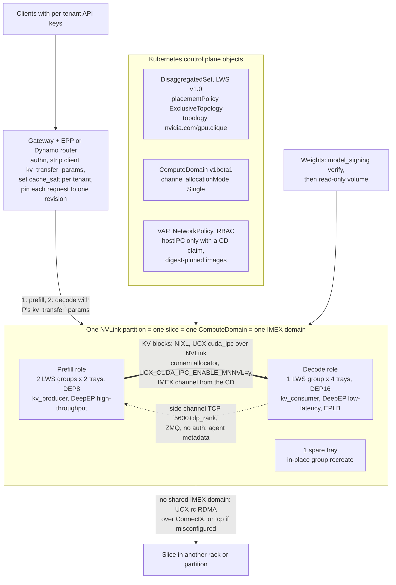
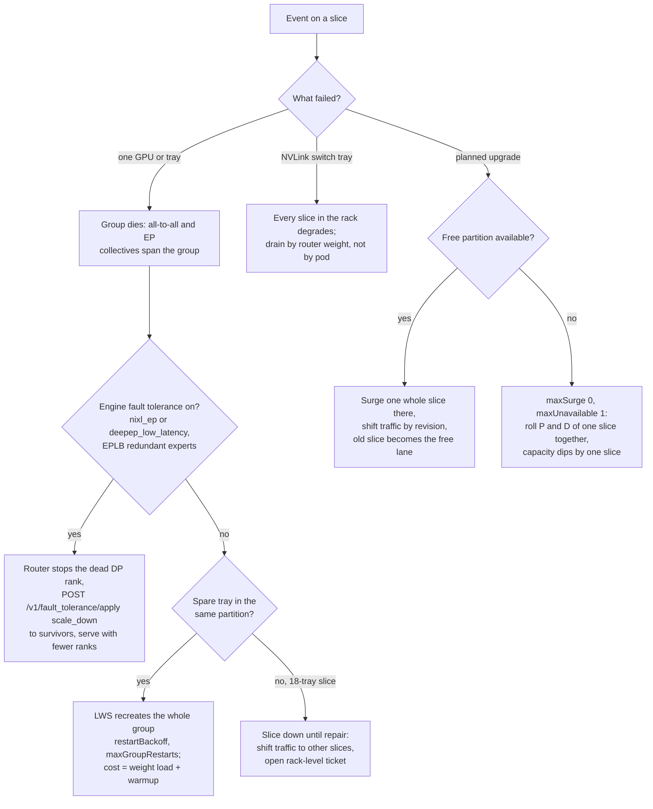

# Lesson 71 — Rack-scale inference serving on NVL72: disaggregated prefill/decode and wide expert parallelism inside one NVLink domain, NIXL KV transfer over NVLink vs RDMA, ComputeDomain-backed replicas, the blast radius of an 18-tray replica, whole-partition scaling and upgrades, and securing KV-cache movement between tenants

*2026-11-20*

[Lesson 70](/lessons/70-rack-scale-gpu-nvl72-operations) treated an NVL72 rack as a failure domain for any workload. This lesson puts inference on it. On Hopper, disaggregated serving ([L22](/lessons/22-prefill-decode-disagg-moe-serving)) meant prefill and decode pools linked by RDMA, and expert parallelism stopped at 8 GPUs per NVLink island. On GB200/GB300 the prefill pool, the decode pool and a wide-EP group can all sit inside **one 72-GPU NVLink domain**. That changes the unit you schedule, scale, upgrade, page on and isolate: it's no longer a pod or a node, it's a **slice** (a full prefill + decode set) pinned to an **NVLink partition** and wrapped in a **ComputeDomain**. The KV cache now moves between trays over the same fabric that carries tenants' GPU memory, through a transfer library whose control channel has no authentication.

> **What's verified here (2026-11-20).** Release facts come from GitHub release pages: Dynamo **v1.6.2** (2026-11-05; pins vLLM v0.31.0, SGLang v0.5.21, TensorRT-LLM v1.3.0rc29, NIXL v1.4.1 in the vLLM image / v1.5.0 in Frontend+SGLang, UCX v1.21.0), NIXL **v1.5.2** (2026-10-29), vLLM **v0.34.0** (2026-11-16), LWS **v1.0.0** (2026-10-16, adds DisaggregatedSet sub-roles, `maxGroupRestarts`, `restartBackoff`), SGLang v0.5.23, llm-d **v1.0** (blog 2026-10-20), DRA driver v0.5.1 (L70). Behavior comes from source and docs at those versions: vLLM `docs/features/nixl_connector_usage.md`, `docs/serving/expert_parallel_deployment.md`, `docs/usage/security.md` and `vllm/distributed/kv_transfer/kv_connector/v1/nixl/*.py` on main (2026-11-20); SGLang `pd_disaggregation.mdx` and `server_arguments.mdx`; LWS v1.0.0 API types and the DisaggregatedSet placement-policy doc; the llm-d DeepSeek-V4 GB200 guide (`guides/models/deepseek-v4`, main 2026-11-18). Advisories come from the vLLM GitHub security-advisory API. **Tests on this box:** the ComputeDomain, DisaggregatedSet, NetworkPolicies, ValidatingAdmissionPolicy and RBAC below were applied to a real **kube-apiserver v1.37.2** with the LWS v1.0.0 and DRA v0.5.1 CRDs (no controllers or webhooks running, so DisaggregatedSet webhook validation was not exercised). The denials quoted are the ones it returned. `slice_plan.py` ran here; its output is quoted. **Nothing ran on GB200 hardware**: transport and engine behavior is quoted from docs and source, and wire times are arithmetic, not measurements.

## What interviewers are really probing

- **Do you know what the replica is?** On NVL72 the serving replica isn't "a pod with 8 GPUs". It's a slice: prefill groups + decode groups, each an LWS group of whole trays, co-located in one NVLink partition and sharing one ComputeDomain so KV can move over NVLink. Say "slice = partition = ComputeDomain = blast-radius unit = rollout unit" and explain each equals sign.
- **Do you know why NVLink matters for KV transfer, and when it doesn't?** For an MLA model with an FP8 KV cache, an 8K-token prompt is ~288 MB of KV (DeepSeek-V3 shape, derived below). That's ~0.3 ms over NVLink 5 vs ~5.8 ms over one 400G NIC. For a GQA model like Llama-3.1-70B with a BF16 cache it's ~2.7 GB: ~3 ms vs ~54 ms. The interviewer wants the arithmetic and the conclusion: NVLink KV transfer turns disaggregation from "only for long prompts" into "almost always worth it" inside a rack, and the silent fallback to RDMA or TCP is a TTFT incident.
- **Do you understand wide EP's failure semantics?** A DEP16 decode group is one collective. One GPU Xid kills all 16 ranks unless the engine has fault tolerance (vLLM `--enable-fault-tolerance` with `nixl_ep` or `deepep_low_latency` and EPLB redundant experts). LWS default `RecreateGroupOnPodRestart` recreates the **whole group**. Recovery cost is weight load + warmup, not pod start.
- **The 18-tray replica question.** "Why not one 72-GPU replica per rack?" Because it has no in-rack spare, one tray takes 100% of the rack's serving capacity offline until repair, and a rolling upgrade needs a whole free rack. Expect to defend 16-tray or 2×8-tray slices with spares, using numbers.
- **Upgrades in whole-partition units.** `maxSurge: 1` on a slice means "find another free NVLink partition". The llm-d recipe sets `maxSurge: 0, maxUnavailable: 1` for exactly this reason, and LWS v1.0 made that the DisaggregatedSet default. Can you plan a rollout lane, and do you know P and D must upgrade together (NIXL compatibility hash)?
- **Security of KV movement.** KV blocks are derived from tenants' prompts. vLLM's docs say inter-node traffic, including KV transfer, is **insecure by default**. The NIXL side-channel listener is a plain ZMQ socket, and `kv_transfer_params` (remote host, port, block IDs) rides in the **API request body**. Interviewers from inference platforms ([L64](/lessons/64-mock-security-deep-dive-weights-platform)) want to hear who is allowed to set those fields, what NetworkPolicy can and can't see (NVLink and RDMA verbs bypass it), and why `cache_salt` isn't an isolation boundary.

## Core diagram

![Rack-scale disaggregated serving on NVL72: clients reach a gateway and endpoint picker that authenticates, strips client-supplied kv_transfer_params, sets a per-tenant cache_salt and pins each request to one revision; inside one NVLink partition that is one slice, one ComputeDomain and one IMEX domain, a prefill role (2 LWS groups of 2 trays, DEP8) sends KV blocks to a decode role (1 LWS group of 4 trays, DEP16) over NIXL with UCX cuda_ipc on NVLink, with an unauthenticated ZMQ side channel on TCP 5600 plus dp_rank and one spare tray; Kubernetes objects DisaggregatedSet with ExclusiveTopology on nvidia.com/gpu.clique, ComputeDomain with a Single channel, and VAP, NetworkPolicy and RBAC control the slice; signed weights are verified then mounted read-only; KV to a slice in another rack falls back to UCX rc RDMA or tcp](/rack-scale-inference-nvl72-disagg-serving.png)

**How to read it.** The gateway is the only thing allowed to decide which prefill and decode workers pair up, so it's also where tenant controls live. Everything inside the box shares one IMEX domain. That's why NVLink KV transfer works, and why the box can belong to only one tenant. The dashed arrow out of the box is what happens when P and D don't share an IMEX domain: UCX picks RDMA over the ConnectX NICs, or TCP if RDMA is also misconfigured. Nothing errors. TTFT just gets worse.



**Failure and rollout decisions, in slice units.**

![Decision flow for an event on a slice: a GPU or tray fault kills the whole group because all-to-all and EP collectives span it; with engine fault tolerance (nixl_ep or deepep_low_latency plus EPLB redundant experts) the router stops the dead DP rank and survivors scale down via POST /v1/fault_tolerance/apply; without it, a spare tray in the same partition lets LWS recreate the group with restartBackoff and maxGroupRestarts at the cost of weight load and warmup, while an 18-tray slice with no spare stays down until repair; an NVLink switch-tray fault degrades every slice in the rack and is drained by router weight; a planned upgrade surges a whole slice into a free partition if one exists, otherwise rolls P and D of one slice together with maxSurge 0 and maxUnavailable 1](/rack-scale-inference-nvl72-failure-rollout.png)



## Idiosyncrasies / operator depth

### The stack in November 2026, and which layer owns what

| Layer | What you'd run | Owns | Version notes (verified) |
|---|---|---|---|
| Engine | vLLM (`NixlConnector` / `NixlPullConnector`), SGLang (`--disaggregation-mode`), TensorRT-LLM | Prefill/decode roles, EP all-to-all, KV layout, NIXL agent | vLLM v0.34.0 upstream; Dynamo v1.6.2 images pin vLLM v0.31.0, SGLang v0.5.21 |
| KV transfer | NIXL over UCX (`cuda_ipc`, `rc`, `tcp`), Libfabric (EFA), Mooncake, UCCL-P2P, GDS | Moving KV blocks between agents, picking a backend per memory type | NIXL v1.5.2; vLLM default backend is UCX, `kv_connector_extra_config.backends` selects others |
| Orchestration | LWS `LeaderWorkerSet` and `DisaggregatedSet` (llm-d), Grove `PodCliqueSet` + KAI Scheduler (Dynamo `DynamoGraphDeployment` with `multinode.nodeCount`) | Gang of trays per group, roles, slices, rollout, restart | LWS v1.0.0. llm-d recommends LWS 1.0.0 with `--set enableDisaggregatedSet=true` |
| Fabric | DRA driver ComputeDomain (L70) | IMEX domain + channel per workload | v0.5.1, `resource.nvidia.com/v1beta1` |
| Routing | llm-d router / EPP (Gateway API Inference Extension), Dynamo Router | Pairing P with D, prefix-cache affinity, revision pinning | llm-d v1.0 config API is v1 |

Both reference stacks attach the ComputeDomain claim the same way: a `resourceClaims` entry pointing at the CD's generated `resourceClaimTemplate`, plus `claims` on the container. The llm-d DeepSeek-V4 GB200 guide puts **both prefill and decode roles on one CD** (`wide-ep-compute-domain`). That's the NVLink KV path: P and D have to be in the same IMEX domain for cross-tray `cuda_ipc`.

### KV transfer: NVLink or RDMA, and how to tell which you got

- **NVLink KV transfer on GB-series needs three things**, from the vLLM NixlConnector guide: KV registered as VMM memory (`--enable-cumem-allocator`), `UCX_CUDA_IPC_ENABLE_MNNVL=y`, and an IMEX channel in the process (the CD claim). *"Otherwise, NIXL can only use RDMA/TCP for cross-node KVCache transfers."* There's no error. The llm-d recipe sets `UCX_TLS=cuda_ipc,rc,cuda_copy`, so a missing channel quietly gives you `rc`.
- **Check the transport, don't assume it.** `UCX_PROTO_INFO=y` prints the protocol UCX selected. KV reads should show `cuda_ipc`, not `rc` or `tcp`. Put this in the slice's readiness gate or a canary job, not in someone's memory.
- **Wire-time arithmetic** (from `slice_plan.py` below; model shapes from the HF configs; NVLink one-direction = half of NVIDIA's 1.8 TB/s bidirectional figure; NIC GB/s = line rate / 8). It assumes DP attention, where a request's KV lives on **one** rank, so one link carries it. With TP attention the KV is spread over TP ranks and links.

| Model / KV dtype | KV per token | 8K-token prompt | NVLink 5 | CX-8 800G | CX-7 400G |
|---|---|---|---|---|---|
| DeepSeek-V3 MLA (61 layers × 576), FP8 | 34.3 KiB | 288 MB | 0.32 ms | 2.88 ms | 5.76 ms |
| Llama-3.1-70B GQA (80 × 8 heads × 128 × K,V), BF16 | 320 KiB | 2,684 MB | 2.98 ms | 26.84 ms | 53.69 ms |

  These are lower bounds. Real transfers add registration, handshake, notification and descriptor overhead, which is why NIXL keeps tuning batching (v1.2.0 added `FI_MORE` write batching on EFA; v1.3.2 fixed a cross-node EFA hang in that path, introduced in 1.3.1, that left decode workers stuck in `KVPoll.WaitingForInput`).
- **Cross-rack still means RDMA.** A slice that spans partitions, or a decode pool fed by prefill in another rack, falls back to `rc` over the scale-out NICs. That's fine and expected. Size it as an RDMA problem ([L19](/lessons/19-gpu-topology-nvlink-rdma-nccl), [L40](/lessons/40-infiniband-roce-fabric-operations)): `UCX_NET_DEVICES` restricted to the IB/RoCE HCAs (the recipe leaves it commented out), and NIXL ≥1.2 with UCX ≥1.21 sets `UCX_MAX_HCA_PER_GPU=auto`.
- **SGLang's equivalent** is `--disaggregation-transfer-backend` (`mooncake` default, `nixl`, `mori`, `mooncake_tcp`, …). For NVL72 with Mooncake, the docs say set `SGLANG_MOONCAKE_CUSTOM_MEM_POOL=NVLINK` and `MC_FORCE_MNNVL=True`, and note that *auxiliary data still goes over TCP*. Prefill runs a bootstrap server on `--disaggregation-bootstrap-port` (default **8998**). That's another control port to fence.

### The pull protocol: what crosses the wire, and when

vLLM's NixlConnector is pull-based by default (decode reads from prefill):

1. The router sends the request to P with `kv_transfer_params: {do_remote_decode: true}`. P prefills, holds the blocks, and returns `kv_transfer_params` containing `remote_block_ids`, `remote_engine_id`, `remote_request_id`, `remote_host`, `remote_port`.
2. The router sends the request to D with those params and `do_remote_prefill: true`.
3. D handshakes with P's **side channel** (`VLLM_NIXL_SIDE_CHANNEL_HOST`:`VLLM_NIXL_SIDE_CHANNEL_PORT`, default port **5600**, **+ dp_rank** per worker on a host). It fetches NIXL agent metadata, which NIXL describes as connection info for each backend plus remote segment identifiers. Then D issues NIXL reads of P's blocks and notifies P.
4. P holds blocks under a **lease**: `kv_lease_duration` defaults to **30 s**. D heartbeats every ~`lease/6` while the request waits in D's queue. Expired leases show up as `vllm:nixl_num_kv_expired_reqs` on P and `vllm:nixl_num_declined_expired_reads` on D.
5. If the load fails, `kv_load_failure_policy` decides: `fail` (default; the request errors) or `recompute` (D does the prefill itself with decode-tuned settings, which the docs warn causes jitter for every other decode).

Two consequences operators miss:

- **The handshake checks a compatibility hash** (`compute_nixl_compatibility_hash`; `NIXL_CONNECTOR_VERSION = 17` on main today, and it changes often). Mismatched vLLM versions, KV layouts, block sizes, transfer mode or speculative configs fail the handshake *before* agent metadata is decoded. That's good: it fails loudly. It also means **P and D of a slice are one upgrade unit.**
- **`kv_transfer_params` is a request field.** In the reference flow, the router (or llm-d's routing sidecar on decode pods) sets it. vLLM also accepts it from any caller who can reach the API port. See Security.

### Wide EP inside one NVLink domain

- **vLLM** picks the all-to-all with `--all2all-backend`: `deepep_high_throughput` for prefill, `deepep_low_latency` for decode (CUDA graphs), and `flashinfer_nvlink_one_sided` / `_two_sided` for MNNVL systems. `auto` chooses `flashinfer_nvlink_one_sided` on GB200/GB300/VR200 topologies for supported dtypes when elastic EP is off. EPLB is `--enable-eplb --eplb-config '{"num_redundant_experts":N,...}'`. The docs recommend 32 redundant experts at large scale.
- **SGLang** uses `--moe-a2a-backend deepep|nixl|mooncake|megamoe|flashinfer_nvlink_one_sided|…`, `--deepep-mode auto` (low-latency for decode batches, normal for prefill), `--enable-eplb`, `--ep-num-redundant-experts`.
- **Shapes people actually ran.** SGLang's GB200 NVL72 DeepSeek V3/R1 work (Sept 2025) used **48 decode ranks** (12 trays) and 2–4 ranks per prefill instance. Their write-up notes that smaller prefill instances *"minimiz[e] the explosion radius."* The llm-d DeepSeek-V4-Pro GB200 guide ships operating points from 1P(DEP8)+1D(TP8) on 4 nodes/16 GPUs up to 3P(DEP8)+2D(DEP16) on 14 nodes/56 GPUs. **None of the published layouts uses all 18 trays as one replica.**
- **Fault tolerance changes the blast radius.** vLLM: `--enable-fault-tolerance --enable-expert-parallel` with an FT-capable backend (`nixl_ep` or `deepep_low_latency`). `retry` works when all workers are alive. `scale_down` removes dead DP ranks but needs `--enable-eplb` with enough redundant expert slots to fit every logical expert on the survivors, plus access to the original checkpoint so the survivors can reload expert weights. An external orchestrator drives it via `POST /v1/fault_tolerance/apply` and `GET /v1/fault_tolerance/status`, with the same `request_id` sent to every engine. Default `request_failure_policy` is `fail`. Scale-down does **not** bring capacity back; you still have to rebuild the group.

### ComputeDomain-backed replicas: the constraints that shape layout

From L70, all still true here:

- **One CD per node at a time.** A tray can't host pods from two slices' CDs, so slice boundaries fall on tray boundaries. Each pod requests `nvidia.com/gpu: 4` (whole tray). The llm-d recipe uses `DP_SIZE_LOCAL=4`, `TP_SIZE=1`.
- **`numNodes` is deprecated**, and pods are released as soon as the *local* IMEX daemon is ready. An LWS group that's all `Running` hasn't necessarily joined its NVLink peers. vLLM's DP rendezvous (`--data-parallel-address $(LWS_LEADER_ADDRESS)`, RPC port) is the real barrier. Note that the llm-d recipe still sets `numNodes: 1`. Copy the intent, not the field.
- **CD and claim must be in the same namespace.** That's what makes a namespace the tenant boundary for the fabric.
- **DisaggregatedSet shares templates across slices**, so `slices: N` means N slices referencing the **same** resourceClaimTemplate and so the same CD object. The driver tracks membership per clique (`ComputeDomainClique` objects), but if you want *one CD per slice* (a clean per-slice IMEX domain and blast radius), run **one DisaggregatedSet per partition with `slices: 1`**. That's what the YAML below does.

### Placement: partitions, slices and what "exclusive" really excludes

- `spec.placementPolicy.type: ExclusiveSlice` co-locates a slice's roles in one topology domain and spreads that set's slices across domains. `ExclusiveTopology` adds *at most one slice per domain across all DisaggregatedSets*. Use `topology: nvidia.com/gpu.clique`, the partition label from L70, not a rack label. With a rack label, two partitions in the same rack would count as one domain.
- **Gotcha: exclusivity is pod anti-affinity on DisaggregatedSet labels only.** The LWS docs say it outright: *"Unrelated, non-DisaggregatedSet workloads … can still share the domain unless node taints or dedicated node pools are configured."* A batch job can land on your spare tray. Taint the serving partitions and give only serving pods the toleration.
- **Gotcha: clique spread is not rack spread.** Two 9-tray partitions in one rack are two domains, so `ExclusiveSlice` will happily put both slices of a set in the same rack. One switch-tray fault then degrades both. If rack diversity matters, split sets per rack or add a rack-level spread rule through your queueing layer (Kueue TAS, [L20](/lessons/20-training-inference-scheduling-kueue-volcano)).
- **Affinity is injected when child LWSs are created.** Changing `placementPolicy` takes effect on the next rollout, not immediately.

### Blast radius of an 18-tray replica, in numbers

`slice_plan.py` (below) on 4 racks:

| Layout | Slices | Serving GPUs / installed | Spare trays per domain | Worst single-GPU fault (no engine FT) | Rolling one slice at a time, no surge |
|---|---|---|---|---|---|
| 1 × 18-tray slice per rack | 4 | 288 / 288 (100%) | **0**: slice stays down until repair | **25%** of capacity | dips to 75% |
| 1 × 16-tray slice per rack | 4 | 256 / 288 (88.9%) | 2 | 25%, recovers in place | dips to 75% |
| 2 × 9-tray partitions, 8-tray slices | 8 | 256 / 288 (88.9%) | 1 | **12.5%**, recovers in place | dips to 87.5% |

An 18-tray replica buys 11% more serving GPUs. In exchange, every single tray fault becomes a whole-rack outage that lasts until the RMA is done. A switch-tray fault degrades every slice in the rack whatever the layout, since all partitions share the 9 switch trays (L70's ~1/9 bandwidth math). The 2×8 layout is what I'd default to for one large MoE model. Use one 16-tray slice per rack only when the model's decode really needs DEP64.

### Scaling and upgrading in whole-partition units

- **Unit of scale.** LWS `size` = trays per group. `replicas` = groups per role. DisaggregatedSet `slices` = full P+D copies. Roles can be `scaling.mode: External`, which auto-creates a `DisaggregatedSetRoleScaler` with a **scale subresource** for HPA/KEDA ([L28](/lessons/28-inference-autoscaling-scale-to-zero)). The smallest step for a role is one group (2 or 4 trays). The smallest step for capacity with locality is one slice (one partition). Autoscaling inside a slice only works if the partition has free trays. Otherwise the scaler creates Pending groups.
- **LWS v1.0 rollout semantics.** `maxUnavailable` defaults to 1 and `maxSurge` to 0, counted in **groups**. They can't both be 0. In `Ordinal` mode the `partition` field gives canaries, but DisaggregatedSet rejects `partition`. DisaggregatedSet v1.0 rolls roles "in proportion to their replica counts" (fractional rollout window), and allows opt-in scale-down during rollouts (`spec.scalingPolicy.duringRollout: AdvanceRollout`).
- **Surge = a free partition.** With `ExclusiveTopology`, a surge group has to co-locate with its slice, inside a partition that's already full. That's why the llm-d recipe overrides to `maxSurge: 0, maxUnavailable: 1` (*"would require a full spare copy of the role to schedule, which deadlocks rollouts on clusters sized for exactly one copy"*). The pattern I use: keep **one empty partition per pool as a rollout lane**. Bring the new revision up as a new slice there, shift traffic by revision at the router, drain the old slice, and the freed partition becomes the next lane. That's blue/green at partition granularity, and it costs one partition of idle capacity ([L51](/lessons/51-gitops-progressive-delivery-fleet-scale)).
- **Revision pinning matters for P/D.** llm-d's router *"pin[s] each request to one DisaggregatedSet revision during rollouts"*, so an old-revision P never hands KV to a new-revision D. If you build your own router, do the same. The compatibility hash will otherwise fail those requests during every rollout.
- **Restart storms.** v1.0 adds `maxGroupRestarts` (after it's exhausted, the group stays down until someone sets `leaderworkerset.sigs.k8s.io/recover=true` on the retained leader pod) and `restartBackoff` (exponential, `baseSeconds` default 10, `capSeconds` default 300, measured from leader creation). A tray that Xids on every weight load won't spin forever, burning NVMe bandwidth and IMEX churn. Use `RecreateGroupAfterStart` so a gang still waiting for capacity isn't recreated in a loop.

## Concrete commands & config

### Preflight: is this partition ready to host a slice?

```bash
# Partition labels and current CD ownership per tray (label owner: GFD or the DRA plugin, not both; L70)
kubectl get nodes -l nvidia.com/gpu.product=NVIDIA-GB200 \
  -L nvidia.com/gpu.clique,resource.nvidia.com/computeDomain --sort-by=.metadata.labels.nvidia\\.com/gpu\\.clique

# CRDs the slice needs: LWS/DisaggregatedSet and ComputeDomain
kubectl get crd leaderworkersets.leaderworkerset.x-k8s.io disaggregatedsets.disaggregatedset.x-k8s.io \
  computedomains.resource.nvidia.com

# Free trays per partition (no CD label = not owned by any slice). Spares must exist *inside* the partition.
kubectl get nodes -l 'nvidia.com/gpu.product=NVIDIA-GB200,!resource.nvidia.com/computeDomain' \
  -o custom-columns=NODE:.metadata.name,CLIQUE:.metadata.labels.nvidia\\.com/gpu\\.clique
```

### The slice (applied to kube-apiserver v1.37.2 with LWS v1.0.0 + DRA v0.5.1 CRDs)

Prefill role shown in full. Decode differs only in `replicas: 1`, `size: 4`, `--data-parallel-size=16`, `--all2all-backend=deepep_low_latency`, `--enable-eplb` and `kv_role: kv_consumer`. The vLLM flags are taken from the llm-d DeepSeek-V4 GB200 recipe and trimmed. That recipe computes `--data-parallel-start-rank` in a bash wrapper from `LWS_WORKER_INDEX`.

```yaml
apiVersion: resource.nvidia.com/v1beta1
kind: ComputeDomain
metadata: {name: dsv3-slice0, namespace: tenant-a-serving}
spec:
  numNodes: 0                      # deprecated; 0 = don't gate Ready on a node count
  channel:
    allocationMode: Single
    resourceClaimTemplate: {name: dsv3-slice0-channel}
---
apiVersion: disaggregatedset.x-k8s.io/v1
kind: DisaggregatedSet
metadata: {name: dsv3, namespace: tenant-a-serving}
spec:
  slices: 1                          # one DisaggregatedSet per partition -> one CD per slice
  placementPolicy:
    type: ExclusiveTopology          # at most one slice per partition across all DisaggregatedSets
    topology: nvidia.com/gpu.clique
  roles:
  - name: prefill
    spec:
      replicas: 2                    # 2 groups x 2 trays
      rolloutStrategy:
        type: RollingUpdate
        rollingUpdateConfiguration: {maxSurge: 0, maxUnavailable: 1}   # surge = a free partition
      leaderWorkerTemplate:
        size: 2                      # trays per group -> DEP8
        restartPolicy: RecreateGroupAfterStart
        maxGroupRestarts: 3
        restartBackoff: {baseSeconds: 30, capSeconds: 600}
        workerTemplate:
          metadata:
            labels: {app.kubernetes.io/part-of: dsv3, llm-d.ai/role: prefill}
          spec:
            serviceAccountName: dsv3-serving          # automountServiceAccountToken: false on the SA
            hostIPC: true                             # cross-pod cuda_ipc, per the llm-d recipe
            resourceClaims:
            - {name: cd-channel, resourceClaimTemplateName: dsv3-slice0-channel}
            containers:
            - name: vllm
              image: registry.internal.example/serving/vllm@sha256:<digest>
              command: ["vllm", "serve", "/models/dsv3"]
              args:
              - --enable-expert-parallel
              - --data-parallel-hybrid-lb
              - --data-parallel-size=8
              - --data-parallel-size-local=4
              - --data-parallel-address=$(LWS_LEADER_ADDRESS)
              - --data-parallel-rpc-port=5555
              - --enable-cumem-allocator                # VMM-registered KV: required for MNNVL cuda_ipc
              - --kv-transfer-config={"kv_connector":"NixlConnector","kv_role":"kv_producer","kv_load_failure_policy":"fail"}
              env:
              - {name: UCX_TLS, value: "cuda_ipc,rc,cuda_copy"}   # no tcp: fail loudly instead of crawling
              - {name: UCX_CUDA_IPC_ENABLE_MNNVL, value: "y"}
              - {name: NCCL_MNNVL_ENABLE, value: "1"}
              - name: VLLM_NIXL_SIDE_CHANNEL_HOST
                valueFrom: {fieldRef: {fieldPath: status.podIP}}
              ports: [{name: http, containerPort: 8000}, {name: nixl, containerPort: 5600}]
              resources:
                limits: {nvidia.com/gpu: "4"}
                claims: [{name: cd-channel}]
              volumeMounts: [{name: weights, mountPath: /models/dsv3, readOnly: true}]
            volumes:
            - name: weights
              persistentVolumeClaim: {claimName: dsv3-weights-verified, readOnly: true}
```

The apiserver stored the defaults you'd expect: `rolloutStrategy` came back as `{"maxSurge":0,"maxUnavailable":1,"partition":0}`, and `maxGroupRestarts`/`restartBackoff` survived pruning. Dropping `tcp` from `UCX_TLS` is my choice, not the recipe's (it uses `cuda_ipc,rc,cuda_copy` too, while the Dynamo Qwen recipe uses `cuda_copy,cuda_ipc,tcp`). Without `tcp`, a broken RDMA path fails the KV load (`fail` policy) and shows up in metrics. With it, the slice just gets slow.

### Prove the KV path is NVLink (run in a canary pod per slice after every rollout)

```bash
# 1. Fabric joined and channel present (L70 checks)
nvidia-smi -q | grep -A3 -i fabric            # State: Completed, Status: Success
test -c /dev/nvidia-caps-imex-channels/channel0 && echo "IMEX channel present"

# 2. Which UCX transport KV reads use: expect cuda_ipc, not rc/tcp
UCX_PROTO_INFO=y <your one-request P/D smoke test> 2>&1 | grep -E 'cuda_ipc|rc_mlx5|tcp' | sort | uniq -c

# 3. NIXL health from vLLM metrics on P and D
curl -s localhost:8000/metrics | grep -E 'vllm:nixl_(num_failed_transfers|num_kv_expired_reqs|num_declined_expired_reads|num_notifications_after_expiry)'
```

### Alerts that map to slice-level decisions (PromQL template, not run)

```yaml
- alert: NixlKvLeaseExpiring        # D queue longer than the 30 s lease: decode under-provisioned
  expr: sum by (slice) (rate(vllm:nixl_num_kv_expired_reqs[5m])) > 0
  for: 10m
- alert: NixlReadsOfRecycledBlocks  # "Potentially invalid KV blocks": correctness, page immediately
  expr: sum by (slice) (increase(vllm:nixl_num_notifications_after_expiry[5m])) > 0
- alert: NixlTransferFailures
  expr: sum by (slice) (rate(vllm:nixl_num_failed_transfers[5m])) > 0.01
  for: 5m
```

`slice` here is a relabel from the pod label `disaggregatedset.x-k8s.io/slice` plus the set name. Alert per slice, because slices are what you drain.

### Engine fault tolerance: drive a scale-down after a dead DP rank

```bash
# Flags on every engine of the group (vLLM): --enable-fault-tolerance --enable-expert-parallel \
#   --all2all-backend deepep_low_latency --enable-eplb --eplb-config.num_redundant_experts 32 \
#   --fault-tolerance-config '{"request_failure_policy":"recompute"}'
RID=ft-$(date +%s)                       # new, non-empty id per recovery round, same on every engine
for h in $SURVIVORS; do
  curl -s -XPOST "http://$h:8000/v1/fault_tolerance/apply" -H 'content-type: application/json' \
    -d "{\"request_id\":\"$RID\",\"instruction\":\"scale_down\",\"params\":{\"removed_dp_ranks\":[5]}}"
done
for h in $SURVIVORS; do curl -s "http://$h:8000/v1/fault_tolerance/status"; done   # wait for healthy
```

The body shape (`instruction` ∈ `retry`/`scale_down`, `params`, non-empty `request_id`; HTTP 202 then poll status) is from `vllm/entrypoints/serve/fault_tolerance/api_router.py` on main. `removed_dp_ranks` (plus `dp_master_ip`/`dp_store_port` if the removed rank hosted the DP store) is from the EP deployment doc. These endpoints sit under `/v1`, so **anyone with an API key can call them** unless the gateway blocks the path (see Security).

### SGLang equivalent (one P, one D, NIXL backend)

```bash
python -m sglang.launch_server --model-path $MODEL --disaggregation-mode prefill \
  --disaggregation-transfer-backend nixl --disaggregation-bootstrap-port 8998 \
  --moe-a2a-backend deepep --deepep-mode auto --enable-eplb
python -m sglang.launch_server --model-path $MODEL --disaggregation-mode decode \
  --disaggregation-transfer-backend nixl --moe-a2a-backend deepep --deepep-mode auto
# Mooncake on NVL72 instead: SGLANG_MOONCAKE_CUSTOM_MEM_POOL=NVLINK MC_FORCE_MNNVL=True (aux data stays on TCP)
```

### `slice_plan.py`: blast radius, rollout dip and KV wire time

```python
#!/usr/bin/env python3
"""slice_plan.py: blast radius, rollout dip and KV-transfer time for rack-scale serving layouts.
Pure arithmetic from the inputs: no vendor numbers except the ones you pass in."""
import argparse, math

def plan(racks, trays_per_rack, partitions_per_rack, slice_trays, gpus_per_tray=4):
    part_trays = trays_per_rack // partitions_per_rack
    if slice_trays > part_trays:
        raise SystemExit(f"slice ({slice_trays} trays) does not fit a {part_trays}-tray partition")
    domains = racks * partitions_per_rack
    slices = domains                      # ExclusiveTopology: at most one slice per domain
    spare = part_trays - slice_trays      # trays left in each domain for hot replacement
    serving_gpus = slices * slice_trays * gpus_per_tray
    total_gpus = racks * trays_per_rack * gpus_per_tray
    print(f"layout: {racks} racks x {partitions_per_rack} partitions of {part_trays} trays; "
          f"slice = {slice_trays} trays ({slice_trays*gpus_per_tray} GPUs)")
    print(f"  slices: {slices}   serving GPUs: {serving_gpus}/{total_gpus} "
          f"({100*serving_gpus/total_gpus:.1f}% of installed)")
    print(f"  spare trays per partition: {spare}  -> "
          + ("group can be recreated in place after one tray loss" if spare >= 1
             else "NO in-domain spare: one tray loss keeps the slice down until repair or reschedule elsewhere"))
    print(f"  one GPU fault, no engine fault tolerance, worst case (it hits the only decode group): lose 1 slice = {100/slices:.1f}% of serving capacity")
    print(f"  one switch-tray fault: all {partitions_per_rack} slice(s) in that rack degrade "
          f"(shared NVLink fabric), {100*partitions_per_rack/slices:.1f}% of slices affected")
    print(f"  rolling one slice at a time with no surge: capacity dips to {100*(slices-1)/slices:.1f}%; "
          f"surge needs a whole free domain (rack partition), not {slice_trays} loose trays")

def kv_xfer(name, layers, kv_elems_per_layer, bytes_per_elem, tokens, links):
    per_tok = layers * kv_elems_per_layer * bytes_per_elem
    total = per_tok * tokens
    print(f"{name}: {per_tok/1024:.1f} KiB/token, {tokens} tokens = {total/1e6:.0f} MB per request")
    for lname, gbps in links:
        print(f"   {lname:<34} {1e3*total/(gbps*1e9):8.2f} ms  (wire time only, one link)")

if __name__ == "__main__":
    ap = argparse.ArgumentParser()
    ap.add_argument("--racks", type=int, default=4)
    ap.add_argument("--trays", type=int, default=18)
    ap.add_argument("--partitions", type=int, default=2)
    ap.add_argument("--slice-trays", type=int, default=8)
    a = ap.parse_args()
    plan(a.racks, a.trays, a.partitions, a.slice_trays)
    links = [("NVLink 5 (900 GB/s one direction)", 900), ("ConnectX-8 800G (100 GB/s)", 100),
             ("ConnectX-7 400G (50 GB/s)", 50)]
    # DeepSeek-V3 MLA: 61 layers x (kv_lora_rank 512 + rope 64) latent, FP8 KV cache
    kv_xfer("DeepSeek-V3 MLA, FP8 KV", 61, 512 + 64, 1, 8192, links)
    # Llama-3.1-70B GQA: 80 layers x 8 KV heads x 128 dim x (K,V), BF16 KV cache
    kv_xfer("Llama-3.1-70B GQA, BF16 KV", 80, 8 * 128 * 2, 2, 8192, links)
```

Output (this box):

```text
layout: 4 racks x 2 partitions of 9 trays; slice = 8 trays (32 GPUs)
  slices: 8   serving GPUs: 256/288 (88.9% of installed)
  spare trays per partition: 1  -> group can be recreated in place after one tray loss
  one GPU fault, no engine fault tolerance, worst case (it hits the only decode group): lose 1 slice = 12.5% of serving capacity
  one switch-tray fault: all 2 slice(s) in that rack degrade (shared NVLink fabric), 25.0% of slices affected
  rolling one slice at a time with no surge: capacity dips to 87.5%; surge needs a whole free domain (rack partition), not 8 loose trays
DeepSeek-V3 MLA, FP8 KV: 34.3 KiB/token, 8192 tokens = 288 MB per request
   NVLink 5 (900 GB/s one direction)      0.32 ms  (wire time only, one link)
   ConnectX-8 800G (100 GB/s)             2.88 ms  (wire time only, one link)
   ConnectX-7 400G (50 GB/s)              5.76 ms  (wire time only, one link)
Llama-3.1-70B GQA, BF16 KV: 320.0 KiB/token, 8192 tokens = 2684 MB per request
   NVLink 5 (900 GB/s one direction)      2.98 ms  (wire time only, one link)
   ConnectX-8 800G (100 GB/s)            26.84 ms  (wire time only, one link)
   ConnectX-7 400G (50 GB/s)             53.69 ms  (wire time only, one link)
--- python3 slice_plan.py --partitions 1 --slice-trays 18 (first 6 lines)
layout: 4 racks x 1 partitions of 18 trays; slice = 18 trays (72 GPUs)
  slices: 4   serving GPUs: 288/288 (100.0% of installed)
  spare trays per partition: 0  -> NO in-domain spare: one tray loss keeps the slice down until repair or reschedule elsewhere
  one GPU fault, no engine fault tolerance, worst case (it hits the only decode group): lose 1 slice = 25.0% of serving capacity
  one switch-tray fault: all 1 slice(s) in that rack degrade (shared NVLink fabric), 25.0% of slices affected
  rolling one slice at a time with no surge: capacity dips to 75.0%; surge needs a whole free domain (rack partition), not 18 loose trays
```

## Failures & fixes

| Symptom | Likely cause | Check | Fix |
|---|---|---|---|
| TTFT p50 jumps from a few ms of transfer to tens of ms after a redeploy; no errors | KV moved from NVLink `cuda_ipc` to `rc` or `tcp`: missing `--enable-cumem-allocator`, `UCX_CUDA_IPC_ENABLE_MNNVL` unset, no IMEX channel, or P and D landed in different CDs/partitions | `UCX_PROTO_INFO=y` on a smoke request; `test -c /dev/nvidia-caps-imex-channels/channel0`; `kubectl get pods -L disaggregatedset.x-k8s.io/slice -o wide` against node cliques | Restore the three MNNVL prerequisites. Make the transport check a post-rollout gate. Drop `tcp` from `UCX_TLS` so a broken path fails instead of crawling |
| Decode requests fail in bursts during a rollout; P logs handshake errors | P/D version skew: new D, old P (or the reverse). The NIXL compatibility hash rejects the handshake | D logs on handshake; pod `disaggregatedset.x-k8s.io/revision` labels of the pair | Roll P and D of a slice together (DisaggregatedSet does), and pin requests to one revision at the router |
| `vllm:nixl_num_kv_expired_reqs` climbing on P, TTFT tail grows | D queue time > `kv_lease_duration` (30 s): decode under-provisioned, or D stalled (GC, recovery) | D queue depth; `num_declined_expired_reads` on D | Scale decode groups (if the partition has trays), raise the lease via `kv_connector_extra_config.kv_lease_duration`, fix the stall. A longer lease pins more P memory |
| `Potentially invalid KV blocks` errors / `nixl_num_notifications_after_expiry` > 0 | D read blocks after P's lease expired and the blocks were reused | Both counters, per slice | Treat as a correctness incident. Keep `kv_load_failure_policy=fail`; check clock and heartbeat behavior; run versions on both sides where P exports its lease deadline in `kv_transfer_params` and D declines expired reads (the `nixl_num_declined_expired_reads` counter exists) |
| One GPU Xid; all pods of a DEP16 decode group restart; slice serves nothing for minutes | Expected without engine FT: the group is one collective, and LWS `RecreateGroupOnPodRestart`/`AfterStart` recreates the whole group. Time goes to weight load + warmup | LWS events; time from recreate to Ready; Xid on the node (L70) | Engine FT (`scale_down` with EPLB redundancy) for big decode groups; faster weight load (local NVMe cache, P2P weight transfer); keep a spare tray per partition |
| Group recreated over and over; NVMe and IMEX churn | Flapping tray or a crash at load | LWS restart count; `GroupUnschedulable` warnings | `restartBackoff` plus `maxGroupRestarts`, then taint the tray (`DeviceTaintRule`, L70). Recover with `leaderworkerset.sigs.k8s.io/recover=true` after repair |
| Rollout stuck: new group `Pending` forever | `maxSurge ≥ 1` with an exclusive partition: no free trays in the domain | `kubectl describe pod` → affinity unsatisfiable; free trays per clique (preflight) | `maxSurge: 0, maxUnavailable: 1`, or a rollout lane (free partition) and a new slice there |
| Pods `Pending` with `didn't match pod affinity rules` on first deploy | `topology` key missing on nodes: `nvidia.com/gpu.clique` not set (fabric not joined, or the label owner is misconfigured) | `kubectl get nodes -L nvidia.com/gpu.clique` | Fix fabric join and label ownership (L70). Don't switch `topology` to a rack label to "unstick" it, because that defeats partition locality |
| `label already exists for a different ComputeDomain` | A spare tray still holds a finished slice's CD, or two sets share a partition | `kubectl get nodes -L resource.nvidia.com/computeDomain` | Clean up stale CDs; one DisaggregatedSet per partition |
| Both slices of a set degrade together after a switch-tray fault | `ExclusiveSlice` on `gpu.clique` put both slices in one rack (two partitions of one rack) | Map slice → clique → rack | Split sets per rack, or spread at the queueing layer |
| Batch pods land on serving spare trays; recreate can't find room | DisaggregatedSet anti-affinity only matches DisaggregatedSet pods | `kubectl get pods -A --field-selector spec.nodeName=<spare>` | Taint serving partitions; tolerate only in serving namespaces |
| `NVSHMEM API called before NVSHMEM initialization has completed` / `init failed for transport: IBGDA` | IBGDA kernel modules missing on nodes (inter-node DeepEP) | vLLM EP troubleshooting doc | Run `tools/ep_kernels/configure_system_drivers.sh` in the node image and reboot. Inside an NVL72 partition prefer MNNVL all-to-all backends |
| Prefill/decode pods crash-loop after a crash with `/dev/shm` full | Stale shm segments survive restarts | `df -h /dev/shm` | The llm-d recipe runs `find /dev/shm -type f -delete` at start with a 2 Gi memory `emptyDir` |
| NIXL on EFA: decode stuck in `KVPoll.WaitingForInput`, empty responses | NIXL 1.3.1 progress-thread + `FI_MORE` hang | NIXL version in the image | NIXL ≥ 1.3.2 |

## Security & hardening

> **The short version.** On a rack-scale serving slice, the KV cache is tenant data moving over three channels that Kubernetes NetworkPolicy can't fully see: NVLink (not IP), RDMA verbs (bypass netfilter) and an unauthenticated TCP side channel. And the request body tells the engine where to read KV from. So isolation comes from **placement** (one tenant per partition/ComputeDomain/namespace), **the gateway** (it's the only thing allowed to set KV routing fields and cache salts), and **fabric partitioning**, with NetworkPolicy and admission as the backstop.

### Threat table

| Asset | Path an attacker would use | Control (this lesson) |
|---|---|---|
| Another tenant's KV blocks (prompt-derived state) | Share a P or D process; forge `kv_transfer_params`; reach the side channel and the RDMA fabric | One tenant per slice; gateway strips/sets KV fields; side channel fenced to the set; per-tenant fabric partitioning |
| Another tenant's prompts, via timing | Prefix-cache hits shorten TTFT (CVE-2025-46570) | Separate slices for hard tenancy; per-tenant `cache_salt` set by the gateway for soft tenancy |
| Engine availability | Client-controlled KV peer addresses (CVE-2026-94624), oversized `cache_salt` (CVE-2026-100647), FT endpoints | Strip fields, cap sizes, block `/v1/fault_tolerance/*` at the gateway |
| Node and tray | `hostPID`/`hostIPC`/root pods, `pods/exec`, `--trust-remote-code` | VAP guardrails, no exec RBAC, reviewed remote code |
| Weights | Writable hostPath cache, unsigned checkpoint, broad bucket role | `model_signing verify` before Ready, read-only mounts, read-only bucket role |

### 1. KV-cache isolation between tenants

- **The engine isn't an isolation boundary.** vLLM's security doc: *"vLLM does not provide isolation between tenants that share the same server process … Options such as `cache_salt` reduce specific cross-tenant risks, but they are not an isolation boundary."* For different customers, the unit is the **slice**: own namespace, own ComputeDomain (own IMEX domain), own NVLink partition (L70 §1), own P and D processes. With `ExclusiveTopology` plus taints, nothing else lands in the partition.
- **Never let two tenants' P and D pair up.** The router's P/D pairing decides whose KV goes where. Route pools per tenant and pin to a revision, so a request can only pair within its own slice.
- **Soft tenancy (internal teams sharing a slice): salt at the gateway, not the client.** `cache_salt` is mixed into the first block hash, so only requests with the same salt share prefixes. The research behind CVE-2025-46570 shows the TTFT signal is distinguishable at 8-token prefixes (ROC AUC 0.99, per vLLM's doc). Set `cache_salt = HMAC(gateway_secret, tenant_id)`: fixed length (CVE-2026-100647 was a multi-hundred-MB salt stalling the scheduler thread), not client-chosen, overwritten on every request. Track salt-dropping bugs as security bugs: **CVE-2026-105752** (fixed in 0.30.0) was the Harmony `/v1/responses` tool-continuation path re-submitting turns *without* the salt, which brought the cross-tenant membership oracle back.
- **KV offload tiers widen the scope.** Host-memory, P2P and storage tiers (LMCache, the OffloadingConnector P2P tier, NIXL GDS/S3) put KV blocks outside HBM. Scope each tier per tenant, or turn it off for hard tenancy. The P2P tier takes peer addresses from requests (next section).

### 2. `kv_transfer_params` and request headers are attacker-controlled input

- vLLM's pull scheduler reads `remote_block_ids`, `remote_engine_id`, `remote_request_id`, `remote_host`, `remote_port` from the request's `kv_transfer_params` (`pull_scheduler.py`). In the reference flow the router writes them. Unless something strips them, **an API caller can write them too.**
- This isn't theoretical. **GHSA-vfp2-c8pq-v6h6** (high, vLLM 0.9.2 up to but not including 0.24.0): a caller put `___decode_addr_<host>:<port>` into `X-Request-Id`, which made a `P2pNcclConnector` prefill worker connect *outbound* to the attacker and `ncclSend` the request's KV tensors there. **CVE-2026-94624** (fixed in 0.32.0): client-supplied P2P peer addresses in `kv_transfer_params.prefill` exhausted ZeroMQ sockets and killed EngineCore. vLLM's recommendation for sensitive deployments: *"deploying behind a reverse proxy that strips or validates `kv_transfer_params`."*
- **Controls.** (1) Only the gateway/EPP and the routing sidecar can reach engine ports: NetworkPolicy below, plus the sidecar listening on the pod port while vLLM binds behind it (llm-d decode pods: sidecar on 8000, vLLM on 8200). (2) The gateway **drops** client `kv_transfer_params`, `X-Request-Id`, `cache_salt` and multimodal `uuid`, then sets its own. (3) The gateway allowlists inference paths and blocks the rest: `/v1/fault_tolerance/*` (under `/v1`, so any API key can trigger recovery), `/reset_prefix_cache`, `/kv_event_sources` (*"may reveal internal transport endpoints"*), `/invocations` (unauthenticated inference per vLLM's doc), `/metrics`.
- **Probe it, don't trust it** (template, run against staging per slice):

```bash
# Forged KV routing fields must never reach an engine. Expect: 4xx from the gateway, or the field
# absent in the engine's debug log for this request id.
curl -s https://gw.staging.example/v1/completions -H "Authorization: Bearer $TENANT_B_KEY" \
  -H 'X-Request-Id: probe-___decode_addr_10.0.0.66:9999' -H 'content-type: application/json' \
  -d '{"model":"dsv3","prompt":"x","max_tokens":1,
       "kv_transfer_params":{"do_remote_prefill":true,"remote_block_ids":[[0,1,2]],
         "remote_engine_id":"x","remote_request_id":"x","remote_host":"10.0.0.66","remote_port":5600}}'
kubectl -n tenant-a-serving logs -l llm-d.ai/role=decode --since=2m | grep -c '10.0.0.66'   # must be 0
```

### 3. Transport exposure: side channel, RDMA, NVLink

- **The NIXL side channel has no authentication.** vLLM's `_nixl_handshake_listener` is a ZMQ `ROUTER` on `VLLM_NIXL_SIDE_CHANNEL_HOST:PORT` that msgpack-decodes `(GET_META_MSG, pp_rank, tp_rank)` and replies with the encoded handshake payload (compatibility hash + NIXL agent metadata) and a timestamp. NIXL's design doc says metadata *"can be exchanged via a secure side channel or through a centralized metadata server like etcd or Redis"*. Securing that channel is left to the framework, and vLLM's is plaintext TCP. Bind it to the pod IP (default is `localhost`; the recipe uses `status.podIP`, never `0.0.0.0`) and fence `5600 + dp_rank` to the set.
- **Other control listeners to fence:** DP RPC (`--data-parallel-rpc-port`, 5555 in the recipe), `data_parallel_master_port` (default 29500), torch.distributed `TCPStore` (*"listens on all network interfaces"*, per vLLM's doc), SGLang's bootstrap server (8998), and KV-event publishers. The Dynamo recipes publish KV events on `tcp://*:5571`: all interfaces, by design, for the router.
- **Deserialization on KV control paths.** **CVE-2025-29783** and **CVE-2025-32444** (both critical) were RCE through vLLM's Mooncake integration, which unpickled data received over ZMQ. The current NIXL connector uses `msgspec` msgpack, which I verified in the source. When you adopt any KV connector or offload tier, check what it deserializes and from whom.
- **Unencrypted by default.** vLLM: *"PyTorch Distributed, KV-cache transfer, and data-parallel channels do not encrypt traffic."* For FIPS, protection has to come from outside (mTLS sidecar or IPsec). That works for TCP side channels but **not** for RDMA or NVLink data paths. None of the NIXL/vLLM docs I checked describe transport encryption for KV payloads. Treat KV transfer as plaintext on a fabric you trust.
- **NetworkPolicy's blind spots.** NVLink `cuda_ipc` isn't IP traffic, and RDMA verbs bypass the kernel's netfilter. NetworkPolicy fences the TCP side channels and nothing else. The data plane is isolated by **fabric partitioning**: NVLink partitions + one IMEX domain per CD (L70) inside the rack, and IB partition keys or RoCE VLAN/VRF per tenant across racks ([L40](/lessons/40-infiniband-roce-fabric-operations), [L46](/lessons/46-gpu-cluster-networking-fleet-scale)). If two tenants' slices share an RDMA partition, a peer holding leaked agent metadata is on the same fabric as your registered KV memory.

### 4. The privileges the reference recipes ask for, and how to contain them

The llm-d DeepSeek-V4 GB200 recipe runs vLLM with `hostIPC: true` and `hostPID: true` (*"Required for cross-pod cuda_ipc (NIXL KV transfers over MNNVL NVLink)"*), `runAsUser: 0`, `IPC_LOCK` + `SYS_RAWIO`, `--trust-remote-code`, the HF token as an env var, and a routing sidecar with `--secure-serving=false`. vLLM's EP troubleshooting section suggests `hostNetwork: true` and `privileged: true` for InfiniBand. My position:

- **Accept host namespaces only where a tray belongs to one slice.** The VAP below allows `hostIPC`/`hostPID` only in namespaces labeled tray-exclusive and only for pods holding a ComputeDomain claim (which pins them to a tray no other CD can use). Start without `hostPID`. The recipe comment justifies `hostIPC`; keep `hostPID` only if your stack fails without it.
- **No `hostNetwork` and no `privileged` on top of host namespaces.** Get RDMA devices from the device plugin or DRA (and DRANET, the path llm-d v1.0 calls out), not from the host.
- **`pods/exec` into a hostPID pod is node access.** Tenant operators get read and scale, not exec (RBAC below). Break-glass access goes through a separate, audited role.
- **`--trust-remote-code` runs the model repo's Python inside that pod.** Require a review annotation (VAP), pin the model revision, and serve weights from your own signed mirror with `HF_HUB_OFFLINE=1` (as the Dynamo recipes do). Then there's no HF token on the tray at all. If a token must exist, mount it as a file rather than env, because a root process with `hostPID` can read other processes' environments.
- **Turn on TLS for the routing sidecar** (`--secure-serving=false` in the recipe), or keep it reachable only from the EPP by NetworkPolicy.

### 5. Weights, images, buckets, secrets

- **Weights integrity before Ready.** The OCI overlay keeps the ~850 GB model in a `hostPath` (`DirectoryOrCreate`) that outlives pods and is writable by any root pod on the tray. Prefer a verified, read-only PVC or ImageVolume ([L68](/lessons/68-k8s-136-138-gpu-ai-platforms)). If you keep a node cache, verify it in an init step every time a group starts:

```bash
model_signing verify /models/dsv3 \
  --signature /models/dsv3/model.sig \
  --identity "https://github.com/acme/release/.github/workflows/promote.yml@refs/heads/main" \
  --identity-provider "https://token.actions.githubusercontent.com"
```

  Engine fault tolerance makes this sharper: `scale_down` needs survivors to **reload expert weights from the original checkpoint** in the middle of an incident. That path has to be reachable and verified too, not just the startup path ([L13](/lessons/13-ml-weights-checkpoint-hardening), [L27](/lessons/27-gpu-supply-chain-weight-registry-hydrate), [L64](/lessons/64-mock-security-deep-dive-weights-platform)).
- **Bucket IAM.** Each slice's ServiceAccount maps (workload identity, [L48](/lessons/48-workload-identity-secrets-pki-fleet-scale)) to a read-only role on `release/<model>/` only. No write, no list outside the prefix, VPC-endpoint-only, KMS decrypt bound to that role (L64's double lock).
- **Images.** Digest-pinned from the internal registry (enforced below) and signature-verified at admission ([L12](/lessons/12-node-container-hardening-supply-chain)). Scan the **engine version inside the image**, not the wrapper's: Dynamo v1.6.2 images pin vLLM v0.31.0 while upstream is v0.34.0. Check each vLLM advisory's affected range against the pinned engine.
- **Secrets.** `automountServiceAccountToken: false` on the serving SA (set in the YAML). No cloud credentials in env. Short-lived tokens via workload identity.

### 6. Admission, network and RBAC (tested on kube-apiserver v1.37.2)

```yaml
# (a) Default-deny, then three narrow allows. NetworkPolicy covers IP traffic only:
#     NVLink (cuda_ipc) and RDMA verbs (rc) never pass through netfilter.
apiVersion: networking.k8s.io/v1
kind: NetworkPolicy
metadata: {name: default-deny, namespace: tenant-a-serving}
spec:
  podSelector: {}
  policyTypes: ["Ingress", "Egress"]
---
apiVersion: networking.k8s.io/v1
kind: NetworkPolicy
metadata: {name: api-from-gateway-only, namespace: tenant-a-serving}
spec:
  podSelector:
    matchLabels: {app.kubernetes.io/part-of: dsv3}
  policyTypes: ["Ingress"]
  ingress:
  - from:
    - namespaceSelector:
        matchLabels: {kubernetes.io/metadata.name: inference-gateway}
      podSelector:
        matchLabels: {app.kubernetes.io/component: epp-or-gateway}
    ports: [{protocol: TCP, port: 8000}]
---
# NIXL side channel (5600 + dp_rank), DP RPC and torch.distributed only between pods of the
# same DisaggregatedSet. The side channel hands out agent metadata with no authentication.
apiVersion: networking.k8s.io/v1
kind: NetworkPolicy
metadata: {name: kv-control-same-set-only, namespace: tenant-a-serving}
spec:
  podSelector:
    matchLabels: {disaggregatedset.x-k8s.io/name: dsv3}
  policyTypes: ["Ingress", "Egress"]
  ingress:
  - from:
    - podSelector:
        matchLabels: {disaggregatedset.x-k8s.io/name: dsv3}
    ports:
    - {protocol: TCP, port: 5600, endPort: 5631}   # side channel: base + dp_rank, size to your DP
    - {protocol: TCP, port: 5555}                  # --data-parallel-rpc-port in the llm-d recipe
    - {protocol: TCP, port: 29500}                 # data_parallel_master_port default
  egress:
  - to:
    - podSelector:
        matchLabels: {disaggregatedset.x-k8s.io/name: dsv3}
  - to:
    - namespaceSelector: {matchLabels: {kubernetes.io/metadata.name: kube-system}}
      podSelector: {matchLabels: {k8s-app: kube-dns}}
    ports: [{protocol: UDP, port: 53}, {protocol: TCP, port: 53}]
---
# (b) Admission guardrails for serving pods (pods are created by the LWS controller, so
#     violations surface as FailedCreate events on the LeaderWorkerSet / StatefulSet).
apiVersion: admissionregistration.k8s.io/v1
kind: ValidatingAdmissionPolicy
metadata: {name: rack-serving-guardrails}
spec:
  failurePolicy: Fail
  matchConstraints:
    resourceRules:
    - apiGroups: [""]
      apiVersions: ["v1"]
      operations: ["CREATE", "UPDATE"]
      resources: ["pods"]
  variables:
  - name: hostNS
    expression: "(has(object.spec.hostIPC) && object.spec.hostIPC) || (has(object.spec.hostPID) && object.spec.hostPID)"
  - name: hasCDClaim
    expression: >-
      has(object.spec.resourceClaims) && object.spec.resourceClaims.exists(c,
        has(c.resourceClaimTemplateName) || has(c.resourceClaimName))
  - name: trayExclusive
    expression: >-
      has(namespaceObject.metadata.labels) &&
      namespaceObject.metadata.labels[?'platform.example.com/tray-exclusive'].orValue('') == 'true'
  - name: allContainers
    expression: "object.spec.containers + (has(object.spec.initContainers) ? object.spec.initContainers : [])"
  validations:
  - expression: "!variables.hostNS || (variables.trayExclusive && variables.hasCDClaim)"
    message: "hostIPC/hostPID only in tray-exclusive namespaces and only for pods that hold a ComputeDomain claim"
  - expression: "!variables.hostNS || !(has(object.spec.hostNetwork) && object.spec.hostNetwork)"
    message: "hostNetwork on top of hostIPC/hostPID is not allowed; RDMA devices come from the device plugin or DRA"
  - expression: >-
      variables.allContainers.all(c, c.image.startsWith('registry.internal.example/') && c.image.contains('@sha256:'))
    message: "images must come from registry.internal.example and be pinned by digest"
  - expression: >-
      !variables.allContainers.exists(c,
        (has(c.args) && c.args.exists(a, a.contains('--trust-remote-code'))) ||
        (has(c.command) && c.command.exists(a, a.contains('--trust-remote-code')))) ||
      object.metadata.?annotations[?'security.example.com/remote-code-reviewed-digest'].orValue('') != ''
    message: "--trust-remote-code needs a reviewed-code annotation (the model repo's Python runs in a hostIPC pod)"
  - expression: >-
      !variables.allContainers.exists(c, has(c.securityContext) && has(c.securityContext.privileged) && c.securityContext.privileged)
    message: "privileged serving pods can open any IMEX channel and every device on the tray"
---
apiVersion: admissionregistration.k8s.io/v1
kind: ValidatingAdmissionPolicyBinding
metadata: {name: rack-serving-guardrails}
spec:
  policyName: rack-serving-guardrails
  validationActions: ["Deny"]
  matchResources:
    namespaceSelector:
      matchExpressions:
      - {key: platform.example.com/gpu-serving, operator: In, values: ["true"]}
---
# (c) Tenant operators: scale and read, no exec/attach/port-forward into hostPID/hostIPC pods,
#     no editing ComputeDomains (platform-owned).
apiVersion: rbac.authorization.k8s.io/v1
kind: Role
metadata: {name: serving-operator, namespace: tenant-a-serving}
rules:
- apiGroups: ["disaggregatedset.x-k8s.io"]
  resources: ["disaggregatedsets"]
  verbs: ["get", "list", "watch"]
- apiGroups: ["disaggregatedset.x-k8s.io"]
  resources: ["disaggregatedsetrolescalers", "disaggregatedsetrolescalers/scale"]
  verbs: ["get", "list", "watch", "update", "patch"]
- apiGroups: ["leaderworkerset.x-k8s.io"]
  resources: ["leaderworkersets"]
  verbs: ["get", "list", "watch"]
- apiGroups: [""]
  resources: ["pods", "pods/log", "events"]
  verbs: ["get", "list", "watch"]
- apiGroups: ["resource.nvidia.com"]
  resources: ["computedomains"]
  verbs: ["get", "list", "watch"]
```

**Test results** (`kubectl apply --dry-run=server`, binding scoped to namespaces labeled `platform.example.com/gpu-serving=true`):

| Pod | Result |
|---|---|
| hostIPC + CD claim + internal digest image, tray-exclusive namespace | `pod/ok created (server dry run)` |
| hostIPC, no CD claim | denied: `hostIPC/hostPID only in tray-exclusive namespaces and only for pods that hold a ComputeDomain claim` |
| hostIPC + claim in a namespace without the tray-exclusive label | denied (same message) |
| Tag instead of digest; public registry image | denied: `images must come from registry.internal.example and be pinned by digest` |
| `--trust-remote-code` without annotation / with annotation | denied: `--trust-remote-code needs a reviewed-code annotation …` / created |
| hostIPC + hostNetwork | denied: `hostNetwork on top of hostIPC/hostPID is not allowed …` |
| `privileged: true` | rejected **before** the VAP by the test apiserver (`--allow-privileged` defaults to false). Most GPU clusters allow privileged for driver DaemonSets, which is where the VAP rule matters |

RBAC (`kubectl auth can-i --as=op-a -n tenant-a-serving`): `get disaggregatedsets` yes, `patch disaggregatedsets` no, `patch disaggregatedsetrolescalers/scale` yes, `create pods/exec` no, `create pods/portforward` no, `delete computedomains` no.

Caveats: the side-channel port range (`5600`–`5631`) has to cover `5600 + dp_rank` for every rank that runs on a host, so size it to your DP layout. The pod labels used in selectors (`disaggregatedset.x-k8s.io/name`) are the ones the controller uses for placement affinity; confirm with `kubectl get pods --show-labels` on your version. This apiserver had no CNI, so the NetworkPolicies were validated by the API, not enforced.

## Interview soundbites

- "On NVL72 my serving replica is a **slice**: prefill and decode LWS groups in one NVLink partition, sharing one ComputeDomain. That one unit is what I schedule, scale, upgrade, page on and give to a tenant."
- "NVLink KV transfer is a configuration, not a default: cumem allocator, `UCX_CUDA_IPC_ENABLE_MNNVL=y`, an IMEX channel, and P and D in the same CD. Get any of them wrong and UCX quietly falls back to RDMA. So I gate every rollout on `UCX_PROTO_INFO` showing `cuda_ipc`."
- "An 8K-token prompt is about 0.3 GB of KV for DeepSeek-style MLA in FP8, and about 2.7 GB for a 70B GQA model in BF16. That's 3 ms versus 54 ms of wire time on NVLink versus one 400G NIC. Inside a rack, disaggregation pays almost always."
- "I don't run one 72-GPU replica per rack. It buys 11% more serving GPUs and turns every tray fault into a rack outage until the RMA lands. I run two 8-tray slices per rack with a spare tray each, so one fault costs 12.5% and recovers in place."
- "Wide EP is one collective. Without engine fault tolerance, a single Xid restarts the group and you pay a full weight load. With vLLM's `scale_down` and EPLB redundant experts you keep serving on fewer ranks, and I still treat the checkpoint as part of the recovery path."
- "Surge on rack-scale serving means a free partition. I keep one partition per pool as a rollout lane, so upgrades are blue/green by slice, and the router pins every request to one revision so P and D never mix versions."
- "`kv_transfer_params` is attacker-controlled input. vLLM has already had a header-driven KV exfiltration bug in a P2P connector. My gateway strips KV routing fields, request IDs and cache salts from clients, sets its own, and blocks the fault-tolerance and cache-reset endpoints."
- "NetworkPolicy fences the NIXL side channel. It can't see NVLink or RDMA verbs. Tenant isolation for KV data comes from NVLink partitions, one IMEX domain per CD, and IB partition keys, and `cache_salt` is a mitigation, not a boundary."

## Watch

<iframe width="100%" height="360" src="https://www.youtube.com/embed/Tyyrwd6hhQs" title="Disaggregated LLM Serving: A Kubernetes-Native Approach to Meeting AI SLOs - Pete Cheslock" frameBorder="0" allow="accelerometer; autoplay; clipboard-write; encrypted-media; gyroscope; picture-in-picture; web-share" allowFullScreen></iframe>

[Open on YouTube](https://www.youtube.com/watch?v=Tyyrwd6hhQs). Why watch: a KCD New York talk on Kubernetes-native P/D disaggregation (llm-d's routing and KV-aware scheduling) that frames disaggregation in SLO terms (TTFT vs TPOT). That's the framing to use before you get to racks. Check API names against this lesson; LWS DisaggregatedSet and llm-d v1.0 are newer than most talks.

<iframe width="100%" height="360" src="https://www.youtube.com/embed/iTxT0GyLvrU" title="SGLang x NVIDIA Dynamo: Live Meetup - Inference at Scale" frameBorder="0" allow="accelerometer; autoplay; clipboard-write; encrypted-media; gyroscope; picture-in-picture; web-share" allowFullScreen></iframe>

[Open on YouTube](https://www.youtube.com/watch?v=iTxT0GyLvrU). Why watch: NVIDIA Developer's SGLang × Dynamo meetup on inference at scale: how Dynamo orchestrates SGLang workers, and where NIXL fits as the disaggregation transfer backend. Useful for answering "Dynamo vs llm-d" without hand-waving.

<iframe width="100%" height="360" src="https://www.youtube.com/embed/GgQtgwdoOWs" title="Beyond VLLM: Distributed LLM Inferencing With Llm-d on Kubernetes - Ravindra Patil, Red Hat" frameBorder="0" allow="accelerometer; autoplay; clipboard-write; encrypted-media; gyroscope; picture-in-picture; web-share" allowFullScreen></iframe>

[Open on YouTube](https://www.youtube.com/watch?v=GgQtgwdoOWs). Why watch: a CNCF-channel walkthrough of distributed inference with llm-d on Kubernetes, from a single vLLM server to the routed, disaggregated stack. Watch it with the DeepSeek-V4 GB200 recipe open and map each component to the slice diagram above.

## References

- vLLM NixlConnector usage (MNNVL prerequisites, side channel, lease, failure policy, metrics): https://github.com/vllm-project/vllm/blob/main/docs/features/nixl_connector_usage.md
- vLLM NIXL KV lease design: https://github.com/vllm-project/vllm/blob/main/docs/design/nixl_kv_cache_lease.md
- vLLM expert-parallel deployment (all2all backends, EPLB, fault tolerance): https://github.com/vllm-project/vllm/blob/main/docs/serving/expert_parallel_deployment.md
- vLLM security guide (inter-node traffic, API-key scope, cache salting, kv_transfer_params): https://github.com/vllm-project/vllm/blob/main/docs/usage/security.md and advisories https://github.com/vllm-project/vllm/security/advisories
- NIXL (backends, metadata handler) and releases: https://github.com/ai-dynamo/nixl and https://docs.nvidia.com/nixl/getting-started/overview/
- NVIDIA Dynamo releases and multinode docs (Grove + KAI Scheduler): https://github.com/ai-dynamo/dynamo/releases and https://docs.nvidia.com/dynamo/
- LeaderWorkerSet / DisaggregatedSet v1.0.0 (rollout, subgroups, placement policy): https://github.com/kubernetes-sigs/lws/releases/tag/v1.0.0 and https://lws.sigs.k8s.io/
- llm-d v1.0 and the DeepSeek-V4 GB200 guide: https://llm-d.ai/blog/llm-d-v1.0-state-of-the-art-inference-ready-for-day-2 and https://github.com/llm-d/llm-d/tree/main/guides/models/deepseek-v4
- SGLang PD disaggregation and server arguments: https://github.com/sgl-project/sglang/tree/main/docs/docs/advanced_features
- LMSYS, DeepSeek on GB200 NVL72 with PD and large-scale EP, Part II: https://www.lmsys.org/blog/2025-09-25-gb200-part-2/
- "Leaking Secrets from Prefix Caches" (the research behind CVE-2025-46570): https://arxiv.org/abs/2411.18191
- OpenSSF model signing: https://github.com/sigstore/model-transparency
- GPU perf engineering resources (background reading): https://github.com/wafer-ai/gpu-perf-engineering-resources
- Related lessons: [L70 rack-scale operations](/lessons/70-rack-scale-gpu-nvl72-operations), [L22 P/D disaggregation & MoE](/lessons/22-prefill-decode-disagg-moe-serving), [L21 inference SLOs & KV cache](/lessons/21-inference-serving-slos-ttft-tpot-kvcache), [L19 NVLink/RDMA/NCCL](/lessons/19-gpu-topology-nvlink-rdma-nccl), [L24 multi-cluster routing](/lessons/24-multi-cluster-inference-routing-capacity), [L25 multi-tenant GPU isolation](/lessons/25-multi-tenant-gpu-isolation-quota), [L28 inference autoscaling](/lessons/28-inference-autoscaling-scale-to-zero), [L14 inference deploy hardening](/lessons/14-ml-inference-training-deploy-hardening), [L64 security deep-dive](/lessons/64-mock-security-deep-dive-weights-platform), [L68 Kubernetes 1.36–1.38 for GPU platforms](/lessons/68-k8s-136-138-gpu-ai-platforms)

> **Not verified (treat as open questions):** real NIXL KV transfer latency on GB200 (the wire times are arithmetic lower bounds); whether `hostPID` is actually needed alongside `hostIPC` for MNNVL `cuda_ipc`; how the DRA driver behaves when one ComputeDomain spans several cliques via DisaggregatedSet `slices > 1`; whether the llm-d routing sidecar strips client-supplied `kv_transfer_params` (run the probe); IMEX TLS with driver-managed daemons (open since L70); exact weight-reload time for a recreated group; the PromQL rules and the probe script (templates, not run). The YAML was validated on a real apiserver without controllers, webhooks or a CNI.

## Quick self-check

1. List the four things that must be true for prefill→decode KV to move over NVLink on GB200 with vLLM. What does UCX do if one is missing, and how do you detect it?
2. Work out the KV size and NVLink vs 400G wire time for an 8K-token prompt on an MLA/FP8 model and on a 70B GQA/BF16 model. Which assumption about attention parallelism did you make?
3. Walk through the NixlConnector pull protocol. Which fields does decode read from `kv_transfer_params`, and who should be allowed to set them?
4. What does `kv_lease_duration` protect, which two metrics tell you it's too short, and what does a longer lease cost?
5. Why must P and D of a slice upgrade together, and what does the router do during a rollout so that's safe?
6. Compare 1×18-tray, 1×16-tray and 2×8-tray layouts on blast radius, in-place recovery and rollout dip.
7. With LWS v1.0 defaults, what happens to a DEP16 decode group when one GPU Xids? What changes with vLLM `scale_down` and EPLB, and what must still be reachable?
8. Why does `maxSurge: 1` deadlock a rollout under `ExclusiveTopology`, and how does a rollout lane fix it?
9. Name three channels KV-related data moves over that NetworkPolicy can or can't see, and the isolation control for each.
10. Why is `cache_salt` set by the gateway rather than the client, and which 2026 vLLM advisory shows salts can be silently dropped?

## Next

Lesson 72: KV-cache tiering and prefix-aware routing at rack scale. HBM → Grace memory → local NVMe → remote/object tiers via NIXL (GDS, S3 over RDMA), LMCache and Dynamo's KV block manager; prefix-cache-aware routing (llm-d precise prefix-cache routing, Dynamo KV router events); hit-rate SLOs and capacity math; eviction and stale-index failure modes; and securing offloaded KV (per-tenant scoping, salts across tiers, encryption at rest, deletion guarantees).
