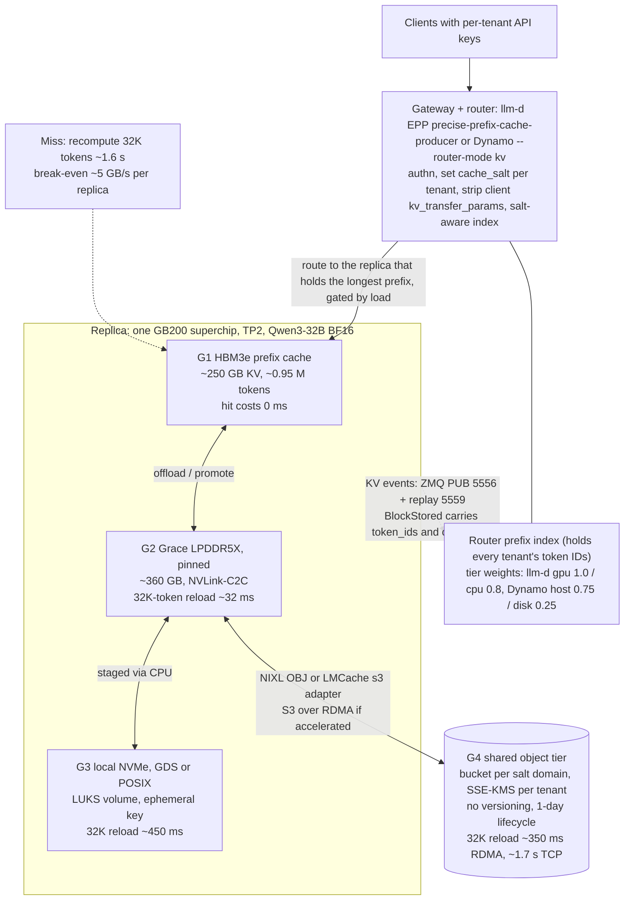

# Lesson 72 — KV-cache tiering and prefix-aware routing at rack scale: HBM → Grace memory → local NVMe → shared object tiers via NIXL, LMCache and Dynamo's KV block manager, precise prefix-cache routing from KV events, hit-rate SLOs and capacity math, eviction and stale-index failure modes, and securing offloaded KV

*2026-11-21*

[Lesson 71](/lessons/71-rack-scale-inference-nvl72-disagg-wide-ep) moved KV between prefill and decode inside one NVLink partition. This lesson is about where KV goes *between* requests. In [L21](/lessons/21-inference-serving-slos-ttft-tpot-kvcache) KV was capacity you spent per running request. Agentic and multi-turn traffic makes it state that you keep: a 32K-token coding session sends the same 30K-token prefix every turn, and recomputing it costs more GPU time than decoding the answer. So the cache becomes a storage hierarchy (HBM → Grace LPDDR5X → local NVMe → a shared object tier). The router ([L24](/lessons/24-multi-cluster-inference-routing-capacity), [L68](/lessons/68-k8s-136-138-gpu-ai-platforms) InferencePool) becomes a cache-placement engine that reads a live event stream from every engine. And every tier stores tenant data that a delete call doesn't actually delete.

> **What's verified here (2026-11-21).** Versions come from GitHub releases: vLLM **v0.34.0** (2026-11-16), LMCache **v0.5.7** (latest stable; v0.5.8rc3 is pre-release), Dynamo **v1.6.2** (2026-11-05), NIXL **v1.5.2** (2026-10-29), llm-d **v1.0.0** and llm-d Router (formerly inference-scheduler) **v1.0.0** (2026-10-16), llm-d-kv-cache **v1.0.0**. Config keys, flags, defaults and quoted behavior come from source and docs at those tags: vLLM `docs/features/kv_offloading_usage.md`, `docs/design/prefix_caching.md`, `docs/usage/security.md`, `vllm/config/kv_events.py`, `vllm/distributed/kv_events.py`, `vllm/v1/core/kv_cache_utils.py`, `vllm/v1/kv_offload/tiering/obj/config.py`; LMCache `docs/source/mp/configuration.rst`, `mp/coordinator.rst`, `mp/serde.rst`, `mp/l2_storage/s3.rst`; Dynamo `kvbm-configuration.mdx`, `frontend-configuration.mdx` and the router docs (`router-design.md`, `router-operations.md`, `kv-event-replay-comparison.md`, `offloading-support-matrix.md`); NIXL `src/plugins/obj/README.md` and `cuda_gds/README.md`; llm-d `guides/precise-prefix-cache-routing` and `guides/tiered-prefix-cache`, the llm-d Router `RELEASE-NOTES.md`, and llm-d-kv-cache `docs/architecture.md` and `pkg/kvcache/kvblock/extra_keys.go`. Advisories come from each repo's GitHub security-advisory API. Model shapes come from the Hugging Face `config.json` files. GB200 numbers come from NVIDIA's GB200 NVL72 and Grace product pages. **Tests on this box:** `tier_plan.py` ran here and its output is quoted. The NetworkPolicy, ValidatingAdmissionPolicy and pod were applied to a real **kube-apiserver v1.37.2** (no kubelet, CNI or GPUs), and the four denials quoted are the ones it returned. The bucket policy and lifecycle JSON were syntax-checked only. **Nothing ran on GB200 hardware.** Tier bandwidths are stated assumptions you should replace with your own measurements, not benchmarks.

## What interviewers are really probing

- **Do you treat the KV cache as a storage hierarchy, with arithmetic?** "Add CPU offload" isn't an answer. The answer is: KV is **256 KiB per token** for Qwen3-32B in BF16 (64 layers × 8 KV heads × 128 dims × K and V × 2 bytes). A 32K-token prefix is **8.6 GB**. Recomputing it on one GB200 superchip at 40% MFU takes about **1.6 s**. Reloading it takes about 32 ms from Grace memory over NVLink-C2C, ~450 ms from two local NVMe drives, and ~1.7 s from S3 over TCP, which loses to recompute. So the break-even is about **5 GB/s per replica**, and a tier slower than that is a liability. Interviewers want that chain, plus the MLA contrast: DeepSeek-V3 with an FP8 cache is **34.3 KiB per token**, so every tier wins.
- **Do you know that routing decides whether tiering pays?** Replica-local tiers (HBM, Grace, NVMe) only help if the next turn lands on the same replica. With round-robin over the 36 TP2 replicas of an NVL72 rack, P(hit) for a per-session prefix is **1/36 = 2.8%**. Precise prefix-cache routing (llm-d's `precise-prefix-cache-producer`, Dynamo's `--router-mode kv`) is what turns tier capacity into hits. A shared object tier changes the question from "which replica holds it" to "which tier will it come from".
- **Do you know the hash is the contract?** Engines, offload tiers and routers must agree on block size, hash algorithm and seed. Otherwise a shared tier silently never hits, or the router scores prefixes the engine can't use. The idiosyncrasies (vLLM `PYTHONHASHSEED`, `xxhash` per-process random seeds, `canonical_layout`, the llm-d router's own `hashAlgorithm`) are what interviewers poke at.
- **Can you run the event plane?** Prefix routing runs on a lossy ZMQ PUB/SUB stream of `BlockStored`/`BlockRemoved` events. You should know about replay sockets, gap detection, what happens when a router restarts after the pods are warm, and why llm-d's guide pins the EPP to **one replica**.
- **Can you write a hit-rate SLO that means something?** That means token-weighted, per tier, per tenant, and tied to TTFT. A request-level "cache hit rate" of 90% can coexist with a TTFT incident.
- **Security of offloaded KV.** KV is derived from prompts. On disk and in buckets it's tenant data, and it outlives the request, the pod and sometimes the tenant. Expect questions on per-tenant salts across every tier, encryption at rest, what "evict" means vs "erase", who can read the KV event stream (it carries **token IDs and the `cache_salt` string**), cache-timing oracles at three latency levels, and integrity (KV poisoning is a real 2026 LMCache advisory).

## Core diagram

![KV-cache tiering and prefix-aware routing at rack scale: clients with per-tenant API keys reach a gateway and router (llm-d EPP precise-prefix-cache-producer or Dynamo router-mode kv) that authenticates, sets cache_salt per tenant, strips client kv_transfer_params and keeps a salt-aware index; the router's prefix index holds every tenant's token IDs and weights tiers (llm-d gpu 1.0 and cpu 0.8, Dynamo host 0.75 and disk 0.25); it routes each request to the replica holding the longest prefix, gated by load; a replica is one GB200 superchip at TP2 serving Qwen3-32B in BF16, with G1 HBM3e prefix cache of about 250 GB (0.95 M tokens, hit costs 0 ms), G2 Grace LPDDR5X pinned tier of about 360 GB over NVLink-C2C (32K-token reload about 32 ms), and G3 local NVMe via GDS or POSIX on a LUKS volume with an ephemeral key (32K reload about 450 ms), staged through the CPU tier; G2 connects through NIXL OBJ or the LMCache s3 adapter, S3 over RDMA when accelerated, to a G4 shared object tier with a bucket per salt domain, SSE-KMS per tenant, no versioning and a 1-day lifecycle (32K reload about 350 ms over RDMA, 1.7 s over TCP); the replica publishes KV events over ZMQ PUB 5556 with replay on 5559 to the router index, and BlockStored carries token_ids and cache_salt; a miss recomputes 32K tokens in about 1.6 s, so break-even is about 5 GB/s per replica](/kv-cache-tiering-prefix-routing.png)

**How to read it.** Solid arrows are KV bytes and requests. The dotted arrow from the replica is the **event plane**: the only way the router knows what each tier holds. The numbers are for one GB200 superchip (2 B200 + 1 Grace) running Qwen3-32B at TP2 with a BF16 cache, from `tier_plan.py` below. Three things in the picture are the lesson. First, **G2 is only about 1.4× G1** on GB200 (480 GB of LPDDR5X per Grace, shared with the OS and the engine), so Grace memory is a "keep the last few turns warm" tier, not a lake. Second, G3 and G4 are only worth reading when the bandwidth beats ~5 GB/s per replica for this model. Third, the router index and the event stream hold **every tenant's token IDs**, so they're as sensitive as the prompts.



## Idiosyncrasies / operator depth

### The tier ladder on GB200, rung by rung

| Tier | Per GB200 superchip (2 GPUs) | Path into HBM | What bites |
|---|---|---|---|
| G1 HBM3e | 372 GB HBM3e total (186 GB/GPU), 8 TB/s/GPU. After Qwen3-32B weights (65.6 GB BF16) and activations: ~250 GB of KV at TP2 | — | The prefix cache shares HBM with running requests. Every block you keep for a future turn is a block a running batch can't use |
| G2 Grace LPDDR5X | Up to 480 GB per Grace at up to 512 GB/s (NVIDIA GB200 spec). Leave ~120 GB for the OS, engine processes and staging: **~360 GB usable, about 1.4× G1** | NVLink-C2C, 900 GB/s bidirectional per superchip, shared by both GPUs. I assume ~270 GB/s achieved for host-to-device | vLLM keeps its CPU tier in `/dev/shm`, so it **counts against the pod memory limit** (llm-d tiered guide). Dynamo's KVBM docs warn that a CPU cache smaller than the GPU cache **churns** |
| G3 local NVMe | OEM-specific. I assume 2 × 7.68 TB Gen5 E1.S per superchip (check your tray BOM) | GDS (cuFile) direct to HBM, or POSIX through G2. ~19 GB/s assumed for two drives | GDS "compat mode" (`allow_compat_mode`) silently falls back to POSIX bounce buffers. vLLM secondary tiers always **stage through the CPU tier** and are **not supported on engines whose workers span several nodes** (startup fails). So the multi-tray wide-EP decode groups from L71 can't use vLLM's FS/OBJ tiers |
| G4 shared object | Effectively unbounded | NIXL OBJ plugin (aws-sdk-cpp S3 + S3 CRT; optional `accelerated` cuObject engines, e.g. Dell ObjectScale S3 over RDMA) or the LMCache `s3` L2 adapter (AWS CRT) | Only tier every replica can read, so it's the only one that survives routing mistakes and pod restarts. Per-object first-byte latency. LMCache's `s3` adapter with `max_capacity_gb: 0` (the default) **disables aggregate eviction**, so lifecycle rules are your eviction |

The headline: on GB200, the CPU tier per GPU (~180 GB) is about the size of HBM. That's typical of x86 HGX nodes too (2 TB of DRAM across 8 GPUs is ~256 GB/GPU). It's large only next to the KV pool that's left after weights. Size G2 by the **turn gap you want to survive**, not by "as much as fits".

### Three tiering stacks for one engine, and how their vocabularies map

| | vLLM native `OffloadingConnector` | LMCache MP (`LMCacheMPConnector` → `lmcache server`) | Dynamo KVBM (`DynamoConnector`) |
|---|---|---|---|
| Tier names | GPU → CPU primary (`cpu_bytes_to_use`) → `secondary_tiers`: `fs`, `obj`, `p2p` | L0 GPU → L1 CPU (`--l1-size-gb`) → L2 adapters (`--l2-adapter`, repeatable, cascade): `fs`, `nixl_store` (POSIX/GDS backends), `s3`, `valkey`, `mooncake_store`, `p2p`... | G1 GPU → G2 host (`DYN_KVBM_CPU_CACHE_GB`) → G3 disk (`DYN_KVBM_DISK_CACHE_GB`, `DYN_KVBM_DISK_CACHE_DIR`) → G4 object (`DYN_KVBM_OBJECT_ENABLED=1`, `DYN_KVBM_OBJECT_BUCKET`, which can contain `{worker_id}`) |
| Process model | In the engine. CPU tier in `/dev/shm` | **Separate daemon**: survives engine crashes and is shared by several engines. Requests on ZMQ `:5555`, HTTP admin/metrics on `:8080`. The in-process `LMCacheConnectorV1` is legacy | In the engine with a leader/worker split over ZMQ (`DYN_KVBM_LEADER_ZMQ_PUB_PORT` default 56001) |
| Eviction | `lru` (default) or `arc`, custom `CachePolicy` via `cache_policy_module_path` | `--eviction-policy` is **required**: `LRU`, `ARC`, `IsolatedLRU` (one LRU per `cache_salt`, quotas required) or `noop` | Offload filters (`DYN_KVBM_HOST_OFFLOAD_PREFIX_MIN_PRIORITY`). Disk filter on unless `DYN_KVBM_DISABLE_DISK_OFFLOAD_FILTER` |
| Tenancy features | `cache_salt` folded into the first block's hash | `IsolatedLRU` + `PUT /quota/{cache_salt}`; **`aesgcm` serde**: AES-GCM at rest in L2, key per `cache_salt` via HKDF from one master key | `cache_salt` hashed into the block sequence. Router-side salting |
| Router visibility | KV events, with `self_describing_kv_events: true` for CPU-tier blocks; FS/OBJ tiers publish `medium: STORAGE` if `enable_kv_events` | LMCache's own events and controller; llm-d tiered guide adds a CPU-tier scorer | Dynamo router: tier-aware for vLLM GPU and CPU. Disk ⚠️ "not fully validated"; shared pool 🚧 (REMOTE locality dropped) |

The llm-d tiered-prefix-cache guide recommends **`native` unless you need something it doesn't do yet**. Its NVIDIA overlay gives each Qwen3-32B TP2 pod a 300 GiB CPU tier ("about 3.8× the HBM KV cache" on H100 80 GB). The reasons to pick LMCache MP are: you need the cache to outlive engine restarts, you want one cache shared across engines on a node, or you want per-tenant quotas and the encrypted L2 serde. The reason to pick KVBM is that you're already on Dynamo.

### The hash is the contract

- **vLLM block hashes are chained**: parent hash + the block's tokens + extra keys (LoRA, multimodal identifiers, `cache_salt` on the first block, prompt-embed digests). The default `--prefix-caching-hash-algo` is `sha256`. `sha256_cbor` is the reproducible, cross-language option. `xxhash`/`xxhash_cbor` are non-cryptographic.
- **The seed.** For cryptographic algorithms, vLLM derives `NONE_HASH` from a **fixed default seed** (`"vllm-none-hash"`), so independent processes produce identical hashes and a shared FS or OBJ tier works with no extra config. For `xxhash`, the seed is **random per process**, so a shared tier never hits unless every instance sets the same `PYTHONHASHSEED`. `PYTHONHASHSEED` overrides the seed in both cases. That's also your lever to keep two trust domains' hash spaces unlinkable (see Security).
- **The on-disk namespace.** The FS tier writes `root_dir/<model>_<digest>_r<rank>/<hhh>/<hh>_g<group>/<hash>.bin`. The digest covers model, block size, parallelism and dtype, so **changing TP size or block size silently starts a new, empty cache** and orphans the old directory (vLLM docs: "orphaned but harmless. Delete them to reclaim disk"). `canonical_layout: true` stores TP-independent pages so a TP2 prefiller and a TP4 decoder share one namespace. It also stores **one copy** of KV that's replicated across ranks (MLA, or GQA with fewer KV heads than TP ranks) instead of one per rank, at the cost of a scatter/gather copy on every load and store.
- **Block sizes must line up.** vLLM's offloaded `block_size` must be a multiple of the GPU block size. The llm-d precise router's `tokenProcessorConfig.blockSizeTokens: 64` matches the guide's `--block-size=64`. The router uses **its own** hash (`hashAlgorithm: xxh64` in the guide) and maps engine keys to request keys. Change that algorithm on a persisted index only together with an index flush and engine cache reset, or "every precise lookup misses".
- **The router's index may not be salt-aware.** llm-d-kv-cache v1.0.0 computes request keys from tokens plus multimodal hashes, and its extra-key parser **skips cache-salt entries** (`extra_keys.go`: "Skip unknown entry types (e.g. LoRA, cache salt)"). With salted multi-tenant traffic, tenant B's identical prefix scores as a hit on tenant A's pod, and the engine then misses. Dynamo documents the mirror image: salted requests get **no routing credit for `STORAGE`-tier entries**, because those events omit the cache-namespace keys. Check your router version before you promise a salted hit rate.

### The event plane: what the router actually sees

- vLLM `--kv-events-config` (`KVEventsConfig`): `enable_kv_cache_events`, `publisher` (`zmq` or `null`), `endpoint` (default `tcp://*:5557`), `replay_endpoint`, `buffer_steps` (10,000), `hwm` (100,000; **events drop** past it if the consumer is slow), `max_queue_size`, `topic`. The llm-d guide binds `tcp://*:5556` with replay on `tcp://*:5559` and topic `kv@$(POD_IP):$(POD_PORT)@<model>`, and the router dials every pod ("pod discovery").
- `BlockStored` carries `block_hashes`, `parent_block_hash`, **`token_ids`**, `block_size`, `medium`, `lora_name`, **`extra_keys`** (documented as including "the cache_salt string"), `group_idx`, `locality`, `session_id`. `BlockRemoved` carries hashes + medium. `AllBlocksCleared` is a cache reset (RL weight swaps, `reset_prefix_cache`).
- **CPU-tier events need opting in.** With `OffloadingConnector`, set `self_describing_kv_events: true` or external indexers see placeholder events. Dynamo says vLLM before v0.24.0 "publish[es] placeholder CPU events that the router silently drops", so offload works engine-side and the router sees only the GPU tier. FS/OBJ tiers publish `BlockStored` with `medium: STORAGE` only with per-tier `enable_kv_events: true`, and `locality` (`LOCAL`/`REMOTE`) appears only if you set it.
- **Loss and recovery.** vLLM keeps a replay ring of the last `buffer_steps` batches. A consumer that falls behind it "must rebuild state through other means", and there's no initial sync for a late joiner. Dynamo's workers keep a local radix-tree indexer: the router detects `event_id` gaps, asks for replay from `last_id + 1`, and gets a **full tree dump** if the buffer has rolled over. llm-d's guide explains why it runs **`replicas: 1`** for the EPP: in-flight token accounting is per-process, and "a replica that starts after the pods have warmed misses the prefixes cached before its replay window". Snapshot warm-start is experimental.
- **Tier weights.** llm-d-kv-cache scores the longest consecutive prefix weighted by tier (defaults `gpu = 1.0`, `cpu = 0.8`). Dynamo subtracts overlap from prefill cost with `overlap_score_credit` (device, default 1.0), `--router-host-cache-hit-weight` (0.75) and `--router-disk-cache-hit-weight` (0.25). **Tune those from `tier_plan.py`, not by feel.** For Qwen3-32B, a 32K NVMe hit saves ~72% of the recompute time (1.64 s → 0.45 s), so 0.25 undervalues it. For a 2K prefix it saves ~60%.

### Hit-rate SLOs that mean something

- **Measure tokens, not requests**: `prefix tokens served from cache / prompt tokens`, broken down **by tier** (vLLM: `vllm:prefix_cache_hits`/`queries` for GPU, `vllm:external_prefix_cache_hits`/`queries` for connectors, `vllm:kv_offload_tiering_chunk_hits`/`chunk_queries` per tier), **per tenant pool** and per model. A 4K-token "hit" on a 32K prompt counts as a request hit and still costs you 1.4 s.
- **Write the SLO in TTFT terms and derive the hit target.** Example for an agent pool: "p90 TTFT ≤ 400 ms for follow-up turns". With the default mix in `tier_plan.py` (55% G1 / 25% G2 / 8% G3 / 4% G4 / 8% miss) a 24K-token turn spends **133 ms** on prefix work vs **1,123 ms** all-miss, and **67% of that 133 ms is the 8% miss**. So the SLO lever is the miss share and the G3/G4 share, not the G1 number. A good SLO pair: **≥ 80% of follow-up prompt tokens from G1+G2, ≤ 10% recomputed**.
- **Retention is the capacity question.** The tier has to hold every session whose next turn is still coming: warm sessions × mean context × bytes/token. With 1,500 concurrent Qwen3-32B sessions at 24K tokens, that's **9.7 TB**. One rack's G1+G2 is 36 × 610 GB = **22 TB (2.27×)**, so it fits *if routing is precise*. A turn gap longer than G2 can hold (tool calls, a human reading) falls to G3/G4 or recompute.

### Eviction semantics (and why "evict" ≠ "erase")

- vLLM `offload_prompt_only: true` (default) skips decode blocks. `store_threshold` (min lookups before offload) exists only for single-tier; `TieringOffloadingSpec` rejects values ≥ 2. Under storage backpressure the tiering layer **drops stores** (`vllm:kv_offload_tiering_backpressure_stores_dropped`), so a slow NVMe or bucket shows up as a decaying hit rate, not as errors.
- Per-request controls in `kv_transfer_params`: `max_offload_tokens` (cache the system prompt, not the user turn) and `max_load_tokens` (0 = no external loads). Both are experimental. They're also **client-settable unless your gateway strips them** (L71).
- LMCache `IsolatedLRU` uses **allowlist** semantics: a salt with no registered quota has a 0-byte limit and is evicted next cycle. Quotas live in memory, and after a restart unquota'd salts are exempt until you re-register them, or the whole tenant base gets mass-evicted. `PUT /quota/{salt}` with `limit_gb: 0` "clears the tenant's data on the next eviction cycle". That's eviction, not a deletion guarantee.
- Every one of these frees an **index slot**. Bytes on NVMe stay until overwritten. Objects in a versioned bucket stay as noncurrent versions. That gap is the Security section's crypto-shred argument.

## Concrete commands & config

### Preflight: is each tier what you think it is?

```bash
# G2: how much Grace memory is really free for a CPU tier (per NUMA node = per Grace)
numactl -H | grep -E 'node [0-9]+ (size|free)'
# Inside the serving pod: vLLM's CPU tier lives in /dev/shm and counts against the memory limit
kubectl -n serve-tenant-a exec decode-0 -c vllm -- df -h /dev/shm
# G3: is GDS really direct, or will cuFile fall back to compat (POSIX bounce buffers)?
/usr/local/cuda/gds/tools/gdscheck -p | grep -Ei 'nvme|compat|nvidia_fs|mode'   # path varies by CUDA install
grep -n allow_compat_mode "${CUFILE_ENV_PATH_JSON:-/etc/cufile.json}"
# G3 encryption: the KV volume must be dm-crypt, not a raw namespace
lsblk -o NAME,TYPE,FSTYPE,MOUNTPOINT | grep -E 'crypt|kv-nvme'
# G4: the bucket really has default SSE-KMS, no versioning, and a lifecycle rule
aws s3api get-bucket-encryption --bucket kv-tier-tenant-a-use1
aws s3api get-bucket-versioning --bucket kv-tier-tenant-a-use1      # expect empty or "Suspended" never "Enabled"
aws s3api get-bucket-lifecycle-configuration --bucket kv-tier-tenant-a-use1
```

### vLLM native tiering: HBM → Grace → NVMe → object, with KV events (applied to kube-apiserver v1.37.2)

The container args of `decode-0` (full pod with the security guardrails below). `cpu_bytes_to_use` is **total across all workers** (360 GiB here for a TP2 pod). The `/dev/shm` emptyDir and the pod memory limit are sized to hold it.

```yaml
      command: ["vllm", "serve"]
      args:
        - "Qwen/Qwen3-32B"
        - "--tensor-parallel-size=2"
        - "--block-size=64"                          # must equal the router's blockSizeTokens
        - "--prefix-caching-hash-algo=sha256_cbor"   # cryptographic + reproducible across instances
        - "--kv-events-config"
        - '{"enable_kv_cache_events":true,"publisher":"zmq","endpoint":"tcp://*:5556","replay_endpoint":"tcp://*:5559","topic":"kv@$(POD_IP):8000@Qwen/Qwen3-32B"}'
        - "--kv-transfer-config"
        - '{"kv_connector":"OffloadingConnector","kv_role":"kv_both","kv_connector_extra_config":{"spec_name":"TieringOffloadingSpec","cpu_bytes_to_use":386547056640,"block_size":256,"secondary_tiers":[{"type":"fs","root_dir":"/mnt/kv-nvme/tenant-a","n_read_threads":32,"n_write_threads":16,"enable_kv_events":true,"locality":"LOCAL"},{"type":"obj","prefix":"tenant-a/","io_threads":8,"enable_kv_events":true,"locality":"REMOTE","store_config":{"bucket":"kv-tier-use1","endpoint_override":"s3.us-east-1.amazonaws.com","scheme":"https","region":"us-east-1"}}]}}'
      env:
        - name: PYTHONHASHSEED                       # per-trust-domain seed: unlinkable hash spaces (Security §1)
          valueFrom: { secretKeyRef: { name: kv-hash-seed, key: seed } }
```

Notes from the docs that change how you write this:

- `store_config.scheme` **defaults to `http`** in vLLM's OBJ tier (`vllm/v1/kv_offload/tiering/obj/config.py`), even though the NIXL OBJ plugin itself defaults to `https`. Leave out the credentials and the plugin uses the AWS default credential chain (IRSA/Pod Identity). At startup the tier probes the bucket and **fails fast** if it can't reach it.
- Add `"self_describing_kv_events": true` to `kv_connector_extra_config` if your router indexes the CPU tier (Dynamo requires it; see the support matrix).
- `"canonical_layout": true` on **every** instance sharing a secondary tier, if prefill and decode run different TP sizes.

```bash
# Did the tiers come up with the sizes you meant? (gauge appears after the first scheduler step)
curl -s localhost:8000/metrics | grep kv_offload_config_info
# Token-weighted hit rates, per tier
curl -s localhost:8000/metrics | grep -E 'vllm:(prefix_cache|external_prefix_cache)_(hits|queries)|kv_offload_tiering_chunk_(hits|queries)'
# Silent hit-rate killers: dropped stores under backpressure, failed promotions
curl -s localhost:8000/metrics | grep -E 'backpressure_(stores|blocks)_dropped|promotion_(job|allocation)_failures|cascade_job_failures'
```

### LMCache multiprocess mode (v0.5.7): a node-level cache daemon shared by engines

```bash
# The ZMQ request port (5555) has NO authentication (LMCache docs: "keep MP endpoints restricted
# to trusted clients"). --api-key-file protects the HTTP frontend only. Run it as a per-node daemon
# (hostNetwork) or sidecar and bind both listeners to loopback, so only local engines reach them.
lmcache server \
  --host 127.0.0.1 --port 5555 \
  --http-host 127.0.0.1 --http-port 8080 --api-key-file /etc/lmcache/api-key \
  --chunk-size 256 --l1-size-gb 300 \
  --eviction-policy IsolatedLRU --eviction-trigger-watermark 0.8 \
  --l2-adapter '{"type": "nixl_store", "backend": "GDS", "backend_params": {"file_path": "/mnt/kv-nvme/l2", "use_direct_io": "true"}, "pool_size": 128}' \
  --l2-adapter '{"type": "s3", "s3_endpoint": "s3://kv-tier-tenant-a-use1", "s3_region": "us-east-1", "serde": {"type": "aesgcm", "key_provider": "hkdf", "master_key_path": "/etc/lmcache/keys/master", "aes_bits": 256}}'

# IsolatedLRU is allowlist-only: register every tenant's quota (in memory, so redo after restart)
curl -s -X PUT -H "Authorization: Bearer $(cat /etc/lmcache/api-key)" \
  -H 'Content-Type: application/json' localhost:8080/quota/<tenant-salt-id> -d '{"limit_gb": 400}'

# vLLM attaches with the MP connector (vLLM >= 0.20: prefer LMCache's shipped implementation)
vllm serve Qwen/Qwen3-32B --tensor-parallel-size 2 --kv-transfer-config \
  '{"kv_connector":"LMCacheMPConnector","kv_connector_module_path":"lmcache.integration.vllm.lmcache_mp_connector","kv_role":"kv_both","kv_connector_extra_config":{"lmcache.mp.host":"tcp://127.0.0.1","lmcache.mp.port":5555}}'
```

The legacy in-process config (`LMCacheConnectorV1` plus `LMCACHE_LOCAL_DISK`, `LMCACHE_MAX_LOCAL_DISK_SIZE`, `LMCACHE_EXTRA_CONFIG`, still used by the llm-d `lmcache-connector/fs` overlay) works, but the November 2026 advisories below hit the legacy server path. New deployments should use MP.

### Dynamo KVBM + KV router

```bash
# Worker: G2 300 GB pinned host, G3 4 TB on the encrypted NVMe volume, GDS backend on
DYN_KVBM_CPU_CACHE_GB=300 DYN_KVBM_DISK_CACHE_GB=4000 DYN_KVBM_DISK_CACHE_DIR=/mnt/kv-nvme/kvbm \
DYN_KVBM_NIXL_BACKEND_GDS=true DYN_KVBM_METRICS=true \
python -m dynamo.vllm --model Qwen/Qwen3-32B --tensor-parallel-size 2 \
  --kv-transfer-config '{"kv_connector":"DynamoConnector","kv_connector_module_path":"kvbm.vllm_integration.connector","kv_role":"kv_both"}'
# MLA models (DeepSeek-style): DYN_KVBM_NCCL_MLA_MODE=true so one rank loads and broadcasts
# G4 per-worker buckets: DYN_KVBM_OBJECT_ENABLED=1 DYN_KVBM_OBJECT_BUCKET='kv-cache-{worker_id}'

# Frontend: KV-aware routing, replicas share active-load state, tier credits from tier_plan.py
python -m dynamo.frontend --http-port 8000 --router-mode kv --router-replica-sync \
  --router-host-cache-hit-weight 0.95 --router-disk-cache-hit-weight 0.7
curl -s localhost:8000/metrics | grep kv_cache_events_applied    # stored/ok must rise
DYN_LOG=debug ...   # look for "Queried lower-tier indexer ... storage_tier=HostPinned"
```

Don't set `DYN_KVBM_OBJECT_ACCESS_KEY`/`SECRET_KEY` in a manifest. Use workload identity, and if your version needs static keys, inject them from a secret store.

### llm-d Router v1.0: precise prefix-cache routing (excerpt of the guide's EPP config)

```yaml
apiVersion: llm-d.ai/v1
kind: EndpointPickerConfig
plugins:
  - type: token-producer                 # renders prompts on the vLLM pods (/v1/*/render, --enable-scale-out)
    parameters: { modelName: Qwen/Qwen3-32B, vllm: { endpointDiscovery: { attemptTimeout: 2s } } }
  - type: endpoint-notification-source
  - type: precise-prefix-cache-producer
    parameters:
      tokenProcessorConfig: { blockSizeTokens: 64, hashAlgorithm: xxh64 }
      speculativeIndexing: true
      kvEventsConfig:
        engineType: "vllm"
        topicFilter: "kv@"
        concurrency: 8
        discoverPods: true
        podDiscoveryConfig: { socketPort: 5556, replaySocketPort: 5559 }
  - type: inflight-load-producer
    parameters: { prefixMatchInfoProducerName: precise-prefix-cache-producer }
  - type: prefix-cache-affinity-filter
    parameters: { prefixMatchInfoProducerName: precise-prefix-cache-producer, peakPrefillThroughput: 15926 }
  - type: token-load-scorer
dataLayer:                               # events -> index wiring; without it the producer never sees pods
  sources:
    - pluginRef: endpoint-notification-source
      extractors: [ { pluginRef: precise-prefix-cache-producer } ]
schedulingProfiles:
  - name: default
    plugins: [ { pluginRef: prefix-cache-affinity-filter }, { pluginRef: token-load-scorer } ]
```

- The monolithic **`precise-prefix-cache-scorer` plugin was removed** (llm-d-router PR 2844, 2026-09-15). Configs that still name it fail to load. Migrate to `precise-prefix-cache-producer` + a consumer that names it in `prefixMatchInfoProducerName`. Talks and blog posts from 2025 still show the old name.
- `peakPrefillThroughput: 15926` was measured by the guide's `calibrate.sh` for Qwen3-32B on 2× H100 TP2. That's a useful sanity check: 15,926 tokens/s × 65.6 GFLOP/token ≈ 1.04 PFLOP/s ≈ **53% of two H100s' dense BF16**. That's why `tier_plan.py` uses a conservative 40% MFU on B200. Re-measure on GB200.

### `tier_plan.py`: KV bytes, tier capacity, reload-vs-recompute break-even, routing ceiling

```python
#!/usr/bin/env python3
"""tier_plan.py: KV bytes/token, tier capacity, reload-vs-recompute break-even, and the
routing hit-rate ceiling for a KV-cache tier stack. Pure arithmetic: every hardware number
is an input with a default you should replace with your own measurements."""
import argparse

# Architectures from the models' config.json on Hugging Face (fetched 2026-11-21).
MODELS = {
    # name: (layers, kv_heads, head_dim, mla_latent, params_active, q_heads, attn_dim)
    "qwen3-32b":   dict(layers=64, kv_heads=8, head_dim=128, mla=None, params=32.8e9, q_heads=64, attn_dim=128),
    "deepseek-v3": dict(layers=61, kv_heads=None, head_dim=None, mla=512 + 64, params=37e9, q_heads=128, attn_dim=192),
}

def kv_bytes_per_token(m, kv_dtype_bytes):
    if m["mla"]:                      # MLA: one latent (kv_lora_rank + rope dim) per layer, no K/V split
        return m["layers"] * m["mla"] * kv_dtype_bytes
    return 2 * m["layers"] * m["kv_heads"] * m["head_dim"] * kv_dtype_bytes   # K and V

def prefill_flops(m, s):
    dense = 2 * m["params"] * s                                    # matmuls over active params
    attn = 2 * m["layers"] * m["q_heads"] * m["attn_dim"] * s * s  # QK^T + PV, causal (half of 4*L*H*d*S^2)
    return dense + attn

def main():
    ap = argparse.ArgumentParser()
    ap.add_argument("--model", default="qwen3-32b", choices=MODELS)
    ap.add_argument("--kv-bytes", type=float, default=2, help="2=BF16/FP16 KV, 1=FP8 KV")
    ap.add_argument("--tokens", type=int, nargs="+", default=[2048, 8192, 32768])
    ap.add_argument("--gpus-per-replica", type=int, default=2)
    ap.add_argument("--replicas", type=int, default=36, help="replicas sharing the router (one NVL72 rack at TP2)")
    ap.add_argument("--dense-pflops-per-gpu", type=float, default=2.5, help="B200 dense BF16 (GB200 spec 5 PF per 2 GPUs)")
    ap.add_argument("--mfu", type=float, default=0.4)
    ap.add_argument("--hbm-kv-gb", type=float, default=250, help="KV pool per replica after weights/activations")
    ap.add_argument("--sessions", type=int, default=1500, help="concurrent warm sessions per rack")
    ap.add_argument("--ctx", type=int, default=24576, help="mean context per warm session (tokens)")
    ap.add_argument("--mix", type=float, nargs=5, default=[0.55, 0.25, 0.08, 0.04, 0.08],
                    metavar=("G1", "G2", "G3", "G4", "MISS"), help="fraction of prefix tokens served per tier")
    a = ap.parse_args()
    m = MODELS[a.model]
    bpt = kv_bytes_per_token(m, a.kv_bytes)
    sc = a.gpus_per_replica / 2       # Grace superchips (1 Grace + 2 GPUs) per replica
    # tier: (name, capacity GB per replica, effective GB/s into HBM per replica, first-byte latency s, scope)
    # Per superchip: 480 GB LPDDR5X minus 120 GB for OS/engine/staging; NVLink-C2C 450 GB/s per
    # direction at ~60% achieved; 2 Gen5 NVMe (~12 GB/s each, 80%) and 2 x 7.68 TB per half-tray
    # (check your OEM BOM); one 400G storage path at ~50%; plain S3 over TCP ~5 GB/s per client.
    tiers = [
        ("G2 Grace LPDDR5X (C2C)", 360 * sc,   270 * sc, 0.0,    "replica"),
        ("G3 local NVMe (GDS)",    15360 * sc,  19 * sc, 0.0002, "replica"),
        ("G4 object over RDMA",    None,        25 * sc, 0.005,  "shared"),
        ("G4 object over TCP/S3",  None,         5,      0.030,  "shared"),
    ]
    eff = a.dense_pflops_per_gpu * 1e15 * a.mfu * a.gpus_per_replica
    print(f"model={a.model} kv_dtype_bytes={a.kv_bytes:g}  KV = {bpt:,.0f} B/token ({bpt/1024:.1f} KiB)")
    print(f"recompute engine: {a.gpus_per_replica} GPUs x {a.dense_pflops_per_gpu} PF x MFU {a.mfu} = {eff/1e15:.1f} PF effective\n")
    print(f"{'tokens':>7} {'KV GB':>7} {'recompute':>10} {'break-even':>11} | " + " | ".join(f"{t[0][:22]:>22}" for t in tiers))
    for s in a.tokens:
        gb = bpt * s / 1e9
        rc = prefill_flops(m, s) / eff
        row = f"{s:>7} {gb:>7.2f} {rc*1e3:>8.0f}ms {gb/rc:>8.1f}GB/s | "
        cells = []
        for name, cap, bw, lat, scope in tiers:
            t = lat + gb / bw
            cells.append(f"{t*1e3:>9.0f}ms ({rc/t:>5.1f}x)")
        print(row + " | ".join(f"{c:>22}" for c in cells))
    print("\n(x) = recompute time / reload time; >1 means loading beats recomputing.\n")
    # capacity
    hbm_tok = a.hbm_kv_gb * 1e9 / bpt
    print(f"capacity per replica: HBM KV {a.hbm_kv_gb:.0f} GB = {hbm_tok/1e6:.2f} M tokens")
    for name, cap, bw, lat, scope in tiers[:2]:
        print(f"  {name:<24} {cap:>6.0f} GB = {cap*1e9/bpt/1e6:>7.2f} M tokens ({cap/a.hbm_kv_gb:.1f}x HBM)")
    need = a.sessions * a.ctx * bpt / 1e12
    have_g12 = a.replicas * (a.hbm_kv_gb + tiers[0][1]) / 1e3
    print(f"\nrack working set: {a.sessions} sessions x {a.ctx} tokens = {need:.1f} TB of KV")
    print(f"rack HBM+Grace KV capacity: {a.replicas} x {a.hbm_kv_gb + tiers[0][1]:.0f} GB = {have_g12:.1f} TB "
          f"-> {'fits' if have_g12 >= need else 'does NOT fit'} in G1+G2 ({have_g12/need:.2f}x)")
    g1, g2, g3, g4, miss = a.mix
    s = a.ctx
    gb = bpt * s / 1e9
    rc = prefill_flops(m, s) / eff
    t = [0.0] + [tiers[i][3] + gb / tiers[i][2] for i in range(3)] + [rc]
    exp = g1 * t[0] + g2 * t[1] + g3 * t[2] + g4 * t[3] + miss * t[4]
    print(f"\nprefix-time for a {s}-token turn with mix G1 {g1:.0%} / G2 {g2:.0%} / G3 {g3:.0%} / G4(RDMA) {g4:.0%} / miss {miss:.0%}: "
          f"{exp*1e3:.0f} ms (all-miss {rc*1e3:.0f} ms); the miss share is {miss*rc/exp:.0%} of it")
    print(f"\nrouting ceiling for per-session prefixes held in replica-local tiers (G1-G3):")
    print(f"  random / round-robin over {a.replicas} replicas: P(hit) = 1/{a.replicas} = {1/a.replicas:.1%}")
    print(f"  precise prefix-aware routing: bounded by retention and by the affinity filter's load gate, not by 1/N")
    print(f"  shared G4 tier: any replica can load, so routing only decides *which tier* you hit")

if __name__ == "__main__":
    main()
```

Run on this box (2026-11-21), defaults = Qwen3-32B BF16 cache, one GB200 superchip per TP2 replica, 36 replicas per rack:

```text
$ python3 tier_plan.py
model=qwen3-32b kv_dtype_bytes=2  KV = 262,144 B/token (256.0 KiB)
recompute engine: 2 GPUs x 2.5 PF x MFU 0.4 = 2.0 PF effective

 tokens   KV GB  recompute  break-even | G2 Grace LPDDR5X (C2C) |    G3 local NVMe (GDS) |    G4 object over RDMA |  G4 object over TCP/S3
   2048    0.54       69ms      7.7GB/s |           2ms ( 34.9x) |          28ms (  2.4x) |          26ms (  2.6x) |         137ms (  0.5x)
   8192    2.15      304ms      7.1GB/s |           8ms ( 38.2x) |         113ms (  2.7x) |          91ms (  3.3x) |         459ms (  0.7x)
  32768    8.59     1638ms      5.2GB/s |          32ms ( 51.5x) |         452ms (  3.6x) |         349ms (  4.7x) |        1748ms (  0.9x)

(x) = recompute time / reload time; >1 means loading beats recomputing.

capacity per replica: HBM KV 250 GB = 0.95 M tokens
  G2 Grace LPDDR5X (C2C)      360 GB =    1.37 M tokens (1.4x HBM)
  G3 local NVMe (GDS)       15360 GB =   58.59 M tokens (61.4x HBM)

rack working set: 1500 sessions x 24576 tokens = 9.7 TB of KV
rack HBM+Grace KV capacity: 36 x 610 GB = 22.0 TB -> fits in G1+G2 (2.27x)

prefix-time for a 24576-token turn with mix G1 55% / G2 25% / G3 8% / G4(RDMA) 4% / miss 8%: 133 ms (all-miss 1123 ms); the miss share is 67% of it

routing ceiling for per-session prefixes held in replica-local tiers (G1-G3):
  random / round-robin over 36 replicas: P(hit) = 1/36 = 2.8%
  precise prefix-aware routing: bounded by retention and by the affinity filter's load gate, not by 1/N
  shared G4 tier: any replica can load, so routing only decides *which tier* you hit
```

DeepSeek-V3 (MLA, FP8 cache, 8-GPU replica = 4 superchips, FP8 dense 5 PF/GPU, 9 replicas per rack):

```text
$ python3 tier_plan.py --model deepseek-v3 --kv-bytes 1 --gpus-per-replica 8 --replicas 9 --dense-pflops-per-gpu 5 --hbm-kv-gb 580 --tokens 8192 32768 131072
model=deepseek-v3 kv_dtype_bytes=1  KV = 35,136 B/token (34.3 KiB)
recompute engine: 8 GPUs x 5.0 PF x MFU 0.4 = 16.0 PF effective

 tokens   KV GB  recompute  break-even | G2 Grace LPDDR5X (C2C) |    G3 local NVMe (GDS) |    G4 object over RDMA |  G4 object over TCP/S3
   8192    0.29       50ms      5.7GB/s |           0ms (189.3x) |           4ms ( 12.7x) |           8ms (  6.4x) |          88ms (  0.6x)
  32768    1.15      353ms      3.3GB/s |           1ms (330.9x) |          15ms ( 23.0x) |          17ms ( 21.4x) |         260ms (  1.4x)
 131072    4.61     3826ms      1.2GB/s |           4ms (897.1x) |          61ms ( 62.9x) |          51ms ( 74.9x) |         951ms (  4.0x)

(x) = recompute time / reload time; >1 means loading beats recomputing.

capacity per replica: HBM KV 580 GB = 16.51 M tokens
  G2 Grace LPDDR5X (C2C)     1440 GB =   40.98 M tokens (2.5x HBM)
  G3 local NVMe (GDS)       61440 GB = 1748.63 M tokens (105.9x HBM)

rack working set: 1500 sessions x 24576 tokens = 1.3 TB of KV
rack HBM+Grace KV capacity: 9 x 2020 GB = 18.2 TB -> fits in G1+G2 (14.04x)

prefix-time for a 24576-token turn with mix G1 55% / G2 25% / G3 8% / G4(RDMA) 4% / miss 8%: 20 ms (all-miss 227 ms); the miss share is 92% of it

routing ceiling for per-session prefixes held in replica-local tiers (G1-G3):
  random / round-robin over 9 replicas: P(hit) = 1/9 = 11.1%
  precise prefix-aware routing: bounded by retention and by the affinity filter's load gate, not by 1/N
  shared G4 tier: any replica can load, so routing only decides *which tier* you hit
```

**How to read the output.**

- **Grace memory always wins** (35–52× faster than recompute for Qwen3-32B, hundreds of times for DeepSeek-V3). The question for G2 is capacity and retention, never "is it worth it".
- **NVMe and RDMA object tiers win 2.4–4.7× for GQA/BF16**, more at long context: recompute grows with S² (attention) while bytes grow with S.
- **Plain S3 over TCP loses for Qwen3-32B at every length shown** (0.5–0.9×) but wins for DeepSeek-V3 at 32K+ (1.4–4×), because MLA plus FP8 makes KV **7.5× smaller per token**. "Should we add an S3 tier?" depends on the attention architecture and context length. Saying that in one sentence is a strong interview signal.
- **Break-even ≈ 5–8 GB/s per replica for Qwen3-32B and 1–6 GB/s for DeepSeek-V3.** Any tier you can't sustain above that for the replica's whole load burst should be disabled or capped per request (`max_load_tokens`).
- **Fits in G1+G2 (2.27×) is necessary, not sufficient**: with round-robin routing it's still a 2.8% hit rate for session prefixes.
- MLA caveat: the 34.3 KiB/token is the raw latent (576 × 61 layers × 1 byte). vLLM's FP8 MLA cache layout can add per-token scale bytes, and with TP-attention every rank holds the same latent, so offload volume multiplies by TP **unless** you use `canonical_layout` or DP attention. Check your version's `kv_cache_size_tokens` in `vllm:kv_offload_config_info`.

## Failures & fixes

| Symptom | Likely cause | Check | Fix |
|---|---|---|---|
| CPU tier configured, hit rate unchanged, TTFT unchanged | CPU tier ≤ GPU KV cache: offload just mirrors HBM (vLLM tuning tips; KVBM "churns") | `vllm:kv_offload_config_info` `cpu_kv_cache_size_tokens` vs GPU `kv_cache_size_tokens` | Make G2 larger than G1 or don't bother. On GB200 that means ≥ ~250 GB per TP2 replica |
| Pods OOMKilled shortly after load, no GPU errors | vLLM's CPU tier is in `/dev/shm` and counts toward the pod memory limit; the limit wasn't raised with `cpu_bytes_to_use` | `kubectl describe pod` → OOMKilled; `df -h /dev/shm` | Raise memory request/limit and the shm `sizeLimit` together. Change the router's `lruCapacityPerServer` with them (llm-d note) |
| Shared FS/OBJ tier never hits across replicas | `xxhash`/`xxhash_cbor` with per-process random seed; different `PYTHONHASHSEED`; different TP/block size/dtype → different `<digest>` dir | `ls root_dir` shows several `<model>_<digest>` dirs; compare args | Same `sha256_cbor` + same seed per trust domain; `canonical_layout` if TP differs; delete orphaned digest dirs |
| Router reports high prefix hits, engine `prefix_cache_hits` low | Index drift: router hashes ≠ engine block boundaries (`blockSizeTokens` ≠ `--block-size`), salt-blind index (llm-d-kv-cache skips salt entries), or stale entries after missed `BlockRemoved` | Compare router predicted overlap (EPP metrics/trace `match_block_keys`) with engine hit counters per pod | Align block sizes; partition router pools per salt domain; enable replay socket; restart the router only with replay/snapshot available |
| Hit rate collapses after an EPP restart or scale-out, recovers slowly | New router replica has an empty index; vLLM's replay ring (`buffer_steps` 10,000) has no initial sync | Index size metrics vs pod count after restart | Keep EPP `replicas: 1` per the llm-d guide or use Dynamo (worker local indexer + tree dump); warm by replay; don't autoscale the router on CPU |
| Router keeps sending to a pod that restarted; misses spike there | `AllBlocksCleared`/pod-gone not processed; events from the old pod IP | `kubectl get pods -o wide` vs index pod IDs; `kv_cache_events_applied` errors | Pod discovery (`discoverPods: true`) so endpoints that disappear drop their subscriptions and entries; topics keyed by pod IP:port |
| CPU-tier hits never influence routing (Dynamo) | vLLM before v0.24.0 placeholder CPU events, or `self_describing_kv_events` off | Router debug log lacks `storage_tier=HostPinned` | Upgrade vLLM; set `self_describing_kv_events: true` |
| Salted tenants get worse TTFT than unsalted with the same tiers | Dynamo: salted requests don't reuse `STORAGE`-tier entries for routing; llm-d: salt-blind index sends to pods that will miss | Split hit rate by salt domain | Route per-tenant pools (salt domain = pool); size G2 so salted traffic rarely needs `STORAGE` routing credit |
| Tiered hit rate decays slowly over a day, no errors | Backpressure drops: storage can't absorb writes (`backpressure_stores_dropped`), or GDS fell back to compat mode | Tiering metrics; `gdscheck -p`; NVMe `iostat -x` | More write threads/drives, larger offload chunks (`block_size` 256), `offload_prompt_only`, fix GDS (nvidia-fs, `use_direct_io`) |
| Engine fails at startup with secondary tiers on a multi-tray wide-EP group | vLLM: secondary tiers aren't supported on engines whose workers span several nodes | Startup error | Use CPU-only offload for multi-node engines, LMCache MP per node, or KVBM; keep FS/OBJ tiers for single-node (single-tray) replicas |
| Object tier: every load is a miss after enabling a custom serde or compression | LMCache `s3` adapter loads only objects exactly the destination size; a serde that over-estimates `estimate_serialized_size` misses every time | LMCache logs: miss with object present | Fix the serde estimate, or use the built-in `aesgcm`/codecs |
| Bucket grows without bound; bill grows | LMCache `s3` `max_capacity_gb: 0` (default) disables aggregate eviction; vLLM OBJ tier has no lifecycle of its own | Bucket size over time | S3 lifecycle `Expiration` (1 day) + `AbortIncompleteMultipartUpload`; versioning off |
| A disk-full NVMe tier takes down the node's other pods | KV files written to the node root FS via hostPath or a default dir (KVBM: "When unset, a default path is used") | `df -h` on node; pod volume specs | Dedicated encrypted local PV per tenant pool; VAP denying hostPath (below); set `DYN_KVBM_DISK_CACHE_DIR` explicitly |
| Two tenants' identical system prompts share a cache entry | No `cache_salt`, or the salt was dropped on some path (CVE-2026-105752: Harmony tool continuations) | Per-request debug: salt present at engine | Gateway sets salt on every request; vLLM ≥ 0.30.0; separate pools for hard tenancy |

## Security & hardening

> **The short version.** Offloaded KV is **tenant data at rest**. It's derived from prompts, it outlives the request, and the "delete" path is an LRU eviction. Every tier needs the same three properties: **namespacing** (a salt or key nobody else can guess, carried into the hash on every tier), **confidentiality at rest** (encryption whose key you can destroy), and **integrity** (nobody else can write blocks you'll later consume). On top of that, two channels around the cache leak as much as the cache itself: the **KV event stream** (token IDs and salts in clear) and **TTFT timing** (now at four distinguishable latency levels). Hard tenancy is still a separate pool per tenant, as in L71. Salts and keys are how you make the *shared* tiers safe.

### Threat table

| Asset | Attack path | Control (this lesson) |
|---|---|---|
| Another tenant's prompts (from KV bytes) | Read NVMe files on a node; read the object bucket; backup/snapshot of the volume | LUKS with an ephemeral per-pod key; bucket per salt domain + SSE-KMS key per tenant; LMCache `aesgcm` serde |
| Another tenant's prompts (from metadata) | Subscribe to KV events (`token_ids`, `cache_salt`); list FS tier filenames or object keys (content hashes) | NetworkPolicy on 5556/5559 to the router only; secret `PYTHONHASHSEED` per trust domain; deny `ListBucket` to everyone but the serving role |
| Another tenant's prompts (timing) | TTFT oracle on prefix hits (CVE-2025-46570), now with G1/G2/G3/G4 levels | Per-tenant secret salt set by the gateway; per-tenant pools for hard tenancy; don't expose fine-grained timing |
| Output integrity | Overwrite a cached KV entry that another request will reuse (LMCache GHSA-xv3r-8wjc-26q5) | LMCache ≥ 0.5.7 MP mode; AES-GCM (authenticated) serde; write access only from the tenant's own engines |
| Engine / node | Unsafe deserialization in LMCache MP transport (CVE-2026-105192, GHSA-qr43-hv93-6x7p), `/run_script` RCE (CVE-2026-107204); `module_path` imports in KV configs; hostPath | Patch; ZMQ ports reachable only from the engine; treat `kv-transfer-config` as code; VAP |
| Deletion promises to customers | "We evicted it" while blocks remain on NVMe/S3 versions | Crypto-shred (destroy the key), versioning off, short lifecycle, evidence |

### 1. Per-tenant scoping and salts that survive every tier

- **Where the salt lives.** In vLLM, `cache_salt` is folded into the **first block's hash**, and because hashes are chained, every later block differs too. So FS filenames, OBJ object keys and LMCache/KVBM keys are all salted *if the engine got the salt*. The gateway sets it from the authenticated tenant and strips any client-supplied value (L71 §2).
- **Salt quality.** vLLM's security guide: treat the salt as a secret, use ~256 random bits (e.g. 43 base64 characters), never a tenant ID. One salt per trust group: per user for strict, per org if org members may share prefixes.
- **Paths that drop salts are vulnerabilities, not bugs.** Prior art: CVE-2026-105752 (Harmony tool continuations dropped `cache_salt`, fixed in 0.30.0), CVE-2026-105756 (loose salt validation crashes EngineCore on LMCache-MP deployments, 0.30.0), CVE-2026-100647 (unbounded salt length DoS, 0.29.0), and an October 2026 advisory on caller-controllable values aliasing prefix-cache extra keys (fixed in 0.31.0). Gate engine versions on these.
- **Unlinkable hash spaces.** With a cryptographic hash and the default fixed seed, **anyone who can list a shared FS directory or bucket can test "is this unsalted prefix cached?"** by computing the hash offline and checking for the filename. That's a membership oracle with no timing involved. Set a secret `PYTHONHASHSEED` per trust domain (from a Secret, as in the pod above) and deny `s3:ListBucket` to everything except the serving role.
- **Salt domain = pool = bucket = key.** The VAP below requires a pod's `platform.example.com/salt-domain` label to match its namespace. That label selects the FS volume, the bucket (`kv-tier-<domain>-<region>`), the KMS key and the router pool. One tenant's salted blocks then never share a directory, bucket or key with another's, even if a salt leaks.

### 2. The KV event stream is a prompt feed

- vLLM's `BlockStored` events include **`token_ids`** for every stored block and `extra_keys` that include **the `cache_salt` string**. They're published on a plain ZMQ PUB socket (`tcp://*:5557` by default, `*:5556` in llm-d) with a replay ROUTER socket. There's no authentication and no encryption. Anyone who can connect can reconstruct every tenant's prompts and harvest the salts that are supposed to separate them.
- Controls: bind to the pod IP and fence the ports with NetworkPolicy so only the router's pods can reach them (below). Treat the **router/EPP as a tier-0 data store**: it holds the token IDs of every prompt in memory, so give it its own namespace, no `exec` RBAC, no debug endpoints, and its traces (`tracing: true` on KV events) off or scrubbed. vLLM's `/kv_event_sources` endpoint "may reveal internal transport endpoints", so keep it off the public listener. LMCache's `--lookup-hash-log-dir` writes chunk hashes to disk. Leave it off in multi-tenant pools, or treat those files as tenant data.
- Dynamo's router tracking hashes (`--router-tracking-hash`, keyed BLAKE3 with a key file) are "not a pseudorandom function or message authentication code, so keep tracking hashes and the APIs that accept them on a trusted internal plane". Same rule: the event plane and the router are internal-only.

### 3. Cache-timing side channels, now with tiers

- CVE-2025-46570 showed prefix hits are measurable from TTFT. Tiering adds **levels**: G1 (0 ms), G2 (~32 ms), G3 (~450 ms), G4 (~350 ms–1.7 s) and miss (~1.6 s) for a 32K Qwen3-32B prefix. An attacker can now learn *how recently* another tenant sent a prefix, not just whether. Salts close this within a pool only if they're secret and per tenant.
- Mitigations beyond salting: per-tenant pools for anything regulated; don't return server-side timing headers to clients; and for "shared system prompt" features, cache **only** platform-owned prefixes under a public salt, with `max_offload_tokens` capped at the system-prompt length so user turns never enter the shared namespace.

### 4. Encryption at rest and deletion you can prove

- **NVMe (G3).** Neither vLLM's FS tier, KVBM's disk tier nor LMCache's `nixl_store` encrypts. Encrypt below them: a dm-crypt/LUKS volume per tenant pool, keyed with an **ephemeral key generated at pod or node start and never persisted**. KV is a cache, so losing the key costs only misses, and **crypto-shred is a restart**. For node decommission or RMA (L70), also run a drive-level crypto erase (`nvme format --ses=2`) and record it.
- **Object (G4).** Default SSE-KMS with a **customer-managed key per salt domain**, enforced by bucket policy (below). Per-tenant crypto-shred = schedule deletion of that tenant's key (AWS KMS imposes a 7–30 day waiting period; disable the key immediately for effect). Note that SSE means S3 sees plaintext. If the object store itself is out of your trust boundary, use client-side encryption: LMCache's `aesgcm` serde (AES-GCM, key per `cache_salt`). LMCache's own warning applies: the `hkdf` provider derives every tenant's key from **one master**, so "any server holding the master can decrypt any tenant's data". That's fleet-vs-outside protection, not tenant-vs-tenant, and per-tenant shredding needs a custom key provider.
- **Make "delete" mean delete.** KV buckets are the **opposite of weights buckets** ([L64](/lessons/64-mock-security-deep-dive-weights-platform)): **versioning off, no Object Lock**, lifecycle expiration of 1 day, abort incomplete multipart uploads, no replication, no backups. Exclude the KV PVs from Velero/snapshot policies. Tenant offboarding runbook: remove the salt from the gateway → `PUT /quota/<salt> {"limit_gb": 0}` (LMCache) → delete the tenant's prefix/bucket objects → disable and schedule deletion of the KMS key → rotate the pool's LUKS keys by rolling pods → attach evidence (KMS key state, bucket inventory empty, pod restart times).

### 5. Integrity: poisoned KV is a model-output attack

- LMCache **GHSA-xv3r-8wjc-26q5** (fixed in 0.5.7): the legacy in-process `lmcache_server` accepted `EXIST`/`GET`/`PUT` with no client authentication. Its `CacheEngineKey` has no client identity, so anyone who could reach it and derive a key could **replace the KV for prompt A with KV from prompt B, changing the victim's output without changing their prompt**. The fix is MP mode.
- Same family, all November 2026 and fixed in **0.5.7**: GHSA-qr43-hv93-6x7p (unauthenticated pickle deserialization in MP `commit_store`, critical), GHSA-59pj-5774-xp3f (unvalidated TCP lengths DoS), GHSA-799h-gjjf-wfm7 (RESP client memory exhaustion). Earlier: **CVE-2026-105192** (unsafe deserialization in MP transport, fixed 0.5.6) and **CVE-2026-107204** (unauthenticated `/run_script` RCE, fixed 0.5.6). LMCache's docs are explicit that the fixes don't add RPC authentication. **Pin LMCache ≥ 0.5.7** and make ports 5555 and 8080 reachable only from the engine's own pod or node.
- Write paths are part of the trust boundary. A bucket that tenant A's engines can write and tenant B's engines read is a cross-tenant output-integrity bug, even with encryption. AES-GCM detects tampering only if the attacker lacks the key. Hence one writer role per salt domain.
- **`kv-transfer-config` is code.** `kv_connector_module_path`, `cache_policy_module_path`, `spec_module_path` and secondary-tier `module_path` all **import a Python module by name**. Whoever can edit serving args can run code in the engine. Admission should allow only platform-approved module paths, and serving args belong in reviewed GitOps (L51), not tenant-editable ConfigMaps.

### 6. Bucket IAM for the object tier (syntax-checked JSON)

```json
{
  "Version": "2012-10-17",
  "Statement": [
    { "Sid": "DenyNonTLS", "Effect": "Deny", "Principal": "*", "Action": "s3:*",
      "Resource": ["arn:aws:s3:::kv-tier-tenant-a-use1", "arn:aws:s3:::kv-tier-tenant-a-use1/*"],
      "Condition": { "Bool": { "aws:SecureTransport": "false" } } },
    { "Sid": "DenyOutsideServingVpce", "Effect": "Deny", "Principal": "*", "Action": "s3:*",
      "Resource": ["arn:aws:s3:::kv-tier-tenant-a-use1", "arn:aws:s3:::kv-tier-tenant-a-use1/*"],
      "Condition": { "StringNotEquals": { "aws:SourceVpce": "vpce-0serving000000000" },
                     "ArnNotLike": { "aws:PrincipalArn": "arn:aws:iam::111122223333:role/kv-tier-breakglass" } } },
    { "Sid": "DenyOtherPrincipals", "Effect": "Deny", "Principal": "*",
      "Action": ["s3:GetObject", "s3:PutObject", "s3:DeleteObject", "s3:ListBucket"],
      "Resource": ["arn:aws:s3:::kv-tier-tenant-a-use1", "arn:aws:s3:::kv-tier-tenant-a-use1/*"],
      "Condition": { "ArnNotLike": { "aws:PrincipalArn": [
        "arn:aws:iam::111122223333:role/kv-tier-tenant-a-serving",
        "arn:aws:iam::111122223333:role/kv-tier-breakglass" ] } } },
    { "Sid": "DenyWrongKmsKey", "Effect": "Deny", "Principal": "*", "Action": "s3:PutObject",
      "Resource": "arn:aws:s3:::kv-tier-tenant-a-use1/*",
      "Condition": { "StringNotEqualsIfExists": {
        "s3:x-amz-server-side-encryption-aws-kms-key-id": "arn:aws:kms:us-east-1:111122223333:key/tenant-a-kv" } } }
  ]
}
```

Pair it with `{"Rules":[{"ID":"kv-blocks-expire-1d","Status":"Enabled","Filter":{"Prefix":""},"Expiration":{"Days":1},"AbortIncompleteMultipartUpload":{"DaysAfterInitiation":1}}]}`, Block Public Access on, and a KMS key policy that grants `kms:Decrypt`/`GenerateDataKey` only to the serving role with `kms:ViaService = s3.us-east-1.amazonaws.com`. The serving role is obtained by workload identity (IRSA/Pod Identity, [L48](/lessons/48-workload-identity-secrets-pki-fleet-scale)), never with static keys in `store_config` or `DYN_KVBM_OBJECT_*`.

### 7. Network, RDMA blind spots and admission (tested on kube-apiserver v1.37.2)

```yaml
# KV events (PUB 5556) and replay (ROUTER 5559) carry token IDs and the cache_salt
# string of every stored block. Only the router (EPP) may connect.
apiVersion: networking.k8s.io/v1
kind: NetworkPolicy
metadata:
  name: kv-events-only-from-epp
  namespace: serve-tenant-a
spec:
  podSelector:
    matchLabels:
      llm-d.ai/role: decode
  policyTypes: ["Ingress"]
  ingress:
    - from:
        - podSelector:
            matchLabels:
              app.kubernetes.io/component: epp
      ports:
        - { protocol: TCP, port: 5556 }
        - { protocol: TCP, port: 5559 }
    - from:
        - namespaceSelector:
            matchLabels:
              kubernetes.io/metadata.name: gateway-system
      ports:
        - { protocol: TCP, port: 8000 }
```

What NetworkPolicy **can't** see: GDS reads (PCIe to local NVMe, not network), NIXL UCX `cuda_ipc` over NVLink, and **S3 over RDMA** and other RDMA-verbs transfers, which bypass netfilter (L71 §3). For those paths, isolation comes from the storage side (bucket policy + VPC endpoint + per-tenant keys), IB partition keys or RoCE VLANs per pool, and placement (one tenant pool per NVLink partition).

```yaml
apiVersion: admissionregistration.k8s.io/v1
kind: ValidatingAdmissionPolicy
metadata:
  name: kv-tier-guardrails
spec:
  failurePolicy: Fail
  matchConstraints:
    namespaceSelector:
      matchLabels:
        platform.example.com/kv-tier-policy: enforced
    resourceRules:
      - apiGroups: [""]
        apiVersions: ["v1"]
        operations: ["CREATE", "UPDATE"]
        resources: ["pods"]
  variables:
    - name: ctrs
      expression: "object.spec.containers + (has(object.spec.initContainers) ? object.spec.initContainers : [])"
    - name: args
      expression: "variables.ctrs.map(c, (has(c.command) ? c.command : []) + (has(c.args) ? c.args : []))"
  validations:
    - expression: "!has(object.spec.volumes) || object.spec.volumes.all(v, !has(v.hostPath))"
      message: "hostPath is not allowed; KV tiers use the platform's encrypted local PV (StorageClass kv-nvme-luks)"
    - expression: "variables.args.all(a, a.all(s, !s.replace(' ', '').contains('\"type\":\"obj\"') || (s.replace(' ', '').contains('\"scheme\":\"https\"') && !s.replace(' ', '').contains('\"scheme\":\"http\"'))))"
      message: "object-store KV tier must set \"scheme\":\"https\" explicitly (vLLM obj tier defaults to http)"
    - expression: "variables.args.all(a, a.all(s, !s.contains('--prefix-caching-hash-algo=xxhash') && !s.contains('--prefix-caching-hash-algo xxhash')))"
      message: "shared KV tiers require a cryptographic prefix hash (sha256 or sha256_cbor)"
    - expression: "has(object.metadata.labels) && 'platform.example.com/salt-domain' in object.metadata.labels && object.metadata.labels['platform.example.com/salt-domain'] == namespaceObject.metadata.labels['platform.example.com/salt-domain']"
      message: "pod salt-domain label must match its namespace (it selects the tier bucket prefix and KMS key)"
---
apiVersion: admissionregistration.k8s.io/v1
kind: ValidatingAdmissionPolicyBinding
metadata:
  name: kv-tier-guardrails
spec:
  policyName: kv-tier-guardrails
  validationActions: ["Deny"]
```

Results on kube-apiserver v1.37.2 (`kubectl apply --dry-run=server`): the compliant `decode-0` pod was `created (server dry run)`. A bad pod was then fixed one violation at a time, and the policy returned each of these in turn:

```text
hostPath is not allowed; KV tiers use the platform's encrypted local PV (StorageClass kv-nvme-luks)
object-store KV tier must set "scheme":"https" explicitly (vLLM obj tier defaults to http)
shared KV tiers require a cryptographic prefix hash (sha256 or sha256_cbor)
pod salt-domain label must match its namespace (it selects the tier bucket prefix and KMS key)
```

An OBJ tier with **no** `scheme` key was also denied (that's the default-`http` trap). String matching on JSON args is a guardrail, not a parser. The real fix is a platform-rendered serving config (Helm factory / GitOps) that tenants can't hand-edit, with this VAP as the backstop. Add an allowlist rule for `module_path` values the same way.

### 8. Weights, images and deployment

- KV is only as trustworthy as the weights that produced it. A block computed by a tampered checkpoint is poison for every later hit. Serving pods load **signed weights** verified before Ready (`model_signing verify`, L64/L71), mounted read-only, and **the model digest belongs in the KV namespace**: vLLM's FS-tier digest is derived from the run configuration (the docs list model, block size, parallelism and dtype), so don't assume it changes when the weight bytes change under the same name. When you hot-swap weights under the same name (RL, L71), call `reset_prefix_cache` (`AllBlocksCleared`) *and* change the tier prefix/bucket path, or a new model will reuse old-model KV from G3/G4.
- Images by digest with provenance (cosign + SLSA, L14/L27). The admission pass in this lesson's test used `vllm/vllm-openai:latest` on purpose to show that the KV VAP doesn't cover image policy. Your image-verification policy must.
- Patch floors for this stack (as of 2026-11-21): vLLM ≥ 0.31.0 for the cache-key and salt advisories above, LMCache ≥ 0.5.7. No published GHSA for NIXL, Dynamo, llm-d-router or llm-d-kv-cache as of today (checked via each repo's advisory API). That doesn't mean their ZMQ/NIXL endpoints are authenticated, so fence them anyway.

## SRE focus: SLIs, SLOs & SLAs

KV-cache tiering makes **hit rate a capacity SLI** that feeds TTFT. Measure it token-weighted per tier, write the SLO in TTFT terms, and watch the router's event plane, because a stale index sends requests to cold replicas. See the [SRE playbook](/sre-slis-slos-slas).

**SLIs an SRE owns here:**
- **GPU-tier hit ratio (tokens):** `vllm:prefix_cache_hits_total` ÷ `vllm:prefix_cache_queries_total`.
- **External-tier hit ratio (tokens):** `vllm:external_prefix_cache_hits_total` ÷ `vllm:external_prefix_cache_queries_total` (KV connector tiers). On LMCache multiprocess mode, use `lmcache_mp_lookup_hit_tokens_total` ÷ `lmcache_mp_lookup_prompt_tokens_total` (the names used in LMCache's Grafana dashboard).
- **Router index health:** `llm_d_epp_kv_cache_index_lookup_hits_total` ÷ `llm_d_epp_kv_cache_index_lookup_requests_total`, plus event-plane errors `llm_d_epp_kv_cache_events_zmq_errors_total` and `llm_d_epp_kv_cache_events_live_only_subscribers` (> 0 means an index running without snapshot or replay). The old `kvcache_index_*` names are no longer emitted.
- **The outcome:** TTFT for follow-up turns (`vllm:time_to_first_token_seconds` or the router view) is the SLO. Hit ratios are the levers.

```promql
# Token-weighted hit ratio, GPU tier vs connector tiers, per model
sum by (model_name) (rate(vllm:prefix_cache_hits_total[10m])) / sum by (model_name) (rate(vllm:prefix_cache_queries_total[10m]))
sum by (model_name) (rate(vllm:external_prefix_cache_hits_total[10m])) / sum by (model_name) (rate(vllm:external_prefix_cache_queries_total[10m]))
```

**Example SLOs (examples, not recommendations):** p90 follow-up-turn TTFT ≤ 400 ms (the lesson's example), with the hit targets derived from it. Router event lag stays within one snapshot interval. Zero live-only subscribers for more than 10 min.

**SLA angle:** never sell hit rate. It depends on customer traffic. Sell the TTFT that a given hit rate makes possible, and exclude prompt patterns that defeat caching (unique prefixes) from latency SLAs only if they're stated up front.

**Alerting:** page on follow-up TTFT burn. Ticket on hit-ratio drops per tier (capacity or eviction-policy regression) and on event-plane errors.

**Failure signals:** hash-seed or block-size mismatches between engine and router (so 0% routed hits), NVMe tier GDS falling back to compat mode, per-tenant salts making shared prefixes uncacheable, and evictions under backpressure.

## Interview soundbites

- "KV for Qwen3-32B is 256 KiB per token, so a 32K prefix is 8.6 GB. Recompute is about 1.6 s on a GB200 superchip. Grace memory reloads it in ~30 ms, NVMe in ~450 ms, plain S3 in ~1.7 s. The break-even is ~5 GB/s per replica, and any tier slower than that gets turned off."
- "On GB200, Grace memory is only about 1.4× the KV pool in HBM. It's the 'last few turns' tier. NVMe and a shared object tier are what hold sessions across long tool calls, and only the object tier survives a routing miss or a pod restart."
- "Tiering without routing is a 1-in-36 lottery on an NVL72 rack. Precise prefix routing reads the engines' KV events, so I run the event plane like a database: replay sockets, gap detection, one EPP replica or Dynamo's tree-dump recovery, and alerts on index-vs-engine hit divergence."
- "My hit-rate SLO is token-weighted and per tier: at least 80% of follow-up prompt tokens from HBM or Grace, at most 10% recomputed. A request-level hit rate hides the 4K hit on a 32K prompt."
- "The hash is the contract: same block size at engine and router, `sha256_cbor`, one secret seed per trust domain, `canonical_layout` across TP sizes. Get any of those wrong and a shared tier silently never hits."
- "vLLM's KV events carry token IDs and the cache_salt string in clear on an unauthenticated ZMQ socket. So the event port is fenced to the router, and the router is a tier-0 data store."
- "KV is a cache, so its encryption key can be ephemeral. LUKS keys die with the pod, the object tier is SSE-KMS with a key per tenant, versioning off and a one-day lifecycle. Crypto-shred is a restart plus a key deletion, and I can show the evidence."
- "Poisoned KV is an output-integrity attack: LMCache's November advisory let an unauthenticated client overwrite cached KV and change another user's answer. One writer per salt domain, authenticated encryption, and version floors in admission."

## Watch

<iframe width="100%" height="360" src="https://www.youtube.com/embed/TwLd15HE6AM" title="Accelerating vLLM with LMCache | Ray Summit 2025" frameBorder="0" allow="accelerometer; autoplay; clipboard-write; encrypted-media; gyroscope; picture-in-picture; web-share" allowFullScreen></iframe>

[Open on YouTube](https://www.youtube.com/watch?v=TwLd15HE6AM). Why watch: the LMCache team (Anyscale channel) on how offloading really works inside vLLM: custom kernels for paged-KV gather/scatter, request-level async loads where the scheduler skips a request until its KV arrives, and layer-wise pipelining. It explains *why* a G3/G4 load shows up as queueing delay rather than an error. It predates LMCache's MP architecture, so map its "connector" to `LMCacheMPConnector` + `lmcache server`.

<iframe width="100%" height="360" src="https://www.youtube.com/embed/YXowceUKYJI" title="KV Cache-Aware Routing and P/D Disaggregation on Kubernetes — Yuchen Fama & Ashish Kamra, Red Hat" frameBorder="0" allow="accelerometer; autoplay; clipboard-write; encrypted-media; gyroscope; picture-in-picture; web-share" allowFullScreen></iframe>

[Open on YouTube](https://www.youtube.com/watch?v=YXowceUKYJI). Why watch: a Red Hat walkthrough (AI Engineer channel) of llm-d's EPP scoring pods on load, KV utilization and prefix-cache availability, with a multi-turn demo showing first-turn vs cached TTFT and what happens when the system prompt changes. It frames "routing finds what retention kept", which is this lesson's thesis. Plugin names have changed since (`precise-prefix-cache-scorer` → `precise-prefix-cache-producer`).

<iframe width="100%" height="360" src="https://www.youtube.com/embed/PRCZZKQirN8" title="Distributed Inference 101: KV Cache-Aware Smart Router with NVIDIA Dynamo" frameBorder="0" allow="accelerometer; autoplay; clipboard-write; encrypted-media; gyroscope; picture-in-picture; web-share" allowFullScreen></iframe>

[Open on YouTube](https://www.youtube.com/watch?v=PRCZZKQirN8). Why watch: NVIDIA Developer's explainer of Dynamo's KV-aware router (KV events → radix tree → overlap-vs-load cost function). Watch it with `router-design.md`'s cost formula open, and note where the host/disk hit weights from this lesson plug in.

## References

- vLLM KV offloading (`OffloadingConnector`, `TieringOffloadingSpec`, FS/OBJ/P2P tiers, canonical layout, metrics): https://github.com/vllm-project/vllm/blob/main/docs/features/kv_offloading_usage.md and the blog https://vllm.ai/blog/2026-01-08-kv-offloading-connector
- vLLM prefix caching design (chained hashes, `cache_salt`): https://github.com/vllm-project/vllm/blob/main/docs/design/prefix_caching.md
- vLLM KV events (`KVEventsConfig`, `BlockStored` fields): https://github.com/vllm-project/vllm/blob/main/vllm/config/kv_events.py and https://github.com/vllm-project/vllm/blob/main/vllm/distributed/kv_events.py
- vLLM security guide (cache salting, P2P peer limits, inter-node traffic): https://github.com/vllm-project/vllm/blob/main/docs/usage/security.md and advisories https://github.com/vllm-project/vllm/security/advisories
- LMCache MP docs (configuration, coordinator quotas, serde incl. `aesgcm`, L2 adapters): https://docs.lmcache.ai/mp/index.html and source https://github.com/LMCache/LMCache/tree/v0.5.7/docs/source/mp; advisories https://github.com/LMCache/LMCache/security/advisories
- Dynamo KVBM configuration: https://github.com/ai-dynamo/dynamo/blob/main/docs/fern/pages/reference/components/kvbm-configuration.mdx; frontend/router flags: https://github.com/ai-dynamo/dynamo/blob/main/docs/fern/pages/reference/components/frontend-configuration.mdx; router design, operations, event replay and offloading support matrix: https://github.com/ai-dynamo/dynamo/tree/main/docs/fern/pages/developer-guide/knowledge-base/modular-components/router
- NIXL (OBJ plugin incl. accelerated S3, GDS/GDS_MT, POSIX): https://github.com/ai-dynamo/nixl/tree/main/src/plugins
- llm-d guides: precise prefix-cache routing https://github.com/llm-d/llm-d/tree/main/guides/precise-prefix-cache-routing and tiered prefix cache https://github.com/llm-d/llm-d/tree/main/guides/tiered-prefix-cache
- llm-d Router (EPP plugins, release notes incl. `precise-prefix-cache-scorer` removal): https://github.com/llm-d/llm-d-router and https://github.com/llm-d/llm-d-router/blob/main/RELEASE-NOTES.md
- llm-d KV-cache indexer architecture (dual-key design, tier weights): https://github.com/llm-d/llm-d-kv-cache/blob/main/docs/architecture.md
- NVIDIA GB200 NVL72 specs: https://www.nvidia.com/en-us/data-center/gb200-nvl72/ and Grace: https://www.nvidia.com/en-us/data-center/grace-cpu-superchip/
- Model shapes: https://huggingface.co/Qwen/Qwen3-32B/blob/main/config.json and https://huggingface.co/deepseek-ai/DeepSeek-V3/blob/main/config.json
- "Leaking Secrets from Prefix Caches" (research behind CVE-2025-46570): https://arxiv.org/abs/2411.18191
- GPU perf engineering resources (KV cache systems section): https://github.com/wafer-ai/gpu-perf-engineering-resources
- Related lessons: [L71 rack-scale inference on NVL72](/lessons/71-rack-scale-inference-nvl72-disagg-wide-ep), [L70 NVL72 operations](/lessons/70-rack-scale-gpu-nvl72-operations), [L21 inference SLOs & KV cache](/lessons/21-inference-serving-slos-ttft-tpot-kvcache), [L22 P/D disaggregation & MoE](/lessons/22-prefill-decode-disagg-moe-serving), [L24 multi-cluster routing](/lessons/24-multi-cluster-inference-routing-capacity), [L68 Gateway API Inference Extension / InferencePool](/lessons/68-k8s-136-138-gpu-ai-platforms), [L64 security deep-dive](/lessons/64-mock-security-deep-dive-weights-platform), [L48 workload identity](/lessons/48-workload-identity-secrets-pki-fleet-scale), [L25 multi-tenant GPU isolation](/lessons/25-multi-tenant-gpu-isolation-quota)

> **Not verified (treat as open questions):** real tier bandwidths on GB200 (C2C achieved H2D rate, NVMe per tray, S3-over-RDMA throughput are assumptions in `tier_plan.py`); the GB200 tray NVMe BOM; whether your llm-d-kv-cache build indexes salted blocks correctly (v1.0.0 source skips salt entries; test with two salts and one prompt); KVBM's event path to the router for G3/G4 (check `DYN_KVBM_KV_EVENTS_ENABLE_CONSOLIDATOR` for your version); whether LMCache `nixl_store` accepts a serde (only the `s3` example is documented); vLLM's exact FP8 MLA bytes per token in your version. The YAML ran on an apiserver without a CNI, so the NetworkPolicy was accepted but not enforced. The bucket JSON wasn't applied to AWS.

## Quick self-check

1. Derive KV bytes/token for Qwen3-32B (BF16) and DeepSeek-V3 (MLA, FP8) from their config.json fields. Why is the MLA number per-layer `kv_lora_rank + qk_rope_head_dim`?
2. For a 32K-token Qwen3-32B prefix, what's the reload time from G2, G3 and S3-over-TCP vs recompute on a GB200 superchip, and the break-even bandwidth? Why does S3 win for DeepSeek-V3 but not for Qwen3-32B?
3. Why does a CPU tier smaller than the GPU KV pool add no hit rate, and what does that imply for Grace memory sizing on GB200?
4. Name four things that make a shared FS/OBJ tier silently never hit across replicas.
5. What's in a vLLM `BlockStored` event, and what does that mean for who may connect to port 5556/5557?
6. A new EPP replica starts after the pods are warm. What does its index contain, and how do vLLM replay, Dynamo's local indexer and llm-d's guide each handle this?
7. Write a token-weighted, per-tier hit-rate SLO for an agent pool and explain why the miss share dominates prefix time.
8. Why is "the router says hit, the engine says miss" more likely with salted multi-tenant traffic in llm-d-kv-cache v1.0.0 and in Dynamo's STORAGE tier?
9. Design deletion for a tenant offboarding across G2/G3/G4 so you can prove it. Why are versioning and Object Lock wrong for a KV bucket but right for a weights bucket?
10. Explain the LMCache KV-overwrite advisory. Which three controls stop it, and why isn't encryption alone enough?

## Next

Lesson 73: quantized and speculative serving as a platform product. FP8/NVFP4 weights and KV-cache quantization as release artifacts with accuracy gates, speculative decoding (EAGLE-style drafts, MTP) with acceptance-rate SLOs and capacity math, serving benchmarks as regression gates on every engine bump, and securing derived artifacts (signing quantized and draft checkpoints with provenance back to the base weights, calibration-data handling).
