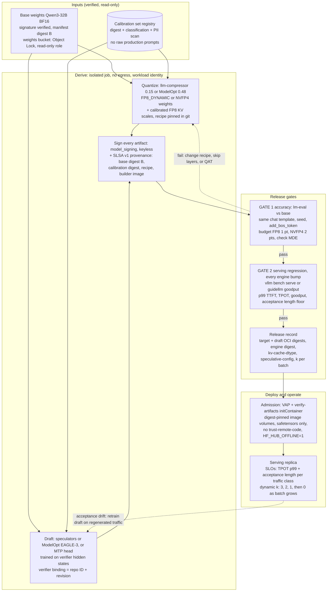

# Lesson 73 — Quantized and speculative serving as a platform product: FP8/NVFP4 weights and KV-cache quantization as release artifacts with accuracy gates, speculative decoding (EAGLE-3 drafts, MTP) with acceptance-rate SLOs and capacity math, serving benchmarks as regression gates on every engine bump, and securing derived artifacts

*2026-11-22*

[Lesson 72](/lessons/72-kv-cache-tiering-prefix-aware-routing) made KV a storage hierarchy and [Lesson 71](/lessons/71-rack-scale-inference-nvl72-disagg-wide-ep) put serving on a rack. This lesson is about the two cheapest multipliers left on a fixed GPU budget, and why a platform team, not each model team, has to own them. **Quantization** (FP8 or NVFP4 weights, FP8 KV cache) halves or quarters the bytes per decode step and doubles the KV pool. **Speculative decoding** (an EAGLE-3 draft head or the model's own MTP layers) turns a memory-bound decode step into one verify pass that emits 1.5–3 tokens. Both produce **new artifacts derived from the base weights**: a quantized checkpoint, KV scales, a draft head. Both change serving behavior in ways an `nvidia-smi` dashboard never shows. A quantized model can lose 3 points on GSM8K and still serve fast. A draft can quietly stop being accepted after an engine bump, so TPOT regresses 15% while every pod is green. In [L31](/lessons/31-evaluation-release-gating-canary-weights) you gated new *weights*. Here you gate **derived** weights, the (target, draft, engine) tuple, and the provenance chain back to the base, which is the place [L13](/lessons/13-ml-weights-checkpoint-hardening), [L27](/lessons/27-gpu-supply-chain-weight-registry-hydrate) and [L64](/lessons/64-mock-security-deep-dive-weights-platform) stopped.

> **What's verified here (2026-11-22).** Versions come from GitHub releases: vLLM **v0.34.0** (2026-11-16), llm-compressor **0.15.0** (2026-10-29), compressed-tensors **0.20.1**, NVIDIA Model Optimizer **0.48.0** (2026-11-02), SGLang **v0.5.23** (2026-11-02), speculators **v0.9.0** (2026-10-19), GuideLLM **v0.8.1** (2026-10-08), lm-evaluation-harness **v0.4.13** (2026-08-31), model-signing **1.1.1** (latest on PyPI), cosign **v3.1.4**. Flags, config keys, defaults and quoted behavior come from source and docs at those tags: vLLM `docs/features/speculative_decoding/*.md` (README schema, `acceptance_metrics.md`, `dynamic_speculative_decoding.md`, `mtp.md`, `speculators.md`), `docs/features/quantization/{quantized_kvcache,modelopt,online}.md`, `docs/features/preload.md`, `docs/benchmarking/cli.md`, `vllm/benchmarks/serve.py`, `vllm/v1/spec_decode/metrics.py`, `vllm/config/{speculative,cache,load}.py`; llm-compressor `examples/quantization_w4a4_fp4`, `quantization_w8a8_fp8`, `quantization_kv_cache`, `mtp/deepseek_v3_nvfp4_fp8_mtp.py`; ModelOpt `examples/hf_ptq/README.md` + `hf_ptq.py`, `examples/speculative_decoding`, `examples/specdec_bench`; SGLang `docs/advanced_features/{speculative_decoding,quantized_kv_cache,quantization}.mdx`; speculators `examples/train/eagle3_qwen3_8b_ultrachat_online_5k.sh`; GuideLLM `docs/en/guides/service_level_objectives.md`; lm-eval `lm_eval/_cli/run.py`, `evaluator_utils.py`. Advisories come from each repo's GitHub security-advisory API (vLLM has spec-decode and artifact-pinning advisories; llm-compressor, ModelOpt, SGLang, compressed-tensors, speculators, GuideLLM and model-transparency had none published as of today). **Tests on this box:** `spec_capacity.py`, `release_gate.py` and `derived_gate.py` + `lab.sh` ran here, and their output is quoted. `lab.sh` used real `model_signing` 1.1.1 and `cosign` v3.1.4 on **toy 64×64 fixtures, not a real model**. The ValidatingAdmissionPolicy and pods were applied to a real **kube-apiserver v1.37.2** (no kubelet, CNI or GPUs), and the seven denials quoted are the ones it returned. **Nothing ran on a GPU.** Capacity numbers are my own roofline arithmetic with stated assumptions. The gate inputs are labeled synthetic fixtures, not measurements.

## What interviewers are really probing

- **Do you treat a quantized checkpoint as a new model?** "We run FP8" isn't an answer. The answer is: FP8 or NVFP4 weights, the KV-cache dtype and its scales, the `ignore` list (`lm_head`, MoE gates, MTP projections), the recipe, the calibration set and the engine kernel path are **one release artifact**. It has its own digest, its own signature, its own accuracy gate against the base, and provenance that names the base digest. Interviewers poke at the defaults that make this silent. ModelOpt's `hf_ptq.py` quantizes the KV cache by default (`--kv_cache_qformat` defaults to `fp8_cast`, with no calibration). vLLM `--kv-cache-dtype fp8` on a checkpoint without `k_scale`/`v_scale` runs with scales of **1.0**. NVFP4 on a pre-Blackwell GPU falls back to Marlin W4A16 with only a log warning.
- **Can you do speculative-decoding capacity math?** That means the chain from acceptance rate to acceptance length, then to per-sequence tokens/s, ITL and streams per GPU, and then the batch size where speculation stops paying. With i.i.d. per-token acceptance α and k drafts, the expected tokens per verify step is `(1 − α^(k+1)) / (1 − α)`. vLLM reports the measured version: `mean acceptance length = 1 + accepted / drafts`. In my worked example (below), 2,000 streams at ITL ≤ 12 ms need **31 GPUs without speculation and 13 with an EAGLE-3 draft at α = 0.75**. If acceptance sags to 0.55, you need **16**. That sensitivity is why acceptance length gets an SLO and an alert, not just a dashboard.
- **Do you know when speculation hurts?** Verification multiplies the compute per step by k+1. At high batch the step becomes compute-bound, rejected tokens are pure waste, and TPOT gets *worse*. Expect "what does vLLM's `num_speculative_tokens_per_batch_size` do", "why is it disabled with data parallelism", and "why did p99 ITL go up while mean TPOT went down" (tokens now arrive in bursts).
- **Is the benchmark a gate or a slide?** Every engine bump (vLLM 0.33 → 0.34), kernel-backend change (`--linear-backend`), or new draft gets the same `vllm bench serve` / GuideLLM run on the same hardware, dataset and seed. It's compared field by field against the last promoted run: p99 TTFT, p99 TPOT, goodput and `spec_decode_acceptance_length`. Accuracy gets the same treatment with lm-eval. Can you tell when a 1-point budget is smaller than the eval's own noise?
- **Security of derived artifacts.** Who may produce a quantized model? How does the serving node know it came from *your* base weights and *your* recipe? What did the calibration set contain? Can a draft checkpoint's `config.json` redirect what the engine loads? (Yes: vLLM GHSA-qrj2-j723-m6w8, fixed in 0.33.0.) Expect model_signing + SLSA provenance with the base digest in `resolvedDependencies`, safetensors only, admission that refuses unpinned or unsigned drafts, and calibration data handled like training data.

## Core diagram

![Quantized and speculative serving as a release pipeline: inputs are base weights Qwen3-32B BF16 with a verified signature and manifest digest B in an Object Lock bucket with a read-only role, and a calibration-set registry recording digest, classification and PII scan with no raw production prompts; an isolated derive job with no egress and its own workload identity runs quantization (llm-compressor 0.15 or ModelOpt 0.48: FP8_DYNAMIC or NVFP4 weights plus calibrated FP8 KV scales, recipe pinned in git) and draft training (speculators or ModelOpt EAGLE-3, or an MTP head, trained on verifier hidden states, verifier binding = repo ID + revision); every artifact is signed with model_signing (keyless) plus SLSA v1 provenance naming base digest B, the calibration digest, the recipe and the builder image; release gates: gate 1 accuracy with lm-eval against the base (same chat template, seed, add_bos_token; budget FP8 1 point, NVFP4 2 points; check the minimum detectable effect), gate 2 serving regression on every engine bump with vllm bench serve or guidellm goodput (p99 TTFT, TPOT, goodput, acceptance-length floor), then a release record with target and draft OCI digests, engine digest, kv-cache-dtype, speculative-config and k per batch; deploy: admission with a VAP plus a verify-artifacts initContainer (digest-pinned image volumes, safetensors only, no trust-remote-code, HF_HUB_OFFLINE=1) and a serving replica with TPOT p99 and acceptance-length SLOs per traffic class and dynamic k (3, 2, 1, then 0 as batch grows); dotted feedback: acceptance drift retrains the draft on regenerated traffic, and an accuracy failure sends the recipe back (skip layers or QAT)](/quantized-speculative-serving-release.png)

**How to read it.** Top to bottom is the life of one **release tuple**: (quantized target, draft, engine image, serving flags). Nothing in the bottom box is trusted because of its name. The pod mounts image volumes **by digest**. An init container re-verifies the `model_signing` bundle and the provenance before the engine starts. The VAP refuses pods that skip any of that. The two dotted arrows are the operational loops that most teams miss. Acceptance length drifts as traffic drifts, so the draft is a model you **retrain**, not a file you ship once. An accuracy failure goes back to the recipe (skip sensitive layers, keep `down_proj` in FP8, use a calibrated KV scale, or QAT). Lowering the budget isn't one of the options.



## Idiosyncrasies / operator depth

### A quantized checkpoint is a different model, and its defaults lie

- **Two on-disk dialects, one engine.** llm-compressor writes **compressed-tensors**: `quantization_config.quant_method: compressed-tensors` in `config.json`, with the recipe saved alongside. ModelOpt writes `hf_quant_config.json` with a `quant_algo` (`FP8`, `FP8_PER_CHANNEL_PER_TOKEN`, `FP8_PB_WO`, `NVFP4`, `W4A16_NVFP4`, `MXFP8`, `MIXED_PRECISION`). vLLM detects both. ModelOpt NVFP4 is served with `--quantization modelopt_fp4`. Your release record stores which dialect it is, because the kernels and failure modes differ.
- **Scheme ≠ data needs.** `FP8_DYNAMIC` uses static per-channel weights and dynamic per-token activations. The vLLM docs call it RTN with **no calibration data**. `FP8_BLOCK` is the usual choice for MoE. `NVFP4` stores FP4 E2M1 values in groups of 16 with an E4M3 scale per group, plus per-tensor global scales. Those global activation scales **need calibration data**: the llm-compressor example uses 20 samples, and the DeepSeek-V3 MTP example uses 512. So only some derived artifacts have a calibration dependency, and your provenance should say which.
- **The ignore list is the accuracy story.** Every recipe skips `lm_head`. MoE recipes skip the router (`re:.*mlp.gate$`). The DeepSeek-V3 NVFP4 example also skips `kv_b_proj` ("vLLM uses BF16 copies of this projection for MLA decoding") and the MTP `eh_proj`. ModelOpt's README recommends `nvfp4_mlp_only`, `nvfp4_experts_only` or `nvfp4_omlp_only`, which keep attention QKV out of FP4, when plain NVFP4 misses accuracy. The vLLM office-hours talk below describes NVFP4-most-layers with `down_proj` kept in FP8. Mixed precision is normal, so diff the recipe, not just the scheme name.
- **Same bytes, different math per GPU pool.** FP8 W8A8 needs compute capability ≥ 8.9. On Turing/Ampere the same checkpoint runs as **W8A16 via Marlin**. NVFP4 activations need SM100. On anything older, vLLM "falls back to weight-only (W4A16) execution via Marlin and logs a warning", and llm-compressor's README says the same. `--linear-backend` (replacing the deprecated `VLLM_NVFP4_GEMM_BACKEND`) chooses among `cutlass`, `flashinfer_cutlass`, `flashinfer_cutedsl`, `flashinfer_trtllm`, `flashinfer_cudnn` and `marlin`. So **GPU SKU and kernel backend belong in the release tuple**. An NVFP4 artifact that passed its gate on B200 hasn't been gated on H100.
- **Online quantization leaves no artifact to sign.** `vllm serve <bf16> --quantization fp8_per_tensor` (also `fp8_per_block`, `mxfp8`, `mxfp4`) quantizes at load time. It's convenient, but the behavior change now lives in a CLI flag. Gate the flag like a checkpoint (VAP below). SGLang has its own trap: `--quantization w8a8_fp8` "will ignore the Hugging Face config's quantization settings" and swaps in its own kernel config.

### KV-cache quantization: a separate decision with its own scales

- **Scales of 1.0 are the default, not a calibration.** vLLM `--kv-cache-dtype fp8` with no scales in the checkpoint sets all of them to `1.0`. Calibrated scales come from llm-compressor (`kv_cache_scheme=QuantizationArgs(num_bits=8, type="float", strategy="tensor" | "attn_head")`). Per-head scales work only on the FlashAttention backend. With FA3 and an FP8 KV cache, **queries are quantized to FP8 too**. Some layer types (sliding-window) are more sensitive. `--kv-cache-dtype-skip-layers sliding_window` (or layer indices) keeps them at native dtype, and vLLM then zeroes newly allocated blocks because the cache is mixed-precision.
- **ModelOpt turns KV quantization on unless you say no.** `hf_ptq.py --kv_cache_qformat` defaults to `fp8_cast`: "FP8 KV cache without data-driven calibration (amax set to FP8 range)". An engineer who asked for "FP8 weights" shipped an FP8 KV cache too. Use `--kv_cache_qformat none` or a calibrated format explicitly, and record it.
- **Capacity is the reason, so do the arithmetic.** Qwen3-32B KV is 256 KiB/token in BF16, 128 KiB in FP8, and 72 KiB in NVFP4 (0.5 B + 1/16 B of block scale per element). SGLang's docs give the same `2 / 0.5625 = 3.56×` multiplier. At a 4K context on a 180 GB GPU with FP8 weights, that's 116 → 232 → 413 sequences (`spec_capacity.py` [1]).
- **KV dtype is a fleet-wide contract.** SGLang's native NVFP4 KV path on SM100 "doesn't currently support PD disaggregation, hierarchical KV cache, and LMCache". Prefill and decode pools ([L71](/lessons/71-rack-scale-inference-nvl72-disagg-wide-ep)) and every offload tier ([L72](/lessons/72-kv-cache-tiering-prefix-aware-routing)) must agree on dtype and layout. Changing `--kv-cache-dtype` is a coordinated rollout across P, D and the tiers, never a per-pod tweak.

### Speculative decoding: what the knobs really do

- **The config surface (vLLM v0.34).** `--speculative-config` JSON with `method` (`eagle3`, `mtp`, `draft_model`, `ngram`, `suffix`, `dflash`, …), `model`, `num_speculative_tokens` and `draft_tensor_parallel_size`. `tensor_parallel_size` "is not a valid key" here. In YAML configs it's a nested mapping, not an escaped string. SGLang uses `--speculative-algorithm EAGLE3 --speculative-draft-model-path … --speculative-num-steps --speculative-eagle-topk --speculative-num-draft-tokens`. Leave all three tuning flags unset for auto-tuning, or set all three.
- **An EAGLE-3 draft is welded to one verifier.** It's roughly one decoder layer plus a reduced-vocab head (speculators trains with `--draft-vocab-size 32000`) that reads the **target's hidden states**. Training data is generated by serving the verifier (`speculators prepare-data`, then `speculators.train --verifier-name-or-path … --vllm-endpoint …`), ideally regenerated on-policy. Serving that draft behind an FP8 or NVFP4 verifier shifts the features it reads. Acceptance usually holds, but it's an empirical question per (target artifact, draft, engine) tuple, which is why the gate measures the tuple.
- **MTP survives quantization only if you carry it.** MTP heads ship inside the checkpoint. llm-compressor's DeepSeek-V3 example quantizes the backbone to NVFP4 and the MTP layer separately to `FP8_DYNAMIC` with `eh_proj` unquantized. It loads as `mtp.layers.0` but "saves as `model.layers.61`". A quantization pipeline that drops that layer gives you an artifact where `method: mtp` silently loses its speedup or fails at start. Check that the layer exists in the gate. Start MTP at `num_speculative_tokens: 1` (vLLM's guidance). `draft_lm_head_quantization: fp8 | nvfp4` gives the drafter a quantized copy of the shared `lm_head`. The target still verifies with its own head, so outputs don't change and only acceptance can move.
- **Lossless only with the standard sampler.** vLLM's guarantee ("up to the precision limits of hardware numerics") covers the standard rejection sampler. `rejection_sample_method: "fly"` "deliberately relaxes verification and is not distribution preserving". That's a **model change** and has to pass the accuracy gate. Logprobs aren't stable across batch sizes either. For a greedy-equality regression test use `VLLM_BATCH_INVARIANT=1`, or you'll chase phantom diffs.
- **Speculation is a low-batch optimization.** Verification computes k+1 positions per sequence. vLLM's dynamic-SD doc says it directly: once B×K passes a critical batch size, "SD negatively impacts the decode speed (TPOT)". `num_speculative_tokens_per_batch_size: [[1,64,3],[65,128,1],[129,512,0]]` steps k down as concurrency rises. It's **not compatible with data parallelism**: with `--data-parallel-size > 1` vLLM disables it and uses the static k, because ranks choosing different k values would deadlock collectives. Wide-EP DP deployments (L71) get a static k you choose for the peak.
- **Acceptance is a property of traffic, not of the draft.** Temperature lowers it. Structured output prunes drafts (`num_draft_tokens` excludes drafts invalidated by structured-output constraints). Code and extraction accept far more than creative writing. So acceptance needs an SLO **per traffic class**, from these counters: `vllm:spec_decode_num_drafts_total`, `…_num_draft_tokens_total`, `…_num_accepted_tokens_total`, `…_num_accepted_tokens_per_pos_total{position}`. Acceptance rate = accepted / draft tokens. Acceptance length = 1 + accepted / drafts. `--per-request-spec-decode-metrics summary` (experimental) puts `mean_acceptance_length` and a histogram on each response, so you can slice by tenant.
- **Tokens arrive in bursts.** With k = 3 a stream gets up to 4 tokens in one verify step, then waits for the next step. Mean TPOT improves, but the ITL distribution goes bimodal, and p99 ITL (the gap between bursts) can get *worse* at high batch. Gate on both. Know your tool's definitions too: GuideLLM's `tpot_ms` SLO is inter-token latency excluding the first token, "not identical" to vLLM's `tpot`.
- **Random-token benchmarks lie about speculation.** A draft can't predict random token IDs, so `--dataset-name random` measures acceptance near zero and declares speculation useless. Benchmark with real prompt distributions: vLLM's `spec_bench` dataset (13 categories), NVIDIA's SPEED-Bench, or a sampled and scrubbed copy of your traffic (Security §3).

### Benchmarks and evals as gates, not slides

- **Comparable or worthless.** Same GPU SKU and driver, same engine flags except the one under test, same dataset file (by digest), `--seed` (default 0), `--num-warmups`, same `--max-concurrency` or request rate, same `--temperature`. `vllm bench serve --save-result` writes `p99_ttft_ms`, `p99_tpot_ms` and `p99_itl_ms` (`--percentile-metrics` defaults to ttft,tpot,itl and `--metric-percentiles` to 99), `output_throughput`, `request_goodput` if you pass `--goodput ttft:… tpot:…`, and, when the server exposes spec-decode counters, `spec_decode_acceptance_rate`, `spec_decode_acceptance_length` and per-position rates. It computes those from `/metrics` deltas.
- **GuideLLM answers the capacity question directly.** `--profile kind=goodput,target_attainment=0.99` doubles concurrency until the SLO attainment misses, then bisects. It searches **concurrency, not rate**, because a rate above capacity "grows an unbounded backlog". It also warns when a probe's confidence interval straddles the target. That's the number capacity planning wants, per tuple.
- **Accuracy evals have noise floors.** GSM8K has 1,319 problems. At ~87% accuracy the stderr is ~0.9 pt per run, so an unpaired base-vs-candidate comparison has a **minimum detectable effect of ~3.6 pts** at 80% power. A "≤1 pt FP8 budget" on GSM8K alone can't fail for the right reasons. Use `--log_samples` and compare per item (paired), add tasks, or raise n. `release_gate.py` prints the MDE next to every verdict. Quantized models are also "sensitive to the presence of the bos token". llm-compressor's and vLLM's docs both tell you to pass `add_bos_token=True`, or the base vs quantized comparison is confounded.

## Concrete commands & config

### Preflight: what will this artifact actually run as?

```bash
# Which kernel family will this pool get? FP8 W8A8 needs CC >= 8.9; NVFP4 activations need SM100 (Blackwell)
nvidia-smi --query-gpu=name,compute_cap,driver_version --format=csv,noheader

# Which dialect and scheme is the artifact? (compressed-tensors vs ModelOpt)
jq '.quantization_config | {quant_method, format, ignore, kv_cache_scheme}' /models/target/config.json
test -f /models/target/hf_quant_config.json && jq '.quantization' /models/target/hf_quant_config.json

# Are calibrated KV scales really in the checkpoint? (no k_scale/v_scale => vLLM uses 1.0)
python3 - <<'PY'
import json, struct, glob
for f in glob.glob("/models/target/*.safetensors"):
    n = struct.unpack("<Q", open(f, "rb").read(8))[0]
    hdr = json.loads(open(f, "rb").read(8 + n)[8:])
    ks = [k for k in hdr if k.endswith(("k_scale", "v_scale"))]
    print(f, "kv scales:", len(ks), "| dtypes:", sorted({v["dtype"] for k, v in hdr.items() if k != "__metadata__"}))
PY

# MTP checkpoints: is the MTP layer still there after quantization? (DeepSeek-V3: model.layers.61.*)
python3 -c "import json;m=json.load(open('/models/target/model.safetensors.index.json'))['weight_map'];print(sum(k.startswith('model.layers.61.') for k in m), 'MTP tensors')"

# After start: did NVFP4 silently fall back to Marlin W4A16? Did spec decoding come up with the method you meant?
kubectl logs deploy/qwen3-32b -c vllm | grep -Ei "marlin|fall(ing)? back|SpeculativeConfig\(method"
```

### Produce the artifacts (pinned tools, pinned recipe)

```python
# llm-compressor 0.15.0: FP8 weights (data-free) + calibrated FP8 KV cache from a REGISTERED calibration set
from datasets import load_dataset
from transformers import AutoModelForCausalLM, AutoTokenizer
from llmcompressor import oneshot
from llmcompressor.modifiers.quantization import QuantizationModifier
from compressed_tensors.quantization import QuantizationArgs

BASE = "/verified/Qwen3-32B"                        # mounted read-only AFTER model_signing verify
CALIB = "/calib/ultrachat-512-v3.jsonl"             # digest checked against the calibration registry
model = AutoModelForCausalLM.from_pretrained(BASE, torch_dtype="auto")   # no trust_remote_code
tok = AutoTokenizer.from_pretrained(BASE)
ds = load_dataset("json", data_files=CALIB, split="train").shuffle(seed=42)
ds = ds.map(lambda ex: tok(tok.apply_chat_template(ex["messages"], tokenize=False),
                           max_length=2048, truncation=True, add_special_tokens=False),
            remove_columns=ds.column_names)
recipe = QuantizationModifier(
    targets="Linear", scheme="FP8_DYNAMIC", ignore=["lm_head"],               # NVFP4: scheme="NVFP4"
    kv_cache_scheme=QuantizationArgs(num_bits=8, type="float", strategy="tensor"))
oneshot(model=model, dataset=ds, recipe=recipe, max_seq_length=2048, num_calibration_samples=512)
model.save_pretrained("/out/Qwen3-32B-FP8-dynamic-kvfp8", save_compressed=True)  # safetensors
tok.save_pretrained("/out/Qwen3-32B-FP8-dynamic-kvfp8")
```

```bash
# ModelOpt 0.48.0: NVFP4 MLP-only weights; say the KV format out loud (default is fp8_cast, uncalibrated)
python examples/hf_ptq/hf_ptq.py --pyt_ckpt_path /verified/Qwen3-32B \
  --qformat nvfp4_mlp_only --kv_cache_qformat fp8 \
  --calib_size 512 --export_path /out/Qwen3-32B-NVFP4-mlp
# or a declarative recipe (takes precedence over --qformat; a PTQ recipe ignores --kv_cache_qformat)
python examples/hf_ptq/hf_ptq.py --pyt_ckpt_path /verified/Qwen3-32B \
  --recipe general/ptq/nvfp4_default-kv_fp8 --export_path /out/Qwen3-32B-NVFP4   # not *-kv_fp8_cast

# speculators v0.9.0: EAGLE-3 draft trained against the verifier you will actually serve
speculators prepare-data --model /verified/Qwen3-32B --data /calib/regen-traffic-v4 \
  --output ./out --max-samples 5000 --seq-length 8192
torchrun --standalone --nproc_per_node 2 -m speculators.train \
  --verifier-name-or-path Qwen/Qwen3-32B --data-path ./out --vllm-endpoint http://localhost:8000/v1 \
  --save-path ./out/checkpoints --draft-vocab-size 32000 --epochs 5 --lr 1e-4 \
  --total-seq-len 8192 --on-missing generate
```

### Serve the tuple: vLLM v0.34 (and SGLang v0.5.23)

```bash
vllm serve /models/target --served-model-name qwen3-32b \
  --load-format safetensors \
  --kv-cache-dtype fp8 \
  --speculative-config '{"method": "eagle3", "model": "/models/draft", "num_speculative_tokens": 3,
     "num_speculative_tokens_per_batch_size": [[1, 54, 3], [55, 145, 2], [146, 256, 1], [257, 512, 0]]}' \
  --per-request-spec-decode-metrics summary
# MTP target instead of a separate draft (start at k=1):
#   --speculative-config '{"method": "mtp", "num_speculative_tokens": 1, "draft_lm_head_quantization": "fp8"}'
# Pin the GEMM path you gated, instead of letting it auto-select per node:
#   --linear-backend flashinfer_cutlass

python3 -m sglang.launch_server --model-path /models/target --quantization modelopt_fp4 \
  --kv-cache-dtype fp8_e4m3 \
  --speculative-algorithm EAGLE3 --speculative-draft-model-path /models/draft \
  --speculative-num-steps 3 --speculative-eagle-topk 1 --speculative-num-draft-tokens 4
# Hub drafts: --speculative-draft-model-revision defaults to "main" when omitted; always pin a commit
```

### Gate 1: accuracy against the base (lm-eval v0.4.13)

```bash
for M in /verified/Qwen3-32B /models/target; do
  lm_eval --model vllm \
    --model_args pretrained=$M,add_bos_token=True,tensor_parallel_size=2,gpu_memory_utilization=0.85 \
    --tasks gsm8k,ifeval --num_fewshot 5 --batch_size auto --apply_chat_template \
    --seed 1234 --log_samples --output_path ./eval/$(basename $M)
done
# Code tasks (humaneval/mbpp) execute model-generated code and need --confirm_run_unsafe_code:
# run those only in the sandboxed eval pool (L34/L54), never on the serving node.
```

### Gate 2: serving regression on every engine bump

```bash
# Real prompts, not random tokens (random data makes every draft look useless)
vllm bench serve --model qwen3-32b --base-url http://qwen3-32b-canary:8000 \
  --dataset-name spec_bench --dataset-path ./Spec-Bench/data/spec_bench/question.jsonl --num-prompts -1 \
  --max-concurrency 32 --temperature 0 --seed 0 --num-warmups 20 \
  --percentile-metrics ttft,tpot,itl,e2el --metric-percentiles 50,99 \
  --goodput ttft:500 tpot:25 \
  --save-result --result-filename bench_cand_v0.34.json
# -> JSON fields used by the gate: p99_ttft_ms, p99_tpot_ms, p99_itl_ms, output_throughput,
#    request_goodput, spec_decode_acceptance_length, spec_decode_per_position_acceptance_rates

# Capacity per tuple: highest concurrency where 99% of requests meet the SLO (GuideLLM v0.8.1)
guidellm run --backend kind=openai_http,target=http://qwen3-32b-canary:8000 \
  --profile kind=goodput,target_attainment=0.99 \
  --data kind=synthetic_text,prompt_tokens=2048,output_tokens=512 \
  --metrics '{"kind":"generative","slo":{"ttft_ms":500,"tpot_ms":25}}' \
  --constraint kind=max_duration,seconds=300 --output kind=json,path=goodput_v0.34.json
# (GuideLLM tpot_ms = ITL excluding the first token; synthetic text understates acceptance: use it for
#  capacity of non-speculative tuples, or feed a real prompt file through --data)
```

### Acceptance-length SLO as Prometheus rules

```yaml
groups:
  - name: spec-decode-slo
    rules:
      - record: model:spec_acceptance_length:rate10m
        expr: |
          1 + sum by (model_name) (rate(vllm:spec_decode_num_accepted_tokens_total[10m]))
            / sum by (model_name) (rate(vllm:spec_decode_num_drafts_total[10m]))
      - record: model:spec_acceptance_rate_by_pos:rate10m
        expr: |
          sum by (model_name, position) (rate(vllm:spec_decode_num_accepted_tokens_per_pos_total[10m]))
            / on (model_name) group_left sum by (model_name) (rate(vllm:spec_decode_num_drafts_total[10m]))
      - alert: SpecAcceptanceBelowCapacityPlan
        # 2.2 = the acceptance length the GPU count was sized for (spec_capacity.py); page, it is a capacity event
        expr: model:spec_acceptance_length:rate10m < 2.2
        for: 30m
        labels: { severity: page }
        annotations:
          summary: "{{ $labels.model_name }} acceptance length {{ $value | printf \"%.2f\" }} < plan 2.2: TPOT and GPU count at risk"
      - alert: SpecAcceptanceDrift
        expr: model:spec_acceptance_length:rate10m < 0.9 * avg_over_time(model:spec_acceptance_length:rate10m[7d])
        for: 2h
        labels: { severity: ticket }
        annotations:
          summary: "Acceptance drifted >10% vs 7d: traffic shift or engine change; schedule draft retrain on regenerated traffic"
```

vLLM's counters carry `model_name`/`engine` labels, not a traffic class. For per-class SLOs, either split pools by class or aggregate the per-request `metrics.speculative_decoding` fields at the gateway.

### `spec_capacity.py`: acceptance rate → tokens/s → GPUs (worked example, not a benchmark)

```python
#!/usr/bin/env python3
"""spec_capacity.py - acceptance rate -> effective tokens/s -> GPUs, for one decode replica.

A roofline-style worked example, NOT a benchmark. Every hardware number below is an
assumption you must replace with your own measurements (vllm bench serve / guidellm).

Step time for the target, B sequences, n tokens each (n = k+1 when verifying k drafts):
    t = max(weight_bytes + B*L*kv_bytes_per_token, flops(B, n)) / achieved_rate + overhead
Expected tokens emitted per verify step with i.i.d. per-token acceptance a:
    E(k) = (1 - a^(k+1)) / (1 - a)           (Leviathan et al. 2023)
"""
import argparse

# ---- Model: Qwen3-32B (config.json: 64 layers, 64 q heads, 8 kv heads, head_dim 128,
#      hidden 5120, intermediate 25600). Draft: EAGLE-3 style, one decoder layer + 32K draft vocab.
P_TARGET = 32.8e9
LAYERS, QH, KVH, HD, HID, INTER = 64, 64, 8, 128, 5120, 25600
P_DRAFT = (HID * (QH * HD + 2 * KVH * HD) + QH * HD * HID) + 3 * HID * INTER \
          + 32000 * HID + 3 * HID * HID           # 1 layer + draft lm_head + fc fuse
KV_ELEM_BYTES = {"bf16": 2.0, "fp8": 1.0, "nvfp4": 0.5625}   # nvfp4: 0.5 B + 1/16 B block scale
W_BYTES = {"bf16": 2.0, "fp8": 1.0, "nvfp4": 0.5625}

# ---- GPU assumptions (one B200-class GPU; replace with measured numbers)
HBM_GB = 180          # HGX B200: 1.4 TB / 8
BW = 8e12 * 0.75      # 8 TB/s spec x 75% achieved on decode GEMV + paged attention
FLOPS = 4.5e15 * 0.30 # FP8 dense 4.5 PF x 30% achieved on skinny verify GEMMs
OVH_T, OVH_D = 0.6e-3, 0.25e-3  # per-step fixed overhead: target step, draft step (CUDA graphs)

def kv_bytes_tok(kv):
    return LAYERS * KVH * HD * 2 * KV_ELEM_BYTES[kv]

def t_target(B, n, L, w, kv):
    mem = P_TARGET * W_BYTES[w] + B * L * kv_bytes_tok(kv)
    flops = 2 * P_TARGET * B * n + 4 * L * QH * HD * LAYERS * B * n
    return max(mem / BW, flops / FLOPS) + OVH_T

def t_draft(B, L):
    mem = P_DRAFT * 2 + B * L * KVH * HD * 2 * 2   # BF16 draft, one layer of KV
    flops = 2 * P_DRAFT * B
    return max(mem / BW, flops / FLOPS) + OVH_D

def expected_tokens(a, k):
    return k + 1 if a >= 1 else (1 - a ** (k + 1)) / (1 - a)

def per_seq_tps(B, k, a, L, w, kv):
    if k == 0:
        return 1 / t_target(B, 1, L, w, kv)
    return expected_tokens(a, k) / (t_target(B, k + 1, L, w, kv) + k * t_draft(B, L))

def max_batch_mem(L, w, kv, k):
    free = HBM_GB * 1e9 * 0.92 - P_TARGET * W_BYTES[w] - (P_DRAFT * 2 if k else 0) - 8e9
    return int(free // ((L + k) * kv_bytes_tok(kv)))

def max_batch_slo(k, a, L, w, kv, itl_ms):
    cap = max_batch_mem(L, w, kv, k)
    best = 0
    for B in range(1, cap + 1):
        if 1000 / per_seq_tps(B, k, a, L, w, kv) <= itl_ms:
            best = B
    return best, cap

def main():
    ap = argparse.ArgumentParser()
    ap.add_argument("--ctx", type=int, default=8192, help="mean live context tokens per sequence")
    ap.add_argument("--itl-ms", type=float, default=20.0, help="mean inter-token latency SLO")
    ap.add_argument("--alpha", type=float, default=0.75, help="per-token acceptance (i.i.d. model)")
    ap.add_argument("--streams", type=int, default=2000, help="concurrent decode streams to serve")
    a = ap.parse_args()
    L = a.ctx
    print(f"Assumptions: Qwen3-32B target, EAGLE-3-style draft {P_DRAFT/1e9:.2f} B params (BF16), "
          f"ctx {L} tokens, BW {BW/1e12:.1f} TB/s achieved, {FLOPS/1e15:.1f} PF achieved, ITL SLO {a.itl_ms} ms")
    print("\n[1] KV footprint and memory-bound concurrency cap (FP8 weights)")
    for kv in ("bf16", "fp8", "nvfp4"):
        print(f"  kv={kv:5s} {kv_bytes_tok(kv)/1024:6.0f} KiB/token  {L*kv_bytes_tok(kv)/1e9:5.2f} GB/seq"
              f"  max seqs={max_batch_mem(L, 'fp8', kv, 0)}")
    print(f"\n[2] Per-sequence tokens/s vs batch (fp8 weights, fp8 KV, alpha={a.alpha})")
    ks = (0, 1, 2, 3, 5)
    print("  B    " + "".join(f"k={k:<9d}" for k in ks) + "best-k")
    for B in (1, 4, 8, 16, 32, 48, 64, 96):
        row = [per_seq_tps(B, k, a.alpha, L, "fp8", "fp8") for k in ks]
        print(f"  {B:<4d} " + "".join(f"{v:8.1f}  " for v in row) + f"{ks[row.index(max(row))]}")
    print("\n[3] Suggested num_speculative_tokens_per_batch_size (best k by aggregate tokens/s)")
    buckets, prev, start = [], None, 1
    capB = max_batch_mem(L, "fp8", "fp8", 3)
    for B in range(1, capB + 1):
        tps = [B * per_seq_tps(B, k, a.alpha, L, "fp8", "fp8") for k in (0, 1, 2, 3, 4, 5)]
        kb = tps.index(max(tps))
        if prev is not None and kb != prev:
            buckets.append([start, B - 1, prev]); start = B
        prev = kb
    buckets.append([start, capB, prev])
    print("  " + str(buckets))
    print(f"\n[4] Capacity at ITL <= {a.itl_ms} ms: max concurrent streams per GPU, GPUs for {a.streams} streams")
    base, cap = max_batch_slo(0, a.alpha, L, "fp8", "fp8", a.itl_ms)
    print(f"  no spec  : {base:3d} streams/GPU (mem cap {cap})  -> {-(-a.streams // max(base,1))} GPUs")
    for al in (0.85, 0.75, 0.65, 0.55, 0.45):
        bests = [(max_batch_slo(k, al, L, "fp8", "fp8", a.itl_ms)[0], k) for k in (1, 2, 3)]
        n, k = max(bests)
        AL = expected_tokens(al, k)
        print(f"  alpha {al:.2f}: k={k} acceptance length {AL:4.2f} -> {n:3d} streams/GPU -> "
              f"{-(-a.streams // max(n,1))} GPUs")

if __name__ == "__main__":
    main()
```

Output (`python3 spec_capacity.py --ctx 4096 --itl-ms 12`, run on this box):

```text
Assumptions: Qwen3-32B target, EAGLE-3-style draft 0.73 B params (BF16), ctx 4096 tokens, BW 6.0 TB/s achieved, 1.4 PF achieved, ITL SLO 12.0 ms

[1] KV footprint and memory-bound concurrency cap (FP8 weights)
  kv=bf16     256 KiB/token   1.07 GB/seq  max seqs=116
  kv=fp8      128 KiB/token   0.54 GB/seq  max seqs=232
  kv=nvfp4     72 KiB/token   0.30 GB/seq  max seqs=413

[2] Per-sequence tokens/s vs batch (fp8 weights, fp8 KV, alpha=0.75)
  B    k=0        k=1        k=2        k=3        k=5        best-k
  1       162.4     263.1     323.5     357.7     380.7  5
  4       155.7     252.6     311.1     344.5     367.5  5
  8       147.4     239.8     295.9     328.3     351.2  5
  16      133.4     217.8     269.7     300.1     322.7  5
  32      112.0     184.0     229.1     256.1     233.8  3
  48       96.5     159.2     199.1     209.8     168.1  3
  64       84.8     140.4     176.0     163.9     131.2  2
  96       68.2     113.5     128.8     114.0      91.2  2

[3] Suggested num_speculative_tokens_per_batch_size (best k by aggregate tokens/s)
  [[1, 23, 5], [24, 33, 4], [34, 54, 3], [55, 145, 2], [146, 229, 1]]

[4] Capacity at ITL <= 12.0 ms: max concurrent streams per GPU, GPUs for 2000 streams
  no spec  :  66 streams/GPU (mem cap 232)  -> 31 GPUs
  alpha 0.85: k=2 acceptance length 2.57 -> 171 streams/GPU -> 12 GPUs
  alpha 0.75: k=1 acceptance length 1.75 -> 156 streams/GPU -> 13 GPUs
  alpha 0.65: k=1 acceptance length 1.65 -> 143 streams/GPU -> 14 GPUs
  alpha 0.55: k=1 acceptance length 1.55 -> 130 streams/GPU -> 16 GPUs
  alpha 0.45: k=1 acceptance length 1.45 -> 117 streams/GPU -> 18 GPUs
```

How to read it. [1]: FP8 KV doubles the memory cap. Without it the replica can't hold the batch where speculation still pays. [2]: speculation multiplies per-sequence speed by ~2.3× at B = 1 (k = 5). Its advantage shrinks as B grows, and k = 5 loses to k = 3 from B ≈ 32, because verify compute (k+1 positions × B) becomes the bottleneck. [3]: that crossover pattern *is* the `num_speculative_tokens_per_batch_size` table. With a 2K context (`--ctx 2048 --itl-ms 15`, also run here) the table ends `[358, 458, 0]`: speculation switched off entirely at high batch. [4]: at this ITL target, the draft cuts 31 GPUs to 13. **Each 0.1 of α lost costs one or two GPUs per 2,000 streams**, which is why the SLO alert above pages at the planned acceptance length. Caveats: i.i.d. α overstates deep positions (use `spec_decode_per_position_acceptance_rates` from the bench JSON), the roofline ignores scheduler and sampler overheads beyond a fixed term, and every hardware constant is an assumption.

### `release_gate.py`: accuracy budget + serving regression in one verdict

```python
#!/usr/bin/env python3
"""release_gate.py - accuracy gate (lm-eval JSON) + serving regression gate (vllm bench serve JSON).

Accuracy: candidate (quantized/spec) vs base on the same tasks/seed/chat template.
  FAIL if drop > budget. WARN if the eval is too small to see a budget-sized drop
  (minimum detectable effect, 80% power, two-sided 5%: MDE = 2.8 * sqrt(se_b^2 + se_c^2)).
Serving: candidate engine/artifact vs the last promoted run, same hardware + dataset + seed.
"""
import json, math, sys

ACC_BUDGET_PTS = {"fp8": 1.0, "nvfp4": 2.0}          # max allowed absolute drop, percentage points
PERF_RULES = [  # key, direction, tolerance vs previous
    ("p99_ttft_ms", "max", 1.10), ("p99_tpot_ms", "max", 1.05), ("p99_itl_ms", "max", 1.05),
    ("output_throughput", "min", 0.97), ("request_goodput", "min", 0.97),
    ("spec_decode_acceptance_length", "min", 0.95)]
ACCEPTANCE_LENGTH_FLOOR = 2.2                          # from the capacity plan (spec_capacity.py)

def acc_gate(base, cand, scheme):
    ok = True
    for task, m in cand["results"].items():
        for key, val in m.items():
            if "_stderr" in key or not isinstance(val, (int, float)) or key == "alias":
                continue
            metric, filt = key.split(",")
            b, se_b = base["results"][task][key], base["results"][task][f"{metric}_stderr,{filt}"]
            se_c = m[f"{metric}_stderr,{filt}"]
            drop = (b - val) * 100
            mde = 2.8 * math.hypot(se_b, se_c) * 100
            budget = ACC_BUDGET_PTS[scheme]
            verdict = "FAIL" if drop > budget else ("WARN underpowered" if mde > budget else "PASS")
            ok &= verdict != "FAIL"
            n = cand.get("n-samples", {}).get(task, {}).get("original", "?")
            print(f"  [{verdict}] {task}/{filt}: base {b*100:.1f} cand {val*100:.1f} drop {drop:+.1f} pts "
                  f"(budget {budget}, MDE {mde:.1f} pts at n={n})")
    return ok

def perf_gate(prev, cand):
    ok = True
    for key, d, tol in PERF_RULES:
        if key not in cand or key not in prev or cand[key] is None:
            continue
        lim = prev[key] * tol
        bad = cand[key] > lim if d == "max" else cand[key] < lim
        ok &= not bad
        print(f"  [{'FAIL' if bad else 'PASS'}] {key}: prev {prev[key]:.2f} cand {cand[key]:.2f} "
              f"({'<=' if d == 'max' else '>='} {lim:.2f})")
    al = cand.get("spec_decode_acceptance_length")
    if al is not None:
        bad = al < ACCEPTANCE_LENGTH_FLOOR
        ok &= not bad
        print(f"  [{'FAIL' if bad else 'PASS'}] acceptance length floor: {al:.2f} >= {ACCEPTANCE_LENGTH_FLOOR}")
    return ok

if __name__ == "__main__":
    base, cand, scheme, prev, new = sys.argv[1:6]
    print("Accuracy gate (lm-eval)")
    a = acc_gate(json.load(open(base)), json.load(open(cand)), scheme)
    print("Serving regression gate (vllm bench serve --save-result)")
    p = perf_gate(json.load(open(prev)), json.load(open(new)))
    print("PROMOTE" if a and p else "BLOCK")
    sys.exit(0 if a and p else 1)
```

Run on this box against **synthetic fixture JSON** (shaped like lm-eval v0.4.13 and `vllm bench serve --save-result` output, values invented to exercise the gate):

```text
### FP8 artifact on engine bump v0.33 -> v0.34 (acceptance regression)
Accuracy gate (lm-eval)
  [WARN underpowered] gsm8k/strict-match: base 87.0 cand 86.6 drop +0.4 pts (budget 1.0, MDE 3.6 pts at n=1319)
  [WARN underpowered] gsm8k/flexible-extract: base 88.0 cand 87.4 drop +0.6 pts (budget 1.0, MDE 3.6 pts at n=1319)
  [WARN underpowered] ifeval/none: base 84.0 cand 83.5 drop +0.5 pts (budget 1.0, MDE 6.3 pts at n=541)
Serving regression gate (vllm bench serve --save-result)
  [PASS] p99_ttft_ms: prev 412.00 cand 405.00 (<= 453.20)
  [FAIL] p99_tpot_ms: prev 21.40 cand 24.10 (<= 22.47)
  [FAIL] p99_itl_ms: prev 48.00 cand 55.00 (<= 50.40)
  [FAIL] output_throughput: prev 9120.00 cand 8410.00 (>= 8846.40)
  [FAIL] request_goodput: prev 18.20 cand 16.10 (>= 17.65)
  [FAIL] spec_decode_acceptance_length: prev 2.61 cand 2.07 (>= 2.48)
  [FAIL] acceptance length floor: 2.07 >= 2.2
BLOCK

### NVFP4 artifact, engine config fixed
Accuracy gate (lm-eval)
  [FAIL] gsm8k/strict-match: base 87.0 cand 84.2 drop +2.8 pts (budget 2.0, MDE 3.7 pts at n=1319)
  [FAIL] gsm8k/flexible-extract: base 88.0 cand 85.1 drop +2.9 pts (budget 2.0, MDE 3.7 pts at n=1319)
  [FAIL] ifeval/none: base 84.0 cand 81.8 drop +2.2 pts (budget 2.0, MDE 6.4 pts at n=541)
Serving regression gate (vllm bench serve --save-result)
  [PASS] p99_ttft_ms: prev 412.00 cand 409.00 (<= 453.20)
  [PASS] p99_tpot_ms: prev 21.40 cand 21.00 (<= 22.47)
  [PASS] p99_itl_ms: prev 48.00 cand 47.00 (<= 50.40)
  [PASS] output_throughput: prev 9120.00 cand 9200.00 (>= 8846.40)
  [PASS] request_goodput: prev 18.20 cand 18.40 (>= 17.65)
  [PASS] spec_decode_acceptance_length: prev 2.61 cand 2.58 (>= 2.48)
  [PASS] acceptance length floor: 2.58 >= 2.2
BLOCK
```

Two lessons from the output. First, an engine bump that drops acceptance length from 2.61 to 2.07 fails five rules at once, and only the acceptance rule names the cause. Look at per-position rates and the draft/verifier pairing before touching kernels. Second, the NVFP4 candidate **fails** on a 2.8-pt drop that is *below* the eval's own MDE (3.7). The gate is right to block, because the point estimate breaches budget, but the honest next step is a paired, larger eval, not an argument about noise. The FP8 candidate's WARN lines say the same thing from the other side: "passed" on GSM8K alone isn't evidence of ≤1 pt.

## Failures & fixes

| Symptom | Likely cause | Check | Fix |
|---|---|---|---|
| Quantized model passed CI evals; users report worse chat answers | Eval ran without the chat template or `add_bos_token`, so base and candidate were scored on different prompts, or the eval set doesn't cover the product's domain | Re-run both with `--apply_chat_template`, `add_bos_token=True`; diff `--log_samples` per item | Gate with the serving template, a domain eval set, paired comparison; add a judge-scored task (L32) |
| NVFP4 artifact on an H100 pool is *slower* than FP8 | No native FP4 GEMM below SM100: vLLM falls back to Marlin W4A16 (warning only) | `nvidia-smi --query-gpu=compute_cap`; startup log `marlin`/fallback | Node affinity: NVFP4 tuples only on SM100 pools; GPU SKU in the release tuple; pin `--linear-backend` |
| Long-context answers degrade after enabling FP8 KV; short prompts fine | KV scales are 1.0 (none in checkpoint), ModelOpt `fp8_cast` (uncalibrated), or sliding-window layers more sensitive | Safetensors header lacks `k_scale`/`v_scale`; A/B with `--kv-cache-dtype auto` on long-context evals | Calibrated `kv_cache_scheme` (llm-compressor) or `--kv_cache_qformat fp8`; `--kv-cache-dtype-skip-layers sliding_window`; long-context task in Gate 1 |
| After vLLM bump: p99 TPOT +12%, acceptance length 2.61 → 2.07, zero errors | Draft/verifier numerics changed with new kernels, a sampling default changed, or the method was parsed differently (vLLM warns about Gemma 4 assistants being treated as `draft_model` on old releases) | Bench JSON `spec_decode_per_position_acceptance_rates`; log `SpeculativeConfig(method=…)` | Gate 2 blocks the bump. Fix the pairing (re-export or retrain the draft for the new engine), then re-gate. Never ship "fast but fine" |
| Speculation makes TPOT worse at peak hours | Verify compute (B × (k+1)) is the bottleneck at high batch | TPOT vs `vllm:num_requests_running`; `spec_capacity.py` crossover | `num_speculative_tokens_per_batch_size` stepping to k = 0; with DP > 1 (where it's disabled) pick a static k sized for peak, often 1 |
| Acceptance length decays over weeks with no deploy | Traffic drift: new tool-call schema, more structured output, new languages, higher temperature defaults | Per-class `metrics.speculative_decoding`; `SpecAcceptanceDrift` alert | Retrain the draft on recent **regenerated** traffic (scrubbed, §3); split pools by class; MTP-tuned heads (speculators v0.9 FastMTP finetuning) |
| Streaming users report "stutter" though mean TPOT improved | k+1 tokens arrive per verify step: bimodal ITL, p99 ITL up | `p99_itl_ms` vs `p99_tpot_ms` in the bench JSON | Lower k for the interactive class; gate on p99 ITL; smooth emission at the gateway if product needs it |
| Benchmark "proves" speculation is useless (acceptance ≈ 0) | Random-token dataset | `--dataset-name random` in the run record | `spec_bench`, SPEED-Bench or a scrubbed traffic sample; record the dataset digest |
| MTP model serves without speedup or fails to start after quantization | Quant pipeline dropped the MTP layer or quantized `eh_proj` | `model.layers.61.*` count in the weight map (DeepSeek-V3) | Quantize MTP as its own group, ignore `eh_proj` (llm-compressor example); gate checks the layer exists |
| "Quantization improved GSM8K by 1.5 pts" | Noise: unpaired MDE on GSM8K ≈ 3.6 pts | `release_gate.py` MDE column | Don't celebrate or block on sub-MDE deltas; paired per-item comparison, more items |
| OOM at start after adding a draft or quantized lm_head copy | Draft weights + draft KV + `draft_lm_head_quantization` copy (vLLM docs: ~0.6 GiB FP8 for a 248k × 2560 head) not budgeted, esp. with `--kv-cache-memory-bytes` | Startup memory profile log | Budget the draft in the capacity plan; lower `--gpu-memory-utilization` or KV bytes |
| Engine loads a different model or tokenizer than the one you deployed | A `config.json` with `speculators_config.verifier.name_or_path` redirects model + tokenizer (vLLM GHSA-qrj2-j723-m6w8, absolute paths need no traversal) | Startup log model path; `/detokenize` vocab vs expected | vLLM ≥ 0.33.0; serve the target path explicitly + `--speculative-config`; gate G8 + VAP |
| One request crashes the engine on a speculative pool | `allowed_token_ids` + spec decode metadata mismatch (GHSA-8c65-hq7q-r7jm, fixed 0.18.0) or `extract_hidden_states` + any penalty param (CVE-2026-44223, 0.18.0–0.19.1, fixed 0.20.0) | Engine traceback in rejection sampler / penalties | Version floor in admission; fuzz spec pools with sampling-param combos in Gate 2 |
| A `--revision`-pinned deployment still pulls new code or processors | Artifact pin decay (CVE-2026-47155, fixed 0.22.0): some nested artifacts ignored the pin | Hub access logs from serving nodes | Serve only from verified local volumes with `HF_HUB_OFFLINE=1` (VAP); patch |

## Security & hardening

> **The short version.** Every quantized checkpoint, KV-scale file, draft head and MTP export is a **new model derived from your weights**. It needs its own chain of custody, and that chain has to lead back to the base. A derived artifact can't be trusted because the base was trusted. Quantization can *create* behavior the base doesn't have: "Exploiting LLM Quantization" (Egashira et al., NeurIPS 2024) built models that are benign in full precision and malicious once quantized with standard zero-shot methods. So the controls are: sign every derived artifact with the pipeline's workload identity; attach SLSA provenance naming the **base digest, calibration-data digest, recipe and builder**; run the accuracy *and safety* evals on the derived artifact; handle calibration and draft-training data like training data; and make admission refuse anything that isn't a digest-pinned, verified, safetensors-only tuple. Speculation adds one more subtlety. Under the standard rejection sampler a poisoned draft **can't change outputs**, because the target verifies every token. It can only collapse acceptance, which is a throughput/DoS attack. Under a lossy verifier (`fly`) it **can** change outputs.

### Threat table

| Asset | Attack path | Control (this lesson) |
|---|---|---|
| Integrity of served weights | Swap or edit a quantized shard after the gate; add a pickle or `modeling_*.py` + `auto_map` and re-sign | model_signing verify before start (rejects extra files by default); file policy (no `.bin/.pt/.pkl/.py`, no `auto_map`) in the gate; safetensors-only VAP |
| Lineage | Quantize from a community re-upload or an unverified base | SLSA provenance `resolvedDependencies` base digest must equal the **verified** base digest (G5) |
| Behavior | Quantization-activated backdoor (Egashira et al.); `fly` lossy verification; KV scales of 1.0 | Security + accuracy evals on the derived artifact; `fly` treated as a model change; scales are part of the gated artifact |
| Calibration / draft-training data | Customer prompts in a calibration set; hidden-state dumps retained; outlier injection skewing scales | Calibration registry (digest, classification, PII scan, owner, TTL) checked by G6; scrubbed, regenerated traffic for drafts; ephemeral hidden-state storage |
| Engine identity | `speculators_config.verifier.name_or_path` redirect (GHSA-qrj2-j723-m6w8); hub drafts at mutable `main`; pin decay (CVE-2026-47155) | vLLM ≥ 0.33.0; G8 verifier binding; drafts only from `/models/draft`; `HF_HUB_OFFLINE=1`; pinned revisions everywhere |
| Availability | Poisoned or stale draft → acceptance collapse → TPOT and GPU-count incident; crash-on-request advisories on spec pools | Acceptance-length SLO alert at the planned value; Gate 2 on every tuple change; version floors |
| Preloaded weights | `vllm preload` daemon serves post-quantized weights over a Unix socket (`--load-format ipc_cache`) | Daemon loads only verified volumes; socket in a pod-private dir; treat it as part of the TCB |

### 1. Sign derived artifacts with the pipeline's identity, and know what the signature covers

- **Keyless in production.** `model_signing sign sigstore` (the default) gets a short-lived Fulcio cert bound to the quantize job's OIDC identity. Use your workload identity federation (L48), or a private Sigstore for air-gapped fleets. Verification then pins **who** signed, not just that someone did: `model_signing verify sigstore … --identity <pipeline identity> --identity_provider <issuer>`. Base weights carry the publisher's or your ingest pipeline's identity (L27). Derived artifacts carry the quantize/draft-training pipeline's identity. A model team's laptop identity never signs a promoted artifact.
- **What model_signing 1.1.1 actually signs** (checked on this box). It produces a DSSE in-toto statement with `predicateType: https://model_signing/signature/v1.0`, one `resources` entry (sha256) per file, and a subject digest over that manifest. A file added after signing fails verification ("Extra files found in model…") unless the verifier passes `--ignore_unsigned_files`, so never set that flag in production. The signature file inside the model directory is ignored automatically, but **other sidecars aren't**: shipping `provenance.bundle` in the same directory needs `--ignore-paths`. Two operational gotchas: the subject `name` is just the directory name (bind on digest, never on name), and the 1.1.1 wheel failed to import without `pyOpenSSL` on this box (`ModuleNotFoundError: No module named 'OpenSSL'`). Bake the verifier into a pinned image instead of `pip install` at pod start.
- **Two digests, one release record.** The model_signing subject digest (manifest of files) isn't the OCI digest of the image volume that carries those files. The release record stores both. Admission pins the OCI digest, and the init container proves the files under it match the signed manifest.

### 2. Provenance back to the base: SLSA v1 statement for a derived artifact

The derived artifact's provenance is an in-toto Statement whose **subject is the derived manifest digest** and whose dependencies name everything that shaped the bytes:

```json
{
  "_type": "https://in-toto.io/Statement/v1",
  "subject": [{"name": "Qwen3-32B-FP8-dynamic", "digest": {"sha256": "<model_signing subject digest of the derived dir>"}}],
  "predicateType": "https://slsa.dev/provenance/v1",
  "predicate": {
    "buildDefinition": {
      "buildType": "https://platform.example.com/quantize/v1",
      "externalParameters": {"scheme": "FP8_DYNAMIC", "ignore": ["lm_head"], "kv_cache_scheme": "fp8/tensor"},
      "resolvedDependencies": [
        {"uri": "hf://Qwen/Qwen3-32B@<commit>", "digest": {"sha256": "<VERIFIED base subject digest>"}, "annotations": {"role": "base-model"}},
        {"uri": "s3://calib-sets/ultrachat-512/v3", "digest": {"sha256": "<dataset digest>"}, "annotations": {"role": "calibration-data"}},
        {"uri": "git+https://git.example.com/platform/quant-recipes@<commit>#fp8-dynamic.yaml", "digest": {"sha256": "<recipe digest>"}, "annotations": {"role": "recipe"}},
        {"uri": "oci://registry.example.com/ml/quantize-runner", "digest": {"sha256": "<image digest>"}, "annotations": {"role": "builder-image", "llmcompressor": "0.15.0"}}
      ]
    },
    "runDetails": {"builder": {"id": "https://platform.example.com/builders/quantize-runner@v1"},
                   "metadata": {"invocationId": "argo://quantize/qwen3-32b-fp8-7f3c"}}
  }
}
```

```bash
# Sign the statement (lab: offline key + empty signing config; production: keyless + Rekor)
cosign attest-blob --key quant-pipeline.key --statement stmt-derived.json \
  --bundle stmt-derived.bundle --signing-config signing-config.json -y
# Verify against the digest you just verified with model_signing (no blob needed)
cosign verify-blob-attestation --key quant-pipeline.pub --bundle stmt-derived.bundle \
  --digest "$DERIVED_DIGEST" --digestAlg sha256 --type slsaprovenance1   # lab added --insecure-ignore-tlog
```

`derived_gate.py` ties it together. It runs G1 base signature → G2 derived signature → G3 file policy → G4 provenance verifies **for this derived digest** → G5 provenance base == verified base → G6 calibration set registered and PII-scanned → G7 builder allowlisted → G8 (drafts) verifier binding. `lab.sh` exercised it with real model_signing 1.1.1 and cosign v3.1.4 on toy fixtures. The gate:

```python
#!/usr/bin/env python3
"""derived_gate.py - promotion gate for derived model artifacts (quantized / draft checkpoints).

Promote only if: base signature OK, derived signature OK, no code/pickle in the artifact,
signed SLSA provenance binds derived digest -> verified base digest + registered calibration set,
and (for drafts) the verifier binding is a pinned repo ID that matches the target's base.
"""
import argparse, base64, json, os, re, subprocess, sys

FORBIDDEN_EXT = (".bin", ".pt", ".pth", ".pkl", ".pickle", ".ckpt", ".py", ".so", ".npy")
ALLOWED_BUILDERS = {"https://platform.example.com/builders/quantize-runner@v1",
                    "https://platform.example.com/builders/speculators-train@v1"}

def run(cmd):
    p = subprocess.run(cmd, capture_output=True, text=True)
    return p.returncode, (p.stdout + p.stderr).strip().splitlines()[-1:] or [""]

def ms_verify(model_dir, sig, pub):
    rc, tail = run(["model_signing", "verify", "key", model_dir, "--signature", sig, "--public_key", pub])
    return rc == 0, tail[0]

def ms_subject(sig):
    env = json.load(open(sig))["dsseEnvelope"]
    st = json.loads(base64.b64decode(env["payload"]))
    return st["subject"][0]["digest"]["sha256"]

def file_policy(model_dir):
    bad = []
    for root, _, files in os.walk(model_dir):
        for f in files:
            if f.lower().endswith(FORBIDDEN_EXT):
                bad.append(f)
    cfg = json.load(open(os.path.join(model_dir, "config.json")))
    if "auto_map" in cfg:
        bad.append("config.json:auto_map (trust_remote_code)")
    return bad, cfg

def cosign_verify(bundle, digest, pub):
    rc, tail = run(["cosign", "verify-blob-attestation", "--key", pub, "--bundle", bundle,
                    "--digest", digest, "--digestAlg", "sha256", "--type", "slsaprovenance1",
                    "--insecure-ignore-tlog"])     # lab only: real pipelines verify the Rekor entry
    return rc == 0, tail[0]

def bundle_statement(bundle):
    b = json.load(open(bundle))
    return json.loads(base64.b64decode(b["dsseEnvelope"]["payload"]))

def main():
    ap = argparse.ArgumentParser()
    ap.add_argument("--base"); ap.add_argument("--base-sig"); ap.add_argument("--base-pub")
    ap.add_argument("--derived"); ap.add_argument("--derived-sig"); ap.add_argument("--pipeline-pub")
    ap.add_argument("--provenance"); ap.add_argument("--attest-pub")
    ap.add_argument("--calib-registry")
    ap.add_argument("--expect-verifier", help="draft only: pinned verifier repo id@revision")
    a = ap.parse_args()
    ok = True
    def gate(name, passed, detail):
        nonlocal ok
        ok &= passed
        print(f"  [{'PASS' if passed else 'FAIL'}] {name}: {detail}")

    p, d = ms_verify(a.base, a.base_sig, a.base_pub); gate("G1 base signature", p, d)
    base_digest = ms_subject(a.base_sig) if p else None
    p, d = ms_verify(a.derived, a.derived_sig, a.pipeline_pub); gate("G2 derived signature", p, d)
    derived_digest = ms_subject(a.derived_sig)
    bad, cfg = file_policy(a.derived)
    gate("G3 no code/pickle in artifact", not bad, ", ".join(bad) or "safetensors + json only")
    p, d = cosign_verify(a.provenance, derived_digest, a.attest_pub)
    gate("G4 provenance signed for derived digest", p, d)
    pred = bundle_statement(a.provenance)["predicate"]
    deps = pred["buildDefinition"]["resolvedDependencies"]
    bases = [x for x in deps if x.get("annotations", {}).get("role") == "base-model"]
    gate("G5 provenance base == verified base",
         len(bases) == 1 and bases[0]["digest"]["sha256"] == base_digest,
         f"provenance {bases[0]['digest']['sha256'][:12] if bases else None} vs verified {str(base_digest)[:12]}")
    reg = json.load(open(a.calib_registry))
    cal = [x for x in deps if x.get("annotations", {}).get("role") == "calibration-data"]
    cal_ok = all(c["digest"]["sha256"] in reg and reg[c["digest"]["sha256"]]["classification"] in ("public", "internal-approved")
                 and reg[c["digest"]["sha256"]]["pii_scan"] == "passed" for c in cal)
    gate("G6 calibration data registered + PII-scanned", cal_ok,
         ", ".join(f"{c['uri']} ({reg.get(c['digest']['sha256'], {}).get('classification', 'UNREGISTERED')})" for c in cal) or "none (data-free scheme)")
    bid = pred["runDetails"]["builder"]["id"]
    gate("G7 builder allowlisted", bid in ALLOWED_BUILDERS, bid)
    if a.expect_verifier:
        v = cfg.get("speculators_config", {}).get("verifier", {}).get("name_or_path", "")
        pinned = bool(re.fullmatch(r"[A-Za-z0-9][\w.-]*/[\w.-]+", v)) and ".." not in v
        gate("G8 draft verifier binding", pinned and v == a.expect_verifier.split("@")[0],
             f"name_or_path={v!r} expected={a.expect_verifier.split('@')[0]!r}")
    print("PROMOTE" if ok else "REJECT")
    sys.exit(0 if ok else 1)

if __name__ == "__main__":
    main()
```

`lab.sh` signs a toy base with a "publisher" key, signs the derived FP8 dir and an EAGLE-3 draft dir with a pipeline key, writes the SLSA statements and attests them with cosign, then replays six attacks. Output from this box (tamper cases filtered to their deciding lines):

```text
base digest    106778b7d055d38a9e2821269aea3ad510380260a8ea4f27a35465d3655fdc90
derived digest 53d03d0fc1caf57b4971db3292f1360a15dba18f38f46efd02f15ae9cb36e241

== 0. good FP8 artifact
  [PASS] G1 base signature: Verification succeeded
  [PASS] G2 derived signature: Verification succeeded
  [PASS] G3 no code/pickle in artifact: safetensors + json only
  [PASS] G4 provenance signed for derived digest: Verified OK
  [PASS] G5 provenance base == verified base: provenance 106778b7d055 vs verified 106778b7d055
  [PASS] G6 calibration data registered + PII-scanned: file://calib-ultrachat-512.jsonl (public)
  [PASS] G7 builder allowlisted: https://platform.example.com/builders/quantize-runner@v1
PROMOTE

== 0b. good EAGLE-3 draft
  [PASS] G1 base signature: Verification succeeded
  [PASS] G2 derived signature: Verification succeeded
  [PASS] G3 no code/pickle in artifact: safetensors + json only
  [PASS] G4 provenance signed for derived digest: Verified OK
  [PASS] G5 provenance base == verified base: provenance 106778b7d055 vs verified 106778b7d055
  [PASS] G6 calibration data registered + PII-scanned: file://calib-ultrachat-512.jsonl (public)
  [PASS] G7 builder allowlisted: https://platform.example.com/builders/speculators-train@v1
  [PASS] G8 draft verifier binding: name_or_path='Qwen/Qwen3-32B' expected='Qwen/Qwen3-32B'
PROMOTE

== 1. one byte flipped in derived weights after signing
  [FAIL] G2 derived signature: Verification failed with error: Signature mismatch: ['Hash mismatch for \'model.safetensors\': Expected ... Actual ...']
REJECT

== 2. insider adds pickle + remote code, re-signs with the pipeline key
  [PASS] G2 derived signature: Verification succeeded
  [FAIL] G3 no code/pickle in artifact: training_args.bin, modeling_qwen3.py, config.json:auto_map (trust_remote_code)
  [PASS] G4 provenance signed for derived digest: Verified OK
REJECT

== 3. quantized from an unsigned community re-upload (different base bytes)
  [FAIL] G5 provenance base == verified base: provenance f354ee99e2bc vs verified 106778b7d055
REJECT

== 4. calibrated on raw support tickets (unregistered, PII)
  [FAIL] G6 calibration data registered + PII-scanned: file://calib-support-tickets.jsonl (UNREGISTERED)
REJECT

== 5. provenance for a different artifact replayed against this one
  [FAIL] G4 provenance signed for derived digest: error during command execution: failed to verify signature: provided artifact digest does not match any digest in statement
REJECT

== 6. draft whose speculators_config points the verifier at a local path
  [FAIL] G8 draft verifier binding: name_or_path='/models/tenant-b/Llama-ft' expected='Qwen/Qwen3-32B'
REJECT
```

Read case 2 twice. An insider holding the pipeline key **re-signed** an artifact containing `training_args.bin`, `modeling_qwen3.py` and an `auto_map`. Signature and provenance both pass. A signature proves who and what, not that the content is safe, so the content policy (G3) and the admission rules are separate, independent gates. Case 5 is a replay: valid, signed provenance for the *draft* presented for the quantized artifact. It fails only because G4 verifies against the derived digest instead of "any valid attestation".

### 3. Calibration and draft-training data are training data

- **Small sets, large leverage.** NVFP4 global scales come from 20–512 samples. One crafted outlier sequence can inflate an `amax`, coarsen every value in that tensor, and cause targeted degradation that still passes a generic eval. Calibration sets live in a **registry**: digest, source, classification, PII-scan result, owner and TTL. The quantize job reads them through a role that can't list anything else. `derived_gate` G6 rejects unregistered digests: the "support tickets" case above.
- **Draft training eats your traffic.** EAGLE-3 drafts train best on **regenerated** (on-policy) responses to realistic prompts. The cheap path is "dump last week's production prompts", which copies customer data into a training set, a `prepare-data` cache of verifier **hidden states**, and a model artifact. Hidden states are derived from prompts and must be classified like the prompts. Use scrubbed or synthetic prompt sets, keep hidden-state caches on ephemeral encrypted volumes deleted after training (as with L72's KV tiers), and record the dataset digest in the draft's provenance. Lab case 4 is what happens otherwise.
- **The eval set is a secret too.** If the gate's eval set leaks into calibration or draft training, the gate measures memorization. Keep the eval, calibration and draft-training registries disjoint, and check digest overlap in the gate.

### 4. Formats and loading: no pickle, no remote code, no runtime fetches

- **Safetensors only, enforced twice.** vLLM's `--load-format auto` "will try safetensors and fall back to the pytorch bin format". vLLM loads `.bin` with `torch.load(..., weights_only=True)`, but `weights_only` itself had a bypass (CVE-2025-32434, PyTorch < 2.6.0; L64). The platform answer is no `.bin` in derived artifacts (G3) and `--load-format safetensors` required (VAP).
- **No `trust_remote_code`, no `auto_map`.** vLLM's history includes RCE via `auto_map` dynamic modules (CVE-2026-22807, fixed 0.14.0), via `get_config` (CVE-2025-66448), and hardcoded `trust_remote_code=True` in specific model classes (CVE-2026-27893, fixed 0.18.0). Quantization tools take `--trust_remote_code` too (ModelOpt `hf_ptq.py`). A quantize job must not execute repo code from the artifact it's quantizing.
- **Drafts can redirect the engine.** GHSA-qrj2-j723-m6w8 (fixed 0.33.0): `maybe_override_with_speculators` ran for every model, and a `config.json` carrying `speculators_config.verifier.name_or_path` replaced **both model and tokenizer** with any path, absolute paths included. v0.34's docs now say local verifier references are rejected. G8 checks that the binding is a repo ID equal to the expected verifier. The VAP forces drafts to load from the signed `/models/draft` volume.
- **Offline at runtime.** `HF_HUB_OFFLINE=1` plus verified local volumes defeats the whole class of "pinned but still fetched something" bugs (artifact pin decay, CVE-2026-47155) and SGLang's draft revision defaulting to `main`.

### 5. Registries and buckets

- **Three buckets, three roles.** *Base* (Object Lock, the quantize role has read-only access). *Derived* (only the quantize-runner identity can `PutObject` under `staging/`; only the release controller can copy to `released/`, which has Object Lock). *Calibration* (SSE-KMS with a key the serving role can't use, `ListBucket` denied to everyone but the quantize role). Serving pods never get bucket credentials. They mount OCI image volumes that the release controller built from `released/`. That's the L27 hydrate path with one more stage.
- **Attestations ride with the image.** Push the derived model as an OCI artifact, sign its digest with cosign, and attach the SLSA statement (`cosign attest --type slsaprovenance1`) and the eval/bench results as attestations. Your image-policy controller (sigstore policy-controller or Kyverno, L12/L14) then verifies identity + attestation type on pull, and the VAP below is the backstop that refuses tag references and missing verifiers.

### 6. Admission: refuse anything that isn't the gated tuple (tested on kube-apiserver v1.37.2)

```yaml
apiVersion: admissionregistration.k8s.io/v1
kind: ValidatingAdmissionPolicy
metadata:
  name: derived-artifact-guardrails
spec:
  failurePolicy: Fail
  matchConstraints:
    namespaceSelector:
      matchLabels:
        platform.example.com/model-policy: enforced
    resourceRules:
      - apiGroups: [""]
        apiVersions: ["v1"]
        operations: ["CREATE", "UPDATE"]
        resources: ["pods"]
  variables:
    - name: engines
      expression: "object.spec.containers.filter(c, c.name == 'vllm')"
    - name: argv
      expression: "variables.engines.map(c, ' ' + ((has(c.command) ? c.command : []) + (has(c.args) ? c.args : [])).join(' ').replace('=', ' ') + ' ')"
    - name: ann
      expression: "has(object.metadata.annotations) ? object.metadata.annotations : {}"
  validations:
    - expression: "!has(object.spec.volumes) || object.spec.volumes.all(v, !has(v.image) || v.image.reference.contains('@sha256:'))"
      message: "model image volumes must be pinned by digest (the digest the release gate signed off)"
    - expression: "has(object.spec.initContainers) && object.spec.initContainers.exists(c, c.name == 'verify-artifacts' && c.image.startsWith('registry.example.com/ml/model-verifier@sha256:'))"
      message: "a digest-pinned verify-artifacts initContainer (model_signing + provenance check) must run before the engine"
    - expression: "variables.argv.all(a, !a.contains('--trust-remote-code'))"
      message: "--trust-remote-code is not allowed for platform-served artifacts"
    - expression: "variables.argv.all(a, a.contains('--load-format safetensors'))"
      message: "set --load-format safetensors explicitly (auto falls back to pickle .bin weights)"
    - expression: "variables.argv.all(a, !a.contains('--speculative-config') || a.replace(' ', '').contains('\"model\":\"/models/draft'))"
      message: "speculative drafts must load from the signed /models/draft volume, not a hub ID or arbitrary path"
    - expression: "variables.engines.all(c, has(c.env) && c.env.exists(e, e.name == 'HF_HUB_OFFLINE' && has(e.value) && e.value == '1'))"
      message: "HF_HUB_OFFLINE=1 is required: no runtime hub fetches outside the verified artifact"
    - expression: "'platform.example.com/kv-cache-dtype' in variables.ann && variables.argv.all(a, variables.ann['platform.example.com/kv-cache-dtype'] == 'auto' ? !a.contains('--kv-cache-dtype') : a.contains(' --kv-cache-dtype ' + variables.ann['platform.example.com/kv-cache-dtype'] + ' '))"
      message: "--kv-cache-dtype must match the gated release (annotation platform.example.com/kv-cache-dtype)"
---
apiVersion: admissionregistration.k8s.io/v1
kind: ValidatingAdmissionPolicyBinding
metadata:
  name: derived-artifact-guardrails
spec:
  policyName: derived-artifact-guardrails
  validationActions: ["Deny"]
```

The compliant pod. Its digests are placeholders, and `derived-gate` stands for the platform's packaged version of `derived_gate.py`:

```yaml
apiVersion: v1
kind: Pod
metadata:
  name: qwen3-32b-fp8-eagle3-0
  namespace: serve-qwen3
  annotations:
    platform.example.com/release-id: qwen3-32b-fp8-dynamic-eagle3-r7
    platform.example.com/kv-cache-dtype: fp8
spec:
  automountServiceAccountToken: false
  initContainers:
    - name: verify-artifacts
      image: registry.example.com/ml/model-verifier@sha256:1111111111111111111111111111111111111111111111111111111111111111
      command: ["/bin/sh", "-c"]
      args:
        - >-
          model_signing verify certificate /models/target --signature /models/target/model.sig
          --certificate_chain /etc/model-ca/chain.pem --ignore-paths /models/target/provenance.bundle &&
          model_signing verify certificate /models/draft --signature /models/draft/model.sig
          --certificate_chain /etc/model-ca/chain.pem --ignore-paths /models/draft/provenance.bundle &&
          derived-gate --target /models/target --draft /models/draft --expect-verifier Qwen/Qwen3-32B
      volumeMounts:
        - { name: target, mountPath: /models/target, readOnly: true }
        - { name: draft, mountPath: /models/draft, readOnly: true }
  containers:
    - name: vllm
      image: registry.example.com/vllm/vllm-openai@sha256:0000000000000000000000000000000000000000000000000000000000000000
      command: ["vllm", "serve"]
      args:
        - "/models/target"
        - "--served-model-name=qwen3-32b"
        - "--load-format=safetensors"
        - "--kv-cache-dtype=fp8"
        - "--speculative-config"
        - '{"method": "eagle3", "model": "/models/draft", "num_speculative_tokens": 3, "num_speculative_tokens_per_batch_size": [[1, 54, 3], [55, 145, 2], [146, 256, 1], [257, 512, 0]]}'
      env:
        - { name: HF_HUB_OFFLINE, value: "1" }
      volumeMounts:
        - { name: target, mountPath: /models/target, readOnly: true }
        - { name: draft, mountPath: /models/draft, readOnly: true }
  volumes:
    - name: target
      image:
        reference: registry.example.com/models/qwen3-32b-fp8-dynamic@sha256:3333333333333333333333333333333333333333333333333333333333333333
        pullPolicy: IfNotPresent
    - name: draft
      image:
        reference: registry.example.com/models/qwen3-32b-eagle3@sha256:2222222222222222222222222222222222222222222222222222222222222222
        pullPolicy: IfNotPresent
```

`kubectl apply --dry-run=server` returned `pod/qwen3-32b-fp8-eagle3-0 created (server dry run)`. Seven mutants, one violation each, returned:

```text
tag-ref      -> model image volumes must be pinned by digest (the digest the release gate signed off)
no-verifier  -> a digest-pinned verify-artifacts initContainer (model_signing + provenance check) must run before the engine
remote-code  -> --trust-remote-code is not allowed for platform-served artifacts
load-auto    -> set --load-format safetensors explicitly (auto falls back to pickle .bin weights)
hub-draft    -> speculative drafts must load from the signed /models/draft volume, not a hub ID or arbitrary path
no-offline   -> HF_HUB_OFFLINE=1 is required: no runtime hub fetches outside the verified artifact
kv-flip      -> --kv-cache-dtype must match the gated release (annotation platform.example.com/kv-cache-dtype)
```

**A real bug the test caught.** The first version of the KV rule checked `contains('--kv-cache-dtype ' + value)`, so `--kv-cache-dtype=fp8_e5m2` *passed* for an `fp8` release, because `fp8_e5m2` starts with `fp8`. The fix pads argv with spaces and matches `' --kv-cache-dtype fp8 '`. String-matching CEL over argv is a guardrail, not a parser. The durable control is a platform-rendered serving config (Helm factory / GitOps, L33) that tenants can't hand-edit, with this VAP behind it. A VAP also can't verify a signature. That's the init container's job and the image-policy controller's, and the VAP only insists both are present.

### 7. Build isolation, secrets, network

- The quantize and draft-training jobs run in a dedicated namespace with **no egress** (base, calibration set and tool image are all pre-staged and verified), `automountServiceAccountToken: false` except for a projected token scoped to the derived bucket's `staging/` prefix, and GPU nodes from a build pool, not the serving pool (L25 isolation). Hub tokens live only in the ingest pipeline, never in quantize or serving pods.
- Draft data generation launches a vLLM server for the verifier (`speculators` `launch_vllm.py`). Bind it to localhost or a NetworkPolicy-fenced pod. It's an unauthenticated OpenAI endpoint on a GPU with your base weights.
- `lm_eval` code tasks require `--confirm_run_unsafe_code` because they execute model output. Run them in the sandboxed eval pool (L34/L54) with no credentials.
- The `vllm preload` daemon holds post-quantized weights in GPU memory and hands out CUDA IPC handles over a Unix socket. It must load only verified volumes, its socket dir must be pod-private, and a daemon left running across a release change can serve **stale weights** if config matching misses a difference. Restart it as part of the rollout.

### 8. Patch floors (as of 2026-11-22)

vLLM ≥ **0.33.0** for the speculators verifier redirect. This also covers the earlier spec-decode crash fixes (0.18.0, 0.20.0), pin decay (0.22.0) and the `auto_map` RCE (0.14.0). The current release is v0.34.0. No published GitHub security advisories for llm-compressor, compressed-tensors, ModelOpt, SGLang, speculators, GuideLLM or model-transparency (checked via each repo's advisory API today). That's not evidence of safety: the quantize runner is a pickle-adjacent, `trust_remote_code`-capable toolchain, so isolate it anyway.

## Interview soundbites

- "A quantized checkpoint is a new model. The release unit is the tuple: target artifact, draft, engine image, GPU SKU and serving flags. Each tuple gets an accuracy gate against the base and a serving gate against the last promoted run."
- "FP8_DYNAMIC is data-free. NVFP4 needs calibration for its global activation scales. FP8 KV with no scales in the checkpoint runs at scale 1.0, and ModelOpt quantizes KV by default with `fp8_cast`. I make every one of those explicit in the recipe and record it in provenance."
- "Acceptance length is a capacity number. In my worked example 2,000 streams at 12 ms ITL need 31 GPUs without speculation and 13 with EAGLE-3 at α = 0.75, and 16 if α sags to 0.55. So acceptance length has an SLO that pages at the value the fleet was sized for."
- "Speculation is a low-batch optimization. I step k down with batch size, `num_speculative_tokens_per_batch_size`, and with data parallelism, where vLLM disables that, I pick a static k for peak."
- "Benchmarks are gates: same SKU, dataset digest, seed and concurrency on every engine bump, compared field by field, including `spec_decode_acceptance_length`. And never random tokens for speculative pools. Random data makes every draft look useless."
- "A 1-point FP8 budget on GSM8K alone is below the eval's noise floor. The unpaired MDE is about 3.6 points. I gate on paired, per-item comparisons and print the MDE next to every verdict."
- "Derived artifacts get their own signatures from the pipeline's identity, plus SLSA provenance whose `resolvedDependencies` names the verified base digest, the calibration set and the recipe. In my lab an insider re-signed an artifact containing a pickle and an `auto_map`. Signature and provenance passed, and the content policy caught it. Signing says who, not whether it's safe."
- "Under the standard rejection sampler a poisoned draft can't change outputs, only throughput. Quantization *can* change behavior, including backdoors that only activate after quantization, so security evals run on the derived artifact, not just the base."

## Watch

<iframe width="100%" height="360" src="https://www.youtube.com/embed/2ISAr_JVGLs" title="[vLLM Office Hours #40] Intro to Speculators - January 15, 2026" frameBorder="0" allow="accelerometer; autoplay; clipboard-write; encrypted-media; gyroscope; picture-in-picture; web-share" allowFullScreen></iframe>

[Open on YouTube](https://www.youtube.com/watch?v=2ISAr_JVGLs). Why watch: Red Hat's vLLM office hours on the speculators library (linked from vLLM's own speculative-decoding docs): how EAGLE-3 drafts are trained from verifier hidden states, the Hugging Face-compatible speculator format with its `speculators_config` (the field behind GHSA-qrj2-j723-m6w8), and how acceptance shows up in vLLM. Watch it as the producer side of the draft artifact you're signing and gating.

<iframe width="100%" height="360" src="https://www.youtube.com/embed/WVenRmF4dPY" title="[vLLM Office Hours #31] vLLM and LLM Compressor Update - August 28, 2025" frameBorder="0" allow="accelerometer; autoplay; clipboard-write; encrypted-media; gyroscope; picture-in-picture; web-share" allowFullScreen></iframe>

[Open on YouTube](https://www.youtube.com/watch?v=WVenRmF4dPY). Why watch: the LLM Compressor team on NVFP4 support, transforms and **mixed precision** (NVFP4 for most layers, FP8 for sensitive ones like `down_proj`). It's the reasoning behind "diff the recipe, not the scheme name", and a reminder that transforms can help or hurt per model, which is why the accuracy gate is per artifact.

<iframe width="100%" height="360" src="https://www.youtube.com/embed/VeU9Du2WxzI" title="SBTB 2023: Mihai Maruseac, Model transparency for AI/ML security" frameBorder="0" allow="accelerometer; autoplay; clipboard-write; encrypted-media; gyroscope; picture-in-picture; web-share" allowFullScreen></iframe>

[Open on YouTube](https://www.youtube.com/watch?v=VeU9Du2WxzI). Why watch: Mihai Maruseac (Google, OpenSSF model-signing lead) demonstrates Sigstore model signing combined with SLSA provenance that records repo commits, data and builder metadata. That's exactly the shape of this lesson's derived-artifact statement. It predates model-signing 1.0, so map the demo's CLI to today's `model_signing sign/verify`.

## References

- vLLM speculative decoding (config schema, lossless guarantees, EAGLE/MTP/draft/n-gram/suffix, dynamic SD, per-request acceptance metrics, speculators): https://github.com/vllm-project/vllm/tree/v0.34.0/docs/features/speculative_decoding
- vLLM quantization: FP8 W8A8 via llm-compressor https://docs.vllm.ai/en/latest/features/quantization/llm_compressor/fp8/, quantized KV cache and ModelOpt formats https://github.com/vllm-project/vllm/tree/v0.34.0/docs/features/quantization, online quantization `online.md`, weight preload `docs/features/preload.md`
- vLLM benchmarking CLI (spec_bench, SPEED-Bench, `--save-result`, goodput): https://github.com/vllm-project/vllm/blob/v0.34.0/docs/benchmarking/cli.md and spec-decode metrics `vllm/v1/spec_decode/metrics.py`
- llm-compressor examples (NVFP4, FP8, KV cache, MTP): https://github.com/vllm-project/llm-compressor/tree/0.15.0/examples
- NVIDIA Model Optimizer PTQ (`hf_ptq.py`, KV formats, recipes) and EAGLE-3 training / specdec_bench: https://github.com/NVIDIA/Model-Optimizer/tree/0.48.0/examples
- SGLang speculative decoding, quantization and quantized KV cache: https://github.com/sgl-project/sglang/tree/v0.5.23/docs/docs/advanced_features
- speculators (draft training, `prepare-data`, `speculators.train`): https://github.com/vllm-project/speculators and docs https://docs.vllm.ai/projects/speculators/en/latest/
- GuideLLM SLOs and goodput search: https://github.com/vllm-project/guidellm/blob/v0.8.1/docs/en/guides/service_level_objectives.md
- lm-evaluation-harness (vLLM backend, `--log_samples`, `--confirm_run_unsafe_code`): https://github.com/EleutherAI/lm-evaluation-harness
- OpenSSF model signing (model_signing CLI/API): https://github.com/sigstore/model-transparency and blog https://blog.sigstore.dev/model-transparency-v1.0/
- SLSA provenance v1: https://slsa.dev/spec/v1.0/provenance; in-toto Statement v1: https://github.com/in-toto/attestation/blob/main/spec/v1/statement.md; cosign attestations: https://docs.sigstore.dev/cosign/verifying/attestation/
- vLLM advisories referenced (GHSA-qrj2-j723-m6w8, GHSA-8c65-hq7q-r7jm, CVE-2026-44223, CVE-2026-47155, CVE-2026-22807, CVE-2026-27893, CVE-2025-66448): https://github.com/vllm-project/vllm/security/advisories
- Papers: Leviathan et al., "Fast Inference from Transformers via Speculative Decoding" https://proceedings.mlr.press/v202/leviathan23a.html; Chen et al., "Accelerating LLM Decoding with Speculative Sampling" https://arxiv.org/abs/2302.01318; EAGLE-3 https://arxiv.org/abs/2503.01840; Egashira et al., "Exploiting LLM Quantization" https://arxiv.org/abs/2405.18137; NVIDIA, "Introducing NVFP4" https://developer.nvidia.com/blog/introducing-nvfp4-for-efficient-and-accurate-low-precision-inference/
- NVIDIA HGX B200 specs (memory, FP8 throughput used in assumptions): https://www.nvidia.com/en-us/data-center/hgx/
- GPU perf engineering resources (Quantization and Speculative decoding sections): https://github.com/wafer-ai/gpu-perf-engineering-resources
- Related lessons: [L72 KV-cache tiering](/lessons/72-kv-cache-tiering-prefix-aware-routing), [L71 rack-scale inference](/lessons/71-rack-scale-inference-nvl72-disagg-wide-ep), [L64 security deep-dive](/lessons/64-mock-security-deep-dive-weights-platform), [L13 weights & checkpoint hardening](/lessons/13-ml-weights-checkpoint-hardening), [L14 inference deploy hardening](/lessons/14-ml-inference-training-deploy-hardening), [L27 weight registry & hydrate](/lessons/27-gpu-supply-chain-weight-registry-hydrate), [L31 eval & release gating](/lessons/31-evaluation-release-gating-canary-weights), [L32 offline/online eval](/lessons/32-offline-online-eval-consistency-llm-judge), [L33 serving config as code](/lessons/33-prompt-tool-catalog-versioning-serving-config), [L21 TTFT/TPOT & KV](/lessons/21-inference-serving-slos-ttft-tpot-kvcache), [L48 workload identity](/lessons/48-workload-identity-secrets-pki-fleet-scale), [L68 ImageVolume & K8s 1.36–1.38](/lessons/68-k8s-136-138-gpu-ai-platforms)

> **Not verified (treat as open questions):** every hardware constant in `spec_capacity.py` (achieved HBM bandwidth, achieved FP8 FLOPS on skinny verify GEMMs, fixed overheads) and the EAGLE-3 draft size for Qwen3-32B are assumptions. The i.i.d. acceptance model is a simplification. The gate fixtures are synthetic. Nothing here measured real accuracy or acceptance for any model. The derived-artifact lab used toy 64×64 tensors and an offline key with `--insecure-ignore-tlog`; production would use keyless signing with Rekor. Whether a BF16-trained EAGLE-3 draft keeps its acceptance behind an NVFP4 verifier is model-specific, so measure it. The VAP ran on an apiserver without kubelet, so image volumes were never pulled and the init container never ran. Whether your image-policy controller can verify attestations on **image volumes** (not just container images) depends on the controller and version, so test that before relying on it.

## Quick self-check

1. What's in a quantized "release tuple", and why does GPU SKU belong in it? What happens to an NVFP4 artifact on an H100?
2. Which of FP8_DYNAMIC and NVFP4 needs calibration data, for what, and how does that change the artifact's provenance?
3. Name three ways a deployment ends up with an uncalibrated FP8 KV cache without anyone choosing it.
4. Derive the expected tokens per verify step for α = 0.7, k = 3. Convert vLLM's counters into acceptance rate and acceptance length.
5. Why does speculation hurt TPOT at high batch, what does `num_speculative_tokens_per_batch_size` do, and why is it off with DP > 1?
6. In the worked example, what does dropping α from 0.75 to 0.55 cost in GPUs for 2,000 streams, and what alert follows from that?
7. Why can p99 ITL rise while mean TPOT falls with speculation? What do you gate on?
8. GSM8K, ~87% accuracy, 1,319 items: what's the unpaired MDE, and what do you do about a 1-point budget?
9. Walk the eight gates of `derived_gate.py`. Which lab attack passes signature *and* provenance, and what stops it?
10. Explain GHSA-qrj2-j723-m6w8 and the three controls in this lesson that stop it independently.
11. Why can't a poisoned draft change outputs under the standard rejection sampler, what can it do instead, and what changes with `fly`?
12. Where does draft-training data come from, what derived data does it create, and how do you keep customer prompts out?

## Next

Lesson 74: multi-LoRA and adapter serving as a platform product. Covers dynamic adapter loading and residency (vLLM `--enable-lora`, `--max-loras`, `--max-cpu-loras`, runtime load/unload), adapter-affinity routing in an InferencePool, capacity math for adapter swaps vs dedicated replicas, per-adapter eval and benchmark gates, and securing tenant adapters: signing and provenance back to the base weights, upload paths that never execute code, backdoor and poisoning review, and per-tenant isolation of adapter weights and KV.
