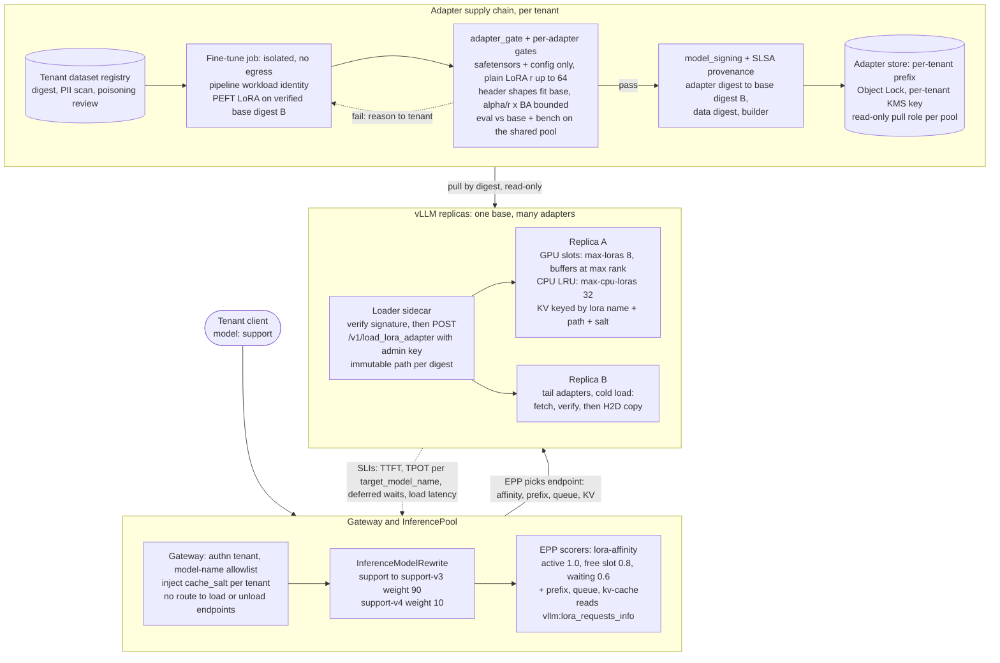

# Lesson 74 — Multi-LoRA and adapter serving as a platform product: adapter residency and dynamic loading in vLLM, adapter-affinity routing in an InferencePool, capacity math for swaps vs dedicated replicas, per-adapter eval and benchmark gates, and securing tenant adapters

*2026-11-23*

[Lesson 73](/lessons/73-quantized-speculative-serving-platform) made quantized checkpoints and draft heads into signed, derived release artifacts. A LoRA adapter is the same kind of artifact, but the tenant brings it, there are hundreds of them per base model, and they change weekly. The pitch is easy: one base model on one pool serves 200 fine-tunes instead of 200 pools. The operator reality is that an adapter is **a model you serve but didn't build**. It competes for a fixed number of GPU slots per replica. It costs HBM you took from the KV cache ([L21](/lessons/21-inference-serving-slos-ttft-tpot-kvcache), [L72](/lessons/72-kv-cache-tiering-prefix-aware-routing)). It changes the prefix-cache key and the speculative-decoding acceptance rate. It has a cold-start path that shows up as TTFT for exactly one tenant. And the vLLM runtime-load path is documented upstream as unsafe for production. This lesson treats adapters the way [L13](/lessons/13-ml-weights-checkpoint-hardening), [L27](/lessons/27-gpu-supply-chain-weight-registry-hydrate) and [L64](/lessons/64-mock-security-deep-dive-weights-platform) treat weights: gated, signed, bound to a base digest, and loaded only through a path you control.

> **What's verified here (2026-11-23).** Versions come from GitHub releases: vLLM **v0.34.0** (2026-11-16), llm-d Router **v1.0.0** (2026-10-16; the EPP, `InferenceObjective` and `InferenceModelRewrite` moved there from gateway-api-inference-extension), gateway-api-inference-extension **v1.6.2** (InferencePool API, `inference.networking.k8s.io/v1`), llm-d **v1.0.0**, SGLang **v0.5.23**, model-signing **1.1.1**, cosign **v3.1.4**. Flags, defaults and behavior come from source at those tags: vLLM `docs/features/lora.md`, `vllm/config/lora.py`, `vllm/lora/{lora_model,peft_helper,model_manager}.py`, `vllm/lora/layers/base_linear.py`, `vllm/entrypoints/openai/models/serving.py`, `vllm/entrypoints/serve/lora/api_router.py`, `vllm/entrypoints/serve/engine/serving.py`, `vllm/plugins/lora_resolvers/filesystem_resolver.py`, `vllm/v1/core/kv_cache_utils.py`, `vllm/v1/core/sched/scheduler.py`, `vllm/v1/metrics/loggers.py`, `vllm/benchmarks/serve.py`; llm-d-router `pkg/epp/framework/plugins/scheduling/scorer/loraaffinity/lora_affinity.go`, `.../datalayer/extractor/metrics/{factories,extractor}.go`, `pkg/epp/metadata/consts.go`, `apix/v1alpha2/inferencemodelrewrite_types.go`, `apix/v1/inferenceobjective_types.go`, `docs/metrics.md` (plus `main` for `llm_d_epp_request_outcome_total`, added after v1.0.0); llm-d `guides/multi-model-routing`; SGLang `docs/advanced_features/lora.mdx`. Advisories come from the vLLM GitHub security-advisory API. **Tests on this box:** `lora_capacity.py`, `resolver_lab.py` (runs vLLM v0.34.0's real `FilesystemResolver` source with stubbed imports), and `adapter_gate.py` + `lab.sh` ran here, and their output is quoted. `lab.sh` used real `model_signing` 1.1.1 and `cosign` v3.1.4 on **toy 2-layer fixtures, not a real model**. The ValidatingAdmissionPolicy, the InferencePool, `InferenceModelRewrite` and `InferenceObjective` objects were applied to a real **kube-apiserver v1.37.2** with the v1.0.0 / v1.6.2 CRDs installed (no kubelet, CNI, gateway or GPUs). **Nothing ran on a GPU.** Capacity numbers are my own arithmetic with stated assumptions.

## What interviewers are really probing

- **Do you know what `--max-loras` actually is?** It isn't "how many adapters the server knows". It's the number of **distinct adapters allowed in one batch**, which is also the number of GPU slots. vLLM pre-allocates stacked `lora_a`/`lora_b` buffers of shape `max_loras × max_lora_rank × …` for every LoRA-wrapped linear layer at startup, whatever rank your adapters really have. On Qwen3-32B with all seven projections wrapped, that's **16 MiB per unit of rank**, so `--max-loras 16 --max-lora-rank 64` reserves **16 GiB per replica**, or 65,536 tokens of BF16 KV you no longer have. `--max-cpu-loras` (defaults to `max_loras`, must be ≥ it) is the host-RAM LRU behind the slots. Adapters beyond that reload from their path.
- **Can you reason about the scheduler, not just the router?** When a batch already holds `max_loras` distinct adapters, a request for a different adapter is **skipped**, not failed. It shows up as `vllm:num_requests_waiting_by_reason{reason="deferred"}` ("LoRA budget, KV transfer, blocked status") and as TTFT for that tenant only. Random routing across a pool with 200 adapters guarantees this. In my worked example, 64 running requests per replica touch ~32 distinct adapters, twice the slots.
- **Do you know what the router can and can't see?** The llm-d `lora-affinity-scorer` reads one vLLM metric, `vllm:lora_requests_info`, whose labels are comma-joined adapter names (`running_lora_adapters`, `waiting_lora_adapters`) plus `max_lora`. It scores 1.0 if the adapter is active on that pod, 0.8 if there's a free slot, 0.6 if it's only waiting, and 0 otherwise. "Active" means *has running requests*. An adapter that's resident in GPU or CPU memory but idle is invisible. Only vLLM's engine config fills this in: the SGLang, TRT-LLM and Triton engine configs in llm-d-router v1.0.0 set `LoRASpec: ""`, so there is no LoRA affinity at all on those pools.
- **Would you turn on runtime loading in a shared pool?** vLLM's own docs say dynamic LoRA "should not be used in production unless it is an isolated, fully trusted environment", and the server logs "This should ONLY be used for local development!" when it attaches the routes. The interviewer wants to hear why. The load/unload endpoints live under `/v1` and share one API key with inference. The built-in filesystem resolver joins the request's `model` string onto its cache directory with `os.path.join`. In my test, `../tenant-b/fraud-v1` and absolute paths resolved to adapters outside the cache dir.
- **Can you sign and gate something you didn't build?** Platform-trained adapters get the full chain from [L73](/lessons/73-quantized-speculative-serving-platform): `model_signing` plus SLSA provenance naming the **verified base digest**, the dataset digest and the builder. Bring-your-own adapters can't prove their base, so they go through a code-free conversion path and a quarantine tier. vLLM itself never checks which base an adapter was trained on. It checks shapes, rank and module names, so an adapter from a different fine-tune of the same architecture loads silently and serves garbage.

## Core diagram

![Multi-LoRA adapter serving as a platform: top row, the per-tenant adapter supply chain — tenant dataset registry with digest, PII scan and poisoning review; an isolated fine-tune job with no egress and its own workload identity training a PEFT LoRA on the verified base digest B; adapter_gate plus per-adapter gates (safetensors and config only, plain LoRA up to rank 64, safetensors header shapes fit the base, alpha over r times BA bounded, eval against base and a benchmark on the shared pool), with failures returned to the tenant; model_signing plus SLSA provenance binding the adapter digest to base digest B, the data digest and the builder; and an adapter store with per-tenant prefixes, Object Lock, per-tenant KMS keys and a read-only pull role per pool. Middle: vLLM replicas sharing one base — a loader sidecar that verifies signatures and then posts to /v1/load_lora_adapter with an admin key using an immutable path per digest; replica A with GPU slots max-loras 8 whose buffers are sized at max rank, a CPU LRU of max-cpu-loras 32 and KV keyed by LoRA name, path and salt; replica B serving tail adapters with a cold load path of fetch, verify, then host-to-device copy. Bottom: the tenant client calling the Gateway (authenticate tenant, model-name allowlist, inject cache_salt per tenant, no route to load or unload endpoints), then InferenceModelRewrite (support to support-v3 weight 90 and support-v4 weight 10), then the EPP scorers (lora-affinity: active 1.0, free slot 0.8, waiting 0.6, plus prefix, queue and KV-cache scorers, reading vllm:lora_requests_info), which picks the endpoint; the pool feeds SLIs back: TTFT and TPOT per target_model_name, deferred waits and load latency](/multi-lora-adapter-serving-platform.png)

**How to read it.** Start at the bottom right with the tenant client. The name it sends (`support`) is a **product name**, not an adapter. The gateway authenticates the tenant, checks the name against an allowlist, injects that tenant's `cache_salt`, and never routes the load/unload paths. `InferenceModelRewrite` turns the product name into an immutable adapter name (`tenant-a-support-v3`), and a weighted second target is the canary. The EPP prefers a replica where that adapter is already active, then one with a free slot. In the middle box, adapters reach a replica only through the loader. The loader verifies the `model_signing` bundle and loads from a path that encodes the digest, because vLLM keys prefix-cache blocks on adapter name **and path**. The top box is where an adapter earns that path. It's trained or converted in isolation, gated on files, config, tensor header, numeric bounds, eval and a shared-pool benchmark, then signed with provenance back to base digest B. The dotted line from the pool back to the router is the part teams forget. Per-adapter SLIs only exist at the router (`target_model_name`), because vLLM labels its latency histograms with the base model's served name.



## Idiosyncrasies / operator depth

### Residency: three tiers, and only one of them is visible to the router

- **GPU slots** (`--max-loras`, default **1**). The stacked buffers are zero-padded to `--max-lora-rank`. Allowed ranks are 1, 8, 16, 32, 64, 128, 256, 320 and 512, with a default of 16. The Punica-lineage shrink/expand kernels (`vllm/lora/ops/triton_ops/lora_shrink_op.py`, `lora_expand_op.py`; the papers are Punica's SGMV and S-LoRA's heterogeneous batching) run over that padded dimension. One rank-256 tenant raises the HBM bill and the kernel cost for everyone in the pool. vLLM's own tip is to set it to the largest rank you'll serve, "rather than 256". `--lora-target-modules o_proj qkv_proj …` shrinks the reservation if your adapters don't touch every projection.
- **CPU LRU** (`--max-cpu-loras`). This holds `LoRAModel` tensors at their real rank in host memory. A hit costs a host-to-device copy (about 11 ms for a 256 MiB rank-16 adapter at 25 GB/s, by my arithmetic). `max_cpu_loras` is in the config's `ignored_factors` for compilation, so changing it doesn't invalidate the torch.compile cache. Changing `max_loras` or `max_lora_rank` does.
- **The path** (disk, image volume, object store). A CPU miss re-reads the adapter from `lora_path`. On a node-local image volume that's tens of milliseconds. Through an S3-style resolver it's half a second or more, inside the request, under a per-name lock (`lora_resolver_lock[lora_name]`), so every concurrent first request for that adapter waits behind it.
- **What the router sees.** `vllm:lora_requests_info` lists adapter **names with running or waiting requests**, nothing else. Neither the CPU LRU nor idle GPU residency is exported. So the scorer ranks a "free slot" (0.8) above "waiting" (0.6) without knowing whether that free slot means a CPU-LRU hit (milliseconds) or an object-store fetch (seconds). The llm-d-router code notes that "ActiveModels and WaitingModels share the same source in current vLLM".

### The metric that drives routing is shaped like a log line

- `vllm:lora_requests_info` is a Gauge whose **value is a wall-clock timestamp**, set every time stats are recorded, and whose labels carry comma-joined adapter names in dict order. vLLM's own design doc calls this encoding "misguided". In v0.34.0 the logger never removes old label sets, so the exposition keeps **one series per distinct (running, waiting) combination ever seen**. The EPP copes by taking the series with the **largest value** (`getLatestMetric`). Your Prometheus shouldn't store it: drop it with `metric_relabel_configs` and let the EPP scrape pods directly.
- With data parallelism (`len(engine_indexes) > 1`), vLLM logs that the metric "may be incorrect/misleading", which means LoRA affinity is approximate on DP deployments.
- vLLM's latency histograms (`vllm:time_to_first_token_seconds`, `vllm:inter_token_latency_seconds`, …) carry `model_name` = **served model name**, the base, never the adapter. Per-adapter latency only exists at the router, as `llm_d_epp_request_ttft_seconds{target_model_name=…}`. EPP caps client-derived `model_name`/`target_model_name` values at **1,000 per process lifetime** before folding them to `other`. Names configured through `InferenceModelRewrite` "never fold". So registering every tenant adapter through a rewrite rule is also how you keep its SLI series.

### Loading paths and their sharp edges

- **Static** `--lora-modules name=path` (or the JSON form with `base_model_name`, which fills `/v1/models` `parent`). `init_static_loras` "raises if any fail to load", so one bad adapter in a 200-entry list crash-loops the whole pool at startup.
- **Runtime API.** With `VLLM_ALLOW_RUNTIME_LORA_UPDATING=True`, `/v1/load_lora_adapter` takes `lora_name` + `lora_path` (+ `load_inplace`). It returns 400 if the name is already loaded unless `load_inplace` is set. `/v1/unload_lora_adapter` only deletes the name from the server's registry. It doesn't call the engine's `remove_lora`, so the slot and CPU copy age out through LRU. Unload makes a name unroutable. It doesn't free memory right away.
- **In-place reload at the same path reuses stale KV.** Block hashes include `("lora", lora_name, lora_path)`. Reloading changed weights under the same name **and the same path** leaves prefix-cache blocks computed with the old weights valid. v0.34 logs a warning saying exactly that. Always load a new version from a new, digest-named path.
- **Resolvers** (`VLLM_PLUGINS=lora_filesystem_resolver` + `VLLM_LORA_RESOLVER_CACHE_DIR`, or `lora_hf_hub_resolver` + `VLLM_LORA_RESOLVER_HF_REPO_LIST`) run on **any unknown model name** in the request path. They return 404 if no resolver finds it and 400 if one finds it but loading fails. Both are 4xx. A broken adapter store therefore looks like **client error** to an availability SLI that excludes `ModelServerClientError`. The filesystem resolver also requires `adapter_config.json`'s `base_model_name_or_path` to **equal `model_config.model`**. Serve the base from `/models/qwen3-32b` and every Hub-trained adapter (`"Qwen/Qwen3-32B"`) resolves to `None`, which means a silent 404. My lab below shows both behaviors.
- **Formats.** The loader prefers `adapter_model.safetensors` and falls back to `adapter_model.bin`/`.pt` via `torch.load(..., weights_only=True)`. That's still a pickle parser, and `weights_only` has had bypasses (CVE-2025-32434 in torch before 2.6). vLLM rejects DoRA, `lora_bias`, `bias != "none"`, `modules_to_save` other than `classifier`/`score`, and base-mutating inits (PiSSA, OLoRA, CorDA, LoftQ). It does **not** check which base an adapter was trained on.

### Adapters change the cache and speculation math you sized in L72/L73

- **No prefix sharing across adapters.** The LoRA name and path are part of every block hash. Fifty adapters with the same 4K-token system prompt hold fifty copies, and prefix-hit rate per pool falls as adapter count rises ([L72](/lessons/72-kv-cache-tiering-prefix-aware-routing)). llm-d-router PR 2929 (2026-09-19) made precise prefix routing match LoRA requests at all. Older routers mis-scored them.
- **Drafts don't run adapters.** `LoRAConfig.verify_with_model_config` notes "Speculative decoding drafters don't run LoRA adapters." An EAGLE-3 or MTP draft predicts the **base** model's distribution, so acceptance length on adapter traffic is lower than on base traffic, and lower still the further the adapter moves the model. The acceptance-length SLO from [L73](/lessons/73-quantized-speculative-serving-platform) has to be per traffic class (base vs adapter), or a pool that adds adapters quietly loses its speculative capacity.
- **Quantized base, BF16-trained adapter.** LoRA on an AWQ or FP8 base works (the upstream multi-LoRA manifest serves `Qwen/Qwen3-32B-AWQ`), but the base is now a derived artifact. Per-adapter evals must run on the **served** base, and provenance should name both the training base digest and the serving base digest.

### SGLang differs in names and in one useful knob

SGLang v0.5.23 uses `--max-loras-per-batch` (default 8), `--max-loaded-loras` (CPU), `--lora-eviction-policy lru|fifo`, `--lora-backend csgmv|triton`, and `base-model:adapter` in the OpenAI `model` field. It has **pinned** adapters, capped at `max-loras-per-batch − 1` "to prevent unexpected starvations". vLLM has no pin API in the server. Remember the EPP gives SGLang pools no LoRA affinity.

### Swaps vs dedicated replicas: the decision is per adapter, not per platform

Merged dedicated replicas pay no LoRA kernel overhead and no slot contention, but each needs a full base-model footprint. That only pays when one adapter's traffic fills **at least one replica** at SLO. In the worked example below, a Zipf(1.1) tenant mix of 200 adapters at 600 req/s needs **20 shared replicas vs 205 dedicated**. Giving the 6 hottest adapters their own pools comes to **22**, more than shared, because of rounding. Do that for isolation or a contractual SLO, not for cost.

## Concrete commands & config

### Preflight: what is this adapter, without executing anything?

```bash
A=/quarantine/tenant-a/support-v4
ls -la "$A"        # expect exactly: adapter_config.json  adapter_model.safetensors  (README.md)
jq '{peft_type, r, lora_alpha, use_rslora, use_dora, bias, modules_to_save, init_lora_weights,
     target_modules, rank_pattern, alpha_pattern, base_model_name_or_path}' "$A/adapter_config.json"

# safetensors = 8-byte little-endian header length + JSON header: read names/dtypes/shapes with no torch, no pickle
python3 - "$A/adapter_model.safetensors" <<'PY'
import json, struct, sys, collections
f = open(sys.argv[1], "rb"); n = struct.unpack("<Q", f.read(8))[0]; h = json.loads(f.read(n)); h.pop("__metadata__", None)
kinds = collections.Counter(k.rsplit(".", 2)[-2] for k in h)      # lora_A / lora_B / anything else
print(kinds, {v["dtype"] for v in h.values()}, sorted({tuple(v["shape"]) for v in h.values()})[:4])
PY
```

### Static tier (default for shared multi-tenant pools): adapters as digest-pinned image volumes

```yaml
# pod template excerpt: no runtime loading, adapters arrive with the pod and change by rollout
containers:
  - name: vllm
    image: registry.example.com/ml/vllm-openai@sha256:<engine-digest>     # v0.34.0 build
    args: ["--model", "/models/qwen3-32b", "--served-model-name", "Qwen/Qwen3-32B",
           "--load-format", "safetensors", "--tensor-parallel-size", "2",
           "--enable-lora", "--max-loras", "8", "--max-cpu-loras", "64", "--max-lora-rank", "64",
           "--lora-target-modules", "qkv_proj", "o_proj", "gate_up_proj", "down_proj",
           "--lora-modules",
           '{"name": "tenant-a-support-v3", "path": "/adapters/tenant-a/support-v3@31339ec0", "base_model_name": "Qwen/Qwen3-32B"}',
           '{"name": "tenant-b-sql-v7", "path": "/adapters/tenant-b/sql-v7@9c1d02aa", "base_model_name": "Qwen/Qwen3-32B"}']
    env: [{name: HF_HUB_OFFLINE, value: "1"}]
    volumeMounts:
      - {name: adapters-tenant-a, mountPath: /adapters/tenant-a, readOnly: true}
      - {name: adapters-tenant-b, mountPath: /adapters/tenant-b, readOnly: true}
volumes:   # ImageVolume (L68): OCI artifacts pinned by digest, verified by the image-policy controller
  - name: adapters-tenant-a
    image: {reference: "registry.example.com/adapters/tenant-a@sha256:<gated-digest>"}
  - name: adapters-tenant-b
    image: {reference: "registry.example.com/adapters/tenant-b@sha256:<gated-digest>"}
```

A cold adapter in this tier reloads from a node-local image volume, which takes tens of milliseconds, not an object-store round trip. An adapter change becomes a new pod template, so it goes through the same canary and progressive delivery as any release ([L51](/lessons/51-gitops-progressive-delivery-fleet-scale)). The cost is that one adapter that fails to load blocks startup, which is why the gate runs first.

### Dynamic tier (single-tenant or fully trusted pools only)

```bash
# Engine env: VLLM_ALLOW_RUNTIME_LORA_UPDATING=true, VLLM_API_KEY from a Secret, no resolver plugins.
# The loader sidecar verifies the signature first, then loads from a NEW digest-named path (never in place on the same path).
model_signing verify sigstore /adapters/tenant-a/support-v4@5b77e1c2 \
  --signature /adapters/tenant-a/support-v4@5b77e1c2.sig \
  --identity "https://platform.example.com/builders/peft-finetune@v2" --identity_provider https://token.actions.example.com
curl -sf -X POST http://127.0.0.1:8000/v1/load_lora_adapter \
  -H "Authorization: Bearer ${VLLM_API_KEY}" -H "Content-Type: application/json" \
  -d '{"lora_name": "tenant-a-support-v4", "lora_path": "/adapters/tenant-a/support-v4@5b77e1c2"}'
# -> 200 "Success: LoRA adapter 'tenant-a-support-v4' added successfully."  (the engine add_lora also preloads it)
curl -s -H "Authorization: Bearer ${VLLM_API_KEY}" http://127.0.0.1:8000/v1/models | jq '.data[] | {id, root, parent}'
# Retire v3 only after the rewrite weight is 0 and in-flight requests drain; unload = unroutable, memory ages out via LRU
curl -sf -X POST http://127.0.0.1:8000/v1/unload_lora_adapter -H "Authorization: Bearer ${VLLM_API_KEY}" \
  -H "Content-Type: application/json" -d '{"lora_name": "tenant-a-support-v3"}'
```

### Routing: InferencePool, rewrite and objective (server-dry-run on kube-apiserver v1.37.2 with v1.0.0/v1.6.2 CRDs)

```yaml
apiVersion: inference.networking.k8s.io/v1
kind: InferencePool
metadata: {name: qwen3-32b-lora, namespace: serve-lora}
spec:
  selector: {matchLabels: {app: vllm-qwen3-32b-lora}}
  targetPorts: [{number: 8000}]
  endpointPickerRef:
    name: qwen3-32b-lora-epp
    port: {number: 9002}
    failureMode: FailClose     # default; FailOpen = the gateway picks blind and every request can cold-load anywhere
---
apiVersion: llm-d.ai/v1alpha2
kind: InferenceModelRewrite
metadata: {name: tenant-a-support, namespace: serve-lora}
spec:
  poolRef: {name: qwen3-32b-lora}          # group defaults to inference.networking.k8s.io
  rules:
    - matches: [{model: {value: support}}]  # what tenant A's client sends (Exact is the only match type)
      targets:
        - {modelRewrite: tenant-a-support-v3, weight: 90}
        - {modelRewrite: tenant-a-support-v4, weight: 10}   # canary of a gated adapter, same base digest
---
apiVersion: llm-d.ai/v1                     # v1alpha2 InferenceObjective now warns "deprecated; use llm-d.ai/v1"
kind: InferenceObjective
metadata: {name: tenant-a-interactive, namespace: serve-lora}
spec:
  priority: 10                              # flow control serves higher priority first; unset = 0
  poolRefs: [{name: qwen3-32b-lora}]        # selected per request with header x-llm-d-inference-objective
```

```yaml
# EndpointPickerConfig: affinity matters, but not more than queueing (weights are illustrative; tune with replay)
apiVersion: llm-d.ai/v1
kind: EndpointPickerConfig
plugins:
  - type: queue-scorer
  - type: kv-cache-utilization-scorer
  - type: prefix-cache-scorer
  - type: lora-affinity-scorer
  - type: max-score-picker
schedulingProfiles:
  - name: default
    plugins:
      - {pluginRef: queue-scorer, weight: 2}
      - {pluginRef: kv-cache-utilization-scorer, weight: 1}
      - {pluginRef: prefix-cache-scorer, weight: 2}
      - {pluginRef: lora-affinity-scorer, weight: 1}
      - {pluginRef: max-score-picker}
```

Two things the dry-run showed. First, the v1.0.0 CRD accepted a rule with `weight` on one target and not the other, even though the type's doc says "If a weight is set for any targetModel, it must be set for all". Lint rewrites in CI. Second, the deprecated `x-gateway-*` headers still work as aliases (`x-gateway-inference-objective`, `x-gateway-model-name-rewrite`) next to the `x-llm-d-*` names. Strip **both** spellings at the gateway edge so a client can't choose its own objective or rewrite.

### Observe residency and LoRA pressure

```bash
curl -s -H "Authorization: Bearer $KEY" http://$POD:8000/metrics | grep -E '^vllm:lora_requests_info|waiting_by_reason'
# vllm:lora_requests_info{max_lora="8",running_lora_adapters="tenant-a-support-v3,tenant-b-sql-v7",waiting_lora_adapters=""} 1.7639e+09
# vllm:num_requests_waiting_by_reason{engine="0",model_name="Qwen/Qwen3-32B",reason="deferred"} 3.0
```

```yaml
# Prometheus scrape: keep the EPP's view, drop the churny info gauge from the TSDB
metric_relabel_configs:
  - source_labels: [__name__]
    regex: "vllm:lora_requests_info"
    action: drop
```

### Benchmark gate: the new adapter, in the pool mix it will actually live in

```bash
vllm bench serve --backend openai-chat --endpoint /v1/chat/completions --base-url http://$POD:8000 \
  --model Qwen/Qwen3-32B --tokenizer /models/qwen3-32b \
  --dataset-name custom --dataset-path /bench/tenant-mix-2026-11.jsonl --num-prompts 2000 --seed 0 \
  --lora-modules tenant-a-support-v4 tenant-b-sql-v7 tenant-c-claims-v2 tenant-d-kb-v11 \
  --lora-assignment random --max-concurrency 64 \
  --goodput ttft:1000 tpot:60 --save-result --result-filename bench-support-v4.json
# Compare against the last promoted pool run: p99_ttft_ms, p99_tpot_ms, request_goodput, output_throughput.
# Run once with --lora-assignment round-robin and more adapters than --max-loras to measure the deferred-wait tail.
```

### `lora_capacity.py`: HBM reservation, cold-path cost, shared vs dedicated (worked example, not a benchmark)

```python
#!/usr/bin/env python3
"""lora_capacity.py - what multi-LoRA costs in HBM, what a cold adapter costs in TTFT, and
shared multi-LoRA pool vs dedicated (merged) replicas. Worked example, not a benchmark."""
import math

# ---- Base: Qwen3-32B (config.json: 64 layers, hidden 5120, 64 q heads x 128, 8 kv heads x 128, intermediate 25600)
L, H, QD, KVD, I = 64, 5120, 64 * 128, 8 * 128, 25600
BYTES = 2                                   # --lora-dtype auto = model dtype (bf16 here)
KV_PER_TOKEN = L * 2 * KVD * BYTES          # K and V, bf16 KV cache: 256 KiB/token

# vLLM packs q/k/v into qkv_proj (3 slices) and gate/up into gate_up_proj (2 slices); each slice gets its own A.
# Elements per unit of rank per layer: sum over slices of (in + out)
per_rank_layer = (3 * H + (QD + 2 * KVD)) + (QD + H) + (2 * H + 2 * I) + (I + H)
per_rank_bytes = per_rank_layer * L * BYTES

def gib(b): return b / 2**30

print("== 1. HBM reserved by --enable-lora (stacked buffers are sized max_loras x max_lora_rank, any adapter rank)")
print(f"   per unit of rank, all 7 linear modules x {L} layers: {per_rank_bytes/2**20:.1f} MiB")
for max_loras, max_rank in [(4, 16), (8, 64), (16, 64), (16, 256)]:
    b = max_loras * max_rank * per_rank_bytes
    print(f"   --max-loras {max_loras:>2} --max-lora-rank {max_rank:>3}: {gib(b):6.2f} GiB per replica"
          f"  = {b/KV_PER_TOKEN:>9,.0f} tokens of bf16 KV not available")

print("\n== 2. One adapter's real size (rank 16, all-linear) and the cold path")
adapter = 16 * per_rank_bytes
print(f"   adapter_model.safetensors ~ {adapter/2**20:.0f} MiB")
# Assumed achieved bandwidths (replace with measured): object store per pod, local NVMe, pinned H2D over PCIe Gen5
paths = {"object store (S3-class, ~0.5 GB/s per pod)": 0.5e9, "node-local NVMe cache (~3 GB/s)": 3e9,
         "CPU LRU hit (pinned H2D ~25 GB/s)": 25e9}
for k, bw in paths.items():
    print(f"   {k:46}: {adapter/bw*1000:7.0f} ms + fixed load overhead")

print("\n== 3. Shared multi-LoRA pool vs dedicated replicas (2-GPU TP=2 replicas)")
# 200 tenant adapters, Zipf(s=1.1) popularity, 600 req/s total, a replica sustains 30 req/s at SLO with LoRA
# overhead, 33 req/s without LoRA (assume ~10% LoRA kernel overhead at rank 16; MEASURE IT).
N, S, QPS, CAP_LORA, CAP_BASE = 200, 1.1, 600, 30, 33
w = [1 / (k ** S) for k in range(1, N + 1)]; Z = sum(w); p = [x / Z for x in w]
shared = math.ceil(QPS / CAP_LORA)
dedicated = sum(max(1, math.ceil(QPS * pk / CAP_BASE)) for pk in p)  # min 1 replica per adapter (no scale-to-zero)
head = sum(1 for pk in p if QPS * pk >= CAP_BASE * 0.5)
print(f"   shared pool: {shared} replicas = {2*shared} GPUs (each replica: --max-loras 16, --max-cpu-loras 64)")
print(f"   dedicated merged replicas, one per adapter (min 1): {dedicated} replicas = {2*dedicated} GPUs")
print(f"   hybrid: {head} hot adapters (>= half a replica of load) get dedicated or pinned pools, "
      f"tail of {N-head} shares a pool: "
      f"{sum(math.ceil(QPS*pk/CAP_BASE) for pk in p[:head]) + math.ceil(QPS*sum(p[head:])/CAP_LORA)} replicas")

print("\n== 4. Residency: how many distinct adapters does one replica see? (affinity on vs off)")
R = shared
def distinct(n_req, probs):         # expected distinct adapters among n_req i.i.d. draws
    return sum(1 - (1 - q) ** n_req for q in probs)
batch = 64                           # running requests per replica at steady state
print(f"   random routing, {batch} running reqs/replica: ~{distinct(batch, p):.0f} distinct adapters want a GPU slot "
      f"(max_loras=16 -> 'deferred' waits)")
# affinity: adapters partitioned across replicas by load; each replica serves ~N/R adapters' traffic
per = N / R
print(f"   with adapter affinity (~{per:.0f} adapters homed per replica): working set per replica ~{per:.0f}, "
      f"fits --max-cpu-loras 64; GPU slots hold the hottest 16")
```

```text
$ python3 lora_capacity.py
== 1. HBM reserved by --enable-lora (stacked buffers are sized max_loras x max_lora_rank, any adapter rank)
   per unit of rank, all 7 linear modules x 64 layers: 16.0 MiB
   --max-loras  4 --max-lora-rank  16:   1.00 GiB per replica  =     4,096 tokens of bf16 KV not available
   --max-loras  8 --max-lora-rank  64:   8.00 GiB per replica  =    32,768 tokens of bf16 KV not available
   --max-loras 16 --max-lora-rank  64:  16.00 GiB per replica  =    65,536 tokens of bf16 KV not available
   --max-loras 16 --max-lora-rank 256:  64.00 GiB per replica  =   262,144 tokens of bf16 KV not available

== 2. One adapter's real size (rank 16, all-linear) and the cold path
   adapter_model.safetensors ~ 256 MiB
   object store (S3-class, ~0.5 GB/s per pod)    :     537 ms + fixed load overhead
   node-local NVMe cache (~3 GB/s)               :      89 ms + fixed load overhead
   CPU LRU hit (pinned H2D ~25 GB/s)             :      11 ms + fixed load overhead

== 3. Shared multi-LoRA pool vs dedicated replicas (2-GPU TP=2 replicas)
   shared pool: 20 replicas = 40 GPUs (each replica: --max-loras 16, --max-cpu-loras 64)
   dedicated merged replicas, one per adapter (min 1): 205 replicas = 410 GPUs
   hybrid: 6 hot adapters (>= half a replica of load) get dedicated or pinned pools, tail of 194 shares a pool: 22 replicas

== 4. Residency: how many distinct adapters does one replica see? (affinity on vs off)
   random routing, 64 running reqs/replica: ~32 distinct adapters want a GPU slot (max_loras=16 -> 'deferred' waits)
   with adapter affinity (~10 adapters homed per replica): working set per replica ~10, fits --max-cpu-loras 64; GPU slots hold the hottest 16
```

How to read it. **Section 1** is the number to raise in a design review. On 2× H100 80 GB (TP=2) at `--gpu-memory-utilization 0.9`, about 144 GB is usable. The BF16 weights take ~65.5 GB, and activations and CUDA graphs take more, so the KV pool is somewhere around 70 GB. A careless `--max-loras 16 --max-lora-rank 64` takes **~23%** of it. `--max-lora-rank 256` takes almost all of it. Default partial sharding replicates some A matrices across TP ranks, so per-GPU cost is more than half the per-replica figure. `--fully-sharded-loras` changes that and is "likely faster" at high rank or TP. **Section 2** says where the cold path should live: node-local volumes or a warmed CPU LRU, never object storage in the request path. **Section 3** is the cost argument for shared pools, and it's also why the hybrid isn't automatically cheaper. **Section 4** is the routing argument. Without affinity, every replica sees most of the tenant mix and the 16 slots thrash. With affinity, each replica's working set is ~10 adapters. The ~10% LoRA throughput penalty, the bandwidths and the Zipf skew are **assumptions**. Measure your own with the benchmark gate above.

### `resolver_lab.py`: what the request's `model` string reaches on disk (vLLM v0.34.0 `FilesystemResolver`, real source)

```text
$ python3 resolver_lab.py      # cache dir = /tmp/l74-resolver/adapters/tenant-a

served model (model_config.model) = 'Qwen/Qwen3-32B'
  model='support-v3'                                         -> /tmp/l74-resolver/adapters/tenant-a/support-v3
  model='../tenant-b/fraud-v1'                               -> /tmp/l74-resolver/adapters/tenant-a/../tenant-b/fraud-v1
  model='/tmp/l74-resolver/scratch/uploaded-by-anyone'       -> /tmp/l74-resolver/scratch/uploaded-by-anyone
  model='nope'                                               -> None (vLLM answers 404)

served model (model_config.model) = '/models/qwen3-32b'
  model='support-v3'                                         -> None (vLLM answers 404)
  model='../tenant-b/fraud-v1'                               -> None (vLLM answers 404)
  model='/tmp/l74-resolver/scratch/uploaded-by-anyone'       -> None (vLLM answers 404)
  model='nope'                                               -> None (vLLM answers 404)
```

The resolver's only checks are that `adapter_config.json` exists, `peft_type == "LORA"`, and `base_model_name_or_path == model_config.model`. `_check_model` passes `request.model` through unchanged. So with runtime updating on, **any directory on the pod that looks like an adapter for this base is addressable by path**, including another tenant's mount or a writable scratch dir. The second block is the operational twin: serve from a local path and every Hub-trained adapter silently 404s. Neither is a new upstream advisory. Upstream already calls this mode dev-only. They're the concrete reasons the VAP below makes runtime-load pods single-tenant and the gateway allowlists model names (`^[a-z0-9-]{1,63}$`, no `/` or `..`).

## Failures & fixes

| Symptom | Likely cause | Check | Fix |
|---|---|---|---|
| One tenant's TTFT p99 jumps to seconds; pool averages fine | Adapter not resident: CPU-LRU miss + object-store fetch under the per-name lock, or `max_loras` budget full (deferred) | `llm_d_epp_request_ttft_seconds{target_model_name=…}` vs pool; `vllm:num_requests_waiting_by_reason{reason="deferred"}`; loader latency | Affinity scorer on; node-local adapter volumes; raise `--max-cpu-loras`; prewarm adapters on rollout; reserved residency for contractual tenants |
| KV cache shrank and preemptions rose after "just enabling LoRA" | Stacked buffers sized `max_loras × max_lora_rank` across all wrapped modules, carved out of the KV budget | Startup memory profile; `lora_capacity.py` section 1 | Right-size rank (largest real rank), `--lora-target-modules`, fewer slots; dedicated pool for high-rank tenants |
| Pool crash-loops after an adapter rollout | Static `--lora-modules` entry fails to load (rank > max, unsupported feature, bad path): `init_static_loras` raises | Pod logs: `ValueError` naming the adapter | Gate before promote; canary pods; dynamic tier for churny tenants |
| Requests for a known adapter 404 | Filesystem resolver base check fails (`base_model_name_or_path` ≠ served `--model` path), or adapter store unreachable | Compare `adapter_config.json` with `model_config.model`; resolver logs | Register adapters explicitly (static or loader) instead of resolvers; count 404s for *registered* names as server errors in the SLI |
| Adapter v2 deployed, outputs still look like v1 for cached prompts | `load_inplace` from the **same path**: prefix blocks keyed on (name, path) still valid | vLLM warning "Prefix-cache blocks computed with its previous weights are not invalidated" | New digest-named path per version; or the dev-router `/reset_prefix_cache` (keep dev routes off in prod; roll the pod instead) |
| Unloaded an adapter, memory didn't come back | `unload_lora_adapter` only drops the name from the server registry | `/v1/models` vs GPU memory | Expected: LRU reclaims; to free now, roll the pod |
| Router keeps sending tenant B to a replica that has to fetch | "Active" in `lora_requests_info` = has running requests; idle residency invisible; free slot (0.8) beats waiting (0.6) | EPP scores (`--emit-endpoint-scores`), pod `lora_requests_info` | Weight queue/prefix appropriately; home adapters per replica group; prewarm |
| Prometheus head series climbing on LoRA pools | `vllm:lora_requests_info` keeps one series per distinct comma-joined label combination, never removed | `count({__name__="vllm:lora_requests_info"}) by (pod)` | Drop it at scrape; EPP scrapes pods itself |
| Per-adapter dashboards show `other` | EPP label cap (1,000 client-derived model names per process) | `llm_d_epp_request_total{target_model_name="other"}` | Register adapters via `InferenceModelRewrite` (never folded); reject unknown model names at the gateway |
| Speculative pool's TPOT regressed as adapter share grew | Drafts don't run LoRA: acceptance length lower on adapter traffic | Acceptance per traffic class (L73) | Per-class acceptance SLOs; disable speculation for adapter-heavy pools or retrain drafts on adapter outputs |
| Canary adapter "won" A/B on quality but pool goodput fell | New adapter's rank or target modules raised the padded kernel cost for every request in the batch | Bench gate p99 TPOT with the full pool mix | Pool rank policy; separate pool for outliers |
| SGLang pool ignores adapter affinity | llm-d-router SGLang engine config has no `LoRASpec` | EPP config, engine-type label | Pin hot adapters (SGLang `pinned`), route by `InferenceModelRewrite` to per-adapter pools, or use vLLM pools for multi-LoRA |
| Tenant A got tenant B's adapter | Runtime load + resolver path traversal, or name squatting in a rewrite/IPP ConfigMap | Request logs `model`, rewrite objects (oldest wins ties), `inference.llm-d.ai/ipp-managed` ConfigMaps | Single-tenant runtime pods, name allowlist, platform-owned rewrites (RBAC), VAP |

## Security & hardening

> **The short version.** A tenant adapter is **a model you serve but didn't build**, loaded next to every other tenant's traffic. Treat it like weights ([L13](/lessons/13-ml-weights-checkpoint-hardening), [L27](/lessons/27-gpu-supply-chain-weight-registry-hydrate)). Accept only code-free formats through a quarantine path. Gate it on files, config, tensor header and numeric bounds. Sign it with the pipeline's identity, with provenance whose base-model digest equals the **verified** base digest. Store it per tenant under its own KMS key. Load it only by digest through a path you control. In shared pools, never let a request string turn into a filesystem path or a load call. vLLM's runtime-load mode is dev-only by upstream's own words. Signing tells you **who** produced an adapter and **what** it was built from. It doesn't tell you the adapter is benign, so behavior gets its own gate.

### Threat table

| Asset | Attack path | Control (this lesson) |
|---|---|---|
| Serving host integrity | `adapter_model.bin`/`.pt` pickle (vLLM falls back to `torch.load(weights_only=True)`; CVE-2025-32434-class bypasses), `training_args.bin`, `.py` files riding along | Quarantine conversion to canonical safetensors; G3 file allowlist; never `torch.load` in the platform path; `--load-format safetensors` for the base |
| Lineage | Adapter trained on a different fine-tune or re-upload of the same architecture (vLLM checks shapes, not base identity) | G7: provenance `resolvedDependencies[role=base-model]` digest == verified base digest; separate serving-base digest for quantized bases (L73) |
| Behavior | Backdoored or safety-stripped adapter; config-only blow-up via `lora_alpha` (scale = alpha/r) | G6 effective-delta bound; per-adapter platform safety + regression evals vs base; dataset registry with poisoning review; trigger-sweep evals |
| Cross-tenant weights | Resolver path traversal (`../tenant-b/x`, absolute paths); shared adapter mounts; name squatting in `InferenceModelRewrite` (oldest wins ties) or IPP ConfigMaps (`inference.llm-d.ai/ipp-managed`) | Single-tenant runtime pods (VAP), per-tenant read-only mounts, gateway name allowlist, platform-owned rewrites and IPP maps (RBAC + VAP) |
| Cross-tenant KV | Shared platform adapters reused by many tenants share prefix blocks (timing side channel, L72); LoRA-name vs `cache_salt` first-block collision (GHSA-rh6f-3x46-j33q, fixed 0.31.0) | Gateway-injected per-tenant `cache_salt`, client-supplied salt stripped; vLLM ≥ 0.31.0 |
| Control endpoints | `/v1/load_lora_adapter` with no key, or reachable through the gateway; permissive default CORS (GHSA-vvpg-rrww-wpmh, fixed 0.32.0) driving an unauthenticated dev server from a browser | No runtime updating in shared pools; `VLLM_API_KEY` from a Secret where enabled; gateway routes only inference paths; NetworkPolicy; vLLM ≥ 0.32.0 and explicit `--allowed-origins` |
| Metadata | `/metrics` isn't behind the API key (auth guards `/v1`, `/v2`, `/inference`, `/cohere`), and `vllm:lora_requests_info` labels list adapter names | Opaque adapter IDs (no customer names); NetworkPolicy on the metrics port; drop the gauge from shared TSDBs |
| Availability | Rank-256 adapter in a rank-64 pool, many unknown model names triggering resolver fetches under per-name locks | VAP rank policy, G4; reject unknown names at the gateway before they reach a resolver |

### 1. Two intake paths, one artifact contract

- **Platform-trained** (preferred). The fine-tune job runs in an isolated namespace with no egress and its own workload identity ([L48](/lessons/48-workload-identity-secrets-pki-fleet-scale)). It reads the base from the verified, Object Lock-protected weights bucket and the dataset by digest from the registry. It emits safetensors only and signs with `model_signing` (keyless in production). It attaches SLSA v1 provenance with the base digest, dataset digest, PEFT config and builder image.
- **Bring-your-own.** Tenant uploads land in a quarantine bucket via a presigned PUT. A converter in a sandbox (gVisor or Kata, no network, [L54](/lessons/54-sandboxed-agent-execution-scale)) parses only `adapter_config.json` and the safetensors header, re-serializes tensors into a canonical `adapter_model.safetensors` (drops `__metadata__` and every other file), and never runs `torch.load` or `trust_remote_code`. The platform signs the **converted** artifact, and its provenance says "converted from upload `sha256:…`, declared base `Qwen/Qwen3-32B`, base unverified". BYO adapters serve from a separate pool or with a lower SLA tier until they pass the same evals.

### 2. `adapter_gate.py`: verify before parse, then prove it fits and binds to the base

```python
#!/usr/bin/env python3
"""adapter_gate.py - promotion gate for tenant LoRA adapters (vLLM-served).

Promote only if: base signature OK; adapter signed by the fine-tune pipeline; directory holds only
adapter_config.json + adapter_model.safetensors; adapter_config is a plain LoRA the pool can serve;
the safetensors header (parsed as JSON, no code) holds only lora_A/lora_B tensors with shapes that
fit the base; the effective delta (alpha/r * B@A) is finite and bounded; and signed SLSA provenance
binds the adapter digest to the VERIFIED base digest, a registered dataset and an allowed builder.
"""
import argparse, base64, json, os, re, struct, subprocess, sys
import numpy as np
from safetensors.numpy import load_file

ALLOWED_FILES = {"adapter_config.json", "adapter_model.safetensors", "README.md"}
ALLOWED_BUILDERS = {"https://platform.example.com/builders/peft-finetune@v2"}
ALLOWED_DTYPES = {"BF16", "F16", "F32"}
KEY = re.compile(r"^base_model\.model\.model\.layers\.(\d+)\.(self_attn|mlp)\.(q_proj|k_proj|v_proj|o_proj|gate_proj|up_proj|down_proj)\.lora_([AB])\.weight$")

def run(cmd):
    p = subprocess.run(cmd, capture_output=True, text=True)
    return p.returncode, ((p.stdout + p.stderr).strip().splitlines() or [""])[-1]

def ms_verify(d, sig, pub):
    rc, tail = run(["model_signing", "verify", "key", d, "--signature", sig, "--public_key", pub])
    return rc == 0, tail

def ms_subject(sig):
    return json.loads(base64.b64decode(json.load(open(sig))["dsseEnvelope"]["payload"]))["subject"][0]["digest"]["sha256"]

def st_header(path):                      # safetensors = 8-byte LE length + JSON header + raw bytes
    with open(path, "rb") as f:
        n = struct.unpack("<Q", f.read(8))[0]
        return json.loads(f.read(n))

def main():
    ap = argparse.ArgumentParser()
    for k in ["base", "base-sig", "base-pub", "base-config", "adapter", "adapter-sig", "pipeline-pub",
              "provenance", "attest-pub", "data-registry", "expect-base-id"]:
        ap.add_argument("--" + k)
    ap.add_argument("--pool-max-rank", type=int, default=64)
    ap.add_argument("--pool-target-modules", default="q_proj,k_proj,v_proj,o_proj,gate_proj,up_proj,down_proj")
    ap.add_argument("--max-delta-ratio", type=float, default=0.5)
    a = ap.parse_args()
    ok = True
    def gate(name, passed, detail):
        nonlocal ok; ok &= passed
        print(f"  [{'PASS' if passed else 'FAIL'}] {name}: {detail}")

    p, d = ms_verify(a.base, a.base_sig, a.base_pub); gate("G1 base signature", p, d)
    base_digest = ms_subject(a.base_sig)
    p, d = ms_verify(a.adapter, a.adapter_sig, a.pipeline_pub)
    gate("G2 adapter signature (fine-tune pipeline key)", p, d if p else "Hash mismatch: " + ",".join(sorted(set(re.findall(r"Hash mismatch for \W*([\w.]+)", d)))))
    adapter_digest = ms_subject(a.adapter_sig)
    if not ok:                            # verify before parse: never open untrusted tensor bytes
        print("  => REJECT (signature failed; later gates not run)"); sys.exit(1)

    files = set(os.listdir(a.adapter))
    extra = sorted(files - ALLOWED_FILES)
    gate("G3 files: safetensors + config only", not extra and "adapter_model.safetensors" in files,
         "ok" if not extra else f"forbidden {extra}")

    cfg = json.load(open(os.path.join(a.adapter, "adapter_config.json")))
    rank = max([cfg.get("r", 0), *cfg.get("rank_pattern", {}).values()])
    tm = cfg.get("target_modules") or []
    tm = [tm] if isinstance(tm, str) else tm
    probs = []
    if cfg.get("peft_type") != "LORA": probs.append(f"peft_type={cfg.get('peft_type')}")
    if rank > a.pool_max_rank: probs.append(f"rank {rank} > pool --max-lora-rank {a.pool_max_rank}")
    if cfg.get("bias", "none") != "none" or cfg.get("lora_bias"): probs.append("bias")
    if cfg.get("modules_to_save"): probs.append(f"modules_to_save={cfg['modules_to_save']}")
    if cfg.get("use_dora") or cfg.get("init_lora_weights") not in (True, None, "gaussian"): probs.append("dora/base-mutating init")
    if not set(tm) <= set(a.pool_target_modules.split(",")): probs.append(f"target_modules {sorted(set(tm))} not served by pool")
    if cfg.get("base_model_name_or_path") != a.expect_base_id: probs.append(f"base_model_name_or_path={cfg.get('base_model_name_or_path')!r}")
    gate("G4 adapter_config is a plain LoRA this pool serves", not probs, "ok" if not probs else "; ".join(probs))

    st = os.path.join(a.adapter, "adapter_model.safetensors")
    if os.path.exists(st):
        hdr = st_header(st); hdr.pop("__metadata__", None)
        base_cfg = json.load(open(a.base_config))
        Hd, I, QD = base_cfg["hidden_size"], base_cfg["intermediate_size"], base_cfg["num_attention_heads"] * base_cfg["head_dim"]
        KVD = base_cfg["num_key_value_heads"] * base_cfg["head_dim"]
        dims = {"q_proj": (Hd, QD), "k_proj": (Hd, KVD), "v_proj": (Hd, KVD), "o_proj": (QD, Hd),
                "gate_proj": (Hd, I), "up_proj": (Hd, I), "down_proj": (I, Hd)}
        bad = []
        for k, v in hdr.items():
            m = KEY.match(k)
            if not m: bad.append(f"unexpected tensor {k}"); continue
            layer, _, mod, ab = m.groups()
            if int(layer) >= base_cfg["num_hidden_layers"]: bad.append(f"{k}: layer out of range")
            if v["dtype"] not in ALLOWED_DTYPES: bad.append(f"{k}: dtype {v['dtype']}")
            din, dout = dims[mod]
            want = [rank, din] if ab == "A" else [dout, rank]
            if v["shape"] != want: bad.append(f"{k}: shape {v['shape']} != {want}")
        gate("G5 safetensors header: only lora_A/B, shapes fit base", not bad, "ok" if not bad else "; ".join(bad[:3]))

        t = load_file(st)
        scale = cfg.get("lora_alpha", rank) / (np.sqrt(rank) if cfg.get("use_rslora") else rank)
        worst, nonfinite = 0.0, []
        for k in t:
            if k.endswith("lora_A.weight"):
                A = t[k].astype(np.float32); B = t[k.replace("lora_A", "lora_B")].astype(np.float32)
                if not (np.isfinite(A).all() and np.isfinite(B).all()): nonfinite.append(k.split("model.model.")[1].rsplit(".lora_A", 1)[0]); continue
                delta = scale * (B @ A)
                din, dout = A.shape[1], B.shape[0]
                ref = np.sqrt(din * dout) * 0.02          # base weight norm proxy (std 0.02); real gate reads base shard
                worst = max(worst, float(np.linalg.norm(delta) / ref))
        gate("G6 effective delta finite and bounded (alpha/r * B@A)",
             not nonfinite and worst <= a.max_delta_ratio,
             f"non-finite {nonfinite[:1]}" if nonfinite else f"max ||dW||/||W|| = {worst:.3f} (limit {a.max_delta_ratio}, scale {scale:g})")

    rc, tail = run(["cosign", "verify-blob-attestation", "--key", a.attest_pub, "--bundle", a.provenance,
                    "--digest", adapter_digest, "--digestAlg", "sha256", "--type", "slsaprovenance1",
                    "--insecure-ignore-tlog"])   # lab only; production verifies keyless + Rekor
    stmt = json.loads(base64.b64decode(json.load(open(a.provenance))["dsseEnvelope"]["payload"]))
    deps = stmt["predicate"]["buildDefinition"]["resolvedDependencies"]
    role = lambda r: [x for x in deps if x.get("annotations", {}).get("role") == r]
    reg = json.load(open(a.data_registry))
    probs = []
    if rc != 0: probs.append(f"signature: {tail}")
    if [x["digest"]["sha256"] for x in role("base-model")] != [base_digest]: probs.append("base-model digest != verified base")
    if not role("training-data") or any(x["digest"]["sha256"] not in reg for x in role("training-data")): probs.append("training data not in registry")
    if stmt["predicate"]["runDetails"]["builder"]["id"] not in ALLOWED_BUILDERS: probs.append("builder not allowed")
    gate("G7 provenance: adapter -> verified base digest, registered data, allowed builder", not probs,
         "ok" if not probs else "; ".join(probs))
    print(f"  => {'PROMOTE' if ok else 'REJECT'} adapter {adapter_digest[:16]}... on base {base_digest[:16]}...")
    sys.exit(0 if ok else 1)

if __name__ == "__main__":
    main()
```

```text
$ ./lab.sh        # toy 2-layer base + rank-8 adapters; real model_signing 1.1.1 + cosign v3.1.4
== 0. good tenant adapter
  [PASS] G1 base signature: Verification succeeded
  [PASS] G2 adapter signature (fine-tune pipeline key): Verification succeeded
  [PASS] G3 files: safetensors + config only: ok
  [PASS] G4 adapter_config is a plain LoRA this pool serves: ok
  [PASS] G5 safetensors header: only lora_A/B, shapes fit base: ok
  [PASS] G6 effective delta finite and bounded (alpha/r * B@A): max ||dW||/||W|| = 0.031 (limit 0.5, scale 2)
  [PASS] G7 provenance: adapter -> verified base digest, registered data, allowed builder: ok
  => PROMOTE adapter 31339ec011baaa3d... on base 3b113fbe272da402...

== 1. pickle smuggled next to the safetensors (adapter_model.bin + training_args.bin), re-signed by insider
  [FAIL] G3 files: safetensors + config only: forbidden ['adapter_model.bin', 'training_args.bin']
  => REJECT adapter 5edf71ade5424219... on base 3b113fbe272da402...

== 2. trained on a different base (community fine-tune of Qwen3-32B, same shapes)
  [FAIL] G7 provenance: adapter -> verified base digest, registered data, allowed builder: base-model digest != verified base
  => REJECT adapter 31339ec011baaa3d... on base 3b113fbe272da402...

== 3. rank 128 adapter into a --max-lora-rank 64 pool
  [FAIL] G4 adapter_config is a plain LoRA this pool serves: rank 128 > pool --max-lora-rank 64
  [PASS] G5 safetensors header: only lora_A/B, shapes fit base: ok
  => REJECT adapter b47a5f929a0c241e... on base 3b113fbe272da402...

== 4. modules_to_save lm_head + full lm_head tensor
  [FAIL] G4 adapter_config is a plain LoRA this pool serves: modules_to_save=['lm_head']
  [FAIL] G5 safetensors header: only lora_A/B, shapes fit base: unexpected tensor base_model.model.lm_head.weight
  => REJECT adapter 331a776260788395... on base 3b113fbe272da402...

== 5. config-only blow-up: lora_alpha 4096 (tensors identical in scale to the good adapter)
  [FAIL] G6 effective delta finite and bounded (alpha/r * B@A): max ||dW||/||W|| = 7.639 (limit 0.5, scale 512)
  => REJECT adapter 9888e3cc9f5c07af... on base 3b113fbe272da402...

== 5b. NaN in one lora_B
  [FAIL] G6 effective delta finite and bounded (alpha/r * B@A): non-finite ['model.layers.1.mlp.down_proj']
  => REJECT adapter db21877f42f82b72... on base 3b113fbe272da402...

== 6. one byte flipped after signing
  [FAIL] G2 adapter signature (fine-tune pipeline key): Hash mismatch: adapter_model.safetensors
  => REJECT (signature failed; later gates not run)

== 7. unregistered training data (scraped set, no poisoning review)
  [FAIL] G7 provenance: adapter -> verified base digest, registered data, allowed builder: training data not in registry
  => REJECT adapter 31339ec011baaa3d... on base 3b113fbe272da402...
```

What the lab shows. Case 1 is the insider-with-the-pipeline-key story from L73 again: the signature is valid and the content is not, so G3 catches it. Case 2 passes G1 through G6, because the tensors are identical. Only provenance knows the adapter was trained on someone else's base. Case 5 is the one people miss. The tensors are the same scale as the good adapter's, but `lora_alpha: 4096` makes the effective delta 7.6× the base weight norm. Gate on `alpha/r · B·A` (or `alpha/√r` with rsLoRA), not on raw tensor norms. Case 6 stops at G2 and never parses the tampered header. My first draft of the gate parsed first and crashed on the flipped byte. Lab caveats: offline keys and `--insecure-ignore-tlog` instead of keyless signing and Rekor, a base-norm proxy instead of reading the base shard, and toy shapes.

### 3. Behavior: poisoning and backdoor review that's actually doable

You can't prove an adapter has no trigger. What you can do is make the cheap attacks fail and the expensive ones visible:
- **Data side.** Every training set is registered by digest with owner, PII scan and a poisoning review (duplicates, injected trigger strings, label flips, instruction-override patterns). Unregistered data fails G7 (lab case 7).
- **Eval side, per adapter, on the served base.** (a) The tenant's own eval set against the previous version (quality gate, [L31](/lessons/31-evaluation-release-gating-canary-weights), [L32](/lessons/32-offline-online-eval-consistency-llm-judge)). (b) The platform's fixed safety and regression suite against the **base**: refusal rate, jailbreak resistance, PII echo, tool-call schema validity. An adapter that strips safety behavior fails here even if the tenant likes it. (c) A trigger sweep: canary prompts with known trigger families and rare-token prefixes, flagging large output divergence from the base. Use the same template, temperature 0 and seed, as in L73.
- **Blast radius.** A backdoored tenant adapter mostly hurts its own tenant. **Platform-provided shared adapters** (a "SQL" or "support" adapter many tenants use) and any adapter merging are the high-risk cases. Hold them to platform-trained-only, two-person review and the full eval suite.

### 4. Registries, buckets, KMS, secrets

- One prefix per tenant (`s3://adapters/<tenant-id>/<adapter-id>@<digest>/`) with Object Lock (compliance mode on promoted versions) and a per-tenant KMS key. Use an `aws:PrincipalTag`/encryption-context condition so the pool role decrypts only the tenants it serves. Crypto-shred on offboarding ([L72](/lessons/72-kv-cache-tiering-prefix-aware-routing)).
- Pull roles are read-only and per pool. The fine-tune pipeline role is write-only to quarantine and promote. Nobody has write and serve together. Tenants never get direct write to the promoted prefix.
- OCI adapter artifacts (for image volumes) live in a private registry, are referenced by digest, and are verified by the image-policy controller. Confirm your controller verifies **image volumes**, not just container images ([L68](/lessons/68-k8s-136-138-gpu-ai-platforms)).
- `VLLM_API_KEY` comes from a Secret mounted only into the engine and loader containers, rotated, and never shared with the gateway's tenant credentials. vLLM has **one** auth domain, so whoever holds the key can both infer and load.

### 5. Lock down the runtime-load path and the network

```yaml
# HTTPRoute: only inference paths reach the pool; load/unload/dev routes are never routable from outside
rules:
  - matches:
      - path: {type: Exact, value: /v1/chat/completions}
      - path: {type: Exact, value: /v1/completions}
    backendRefs: [{group: inference.networking.k8s.io, kind: InferencePool, name: qwen3-32b-lora}]
---
# NetworkPolicy: engine port only from the gateway's proxies; metrics only from the EPP and Prometheus; no egress
apiVersion: networking.k8s.io/v1
kind: NetworkPolicy
metadata: {name: vllm-lora-pool, namespace: serve-lora}
spec:
  podSelector: {matchLabels: {app: vllm-qwen3-32b-lora}}
  policyTypes: [Ingress, Egress]
  ingress:
    - from: [{namespaceSelector: {matchLabels: {kubernetes.io/metadata.name: gateway-system}}}]
      ports: [{port: 8000}]
    - from: [{podSelector: {matchLabels: {app: qwen3-32b-lora-epp}}},
             {namespaceSelector: {matchLabels: {kubernetes.io/metadata.name: monitoring}}}]
      ports: [{port: 8000}]          # /metrics shares the port: the gateway path allowlist is what keeps it internal
  egress: []                          # adapters arrive as image volumes or via the loader sidecar's verified pull
```

At the gateway: authenticate the tenant; allowlist `model` against that tenant's registered product names (regex `^[a-z0-9-]{1,63}$`); inject `cache_salt` as an HMAC of the tenant ID; strip client-supplied `cache_salt`, `x-llm-d-*` and `x-gateway-*` headers. If the engine sits behind a mesh, pin the loader sidecar to `127.0.0.1`. The `/metrics` path shares the inference port, so the path allowlist does real work here.

### 6. Tenant isolation of adapter weights and KV

- **Weights.** Mount only the adapters the pool is entitled to serve, read-only, one mount per tenant. Runtime-load pods are single-tenant (VAP rule 6), so resolver traversal finds nothing foreign. vLLM's `lora_int_id`s are process-local counters. Isolation comes from what's mounted and what's routable, not from IDs.
- **KV.** Different adapters never share blocks (name + path are in the hash). Two tenants calling the **same** shared adapter do, unless each has its own `cache_salt`, which is the same rule as L71/L72. Since GHSA-rh6f-3x46-j33q (fixed in 0.31.0), extra keys are typed tuples (`("lora", name, path)`, `("cache_salt", salt)`), so a LoRA named `foo` no longer collides with `cache_salt="foo"` on block 0.
- **Evictions and offload.** If the pool offloads KV (L72 tiers), the salt follows the blocks. Adapter weights in the CPU LRU are process memory, gone when the pod goes.

### 7. Admission: refuse unsafe LoRA pods (tested on kube-apiserver v1.37.2)

```yaml
apiVersion: admissionregistration.k8s.io/v1
kind: ValidatingAdmissionPolicy
metadata:
  name: lora-pool-guardrails
spec:
  failurePolicy: Fail
  matchConstraints:
    namespaceSelector:
      matchLabels:
        platform.example.com/lora-policy: enforced
    resourceRules:
      - apiGroups: [""]
        apiVersions: ["v1"]
        operations: ["CREATE", "UPDATE"]
        resources: ["pods"]
  variables:
    - name: engines
      expression: "object.spec.containers.filter(c, c.name == 'vllm')"
    - name: argv
      expression: "variables.engines.map(c, ' ' + ((has(c.command) ? c.command : []) + (has(c.args) ? c.args : [])).join(' ').replace('=', ' ') + ' ')"
    - name: env
      expression: "variables.engines.map(c, has(c.env) ? c.env : []).flatten()"
    - name: runtimeLora
      expression: "variables.env.exists(e, e.name == 'VLLM_ALLOW_RUNTIME_LORA_UPDATING' && has(e.value) && e.value.lowerAscii() in ['1', 'true'])"
  validations:
    - expression: "variables.argv.all(a, a.contains(' --max-lora-rank ') && a.contains(' --max-loras ') && a.contains(' --max-cpu-loras '))"
      message: "--max-loras, --max-cpu-loras and --max-lora-rank must be explicit: they size reserved HBM and the CPU adapter cache"
    - expression: "variables.argv.all(a, !a.matches(' --max-lora-rank (128|256|320|512) '))"
      message: "pools serve rank <= 64; higher ranks reserve 2-8x more HBM per slot (dedicated pool required)"
    - expression: "!variables.env.exists(e, e.name == 'VLLM_LORA_RESOLVER_HF_REPO_LIST') && !variables.env.exists(e, e.name == 'VLLM_PLUGINS' && has(e.value) && e.value.contains('lora_hf_hub_resolver'))"
      message: "no Hugging Face LoRA resolver: adapters come only from the verified, signed adapter store"
    - expression: "variables.argv.all(a, !a.contains(' --lora-modules ') || !a.split(' --lora-modules ')[1].split(' --')[0].split(' ').exists(t, t != '' && !t.startsWith('/adapters/') && t.contains('/')))"
      message: "--lora-modules paths must be under /adapters/ (signed, read-only volume), never hub IDs"
    - expression: "!variables.runtimeLora || variables.env.exists(e, e.name == 'VLLM_API_KEY' && has(e.valueFrom) && has(e.valueFrom.secretKeyRef))"
      message: "runtime LoRA loading requires VLLM_API_KEY from a Secret (the load/unload endpoints are open without a key)"
    - expression: "!variables.runtimeLora || (has(object.metadata.labels) && 'platform.example.com/adapter-tenant' in object.metadata.labels)"
      message: "runtime LoRA pods must be single-tenant: set platform.example.com/adapter-tenant (resolver joins the request's model name onto the cache dir)"
    - expression: "variables.engines.all(c, !has(c.volumeMounts) || c.volumeMounts.all(m, !m.mountPath.startsWith('/adapters') || (has(m.readOnly) && m.readOnly)))"
      message: "adapter mounts must be readOnly in the engine container (nothing in the pod may write adapters)"
    - expression: "!has(object.spec.volumes) || object.spec.volumes.all(v, !has(v.hostPath) && (!has(v.image) || v.image.reference.contains('@sha256:')))"
      message: "no hostPath; adapter/model image volumes pinned by digest"
---
apiVersion: admissionregistration.k8s.io/v1
kind: ValidatingAdmissionPolicyBinding
metadata:
  name: lora-pool-guardrails
spec:
  policyName: lora-pool-guardrails
  validationActions: ["Deny"]
```

```text
$ kubectl apply --dry-run=server -f 30-pod-good.yaml        # static adapters + single-tenant runtime tier
pod/lora-good created (server dry run)
$ python3 bad.py                                            # one violation per pod
1-upstream-example-shape:
    DENY --max-loras, --max-cpu-loras and --max-lora-rank must be explicit: they size reserved HBM and the CPU adapter cache
1b-hub-id-in-lora-modules:
    DENY --lora-modules paths must be under /adapters/ (signed, read-only volume), never hub IDs
1c-runtime-load-no-api-key:
    DENY runtime LoRA loading requires VLLM_API_KEY from a Secret (the load/unload endpoints are open without a key)
2-hf-hub-resolver:
    DENY no Hugging Face LoRA resolver: adapters come only from the verified, signed adapter store
3-rank-256:
    DENY pools serve rank <= 64; higher ranks reserve 2-8x more HBM per slot (dedicated pool required)
4-runtime-load-multitenant:
    DENY runtime LoRA pods must be single-tenant: set platform.example.com/adapter-tenant (resolver joins the request's model name onto the cache dir)
5-writable-adapter-mount:
    DENY adapter mounts must be readOnly in the engine container (nothing in the pod may write adapters)
6-hostpath-adapters:
    DENY no hostPath; adapter/model image volumes pinned by digest
```

The apiserver returns the **first** failing validation, so each rule got its own pod. Case 1 is the shape of the upstream `gpu-multilora-deployment.yaml` example (runtime updating on, no key, Hub-cloned adapters, implicit CPU cache). It's fine for a lab and denied here. Pair the VAP with RBAC. Tenants get no `create` on `InferenceModelRewrite`, `InferenceObjective` or ConfigMaps labeled `inference.llm-d.ai/ipp-managed` in pool namespaces, because rewrite ties go to the **oldest** object and IPP adapter names "must be globally unique". A squatter who creates first wins the route.

### 8. Patch floors (as of 2026-11-23)

vLLM ≥ **0.32.0** for the default-CORS advisory (GHSA-vvpg-rrww-wpmh). Its write-up confirms the LoRA load/unload routes are open only when no key is set and runtime updating is on. That release also covers the LoRA-name vs `cache_salt` collision (GHSA-rh6f-3x46-j33q, fixed in 0.31.0). Keep L73's floor of ≥ 0.33.0 for the speculators verifier redirect. Current is v0.34.0. The vLLM advisory database has no LoRA-specific RCE advisory as of today. That isn't a safety claim about `.bin` adapters, which are a pickle path by construction.

## SRE focus: SLIs, SLOs & SLAs

Multi-LoRA turns one pool's SLO into **hundreds of per-tenant SLOs that share capacity**. The base model's dashboards stay green while one tenant's adapter cold-loads on every request. Per-adapter SLIs only exist at the router, because vLLM labels its latency histograms with the base's served name. See the [SRE playbook](/sre-slis-slos-slas) for the method, [L21](/lessons/21-inference-serving-slos-ttft-tpot-kvcache) for TTFT/TPOT/goodput and [L50](/lessons/50-slo-error-budget-alerting-fleet-scale) for burn-rate alerting at fleet scale.

**What to watch:** per-adapter TTFT tail (cold loads hide here), LoRA-budget deferrals (`max_loras` saturation), loader and resolver failures (they surface as 4xx), HBM given to adapter slots instead of KV, and acceptance length on adapter traffic if the pool speculates.

**SLIs an SRE owns here:**
- **TTFT per adapter (router):** `llm_d_epp_request_ttft_seconds{streaming="true"}` by `target_model_name`. For non-streaming requests the EPP records full duration as TTFT, so filter on `streaming`.
- **TPOT per adapter (router):** `llm_d_epp_request_streaming_tpot_seconds` by `target_model_name`. It needs `usage` in streams, so run vLLM with `--enable-force-include-usage` or the observation is skipped.
- **Error rate per adapter:** `llm_d_epp_request_error_total` ÷ `llm_d_epp_request_total`. **Version trap:** in llm-d-router v1.0.0 any non-200 from the engine is `error_code="ModelServerError"`. `main` splits 4xx into `ModelServerClientError` and adds `llm_d_epp_request_outcome_total`. After the upgrade, a resolver 404 for a *registered* adapter drops out of any SLI that excludes client errors. Back it with a per-adapter synthetic probe.
- **LoRA queue pressure (engine):** `vllm:num_requests_waiting_by_reason{reason="deferred"}` per pod, plus `llm_d_epp_flow_control_request_queue_duration_seconds` by `target_model_name` when flow control is on.
- **Residency and router input:** `vllm:lora_requests_info` (`running_lora_adapters`, `waiting_lora_adapters`, `max_lora`; the value is a timestamp). Keep it only in the cell-local short-retention TSDB and drop it on remote_write.
- **Adapter load latency and cache hit rate (custom):** vLLM v0.34 exports neither. Instrument the loader (`adapter_loader_load_seconds` histogram: signature verify + `/v1/load_lora_adapter`, by adapter) and count loads ÷ requests per adapter as a miss rate. In the static tier, CPU-LRU misses aren't observable, so watch per-adapter TTFT tails instead.
- **Goodput per adapter:** `request_goodput` from `vllm bench serve --goodput` in the gate. At runtime the joint TTFT∧TPOT attainment isn't derivable from two histograms, but it's bounded below by (TTFT ratio + TPOT ratio − 1). Alert on the bound if you need one.

```promql
# Per-adapter TTFT SLI: share of streaming requests with first token <= 1 s (bucket exists: le="1")
sum by (target_model_name) (rate(llm_d_epp_request_ttft_seconds_bucket{streaming="true", le="1"}[5m]))
/ sum by (target_model_name) (rate(llm_d_epp_request_ttft_seconds_count{streaming="true"}[5m]))

# Per-adapter TPOT SLI: share of streaming requests with TPOT <= 60 ms (bucket exists: le="0.06")
sum by (target_model_name) (rate(llm_d_epp_request_streaming_tpot_seconds_bucket{le="0.06"}[5m]))
/ sum by (target_model_name) (rate(llm_d_epp_request_streaming_tpot_seconds_count[5m]))

# Per-adapter error ratio (llm-d-router v1.0.0 semantics: every engine non-200 is ModelServerError)
sum by (target_model_name) (rate(llm_d_epp_request_error_total[5m]))
/ sum by (target_model_name) (rate(llm_d_epp_request_total[5m]))

# LoRA budget saturation per pod (leading indicator for the TTFT burn)
max by (pod) (vllm:num_requests_waiting_by_reason{reason="deferred"})

# Router folding adapters into "other" = you just lost per-adapter SLIs
sum(rate(llm_d_epp_request_total{target_model_name="other"}[5m])) > 0
```

**Example SLOs (examples, not recommendations):**

| SLI (per adapter, 30 d) | Reserved-residency tier | Shared tail tier |
|---|---|---|
| Streaming TTFT ≤ 1 s | 99% | — |
| Streaming TTFT ≤ 3 s (cold load included) | — | 99% |
| TPOT ≤ 60 ms | 99% | 97% |
| Router availability (registered names) | 99.9% | 99.5% |
| Gated adapter live on pool ≤ 10 min after promotion (custom) | 99% | 95% |

**SLA angle:** the contract is per tenant, and an adapter can only be as reliable as the shared pool and its own residency. What's safe to promise: pool availability for registered adapters; warm TTFT only for adapters you **reserve residency** for (pinned slots or a dedicated replica group, which is a priced SKU); a looser cold-inclusive latency for the tail. Exclude, in writing: adapter output quality, BYO adapters that fail or bypass gates, ranks above the pool policy, traffic above contracted QPS, and the first request after N hours idle for non-reserved adapters. Compute credits from the router SLI grouped by tenant over the calendar month, and keep the internal SLO tighter than the SLA (99.9% vs 99.5%) so you burn budget before you owe money.

**Alerting (multi-window burn rate, per tenant adapter):**

| Severity | Long / short window | Burn rate | Notes |
|---|---|---|---|
| Page | 1 h / 5 m | 14.4 | Only for adapters above a traffic floor (e.g. ≥ 300 req/h); below it, the probe SLI pages instead |
| Page | 6 h / 30 m | 6 | Same floor |
| Ticket | 1 d / 2 h | 3 | Includes tail-tier adapters |
| Ticket | 3 d / 6 h | 1 | Feeds the weekly budget review |

Generate these from one Sloth/Pyrra spec per tenant tier with `target_model_name` as the grouping label (hub page), not by hand for 200 adapters. Synthetic probes run per registered adapter every minute, labeled as probe traffic and excluded from customer SLIs.

**Toil & on-call signals:** *Page* on per-tenant burn above the floor, sustained pool-wide `deferred` waits with TTFT burn, and a crash-looping pool after a static-list change. *Route to security, not SRE:* loader signature-verification failures, gate rejections on G2/G3/G7, and any request whose `model` contains `/` or `..`. *Ticket:* rank-policy denials, `other` folding, LRU thrash (loads/min per replica), adapters idle 30 days (retire them), rising head series from `lora_requests_info`, BYO conversion failures. *Kill the toil* with adapter-registry-driven generation of rewrites, probes, SLO specs and prewarm lists, so onboarding a tenant adapter is one PR and offboarding is a crypto-shred.

**Failure signals:** TTFT tail growing with adapter count while pool load is flat (slot thrash); KV-cache usage pinned high after enabling LoRA (reservation); 404s right after a base-model path change (resolver base check); per-adapter dashboards going flat (label folding); speculative TPOT regressing as the adapter share rises (drafts don't run LoRA).

## Interview soundbites

- "`--max-loras` is the number of distinct adapters per batch and the number of GPU slots. vLLM pre-allocates them at max rank for every wrapped layer. On Qwen3-32B that's 16 MiB per unit of rank, so 16 slots at rank 64 cost 16 GiB of KV per replica. I size rank to the largest real adapter and restrict target modules."
- "There are three residency tiers: GPU slots, a CPU LRU (`--max-cpu-loras`) and the path. The router sees only adapters with running or waiting requests through `vllm:lora_requests_info`, so I keep cold paths on node-local volumes and never fetch from object storage inside a request."
- "LoRA-budget overflows aren't errors. They're deferred waits, `num_requests_waiting_by_reason{reason=\"deferred\"}`, and they show up as one tenant's TTFT. Per-adapter latency only exists at the router as `target_model_name`, because vLLM labels histograms with the base name."
- "Shared pool vs dedicated is per adapter. In my worked example 200 Zipf-distributed adapters need 20 shared replicas vs 205 dedicated. I only split out an adapter when its traffic fills a replica or its contract needs isolation."
- "Runtime LoRA loading is dev-only upstream for good reason. One API key covers inference and load, and the filesystem resolver joins the request's model name onto a directory. In my test, `../tenant-b/x` and absolute paths resolved. In shared pools adapters arrive as digest-pinned image volumes. Runtime loading is for single-tenant pods with a key from a Secret and a gateway that never routes the load path."
- "An adapter is a derived artifact of the base. vLLM checks shapes, not lineage, so the gate checks provenance: the base-model digest in SLSA has to equal the digest we verified. And I gate on `alpha/r · B·A`, because `lora_alpha` alone can blow up an adapter whose tensors look normal."
- "Never reload changed weights under the same name *and path*. Prefix blocks are keyed on both, so you'd serve KV computed with the old weights. New version, new digest-named path."
- "Drafts don't run adapters, so speculative acceptance drops on adapter traffic. Acceptance SLOs have to be per traffic class."

## Watch (talks & demos)

<iframe width="100%" height="360" src="https://www.youtube.com/embed/BBqDpqATcI0" title="Keynote: LLM-Aware Load Balancing in Kubernetes: A New Era of Efficiency and Control - Clayton Coleman, Jiaxin Shan" frameBorder="0" allow="accelerometer; autoplay; clipboard-write; encrypted-media; gyroscope; picture-in-picture; web-share" allowFullScreen></iframe>

[Open on YouTube](https://www.youtube.com/watch?v=BBqDpqATcI0). Why watch: the KubeCon EU 2025 keynote (CNCF channel, ~16 min) that introduced the Gateway API Inference Extension. Chapters "LoRA adapters for density" and "Text-to-SQL with LoRA" (from ~5:38) cover ByteDance's production case of packing scenario adapters onto one shared base for a reported 1.5–4.7× GPU cost saving, routed to the least-busy compatible server. Watch it for the why. Then remember that the `InferenceModel` it shows has since become `InferenceObjective` + `InferenceModelRewrite` in llm-d-router.

<iframe width="100%" height="360" src="https://www.youtube.com/embed/QAhx8kdzvEI" title="Introducing AIBrix: Cost-Effective and Scalable Kubernetes Control Plane for VLLM - Jiaxin Shan & Liguang Xie, ByteDance" frameBorder="0" allow="accelerometer; autoplay; clipboard-write; encrypted-media; gyroscope; picture-in-picture; web-share" allowFullScreen></iframe>

[Open on YouTube](https://www.youtube.com/watch?v=QAhx8kdzvEI). Why watch: ByteDance's KubeCon talk (CNCF channel, ~33 min) on AIBrix, a Kubernetes control plane co-designed with vLLM. "High-density LoRA management" is one of its pluggable components, next to LLM-specific autoscaling and distributed KV cache. Compare its adapter-lifecycle controller with this lesson's loader sidecar plus static image-volume tier, and ask where it verifies what it loads.

## References

- vLLM LoRA docs (serving, dynamic loading warning, resolvers, `load_inplace`, `--lora-modules` JSON, `max_lora_rank` tips, target modules): https://github.com/vllm-project/vllm/blob/v0.34.0/docs/features/lora.md and https://docs.vllm.ai/en/stable/features/lora/
- vLLM source at v0.34.0: `vllm/config/lora.py` (defaults, allowed ranks), `vllm/lora/lora_model.py` (safetensors vs `.bin`/`.pt`), `vllm/lora/peft_helper.py` (rejected features), `vllm/lora/layers/base_linear.py` (stacked buffers), `vllm/v1/core/kv_cache_utils.py` (LoRA extra keys), `vllm/v1/core/sched/scheduler.py` (max_loras skip), `vllm/v1/metrics/loggers.py` (`vllm:lora_requests_info`, waiting-by-reason), `vllm/entrypoints/openai/models/serving.py`, `vllm/plugins/lora_resolvers/`: https://github.com/vllm-project/vllm/tree/v0.34.0
- vLLM metrics design (LoRA metrics section): https://github.com/vllm-project/vllm/blob/v0.34.0/docs/design/metrics.md; benchmarking CLI: https://github.com/vllm-project/vllm/blob/v0.34.0/docs/benchmarking/cli.md
- vLLM advisories: GHSA-rh6f-3x46-j33q (cache-key aliasing incl. LoRA name vs cache_salt), GHSA-vvpg-rrww-wpmh (default CORS): https://github.com/vllm-project/vllm/security/advisories
- llm-d Router v1.0.0 (EPP, `lora-affinity-scorer`, engine configs, InferenceObjective, InferenceModelRewrite, metrics): https://github.com/llm-d/llm-d-router/tree/v1.0.0 ; metrics on main: https://github.com/llm-d/llm-d-router/blob/main/docs/metrics.md ; release notes: https://github.com/llm-d/llm-d-router/blob/main/RELEASE-NOTES.md
- Gateway API Inference Extension v1.6.2 (InferencePool API, EPP move notice): https://github.com/kubernetes-sigs/gateway-api-inference-extension/tree/v1.6.2 and https://gateway-api-inference-extension.sigs.k8s.io/
- llm-d multi-model and LoRA routing guide (IPP, `X-Gateway-Base-Model-Name`, adapter ConfigMaps): https://github.com/llm-d/llm-d/tree/main/guides/multi-model-routing ; scheduler architecture: https://github.com/llm-d/llm-d/blob/main/docs/architecture/router/scheduling.md
- SGLang LoRA serving (max-loras-per-batch, pinning, csgmv, overlap loading): https://github.com/sgl-project/sglang/blob/v0.5.23/docs/docs/advanced_features/lora.mdx
- Papers: LoRA https://arxiv.org/abs/2106.09685 ; Punica: Multi-Tenant LoRA Serving https://arxiv.org/abs/2310.18547 ; S-LoRA: Serving Thousands of Concurrent LoRA Adapters https://arxiv.org/abs/2311.03285 and blog https://www.lmsys.org/blog/2023-11-15-slora/ ; Fairness in Serving LLMs (VTC) https://arxiv.org/abs/2401.00588
- OpenSSF model signing: https://github.com/sigstore/model-transparency ; SLSA provenance v1: https://slsa.dev/spec/v1.0/provenance ; cosign attestations: https://docs.sigstore.dev/cosign/verifying/attestation/
- PEFT LoRA config reference: https://huggingface.co/docs/peft/package_reference/lora ; safetensors format: https://github.com/huggingface/safetensors
- GPU perf engineering resources (inference engines, scheduling and fairness sections; no LoRA-specific entry as of today, so Punica and S-LoRA come from their papers): https://github.com/wafer-ai/gpu-perf-engineering-resources
- Related lessons: [L73 quantized & speculative serving](/lessons/73-quantized-speculative-serving-platform), [L72 KV-cache tiering & prefix routing](/lessons/72-kv-cache-tiering-prefix-aware-routing), [L71 rack-scale inference](/lessons/71-rack-scale-inference-nvl72-disagg-wide-ep), [L68 K8s 1.36–1.38 (ImageVolume, InferencePool)](/lessons/68-k8s-136-138-gpu-ai-platforms), [L64 security deep-dive](/lessons/64-mock-security-deep-dive-weights-platform), [L54 sandboxed execution](/lessons/54-sandboxed-agent-execution-scale), [L51 GitOps & progressive delivery](/lessons/51-gitops-progressive-delivery-fleet-scale), [L50 SLOs & burn-rate alerting](/lessons/50-slo-error-budget-alerting-fleet-scale), [L48 workload identity](/lessons/48-workload-identity-secrets-pki-fleet-scale), [L33 serving config as code](/lessons/33-prompt-tool-catalog-versioning-serving-config), [L31 eval & release gating](/lessons/31-evaluation-release-gating-canary-weights), [L28 autoscaling & scale-to-zero](/lessons/28-inference-autoscaling-scale-to-zero), [L25 multi-tenant GPU isolation](/lessons/25-multi-tenant-gpu-isolation-quota), [L24 multi-cluster routing](/lessons/24-multi-cluster-inference-routing-capacity), [L21 TTFT/TPOT & KV](/lessons/21-inference-serving-slos-ttft-tpot-kvcache), [L14 inference deploy hardening](/lessons/14-ml-inference-training-deploy-hardening), [L13 weights hardening](/lessons/13-ml-weights-checkpoint-hardening), [SRE playbook](/sre-slis-slos-slas)

> **Not verified (treat as open questions):** every bandwidth, the ~10% LoRA throughput penalty, the Zipf skew and the KV-pool estimate in `lora_capacity.py` are assumptions. The per-rank byte count assumes all seven projections are wrapped at BF16 and ignores TP replication of A matrices. The gate's base-norm proxy (std 0.02) stands in for reading the base shard. The lab used toy tensors, offline keys and `--insecure-ignore-tlog`. The VAP and routing objects ran on an apiserver without a gateway, EPP or kubelet, so scoring, rewrites and image-volume pulls were never exercised. Whether the EPP enforces the "all targets weighted or none" rule that the CRD accepted wasn't tested. Whether your image-policy controller verifies image volumes depends on controller and version.

## Quick self-check

1. What exactly does `--max-loras` bound, what does vLLM allocate at startup because of it, and why does `--max-lora-rank` matter even when every adapter is rank 8?
2. Compute the HBM cost of `--max-loras 16 --max-lora-rank 64` on Qwen3-32B with all projections wrapped, and convert it to tokens of BF16 KV.
3. A request arrives for a ninth adapter on a replica with `--max-loras 8` and eight adapters running. What happens, and which metric shows it?
4. What does `vllm:lora_requests_info` contain, what does the EPP score from it, and what residency state can't it see?
5. Why do per-adapter TTFT SLIs have to come from the router, and what happens to them past 1,000 distinct names?
6. Name two reasons a request for a registered adapter can 404, and how each one affects an availability SLI on llm-d-router v1.0.0 vs `main`.
7. Why must a new adapter version load from a new path, and what does `unload_lora_adapter` actually free?
8. Show how the filesystem resolver can be steered outside its cache directory, and list the three controls in this lesson that stop it.
9. Walk the seven gates of `adapter_gate.py`. Which lab attack passes six of them, and what catches it?
10. Why can `lora_alpha` alone make an adapter dangerous, and how does the gate compute the effective delta for rsLoRA?
11. When does a dedicated merged replica beat a shared multi-LoRA pool, and why did the hybrid in the worked example cost more?
12. How do adapters interact with prefix caching (L72) and speculative decoding (L73), and what SLOs change because of it?
13. What would you put in a per-tenant adapter SLA, and what would you exclude?

## Next

Lesson 75: structured outputs and tool calling as a platform product. Covers guided-decoding backends in vLLM and SGLang (xgrammar, guidance, outlines), schema compile caches and per-request grammar cost, tool-call parser drift across model and engine versions, parse-failure and schema-validity SLOs, and securing tool schemas and function-call outputs (oversized grammars as DoS, injection through tool results).
