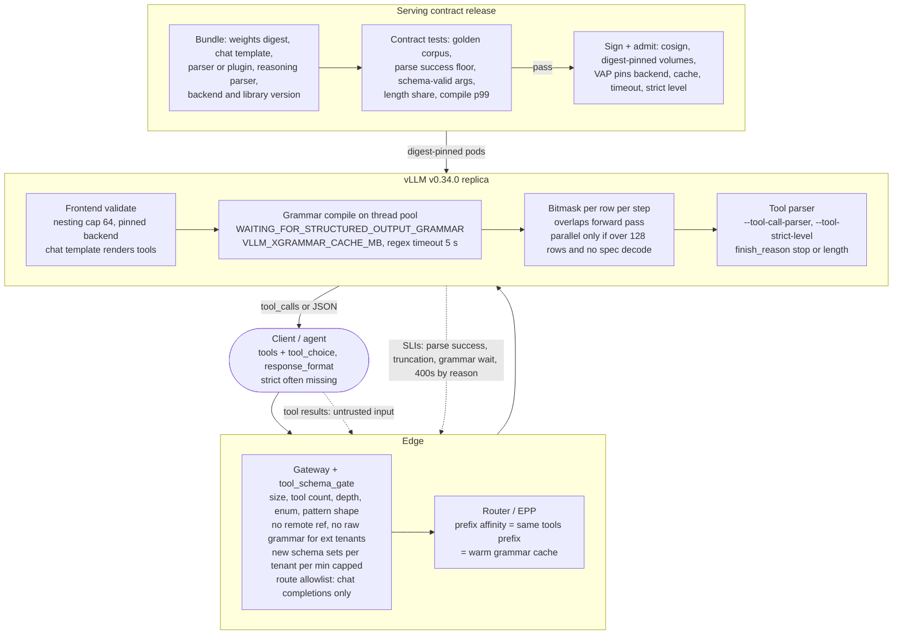

# Lesson 75 — Structured outputs and tool calling as a platform product: guided-decoding backends in vLLM and SGLang, schema compile caches and per-request grammar cost, tool-call parser drift, parse-failure and schema-validity SLOs, and securing tool schemas and function-call outputs

*2026-11-28*

[Lesson 74](/lessons/74-multi-lora-adapter-serving-platform) made tenant adapters into gated, signed artifacts. This lesson covers what nearly every agent and enterprise caller puts on the request itself: a JSON schema in `response_format`, or a `tools[]` array with `tool_choice`. Product teams treat "JSON mode" and "function calling" as a checkbox. For the platform they're two separate subsystems. The first is a **grammar engine** (xgrammar, llguidance, outlines). It compiles a schema the caller sent into a token-mask automaton on the engine's CPU, caches it, and fills a vocabulary-sized bitmask for every structured row at every decode step. The second is a **text parser**. It turns whatever the model emitted back into `tool_calls`, and it's welded to one model family's chat template. The first is a CPU and memory capacity problem, and an availability attack surface, because the caller writes the program you compile. The second is a release-engineering problem. Change the model, the template, the parser or the engine version, and tool calls can start silently landing in `content` with HTTP 200. This lesson treats both the way [L33](/lessons/33-prompt-tool-catalog-versioning-serving-config) treats serving config: versioned, contract-tested, admitted by policy and measured with SLIs you have to build yourself.

> **What's verified here (2026-11-28).** Versions come from GitHub releases: vLLM **v0.34.0** (2026-11-16, pins `xgrammar == 0.2.8`, `llguidance >= 1.7.0, < 1.8.0`, `outlines_core == 0.2.14`), SGLang **v0.5.23** (2026-11-02, pins `xgrammar==0.2.7`, `llguidance>=1.7.6,<2.0.0`), xgrammar **v0.2.9** (latest, 2026-11-09). Flags, defaults and behavior come from source at those tags: vLLM `vllm/config/structured_outputs.py`, `vllm/sampling_params.py` (backend selection, `MAX_STRUCTURED_OUTPUT_JSON_NESTING = 64`), `vllm/v1/structured_output/{__init__,utils,backend_xgrammar,backend_guidance}.py`, `vllm/v1/core/sched/scheduler.py`, `vllm/v1/engine/core.py`, `vllm/v1/metrics/loggers.py`, `vllm/envs.py`, `vllm/tool_parsers/` (64 files, `AGENTS.md`, `tool_strict_level.py`, `hermes_tool_parser.py`), `vllm/entrypoints/common/cli_args.py`, `docs/features/{structured_outputs,tool_calling}.md`, `docs/usage/security.md`; SGLang `python/sglang/srt/constrained/{base_grammar_backend,grammar_manager,xgrammar_backend}.py`, `observability/metrics_collector.py`, `arg_groups/{choices,serving_hook}.py`, `function_call/function_call_parser.py`; xgrammar `python/xgrammar/compiler.py`. Advisories come from the GitHub security-advisory APIs for vllm-project/vllm and mlc-ai/xgrammar. **Tests on this box:** `grammar_lab.py`, `grammar_lab2.py` and `grammar_lab3.py` ran xgrammar 0.2.8, llguidance 1.7.6 and outlines_core 0.2.14 (the versions vLLM pins) against the real **Qwen3-32B tokenizer (151,669 tokens)** on an 8-vCPU box. They measure compile, cache and per-token mask cost only, with **no GPU and no vLLM engine**. `tool_schema_gate.py` and `so_capacity.py` ran here. The ValidatingAdmissionPolicy ran against a real **kube-apiserver v1.37.3** (etcd v3.7.4, server-side dry run, no kubelet, gateway or GPUs). Behavior I took from reading source but did not execute is labeled as such.

## What interviewers are really probing

- **Do you know where structured output actually costs you?** It's not the GPU. vLLM compiles each new constraint on a thread pool sized `(cpus + 1) // 2`, and the request sits in `WAITING_FOR_STRUCTURED_OUTPUT_GRAMMAR` until it's done. Then, every decode step, the scheduler fills one vocabulary-wide bitmask row per structured request **while the forward pass runs**, and sampling waits for it. In my lab (Qwen3-32B vocabulary), the first schema on a fresh xgrammar compiler took **654 ms** and put **19.7 MB** in the cache. The next new schema of the same shape took **~12 ms**, and a repeat was a **0.06 ms** cache hit. Mask fill averaged **150–200 µs per row** on xgrammar, but with a bimodal tail: p50 3 µs, p90 ~550 µs. That's invisible at batch 32 and becomes step time at batch 128 with speculative decoding.
- **Do you know what `auto` does?** vLLM's default backend is `auto`. Per request, it tries xgrammar and falls back to guidance or outlines. But the engine **latches the first backend it initializes** and rejects later requests that resolve to a different one ("Structured output processing only supports one backend per engine"). So which schemas work on a pod depends on the first structured request it served after it started. Before v0.30.0 the same latch was an **engine-fatal** crash (GHSA-85xf-c7hm-whqw). Pin the backend.
- **Can you separate "valid JSON" from "a working tool call"?** Constrained decoding guarantees the output is a legal prefix of the grammar, and nothing more. A response cut off by `max_tokens` (`finish_reason="length"`) is grammar-legal and doesn't parse. In my lab, a 34/68-token prefix accepted every token and failed `json.loads`. And with `tool_choice="auto"` and no `strict`, vLLM doesn't constrain tool calls at all. The `hermes` parser, on a parse error, returns `tools_called=False` and puts the raw `<tool_call>…` text in `content`, still with a 200. Unless you build them, there are no SLIs for any of this.
- **Do you treat the parser as part of the model release?** Tool calling is a three-part contract: model, chat template and tool-call parser. Parser names aren't even portable across engines (vLLM `hermes`/`openai`/`minimax_m2` vs SGLang `qwen25`/`gpt-oss`/`minimax-m2`). `--tool-parser-plugin` is arbitrary Python loaded into the server. And the parser has had an `eval()` RCE (qwen3_coder, GHSA-79j6-g2m3-jgfw).
- **Can you threat-model a request that ships a program?** A JSON schema, regex or EBNF from the caller is compiled by C++ inside your engine. The history is all availability bugs: invalid schemas and regexes that killed the worker, unbounded compile caches on disk and in RAM, ReDoS in regex compilation, and huge-enum and deep-nesting DoS in xgrammar. The defense is layered: gateway limits, pinned backend and cache bounds, patch floors, and a per-tenant new-schema rate limit. Tool *results* are the other half. They're untrusted input that goes straight back into the prompt.

## Core diagram

![Structured outputs and tool calling as a platform product. Top row, the request path: the client or agent sends tools plus tool_choice or a response_format JSON schema, often without strict; the gateway runs tool_schema_gate (body at most 256 KiB, at most 64 tools, schema at most 16 KiB, depth at most 12, enum at most 1,000, pattern shape check, no remote ref, no raw grammar from external tenants, request chat templates dropped, at most 20 new schema sets per tenant per minute, route allowlist of chat completions only and never invocations, systemone or pooling; tool results are size-capped and tagged untrusted); the router or EPP uses prefix affinity, so the same tools mean the same prompt prefix and a warm grammar cache; the vLLM v0.34.0 replica validates (nesting cap 64), pins the backend because auto latches on the first request, renders tools via the sandboxed chat template, compiles on a thread pool while the request waits in WAITING_FOR_STRUCTURED_OUTPUT_GRAMMAR, caches compiled grammars under VLLM_XGRAMMAR_CACHE_MB (default 512; lab: first compile 654 ms, next new schema about 12 ms, hit 0.06 ms), enforces a regex compile timeout of 5 s, fills the bitmask while the forward pass runs (parallel only above 128 rows and without speculative decoding; spec decode needs 1 plus k rows per request, serially), then runs the tool parser selected by tool-call-parser and tool-strict-level, returning tool_calls or content with finish_reason stop or length. Middle row: the serving contract bundle (weights digest, chat template, tool parser or plugin, reasoning parser, strict level, grammar backend and version; parser names differ by engine) goes through contract tests (golden corpus, parse success floor, schema-valid arguments, length truncation share, compile p99, BFCL-style accuracy), then is signed and admitted (cosign, digest-pinned read-only image volumes, an 11-rule VAP tested on kube-apiserver v1.37.3); patch floors as of 2026-11-28. Bottom: the SLIs you must build (parse success, truncation, grammar wait, validation 400s by reason, engine restarts), example SLOs, the SLA angle and burn-rate alerting](/structured-outputs-tool-calling-platform.png)

**How to read it.** Follow the top row left to right. The **gateway** is the only place that sees the whole request before anything is compiled, so it enforces size, count, regex shape and the per-tenant new-schema rate (`tool_schema_gate.py` below). It also only routes the endpoints you meant to expose: vLLM's `/invocations` serves the same inference handlers **without** the API key. The **router** helps more than it looks like it should. Tools are rendered into the prompt, so prefix affinity ([L72](/lessons/72-kv-cache-tiering-prefix-aware-routing)) also sends repeat schemas to the replica whose grammar cache is warm. Inside the **replica**, the cost lands on CPU: compile on a thread pool, a bounded cache, and a mask fill that has to finish before sampling. The **parser** turns text back into `tool_calls`. The middle row is the release side. Parser, template and model ship as one bundle, gated by contract tests and admitted by a policy that pins the risky knobs. The bottom row is honest about SLIs. vLLM v0.34.0 exports **no** grammar metrics. SGLang v0.5.23 defines `sglang:grammar_compilation_time_seconds` and friends, but no code path observes them. So parse success, truncation and grammar wait have to come from the gateway, a response-inspecting sidecar, or derived signals.



## Idiosyncrasies / operator depth

### Three backends, three cost models

- **xgrammar** (vLLM's and SGLang's default path) precomputes an *adaptive token mask cache* at compile time. Most tokens are decided by the top of the pushdown-automaton stack and cached. The rest are checked at runtime (XGrammar paper, MLSys 2025). Compile is the expensive part and caching is what saves you. vLLM builds the compiler with `max_threads=8`, `cache_enabled=True`, `cache_limit_bytes = VLLM_XGRAMMAR_CACHE_MB × 1 MiB` (default **512**). It actually builds **two** compilers: one with special tokens filtered for JSON, and a full-vocab one for structural tags and Lark. So expect two first-compile costs per process.
- **llguidance** (`guidance`) computes masks on the fly with an Earley parser over a lazily built lexer, and has "no significant startup cost" (its README says ~50 µs per token for a 128k vocabulary). In my lab, matcher init took 2–33 ms vs xgrammar's 654 ms first compile. The mask mean was 39–101 µs vs xgrammar's 153–196 µs, but llguidance had one **5.1 ms** outlier token. vLLM passes no `LLParserLimits`, so llguidance's defaults apply (`max_grammar_size` 500,000, `step_lexer_fuel` 200,000, `max_items_in_row` 2,000).
- **outlines** (`outlines_core` 0.2.14) builds a regex index over the whole vocabulary. That's DFA-bound, and it's where regex shape bites. In my lab, `(x{1,50}){1,50}` took **4.6 s**, just under vLLM's 5 s compile timeout on an idle box. `[a-z]{1,500}` took 1.4 s. xgrammar compiled both in 2–66 ms. **lm-format-enforcer** is deprecated in v0.33.0 and slated for removal in v0.35.0.

### `auto` is a per-request decision with a per-engine binding

`SamplingParams` validation in v0.34.0 tries `validate_xgrammar_grammar`. On failure it picks guidance, or outlines for non-Tekken Mistral tokenizers and guidance-unsupported schema features. It routes Lark grammars from Tekken tokenizers to guidance, and stamps `_backend` on the request. `StructuredOutputManager.grammar_init` creates the backend **once** and raises `VLLMValidationError` for any later request whose `_backend` differs. From reading the source (not executed): if the first structured request after a restart needs guidance, later ordinary schemas that resolve to xgrammar get rejected on that pod, and the reverse is also true. That's a heisenbug across a fleet. Same request, different pod, different answer. **Pin `--structured-outputs-config.backend xgrammar` (or `guidance`)** and treat the schemas the pinned backend rejects as a product decision. On versions below 0.30.0, this latch killed EngineCore for everyone (GHSA-85xf-c7hm-whqw, site 1).

### Compile cache: the first schema pays for everyone, and floods evict neighbors

From `grammar_lab2.py`. Schema A on a fresh compiler took **654 ms** and added 19.7 MB. That's mostly shared JSON sub-rule masks over a 151,669-token vocabulary. Schema B (new, same shape) took 11.1 ms. A free-text string schema took 10.6 ms. A regex took 0.8 ms. Then I flooded the 512 MB cache with 900 unique 5-tool schemas. It plateaued at **356 MB** with a steady **12–13 ms** per miss, and a "victim" schema that had been a 0.06 ms hit before the flood cost **13.5 ms** afterward. With the cache capped at **16 MB**, below the shared working set, every compile paid **~500 ms** (300 schemas = 156 s of CPU vs 4.6 s at 512 MB). Two operator rules follow. **Prewarm** each pod with your registered schemas before it reports Ready, so the 654 ms lands in the startup probe and not in a customer's TTFT. **Never** shrink the cache to "save memory".

**SGLang is different.** `XGrammarGrammarBackend` builds `GrammarCompiler(tokenizer_info=...)` with xgrammar's default `cache_limit_bytes=-1` (**unbounded**). `BaseGrammarBackend` also keeps its own Python `dict` cache of grammar objects with no eviction (cleared only on `flush_cache`). Framed structural-tag grammars compile uncached on purpose (xgrammar 0.2.1–0.2.7 cache bug). On SGLang, a unique-schema flood is a memory leak until restart, so the gateway rate limit is mandatory there.

### The mask fill is hidden until it isn't

In v0.34.0's `engine/core.py`, `execute_model(..., non_block=True)` starts the forward pass, then `get_grammar_bitmask` runs, then `sample_tokens(grammar_output)` waits. The mask is free as long as it finishes before the GPU does. `grammar_bitmask()` fills rows **in parallel only when there are more than 128 structured rows and `num_speculative_tokens == 0`**, using `min(cpu//2, 8)` threads in chunks of 16. Otherwise it fills them **serially**, and with speculation each request owns `1 + k` mask rows. `so_capacity.py` below turns my measured means into step time. With xgrammar at 128 structured rows and k=3, that's ~90 ms of serial masking against an assumed 30 ms forward pass. Structured traffic and speculative decoding ([L73](/lessons/73-quantized-speculative-serving-platform)) are a combination you benchmark, not assume.

### Tool calling: strictness is opt-in per tool, and the server can raise the floor

From `docs/features/tool_calling.md` at v0.34.0:

| `tool_choice` | Obligation | Structural tag (grammar) active |
|---|---|---|
| named function | call that function | always |
| `"required"` | ≥ 1 tool call | always |
| `"auto"` | optional | only if some tool sets `strict: true`, or `--tool-strict-level function\|parameter` |
| `"none"` | no calls | never |

The envelope (markup plus function name) and the **argument schema** are separate layers. A tool's arguments are pinned only if *that* tool is `strict: true` or the server runs `--tool-strict-level parameter`. Most OpenAI-compatible clients never set `strict`, so on `auto` the default is unconstrained text extraction. `--tool-strict-level function` makes the envelope well-formed for every request carrying tools, without forcing a call. `glm47` defaults to `function`, and every other parser to `auto`. `VLLM_ENFORCE_STRICT_TOOL_CALLING=false` turns structural tags off entirely and overrides the flag. Named and required choices compile a grammar from the tools array, so the first one pays the compile cost too (the docs warn of "several seconds" the first time).

### Parsers drift, and fail open

- **Failure mode:** in `hermes_tool_parser.py`, any exception while extracting returns `tools_called=False, tool_calls=[], content=model_output`. The client gets HTTP 200 with `<tool_call>{...}` sitting in `content`. Agents then "answer" with markup or loop.
- **Boundary tokens:** the structured-outputs docs warn that Qwen3's streaming parser recognizes `<think>`, `</think>`, `<tool_call>` and `</tool_call>` **by token ID**. A text grammar that spells the same characters with ordinary tokens yields output the parser won't recognize.
- **Reasoning interplay:** with a reasoning parser, the grammar applies only after reasoning ends (`enable_in_reasoning` defaults to False). If the model reasons until `max_tokens`, you get no structured output at all and `finish_reason="length"`.
- **Names aren't portable:** vLLM registers 64-odd parser keys (`hermes`, `qwen3_xml`, `qwen3_coder`, `openai`, `minimax_m2`, `deepseek_v31`, …) and SGLang its own (`qwen25`, `qwen3_coder`, `gpt-oss`, `minimax-m2`, `deepseekv31`, …). vLLM's `AGENTS.md` says parser keys are CLI API and "treat renames as breaking". A dual-engine fleet needs a per-engine mapping in serving config ([L33](/lessons/33-prompt-tool-catalog-versioning-serving-config)).
- **Plugins are code:** `--tool-parser-plugin` → `ToolParserManager.import_tool_parser(path)` → `import_plugin`. That's a Python file executed inside the server process.

## Concrete commands & config

### Serve: pin the backend, bound the cache, raise the tool floor

```bash
# vLLM v0.34.0. Every structured-output and tool knob explicit; nothing left to "auto".
export VLLM_XGRAMMAR_CACHE_MB=1024           # default 512; never below the shared working set (lab: 16 MB -> ~500 ms per compile)
export VLLM_REGEX_COMPILATION_TIMEOUT_S=2    # default 5; 0 disables the ReDoS guard (thread keeps running after the 400)
# VLLM_ENFORCE_STRICT_TOOL_CALLING stays at its default (true); false disables structural tags everywhere
vllm serve /models/qwen3-32b-fp8 \
  --served-model-name support \
  --structured-outputs-config.backend xgrammar \
  --enable-auto-tool-choice \
  --tool-call-parser hermes \
  --tool-strict-level function \
  --chat-template /templates/qwen3-tools-v7.jinja \
  --enable-force-include-usage
# Not set, on purpose: --trust-request-chat-template, --tool-parser-plugin (unless from a signed image volume),
# --structured-outputs-config.backend lm-format-enforcer|outlines, VLLM_V1_USE_OUTLINES_CACHE=1.
# --structured-outputs-config.disable_any_whitespace true is xgrammar/guidance only: fewer tokens per JSON,
# but test it per model; some models degrade when forced into compact JSON.
```

```bash
# SGLang v0.5.23 equivalents (names differ; so do the defaults)
python -m sglang.launch_server --model-path /models/qwen3-32b-fp8 \
  --grammar-backend xgrammar \
  --tool-call-parser qwen25 \
  --reasoning-parser qwen3 \
  --constrained-json-disable-any-whitespace
# Grammar wait timeout = SGLANG_GRAMMAR_MAX_POLL_ITERATIONS (10000) x max(SGLANG_GRAMMAR_POLL_INTERVAL 0.005 s, step time)
# i.e. >= 50 s before a stuck compile is failed. xgrammar cache is unbounded here: rate-limit new schemas at the gateway.
```

### Requests: what "strict" looks like on the wire

```bash
# 1) JSON schema response, strict-style schema (all properties required, additionalProperties false)
curl -s $VLLM/v1/chat/completions -H "Authorization: Bearer $KEY" -H 'Content-Type: application/json' -d '{
  "model": "support", "max_tokens": 512,
  "messages": [{"role": "user", "content": "Classify ticket 88213 and extract the order id."}],
  "response_format": {"type": "json_schema", "json_schema": {"name": "triage", "strict": true, "schema": {
    "type": "object", "additionalProperties": false, "required": ["category", "order_id", "urgency"],
    "properties": {"category": {"type": "string", "enum": ["billing", "shipping", "account", "other"]},
                   "order_id": {"type": "string", "pattern": "^ORD-[0-9]{8}$"},
                   "urgency":  {"type": "integer", "minimum": 1, "maximum": 5}}}}}
}' | jq '{finish: .choices[0].finish_reason, content: .choices[0].message.content}'
# Treat finish_reason == "length" as a failed structured response even though every token was grammar-legal.

# 2) Tool call with an argument schema pinned (strict on the tool), envelope pinned by --tool-strict-level function
curl -s $VLLM/v1/chat/completions -H "Authorization: Bearer $KEY" -H 'Content-Type: application/json' -d '{
  "model": "support", "max_tokens": 256, "tool_choice": "auto",
  "messages": [{"role": "user", "content": "Where is order ORD-00018231?"}],
  "tools": [{"type": "function", "function": {"name": "get_order", "strict": true,
    "description": "Look up an order by id",
    "parameters": {"type": "object", "additionalProperties": false, "required": ["order_id"],
                   "properties": {"order_id": {"type": "string", "pattern": "^ORD-[0-9]{8}$"}}}}}]
}' | jq '.choices[0] | {finish_reason, tool_calls: .message.tool_calls, leaked: (.message.content // "" | test("<tool_call>"))}'
# leaked == true means the parser failed open: count it as a parse failure, not a success.
```

### Prewarm before Ready (move the 654 ms out of customer TTFT)

```yaml
# pod excerpt: a warmer sidecar replays the registered schema set once, then flips readiness
containers:
  - name: vllm
    readinessProbe:
      exec: {command: ["sh", "-c", "test -f /warm/done && curl -sf localhost:8000/health"]}
      periodSeconds: 5
    volumeMounts: [{name: warm, mountPath: /warm, readOnly: true}]
  - name: grammar-warmer
    image: registry.example.com/serving/grammar-warmer@sha256:3333333333333333333333333333333333333333333333333333333333333333
    args: ["--schemas=/registry/support-v7.jsonl", "--endpoint=http://localhost:8000", "--max-tokens=1", "--done=/warm/done"]
    volumeMounts:
      - {name: warm, mountPath: /warm}
      - {name: schema-registry, mountPath: /registry, readOnly: true}
volumes:
  - {name: warm, emptyDir: {}}
  - name: schema-registry
    image: {reference: "registry.example.com/serving/schemas@sha256:4444444444444444444444444444444444444444444444444444444444444444"}
```

The warmer sends one `max_tokens: 1` request per registered schema set (tool arrays included) through the real endpoint. That fills both xgrammar compilers and the per-schema cache, and it also seeds the prefix cache with the tool-rendered system prompt.

### `grammar_lab.py`: compile, cache and mask cost (ran here, no GPU)

The full script compiles six schema shapes with the exact `GrammarCompiler` arguments vLLM uses, floods the cache, times `fill_next_token_bitmask` per token while walking a valid instance, cuts an instance at `max_tokens`, and compiles adversarial regexes in subprocesses. The core of it:

```python
tok = AutoTokenizer.from_pretrained("Qwen/Qwen3-32B"); VOCAB = len(tok)            # 151,669
info = xgr.TokenizerInfo.from_huggingface(tok, vocab_size=VOCAB)
def compiler(cache_mb=512):   # same constructor arguments as vLLM backend_xgrammar._create_compiler
    return xgr.GrammarCompiler(info, max_threads=8, cache_enabled=True, cache_limit_bytes=cache_mb * 1024 * 1024)
c = compiler(); js = json.dumps(schema)
cold = timed(lambda: c.compile_json_schema(js, any_whitespace=True))   # fresh compiler: includes the first-compile floor
warm = timed(lambda: c.compile_json_schema(js, any_whitespace=True))   # same schema again: cache hit
m = xgr.GrammarMatcher(c.compile_json_schema(js)); bm = xgr.allocate_token_bitmask(1, VOCAB)
for tid in tok.encode(json.dumps(instance), add_special_tokens=False):
    per_token.append(timed(lambda: m.fill_next_token_bitmask(bm, 0))); assert m.accept_token(tid)
```

Output on this box (xgrammar 0.2.8, llguidance 1.7.6, outlines_core 0.2.14), condensed from the three scripts' runs; sections B/G and E/H merge two runs each. The "cold" column uses a **fresh compiler per row**, so every row includes the ~650 ms first-compile floor:

```text
== A. compile cost per schema (cold = first sight, warm = same schema again) ==
schema                                bytes  xgr cold ms  xgr warm ms  cache +MB  llg init ms
1 tool, 6 args                          467        652.3        0.031      19.68          2.3
required over 10 tools                 6204        663.7        0.124      21.23          3.0
required over 50 tools                31324        698.7        0.416      27.89          8.4
required over 200 tools              126824        848.5        1.098      53.01         32.5
enum of 5,000 SKUs                    70028         58.9        0.236       0.39          6.4
nesting depth 60 (vLLM cap 64)         5698        101.9        0.127       1.68          2.2

== F. first compile on a fresh compiler vs the next new schema ==
schema A (first ever):    654.2 ms, cache 19.7 MB
schema B (new, similar):    11.1 ms, cache 29.5 MB
regex  (new, different):     0.8 ms
free-text string schema:    10.6 ms

== B/G. unique-schema flood ==
cache_limit= 512 MB: 300 unique 5-tool schemas, cache now   356.7 MB, p50 compile 12.9 ms, total CPU 4.6 s
cache_limit=  16 MB: 300 unique 5-tool schemas, cache now    24.8 MB, p50 compile 501.4 ms, total CPU 156.5 s
victim warm hit before flood: 0.060 ms ... after 900 unique schemas (cache plateau 356.2 MB): 13.5 ms

== C (lab3). per-token mask cost, one bitmask row ==
1 tool, 6 args           xgrammar   tokens= 86 mean=  196.1 us p50=    3.2 p90=  568.2 max=  889.8 us
1 tool, 6 args           llguidance tokens= 86 mean=  100.9 us p50=   21.4 p90=  104.8 max= 5077.4 us
required over 50 tools   xgrammar   tokens=106 mean=  152.8 us p50=    3.0 p90=  524.9 max=  697.4 us
required over 50 tools   llguidance tokens=106 mean=   38.9 us p50=   19.0 p90=   93.6 max=  318.9 us

== D. truncation: grammar-valid prefix cut by max_tokens (finish_reason=length) ==
max_tokens= 34/68: every token grammar-legal=True, json.loads ok=False

== E/H. adversarial regex compile (20 s wall clock each) ==
pattern                                  xgrammar   outlines_core
\w+@\w+\.com                               2 ms        965 ms
(a+)+b                                     1 ms         12 ms
[a-z]{1,500}                              66 ms       1379 ms
(x{1,50}){1,50}                            2 ms       4588 ms
([a-z0-9]{1,20}\.){1,20}[a-z]{2,8}        11 ms       2029 ms
```

What to take from it. (1) The **first** compile per process is the expensive one, so prewarm. (2) Big tool unions cost memory: 200 tools put 53 MB in the cache for one schema set, which is why the gateway caps tool count. (3) A huge enum is cheap for xgrammar. The advisory-era huge-enum DoS (GHSA-9q5r-wfvf-rr7f) was fixed in 0.1.24, but enum *bytes* still cost gateway and prompt tokens. (4) xgrammar shrugs off classic ReDoS shapes, but outlines doesn't. A pinned xgrammar backend plus a pattern-shape check at the gateway beats trusting the timeout alone.

### `so_capacity.py`: does masking stay hidden under the forward pass? (worked example)

```python
#!/usr/bin/env python3
"""so_capacity.py — does grammar mask filling stay hidden under the forward pass? (worked example)
vLLM v0.34.0 rules (vllm/v1/structured_output/__init__.py, vllm/v1/engine/core.py):
  * the bitmask is computed while execute_model runs (non_block), sampling waits for it;
  * parallel fill only if structured rows > 128 AND num_speculative_tokens == 0,
    with min(cpu//2, 8) threads in chunks of 16; otherwise serial on one thread;
  * with speculation each request needs (1 + k) mask rows per step.
Per-row mask cost = means measured by grammar_lab3.py on this 8-vCPU box (Qwen3-32B vocab).
Forward-step time is an ASSUMPTION (replace with your measured decode step at that batch)."""
MASK_US = {"xgrammar": 175.0, "llguidance": 70.0}   # mean of the two lab3 schemas, rounded
FORWARD_MS = {32: 22.0, 128: 30.0, 256: 38.0}        # assumed decode step, Qwen3-32B FP8 TP2 (illustrative)
THREADS = 4                                          # min(cpu//2, 8) on an 8-vCPU engine pod; 8 on a big host
print(f"{'backend':10s} {'rows':>5s} {'k':>2s} {'mode':8s} {'mask ms':>8s} {'fwd ms':>7s} {'added step ms':>12s}")
for be, us in MASK_US.items():
    for b, fwd in FORWARD_MS.items():
        for k in (0, 3):
            masks = b * (1 + k)
            parallel = b > 128 and k == 0
            ms = masks * us / 1000 / (THREADS if parallel else 1)
            print(f"{be:10s} {b:5d} {k:2d} {'parallel' if parallel else 'serial':8s} {ms:8.1f} {fwd:7.1f} {max(0.0, ms - fwd):12.1f}")
```

```text
backend     rows  k mode      mask ms  fwd ms added step ms
xgrammar      32  0 serial        5.6    22.0          0.0
xgrammar      32  3 serial       22.4    22.0          0.4
xgrammar     128  0 serial       22.4    30.0          0.0
xgrammar     128  3 serial       89.6    30.0         59.6
xgrammar     256  0 parallel     11.2    38.0          0.0
xgrammar     256  3 serial      179.2    38.0        141.2
llguidance    32  0 serial        2.2    22.0          0.0
llguidance    32  3 serial        9.0    22.0          0.0
llguidance   128  0 serial        9.0    30.0          0.0
llguidance   128  3 serial       35.8    30.0          5.8
llguidance   256  0 parallel      4.5    38.0          0.0
llguidance   256  3 serial       71.7    38.0         33.7
```

Read it as the shape of the problem, not a forecast. Means come from two schemas on one box, and spec rows past a rejected draft may be cheaper than this. But the conclusion holds: **a pool that is mostly structured traffic and runs speculative decoding needs its own benchmark** (`vllm bench serve` with your real schemas, [L73](/lessons/73-quantized-speculative-serving-platform)'s gate). Either size it by measured ITL, cap `--max-num-seqs`, or switch backends and measure.

### `tool_schema_gate.py`: gateway admission for schemas and tools (ran here)

The engine gives you a nesting cap (64), a regex timeout, and nothing else: no body limit, no tool-count limit, no per-tenant schema rate. This runs in the gateway (an ext_proc or Wasm filter, or the API service in front of the pool) before anything compiles. It's stdlib only.

```python
#!/usr/bin/env python3
"""tool_schema_gate.py — gateway-side admission for structured-output and tool-calling requests.
Runs before the request reaches vLLM/SGLang. The engine has only a nesting cap (vLLM: 64) and a
regex compile timeout; size, count, regex shape, $ref and per-tenant unique-schema rate are ours.
Pure stdlib. Limits are examples; tune them from your own grammar_lab numbers."""
import hashlib, json, re, sys, time
from collections import defaultdict, deque

LIMITS = dict(body_bytes=256 * 1024, tools=64, schema_bytes=16 * 1024, total_schema_bytes=96 * 1024,
              depth=12, enum=1000, pattern_len=256, unique_schemas_per_min=20)
NESTED_QUANT = re.compile(r"\((?:[^()\\]|\\.)*[+*}](?:[^()\\]|\\.)*\)\s*[+*{]")  # (x+)+  (a|b*)*  (x{1,50}){1,50}
LOOK_BACKREF = re.compile(r"\(\?[=!<]|\\[1-9]")

def canon(obj):  # canonical form: what you hash, allowlist and use as a bounded metric label
    return json.dumps(obj, sort_keys=True, separators=(",", ":"))

def walk(node, depth, path, errs, warns):
    if depth > LIMITS["depth"]:
        errs.append(f"{path.split('/')[0]}: nesting depth > {LIMITS['depth']}"); return
    if isinstance(node, dict):
        ref = node.get("$ref")
        if isinstance(ref, str) and not ref.startswith("#/"):
            errs.append(f"{path}: non-local $ref {ref!r} (no fetching schemas from URLs or files)")
        if isinstance(node.get("enum"), list) and len(node["enum"]) > LIMITS["enum"]:
            errs.append(f"{path}: enum of {len(node['enum'])} > {LIMITS['enum']} (use a lookup tool, not a grammar)")
        pat = node.get("pattern")
        if isinstance(pat, str):
            if len(pat) > LIMITS["pattern_len"]:
                errs.append(f"{path}: pattern length {len(pat)} > {LIMITS['pattern_len']}")
            if NESTED_QUANT.search(pat):
                errs.append(f"{path}: nested quantifier in pattern {pat!r}")
            if LOOK_BACKREF.search(pat):
                errs.append(f"{path}: lookaround/backreference in pattern {pat!r} (unsupported by Rust-style backends)")
        if node.get("type") == "object" and "properties" in node:
            if node.get("additionalProperties", True) is not False:
                warns.append(f"{path}: additionalProperties not false (not strict-style)")
            missing = set(node["properties"]) - set(node.get("required", []))
            if missing:
                warns.append(f"{path}: optional fields {sorted(missing)[:3]} (strict style marks all required)")
        for k, v in node.items():
            walk(v, depth + (k in ("properties", "items", "anyOf", "oneOf", "allOf", "$defs")), f"{path}/{k}", errs, warns)
    elif isinstance(node, list):
        for i, v in enumerate(node):
            walk(v, depth, f"{path}[{i}]", errs, warns)

class Gate:
    def __init__(self, registry=None):
        self.registry = registry or {}            # tenant -> set(schema hashes) for "registered schemas only" tenants
        self.seen = defaultdict(deque)            # tenant -> deque[(ts, hash)] of first-seen schemas

    def check(self, tenant, body_bytes, now=None):
        now = now or time.time(); errs, warns = [], []
        if len(body_bytes) > LIMITS["body_bytes"]:
            return ["body > %d bytes" % LIMITS["body_bytes"]], warns, []
        req = json.loads(body_bytes)
        so = req.get("structured_outputs") or {}
        if any(k in so for k in ("grammar", "regex", "structural_tag")) and tenant.startswith("ext-"):
            errs.append("raw grammar/regex/structural_tag is internal-only; external tenants send json_schema or tools")
        if "chat_template" in req or "chat_template_kwargs" in req:
            errs.append("request-supplied chat_template/kwargs are not accepted at the edge")
        schemas = []
        rf = req.get("response_format") or {}
        if rf.get("type") == "json_schema":
            schemas.append(("response_format", rf.get("json_schema", {}).get("schema", {})))
        if "json" in so:
            schemas.append(("structured_outputs.json", so["json"]))
        tools = req.get("tools") or []
        if len(tools) > LIMITS["tools"]:
            errs.append(f"{len(tools)} tools > {LIMITS['tools']} (route to a tool-search step instead)")
        for i, t in enumerate(tools):
            fn = t.get("function", {})
            if not re.fullmatch(r"[A-Za-z0-9_\-]{1,64}", fn.get("name", "")):
                errs.append(f"tools[{i}]: bad function name {fn.get('name')!r}")
            schemas.append((f"tools[{i}]:{fn.get('name')}", fn.get("parameters", {})))
        total, hashes = 0, []
        for where, s in schemas:
            c = canon(s); total += len(c)
            if len(c) > LIMITS["schema_bytes"]:
                errs.append(f"{where}: schema {len(c)} bytes > {LIMITS['schema_bytes']}")
            walk(s, 0, where, errs, warns)
            hashes.append(hashlib.sha256(c.encode()).hexdigest()[:16])
        if total > LIMITS["total_schema_bytes"]:
            errs.append(f"total schema bytes {total} > {LIMITS['total_schema_bytes']}")
        # what the engine compiles is the whole constraint, so rate-limit on the combined hash
        combo = hashlib.sha256("|".join(sorted(hashes)).encode()).hexdigest()[:16] if hashes else None
        if combo and tenant in self.registry and combo not in self.registry[tenant]:
            errs.append(f"schema set {combo} not registered for {tenant}")
        if combo:
            q = self.seen[tenant]
            while q and now - q[0][0] > 60: q.popleft()
            if all(h != combo for _, h in q):
                if len(q) >= LIMITS["unique_schemas_per_min"]:
                    errs.append(f"{tenant}: > {LIMITS['unique_schemas_per_min']} new schema sets/min (compile-cache flood)")
                else:
                    q.append((now, combo))
        return errs, warns, ([combo] if combo else [])

# __main__ (omitted here): ten fixture requests + a 300-schema flood, output below
```

```text
ALLOW 1 good strict tool                     hash=fb81d5bb6ca1e0eb
DENY  200 tools                              200 tools > 64 (route to a tool-search step instead)
DENY  nested quantifier pattern              tools[0]:f/properties/a: nested quantifier in pattern '(x{1,50}){1,50}'
DENY  depth 20 response_format               response_format: nesting depth > 12
DENY  remote $ref                            tools[0]:f/properties/a: non-local $ref 'https://evil.example/s.json' (no fetching schemas from URLs or files)
DENY  enum of 5,000                          tools[0]:f: schema 34003 bytes > 16384; tools[0]:f/properties/sku: enum of 5000 > 1000 (use a lookup tool, not a grammar)
DENY  raw grammar, external                  raw grammar/regex/structural_tag is internal-only; external tenants send json_schema or tools
DENY  chat_template in request               request-supplied chat_template/kwargs are not accepted at the edge
ALLOW non-strict schema (warn only)          warn: tools[0]:f: additionalProperties not false (not strict-style); tools[0]:f: optional fields ['a'] (strict style marks all required)
DENY  unregistered schema, registry tenant   schema set fb81d5bb6ca1e0eb not registered for int-billing
flood: 300 unique schema sets in 60 s -> allowed 20, denied 280; next new schema after the window: ALLOW
```

The combined hash does three jobs. It's the **rate-limit key** (new schema sets per tenant per minute), the **allowlist key** for tenants on "registered schemas only", and a **bounded metric label** (`schema_set`) once you map unregistered hashes to `other`. The nested-quantifier regex is a heuristic. It's there to block known-bad shapes cheaply, not to prove a pattern safe. The engine's compile timeout is still the backstop.

### Contract test: model + template + parser as one release (run in CI against a canary pod)

```bash
# golden corpus: each line = messages + tools + expected {name, args-schema-valid, parallel count, or "no call"}
# cases: single call, parallel calls, no call wanted, nested object args, unicode/escaped strings, 2 KB arg,
#        streaming vs non-streaming, tool_choice auto/required/named, reasoning on/off
python tool_contract.py --endpoint "$CANARY" --corpus golden/support-v7.jsonl --runs 3 \
  --assert parse_success_rate>=0.995 --assert leaked_markup==0 --assert schema_valid_rate>=0.995 \
  --assert length_truncation_rate<=0.005 --assert stream_equals_nonstream --report out/contract.json
# Gate the bundle (model digest + template digest + parser name/plugin digest + engine version) on the report.
# Re-run on ANY of: engine upgrade, parser change, template edit, model or quant change (L73), adapter (L74).
```

`tool_contract.py` is a sketch of the harness's interface, not a script I ran. The point is which assertions it makes. Measure parse success from the **client's** view: `tool_calls` present, arguments parse, arguments validate against the declared schema, and no markup leaked into `content`. Streaming and non-streaming paths use different parser code (`extract_tool_calls_streaming`), so assert they agree. For accuracy (right tool, right arguments), run a BFCL-style eval as part of the [L31](/lessons/31-evaluation-release-gating-canary-weights) release gate. The contract test proves the plumbing. The eval proves the model.

## Failures & fixes

| Symptom | Likely cause | Check | Fix |
|---|---|---|---|
| Same request gets 200 on one pod and 400 "only supports one backend per engine" on another | `auto` backend latched to whatever the first structured request resolved to (xgrammar vs guidance) | Pod start time vs first structured request; error text; `--structured-outputs-config.backend` | Pin the backend fleet-wide (VAP rule 1); decide product-wide which schema features you support |
| Whole engine died on one structured request; every tenant on the pod failed | Pre-0.30.0 engine-fatal paths (GHSA-85xf-c7hm-whqw); older invalid-schema or regex crashes (GHSA-6qc9-v4r8-22xg, GHSA-9hcf-v7m4-6m2j, GHSA-vrq3-r879-7m65) | Engine version; `EngineCore` death in logs right after a structured request | vLLM ≥ 0.34.0; gateway schema gate; restarts as an SLI |
| First structured request after each rollout has TTFT of seconds | First compile per process (654 ms in lab, two compilers in vLLM) plus no cache | TTFT on first N structured requests per pod; pod age | Grammar warmer sidecar gating readiness; registered schema sets |
| Structured TTFT p99 creeps up under steady load; GPU idle-ish | Compile thread pool saturated by many unique schemas; cache churn evicting shared entries | Gateway new-schema rate per tenant; `vllm:num_requests_waiting_by_reason{reason="deferred"}`; CPU per engine pod | Per-tenant new-schema rate limit; registered-schema mode for heavy tenants; `VLLM_XGRAMMAR_CACHE_MB` sized from a flood test; more CPU per GPU pod |
| ITL regressed on a structured pool after enabling speculative decoding | Mask fill goes serial with spec on, with `1 + k` rows per request; exceeds the forward pass | `vllm bench serve` structured vs unstructured, k=0 vs k>0; py-spy on EngineCore | Lower k or `--max-num-seqs` for structured pools; try `guidance`; separate structured pool (`so_capacity.py`) |
| "Valid JSON" contract broken: client `json.loads` fails on 200 responses | `finish_reason="length"`: `max_tokens` hit mid-object, or reasoning consumed the budget before the grammar started | Share of structured responses with `finished_reason="length"` | Gateway floor on `max_tokens` for structured requests; treat `length` as failure + retry with a bigger budget; cap reasoning |
| Tool calls show up as `<tool_call>{…}` text in `content`, HTTP 200 | Parser failed open (hermes: exception → `tools_called=False`, raw text to content); template/parser/model mismatch after an upgrade | Leaked-markup counter at the gateway; contract test diff; parser name vs model family | `--tool-strict-level function`; contract tests on every bundle change; per-engine parser mapping |
| Tool arguments violate the declared schema | Tool not `strict: true` and server floor `auto`/`function`: arguments unconstrained | Schema-validation SLI by tool; `strict` share in request logs | `--tool-strict-level parameter` for pools that serve agents; strict-style schemas; validate arguments before executing |
| Custom grammar output not recognized by the parser | Grammar emits `<tool_call>` as ordinary text tokens; Qwen3 parser keys on token IDs | Token IDs in the output vs special-token IDs | Require boundary token IDs in custom grammars (docs warning); prefer structural tags from the parser |
| After an engine upgrade, a previously fine schema is rejected | Backend changed (lm-format-enforcer removal in 0.35.0; Python `re` vs Rust regex syntax), or `auto` fallbacks moved | Replay the schema registry against the canary | Schema registry replay is part of the upgrade gate ([L68](/lessons/68-k8s-136-138-gpu-ai-platforms)-style); pin backend |
| SGLang pod RSS grows until OOM-kill; restarts "fix" it | xgrammar cache unbounded (`cache_limit_bytes=-1`) plus a Python dict cache with no eviction; unique schemas per request | RSS vs `sglang:num_so_requests_total` rate; unique schema hashes at the gateway | Gateway new-schema rate limit; registered schemas; periodic `flush_cache` or rolling restart as a stopgap |
| Grammar dashboards on SGLang show zeros | `sglang:grammar_compilation_time_seconds`, `num_grammar_cache_hit_total`, `num_grammar_timeout_total` defined but never observed in v0.5.23 | `grep` the scheduler for `.observe(` / `.inc(` on them | Derive from gateway-side timing; only `sglang:num_grammar_queue_reqs` and `sglang:num_so_requests_total` are live |
| A tenant's agent took a destructive action after reading a web page or email | Indirect prompt injection via a tool **result**; model then emitted a valid, schema-conforming tool call | Trace: tool result content preceding the call (L56) | Tool results tagged untrusted, size-capped, screened; side-effecting tools need step-up approval (L58); egress policy (L34) |

## Security & hardening

> **The short version.** A schema is **a program the caller asks you to compile** with C++ on the engine's CPU. A tool call is **text the model asks you to execute**. A tool result is **untrusted input that goes straight back into the prompt**. Harden all three. At the edge: size, count, shape and new-schema rate limits, no raw grammars or request-supplied templates from external tenants, and a route allowlist. In the engine: a pinned backend, a bounded cache, the regex timeout kept on, and patch floors. In the release: model, chat template, parser and parser plugin ship as **one signed bundle**, pinned by digest and admitted by policy. Treat it the way you treat weights ([L13](/lessons/13-ml-weights-checkpoint-hardening), [L27](/lessons/27-gpu-supply-chain-weight-registry-hydrate)), because a parser swap changes behavior as much as a weight swap. At execution: arguments get validated again before any side effect. Grammar validity isn't authorization.

### Threat table

| Asset | Attack path | Control (this lesson) |
|---|---|---|
| Engine availability (all tenants on a pod) | Invalid schema, regex or type killing the worker (GHSA-6qc9-v4r8-22xg, GHSA-9hcf-v7m4-6m2j, GHSA-vrq3-r879-7m65, all fixed 0.9.0); engine-fatal structured-output exceptions incl. the backend latch (GHSA-85xf-c7hm-whqw, fixed 0.30.0); xgrammar compile crashes and DoS (GHSA-m5hf-r6jr-m4q6, GHSA-7rgv-gqhr-fxg3, GHSA-9q5r-wfvf-rr7f, GHSA-5cmr-4px5-23pc) | Patch floors; `tool_schema_gate.py`; pinned backend; per-request exception boundary verified in canary with fuzzed schemas |
| CPU and memory | Unique-schema floods filling compile caches (GHSA-389x-67px-mjg3 / GHSA-hf3c-wxg2-49q9 xgrammar RAM, GHSA-mgrm-fgjv-mhv8 outlines disk); SGLang unbounded caches; ReDoS in regex compile (GHSA-rwxx-mrjm-wc2m, GHSA-48jh-3gj7-fg8v) and in tool parsers (GHSA-w6q7-j642-7c25) | Per-tenant new-schema rate limit; `VLLM_XGRAMMAR_CACHE_MB` bounded (VAP); `VLLM_REGEX_COMPILATION_TIMEOUT_S` > 0; pattern-shape check; no outlines disk cache |
| Serving host integrity | Parser code paths that evaluate model output (qwen3_coder `eval()`, GHSA-79j6-g2m3-jgfw, fixed 0.10.1.1); `--tool-parser-plugin` = arbitrary Python; request-supplied Jinja templates (GHSA-x567-49g5-p4cf, GHSA-xgh8-qwjh-q853 `/v1/systemone` gate bypass fixed 0.34.0; GHSA-542m-9234-8gvf Jinja render DoS fixed 0.32.0) | vLLM ≥ 0.34.0; plugin and templates only from digest-pinned read-only image volumes (VAP); `--trust-request-chat-template` off (VAP); gateway strips `chat_template*` |
| Auth boundary | `/invocations`, `/pooling`, `/classify` etc. reach inference handlers **without** the API key; `/v1/systemone` structured-decisions endpoint registered unconditionally | Gateway route allowlist (only the endpoints the product sells); NetworkPolicy so only gateway proxies reach the engine port |
| Cross-tenant data | Harmony tool continuations dropped `cache_salt` → prefix-cache membership oracle (GHSA-935w-9g4m-p28p, fixed 0.30.0); compile-cache timing (hit 0.06 ms vs miss 12 ms) reveals whether a schema was seen before (theoretical, untested) | vLLM ≥ 0.30.0; gateway-injected `cache_salt`; opaque tool and property names for sensitive tenants; separate pools for tenants with a real timing threat model |
| Downstream systems | Model emits a schema-valid call with attacker-chosen arguments (indirect injection from a tool result, poisoned retrieval) | Grammar ≠ authorization: re-validate args server-side; per-tool allowlists and scopes (L58); step-up approval for side effects; egress policy for tool runtimes (L34, L54) |
| Telemetry | Schemas, tool arguments and results contain PII and secrets; logging full requests on 400s (GHSA-mwgq-9582-w2vf amplification, GHSA-hwrm-c4cx-rf4j path disclosure) | Log schema-set hashes, not schemas; argument redaction before traces (L56); bounded error rendering (vLLM ≥ 0.30.0) |

### 1. Edge controls (before anything compiles)

- **Route allowlist.** Expose `/v1/chat/completions` (plus `/v1/responses` if you sell it) and nothing else. vLLM's own security doc lists `/invocations`, `/pooling`, `/classify`, `/score`, `/rerank` and `/generative_scoring` as reachable **without** the API key.
- **`tool_schema_gate.py`.** Limits on body, tool count, schema bytes, depth, enum and pattern shape. No remote `$ref`. Raw `grammar`, `regex` and `structural_tag` are internal-only. `chat_template` and `chat_template_kwargs` are stripped. A per-tenant new-schema-set rate limit applies. Registered-schemas-only mode is for tenants with a contractual SLO, since their schemas get prewarmed.
- **`max_tokens` floor for structured requests.** Reject or raise budgets too small for the schema. A truncated object is the most common "JSON mode is broken" ticket.
- **Tool results are input.** Cap their size, tag them as untrusted in the message (role `tool` plus a provenance marker the template renders), screen them for injection markers if you have a classifier, and never let a tool result silently widen the tool set for the next turn.

### 2. Engine configuration (pinned by admission, tested on kube-apiserver v1.37.3)

```yaml
apiVersion: admissionregistration.k8s.io/v1
kind: ValidatingAdmissionPolicy
metadata:
  name: structured-output-guardrails
spec:
  failurePolicy: Fail
  matchConstraints:
    namespaceSelector:
      matchLabels:
        platform.example.com/structured-output-policy: enforced
    resourceRules:
      - apiGroups: [""]
        apiVersions: ["v1"]
        operations: ["CREATE", "UPDATE"]
        resources: ["pods"]
  variables:
    - name: engines
      expression: "object.spec.containers.filter(c, c.name == 'vllm')"
    - name: argv
      expression: "variables.engines.map(c, ' ' + ((has(c.command) ? c.command : []) + (has(c.args) ? c.args : [])).join(' ').replace('=', ' ') + ' ')"
    - name: env
      expression: "variables.engines.map(c, has(c.env) ? c.env : []).flatten()"
  validations:
    - expression: "variables.argv.all(a, a.matches(' --structured-outputs-config\\\\.backend (xgrammar|guidance) '))"
      message: "pin --structured-outputs-config.backend to xgrammar or guidance: 'auto' latches the engine to whichever backend the first structured request resolves to"
    - expression: "variables.env.exists(e, e.name == 'VLLM_XGRAMMAR_CACHE_MB' && has(e.value) && e.value.matches('^[0-9]+$') && int(e.value) >= 256 && int(e.value) <= 4096)"
      message: "set VLLM_XGRAMMAR_CACHE_MB explicitly (256-4096): below the shared working set every compile pays the cold cost; unbounded is a memory DoS"
    - expression: "!variables.env.exists(e, e.name == 'VLLM_REGEX_COMPILATION_TIMEOUT_S' && has(e.value) && (e.value == '0' || e.value.startsWith('-')))"
      message: "VLLM_REGEX_COMPILATION_TIMEOUT_S <= 0 disables the regex compile timeout (ReDoS guard)"
    - expression: "!variables.env.exists(e, e.name == 'VLLM_ENFORCE_STRICT_TOOL_CALLING' && has(e.value) && e.value.lowerAscii() in ['0', 'false'])"
      message: "VLLM_ENFORCE_STRICT_TOOL_CALLING=false disables structural-tag tool calling everywhere"
    - expression: "!variables.env.exists(e, e.name == 'VLLM_V1_USE_OUTLINES_CACHE' && has(e.value) && e.value == '1')"
      message: "the outlines on-disk cache has no size bound"
    - expression: "variables.argv.all(a, !a.contains(' --trust-request-chat-template '))"
      message: "request-supplied chat templates are code paths into the renderer; keep --trust-request-chat-template off"
    - expression: "variables.argv.all(a, !a.contains(' --enable-auto-tool-choice ') || (a.contains(' --tool-call-parser ') && a.matches(' --tool-strict-level (function|parameter) ')))"
      message: "auto tool choice needs an explicit --tool-call-parser and --tool-strict-level function|parameter (most clients never set strict)"
    - expression: "variables.argv.all(a, !a.contains(' --tool-parser-plugin ') || a.split(' --tool-parser-plugin ')[1].split(' ')[0].startsWith('/opt/parsers/'))"
      message: "--tool-parser-plugin is Python executed in the server: load it only from /opt/parsers/ (signed, digest-pinned image volume)"
    - expression: "variables.argv.all(a, !a.contains(' --chat-template ') || a.split(' --chat-template ')[1].split(' ')[0].startsWith('/templates/'))"
      message: "--chat-template only from /templates/ (versioned with the parser it was tested against)"
    - expression: "object.spec.containers.all(c, c.image.contains('@sha256:')) && (!has(object.spec.volumes) || object.spec.volumes.all(v, !has(v.hostPath) && (!has(v.image) || v.image.reference.contains('@sha256:'))))"
      message: "engine image and parser/template image volumes pinned by digest; no hostPath"
---
apiVersion: admissionregistration.k8s.io/v1
kind: ValidatingAdmissionPolicyBinding
metadata:
  name: structured-output-guardrails
spec:
  policyName: structured-output-guardrails
  validationActions: ["Deny"]
```

Server-side dry runs against kube-apiserver v1.37.3: the compliant pod (pinned xgrammar, 1024 MB cache, 2 s regex timeout, `hermes` + `--tool-strict-level function`, template from a digest-pinned image volume, key from a Secret) was admitted. All 11 single-fault variants were denied:

```text
good: pod/qwen3-tools-good created (server dry run)
b1-backend-auto: DENY  pin --structured-outputs-config.backend to xgrammar or guidance: 'auto' latches the engine to whichever backend the first structured request resolves to
b2-no-cache-cap: DENY  set VLLM_XGRAMMAR_CACHE_MB explicitly (256-4096): below the shared working set every compile pays the cold cost; unbounded is a memory DoS
b3-cache-16mb: DENY  set VLLM_XGRAMMAR_CACHE_MB explicitly (256-4096): ...
b4-regex-timeout-off: DENY  VLLM_REGEX_COMPILATION_TIMEOUT_S <= 0 disables the regex compile timeout (ReDoS guard)
b5-strict-off: DENY  VLLM_ENFORCE_STRICT_TOOL_CALLING=false disables structural-tag tool calling everywhere
b6-trust-req-template: DENY  request-supplied chat templates are code paths into the renderer; keep --trust-request-chat-template off
b7-no-strict-level: DENY  auto tool choice needs an explicit --tool-call-parser and --tool-strict-level function|parameter (most clients never set strict)
b8-plugin-from-tmp: DENY  --tool-parser-plugin is Python executed in the server: load it only from /opt/parsers/ (signed, digest-pinned image volume)
b9-template-from-tmp: DENY  --chat-template only from /templates/ (versioned with the parser it was tested against)
b10-image-by-tag: DENY  engine image and parser/template image volumes pinned by digest; no hostPath
b11-outlines-disk-cache: DENY  the outlines on-disk cache has no size bound
```

Limits of this policy. It parses `args` as space-separated tokens, so it handles `--flag value` and `--flag=value` but not the JSON form `--structured-outputs-config '{"backend": ...}'`. Either forbid that form too, or render args from a typed serving config ([L33](/lessons/33-prompt-tool-catalog-versioning-serving-config)) so there's only one shape. It doesn't see env from `envFrom` ConfigMaps. And it only matches containers named `vllm`.

### 3. The serving bundle: weights, template, parser, schemas, one signature

- **Bundle contents:** the model weights digest (signed per [L13](/lessons/13-ml-weights-checkpoint-hardening)/[L73](/lessons/73-quantized-speculative-serving-platform)), chat template file, parser name (or plugin file), reasoning parser, `--tool-strict-level`, grammar backend and pinned library version, and the registered schema set for prewarm. Templates, plugin and schemas ship as an OCI image mounted as a read-only image volume, pinned by digest ([L68](/lessons/68-k8s-136-138-gpu-ai-platforms)).
- **Sign and attest:** `cosign sign` the bundle image with the pipeline identity (keyless in production). Attach the contract-test report as an in-toto attestation (`cosign attest --type https://example.com/tool-contract/v1 --predicate out/contract.json`). Admission verifies the attestation before the pod can mount the bundle, through your image-policy controller ([L12](/lessons/12-node-container-hardening-supply-chain)).
- **Parser plugins get code review, SAST and a ban list:** no `eval`, `exec`, `pickle`, `subprocess` or network. Parse with `json.loads` and `ast.literal_eval` only (v0.34.0's in-tree parsers use a `safe_literal_eval` wrapper around `ast.literal_eval`). A plugin is in the same trust tier as the engine image.
- **Registries and buckets:** the bundle registry is write-only for the release pipeline and read-only for pools, with the same IAM split as the weights bucket ([L27](/lessons/27-gpu-supply-chain-weight-registry-hydrate)). Schema registries that hold tenant schemas are per-tenant prefixes, because schemas leak business logic (field names, enums of internal codes).

### 4. Execution-side controls (grammar validity is not authorization)

- **Validate again before executing.** Check arguments against the declared schema with a JSON Schema validator in the tool runtime. Neither strict mode nor `required` makes an argument *safe* (a valid `path` can still be `../../etc/shadow`).
- **Scope per tool and per call.** Tool credentials are short-lived and scoped to the agent identity and user ([L58](/lessons/58-agent-identity-delegated-authorization)). High-risk tools need step-up approval. Tool runtimes run sandboxed with egress policy ([L34](/lessons/34-agent-tool-sandboxing-egress-policy), [L54](/lessons/54-sandboxed-agent-execution-scale)).
- **MCP-sourced tool definitions** are hash-pinned at the gateway ([L52](/lessons/52-mcp-a2a-gateways-fleet-scale)). A changed tool description is a changed prompt, and a changed schema is a changed grammar.

### 5. Network and secrets

- NetworkPolicy: the engine port accepts traffic only from gateway proxies and the EPP. `/metrics` is reachable only from Prometheus. Engines have no egress. The warmer talks to `localhost` only.
- `VLLM_API_KEY` from a Secret. Defense in depth only: it doesn't cover the unauthenticated paths listed above.
- Logs: schema-set hash, tool names and validation verdicts. Never log full schemas, arguments or tool results by default. Debug sampling gets redaction and a TTL ([L56](/lessons/56-agent-observability-evaluation)).

### 6. Patch floors (as of 2026-11-28)

- **vLLM ≥ 0.34.0.** That covers GHSA-xgh8-qwjh-q853 (`/v1/systemone` template-trust bypass; the advisory lists 0.32.0rc0–0.34.0 as affected and 0.34.0 as patched, and the v0.34.0 tag's `structured_decisions/serving.py` does call `validate_chat_template`). It also brings in GHSA-85xf-c7hm-whqw (engine-fatal structured-output errors) and GHSA-935w-9g4m-p28p (Harmony tool continuations dropping `cache_salt`), both fixed 0.30.0; GHSA-mwgq-9582-w2vf (validation-error amplification) fixed 0.30.0; GHSA-rwxx-mrjm-wc2m (regex compile timeout) fixed 0.24.0; GHSA-48jh-3gj7-fg8v (lm-format-enforcer ReDoS) fixed 0.26.0; GHSA-79j6-g2m3-jgfw (qwen3_coder `eval()` RCE) fixed 0.10.1.1. Keep L74's ≥ 0.32.0 (CORS) and L73's ≥ 0.33.0 floors.
- **xgrammar ≥ 0.2.6**, which covers GHSA-m5hf-r6jr-m4q6 (compile DoS crashes), GHSA-3gmq-qh92-5grm (OOB write via deserialized rule IDs) and GHSA-ggf7-2pq3-j6pv (null-byte memory safety). vLLM v0.34.0 pins 0.2.8 and SGLang v0.5.23 pins 0.2.7. If you pip-install engines into custom images, verify the resolved version in the SBOM. Don't assume it.
- **llguidance, outlines-core:** no published GitHub advisories as of today. That isn't a safety claim, so keep them behind the same gateway limits.

## SRE focus: SLIs, SLOs & SLAs

Structured outputs move the failure from "the request errored" to "the request succeeded and the caller couldn't use it". Truncated JSON, tool markup leaked into `content` and schema-violating arguments all come back as **HTTP 200**, so availability SLIs stay green while an agent fleet stalls. Neither engine exports what you need: vLLM v0.34.0 has no grammar metrics, and SGLang v0.5.23 defines grammar histograms it never fills. The SLIs here are mostly **custom**, measured at the gateway or a response-inspecting sidecar. See the [SRE playbook](/sre-slis-slos-slas) for method, [L21](/lessons/21-inference-serving-slos-ttft-tpot-kvcache) for TTFT/TPOT/goodput and [L50](/lessons/50-slo-error-budget-alerting-fleet-scale) for burn-rate alerting at fleet scale.

**What to watch:** parse success of tool calls (from the client's view), schema validity of arguments and JSON responses, the truncation share (`finish_reason="length"`), grammar wait and first-compile TTFT on structured traffic, validation 400s by reason (backend mismatch, nesting, regex timeout, gateway limits), engine restarts after structured requests, new-schema rate per tenant, and the ITL delta between structured and unstructured traffic on speculative pools.

**SLIs an SRE owns here:**
- **Tool-call parse success (custom, gateway):** `gateway_tool_calls_total{outcome}` with `outcome` = `parsed` (`tool_calls` present, arguments parse), `leaked` (markup such as `<tool_call>` or `[TOOL_CALLS]` in `content`), `invalid_args` (fails JSON Schema validation against the declared tool), or `no_call` (expected for `auto`). Label by `parser`, `model_version` and `tier`, never by tenant name or tool argument values.
- **Structured response validity (custom, gateway):** `gateway_structured_responses_total{outcome="valid|truncated|invalid"}`. `truncated` comes from `finish_reason="length"`.
- **Truncation (engine view):** `vllm:request_success_total{finished_reason="length"}` ÷ all, on pools that serve mostly structured traffic. That's a fair proxy only where structured traffic dominates, because the engine doesn't label structured vs free text.
- **Grammar wait / cold compile (derived):** vLLM counts requests blocked on grammar compile inside `vllm:num_requests_waiting_by_reason{reason="deferred"}` ("blocked status", per the metric's help text), shared with LoRA and KV-transfer waits. Pair it with gateway TTFT on structured requests vs unstructured on the same pool. On SGLang, `sglang:num_grammar_queue_reqs` is a live gauge.
- **Validation rejects by reason (custom):** `gateway_schema_rejections_total{reason}` from `tool_schema_gate.py`, plus engine 400s whose message names the cause ("only supports one backend per engine", "nested too deeply", "Regex compilation timed out").
- **Engine restarts:** `kube_pod_container_status_restarts_total{container="vllm"}` (kube-state-metrics) correlated with the last structured requests. An engine-fatal structured-output bug spends every tenant's budget at once.

```promql
# Tool-call parse success (strict-tool pools): parsed / (all calls that should have parsed)
sum by (parser, model_version) (rate(gateway_tool_calls_total{outcome="parsed"}[5m]))
/ sum by (parser, model_version) (rate(gateway_tool_calls_total{outcome=~"parsed|leaked|invalid_args"}[5m]))

# Leaked markup must be ~0 with --tool-strict-level function; any sustained rate = parser/template drift
sum by (parser, model_version) (rate(gateway_tool_calls_total{outcome="leaked"}[15m])) > 0

# Truncation share on a structured pool (engine view)
sum by (model_name) (rate(vllm:request_success_total{finished_reason="length"}[5m]))
/ sum by (model_name) (rate(vllm:request_success_total[5m]))

# Cold-compile tax: structured vs unstructured p95 TTFT at the gateway (custom histogram with a `structured` label)
histogram_quantile(0.95, sum by (le) (rate(gateway_ttft_seconds_bucket{structured="true"}[10m])))
- histogram_quantile(0.95, sum by (le) (rate(gateway_ttft_seconds_bucket{structured="false"}[10m])))

# Leading indicator: new schema sets per tenant tier (cache churn, flood)
sum by (tier) (rate(gateway_schema_new_total[5m]))
```

**Example SLOs (examples, not recommendations):**

| SLI (30 d) | Strict / registered-schema tier | Best-effort tier |
|---|---|---|
| Tool-call parse success (parsed ÷ parsed+leaked+invalid) | 99.5% | 98% |
| Structured responses not truncated (`length`) | 99.5% | 99% |
| Structured TTFT p95 ≤ unstructured p95 + 150 ms | 99% of 5-min windows | — |
| Requests not rejected by engine-side validation (gateway-admitted only) | 99.9% | 99.5% |
| Engine restarts attributable to a request | 0 (any = incident) | 0 |

**SLA angle:** sell **availability and latency of the API** for registered or strict schemas, plus "responses conform to the supplied JSON schema when `finish_reason` is `stop`". That's what constrained decoding actually guarantees, and only while the request is within limits. Never put **semantic correctness** in writing: right tool, right arguments, true field values. That's model quality, measured by evals ([L31](/lessons/31-evaluation-release-gating-canary-weights)), not an SLA. Exclude in writing: schemas over published limits or using unsupported features, non-strict tools on `auto`, `finish_reason="length"` caused by a client-set `max_tokens`, the first request with a never-seen schema (cold compile), and raw grammars. Compute credits from the gateway SLI by tenant per calendar month. Keep the internal SLO tighter than the SLA (99.5% vs 99%) so you burn budget before you owe money.

**Alerting (multi-window burn rate on parse success and validity):**

| Severity | Long / short window | Burn rate | Notes |
|---|---|---|---|
| Page | 1 h / 5 m | 14.4 | Per (parser, model_version) above a traffic floor; leaked markup after a rollout = roll back the bundle |
| Page | 6 h / 30 m | 6 | Same floor |
| Ticket | 1 d / 2 h | 3 | Includes best-effort tier |
| Ticket | 3 d / 6 h | 1 | Weekly budget review |

```yaml
# Sloth spec excerpt: one SLO per serving bundle (parser + model version), generated from the bundle registry
version: "prometheus/v1"
service: "structured-serving"
slos:
  - name: "tool-call-parse-success"
    objective: 99.5
    sli:
      events:
        error_query: sum(rate(gateway_tool_calls_total{bundle="support-v7",outcome=~"leaked|invalid_args"}[{{.window}}]))
        total_query: sum(rate(gateway_tool_calls_total{bundle="support-v7",outcome=~"parsed|leaked|invalid_args"}[{{.window}}]))
    alerting:
      name: ToolCallParseBudgetBurn
      page_alert: {labels: {severity: page}}
      ticket_alert: {labels: {severity: ticket}}
```

**Toil & on-call signals:** *Page* on parse-success burn after a bundle rollout (roll back first, debug second), engine restarts correlated with structured requests, and structured-pool ITL burn after a speculative-decoding change. *Route to security, not SRE:* new-schema floods from one tenant, regex-timeout spikes, schemas with remote `$ref` or nested quantifiers, requests to `/invocations` or `/v1/systemone` at the edge, and tool calls whose arguments fail server-side policy. *Ticket:* rising cold-compile tax, the cache plateau approaching `VLLM_XGRAMMAR_CACHE_MB`, backend-mismatch 400s (someone unpinned a pool), schemas rejected after an engine upgrade, SGLang RSS growth. *Kill the toil:* generate the warmer list, the gateway allowlist, the Sloth specs and the contract corpus from **one schema/bundle registry**, so onboarding a tool is one PR.

**Failure signals:** structured TTFT spikes on every rollout (no prewarm); flat GPU utilization with high EngineCore CPU (compile or mask bound); `length` share rising after a reasoning-model swap (reasoning eats the budget); leaked markup appearing only on streaming (streaming parser path drift); parse success dropping for one `model_version` only (template mismatch).

## Interview soundbites

- "Structured output costs CPU, not GPU. vLLM compiles the schema on a thread pool while the request waits in `WAITING_FOR_STRUCTURED_OUTPUT_GRAMMAR`. Every decode step it fills a vocab-wide bitmask per structured row while the forward pass runs. In my lab on the Qwen3-32B vocab, the first compile was 654 ms, the next new schema 12 ms, and a cache hit 60 µs. So I prewarm registered schemas before Ready."
- "I never run `auto` in production. It picks a backend per request, but the engine latches the first one it initializes, so whether a schema works depends on what the pod served first. Before 0.30 that latch could kill the engine."
- "The mask fill is free until it's longer than the forward pass. vLLM only parallelizes it above 128 structured rows and only without speculative decoding. With spec decode each request needs 1+k rows, filled serially. So a structured pool with EAGLE gets its own benchmark."
- "Constrained decoding guarantees a grammar-legal prefix, not a usable answer. `finish_reason=length` is valid-so-far JSON that doesn't parse. And on `auto` without `strict`, vLLM extracts tool calls from raw text. The hermes parser fails open into `content` with a 200. I run `--tool-strict-level function` and measure parse success at the gateway."
- "Tool calling is a three-part contract: model, chat template and parser. I ship them as one signed bundle with a contract test, because parser names aren't even portable between vLLM and SGLang, and a parser plugin is Python running in the server."
- "A schema is a program the caller asks me to compile. The CVE history is all availability: invalid schemas killing workers, unbounded caches, ReDoS. So the gateway caps size, tools, depth, enum and regex shape, and rate-limits **new** schemas per tenant. On SGLang the xgrammar cache is unbounded by default, so that limit is mandatory."
- "Grammar validity isn't authorization. A schema-valid `path` can still be `../../etc/shadow`, and the tool result that talked the model into it is untrusted input. I re-validate arguments server-side and put side-effecting tools behind scoped credentials and approvals."

## Watch (talks & demos)

<iframe width="100%" height="360" src="https://www.youtube.com/embed/CGEkEwg0V9U" title="[vLLM Office Hours #25] Structured Outputs in vLLM - May 8, 2025" frameBorder="0" allow="accelerometer; autoplay; clipboard-write; encrypted-media; gyroscope; picture-in-picture; web-share" allowFullScreen></iframe>

[Open on YouTube](https://www.youtube.com/watch?v=CGEkEwg0V9U). Why watch: Russell Bryant (Red Hat) explains how vLLM constrains generation to JSON schema, regex and grammars, what the backends do under the hood, and what was planned next (Neural Magic channel). It's from May 2025, so map what you hear onto v0.34.0: `guided_*` fields are gone in favor of `structured_outputs`, lm-format-enforcer is on its way out, and `auto` still latches per engine.

<iframe width="100%" height="360" src="https://www.youtube.com/embed/N4qRxarKYFE" title="[vLLM Office Hours #48] vLLM Project and Tool Calling Update - April 30, 2026" frameBorder="0" allow="accelerometer; autoplay; clipboard-write; encrypted-media; gyroscope; picture-in-picture; web-share" allowFullScreen></iframe>

[Open on YouTube](https://www.youtube.com/watch?v=N4qRxarKYFE). Why watch: the session frames tool calling as "a three-part system (model, chat template, tool-call parser) that must stay aligned", covers how to measure success and where it breaks in practice, and lays out the vLLM tool-calling roadmap (Red Hat channel, 2026-04-30). That's the parser-drift section of this lesson, from the maintainers. Watch for what they measure, and steal it for your contract tests.

<iframe width="100%" height="360" src="https://www.youtube.com/embed/DNYhF2PvBJY" title="XGrammar-2: Dynamic and Efficient Structured Generation Engine for Agentic LLMs" frameBorder="0" allow="accelerometer; autoplay; clipboard-write; encrypted-media; gyroscope; picture-in-picture; web-share" allowFullScreen></iframe>

[Open on YouTube](https://www.youtube.com/watch?v=DNYhF2PvBJY). Why watch: Yixin Dong (CMU) on XGrammar-2 (ACM channel). Agents bring **inter-request dynamism** (every request carries a different tool set, so you can't precompile the space) and **intra-request dynamism** (reasoning, tool calls and final output alternate in one generation). Structural tags are the answer to the second. This is the design pressure behind this lesson's compile-cache and first-compile numbers.

## References

- vLLM structured outputs (backends, `auto`, regex syntax per backend, lm-format-enforcer deprecation, reasoning interplay, boundary-token warning): https://github.com/vllm-project/vllm/blob/v0.34.0/docs/features/structured_outputs.md and https://docs.vllm.ai/en/stable/features/structured_outputs/
- vLLM tool calling (`tool_choice` table, strict mode, `--tool-strict-level`, `VLLM_ENFORCE_STRICT_TOOL_CALLING`, parser list, plugins): https://github.com/vllm-project/vllm/blob/v0.34.0/docs/features/tool_calling.md
- vLLM source at v0.34.0: `vllm/config/structured_outputs.py`, `vllm/sampling_params.py` (auto selection, nesting cap 64), `vllm/v1/structured_output/` (latch, thread pools, parallel-fill rule, compile timeout), `vllm/v1/engine/core.py` (bitmask overlapped with `execute_model`), `vllm/v1/core/sched/scheduler.py`, `vllm/envs.py`, `vllm/tool_parsers/` (`AGENTS.md`, `hermes_tool_parser.py`, `tool_strict_level.py`), `vllm/entrypoints/common/cli_args.py`: https://github.com/vllm-project/vllm/tree/v0.34.0
- vLLM security guide (API-key coverage, unprotected endpoints, `cache_salt`): https://github.com/vllm-project/vllm/blob/v0.34.0/docs/usage/security.md
- vLLM advisories cited: GHSA-85xf-c7hm-whqw, GHSA-935w-9g4m-p28p, GHSA-mwgq-9582-w2vf, GHSA-rwxx-mrjm-wc2m, GHSA-48jh-3gj7-fg8v, GHSA-79j6-g2m3-jgfw, GHSA-vrq3-r879-7m65, GHSA-9hcf-v7m4-6m2j, GHSA-w6q7-j642-7c25, GHSA-6qc9-v4r8-22xg, GHSA-hf3c-wxg2-49q9, GHSA-mgrm-fgjv-mhv8, GHSA-xgh8-qwjh-q853, GHSA-x567-49g5-p4cf, GHSA-542m-9234-8gvf, GHSA-hwrm-c4cx-rf4j: https://github.com/vllm-project/vllm/security/advisories
- xgrammar advisories (GHSA-m5hf-r6jr-m4q6, GHSA-3gmq-qh92-5grm, GHSA-ggf7-2pq3-j6pv, GHSA-7rgv-gqhr-fxg3, GHSA-9q5r-wfvf-rr7f, GHSA-5cmr-4px5-23pc, GHSA-389x-67px-mjg3): https://github.com/mlc-ai/xgrammar/security/advisories ; compiler API (`cache_limit_bytes` default -1, `enable_dynamic_compilation`): https://github.com/mlc-ai/xgrammar/blob/v0.2.9/python/xgrammar/compiler.py
- XGrammar paper (adaptive token mask cache, overlap with GPU execution; MLSys 2025): https://arxiv.org/abs/2411.15100
- llguidance (Earley + derivative-based lexer, ~50 µs/token, no significant startup cost; `LLParserLimits`): https://github.com/guidance-ai/llguidance ; JSONSchemaBench / MaskBench: https://arxiv.org/abs/2501.10868
- Outlines / Efficient Guided Generation for LLMs: https://arxiv.org/abs/2307.09702 ; outlines-core: https://github.com/dottxt-ai/outlines-core
- SGLang v0.5.23 structured outputs and tool parsing (`--grammar-backend`, grammar manager poll timeout, unbounded caches, grammar metrics, `FunctionCallParser` names): https://github.com/sgl-project/sglang/tree/v0.5.23/python/sglang/srt/constrained and https://github.com/sgl-project/sglang/blob/v0.5.23/python/sglang/srt/function_call/function_call_parser.py
- vLLM blog, "Structured Decoding in vLLM: a gentle introduction": https://vllm.ai/blog/2025-01-14-struct-decode-intro
- Berkeley Function Calling Leaderboard (tool-call accuracy evals): https://gorilla.cs.berkeley.edu/leaderboard.html
- Kubernetes ValidatingAdmissionPolicy: https://kubernetes.io/docs/reference/access-authn-authz/validating-admission-policy/ ; Sloth: https://sloth.dev/
- GPU perf engineering resources, "Structured decoding and fairness" section (Outlines, "Guiding LLMs the Right Way", XGrammar): https://github.com/wafer-ai/gpu-perf-engineering-resources
- Related lessons: [L74 multi-LoRA serving](/lessons/74-multi-lora-adapter-serving-platform), [L73 quantized & speculative serving](/lessons/73-quantized-speculative-serving-platform), [L72 KV-cache tiering & prefix routing](/lessons/72-kv-cache-tiering-prefix-aware-routing), [L68 K8s 1.36–1.38 (ImageVolume, VAP)](/lessons/68-k8s-136-138-gpu-ai-platforms), [L64 security deep-dive](/lessons/64-mock-security-deep-dive-weights-platform), [L58 agent identity & delegated authz](/lessons/58-agent-identity-delegated-authorization), [L56 agent observability](/lessons/56-agent-observability-evaluation), [L54 sandboxed execution](/lessons/54-sandboxed-agent-execution-scale), [L52 MCP & A2A gateways](/lessons/52-mcp-a2a-gateways-fleet-scale), [L50 SLOs & burn-rate alerting](/lessons/50-slo-error-budget-alerting-fleet-scale), [L34 tool sandboxing & egress](/lessons/34-agent-tool-sandboxing-egress-policy), [L33 prompt/tool catalog & serving config as code](/lessons/33-prompt-tool-catalog-versioning-serving-config), [L31 eval & release gating](/lessons/31-evaluation-release-gating-canary-weights), [L27 weight registries](/lessons/27-gpu-supply-chain-weight-registry-hydrate), [L21 TTFT/TPOT & KV](/lessons/21-inference-serving-slos-ttft-tpot-kvcache), [L14 inference deploy hardening](/lessons/14-ml-inference-training-deploy-hardening), [L13 weights hardening](/lessons/13-ml-weights-checkpoint-hardening), [L12 supply chain](/lessons/12-node-container-hardening-supply-chain), [SRE playbook](/sre-slis-slos-slas)

> **Not verified (treat as open questions):** all timings come from one 8-vCPU box, with library calls outside vLLM. Engine-side compile adds queueing on the thread pool, and real pods have different CPU. The `auto` latch behavior on v0.34.0 (a 400 for a mismatched backend, which pod gets which backend) comes from reading `sampling_params.py` and `structured_output/__init__.py`, not from running vLLM. `so_capacity.py` assumes forward-step times and uses mask means from two schemas. Spec-decode rows may be cheaper after rejections. The compile-cache timing side channel is theoretical. The VAP ran without a kubelet, gateway or engine, and doesn't parse the JSON form of `--structured-outputs-config`. `tool_contract.py` is an interface sketch, and the custom `gateway_*` metric names are this lesson's proposal, not an existing exporter. SGLang's unbounded caches were read from source, and I didn't measure growth on a live SGLang server.

## Quick self-check

1. Where does structured-output cost land in a vLLM replica: which thread pool compiles, what state does the request wait in, and when does the per-step bitmask become visible in ITL?
2. Why is `--structured-outputs-config.backend auto` dangerous on a fleet, and what did the same latch do before v0.30.0?
3. From the lab: what did the first compile cost vs the next new schema vs a hit, and what happened with a 16 MB cache? What does that mean for readiness probes?
4. When does vLLM fill bitmasks in parallel, and why does speculative decoding change the math? Work one row of `so_capacity.py`.
5. Name three ways a structured or tool-calling response can be HTTP 200 and still unusable, and the SLI that catches each.
6. What do `tool_choice` auto/required/named do to grammar activation, and what do `--tool-strict-level function` and `parameter` change?
7. Why do xgrammar and outlines behave so differently on `(x{1,50}){1,50}`, and what's your defense if you can't pin the backend?
8. List the gateway limits in `tool_schema_gate.py` and explain why the rate limit keys on the *combined* schema-set hash.
9. Which SGLang caches are unbounded, and which SGLang grammar metrics actually move in v0.5.23?
10. What goes into the serving bundle, how is it signed and admitted, and which events force the contract test to re-run?
11. Which vLLM endpoints bypass `--api-key`, and why does that matter for structured outputs specifically?
12. Walk the 11 VAP rules. Which one would you drop for an SGLang pool, and what would you add?
13. What would you promise in an SLA for "JSON mode", and what would you exclude?

## Next

Lesson 76: embedding, reranker and retrieval serving fleets. Covers pooling runners in vLLM, batch vs online embedding pools, index-freshness and recall SLOs, vector-store coupling and capacity math, re-embedding migrations when the embedding model changes, and tenant isolation of indexes and embeddings (inversion and membership-inference risk).
