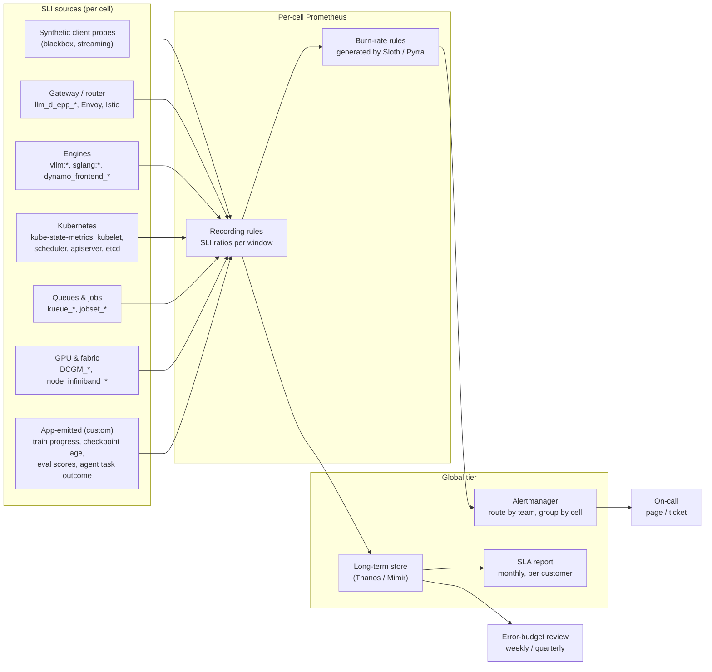

# SRE playbook: SLIs, SLOs & SLAs for AI workloads on Kubernetes

*2026-11-23 · hub page for the "SRE focus" section at the end of every lesson*

## What interviewers are really probing

Every lesson on this site ends with a short **SRE focus: SLIs, SLOs & SLAs** section that applies this page to that lesson's topic. This page is the reference those sections link back to.

The interview version: *"You run inference for 40 models, a training fleet of 20,000 GPUs and an agent platform, across 120 clusters. Product wants an SLA for the enterprise API. What do you measure, what do you promise, and what pages a human?"* Strong answers do five things:

- **Keep the three words apart.** An SLI is a measurement, an SLO is an internal target on that measurement, and an SLA is a contract with money attached. The SLA is always looser than the SLO.
- **Pick SLIs per workload type.** Online inference is judged per request and per token, batch inference per deadline, training per unit of useful progress, and the GPU fleet per healthy, schedulable accelerator. A single "uptime" number doesn't cover any of them.
- **Name the metric and where it's measured.** For example, `vllm:time_to_first_token_seconds` is measured inside the engine and never sees the gateway queue or the client's network. You should know what each metric can't see.
- **Alert on error budget burn, not thresholds.** Use multi-window burn-rate alerts generated from SLO specs (Sloth or Pyrra) and evaluated in the cell where the data lives.
- **Treat the SLO pipeline as a security boundary.** Labels leak tenants and prompts, a silenced alert hides an incident, and a tampered recording rule quietly turns a missed SLA into a met one.

Cross-links: [L21](/lessons/21-inference-serving-slos-ttft-tpot-kvcache) (TTFT/TPOT/goodput), [L23](/lessons/23-gpu-observability-dcgm-nccl-roofline) (DCGM, XIDs), [L28](/lessons/28-inference-autoscaling-scale-to-zero) (autoscaling and cold start), [L29](/lessons/29-training-reliability-checkpoint-elastic) (training goodput, checkpoints), [L35](/lessons/35-fleet-incident-response-gpu-inference-agent-runbooks) (incident response), [L49](/lessons/49-fleet-observability-pipelines-scale) (telemetry pipelines), [L50](/lessons/50-slo-error-budget-alerting-fleet-scale) (burn-rate alerting at fleet scale), [L56](/lessons/56-agent-observability-evaluation) (agent observability), [L61](/lessons/61-agent-platform-capstone-10k) (agent platform capstone).

## Core diagram: from metric to page to SLA report



## SLI vs SLO vs SLA

| | SLI | SLO | SLA |
|---|---|---|---|
| What it is | A ratio of good events to valid events, measured | An internal target for an SLI over a window | A contract: a promised level, a measurement method, and a remedy |
| Example (illustrative) | Share of chat requests with TTFT ≤ 1 s | 99% of requests over 28 rolling days | 99.5% monthly availability, or service credits |
| Owner | SRE / platform | Service owner and SRE together | Legal, product and finance, with SRE writing the measurement clause |
| When missed | Nothing by itself | Spend error budget: freeze risky changes, prioritise reliability work | Money or credits paid out, and possibly churn |

**The SLA clauses an SRE has to get right:**

- **Service credits.** The usual shape is tiered credits as a percentage of the monthly bill for that service, for example (illustrative) 10% below 99.5%, 25% below 99.0% and 100% below 95.0%. Credits are normally the *sole remedy* and must be claimed by the customer within a set period. Make sure the measurement can answer a claim per customer, not just fleet-wide.
- **Exclusions.** Announced maintenance windows; failures caused by the customer (invalid requests, 4xx); traffic over the customer's quota or rate limit; preview or beta models; force majeure; and outages of a dependency the customer chose, such as their own VPC. For AI APIs, also say how you treat content-filter refusals, `max_tokens` truncation (`finished_reason="length"`) and client disconnects. These are usually not failures.
- **Measurement window and unit.** Calendar month is typical for contracts, while internal SLOs usually use 28 or 30 rolling days. Decide whether you count *requests* (good requests / valid requests) or *time* ("a bad minute is one with more than X% errors"). Time-based clauses favour small customers, because one bad minute counts the same whatever the traffic.
- **Where it's measured.** "Measured at our gateway" and "as seen by the customer" give different numbers. Write down which one the contract uses.

**Why the SLA must be looser than the internal SLO:**

1. **Early warning.** With an SLO of 99.9% and an SLA of 99.5%, you see the burn and act before money is owed.
2. **Measurement differences.** The customer's vantage point, retries and clock skew mean your number and their number won't match exactly. The gap covers that.
3. **Budget to change things.** The space between the SLO and 100% is what lets you ship weights, engines and kernels. If the SLA equalled the SLO, every rollout would put money at risk.
4. **Correlated failures.** GPU fleets fail together (a firmware push, a fabric event, a region). The SLA has to survive the bad month, not the average one.

## Version notes: verified metric names (Nov 2026)

Metric names below were checked against source or docs on 2026-11-23:

- **vLLM v0.34.0** (`vllm/v1/metrics/loggers.py`). Labels are `model_name` and `engine`, with **no tenant label**. `vllm:corrupted_requests` exists only when `VLLM_COMPUTE_NANS_IN_LOGITS` is set.
- **SGLang v0.5.23** (`python/sglang/srt/observability/metrics_collector.py`).
- **NVIDIA Dynamo** frontend metrics (`dynamo_frontend_*`, from the Dynamo docs on main).
- **llm-d router (EPP)** `llm_d_epp_*`, from `docs/metrics.md` on main. Older Gateway API Inference Extension builds used `inference_objective_*` and `inference_pool_*`.
- **Kueue** metrics reference. `kueue_workload_recovery_wait_time_seconds` and `kueue_admitted_until_ready_wait_time_seconds` need `waitForPodsReady` turned on.
- **Kubernetes v1.37** metrics reference (apiserver, scheduler, kubelet, DRA) and **etcd** server metrics.
- **kube-state-metrics** docs. Extended resources are sanitised, so `nvidia.com/gpu` shows up as `resource="nvidia_com_gpu"`.
- **JobSet**: `jobset_failed_total` and `jobset_completed_total`.
- **kubernetes-sigs/agent-sandbox v1.0.12**: `agent_sandbox_claim_startup_latency_ms`, `agent_sandbox_creation_latency_ms` and `agent_sandbox_warmpool_size`.
- **OpenTelemetry GenAI semantic conventions**, now in their own `semantic-conventions-genai` repo and still at *development* stability: `gen_ai.server.time_to_first_token`, `gen_ai.execute_tool.duration` and `mcp.server.operation.duration`. Their Prometheus names depend on your translation setting. With the default suffixing, `gen_ai.execute_tool.duration` becomes `gen_ai_execute_tool_duration_seconds`.
- **LeaderWorkerSet:** `lws_group_recreations_total` and `lws_group_restart_budget_exhausted_total` were merged to main on 2026-11-15 and **aren't in the v1.0.0 release**. Until they ship, use kube-state-metrics on the StatefulSets that LWS creates.

**DCGM exporter 4.9.0 (released 2026-11-06) renamed the default metrics**, and some units changed with them. Lessons written before that use the 4.8.4 names. Check which version you're scraping before you copy a rule.

| dcgm-exporter ≤ 4.8.4 | 4.9.0+ | Unit change |
|---|---|---|
| `DCGM_FI_DEV_XID_ERRORS` (gauge, last XID) | `DCGM_FI_DEV_XID_ERROR` | — |
| `DCGM_FI_DEV_GPU_UTIL` | `DCGM_FI_DEV_GPU_UTIL_RATIO` | % → 0–1 |
| `DCGM_FI_DEV_FB_USED` | `DCGM_FI_DEV_FB_USED_BYTES` | MiB → bytes |
| `DCGM_FI_DEV_GPU_TEMP` | `DCGM_FI_DEV_GPU_TEMP_CELSIUS` | — |
| `DCGM_FI_DEV_POWER_USAGE` | `DCGM_FI_DEV_BOARD_POWER_WATTS` | — |
| `DCGM_FI_PROF_GR_ENGINE_ACTIVE` | `DCGM_FI_PROF_GR_ENGINE_UTIL_RATIO` | — |
| `DCGM_FI_PROF_PIPE_TENSOR_ACTIVE` | `DCGM_FI_PROF_TENSOR_UTIL_RATIO` | — |
| `DCGM_FI_DEV_ROW_REMAP_FAILURE` | `DCGM_FI_DEV_ROW_REMAP_FAILED` | — |
| `DCGM_FI_DEV_NVLINK_BANDWIDTH_TOTAL` | `DCGM_FI_DEV_NVLINK_THROUGHPUT_BYTES_PER_SECOND` | MB/s → B/s |

`DCGM_FI_DEV_XID_ERRORS` is a gauge holding the *last* XID code, so `rate()` on it means nothing. To get an XID *rate*, turn on the optional counter `DCGM_EXP_XID_ERRORS_TOTAL{xid}`, which is commented out in the default CSV. Its total restarts from zero when the exporter's collectors are rebuilt.

Anything below marked **custom** is a metric you emit yourself, because no standard exporter provides it. The name shown is an example, not a real upstream metric.

## SLI catalog by workload type

### Online inference (chat, completion, embeddings)

| SLI | Good event / valid event | Source | Notes |
|---|---|---|---|
| Availability | Requests not failed by the server / all valid requests | Gateway: `llm_d_epp_request_outcome_total`; engine: `vllm:request_success_total{finished_reason}` | Measure at the gateway. The engine never sees requests the router rejected. |
| TTFT | Requests with first token ≤ T / all requests | `vllm:time_to_first_token_seconds`, `sglang:time_to_first_token_seconds`, `llm_d_epp_request_ttft_seconds`, `dynamo_frontend_time_to_first_token_seconds` | T must be an exact bucket boundary. vLLM's TTFT buckets include 0.25, 0.5, 1.0 and 2.5 s. |
| TPOT / ITL | Token gaps ≤ T / all token gaps | `vllm:inter_token_latency_seconds` (one sample per token gap), `vllm:request_time_per_output_token_seconds` (one per request), `sglang:inter_token_latency_seconds` | The ITL histogram is token-weighted and the per-request TPOT histogram is request-weighted. They answer different questions. |
| E2E latency | Requests finished ≤ T / all | `vllm:e2e_request_latency_seconds`, `sglang:e2e_request_latency_seconds` | Only meaningful within an output-length class. Split by route or `max_tokens` class. |
| Goodput | Requests that met *every* latency SLO / all | Gateway or client, **per request** | Engine histograms can't be joined per request. Use router SLO counters (`llm_d_epp_request_slo_violation_total` from the SLO-aware plugin) or access logs. |
| Queue time | Requests queued ≤ T / all | `vllm:request_queue_time_seconds`, `sglang:queue_time_seconds`, `llm_d_epp_flow_control_request_queue_duration_seconds` | Leading indicator of TTFT burn. |
| Rejections / 429 | Rejected for saturation / all | `vllm:admission_rejections_total{reason}` (`max_num_queued_reqs`, `max_num_queued_tokens`), `llm_d_epp_request_outcome_total{outcome="rejected"}` | Count saturation rejections as bad. Decide by policy whether a tenant over its own quota counts. |
| Streaming stall | Token gaps ≤ 2.5 s / all gaps | `vllm:inter_token_latency_seconds_bucket{le="2.5"}`, plus a streaming client probe | Users read a stall as "it hung", even when the request succeeds. |
| Correctness | Requests without NaN logits or runaway repetition / all | `vllm:corrupted_requests_total` (opt-in), `vllm:request_success_total{finished_reason="repetition"}`, and a **custom** canary eval score | Quality is an SLI too. A quantised model that answers fast and wrong is an outage. |

```promql
# Availability at the router (5xx-class and saturation outcomes are bad; client 4xx excluded)
1 - (
  sum(rate(llm_d_epp_request_outcome_total{outcome=~"failed|evicted", reason!="ModelServerClientError"}[5m]))
  + sum(rate(llm_d_epp_request_outcome_total{outcome="rejected", reason="rejected-saturated"}[5m]))
) / sum(rate(llm_d_epp_request_outcome_total{outcome!="cancelled"}[5m]))

# TTFT SLI: share of requests with first token <= 1 s, per model (vLLM)
sum by (model_name) (rate(vllm:time_to_first_token_seconds_bucket{le="1.0"}[5m]))
/ sum by (model_name) (rate(vllm:time_to_first_token_seconds_count[5m]))

# ITL SLI (token-weighted): share of token gaps <= 100 ms
sum by (model_name) (rate(vllm:inter_token_latency_seconds_bucket{le="0.1"}[5m]))
/ sum by (model_name) (rate(vllm:inter_token_latency_seconds_count[5m]))

# Streaming stall rate: token gaps over 2.5 s
1 - sum(rate(vllm:inter_token_latency_seconds_bucket{le="2.5"}[5m]))
  / sum(rate(vllm:inter_token_latency_seconds_count[5m]))

# Engine-side errors (FinishReason.ERROR is always turned into a 500)
sum by (model_name) (rate(vllm:request_success_total{finished_reason="error"}[5m]))
/ sum by (model_name) (rate(vllm:request_success_total[5m]))

# Queue pressure (leading indicator): p95 queue time and waiting-by-reason
histogram_quantile(0.95, sum by (le, model_name) (rate(vllm:request_queue_time_seconds_bucket[5m])))
sum by (model_name, reason) (vllm:num_requests_waiting_by_reason)
```

### Batch inference (offline scoring, eval sweeps, batch APIs)

Batch work is judged by **deadline and completeness**, not latency percentiles. A 24-hour batch API that finishes in 23 hours is meeting its SLO, however slow each request was.

| SLI | Source |
|---|---|
| Batches completed within the deadline / batches submitted | **custom** (for example `batch_jobs_completed_within_deadline_total`), or `kube_job_status_completion_time - kube_job_status_start_time` per Job |
| Items succeeded / items submitted | **custom** per-batch counters. Engine `vllm:request_success_total` gives the engine-side view. |
| Admission wait | `kueue_admission_wait_time_seconds` per ClusterQueue |
| Throughput against plan | `rate(vllm:generation_tokens_total[1h])` and `rate(vllm:prompt_tokens_total[1h])` compared with the tokens/hour the deadline needs |
| Failed Jobs | `kube_job_status_failed`, `jobset_failed_total` |

```promql
# Seconds each finished batch Job took (compare with its deadline)
kube_job_status_completion_time - kube_job_status_start_time
# p95 admission wait for the batch queue
histogram_quantile(0.95, sum by (le) (rate(kueue_admission_wait_time_seconds_bucket{cluster_queue="batch-infer"}[1h])))
```

### Training

| SLI | Definition | Source |
|---|---|---|
| Job goodput | Productive training time ÷ wall-clock time the job held its GPUs | **custom**: step-progress counter (for example `train_steps_committed_total`), minus steps redone after a restart |
| MFU / effective training time | Achieved FLOP/s ÷ peak, or the share of time in steps that weren't redone | **custom** from the trainer. `DCGM_FI_PROF_PIPE_TENSOR_ACTIVE` is a hardware proxy, not MFU. |
| Checkpoint success | Checkpoints committed (commit marker written) ÷ attempted | **custom** (for example `checkpoint_commits_total{result}`) |
| Checkpoint age | `time()` − last committed checkpoint timestamp | **custom** gauge (for example `checkpoint_last_commit_timestamp_seconds`) |
| Time to recover | Failure to the first step after resume | `kueue_workload_recovery_wait_time_seconds` (needs waitForPodsReady), plus **custom** first-step-after-resume time |
| Queue / admission wait | Created or requeued until admitted | `kueue_admission_wait_time_seconds`, `kueue_pending_workloads{status}` |
| Preemption / eviction rate | Evictions per ClusterQueue and reason | `kueue_evicted_workloads_total{reason}`, `kueue_preempted_workloads_total{reason}` |
| Job failure | Failed JobSets / Jobs | `jobset_failed_total`, `kube_job_status_failed` |

```promql
# Checkpoint age SLI: share of running jobs whose last checkpoint is <= 30 min old (custom gauge)
count((time() - checkpoint_last_commit_timestamp_seconds) <= 1800)
/ count(checkpoint_last_commit_timestamp_seconds)

# Evictions by reason per ClusterQueue
sum by (cluster_queue, reason) (rate(kueue_evicted_workloads_total[1h]))
```

### GPU fleet / platform

| SLI | Source |
|---|---|
| Healthy, schedulable GPUs ÷ capacity | `kube_node_status_allocatable{resource="nvidia_com_gpu"}`, `kube_node_status_capacity{resource="nvidia_com_gpu"}`, `kube_node_spec_unschedulable`, `kube_node_status_condition` |
| XID rate | `DCGM_EXP_XID_ERRORS_TOTAL{xid}` (opt-in), or `changes(DCGM_FI_DEV_XID_ERRORS[1h]) > 0` |
| Memory health | `DCGM_FI_DEV_ROW_REMAP_FAILURE` / `DCGM_FI_DEV_UNCORRECTABLE_REMAPPED_ROWS` (4.8.4 names) |
| Node ready | `kube_node_status_condition{condition="Ready",status="true"}` |
| Image / model pull and cold start | `kubelet_image_pull_duration_seconds` (alpha); `kubelet_pod_start_sli_duration_seconds` (**excludes** image pulls and init containers, so it hides weight hydration); full creation→Ready from `kube_pod_status_ready_time - kube_pod_created`; `karpenter_pods_startup_duration_seconds` when Karpenter provisions the node |
| Scheduling latency | `scheduler_pod_scheduling_sli_duration_seconds`, `scheduler_pending_pods`, and `kueue_admission_wait_time_seconds` for queued work |
| DRA claim preparation | `dra_operations_duration_seconds`, `dra_grpc_operations_duration_seconds` |

```promql
# Healthy-GPU ratio per cluster: allocatable GPUs on Ready, schedulable nodes / installed GPUs
sum by (cluster) (
  kube_node_status_allocatable{resource="nvidia_com_gpu"}
  * on (cluster, node) group_left() (kube_node_status_condition{condition="Ready", status="true"} == 1)
  * on (cluster, node) group_left() (kube_node_spec_unschedulable == 0)
)
/ sum by (cluster) (kube_node_status_capacity{resource="nvidia_com_gpu"})

# Nodes that saw a new XID in the last 10 minutes (works on 4.8.4 gauge semantics)
count by (cluster) (changes(DCGM_FI_DEV_XID_ERRORS[10m]) > 0)
```

### Agent platform

| SLI | Source |
|---|---|
| Task success (the agent reached a terminal success state) | **custom** outcome counter at the agent runtime (for example `agent_tasks_total{outcome}`), with outcomes graded by an eval job ([L56](/lessons/56-agent-observability-evaluation)) |
| Sandbox ready time | `agent_sandbox_claim_startup_latency_ms`, `agent_sandbox_creation_latency_ms`, and warm-pool depth from `agent_sandbox_warmpool_size{sandbox_status="ready"}` |
| Tool-call error rate | `gen_ai.execute_tool.duration` with its `error.type` attribute, `mcp.server.operation.duration` / `mcp.client.operation.duration` (OTel semconv, development) |
| Model-call latency as the agent sees it | `gen_ai.client.operation.duration`, `gen_ai.client.inference.time_to_first_chunk` (OTel semconv, development) |
| Durable-execution health | `temporal_workflow_failed`, `temporal_workflow_endtoend_latency`, `temporal_activity_schedule_to_start_latency` (Temporal SDK metrics) |

```promql
# Sandbox claim p95 (ms) per template
histogram_quantile(0.95, sum by (le, sandbox_template) (rate(agent_sandbox_claim_startup_latency_ms_bucket[5m])))
# Tool-call error ratio (OTel -> Prometheus with default suffixes; check your translation strategy)
sum(rate(gen_ai_execute_tool_duration_seconds_count{error_type!=""}[5m]))
/ sum(rate(gen_ai_execute_tool_duration_seconds_count[5m]))
```

### Control plane

| SLI | Source |
|---|---|
| API latency (the upstream SLO excludes webhook and priority-and-fairness wait) | `apiserver_request_sli_duration_seconds` |
| API errors | `apiserver_request_total{code=~"5.."}` |
| Priority-and-fairness rejections / queue wait | `apiserver_flowcontrol_rejected_requests_total`, `apiserver_flowcontrol_request_wait_duration_seconds` |
| Admission latency | `apiserver_admission_webhook_admission_duration_seconds`, `apiserver_validating_admission_policy_check_duration_seconds` |
| etcd | `etcd_server_has_leader`, `etcd_server_leader_changes_seen_total`, `etcd_disk_wal_fsync_duration_seconds`, `etcd_disk_backend_commit_duration_seconds`, `etcd_mvcc_db_total_size_in_bytes` vs `etcd_server_quota_backend_bytes` |

```promql
# Mutating API calls served within 1 s (resource-scoped), per cluster
sum by (cluster) (rate(apiserver_request_sli_duration_seconds_bucket{verb=~"POST|PUT|PATCH|DELETE", le="1"}[5m]))
/ sum by (cluster) (rate(apiserver_request_sli_duration_seconds_count{verb=~"POST|PUT|PATCH|DELETE"}[5m]))
# etcd fsync p99 (keep under ~10 ms on healthy disks)
histogram_quantile(0.99, sum by (le, instance) (rate(etcd_disk_wal_fsync_duration_seconds_bucket[5m])))
```

## Example SLO tables (examples, not recommendations)

**These targets are illustrative.** Real numbers come from measured baselines, what users notice, and what the capacity can carry.

| Workload | SLI | Example target | Window |
|---|---|---|---|
| Interactive chat (tier-1 model) | Availability at the router | 99.9% | 28 days rolling |
| Interactive chat | TTFT ≤ 1.0 s | 99% of requests | 28 days |
| Interactive chat | ITL ≤ 100 ms | 99% of token gaps | 28 days |
| Interactive chat | Streaming stalls > 2.5 s | ≤ 0.1% of token gaps | 28 days |
| Code completion | TTFT ≤ 0.25 s | 95% | 28 days |
| Embeddings | E2E ≤ 0.5 s | 99% | 28 days |
| Batch API | Completed within 24 h | 99% of batches | calendar month |
| Training (frontier run) | Job goodput | ≥ 90% weekly | 7 days |
| Training | Checkpoint age ≤ 30 min | 99% of minutes | 7 days |
| GPU fleet | Healthy schedulable GPUs ≥ planned reserve | 99.5% of 5-minute intervals | 30 days |
| Agent platform | Sandbox claim ≤ 2 s | 99% | 28 days |
| Control plane | Mutating API calls ≤ 1 s | 99% | 28 days |

**Example SLA (contract) for the same chat API:** 99.5% monthly availability measured at the provider's gateway, request-based, with 4xx, over-quota 429s, preview models and announced maintenance excluded. Credits are tiered as shown above. Note the gap from the internal SLO of 99.9%.

## Error budgets & multi-window burn-rate alerts

The error budget is 1 − SLO. At 99.9% over 30 days, that's **43.2 minutes** of total outage, or 0.1% of requests. Burn rate is how fast you're spending it: a rate of 1 spends exactly the budget over the window.

| Severity | Long window | Short window | Burn rate | Budget spent when it fires |
|---|---|---|---|---|
| Page | 1 h | 5 m | 14.4 | 2% |
| Page | 6 h | 30 m | 6 | 5% |
| Ticket | 1 d | 2 h | 3 | 10% |
| Ticket | 3 d | 6 h | 1 | 10% |

This is the standard table from the Google SRE Workbook. The short window is 1/12 of the long one, so the alert stops firing soon after the problem does. Sloth and Pyrra generate all these rules from one spec, so nobody hand-writes them for 40 models across 120 clusters.

**Sloth:** availability at the router plus TTFT for one model.

```yaml
apiVersion: sloth.slok.dev/v1
kind: PrometheusServiceLevel
metadata:
  name: chat-llama-70b
  namespace: monitoring
spec:
  service: "chat-api"
  labels:
    owner: "inference-sre"
    tier: "1"
  slos:
    - name: "availability"
      objective: 99.9            # example target
      description: "Router-measured availability; client 4xx and cancels excluded."
      sli:
        events:
          errorQuery: |
            sum(rate(llm_d_epp_request_outcome_total{model_name="llama-70b",outcome=~"failed|evicted",reason!="ModelServerClientError"}[{{.window}}]))
            + sum(rate(llm_d_epp_request_outcome_total{model_name="llama-70b",outcome="rejected",reason="rejected-saturated"}[{{.window}}]))
          totalQuery: |
            sum(rate(llm_d_epp_request_outcome_total{model_name="llama-70b",outcome!="cancelled"}[{{.window}}]))
      alerting:
        name: ChatLlama70bAvailabilityBurn
        labels: { team: inference-sre }
        pageAlert:   { labels: { severity: page } }
        ticketAlert: { labels: { severity: ticket } }
    - name: "ttft-1s"
      objective: 99.0            # example target
      description: "Requests whose first token arrives within 1.0 s (engine-measured)."
      sli:
        events:
          errorQuery: |
            sum(rate(vllm:time_to_first_token_seconds_count{model_name="llama-70b"}[{{.window}}]))
            - sum(rate(vllm:time_to_first_token_seconds_bucket{model_name="llama-70b",le="1.0"}[{{.window}}]))
          totalQuery: |
            sum(rate(vllm:time_to_first_token_seconds_count{model_name="llama-70b"}[{{.window}}]))
      alerting:
        name: ChatLlama70bTTFTBurn
        labels: { team: inference-sre }
        pageAlert:   { labels: { severity: page } }
        ticketAlert: { labels: { severity: ticket } }
```

**Pyrra:** token-weighted ITL using a latency indicator. The `le` value must match a bucket boundary exactly.

```yaml
apiVersion: pyrra.dev/v1alpha1
kind: ServiceLevelObjective
metadata:
  name: chat-llama-70b-itl
  namespace: monitoring
  labels:
    prometheus: k8s
    role: alert-rules
    pyrra.dev/team: inference-sre
spec:
  target: "99"                   # example target
  window: 4w
  description: "99% of token gaps <= 100 ms (token-weighted)."
  indicator:
    latency:
      success:
        metric: vllm:inter_token_latency_seconds_bucket{model_name="llama-70b",le="0.1"}
      total:
        metric: vllm:inter_token_latency_seconds_count{model_name="llama-70b"}
```

**Rules that make burn-rate alerts trustworthy:**

- **Guard against missing data.** An SLI with no traffic reads as NaN, and an SLI with a dead scrape reads as "no errors". Pair every SLO with `absent()` or `up == 0` alerts and a dead-man's switch outside the cell.
- **Set a minimum request rate.** At 3 requests an hour, one failure burns at 300×. Suppress pages below a traffic floor and use a probe-based SLI instead.
- **Evaluate in the cell, aggregate globally.** Burn rules run next to the data. The global tier only reads recorded ratios, so a WAN partition doesn't page every cell.
- **Change freezes are policy, not alerts.** An exhausted budget should block risky rollouts, enforced by Argo Rollouts analysis or a deploy gate that reads the remaining budget.

## Measuring per tenant, per model, and per token

- **Per model:** vLLM and SGLang label by `model_name` (served model name), so a LoRA adapter can share the base model's label. Use `vllm:lora_requests_info` or router labels to split it.
- **Per tenant:** engines have **no tenant label**, and you shouldn't add one there. The router has it: `llm_d_epp_*` metrics carry `fairness_id`, and `llm_d_epp_fairness_id_overflow_total` counts tenants folded into an overflow bucket. Compute tenant SLIs and SLA reports from router series or access logs.
- **Request-weighted vs token-weighted:** a request SLI treats a 20-token reply and a 4,000-token essay the same. The ITL histogram is already token-weighted, because it records one sample per token gap. A token-weighted *availability* SLI ("share of requested tokens that were served") needs per-request logs with token counts.
- **Averages lie.** Mean TTFT hides the long-prompt tail, and mean GPU utilisation hides the 30% of GPUs stuck in an NCCL hang. Use ratios against a threshold (good events / valid events). Use percentiles only from histograms aggregated *before* `histogram_quantile`, and never average percentiles across pods.
- **Server-side vs client-side.** Engine histograms start inside the server process and miss the gateway queue, TLS, WAN, and a client that stalls on a slow reader. `llm_d_epp_request_ttft_seconds` adds the router's view. Only a **synthetic streaming probe** from outside the cell measures what users see. Run one per region per tier-1 model, and keep its traffic labelled so it can be excluded from capacity math.
- **Synthetic probes:** fixed prompt, fixed `max_tokens`, `stream=true`, recording first-chunk time and the largest gap between chunks. Probes catch total outages and DNS or cert failures. They don't represent the real prompt-length mix.
- **Cardinality:** `model × engine × tenant × route × le` grows fast. vLLM's TTFT histogram alone has about 20 buckets. Precompute SLI ratios with recording rules, drop unused buckets at scrape time, and never put unbounded values (request ID, user, prompt hash) in labels. Put them in exemplars or traces.

## Capacity and SLO coupling

- **Little's law sets concurrency:** in-flight requests ≈ arrival rate × e2e latency. If latency doubles, the same QPS needs twice the KV seats. That's why TTFT and TPOT burns come in pairs.
- **KV cache is the seat count.** Once `vllm:kv_cache_usage_perc` approaches 1, preemptions (`vllm:num_preemptions_total`) and queue time (`vllm:request_queue_time_seconds`) rise, and TTFT burns next. Alert on burn. Scale on the leading signals: `vllm:num_requests_waiting`, KV usage, and queue time.
- **Headroom is an SLO input.** For N+1 across cells, each cell must absorb a neighbour's traffic without breaking the TTFT SLO. Measure the knee (the load where p99 TTFT leaves the SLO) with a load test, and plan to stay below it with one cell lost.
- **Healthy GPUs vs planned reserve.** The fleet SLI that pages is "allocatable healthy GPUs fell below the reserve the serving SLOs were sized on". A single bad GPU doesn't page.
- **Speculation and quantisation change capacity.** Acceptance rate (`vllm:spec_decode_num_accepted_tokens_total` ÷ `vllm:spec_decode_num_draft_tokens_total`) is a capacity number, as covered in [L73](/lessons/73-quantized-speculative-serving-platform).
- **Cold start eats budget.** Scale-from-zero turns pull time plus weight load plus CUDA graph capture into TTFT for the first users. Either count it in the SLO or keep warm minimums ([L28](/lessons/28-inference-autoscaling-scale-to-zero)).

## Toil, on-call and runbook focus

**Page on symptoms, ticket on causes.** TTFT burn, availability burn, training job goodput collapse and healthy-GPU reserve breach page. A single XID, one hot GPU, or one failed pull is a ticket, an automated remediation, or both.

Every paging alert links to a runbook with a first safe lever. Examples:

- drain a cell at the router
- roll back the engine image
- lower `max_num_seqs`
- step speculative `k` down
- requeue from the last checkpoint
- fail over the inference pool

**What an SRE watches:**

| Cadence | Watch |
|---|---|
| Daily | Budget remaining per tier-1 SLO, overnight pages and whether each one was actionable, healthy-GPU ratio versus reserve, stuck or queued training jobs (`kueue_pending_workloads{status="inadmissible"}`), failed checkpoints, cert and token expiry within 14 days |
| Weekly | Error-budget review per service, top budget burners (by model, cell, release), alert precision (actionable pages ÷ all pages), toil hours, probe-vs-server latency drift, cardinality growth (`prometheus_tsdb_head_series`) |
| Quarterly | Re-baseline SLO targets against user research and capacity, SLA performance per customer and credits paid, game days ([L37](/lessons/37-chaos-engineering-dr-game-days-gpu-inference)), retire SLOs nobody uses, review exclusions and measurement clauses with legal and product |

**Reducing toil:** let automation handle per-node faults ([L39](/lessons/39-gpu-fleet-lifecycle-acceptance-burn-in-rma)), generate rules from SLO specs, test every runbook in game days, and give every recurring page an owner and a ticket to delete it.

## Security & hardening for SLO telemetry

- **No prompts, completions, user IDs, emails, API keys or file paths in labels.** Labels are indexed, replicated, kept for months and visible to anyone with query access. Put request-level detail in traces with sampling and redaction, and keep trace IDs only in exemplars.
- **Bound tenant labels and scope who sees them.** A dashboard that lists every `fairness_id` tells one customer who the others are. Give tenants their own SLI views through a query proxy that enforces a label matcher (for example prom-label-proxy) or a per-tenant Mimir/Thanos org.
- **Allowlist pod-label enrichment.** dcgm-exporter 4.9.0 *requires* a non-empty allowlist when pod labels are on. In 4.8.4 an empty allowlist copied every pod label onto GPU metrics.
- **Authenticate scrapes.** The llm-d EPP authenticates `/metrics` with TokenReview and SubjectAccessReview by default (`--metrics-endpoint-auth`). Keep it on, and use kube-rbac-proxy or mTLS for engines. An open `/metrics` endpoint leaks model names, traffic volume and capacity.
- **Protect the monitoring stack like production:**
  - Treat write access to PrometheusRule, Sloth or Pyrra CRDs and Alertmanager silences as privileged.
  - Changing an SLO rule or silencing a burn alert is the cheapest way to hide an incident or an exfiltration.
  - Use GitOps with review for rule changes, audit-logged silences with a maximum duration, and separate RBAC for SLO definitions.
- **SLO data integrity:**
  - Have `remote_write` use TLS and per-cell credentials.
  - Keep SLA reports in a write-once long-term store.
  - Recompute SLA numbers from raw series rather than editable dashboards.
  - Make sure the cell that is down can't vouch for itself: use an external probe and a dead-man's switch.
- **Don't let SLIs be gamed.** If clients can set `X-Request-Id`, cache salts or priority headers, they can skew per-tenant SLIs or dodge rejection counters. Strip and re-set those headers at the gateway ([L71](/lessons/71-rack-scale-inference-nvl72-disagg-wide-ep)).
- **Keep probes low-privilege.** Synthetic probes get their own API key, quota and tenant label, and can call only one model and endpoint. A leaked probe key must not be an admin key.

## Interview soundbites

- **"An SLI is a ratio, an SLO is a target, and an SLA is a contract with credits. I keep the SLA looser than the SLO so we see the burn before we owe money."**
- **"TTFT from the engine never sees the gateway queue. I page on the router's number and check it against an outside streaming probe."**
- **"The ITL histogram is token-weighted and the per-request TPOT histogram isn't. Pick one on purpose."**
- **"Goodput means a request met every latency SLO. You can't get that from two histograms; it needs a per-request join at the router."**
- **"vLLM has no tenant label, and that's correct. Tenant SLIs come from the router's fairness ID, bounded and access-controlled."**
- **"One bad GPU is a ticket and an automated cordon. Healthy GPUs falling below the reserve the SLO was sized on is a page."**
- **"Training is judged on goodput and checkpoint age, not pod uptime."**
- **"Write access to an SLO rule is write access to the truth. Silences and rule changes are audited like production changes."**

## Watch (talks & demos)

### SLIs, SLOs, SLAs, oh my! (class SRE implements DevOps)

Liz Fong-Jones and Seth Vargo on the three terms, why the SLA sits below the SLO, and how error budgets settle the argument between shipping and reliability.

<iframe width="100%" height="360" src="https://www.youtube.com/embed/tEylFyxbDLE" title="SLIs, SLOs, SLAs, oh my! (class SRE implements DevOps)" frameBorder="0" allow="accelerometer; autoplay; clipboard-write; encrypted-media; gyroscope; picture-in-picture; web-share" allowFullScreen></iframe>

[Open on YouTube](https://www.youtube.com/watch?v=tEylFyxbDLE)

### Dashboards & Dragons: Crafting SLOs To Tame the AI Platform Chaos (KubeCon EU 2025)

Alexa Griffith and Ankita Chaudhari on building TTFT, ITL and availability SLOs for a multi-cluster inference platform with KServe, Envoy, OpenTelemetry and Prometheus, plus burn-rate alert tuning.

<iframe width="100%" height="360" src="https://www.youtube.com/embed/KyoxaAtHi-c" title="Dashboards & Dragons: Crafting SLOs To Tame the AI Platform Chaos" frameBorder="0" allow="accelerometer; autoplay; clipboard-write; encrypted-media; gyroscope; picture-in-picture; web-share" allowFullScreen></iframe>

[Open on YouTube](https://www.youtube.com/watch?v=KyoxaAtHi-c)

### SLO-Based Observability For All Kubernetes Cluster Components (KubeCon NA 2022)

Matthias Loibl and Nadine Vehling on generating Pyrra SLOs and multi-burn-rate alerts for the API server, kubelet and CoreDNS, the control-plane half of this page.

<iframe width="100%" height="360" src="https://www.youtube.com/embed/AC38JtXXE50" title="SLO-Based Observability For All Kubernetes Cluster Components" frameBorder="0" allow="accelerometer; autoplay; clipboard-write; encrypted-media; gyroscope; picture-in-picture; web-share" allowFullScreen></iframe>

[Open on YouTube](https://www.youtube.com/watch?v=AC38JtXXE50)

## References

- Google SRE: [Service Level Objectives](https://sre.google/sre-book/service-level-objectives/) · [Alerting on SLOs (multi-window, multi-burn-rate)](https://sre.google/workbook/alerting-on-slos/) · [Implementing SLOs](https://sre.google/workbook/implementing-slos/)
- SLO tooling: [Sloth](https://github.com/slok/sloth) · [Pyrra](https://github.com/pyrra-dev/pyrra) · [OpenSLO](https://github.com/OpenSLO/OpenSLO)
- Engines: [vLLM metrics design](https://docs.vllm.ai/en/latest/design/metrics.html) · [vLLM loggers.py (v0.34.0)](https://github.com/vllm-project/vllm/blob/v0.34.0/vllm/v1/metrics/loggers.py) · [SGLang production metrics](https://github.com/sgl-project/sglang/blob/main/docs/docs/references/production_metrics.mdx) · [NVIDIA Dynamo metrics](https://github.com/ai-dynamo/dynamo/tree/main/docs)
- Routing: [llm-d router metrics](https://github.com/llm-d/llm-d-inference-scheduler/blob/main/docs/metrics.md) · [Gateway API Inference Extension](https://gateway-api-inference-extension.sigs.k8s.io/)
- Kubernetes: [Metrics reference](https://kubernetes.io/docs/reference/instrumentation/metrics/) · [Scalability SLIs/SLOs](https://github.com/kubernetes/community/blob/master/sig-scalability/slos/slos.md) · [kube-state-metrics](https://github.com/kubernetes/kube-state-metrics/tree/main/docs/metrics) · [Kueue metrics](https://kueue.sigs.k8s.io/docs/reference/metrics/) · [etcd mixin alerts](https://github.com/etcd-io/etcd/tree/main/contrib/mixin)
- GPU: [dcgm-exporter default-counters.csv](https://github.com/NVIDIA/dcgm-exporter/blob/main/etc/default-counters.csv) · [DCGM Exporter 4.9.0 release notes](https://github.com/NVIDIA/dcgm-exporter/releases/tag/4.9.0)
- Agents: [OpenTelemetry GenAI semantic conventions](https://github.com/open-telemetry/semantic-conventions-genai) · [agent-sandbox metrics](https://github.com/kubernetes-sigs/agent-sandbox)
- Prior: [21 — Serving SLOs](/lessons/21-inference-serving-slos-ttft-tpot-kvcache) · [23 — GPU observability](/lessons/23-gpu-observability-dcgm-nccl-roofline) · [28 — Autoscaling](/lessons/28-inference-autoscaling-scale-to-zero) · [29 — Training reliability](/lessons/29-training-reliability-checkpoint-elastic) · [35 — Incident response](/lessons/35-fleet-incident-response-gpu-inference-agent-runbooks) · [49 — Observability pipelines](/lessons/49-fleet-observability-pipelines-scale) · [50 — SLO alerting](/lessons/50-slo-error-budget-alerting-fleet-scale) · [56 — Agent observability](/lessons/56-agent-observability-evaluation) · [61 — Agent capstone](/lessons/61-agent-platform-capstone-10k)

## Quick self-check

Out loud, in under two minutes each:

1. Explain SLI vs SLO vs SLA for a chat API, including one exclusion and one credit tier, and why the SLA target is lower.
2. Write the PromQL for "99% of requests get a first token within 1 s" from vLLM, and say what the engine number can't see.
3. Why does an ITL SLO built on `vllm:inter_token_latency_seconds` weight long answers more than short ones? When do you want that?
4. A tenant claims you missed their SLA, but your fleet SLO is green. Which data do you use, and where must it come from?
5. Derive the 14.4× burn rate for 99.9% over 30 days, and say what the 5-minute short window buys you.
6. Name three training SLIs that aren't pod uptime, and say which are custom metrics you'd have to emit.
7. dcgm-exporter was upgraded to 4.9.0 and your XID dashboard went flat. What happened?
8. Give two ways an attacker or careless insider could make a missed SLO look met, and the control for each.
